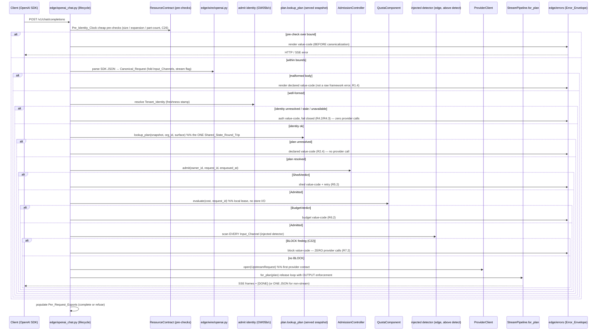

# Design Document

## Overview

GW15 lands the **real** OpenAI-compatible chat/completions surface. It replaces the thin wiring proof in `gateway_v2/gateway_v2/edge/routes.py` `ChatRoute` with the full `/v1/chat/completions` and `/v1/completions` handler — streaming AND non-streaming — and fills the currently-empty `gateway_v2/gateway_v2/edge/openai_chat.py` (`__all__ = ()`) with the chat-surface adapter plus the §10.4 request lifecycle orchestration.

Every pipeline mechanism GW15 drives is **already shipped**. The thin proof today runs the pipeline in PASS-THROUGH mode (`enforcing_output=False`) over a `_DEFAULT_DESTINATION` with an `_EMPTY_BODY`, because no resolved `ExecutionPlan` exists yet. GW15 removes exactly three deferrals and nothing else about the proven streaming orchestration:

1. `_EMPTY_BODY` → a real `UpstreamRequest.body` produced from the parsed SDK request via `Transform.to_provider`.
2. `_DEFAULT_DESTINATION` → the plan-derived destination from `DispatchRouter.select(plan)`.
3. `enforcing_output=False` → `StreamPipeline.for_plan(plan, ...)`, which resolves the enforcing-output set ONCE before the first chunk via `output_guard.enforcing_output_rules(plan)` and raises `EnforcementUndetermined` (fail closed) on an unresolved plan.

Around those three substitutions GW15 adds the full §10.4 request lifecycle in front of the stream: cheap pre-identity pre-checks, SDK JSON parsing + input-channel folding, auth + tenant identity, the ONE shared-state round trip (plan resolution), admission, budget, and the INPUT scan with a BLOCK short-circuit that opens zero provider streams. The non-streaming path collects the full upstream and renders ONE OpenAI-compatible JSON response through the single `edge/errors` path.

### Why this card exists — the channel tests (C21)

The v2.1 prototype PASSED SDK acceptance but FAILED the channel tests, so they are now first-class. `domain/channels.py` already enumerates the pinned text-bearing fields (`TEXT_CHANNELS`): `messages[].content`, `messages[].content[].text`, `messages[].tool_calls[].function.arguments`, `messages[].function_call.arguments`, and the output-side `choices[].message.content` / `refusal` / `reasoning_content` / `tool_calls[].function.arguments` / `logprobs` / structured output. GW15's input-channel folding enumerates every input `TextChannel` out of the parsed request into scannable text so a canary in ANY field is scanned, and the output path scans every output `TextChannel` on released bytes. A canary under BLOCK in any input field ⇒ zero provider calls; a canary under REDACT in any output field ⇒ reaches the client zero times.

### Grounding in actual shipped code

| Shipped seam | File:symbol | How GW15 uses it |
| --- | --- | --- |
| Streaming orchestration (REUSED verbatim) | `edge/routes.py::ChatRoute._stream` / `_run_attempts` / `_finish_stream` / `_next_attempt` / `_as_chunks` | Kept unchanged: `Coalescer` fail-closed admit, `StreamPipeline` run loop, `SSEEncoder`, `FirstByteLatch` no-splice, `InFlightControl`, `StreamTimeouts`, `ScanExecutor` offloaded error-frame scan, single terminal site. GW15 feeds it a real plan/destination/body. |
| Plan-aware pipeline build (REPLACES pass-through) | `egress/stream.py::StreamPipeline.for_plan(plan, ...)` | Replaces `ChatRoute._build_pipeline`'s `StreamPipeline(..., enforcing_output=False)`. Raises `EnforcementUndetermined` on `PlanUnavailable`/`PlanUnknownTenant`/`Undetermined` (R2.4). |
| Plan resolution (the ONE round trip) | `plan/__init__.py::lookup_plan(snapshot, org_id, surface)`, `applicable_rules`, `ReplicaSnapshot` | The single `Shared_State_Round_Trip`: read the served replica snapshot (GW05b/c) once per request (R3.3). |
| Destination selection (REPLACES `_DEFAULT_DESTINATION`) | `dispatch/routing.py::DispatchRouter.select(plan)` | Pure, deterministic plan→destination (R2.2). |
| Request shaping | `dispatch/transform.py::Transform.to_provider` / `.from_provider`, `GatewayRequest`, `BODY_MODEL_KEY`/`BODY_DELTAS_KEY` | `GatewayRequest` ← parsed request; `to_provider` packs the body; `from_provider` carries tool-call fragments through the `text_deltas` transport. |
| Provider seam | `dispatch/provider.py::ProviderClient` (protocol), `StubProviderClient`, `UpstreamRequest`, `UpstreamEvent` | `StubProviderClient` stays the injected test seam; the real socket is a DEFERRED live gate (R11.3). |
| Output enforcement | `egress/output_guard.py::OutputResolver`, `MinimalOutputResolver`, `enforcing_output_rules`, `apply_decision`, `OutputBlocked` | Wired (not rebuilt). `most_restrictive` composition = C22. Non-stream path calls `apply_decision` directly. |
| Admission | `admit/__init__.py::AdmissionController` (`.admit(owner_id, request_id, enqueued_at)` async → `Admitted`\|`ShedVerdict`), `shed_retry_after_s`, `derive_bounds`, `AdmissionBounds` | Called after identity; a `ShedVerdict` renders through the envelope (R5.2). |
| Budget | `admit/quota.py::QuotaComponent.evaluate(cost, *, request_id)` async → `BudgetVerdict`\|`Admitted` | Called after admit; local lease spend, no request-path store I/O (R6.3). |
| Identity + freshness | `admit/identity.py::principal_of`, `IdentityCache`, `identity_applier`; `admit/killswitch.py` | GW05b/c freshness stamp gates trust; stale/unavailable ⇒ fail closed (R4.3). |
| Input / error-frame scanner shape | `edge/error_frame_scan.py::ErrorFrameScanner = Callable[[str], Sequence[Finding]]` | The SAME injected findings-callable shape GW15 uses for the input scan; the real GW07/GW08 detector satisfies it unchanged. |
| Channel enumeration (C21) | `domain/channels.py::TEXT_CHANNELS`, `TextChannel`, `unscanned_channels` | The authoritative input/output channel list the folding model walks. |
| Error envelope | `edge/errors.py::render_http`, `render_sse`, `render_not_implemented`, `HTTPResponse`, `render` | The ONE value-code → HTTP/SSE boundary (R12). |
| Per-request exports | `runtime/stream_metrics.py::PerRequestExports` (+ `edge/` counters/rates/windowed/event_log/readiness, GW14d) | Populated on complete/refuse; `fail_open_total` pinned 0; no raw content (R14). |
| Request/plan value types | `domain/__init__.py::ExecutionPlan`, `RequestContext`, `Finding`, `Decision`, `Surface`, `Phase`, `PlanUnavailable`, `PlanUnknownTenant` | The canonical/plan vocabulary; `RequestContext` carries `request_id`/`org_id`/`phase`/`input_text`/`findings`/`plan_version`. |

### Critical layer constraint

The import-linter `layers` contract is `edge > admit > plan > detect > resolve > dispatch > egress > audit > runtime > contracts > domain`. `edge` sits at the top and may import every layer below, so the chat handler is the ONE correct injection site for the detection scanner and the `ProviderClient` — `egress` MUST NOT import `detect` (R7.5/R14.1). GW15 keeps the shipped discipline exactly: the input/output scanners and the resolver are injected into `ChatRoute` (in `edge`) and threaded down into the shipped `StreamPipeline`; `egress` never names `detect`.

## Architecture

### Layer map and component placement

```mermaid
graph TD
    subgraph edge["edge/ (top layer — the ONLY place HTTP/SSE is rendered)"]
        OC["openai_chat.py (NEW)<br/>Chat_Surface adapter + §10.4 lifecycle orchestration"]
        WIRE["wire/openai.py (NEW)<br/>SDK JSON ↔ Canonical_Request, channel folding, non-stream JSON render"]
        RT["routes.py (MODIFY)<br/>ChatRoute real deps + build_routes"]
        APP["app.py (MODIFY)<br/>boot wiring: build ChatRoute once"]
        ERR["errors.py (SHIPPED)<br/>Error_Envelope: value-code → HTTP/SSE"]
        SSE["wire/sse.py (SHIPPED)<br/>SSEEncoder / error_frame_for"]
        CANCEL["cancel.py / stream_control.py / stream_timeouts.py / executor.py (SHIPPED)"]
        EXP["counters/rates/windowed/event_log/readiness (SHIPPED, GW14d)"]
    end
    subgraph admit["admit/ (shipped — wire)"]
        AC["AdmissionController.admit"]
        QC["QuotaComponent.evaluate"]
        ID["principal_of / IdentityCache"]
        KS["killswitch"]
    end
    subgraph plan["plan/ (shipped — wire)"]
        LP["lookup_plan(snapshot, org_id, surface)"]
        AR["applicable_rules"]
        RS["ReplicaSnapshot (served, GW05b/c)"]
    end
    subgraph detect["detect/ (GW07/GW08 — INJECTED, never imported by egress)"]
        DET["findings scanner: Callable[[str], Sequence[Finding]]"]
    end
    subgraph dispatch["dispatch/ (shipped — wire)"]
        DR["DispatchRouter.select(plan)"]
        TR["Transform.to_provider / from_provider"]
        PR["ProviderClient / StubProviderClient"]
    end
    subgraph egress["egress/ (below detect — scanner INJECTED)"]
        SP["stream.py::StreamPipeline.for_plan (shipped)"]
        OG["output_guard: enforcing_output_rules / apply_decision (shipped)"]
        CO["backpressure.Coalescer (shipped)"]
    end
    subgraph runtime["runtime/ (ONLY module with capacity literals)"]
        RC["resources.py::ResourceContract (pre-check bounds)"]
        PRM["stream_metrics.py::PerRequestExports (shipped)"]
    end
    subgraph domain["domain/ (bottom — codes, value types)"]
        CH["channels.py::TEXT_CHANNELS"]
        PV["ExecutionPlan / RequestContext / Finding / Decision / posture"]
    end

    OC --> WIRE
    OC --> ID
    OC --> KS
    OC --> AC
    OC --> QC
    OC --> LP
    LP --> RS
    OC --> DR
    OC --> TR
    OC --> SP
    OC --> OG
    OC --> ERR
    OC --> EXP
    RT --> OC
    APP --> RT
    WIRE --> CH
    OC --> RC
    OC --> PRM
    DET -. injected via ChatRoute .-> OC
    PR -. injected via ChatRoute .-> OC
    OG --> PV
    SP --> OG
```



The `egress → detect` edge is forbidden and absent; the dotted edges are the injected detector + provider flowing from `edge` into the handler and down into the shipped pipeline.

### The §10.4 request lifecycle (ordered pipeline inside the chat handler)



The ordering is load-bearing: the INPUT scan and its BLOCK short-circuit run **before** `provider.open`, so a blocked request makes zero provider calls (contrast with the shipped OUTPUT path, which scans released bytes AFTER the provider streams). Exactly one shared-state access (`lookup_plan` on the served `ReplicaSnapshot`) happens per request (R3.3) — identity and budget are served from RAM/local lease.

### Input-channel folding model (C21)

`edge/wire/openai.py` owns the OpenAI-JSON ↔ channels mapping. It walks the parsed request against `domain/channels.py::TEXT_CHANNELS` (input-scoped entries) and yields a `tuple[tuple[str, str], ...]` of `(channel_name, text)` pairs — one per concrete text occurrence, including every array element, every content part, every tool/function `arguments` string, and every `name`/nested field. The fold is total over the enumerated channels: a field present in `TEXT_CHANNELS` with no extraction path is a build-time gate failure (`unscanned_channels()` must stay empty), so a new SDK field cannot silently escape scanning. The folded channels become `Canonical_Request.input_channels`; the input scan runs the injected detector over the concatenation (or per-channel) so a canary in ANY channel produces a `Finding`. The same `TextChannel` output entries drive the output scan on released bytes.

## Components and Interfaces

Each unit lists its module path, key types (frozen-slotted dataclasses / protocols), and injected dependencies. All clocks are `Callable[[], float]`/`Callable[[], int]` and all randomness is an injected `random.Random`, matching the shipped components, so tests are deterministic under `asyncio.run`.

### 1. `edge/wire/openai.py` — OpenAI JSON codec + channel folding (NEW)

Owns request parsing (R1.5: route-specific wire logic lives in `edge/wire/`, security decisions do NOT live in bare `edge/`) and the non-streaming JSON render.

```python
# edge/wire/openai.py
@dataclass(frozen=True, slots=True)
class CanonicalRequest:
    """Parsed SDK request: scannable channels + routing fields + stream flag (R1.1-R1.3)."""
    model: str
    streaming: bool                                   # from body "stream": true (R1.3)
    input_channels: tuple[tuple[str, str], ...]       # folded Input_Channels (R1.2, C21)
    text_deltas: tuple[tuple[str, str], ...]          # the GatewayRequest payload shape
    surface: Surface                                  # chat vs completions

class OpenAIRequestParser:
    """SDK JSON → CanonicalRequest. Pure over the request bytes; no I/O, no security decision."""
    def parse(self, body: bytes, *, surface: Surface) -> CanonicalRequest: ...
    # IF body malformed / off-contract → raise MalformedRequest(code) (R1.4), handler renders it.

def fold_input_channels(parsed: Mapping[str, object]) -> tuple[tuple[str, str], ...]:
    """Enumerate every input TextChannel occurrence into (channel_name, text) pairs (C21, R1.2)."""

class OpenAIResponseRenderer:
    """CanonicalRequest + enforced upstream text → ONE OpenAI-compatible JSON body (R9.1)."""
    def non_stream_body(self, req: CanonicalRequest, deltas: tuple[tuple[str, str], ...]) -> bytes: ...
```

- Round-trip: `parse` then re-render preserves the channel content byte-for-byte (Property 1 / Property 6).
- `MalformedRequest` carries a declared value-code; the handler renders it through `edge/errors`, never a raw framework error (R1.4).
- The folder is total over `TEXT_CHANNELS` input entries (R1.2, Property 2).

### 2. `edge/openai_chat.py` — Chat_Surface adapter + §10.4 lifecycle (NEW)

The orchestration that runs the ordered pipeline, then hands off to either the shipped streaming orchestration (`ChatRoute._stream`, reused) or the new non-streaming collector.

```python
# edge/openai_chat.py
@dataclass(frozen=True, slots=True)
class LifecycleOutcome:
    """Result of the pre-provider lifecycle: proceed with a plan, or a refusal value-code."""
    plan: ExecutionPlan | None
    destination: str | None
    body: Mapping[str, object] | None
    refuse_code: str | None            # non-None ⇒ render + stop; zero provider calls

class ChatSurface:
    """Runs §10.4: pre-checks → parse → auth → plan → admit → budget → input scan → BLOCK gate."""
    def __init__(self, *, deps: "ChatRoute") -> None: ...
    async def run_lifecycle(
        self, scope: ASGIScope, body: bytes,
    ) -> tuple[CanonicalRequest | None, LifecycleOutcome]: ...
    # Each phase returns early with a refuse_code on failure (fail closed), populating exports.
```

- Pre-identity pre-checks (R3.1/R3.2/R3.4): `size`, `expansion ratio`, `part counts` compared against bounds derived from the injected `ResourceContract` BEFORE canonicalization; a breach renders a value-code and stops (no capacity literal in `edge`).
- Exactly one `lookup_plan` call per request (R3.3).
- Identity via `admit.principal_of` + the GW05b/c freshness stamp (`IdentityCache`); `None`/stale/unavailable ⇒ `refuse_code` auth/fail-closed (R4.2/R4.3).
- `AdmissionController.admit` → `ShedVerdict` ⇒ `refuse_code = verdict.code` (R5.2); `Admitted` ⇒ continue (R5.3); undecidable ⇒ the shipped controller already fails closed to a shed (R5.4).
- `QuotaComponent.evaluate(cost, request_id)` → `BudgetVerdict` ⇒ `refuse_code = posture.BUDGET_UNAVAILABLE` (R6.2); local lease only (R6.3).
- INPUT scan: run the injected detector (`Callable[[str], Sequence[Finding]]`) over every folded `Input_Channel`; resolve via the injected `OutputResolver.decide`; a BLOCK disposition (C22 `most_restrictive`) ⇒ `refuse_code = "input_blocked"` and the handler returns BEFORE `provider.open` (R7.1-R7.4).

### 3. `edge/openai_chat.py` — non-streaming path (R9)

```python
async def collect_and_render(
    self, req: CanonicalRequest, plan: ExecutionPlan, destination: str,
    body: Mapping[str, object], send: ASGISend,
) -> None:
    """Collect the whole upstream, enforce, render ONE JSON (R9). BLOCK withholds the body."""
```

- Opens the injected `ProviderClient`, drains events to the final event (`StubProviderClient` script terminal event; the real client's non-stream completion), concatenates per-channel `text_deltas`.
- Applies the output decision with the shipped `apply_decision(released, decision, base_offset=0)`; `OutputBlocked` ⇒ withhold body, render the block value-code (R9.3).
- Renders ONE OpenAI JSON via `OpenAIResponseRenderer.non_stream_body`, emitted through the single `emit_response(send, HTTPResponse)` path so an unmapped error renders the declared `Error_Envelope` body (R9.2).

### 4. `edge/openai_chat.py` — streaming path (R10, REUSES shipped orchestration)

The streaming path **reuses `ChatRoute._stream` and its helpers verbatim**. GW15 only changes what feeds them:

| Shipped piece | Status in GW15 | Change |
| --- | --- | --- |
| `Coalescer` fail-closed admit | REUSED unchanged | — |
| `FirstByteLatch` + `run_with_no_splice` (R10.3) | REUSED unchanged | — |
| `InFlightControl` + `KillLatch` (R10.4 triggers) | REUSED unchanged | — |
| `StreamTimeouts` (C27) | REUSED unchanged | — |
| `ScanExecutor` + offloaded error-frame scan | REUSED unchanged | — |
| `_as_chunks` adapter + `SSEEncoder` + `[DONE]` (R10.1) | REUSED unchanged | — |
| `_finish_stream` single terminal site (R10.4) | REUSED unchanged | — |
| `_build_pipeline` | **REPLACED** | `StreamPipeline.for_plan(plan, ...)` instead of `StreamPipeline(..., enforcing_output=False)` |
| `_destination` | **REPLACED** | `DispatchRouter.select(plan)` instead of `_DEFAULT_DESTINATION` |
| `_EMPTY_BODY` in `_next_attempt` | **REPLACED** | `Transform.to_provider(GatewayRequest(...)).body` |

Tool-call fragment reassembly needs no new code: fragmented `function.arguments` ride the `text_deltas` channel transport through `Transform.from_provider` → `DownstreamFrame` → `SSEEncoder.content` unchanged, so the official SDK reconstructs the identical call (R10.2).

### 5. `dispatch` + `plan` wiring (SHIPPED — called, not rebuilt)

- `DispatchRouter.select(plan)` — pure, deterministic destination (R2.2).
- `Transform.to_provider(GatewayRequest(destination, model, text_deltas))` — packs `UpstreamRequest.body` (R8.4 shaping); `from_provider` carries deltas/error frames downstream.
- `lookup_plan(snapshot, org_id, surface)` on the served `ReplicaSnapshot`; `applicable_rules(plan, surface, phase)` filters to the request's surface/phase; `enforcing_output_rules(plan)` (inside `for_plan`) resolves the output enforcement set.

### 6. `ChatRoute` dependency set (MODIFY `edge/routes.py`)

The existing frozen+slotted `ChatRoute` keeps its shipped fields and **adds** the GW15 deps; it stays built once at boot (`edge/app.py`) with no module-level mutable and no capacity literal:

```python
@dataclass(frozen=True, slots=True)
class ChatRoute:
    # --- shipped fields (kept) ---
    contract: ResourceContract
    provider: ProviderClient
    scanner: ScanProtocol                 # holdback scan core (egress loop)
    resolver: OutputResolver
    cfg: HoldbackConfig
    router: DispatchRouter                 # already present
    active_streams: Callable[[], int]
    control: InFlightControlSource
    clock: Callable[[], float]
    error_scanner: ErrorFrameScanner
    executor: ScanExecutor
    # --- GW15 adds ---
    parser: OpenAIRequestParser            # SDK JSON → CanonicalRequest (R1)
    renderer: OpenAIResponseRenderer       # non-stream JSON (R9)
    input_detector: ErrorFrameScanner      # Callable[[str], Sequence[Finding]] input scan (R7)
    identity: IdentityResolver             # principal_of + freshness stamp (R4)
    snapshot_source: Callable[[], ReplicaSnapshot]   # served plan snapshot (R2/R3.3)
    admission: AdmissionController         # GW19 (R5)
    quota: QuotaComponent                  # GW06 (R6)
    exports: PerRequestExports             # GW14d (R14)
```

`IdentityResolver` is a thin `edge`-level adapter over `admit.principal_of` + the GW05b/c freshness stamp returning a `Tenant_Identity` value (org_id + principal) or a fail-closed refusal code. `build_routes(chat)` keeps the same route table (R2.3 placeholders untouched); the chat handler now dispatches to `ChatSurface`.

### 7. `edge/app.py` boot wiring (MODIFY)

`edge/app.py` builds the single `ChatRoute` at boot with every dep constructed once (the serving bounds all derive from the injected `ResourceContract`/`HoldbackConfig`). The injected `input_detector` is the real GW07/GW08 detector (or the stub in tests); `provider` is `StubProviderClient` locally and the deferred real client in production. No new server-process/entrypoint card is in scope — GW15 wires onto the existing raw-ASGI app.

### File list

- **NEW** `gateway_v2/gateway_v2/edge/openai_chat.py` — `ChatSurface` adapter + §10.4 lifecycle + non-streaming path.
- **NEW** `gateway_v2/gateway_v2/edge/wire/openai.py` — `OpenAIRequestParser`, `fold_input_channels`, `CanonicalRequest`, `OpenAIResponseRenderer`.
- **MODIFY** `gateway_v2/gateway_v2/edge/routes.py` — `ChatRoute` real handler + new injected deps; `build_routes` unchanged shape.
- **MODIFY** `gateway_v2/gateway_v2/edge/app.py` — boot wiring builds `ChatRoute` with the GW15 deps.
- **TEST** enable `gateway_v2/tests/openai_conformance/` in-process subset (R15).

## Data Models

All new types are frozen-slotted dataclasses; module-level tables use `MappingProxyType`. The provider/transform/plan/decision value types are the SHIPPED ones (not redefined).

| Type | Module | Shape | Validates |
| --- | --- | --- | --- |
| `CanonicalRequest` | `edge/wire/openai.py` (NEW) | `model:str, streaming:bool, input_channels:tuple[tuple[str,str],...], text_deltas:tuple[tuple[str,str],...], surface:Surface` | R1.1-R1.3, C21 |
| `MalformedRequest` | `edge/wire/openai.py` (NEW) | exception carrying a value-code | R1.4 |
| `LifecycleOutcome` | `edge/openai_chat.py` (NEW) | `plan:ExecutionPlan\|None, destination:str\|None, body:Mapping\|None, refuse_code:str\|None` | R2-R7 |
| `TenantIdentity` | `edge/openai_chat.py` (NEW) | `org_id:str, principal:Principal` | R4 |
| `GatewayRequest` | `dispatch/transform.py` (SHIPPED) | `destination:str, model:str, text_deltas:tuple` | R8.4 |
| `UpstreamRequest` / `UpstreamEvent` | `dispatch/provider.py` (SHIPPED) | request body / `text_deltas,final,error_frame` | R11 |
| `ExecutionPlan` / `PlanUnavailable` / `PlanUnknownTenant` | `domain/plan.py` (SHIPPED) | plan + unresolved markers | R2.1/R2.4 |
| `ReplicaSnapshot` | `plan/snapshot.py` (SHIPPED) | served replica (GW05b/c) | R3.3 |
| `Admitted` / `ShedVerdict` | `admit/grant.py` (SHIPPED) | admission grant / shed value-code + retry | R5 |
| `BudgetVerdict` | `admit/grant.py` (SHIPPED) | budget refusal value-code | R6 |
| `Finding` / `Decision` / `Disposition` | `domain/` (SHIPPED) | detection finding / resolved decision | R7/R8 |
| `TextChannel` / `TEXT_CHANNELS` | `domain/channels.py` (SHIPPED) | channel enumeration | C21, R1.2/R8.1 |
| `HTTPResponse` | `edge/errors.py` (SHIPPED) | status/body/headers | R12 |
| `PerRequestReading` | `runtime/stream_metrics.py` (SHIPPED) | fixed-cardinality exports | R14 |

### Pre-check bounds (R3) derive from `ResourceContract`

The three Pre_Identity_Clock bounds — maximum request size, maximum expansion ratio, maximum part count — are read from the injected `ResourceContract` (the ONLY module permitted capacity literals). GW15 adds no capacity literal in `edge`; the handler calls contract accessors and compares. A breach renders a value-code through `edge/errors` before canonicalization (R3.2).

## Correctness Properties

*A property is a characteristic or behavior that should hold true across all valid executions of a system — a formal statement about what the system should do, bridging human-readable specifications and machine-verifiable guarantees.*

The properties below are derived from the prework analysis and consolidated to remove redundancy. Each is implemented by a SINGLE property-based test in the house seeded-random idiom (≥ 10,000 iterations, no hypothesis). Architectural placement (R1.5, R3.4, R7.5, R15.4), conformance acceptance (R12.3, R15.1/R15.2), and per-trigger in-flight behaviour (R10.4) are covered by the AST/import-linter gates, the conformance harness, and example tests respectively (see Testing Strategy), not by properties.

### Property 1: Parse/render round-trip preserves channel content and the stream flag

*For any* well-formed SDK_Request body, parsing it into a `CanonicalRequest` and rendering it back preserves every channel's text byte-for-byte and preserves the streaming disposition exactly as the body's `stream` flag.

**Validates: Requirements 1.1, 1.3**

### Property 2: Input-channel fold is total (C21)

*For any* well-formed SDK_Request and *any* input `TextChannel`, a canary placed in that channel appears in the folded `input_channels` of the `CanonicalRequest`, so every Input_Channel is enumerated into scannable text.

**Validates: Requirements 1.2**

### Property 3: DispatchRouter is a deterministic function of plan identity

*For any* two `ExecutionPlan`s, `DispatchRouter.select` returns the same destination exactly when the plans share identity (`org_id` + `epoch.sequence.content_hash`), and the `_DEFAULT_DESTINATION` stand-in is never returned.

**Validates: Requirements 2.2**

### Property 4: Plan drives enforcement, and an unresolved plan fails closed

*For any* resolved `ExecutionPlan`, `StreamPipeline.for_plan` engages output enforcement exactly when `enforcing_output_rules(plan)` is non-empty; and *for any* unresolved marker (`PlanUnavailable`, `PlanUnknownTenant`, `Undetermined`) it raises `EnforcementUndetermined`, the request renders a declared value-code, and zero provider calls are made.

**Validates: Requirements 2.3, 2.4**

### Property 5: Pre-identity pre-checks reject before canonicalization

*For any* request exceeding a `ResourceContract`-derived bound on size, expansion ratio, or part count, the Chat_Surface renders a declared value-code and the canonicalization/parse step is never invoked.

**Validates: Requirements 3.1, 3.2**

### Property 6: Exactly one shared-state round trip per request

*For any* request flow (admitted, shed, budget-refused, input-blocked, or completed), the served plan snapshot is read exactly once on the request path, and no additional shared-state read is attributable to the budget spend.

**Validates: Requirements 3.3, 6.3**

### Property 7: Unresolvable or stale identity fails closed

*For any* request whose Tenant_Identity cannot be resolved, or whose freshness stamp is stale or unavailable, the Chat_Surface renders a declared authentication value-code and makes zero provider calls.

**Validates: Requirements 4.2, 4.3**

### Property 8: A pre-provider refusal short-circuits the provider

*For any* refusal before the provider is opened — an admission `ShedVerdict` or a `QuotaComponent` `BudgetVerdict` — the Chat_Surface renders that refusal's declared value-code and makes zero provider calls.

**Validates: Requirements 5.2, 6.2**

### Property 9: A BLOCK input-channel finding yields zero provider calls (input channel test)

*For any* well-formed SDK_Request and *any* input `TextChannel`, a canary placed in that channel that resolves to a BLOCK disposition causes the Chat_Surface to refuse the request, make zero provider calls, and render the declared block value-code.

**Validates: Requirements 7.1, 7.2, 7.3**

### Property 10: BLOCK is the most-restrictive disposition (C22)

*For any* set of findings on a request that contains at least one BLOCK-disposition finding, the resolved per-finding outcome is BLOCK regardless of any co-matching REDACT or FLAG rule.

**Validates: Requirements 7.4**

### Property 11: A REDACT output-channel finding reaches the client zero times (output channel test)

*For any* upstream response and *any* output `TextChannel`, a canary placed in that channel that resolves to a REDACT disposition is removed or masked so the client-visible bytes contain the canary zero times, for both streaming and non-streaming responses.

**Validates: Requirements 8.1, 8.2**

### Property 12: A BLOCK output finding withholds the whole response

*For any* collected or streamed response carrying a BLOCK-disposition output finding, the Chat_Surface withholds the response body (streaming: terminal error frame with no content after it; non-streaming: no JSON body) and renders the declared block value-code.

**Validates: Requirements 8.3, 9.3**

### Property 13: Uncomputable scan or decision fails closed with FAIL_OPEN pinned at zero

*For any* input or output scan or decision that cannot be computed, the Chat_Surface withholds the affected bytes (never forwarding raw unscanned/undecided content) and `PerRequestExports.snapshot().fail_open_total` remains zero.

**Validates: Requirements 8.4**

### Property 14: Non-streaming returns one enforced OpenAI-compatible JSON

*For any* non-streaming upstream response, the Chat_Surface collects the full response, applies the output enforcement decision, and returns exactly one OpenAI-compatible JSON body whose content reflects the enforced (possibly redacted) text.

**Validates: Requirements 9.1**

### Property 15: Clean streaming ends with exactly one terminal [DONE]

*For any* cleanly completing streaming response, the Chat_Surface emits exactly one terminal `[DONE]` marker and emits no frame after it.

**Validates: Requirements 10.1**

### Property 16: Tool-call fragment reassembly round-trip

*For any* tool-call `arguments` string and *any* fragmentation of it across upstream deltas, the concatenation of the forwarded fragments reconstructs the identical `arguments` string, so the official SDK rebuilds the exact tool call.

**Validates: Requirements 10.2**

### Property 17: No-splice invariant after the first content byte

*For any* stream, a signed fallback or retry is permitted only while the `FirstByteLatch` is unset; once the first content byte is released the latch is set and no second upstream response is ever spliced in.

**Validates: Requirements 10.3**

### Property 18: Every value-code renders through the single Error_Envelope

*For any* value-code, the Chat_Surface renders it through the one `edge/errors` envelope — as a declared HTTP body for non-streaming requests and as a declared SSE Error_Frame for streaming requests.

**Validates: Requirements 12.1**

### Property 19: Two-tenant isolation

*For any* two concurrently-served tenants with opposite policies, each request is resolved and served under its own `ExecutionPlan`, and no configuration, finding, request ID, or audit record of one tenant appears in the other's outcome; on completion each request's findings, request ID, and audit are attributed to its originating Tenant_Identity only.

**Validates: Requirements 13.1, 13.2, 13.3**

### Property 20: Every terminal outcome populates content-free exports with FAIL_OPEN zero

*For any* terminal outcome (allowed, shed, budget-refused, input-blocked, output-redacted, output-blocked, or errored), the Chat_Surface populates `PerRequestExports` with the admission, budget, input-enforcement, and output-enforcement dimensions, keeps `fail_open_total` at zero, and places no raw request or response content in any export field.

**Validates: Requirements 14.1, 14.2, 14.3, 14.4**

## Error Handling

Every failure fails **closed**: no raw request bytes reach a provider and no raw upstream bytes reach the client when a guard, count, auth, or decision cannot be computed (R8.4/R15.4). Components below `edge` return/raise value-codes from `domain/posture.py` (or the shipped egress terminal codes); the ONE `edge/errors` envelope renders them to an HTTP status + declared SSE Error_Frame (R12). `PerRequestExports.fail_open_total` is pinned at zero — it has no increment path (R14.3).

| Failure | Where detected | Value-code | Rendered outcome | Provider calls |
| --- | --- | --- | --- | --- |
| Pre-check over bound (size/expansion/parts) | `ChatSurface.run_lifecycle` vs `ResourceContract` | declared pre-check code | HTTP/SSE before canonicalization (R3.2) | 0 |
| Malformed / off-contract body | `OpenAIRequestParser.parse` → `MalformedRequest` | declared parse code | Envelope render, not a raw framework error (R1.4) | 0 |
| Identity unresolved | `IdentityResolver` (`principal_of` → `None`/raise) | authentication code | Fail closed (R4.2) | 0 |
| Freshness stamp stale / unavailable | `IdentityResolver` | authentication code | Fail closed; refuse (R4.3) | 0 |
| Plan unresolved | `StreamPipeline.for_plan` → `EnforcementUndetermined`; `lookup_plan` markers | `PLAN_UNAVAILABLE` (or declared) | Envelope render; no forward (R2.4) | 0 |
| Admission shed | `AdmissionController.admit` → `ShedVerdict` | `OVERLOAD_SHED` (+ retry via `shed_retry_after_s`) | Envelope render (R5.2) | 0 |
| Admission undecidable | shipped controller fail-closed | `OVERLOAD_SHED` | Shed honoured (R5.4) | 0 |
| Budget refused | `QuotaComponent.evaluate` → `BudgetVerdict` | `BUDGET_UNAVAILABLE` | Envelope render (R6.2) | 0 |
| Input BLOCK finding (C22) | input scan + `OutputResolver.decide` | `input_blocked` | Refuse; render block code (R7.2/R7.3) | 0 |
| Input scan raises | input scan | `scan_failure` | Fail closed; withhold (R8.4) | 0 |
| Output REDACT finding | `StreamPipeline` / `apply_decision` | — (bytes masked) | Redacted content forwarded (R8.2) | ≥1 |
| Output BLOCK finding | `apply_decision` → `OutputBlocked` | `output_blocked` | Terminal error frame / withheld body (R8.3/R9.3) | ≥1 |
| Output scan/decision uncomputable | `StreamPipeline` / error-frame scan | `scan_failure` | Withhold; `fail_open_total` stays 0 (R8.4) | ≥1 |
| In-flight trigger (max duration / kill / revocation / plan change / stale snapshot) | shipped `InFlightControl` → `KillLatch` | `STREAM_MAX_DURATION` / `stream_killed` / `STREAM_KEY_REVOKED` / `STREAM_PLAN_CHANGED` / `STREAM_SNAPSHOT_STALE` | Matching Error_Frame at `_finish_stream` single site (R10.4) | ≥1 |
| C27 stream timeout | shipped `StreamTimeouts` | `STREAM_INTER_CHUNK_TIMEOUT` / `STREAM_IDLE_TIMEOUT` / `STREAM_WRITE_TIMEOUT` | Terminal Error_Frame at single site | ≥1 |
| Malformed upstream SSE | shipped `SSEDecoder.malformed()` | `STREAM_MALFORMED_UPSTREAM` | Terminal Error_Frame | ≥1 |
| Unmapped value-code | `edge/errors.render` | — | Declared generic error, no raw detail (R12.2) | n/a |

The codes-vs-render boundary is preserved: the lifecycle phases return value-codes and never construct an HTTP object (`check_http_outside_edge_resolve.py`); `edge/errors` is the single renderer (R12.1).

## Testing Strategy

**Dual approach.** Property-based tests verify the universal properties above across generated inputs; unit/example tests cover specific scenarios, wiring, and per-trigger behaviour; the conformance harness verifies OpenAI compatibility; CI gates enforce the architectural invariants.

### Property-based tests (house idiom)

- Each of the 20 properties above is implemented by exactly one property-based test using the house seeded-random idiom with an injected `random.Random`, **≥ 10,000 iterations**, **no hypothesis**, run under `asyncio.run` for the async lifecycle (matching the shipped GW12/GW19 test suites).
- Each test is tagged: **Feature: chat-surface-gw15, Property {number}: {property_text}**.
- Generators: random well-formed SDK request bodies (varying message/content-part/tool-call/function-call/`name` shapes), random `ExecutionPlan`s (varying rule scopes/modes/actions and identities), random finding sets (varying dispositions), random upstream event scripts (varying tool-call fragmentations and terminal events), and random canary placement across the `TEXT_CHANNELS` input/output entries.
- The channel-test properties (2, 9, 11) iterate the canary over every `TextChannel`, so a dropped channel-folding path fails the gate (C21).
- Provider-call-count assertions use an instrumented `StubProviderClient` (counts `open` calls); shared-state-round-trip assertions use an instrumented `snapshot_source` and store client.

### Unit / example tests

- Wiring/happy-path examples: 2.1 (plan drives pipeline), 4.1 (valid key → principal), 5.1/5.3 (admit called / Admitted continues), 6.1 (quota called).
- Edge cases: 1.4 (malformed-body variants → declared code), 5.4 (undecidable admission), 9.2 (unmapped non-stream code → generic body), 12.2 (unmapped code → generic error, no raw leak).
- Per-trigger in-flight behaviour (R10.4): one example per trigger (max duration, kill switch, key revocation, plan change, stale snapshot) asserting the matching declared code at `_finish_stream`'s single terminal site — reusing the shipped `InFlightControl`/`KillLatch` test seams.

### Conformance (in-process; live gates deferred)

- Enable the in-process subset of `gateway_v2/tests/openai_conformance/` (currently excluded via pyproject `addopts`) against the Chat_Surface, covering scenarios S01–S07 for streaming and non-streaming (R15.1/R15.2, R12.3). The unmodified Python OpenAI SDK targets the handler with only `base_url` + key swapped (`StubProviderClient` behind it).
- **Deferred live gates kept as seams, NOT scaffolded as un-runnable gates** (R11.3, R15.3): the real HTTP/SSE provider socket, the real-TCP + Node SDK conformance runs, and the LGW15-6 10,000 C2 chat replay. The real provider client is a documented named seam satisfying the `ProviderClient` protocol, injected through `ChatRoute`; `StubProviderClient` stays the in-process substitute.

### CI gates (preserved, R15.4)

- import-linter 2 contracts — the `edge > admit > plan > detect > resolve > dispatch > egress > audit > runtime > contracts > domain` layer order holds; `egress` never imports `detect`; the detector/resolver/provider are injected through `ChatRoute` in `edge` (R7.5).
- 5 AST gates — no capacity literal outside `runtime/resources.py` (pre-check bounds derive from the injected `ResourceContract`); no module-level mutable (route table built in `build_routes`, tables are `MappingProxyType`); frozen dataclasses; HTTP construction only in `edge`/`resolve`; tenant-scale.
- `mypy --strict`, ruff — green.
- `unscanned_channels()` stays empty — a `TEXT_CHANNELS` entry with no folding path is a build-time failure (C21 totality).

## Requirements Coverage

| Requirement | Covered by |
| --- | --- |
| 1.1 Parse into Canonical_Request | Property 1; `OpenAIRequestParser.parse` |
| 1.2 Extract every Input_Channel | Property 2; `fold_input_channels` + `TEXT_CHANNELS` |
| 1.3 Stream flag → disposition | Property 1 |
| 1.4 Malformed body → declared code | Unit (malformed variants); `MalformedRequest` → `edge/errors` |
| 1.5 Parse in `edge/wire`, no security in `edge/` | import-linter + file placement; `edge/wire/openai.py` |
| 2.1 Resolve plan via `for_plan` | Example; `lookup_plan` + `StreamPipeline.for_plan` |
| 2.2 Destination via DispatchRouter | Property 3 |
| 2.3 Enforcing-output from plan | Property 4 |
| 2.4 Plan unresolved → code, no forward | Property 4 |
| 3.1 Pre-checks before canonicalization | Property 5 |
| 3.2 Pre-check breach → envelope before canon | Property 5 |
| 3.3 Exactly one Shared_State_Round_Trip | Property 6 |
| 3.4 Bounds from ResourceContract, no literal | AST capacity-literal gate |
| 4.1 Resolve identity (GW05b/c) | Example; `IdentityResolver`/`principal_of` |
| 4.2 Identity unresolved → auth code, no forward | Property 7 |
| 4.3 Stale/unavailable stamp → fail closed | Property 7 |
| 5.1 Submit to AdmissionController | Example; `admission.admit` |
| 5.2 ShedVerdict → code, no forward | Property 8 |
| 5.3 Admitted → continue | Example |
| 5.4 Undecidable admission → shed | Unit; shipped fail-closed controller |
| 6.1 Request budget decision | Example; `quota.evaluate` |
| 6.2 Budget refused → code, no forward | Property 8 |
| 6.3 Local lease, no request-path store read | Property 6 |
| 7.1 Scan every Input_Channel before provider | Property 9 |
| 7.2 BLOCK input → refuse, zero provider calls | Property 9 |
| 7.3 BLOCK → render block code | Property 9 |
| 7.4 C22 most-restrictive BLOCK | Property 10 |
| 7.5 Injected above detect; egress not import detect | import-linter + AST gates |
| 8.1 Scan every Output_Channel before send | Property 11 |
| 8.2 REDACT output → canary zero times | Property 11 |
| 8.3 BLOCK output → withhold, render code | Property 12 |
| 8.4 Uncomputable → fail closed, FAIL_OPEN 0 | Property 13 |
| 9.1 Non-streaming single enforced JSON | Property 14 |
| 9.2 Single response path, unmapped → envelope | Unit (edge case) |
| 9.3 BLOCK collected → withhold body | Property 12 |
| 10.1 Streaming → [DONE] on clean completion | Property 15 |
| 10.2 Tool-call fragment reassembly | Property 16 |
| 10.3 FirstByteLatch / no-splice | Property 17 |
| 10.4 InFlightControl triggers → single terminal site | Example per trigger; shipped `InFlightControl`/`_finish_stream` |
| 11.1 Forward via injected ProviderClient | Example |
| 11.2 StubProviderClient accepted locally | Conformance harness injection |
| 11.3 Real socket deferred, no HTTP client | Seam; scope boundary |
| 12.1 Render every code through Error_Envelope | Property 18 |
| 12.2 Unmapped → generic error, no raw leak | Unit (edge case); shipped `render_http`/`render_sse` fallback |
| 12.3 Unmodified SDK served unchanged | Conformance subset S01–S07 |
| 12.4 Client code change → fail acceptance (LGW15-2) | Conformance stop rule |
| 13.1 Each tenant → own plan | Property 19 |
| 13.2 Concurrent isolation | Property 19 |
| 13.3 Attribution to originating identity | Property 19 |
| 14.1 Populate Per_Request_Exports | Property 20 |
| 14.2 Record admission/budget/input/output outcomes | Property 20 |
| 14.3 FAIL_OPEN pinned 0 | Property 20 (also Property 13) |
| 14.4 No raw content in exports | Property 20 |
| 15.1 In-process conformance subset passes | Conformance subset |
| 15.2 C1 conformance stream + non-stream | Conformance subset |
| 15.3 Real-TCP/Node/10k replay deferred, not scaffolded | Seams; scope boundary |
| 15.4 Preserve gates + house property idiom | CI gates; property-test idiom (≥10k, no hypothesis) |
