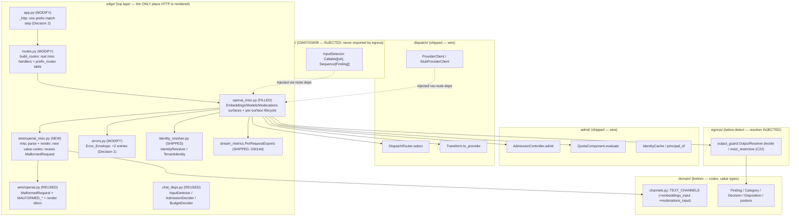
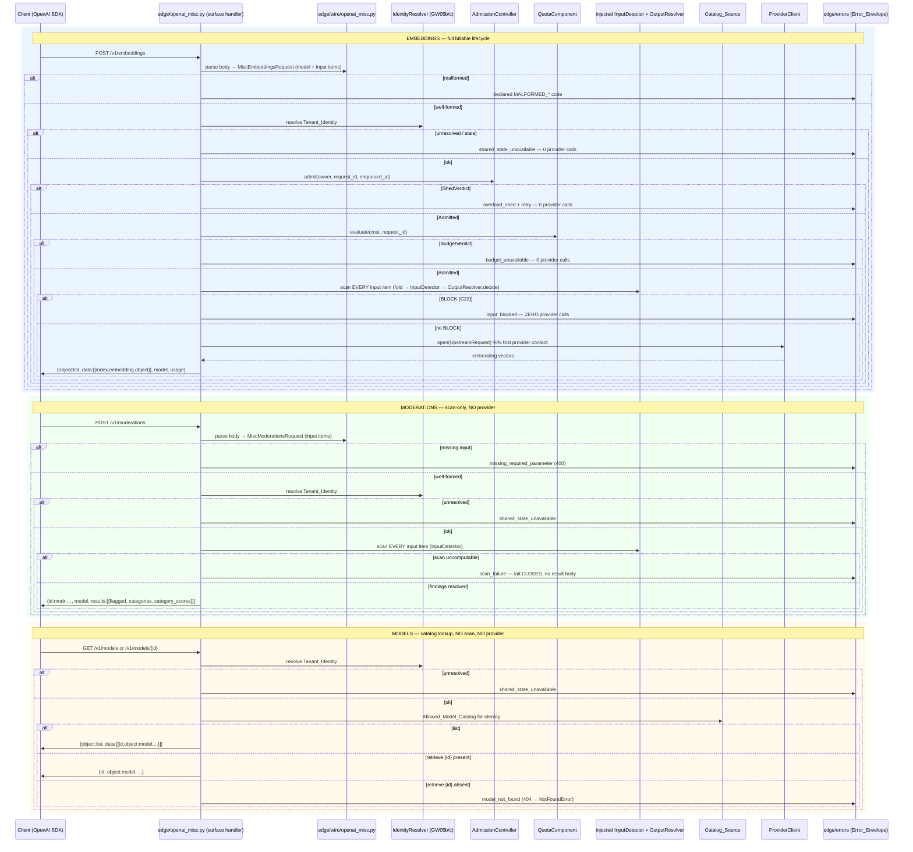

# Design Document

## Overview

GW16 lands the three **misc** OpenAI-compatible surfaces. It fills the currently-empty `gateway_v2/gateway_v2/edge/openai_misc.py` (`__all__ = ()`, "empty until GW16") with the real handlers for `POST /v1/embeddings`, `GET /v1/models` (list) + `GET /v1/models/{id}` (retrieve), and `POST /v1/moderations`, and replaces the three corresponding `_placeholder(...)` entries in `gateway_v2/gateway_v2/edge/routes.py` `build_routes` — which today return a declared `not_implemented` value-code — with those real handlers.

Every pipeline mechanism GW16 drives is **already shipped** and was wired by GW15. GW16 does not build a new pipeline: it WIRES the same seams GW15 wired — the injected `InputDetector` + `OutputResolver` input-scan path, GW05b/c identity + freshness (`IdentityResolver`), the GW19 `AdmissionController` (`AdmissionDecider` surface), the GW06 `QuotaComponent` budget lease (`BudgetDecider` surface), the injected `ProviderClient` (`StubProviderClient` locally), the single `edge/errors` `Error_Envelope`, and the GW14d `PerRequestExports` — into three new surfaces. It REUSES the shared OpenAI typing GW15 landed in `edge/wire/openai.py` (`MalformedRequest` + the `MALFORMED_*` declared value-codes, the `fold_input_channels` discipline, the fixed-key-order JSON rendering idiom) and ADDS the misc request/response typing in a SIBLING module `edge/wire/openai_misc.py`, keeping `edge/wire` as the ONLY layer that renders OpenAI wire shapes.

The three surfaces differ in which §10.4 lifecycle phases they run — GW16 reuses the chat lifecycle shape per surface rather than inventing a parallel one:

1. **Embeddings** is a billable upstream call: it runs the FULL lifecycle — identity → admission → budget → input scan (BLOCK short-circuits with **zero provider calls**) → provider → render. The embedding VECTORS come from the injected provider (`StubProviderClient` locally); GW16 invents no real embedding model. The response preserves batch index order.
2. **Moderations** is a scan-only surface: identity → input scan → render findings-as-categories. It NEVER contacts the provider; an uncomputable scan fails CLOSED rather than returning an unscanned result.
3. **Models** is a catalog lookup: identity → catalog read from the injected `Catalog_Source` → render list/retrieve. It runs NO input scan (no client text) and NEVER contacts the provider; an unknown id renders a declared not-found code so the stock SDK raises `openai.NotFoundError`.

### Why this card exists — the channel enumeration (C21)

The v2.1 prototype PASSED SDK acceptance but FAILED the channel tests, so channel totality is a first-class gate (`unscanned_channels()` must stay empty). GW15 made the chat-input fold total over the four `messages[]` channels. GW16 introduces NEW scannable request text — the embeddings `input` and the moderations `input` — and MUST enumerate every such field into `domain/channels.py::TEXT_CHANNELS` so a canary in ANY new input field is scanned, exactly as GW15's input fold is total over the chat input channels. A new scannable field with no folding path is a build-time gate failure.

### Three resolved design decisions (baked in)

GW15 flagged three open design decisions on the misc surfaces; all three are resolved below from the shipped code and stated here with rationale.

#### Decision 1 — new declared value-codes + envelope entries (R2.4, R7.3, R9.1)

`edge/errors.py::_ENVELOPE` is a `MappingProxyType` keyed by value-code → `(http_status, sse_error_type)`. It has NO entry for a missing-parameter or a model-not-found code; an unmapped code renders the generic HTTP `500` `gateway_error` body (`GENERIC_HTTP_STATUS`). That generic fallback is correct for an internal gap but WRONG for these two client-facing cases: the stock SDK must see a `400` with `error.code == "missing_required_parameter"` for a moderations body missing `input`, and a `404` so `models.retrieve(unknown)` raises `openai.NotFoundError`.

**Resolution.** ADD two declared value-codes and two `_ENVELOPE` entries:

| New value-code | Spelling | Home | `_ENVELOPE` entry `(status, sse_error_type)` | HTTP `error.type` body |
| --- | --- | --- | --- | --- |
| missing required parameter | `missing_required_parameter` | `edge/wire/openai_misc.py` (a `MALFORMED_*`-style constant, since it is a malformed-body code raised by the misc parser) | `(400, "invalid_request_error")` | `invalid_request_error` |
| model not found | `model_not_found` | `edge/wire/openai_misc.py` (a misc-surface value-code; it is not a malformed body but a resolved-lookup miss, kept beside the misc typing it is raised from) | `(404, "not_found_error")` | `not_found_error` |

Rationale for placement: these are **codes**, not HTTP objects, so they obey the codes-vs-render boundary (`check_http_outside_edge_resolve.py`). They live as plain module-level string constants in `edge/wire/openai_misc.py` beside the misc typing that raises them — the same discipline GW15 used for `MALFORMED_BODY` etc. in `edge/wire/openai.py` (a value-code is a code, not a capacity-position literal). The ENVELOPE entry itself MUST be added to `edge/errors.py::_ENVELOPE`, because that `MappingProxyType` is the single render authority: the handler returns the code, `edge/errors.render_http(code)` maps it to the status/type. `error_frame_for(code)` already renders a generic SSE frame for an unmapped code, so the SSE side needs no change (the misc surfaces are non-streaming — these codes render only as HTTP bodies). Alternative rejected: letting the generic `500` fallback stand — it breaks the Frozen_Contract because the SDK would raise a generic `APIError`/`InternalServerError`, not `NotFoundError` / `BadRequestError`.

#### Decision 2 — path-parameter routing for `GET /v1/models/{id}` (R1.2, R1.4)

`edge/app.py::_http` matches routes with a FLAT exact-tuple lookup: `handler = self.routes.get((method, path))`, falling back to `errors.render_not_implemented(path)` on a miss. The `Route_Table` is a function-local `dict` returned by `build_routes` (no module-level mutable — a hard gate via `check_no_module_mutable.py`). `GET /v1/models/gpt-4o-mini` cannot be a static tuple key, and the exact matcher renders `not_implemented` on it before any Models handler is reached.

Two candidate approaches were weighed:

- **(A)** Add a minimal, declared prefix/longest-match step in `edge/app.py::_http` for a SMALL registered set of path-prefixed routes — a SECOND function-local table (`(method, path_prefix) -> handler`) consulted only AFTER the exact-match miss and BEFORE the `not_implemented` fallback, with the segment after the prefix passed to the handler. Both tables stay function-local; the exact-match behaviour for every other route is untouched; HTTP construction stays in `edge`; the `{id}` extraction is pure string work in `edge`.
- **(B)** Register `("GET", "/v1/models")` only and have the Models handler own retrieve some other way. **Rejected**: the exact-tuple matcher never routes `("GET", "/v1/models/<id>")` to any handler — the key misses the table entirely and renders `not_implemented` before the Models handler is reached. There is no local hook for the handler to intercept the retrieve path without changing the matcher, so (B) cannot actually be reached.

**Chosen: (A), minimal and gated.** `build_routes` keeps the exact key `("GET", "/v1/models")` → the Models list handler, and ALSO returns a second function-local prefix table binding `("GET", "/v1/models/")` → the Models retrieve handler. `_http` gains one declared step after the exact-match miss:

```python
# edge/app.py::_http  (the ONE added step, after the exact-match miss, before the fallback)
handler = self.routes.get((method, path))
if handler is None:
    prefixed = self._match_prefix(method, path)   # NEW: longest registered (method, prefix)
    if prefixed is not None:
        handler, suffix = prefixed                # suffix is the trailing path segment ({id})
        await handler(scope, receive, send)       # the handler reads scope["path"] to extract {id}
        return
    await emit_response(send, errors.render_not_implemented(path))
    return
await handler(scope, receive, send)
```

`_match_prefix` consults a second function-local `prefix_routes` table (built in `build_routes`, threaded onto the app the same way `routes` is) and returns the longest `(method, prefix)` whose `prefix` is a proper prefix of `path` with a non-empty trailing segment, else `None`. The `{id}` is the trailing segment, extracted by the Models retrieve handler from `scope["path"]` (pure string work — `path[len("/v1/models/"):]`), so `edge/wire` sees a clean id and the handler branches list vs retrieve on presence of a non-empty suffix. This touches `app.py` (acceptable — it is `edge`), keeps both tables function-local (no module-level mutable), does not regress exact-match for any other route (the prefix step runs ONLY on an exact-match miss), keeps HTTP construction in `edge`, and is a small bounded method under `check_sizes`. An empty suffix (`/v1/models/`) and a path that merely starts with the prefix but has no trailing segment do NOT match the prefix table and fall through to `not_implemented`, so list stays the exact-key route.

#### Decision 3 — misc typing module location (R2.5, R2.6)

GW15's `edge/wire/openai.py` is already ~650+ lines and `check_sizes` (max **800** lines/module, `MAX_MODULE_LINES = 800`) is a LIVE gate that GW15's final reconciliation had to split files to satisfy (the `ChatRoute` deps were split into `edge/chat_deps.py` for the same reason). Adding the embeddings/models/moderations parse + render into `openai.py` would breach the gate.

**Resolution.** Put the GW16 misc request/response typing in a SIBLING module `edge/wire/openai_misc.py` (embeddings / models / moderations parse + render), importing `MalformedRequest` + the `MALFORMED_*` codes from `edge/wire/openai.py` and reusing the fixed-key-order `json.dumps(..., ensure_ascii=True, separators=(",", ":"))` rendering idiom. This keeps `edge/wire` as the only layer rendering OpenAI wire shapes, keeps each module comfortably under 800 lines, and does NOT redefine the GW15 shared types (`CanonicalRequest`, `OpenAIRequestParser`, `OpenAIResponseRenderer`, `fold_input_channels`) — they are imported where needed, never re-declared (R2.6).

### Grounding in actual shipped code

| Shipped seam | File:symbol | How GW16 uses it |
| --- | --- | --- |
| Misc surface stub (FILLED) | `edge/openai_misc.py` (`__all__ = ()`) | Filled with the three Surface handlers (`EmbeddingsSurface` / `ModelsSurface` / `ModerationsSurface`) + the per-surface lifecycle. |
| Route table (MODIFY) | `edge/routes.py::build_routes`, `_placeholder`, `emit_response`, `RouteTable`, `RouteHandler` | The three `_placeholder` entries replaced with the real handlers; a second function-local `prefix_routes` table added for retrieve (Decision 2); `emit_response` reused verbatim. |
| ASGI matcher (MODIFY, Decision 2) | `edge/app.py::_http`, `self.routes.get((method, path))`, `render_not_implemented` | ONE added prefix-match step after the exact-match miss, before the `not_implemented` fallback. |
| Error envelope (MODIFY, Decision 1) | `edge/errors.py::_ENVELOPE`, `render_http`, `render`, `HTTPResponse` | Two new `_ENVELOPE` entries (`missing_required_parameter`→(400,…), `model_not_found`→(404,…)); the single render authority is otherwise unchanged. |
| OpenAI typing (REUSED) | `edge/wire/openai.py::MalformedRequest`, `MALFORMED_BODY`/`MALFORMED_NOT_AN_OBJECT`/`MALFORMED_WRONG_SHAPE`, `fold_input_channels` idiom | Imported by `edge/wire/openai_misc.py`; the misc parsers raise `MalformedRequest` with declared codes, never a raw framework error (R2.3/R2.5). |
| Channel enumeration (C21) | `domain/channels.py::TEXT_CHANNELS`, `TextChannel`, `unscanned_channels` | Gains `embeddings_input` + `moderations_input` scanned entries; the misc fold is total over them. |
| Input detector seam | `edge/chat_deps.py::InputDetector = Callable[[str], Sequence[Finding]]`, `no_findings_detector` | The SAME injected findings-callable the misc input scan runs over every folded input item. |
| Output resolver (C22) | `egress/output_guard.py::OutputResolver` (`decide(matches)->Decision`), `MinimalOutputResolver`, `most_restrictive` | GW16 resolves the input findings through `decide`; `most_restrictive` is C22 (`domain/decision.py::most_restrictive`, BLOCK rank 3). |
| Identity + freshness | `edge/identity_resolver.py::IdentityResolver` (`resolve(scope)->TenantIdentity\|None`), `CachingIdentityResolver`, `TenantIdentity`, `fail_closed_resolver`; `admit.identity.IdentityCache` | Resolved before any provider contact; `None` ⇒ fail closed `shared_state_unavailable` (R5.2/R7.6). |
| Admission | `edge/chat_deps.py::AdmissionDecider` (`admit(owner_id, request_id, enqueued_at)`), shipped `AdmissionController`, `ShedVerdict`, `shed_retry_after_s`, `fail_closed_admission` | Embeddings only; a `ShedVerdict` renders through the envelope (R5.3). |
| Budget | `edge/chat_deps.py::BudgetDecider` (`evaluate(cost, *, request_id)`), shipped `QuotaComponent`, `BudgetVerdict`, `fail_closed_budget` | Embeddings only; local lease, no request-path store I/O (R5.5). |
| Provider seam | `dispatch/provider.py::ProviderClient` (protocol), `StubProviderClient`, `UpstreamRequest`, `UpstreamEvent` | Embeddings forwards through the injected provider for vectors; `StubProviderClient` is the in-process substitute, real socket DEFERRED (R6.4/R11.3). |
| Request shaping | `dispatch/transform.py::Transform.to_provider`, `GatewayRequest`; `dispatch/routing.py::DispatchRouter.select` | Embeddings packs the `UpstreamRequest.body` from the parsed request; destination from the plan (as GW15). |
| Error envelope render | `edge/errors.py::render_http`, `render`, `HTTPResponse`, `render_not_implemented` | The ONE value-code → HTTP boundary (R9). |
| Per-request exports | `runtime/stream_metrics.py::PerRequestExports` | Populated on complete/refuse; `fail_open_total` pinned 0; no raw content (R10). |
| Value types | `domain/finding.py::Finding`/`Span`/`FindingStatus`, `domain/category.py::Category`, `domain/decision.py::Decision`/`Disposition`, `domain/plan.py::Surface` | Finding carries `detector`/`category`/`confidence`/`spans`; moderations maps `category` → OpenAI categories. |

### Critical layer constraint

The import-linter `layers` contract is `edge > admit > plan > detect > resolve > dispatch > egress > audit > runtime > contracts > domain`. `edge` sits at the top and may import every layer below, so the misc handlers are the ONE correct injection site for the `InputDetector`, the `OutputResolver`, the `ProviderClient`, and the `Catalog_Source` — `egress` MUST NOT import `detect` (R4.5). GW16 keeps the shipped discipline exactly: the detector, resolver, provider, and catalog source are injected into the misc route deps (in `edge`); `egress` never names `detect`.

## Architecture

### Layer map and component placement



The `egress → detect` edge is forbidden and absent; the dotted edges are the injected detector + provider flowing from `edge` into the handlers.

### Per-surface lifecycle (ordered pipelines inside the misc handlers)

GW16 reuses the §10.4 ordering GW15 proved, trimmed per surface. The ordering is load-bearing: every refusal before `provider.open` makes **zero provider calls**.



Exactly one shared-state access (identity resolved from RAM-served `IdentityCache` + the budget local lease) happens per request; neither identity nor the budget spend performs a request-path store read (R5.5), mirroring GW15's one-round-trip discipline.

### Misc input-channel folding model (C21)

`edge/wire/openai_misc.py` owns the embeddings/moderations `input` → channels mapping, parallel to GW15's `fold_input_channels`. It maps `input: str | list[str]` into per-item `(channel_name, text)` pairs keyed on the new channel names:

- An embeddings `input` that is a plain string folds to one `(embeddings_input, text)` pair; a list folds to one `(embeddings_input, item)` pair per element, **in request order** (R3.2).
- A moderations `input` folds the same way under `(moderations_input, …)`.

The misc fold is total over the misc input channels: the set of channel names the misc fold can emit must equal the set of `TEXT_CHANNELS` entries whose `sdk_path` marks a misc input. Because the chat fold keys totality off the `messages[]` `sdk_path` prefix (`_INPUT_SDK_PATH_PREFIX`), the misc inputs are a **new scope** — GW15's `_assert_fold_total()` must NOT see the misc channels as unfolded chat channels, and the misc fold must NOT be asked to fold the chat channels. The design keeps the two totality checks disjoint by scope:

- `domain/channels.py` gives `embeddings_input`/`moderations_input` a distinct `sdk_path` (`input` / `input[]`) that does NOT start with `messages[]`, so GW15's `_input_channel_names()` (which filters on the `messages[]` prefix) is unchanged and its totality check still passes untouched.
- `edge/wire/openai_misc.py` adds its own `_assert_misc_fold_total()` (the same import-time pattern as GW15's `_assert_fold_total`) that compares the misc fold's emittable channel names against the misc-scoped `TEXT_CHANNELS` names (those NOT prefixed `messages[]` and NOT prefixed `choices[]`). A misc input channel added with no misc folding path — or a misc folding path with no `TEXT_CHANNELS` entry — raises `ChannelFoldError` at import.
- `unscanned_channels()` stays empty because both new entries are `scanned=True` (R3.3). The two scope-local totality checks together cover every `TEXT_CHANNELS` entry; neither weakens the other.

## Components and Interfaces

Each unit lists its module path, key types (frozen-slotted dataclasses / protocols), and injected dependencies. All randomness is an injected `random.Random` and clocks are injected `Callable`s, matching the shipped components, so tests are deterministic under `asyncio.run`.

### 1. `edge/wire/openai_misc.py` — misc OpenAI codec (NEW)

Owns misc request parsing + response rendering + the two new value-codes. Imports `MalformedRequest` + the `MALFORMED_*` codes from `edge/wire/openai.py` and the misc channel folding; reuses the fixed-key-order JSON idiom. PURE over the request bytes — no I/O, no security decision (R2.5).

```python
# edge/wire/openai_misc.py
from gateway_v2.edge.wire.openai import MalformedRequest, MALFORMED_BODY, MALFORMED_NOT_AN_OBJECT, MALFORMED_WRONG_SHAPE

#: New declared value-codes (plain strings; codes, not HTTP objects, not capacity literals).
MISSING_REQUIRED_PARAMETER = "missing_required_parameter"   # Decision 1 → (400, invalid_request_error)
MODEL_NOT_FOUND = "model_not_found"                         # Decision 1 → (404, not_found_error)

@dataclass(frozen=True, slots=True)
class MiscEmbeddingsRequest:
    model: str
    input_items: tuple[str, ...]          # one Scannable_Text per input element, in order (R2.1, R3.2)

@dataclass(frozen=True, slots=True)
class MiscModerationsRequest:
    model: str | None
    input_items: tuple[str, ...]          # Scannable_Text items (R2.2)

class MiscRequestParser:
    """SDK JSON → typed misc request. Pure; raises MalformedRequest on an off-contract body (R2.3)."""
    def parse_embeddings(self, body: bytes) -> MiscEmbeddingsRequest: ...
    def parse_moderations(self, body: bytes) -> MiscModerationsRequest: ...
    # moderations missing `input` → raise MalformedRequest(MISSING_REQUIRED_PARAMETER) (R2.4)

def fold_misc_input(items: tuple[str, ...], channel: str) -> tuple[tuple[str, str], ...]:
    """One (channel, item) Scannable_Text pair per input element, in order (C21, R3.2)."""

class MiscResponseRenderer:
    """Typed misc result → ONE OpenAI-compatible JSON body. Pure wire logic (R2.5)."""
    def embeddings_body(self, req: MiscEmbeddingsRequest, vectors: tuple[tuple[int, tuple[float, ...]], ...]) -> bytes: ...
    def models_list_body(self, models: tuple[CatalogModel, ...]) -> bytes: ...
    def model_retrieve_body(self, model: CatalogModel) -> bytes: ...
    def moderation_body(self, model: str, result: ModerationResult) -> bytes: ...
```

- `parse_embeddings` / `parse_moderations` decode the body (reusing the GW15 decode discipline), validate the OpenAI-compatible shape, and extract `model` + the ordered `input` items. A bad body raises `MalformedRequest` with a declared `MALFORMED_*` code; a moderations body missing `input` raises `MalformedRequest(MISSING_REQUIRED_PARAMETER)` (R2.4). Never a raw framework error (R2.3).
- `embeddings_body` emits `{object:"list", data:[{index, embedding, object:"embedding"}], model, usage}` with one `data` entry per input item, each `index` matching the input position (R6.2/R6.3), fixed key order + `ensure_ascii=True` + compact separators so renders are byte-stable and round-trip.
- `moderation_body` emits `{id:"modr-…", model, results:[{flagged, categories{…}, category_scores{…}}]}` (R8.2).
- The misc fold `fold_misc_input` is total over the misc input channels (import-time `_assert_misc_fold_total`, C21).

### 2. `edge/openai_misc.py` — the three Surface handlers (FILLED)

The handlers that run each per-surface lifecycle, then render ONE OpenAI JSON through the single `edge/errors` path. Built once at boot on a frozen+slotted route deps value (parallel to `ChatRoute`), with no module-level mutable and no capacity literal.

```python
# edge/openai_misc.py
@dataclass(frozen=True, slots=True)
class MiscRoute:
    """Injected deps for the three misc surfaces (parallel to edge/routes.py::ChatRoute).

    Frozen + slotted; built once at boot. Detector / resolver / provider / catalog are
    injected HERE (edge, above detect) so egress never imports detect (R4.5). Every field
    is stateless or per-request-rebuilt, so no request-scoped state is shared (two-tenant
    isolation). Fail-closed defaults where a security decision is implied; sensible defaults
    for the non-security deps.
    """
    parser: MiscRequestParser = MiscRequestParser()
    renderer: MiscResponseRenderer = MiscResponseRenderer()
    identity: IdentityResolver = fail_closed_resolver          # None ⇒ refuse (R5.2/R7.6/R8 identity)
    admission: AdmissionDecider = fail_closed_admission        # embeddings only (R5.3)
    quota: BudgetDecider = fail_closed_budget                  # embeddings only (R5.4)
    input_detector: InputDetector = no_findings_detector       # embeddings + moderations scan (R4/R8)
    resolver: OutputResolver = ...                             # C22 most_restrictive (R4.4)
    provider: ProviderClient = ...                             # embeddings only; StubProviderClient locally (R6.1)
    router: DispatchRouter = ...
    transform: Transform = Transform()
    catalog: CatalogSource = empty_catalog_source             # models only (R7.4); default empty
    clock: Callable[[], float] = ...
    exports: PerRequestExports = PerRequestExports()

class EmbeddingsSurface:
    """POST /v1/embeddings: identity → admission → budget → input scan (BLOCK gate) → provider → render."""
    def __init__(self, *, deps: MiscRoute) -> None: ...
    async def handle(self, scope, receive, send) -> None: ...

class ModerationsSurface:
    """POST /v1/moderations: identity → input scan → render findings-as-categories. NO provider."""
    def __init__(self, *, deps: MiscRoute) -> None: ...
    async def handle(self, scope, receive, send) -> None: ...

class ModelsSurface:
    """GET /v1/models (list) + /v1/models/{id} (retrieve): identity → catalog → render. NO scan, NO provider."""
    def __init__(self, *, deps: MiscRoute) -> None: ...
    async def handle_list(self, scope, receive, send) -> None: ...
    async def handle_retrieve(self, scope, receive, send) -> None: ...   # reads scope["path"] for {id}
```

- **Embeddings** runs the full lifecycle. The input scan folds `embeddings_input` items, runs the injected `input_detector` over EACH item, resolves via `resolver.decide` (C22 `most_restrictive`); a BLOCK disposition ⇒ refuse with `input_blocked` BEFORE `provider.open` (R4.1-R4.4). On a proceed, it opens the injected `ProviderClient` for the plan destination with the `Transform`-packed body, reads the vectors from the `UpstreamEvent` stream, and renders them with index order preserved (R6). It never computes vectors itself (R6.1).
- **Moderations** resolves identity, folds `moderations_input`, scans each item, maps findings → categories, and renders (R8). It opens no provider (R8.5). An uncomputable scan ⇒ `scan_failure` fail-closed, no result body (R8.6).
- **Models** resolves identity, reads the `Allowed_Model_Catalog` from the injected `CatalogSource`, and renders list or retrieve. `handle_retrieve` extracts `{id}` from `scope["path"]` (pure string work, Decision 2); an id absent from the catalog ⇒ `model_not_found` (R7.3). No scan, no provider (R7.4/R7.5).
- Every refusal renders through `emit_response(send, errors.render_http(code))` — the single envelope path — so an unmapped code renders the declared generic error rather than a raw framework 500 (R9.2). Every terminal outcome populates `exports` content-free with `fail_open_total` pinned 0 (R10).

### 3. Moderation category mapping (R8.3, R8.4)

The Moderations_Surface maps a `Finding` (`detector`, `category: Category`, `confidence: float | None`, `spans`) to the OpenAI moderation `Moderation_Result`:

- The stock OpenAI moderation categories are a **fixed set** (`hate`, `harassment`, `sexual`, `violence`, `self-harm`, …). A firewall `Category` that maps to a stock category sets that category `true` in `categories{…}` and places its score (the finding `confidence`, or `1.0` for an EXECUTED finding with no confidence floor) in `category_scores{…}`.
- A firewall-specific `Category` with NO stock OpenAI counterpart — `prompt_injection`, `jailbreak`, `secret`, `credential`, `command`, `exfil`, `dos`, and `pii`/`toxicity` where no stock category fits — rides as a **category EXTRA**: an extra key in `categories{…}` + `category_scores{…}` named by the firewall `Category` spelling, flagged `true`. This is honest: the stock set is not expanded in meaning, and no firewall signal is silently dropped (R8.4). The mapping table lives in `edge/wire/openai_misc.py` as a `MappingProxyType` (no module-level mutable).
- Overall `flagged` is `true` iff at least one category (stock OR extra) is flagged (R8.3). A finding with `status != EXECUTED` (SKIPPED/UNAVAILABLE) does not flag a category — but if the scan as a whole could not be computed, the surface fails CLOSED with `scan_failure` rather than returning a `flagged:false` result (R8.6).

### 4. `edge/routes.py::build_routes` wiring (MODIFY)

`build_routes` keeps its function-local table shape and replaces the three misc `_placeholder` entries; it also returns the second function-local `prefix_routes` table (Decision 2). The responses/mcp/rag/vector placeholders are UNCHANGED (R1.3):

```python
def build_routes(chat: ChatRoute, misc: MiscRoute) -> tuple[RouteTable, RouteTable]:
    exact = {
        ("POST", "/v1/chat/completions"): chat.handle,
        ("POST", "/v1/completions"): chat.handle,
        ("POST", "/v1/responses"): _placeholder("responses"),
        ("POST", "/v1/embeddings"): EmbeddingsSurface(deps=misc).handle,     # was _placeholder
        ("GET", "/v1/models"): ModelsSurface(deps=misc).handle_list,         # was _placeholder
        ("POST", "/v1/moderations"): ModerationsSurface(deps=misc).handle,   # was _placeholder
        ("POST", "/v1/mcp"): _placeholder("mcp"),
        ("POST", "/v1/rag/query"): _placeholder("rag"),
        ("POST", "/v1/vector/query"): _placeholder("vector"),
    }
    prefix = {("GET", "/v1/models/"): ModelsSurface(deps=misc).handle_retrieve}  # Decision 2
    return exact, prefix
```

Both tables are function-local (no module-level mutable, R1.4). The existing `build_routes(chat)` call site in `edge/app.py` is updated to pass `misc` and to receive the two tables; `app.py` holds both as `self.routes` + `self.prefix_routes`.

### 5. `edge/app.py::_http` prefix step (MODIFY, Decision 2)

One added step after the exact-match miss, before the `not_implemented` fallback — the exact code shown in Decision 2. `_match_prefix(method, path)` is a small bounded method (under `check_sizes`) consulting the function-local `prefix_routes`; it returns the longest `(method, prefix)` whose `prefix` is a proper prefix of `path` with a non-empty trailing suffix, else `None`. Exact-match behaviour for every other route is unchanged (the prefix step only runs on a miss). HTTP construction stays in `edge`.

### 6. `edge/errors.py` envelope entries (MODIFY, Decision 1)

Two entries added to the `_ENVELOPE` `MappingProxyType`:

```python
"missing_required_parameter": (400, "invalid_request_error"),
"model_not_found": (404, "not_found_error"),
```

`render_http` already reads `_ENVELOPE.get(code)` and builds the `{"error": {message, type, code}}` body with the mapped status/type (and the single-sourced `error_frame_for(code)` message); nothing else in `edge/errors.py` changes. The `400`/`404` integers are response-status codes, not capacity-position literals (the module docstring already states this discipline).

### 7. `CatalogSource` + boot wiring (MODIFY `edge/app.py`)

```python
@runtime_checkable
class CatalogSource(Protocol):
    """The injected Allowed_Model_Catalog source, resolved against Tenant_Identity (R7.4)."""
    def catalog_for(self, identity: TenantIdentity) -> tuple[CatalogModel, ...]: ...

@dataclass(frozen=True, slots=True)
class CatalogModel:
    id: str
    created: int
    owned_by: str
```

The real org/plan-derived catalog backend is a DEFERRED seam behind `CatalogSource` (R11.3); the default `empty_catalog_source` returns `()` (an empty catalog — a models list of none, and every retrieve a `model_not_found`), so an unwired route is honest rather than fabricating a model. `edge/app.py` builds the single `MiscRoute` at boot the same way it builds `ChatRoute`, injecting the real detector/resolver/provider/catalog (or the stubs in tests). No new server-process/entrypoint card is in scope (B3) — GW16 wires onto the existing raw-ASGI app.

### File list

- **FILLED** `gateway_v2/gateway_v2/edge/openai_misc.py` — `MiscRoute` + `EmbeddingsSurface` / `ModerationsSurface` / `ModelsSurface` + per-surface lifecycle.
- **NEW** `gateway_v2/gateway_v2/edge/wire/openai_misc.py` — misc parse + render, `fold_misc_input`, the two new value-codes, moderation category map, `_assert_misc_fold_total`.
- **MODIFY** `gateway_v2/gateway_v2/edge/routes.py` — `build_routes` returns the real misc handlers + the `prefix_routes` table.
- **MODIFY** `gateway_v2/gateway_v2/edge/app.py` — `_http` prefix-match step; boot wiring builds `MiscRoute`; holds `prefix_routes`.
- **MODIFY** `gateway_v2/gateway_v2/edge/errors.py` — two `_ENVELOPE` entries.
- **MODIFY** `gateway_v2/gateway_v2/domain/channels.py` — `embeddings_input` + `moderations_input` entries.
- **TEST** extend `gateway_v2/tests/openai_conformance/` in-process subset for the misc scenarios (R11).

## Data Models

All new types are frozen-slotted dataclasses; module-level tables use `MappingProxyType`. The provider/transform/finding/decision value types are the SHIPPED ones (not redefined).

| Type | Module | Shape | Validates |
| --- | --- | --- | --- |
| `MiscEmbeddingsRequest` | `edge/wire/openai_misc.py` (NEW) | `model:str, input_items:tuple[str,...]` | R2.1, R3.2 |
| `MiscModerationsRequest` | `edge/wire/openai_misc.py` (NEW) | `model:str\|None, input_items:tuple[str,...]` | R2.2 |
| `ModerationResult` | `edge/wire/openai_misc.py` (NEW) | `flagged:bool, categories:Mapping[str,bool], category_scores:Mapping[str,float]` | R8.2-R8.4 |
| `CatalogModel` | `edge/app.py` (NEW) | `id:str, created:int, owned_by:str` | R7.1/R7.2 |
| `MiscRoute` | `edge/openai_misc.py` (NEW) | injected deps (frozen+slotted) | R1.5, R4-R8 |
| `MISSING_REQUIRED_PARAMETER` / `MODEL_NOT_FOUND` | `edge/wire/openai_misc.py` (NEW) | declared value-code strings | R2.4, R7.3, R9.1 |
| `MalformedRequest` + `MALFORMED_*` | `edge/wire/openai.py` (SHIPPED) | exception + codes, REUSED | R2.3/R2.5 |
| `TenantIdentity` / `IdentityResolver` | `edge/identity_resolver.py` (SHIPPED) | `org_id:str, principal:Principal` / resolve surface | R5.1/R7.6/R8.1 |
| `Admitted` / `ShedVerdict` / `BudgetVerdict` | `admit/grant.py` (SHIPPED) | admission grant / shed / budget refusal | R5.3/R5.4 |
| `Finding` / `Span` / `FindingStatus` | `domain/finding.py` (SHIPPED) | `detector, category, status, confidence, spans` | R4/R8.3 |
| `Category` | `domain/category.py` (SHIPPED) | threat taxonomy enum | R8.4 |
| `Decision` / `Disposition` / `most_restrictive` | `domain/decision.py` (SHIPPED) | resolved decision; BLOCK rank 3 | R4.4 |
| `OutputResolver` | `egress/output_guard.py` (SHIPPED) | `decide(matches)->Decision` | R4.4 |
| `ProviderClient` / `StubProviderClient` / `UpstreamEvent` / `UpstreamRequest` | `dispatch/provider.py` (SHIPPED) | injected vectors / events | R6 |
| `TextChannel` / `TEXT_CHANNELS` | `domain/channels.py` (MODIFY) | `+embeddings_input +moderations_input` | C21, R3 |
| `HTTPResponse` | `edge/errors.py` (SHIPPED) | status/body/headers | R9 |
| `PerRequestExports` | `runtime/stream_metrics.py` (SHIPPED) | fixed-cardinality exports | R10 |

### `Surface` for embeddings

`domain/plan.py::Surface` already carries `EMBEDDINGS`; embeddings plan resolution + routing use `Surface.EMBEDDINGS` exactly as chat uses `Surface.CHAT`. Moderations and Models do NOT resolve a plan surface (moderations is scan-only; models is a catalog lookup), so they add no `Surface` member — they resolve identity and run their trimmed lifecycle without a plan round trip.

## Correctness Properties

*A property is a characteristic or behavior that should hold true across all valid executions of a system — a formal statement about what the system should do, bridging human-readable specifications and machine-verifiable guarantees.*

The properties below are derived from the prework analysis and consolidated to remove redundancy. Each is implemented by a SINGLE property-based test in the house seeded-random idiom (≥ 10,000 iterations, no hypothesis, run under `asyncio.run` for the async handlers). Architectural placement (R1.4/R1.5, R2.5/R2.6, R4.5), conformance acceptance (R9.3/R9.4, R11.1/R11.2), and seam/scope facts (R6.4, R11.3, R11.4) are covered by the AST/import-linter gates, the conformance harness, and example tests respectively (see Testing Strategy), not by properties.

### Property 1: `GET /v1/models/{id}` path-parameter matching

*For any* request path, the matcher routes `/v1/models` to the list handler, routes `/v1/models/<seg>` for any non-empty `<seg>` to the retrieve handler with the extracted id equal to `<seg>`, and routes a path that is not `/v1/models` and not a `/v1/models/<seg>` away from the Models handlers (to its exact-match handler or the `not_implemented` fallback).

**Validates: Requirements 1.2**

### Property 2: Misc parse/render round-trip preserves input items and model

*For any* well-formed embeddings or moderations body, parsing it into the typed misc request and rendering the corresponding response preserves every `input` item byte-for-byte in request order and preserves the `model` field.

**Validates: Requirements 2.1, 2.2**

### Property 3: Malformed misc body yields a declared value-code

*For any* malformed or off-contract misc body (not JSON, not an object, wrong-typed `input`/`model`), the misc parser raises `MalformedRequest` carrying a declared value-code and the handler renders it through the single `Error_Envelope`, never a raw framework error.

**Validates: Requirements 2.3**

### Property 4: Misc input fold is total and ordered (C21)

*For any* embeddings or moderations `input` and *any* input item, a canary placed in that item appears as its own `(channel, text)` Scannable_Text pair in the misc fold — one pair per element, in request order — so every misc Input_Channel is enumerated into scannable text.

**Validates: Requirements 3.2, 4.1, 8.1**

### Property 5: A BLOCK embeddings input finding yields zero provider calls

*For any* embeddings `input` and *any* input item, a canary in that item that resolves to a BLOCK disposition causes the Embeddings_Surface to refuse the request, make zero provider calls, and render the declared block value-code.

**Validates: Requirements 4.2, 4.3**

### Property 6: BLOCK is the most-restrictive disposition (C22)

*For any* set of findings on an embeddings input that contains at least one BLOCK-disposition finding, the resolved per-finding outcome is BLOCK regardless of any co-matching REDACT or FLAG rule, and the Embeddings_Surface refuses.

**Validates: Requirements 4.4**

### Property 7: Uncomputable scan or decision fails closed with FAIL_OPEN pinned at zero

*For any* input scan or decision that cannot be computed on an embeddings or moderations request, the surface refuses (never forwarding raw unscanned/undecided content, and never returning an unscanned moderation result), makes zero provider calls, and `PerRequestExports.snapshot().fail_open_total` remains zero.

**Validates: Requirements 4.6, 8.6**

### Property 8: Unresolvable or stale identity fails closed

*For any* misc request whose Tenant_Identity cannot be resolved, or whose freshness stamp is stale or unavailable, the surface renders the declared authentication value-code and makes zero provider calls.

**Validates: Requirements 5.2**

### Property 9: A pre-provider refusal short-circuits the provider

*For any* embeddings refusal before the provider is opened — an admission `ShedVerdict` or a `QuotaComponent` `BudgetVerdict` — the Embeddings_Surface renders that refusal's declared value-code and makes zero provider calls.

**Validates: Requirements 5.3, 5.4**

### Property 10: Exactly one shared-state access, none for the budget spend

*For any* embeddings request flow (shed, budget-refused, input-blocked, or completed), the identity/plan access is served from RAM/local lease and no additional request-path shared-state read is attributable to the budget spend.

**Validates: Requirements 5.5**

### Property 11: Embeddings response preserves batch index order

*For any* embeddings `input` list and *any* provider embeddings result, the rendered body has exactly one `data` entry per input item, each entry's `index` equals the position of its input item, and the entries appear in request order (an index-order round trip).

**Validates: Requirements 6.2, 6.3**

### Property 12: Models list renders every allowed model

*For any* Allowed_Model_Catalog, the `GET /v1/models` body has `object == "list"` and exactly one `data` entry per catalog model, each with `id` and `object == "model"`, in catalog order.

**Validates: Requirements 7.1**

### Property 13: Unknown model id yields not-found with zero provider calls

*For any* id absent from the Allowed_Model_Catalog, the Models_Surface renders the declared `model_not_found` value-code (HTTP `404`, `not_found_error`) and makes zero provider calls, so the stock SDK raises `openai.NotFoundError`.

**Validates: Requirements 7.3**

### Property 14: Moderation findings map to categories with fidelity

*For any* set of findings over a moderations input, each EXECUTED finding sets its mapped category to flagged in `categories{…}` with its score in `category_scores{…}` — a stock OpenAI category when one exists, else a firewall-specific category EXTRA — and the overall `flagged` is true exactly when at least one category is flagged.

**Validates: Requirements 8.2, 8.3, 8.4**

### Property 15: Every value-code renders through the single Error_Envelope

*For any* GW16 value-code, the Misc_Surface renders it through the one `edge/errors` envelope as a declared HTTP body — the new `missing_required_parameter` maps to `(400, invalid_request_error)`, the new `model_not_found` maps to `(404, not_found_error)`, every malformed-body code maps to its declared entry, and an unmapped code renders the declared generic error with no raw internal detail.

**Validates: Requirements 9.1**

### Property 16: Every terminal outcome populates content-free exports with FAIL_OPEN zero

*For any* terminal misc outcome (allowed, shed, budget-refused, input-blocked, not-found, moderated, or errored), the surface populates `PerRequestExports` with the relevant admission/budget/input-enforcement dimensions, keeps `fail_open_total` at zero, and places no raw request or response content (no folded input text, no provider vectors) in any export field.

**Validates: Requirements 10.1, 10.2, 10.3, 10.4**

## Error Handling

Every failure fails **closed**: no raw request bytes reach a provider and no unscanned result reaches the client when a guard, auth, or decision cannot be computed (R4.6/R8.6). The handlers return/raise value-codes (`domain/posture.py`, the shipped egress terminal codes, or the two new `edge/wire/openai_misc.py` codes); the ONE `edge/errors` envelope renders them to an HTTP status + body (R9). `PerRequestExports.fail_open_total` is pinned at zero — no increment path (R10.3).

| Failure | Where detected | Value-code | Rendered outcome | Provider calls |
| --- | --- | --- | --- | --- |
| Malformed / off-contract misc body | `MiscRequestParser.parse_*` → `MalformedRequest` | `malformed_request_*` (reused) | Envelope render, not a raw framework error (R2.3) | 0 |
| Moderations missing `input` | `MiscRequestParser.parse_moderations` | `missing_required_parameter` (NEW) | HTTP `400` `invalid_request_error` (R2.4, Decision 1) | 0 |
| Models unknown id | `ModelsSurface.handle_retrieve` vs catalog | `model_not_found` (NEW) | HTTP `404` `not_found_error` → `openai.NotFoundError` (R7.3, Decision 1) | 0 |
| Identity unresolved / stale / unavailable | `IdentityResolver.resolve` → `None` | `shared_state_unavailable` | Fail closed; refuse (R5.2/R7.6/R8.1) | 0 |
| Admission shed (embeddings) | `AdmissionController.admit` → `ShedVerdict` | `overload_shed` (+ retry via `shed_retry_after_s`) | Envelope render (R5.3) | 0 |
| Budget refused (embeddings) | `QuotaComponent.evaluate` → `BudgetVerdict` | `budget_unavailable` | Envelope render (R5.4) | 0 |
| Input BLOCK finding (C22) | input scan + `OutputResolver.decide` | `input_blocked` | Refuse; render block code (R4.2/R4.3) | 0 |
| Input scan / decision raises | input scan (embeddings/moderations) | `scan_failure` | Fail closed; withhold; no result body (R4.6/R8.6) | 0 |
| Unmapped value-code | `edge/errors.render_http` | — | Declared generic `500` `gateway_error`, no raw detail (R9.2) | n/a |

The codes-vs-render boundary is preserved: the handlers return value-codes and never construct an HTTP object (`check_http_outside_edge_resolve.py`); `edge/errors` is the single renderer (R9.1). The two new codes are declared in `edge/wire/openai_misc.py` and mapped in `edge/errors.py::_ENVELOPE` — the handler returns the code, `edge/errors` renders it.

## Testing Strategy

**Dual approach.** Property-based tests verify the universal properties above across generated inputs; unit/example tests cover specific scenarios, wiring, and shapes; the conformance harness verifies OpenAI compatibility; CI gates enforce the architectural invariants.

### Property-based tests (house idiom)

- Each of the 16 properties above is implemented by exactly one property-based test using the house seeded-random idiom with an injected `random.Random`, **≥ 10,000 iterations**, **no hypothesis**, run under `asyncio.run` for the async handlers (matching the shipped GW12/GW15/GW19 suites).
- Each test is tagged: **Feature: chat-surface-gw16-misc, Property {number}: {property_text}**.
- Generators: random well-formed embeddings bodies (string input and list input of varying arity/content), random moderations bodies, random malformed bodies (bad JSON / non-object / wrong-typed fields / missing `input`), random finding sets (varying `Category`/`status`/`confidence`/dispositions, including sets with ≥1 BLOCK and co-matching REDACT/FLAG for C22), random provider embeddings results (varying batch arity), random model catalogs (varying size + ids) and random unknown ids, and random request paths for the matcher property.
- The channel/BLOCK properties (4, 5) iterate the canary over every input item position, so a dropped misc-fold path fails the gate (C21).
- Provider-call-count assertions use an instrumented `StubProviderClient` (counts `open` calls); shared-state assertions use an instrumented identity/store seam counting request-path reads.

### Unit / example tests

- Wiring/structural: 1.1 (route table binds the three real handlers, not `_placeholder`), 1.3 (responses/mcp/rag/vector still `not_implemented`), 2.4 (moderations `{}` → `missing_required_parameter` → `400`), 7.2 (retrieve a known id → `object == "model"`, id matches), 7.4/7.5 (instrumented provider/detector record zero calls on a models request), 8.5 (zero provider calls on moderations), 6.1 (rendered vectors equal the stub's scripted vectors).
- Edge cases: the `_http` prefix-match change (exact code), `/v1/models/` (empty suffix → `not_implemented`, not retrieve), an unmapped value-code → generic `500` body with no raw leak (R9.2), a non-stock firewall category rendered as a moderation extra.

### Conformance (in-process; live gates deferred)

- Extend the in-process subset of `gateway_v2/tests/openai_conformance/` against the misc surfaces, covering: embeddings single + batch with index order preserved, models list + retrieve + unknown-id raising `openai.NotFoundError`, moderations benign + flagged (a firewall finding surfaced) + missing-input error, and a BLOCK on an embeddings input yielding zero provider calls (R11.1/R11.2). The unmodified Python OpenAI SDK targets the handlers over `httpx.ASGITransport` against `build_app` with only `base_url` + key swapped, `StubProviderClient` behind it. The LGW15-2 stop rule applies: any required client code change beyond `base_url` + key fails the acceptance (R9.3/R9.4).
- **Deferred live gates kept as seams, NOT scaffolded as un-runnable gates** (R11.3): the real embedding provider socket, the real org/plan-derived model catalog backend, and any real-TCP / live-SDK run over a real serving entrypoint (B3). The real provider is the documented `ProviderClient` seam injected through `MiscRoute`; the real catalog is the documented `CatalogSource` seam; `StubProviderClient` + `empty_catalog_source` (or a scripted catalog) stay the in-process substitutes.

### CI gates (preserved, R11.4)

- import-linter 2 contracts — the `edge > admit > plan > detect > resolve > dispatch > egress > audit > runtime > contracts > domain` layer order holds; `egress` never imports `detect`; the detector/resolver/provider/catalog are injected through `MiscRoute` in `edge` (R4.5).
- 6 AST gates — `check_capacity_literals` (the `400`/`404`/new codes are response statuses / value-codes, not capacity literals; no capacity literal outside `runtime/resources.py`), `check_no_module_mutable` (both route tables function-local; the moderation category map + envelope entries are `MappingProxyType`), `check_frozen_dataclasses`, `check_http_outside_edge_resolve` (HTTP construction only in `edge`/`resolve`), `check_tenant_scale`, and `check_sizes` (`openai.py` and `openai_misc.py` each under 800 lines — the reason for Decision 3).
- `mypy --strict`, ruff — green.
- `unscanned_channels()` stays empty — the two new `TEXT_CHANNELS` entries are `scanned=True`; the misc `_assert_misc_fold_total()` and GW15's `_assert_fold_total()` are disjoint by scope and both pass (C21 totality).

## Requirements Coverage

| Requirement | Covered by |
| --- | --- |
| 1.1 Register three real misc handlers | Example (route table); `build_routes` |
| 1.2 Route `/v1/models/{id}` to retrieve | Property 1; Decision 2 |
| 1.3 Keep responses/mcp/rag/vector not_implemented | Example (route table) |
| 1.4 Function-local tables, no module mutable | AST `check_no_module_mutable` |
| 1.5 Wire shapes in `edge/wire`; no security in bare `edge/` | import-linter + file placement |
| 2.1 Parse embeddings into typed value | Property 2 |
| 2.2 Parse moderations into typed value | Property 2 |
| 2.3 Malformed → declared code via envelope | Property 3 |
| 2.4 Moderations missing input → `missing_required_parameter` | Example; Decision 1 |
| 2.5 Typing in `edge/wire`; reuse MalformedRequest | File placement; `check_sizes` (Decision 3) |
| 2.6 No redefine of GW15 shared types | File placement (imports, not redefines) |
| 3.1 Enumerate embeddings/moderations input channels | SMOKE (TEXT_CHANNELS entries) |
| 3.2 List input → one Scannable_Text per element | Property 4 |
| 3.3 `unscanned_channels()` stays empty | SMOKE; `_assert_misc_fold_total` |
| 4.1 Scan every embeddings input before provider | Property 4 |
| 4.2 BLOCK input → refuse, zero provider calls | Property 5 |
| 4.3 BLOCK → render block code | Property 5 |
| 4.4 C22 most-restrictive BLOCK | Property 6 |
| 4.5 Injected above detect; egress not import detect | import-linter + AST gates |
| 4.6 Uncomputable → fail closed, FAIL_OPEN 0 | Property 7 |
| 5.1 Resolve identity (GW05b/c) | Example; `IdentityResolver` |
| 5.2 Identity unresolved/stale → auth code, no forward | Property 8 |
| 5.3 ShedVerdict → code, no forward | Property 9 |
| 5.4 Budget refused → code, no forward | Property 9 |
| 5.5 Local lease, no request-path store read | Property 10 |
| 5.6 Lifecycle order → every pre-provider refusal zero calls | Example (order); Properties 5/8/9 (zero calls) |
| 6.1 Forward via injected ProviderClient, no self-computed vectors | Example |
| 6.2 OpenAI embeddings shape | Property 11 |
| 6.3 Batch → one data entry per item, index preserved | Property 11 |
| 6.4 StubProviderClient locally; real socket deferred | Conformance injection; seam |
| 7.1 Models list from catalog in OpenAI shape | Property 12 |
| 7.2 Retrieve known id → model shape | Example |
| 7.3 Unknown id → not-found → NotFoundError | Property 13; Decision 1 |
| 7.4 Catalog from injected source; no provider | Example (zero provider calls) |
| 7.5 Models runs no input scan | Example (zero detector calls) |
| 7.6 Models identity unresolved → fail closed | Property 8 (identity family) |
| 8.1 Moderations identity + scan every item | Property 4 |
| 8.2 OpenAI moderation shape | Property 14 |
| 8.3 Finding → category flagged + overall flagged | Property 14 |
| 8.4 Firewall-specific signal → category extra | Property 14 |
| 8.5 No provider contact (scan-only) | Example (zero provider calls) |
| 8.6 Uncomputable scan → fail closed, no unscanned result | Property 7 |
| 9.1 Render every code through single envelope (incl. new codes) | Property 15; Decision 1 |
| 9.2 Unmapped → generic error, no raw leak | Example (edge case); shipped `render_http` fallback |
| 9.3 Unmodified SDK served unchanged | Conformance subset |
| 9.4 Client code change → fail acceptance | Conformance stop rule (LGW15-2) |
| 10.1 Populate Per_Request_Exports | Property 16 |
| 10.2 Record admission/budget/input outcomes | Property 16 |
| 10.3 FAIL_OPEN pinned 0 | Property 16 (also Property 7) |
| 10.4 No raw content in exports | Property 16 |
| 11.1 In-process conformance subset | Conformance subset |
| 11.2 Named scenario coverage | Conformance subset |
| 11.3 Real socket/catalog/TCP deferred, not scaffolded | Seams; scope boundary |
| 11.4 Preserve gates + house property idiom + channels empty | CI gates; property-test idiom (≥10k, no hypothesis) |
