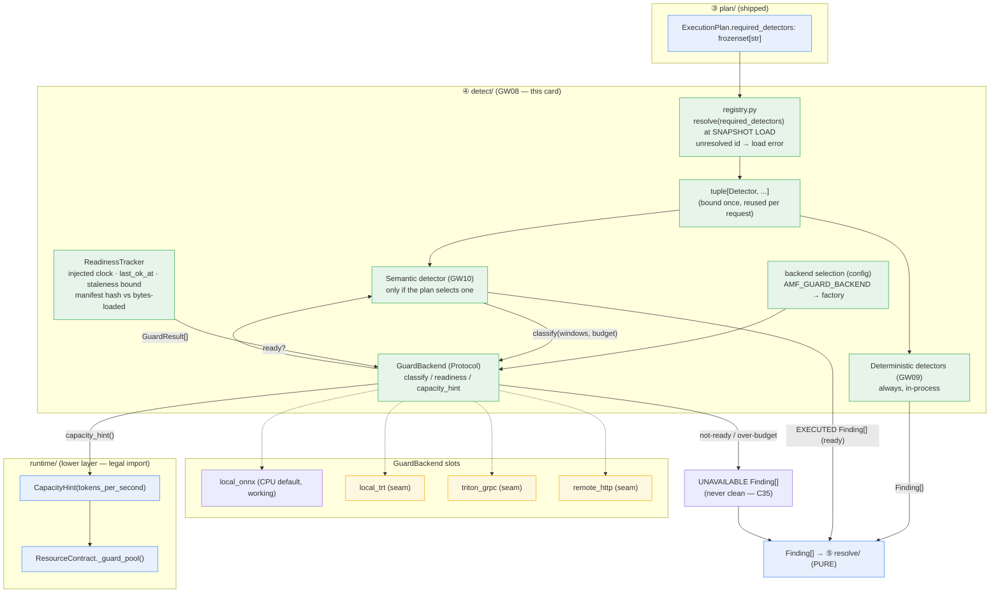

# Design Document

## Overview

GW08 fills the `gateway_v2.detect` layer with the **detector framework** and the **GuardBackend interface**. The objective, verbatim from the runbook card (§10.9), is to *"Make detectors uniform, replaceable and incapable of deciding anything, and make the semantic backend a deployment choice."*

Concretely, GW08 ships:

1. A uniform `Detector` protocol that emits `Finding[]` and nothing else — it cannot import a higher layer (so it cannot reach `edge`), cannot raise HTTP, cannot mutate its input, and cannot decide disposition.
2. A `GuardBackend` protocol (§10.5.4) and its frozen value types (`Budget`, `GuardResult`, `Readiness`), behind which the semantic backend is a deployment choice the detector cannot observe.
3. Four backend slots: `local_onnx` (a working local CPU/fake default for development and CI) plus three declared seams (`local_trt`, `triton_grpc`, `remote_http`).
4. A registry that resolves `ExecutionPlan.required_detectors` ids to `Detector` instances at **snapshot load**, failing the load on an unresolved id.
5. **Reply-based readiness** with the `UNAVAILABLE` safety invariant: a backend that is not ready makes its detectors `UNAVAILABLE`, never clean (C35).
6. `capacity_hint()` returning the shipped `runtime.kinds.CapacityHint` so `runtime/resources.py` derives the guard pool bound from a measured rate.
7. The AST/layer gate posture (an HTTP construct inside `detect/` fails the shipped gate).

GW08 ships **only the framework**. The deterministic detectors (GW09), the semantic detection / windowing / per-request FPR budget (GW10), the real GPU backends and semantic model, and the cloud capacity evidence are all out of scope and enumerated in [Deferred Scope](#deferred-scope).

### Research findings that shape this design

Every claim below was verified against the tree and the runbook; corrections to earlier assumptions are called out.

- **Corrected layer facts — `detect` MAY import `runtime`.** `gateway_v2/pyproject.toml` declares one `layers` contract ordered (highest → lowest): `edge, admit, plan, detect, resolve, dispatch, egress, audit, runtime, contracts, domain`. An import-linter `layers` contract permits a layer to import any **lower** layer. `detect` sits above `runtime`, so **`detect` can legally import `gateway_v2.runtime`** (and `resolve`, `dispatch`, `egress`, `audit`, `contracts`, `domain`). The only *extra* contract is `"Resolve imports only domain"`, which is **resolve-specific** and does not constrain `detect`. The requirements doc (and the `detect/windowing.py` / `detect/holdback.py` docstrings) state "detect imports only domain" — that is a self-imposed discipline those modules chose, **not** the enforced contract. The real, enforced, testable rule is: *`detect` imports no HIGHER layer (`edge`, `admit`, `plan`).* That is the true constraint behind "a detector cannot import `edge` / raise HTTP". This design relies on importing `runtime.kinds.CapacityHint` from `detect`, which is legal.

- **`CapacityHint` already exists and is wired.** `gateway_v2/gateway_v2/runtime/kinds.py` ships `@dataclass(frozen=True, slots=True) class CapacityHint: tokens_per_second: float`. `runtime/resources.py` holds `ResourceContract.guard_capacity: CapacityHint | None` and `_guard_pool()` derives the guard pool as `floor(guard_capacity.tokens_per_second * target_p99_ms/1000)`. GW08 must **reuse** this type, not define a new one. See [Decision B](#decision-b-capacityhint-reuse).

- **Shipped types GW08 builds on (do NOT redefine).** `domain/finding.py` → `Finding(detector, detector_version, category, status, confidence, spans, evidence)`, `FindingStatus(EXECUTED | SKIPPED | UNAVAILABLE)`, `Span(start, end)`; `domain/plan.py` → `ExecutionPlan.required_detectors: frozenset[str]` (compiler-derived) and `Rule.on_unavailable: FailurePosture`; `domain/category.py` → `Category`; `audit/record.py` → `finding_detail()` serializes `finding.detector_version` into every audit row, so `model_hash` flows via `detector_version`.

- **§10.5.4 GuardBackend spec (the source).** The runbook table is:
  ```python
  class GuardBackend(Protocol):
      async def classify(self, windows: Sequence[str], budget: Budget) -> Sequence[GuardResult]: ...
      async def readiness(self) -> Readiness: ...        # includes model_hash
      def capacity_hint(self) -> CapacityHint: ...        # windows/s, queue depth, batch profile
  ```
  The prose: *"`detect/semantic/` calls this and knows nothing about CPU, GPU, TensorRT, Triton, batch size or replica count … `readiness()` returning not-ready means selected semantic rules are UNAVAILABLE, which routes through `on_unavailable`. It never means 'clean'."* The C7/C23/C30/C35 correction adds: frames carry the **remaining budget, not a timestamp** (C30); readiness **requires recent successful replies** (a stuck inference thread otherwise keeps readiness green while FAIL_OPEN tenants run unscanned, C35); model identity is **computed from the bytes actually loaded** and compared with a signed manifest (the prototype advertised a pinned hash while running a different model); engine caches are **keyed by model/TensorRT/driver version**.

- **§10.4 lifecycle step ④.** `detect/` runs the plan-selected input detectors: *"deterministic detectors: always, in-process; semantic detectors: only if the plan selects one; each returns `Finding[]` with status `EXECUTED | SKIPPED | UNAVAILABLE`."* The resolver at ⑤ is pure and consumes those findings; `detect` never decides.

- **The HTTP AST gate.** `gateway_v2/lint/check_http_outside_edge_resolve.py` sets `ALLOWED_TOP = {"edge", "resolve"}` and flags `HTTPException`, `JSONResponse`, and `status_code=` constants in 400–499. `detect` is not in the allow-list, so an HTTP construct under `detect/` makes the gate exit 1 — exactly LGW08-5.

- **House async idiom.** The suite runs async via a local helper `def _run[T](coro: Awaitable[T]) -> T: return asyncio.run(coro)`, with seeded `random.Random`, ≥ 10,000 iterations, and **no** `hypothesis` (confirmed across `tests/admit`, `tests/runtime`, `tests/state_control`). `tests/detect/__init__.py` already exists.

### Design decisions

<a id="decision-a-module-layout"></a>
**Decision A — module layout.** The stubs to fill are the current 3-line placeholders. Placement:

| Piece | Module | Rationale |
|---|---|---|
| `Detector` protocol, `DetectorContext`, re-export of `Finding`/`FindingStatus` | `detect/base.py` | The card names `base.py` for "Detector protocol, Finding, FindingStatus". |
| `GuardBackend` protocol, `Budget`, `GuardResult`, `Readiness`, `BackendCapacity`, `ReadinessTracker` | `detect/guard/backend.py` | §10.5.4 names the GuardBackend contract and its value types together. |
| The **registry** (`required_detectors → tuple[Detector, ...]` at snapshot load) + the backend selection | `detect/registry.py` (**new**) | Chosen over `base.py`. `base.py` holds the *protocol* (a type); the registry holds *registration state and a selection policy* (behaviour). Separating them keeps `base.py` a pure contract module and gives the registration map and the config-driven backend selection one home. This mirrors how `holdback.py`/`windowing.py` separate the contract (`windowing`) from the logic (`holdback`). |
| `local_onnx` working CPU/fake backend | `detect/guard/local_onnx.py` | Named slot; the CI default. |
| `local_trt`, `triton_grpc`, `remote_http` declared seams | their existing files | Named slots; GPU/network impls deferred. |
| Package exports | `detect/guard/__init__.py` | Public surface for the registry + semantic detector. |

`capacity_hint()` returns `runtime.kinds.CapacityHint` imported into `detect` (legal — `runtime` is a lower layer).

<a id="decision-b-capacityhint-reuse"></a>
**Decision B — `CapacityHint` reuse (option a).** The §10.5.4 comment asks `capacity_hint()` to report *"windows/s, queue depth, batch profile"*, but the shipped `CapacityHint` carries only `tokens_per_second` and is already wired into `_guard_pool()`. Extending the shipped type (option b) would ripple into `resources.py`, `from_signals`, `load_contract`, `snapshot`, and the GW03 tests for no contract benefit. **Chosen (a):** `GuardBackend.capacity_hint() -> runtime.kinds.CapacityHint`, where `tokens_per_second` is the **measured guard service rate** that feeds `ResourceContract._guard_pool`. The richer *windows/s + queue depth + batch profile* detail that the owner measures lives on a separate **detect-local `BackendCapacity`** value type; `tokens_per_second` is **derived from** its measured `windows_per_second` (one window ≈ one guard token for pool-sizing purposes). This keeps the single contract-facing type intact, keeps capacity numbers out of `detect` (they stay derived from measurement, satisfying R7.4), and still carries the full owner-reported profile for telemetry.

<a id="decision-c-registry-home"></a>
**Decision C — registry home.** See Decision A: `detect/registry.py` (new), not `base.py`.

<a id="decision-d-selection"></a>
**Decision D — config-only backend selection.** Selection is a deployment env/config value (e.g. `AMF_GUARD_BACKEND`) → a backend **factory** in the registry's registration map. No source edit swaps a backend; swapping changes the model identity that the chosen backend loads, so `model_hash` (hence every `Finding.detector_version` and every audit row) changes accordingly. See [Config-only backend swap](#config-only-backend-swap).

## Architecture



Flow in words: `plan.required_detectors` (shipped) feeds the registry, which — **once, at snapshot load** — resolves each id to a `Detector` instance (an unresolved id fails the load). The resulting `tuple[Detector, ...]` is reused per request. Deterministic detectors run in-process (GW09); a semantic detector (GW10), if the plan selected one, calls `GuardBackend.classify(windows, budget)` and maps the returned `GuardResult[]` to `Finding[]`. If the backend is not ready (per the `ReadinessTracker` on an injected clock) or a `classify` exceeds its `Budget`, the detector emits `UNAVAILABLE` findings — never clean. All findings flow to the pure resolver at ⑤; `detect` decides nothing. `capacity_hint()` returns a measured `CapacityHint` that `ResourceContract._guard_pool()` consumes.

### Layer posture (corrected)

`detect` imports **no higher layer** (`edge`, `admit`, `plan`). It imports lower layers as needed; GW08 uses `domain` (Finding, plan, category) and `runtime` (`CapacityHint`) — both legal. The import-linter `layers` contract and the three AST gates (`check_http_outside_edge_resolve`, `check_frozen_dataclasses`, `check_no_module_mutable`, `check_capacity_literals`) hold the posture. No module under `detect/` may contain an HTTP construct.

## Components and Interfaces

### `detect/base.py` — the Detector contract

```python
from __future__ import annotations
from dataclasses import dataclass
from typing import Protocol, runtime_checkable
from gateway_v2.domain.finding import Finding, FindingStatus, Span  # re-exported
from gateway_v2.domain.plan import Phase, Rule

@dataclass(frozen=True, slots=True)
class DetectorContext:
    """The plan-derived context a detector receives. Carries WHAT the detector is
    selected for and HOW long it may take — never which backend is active."""
    phase: Phase                       # input | output
    rules: tuple[Rule, ...]            # the rules this detector is selected for
    budget: "Budget"                   # remaining time/credit for this invocation (C30)

@runtime_checkable
class Detector(Protocol):
    detector_version: str              # the model_hash for a guard-backed detector
    required_capabilities: frozenset[str]

    def detect(self, text: str, context: DetectorContext) -> tuple[Finding, ...]:
        """Emit findings only. MUST NOT mutate `text`, MUST NOT decide disposition,
        MUST NOT raise HTTP, MUST NOT import a higher layer. A detector that cannot
        execute returns a Finding with status UNAVAILABLE — never an empty tuple
        presented as clean and never a benign EXECUTED finding."""
        ...
```

Hard rules (R1): emits `Finding[]` only; leaves `text` unchanged; never raises HTTP; never decides disposition; `UNAVAILABLE` is a first-class returned status, never coerced to clean or omitted.

### `detect/guard/backend.py` — the GuardBackend contract and value types

```python
from __future__ import annotations
from collections.abc import Sequence
from dataclasses import dataclass
from typing import Protocol, runtime_checkable
from gateway_v2.runtime.kinds import CapacityHint   # lower layer — legal import

@dataclass(frozen=True, slots=True)
class Budget:
    """Remaining time/credit a classify may use. Carries REMAINING budget, not a
    timestamp (C30). `remaining_s` is a duration; there is no absolute-time field.
    `derive(deadline_s, now_s)` is the ONLY place a deadline becomes a remaining
    budget, and it reads `now_s` from an injected clock (R7.3)."""
    remaining_s: float

    @classmethod
    def derive(cls, *, deadline_s: float, now_s: float) -> "Budget":
        return cls(remaining_s=max(0.0, deadline_s - now_s))

@dataclass(frozen=True, slots=True)
class GuardResult:
    """One per window. The semantic detector maps this to a Finding. It names a
    category and a score — never CPU/GPU/batch/replica (R2.7/R2.8)."""
    window_index: int
    category: str                       # a domain.Category spelling
    score: float                        # confidence in [0, 1]

@dataclass(frozen=True, slots=True)
class Readiness:
    """Reply-based readiness (C35). `ready` is True iff a successful reply arrived
    within the staleness bound (computed by ReadinessTracker on an injected clock)."""
    ready: bool
    model_hash: str                     # computed from the bytes actually loaded
    last_ok_at: float | None            # injected-clock time of the last good reply
    reason: str                         # why not-ready (e.g. "manifest_mismatch")

@dataclass(frozen=True, slots=True)
class BackendCapacity:
    """Decision B: the owner's full measured profile. `tokens_per_second` for the
    ResourceContract is DERIVED from windows_per_second."""
    windows_per_second: float
    queue_depth: int
    batch_profile: str

    def to_capacity_hint(self) -> CapacityHint:
        return CapacityHint(tokens_per_second=self.windows_per_second)

@runtime_checkable
class GuardBackend(Protocol):
    async def classify(self, windows: Sequence[str], budget: Budget) -> Sequence[GuardResult]: ...
    async def readiness(self) -> Readiness: ...
    def capacity_hint(self) -> CapacityHint: ...
```

The semantic detector (GW10) maps `GuardResult[]` → `Finding[]` and never observes which backend is active; `GuardResult`, `Readiness`, and `Budget` carry no backend-kind/topology field (R2.8). `model_hash` is model **identity**, not topology.

### `detect/guard/backend.py` — `ReadinessTracker` (the readiness mechanism)

```python
@dataclass(frozen=True, slots=True)
class ReadinessTracker:
    """Pure, deterministic given injected time. A backend is ready iff:
      (1) the bytes actually loaded hash-match the signed manifest, AND
      (2) a successful reply was recorded within `staleness_bound_s`.
    A hung/alive thread with no recent reply reads not-ready (C35)."""
    staleness_bound_s: float
    manifest_hash: str

    def record_ok(self, now_s: float, last_ok_at: float | None) -> float:
        """Return the new last_ok_at (= now_s). Pure; the caller holds the value."""
        return now_s

    def is_ready(self, *, now_s: float, last_ok_at: float | None, loaded_hash: str) -> bool:
        if loaded_hash != self.manifest_hash:         # R5.6/R5.7: manifest/corrupt-cache
            return False
        if last_ok_at is None:                         # R5.4: no reply yet
            return False
        return (now_s - last_ok_at) <= self.staleness_bound_s   # R5.3
```

- **R5.3/5.4 reply-based readiness.** `is_ready` is True only when a reply landed within the bound. "Thread alive" is never an input — only `last_ok_at`.
- **R5.5/5.8 bounded unavailability + budget timeout.** A `classify` whose injected-clock elapsed exceeds its `Budget.remaining_s` resolves to `UNAVAILABLE` within the bound; the semantic detector maps that to an `UNAVAILABLE` finding distinct from a clean `EXECUTED`.
- **R5.6/5.7 manifest/corrupt cache.** `loaded_hash != manifest_hash` → not-ready, refuse to serve; the backend never swaps in a different working model's hash as the selected one.
- **R5.10 hash change.** A new `model_hash` is a new version; caches keyed by the old hash miss (the registry/backend keys any per-model cache by `model_hash`).

### `detect/registry.py` — the registry and backend selection

```python
from __future__ import annotations
from collections.abc import Callable, Mapping
from types import MappingProxyType
from gateway_v2.detect.base import Detector
from gateway_v2.detect.guard.backend import GuardBackend

class UnknownDetectorError(KeyError):
    """A required_detectors id with no registration. Fails the snapshot load."""

# Registration map: detector id → factory. Immutable (R7.5, MappingProxyType — the
# house idiom holdback.TRADE_OFF uses). A guard-backed factory closes over the
# selected GuardBackend, binding a semantic detector to its chosen backend.
_REGISTRY: Mapping[str, Callable[[GuardBackend], Detector]] = MappingProxyType({ ... })

def resolve_required_detectors(
    required: frozenset[str], *, backend: GuardBackend,
) -> tuple[Detector, ...]:
    """Resolve EVERY id to an instance at SNAPSHOT LOAD (R4.1/4.2). An unresolved id
    raises UnknownDetectorError naming it — fail at load, never silently drop (R4.3).
    Resolution is total: all ids resolve, or the whole load fails."""
    out: list[Detector] = []
    for det_id in sorted(required):
        factory = _REGISTRY.get(det_id)
        if factory is None:
            raise UnknownDetectorError(det_id)
        out.append(factory(backend))
    return tuple(out)

def select_backend(config: Mapping[str, str]) -> GuardBackend:
    """Decision D: AMF_GUARD_BACKEND → a backend factory. Config-only; no source
    edit. Unset → local_onnx (the CI default, R3.2)."""
    ...
```

Resolution happens once per snapshot; the returned tuple is reused per request. `select_backend` reads config, so swapping the backend is a deployment action (R3.5) and the resulting `model_hash` differs (R3.6).

### `detect/guard/local_onnx.py` — the CPU default (working)

`local_onnx` is the CI default and ships a **working** local backend with **real** readiness/`model_hash`/capacity behaviour — never fabricated clean results (R3.3). The real ONNX model load/inference is a declared seam: the backend computes `model_hash` from the **bytes it actually loads** (a backing blob — a bytes-hashed stub or a deterministic CPU classifier is acceptable), compares it to the signed manifest, drives a `ReadinessTracker` on an injected clock, and reports a `BackendCapacity` from a measured window rate. A clean `EXECUTED` result is produced only when the backend is genuinely ready.

### `detect/guard/{local_trt,triton_grpc,remote_http}.py` — declared seams

Each seam is honest about being deferred: `readiness()` returns `ready=False` with a `reason` naming the deferral (e.g. `"deferred_gpu_backend"`), and `classify()` raises a clear deferred-backend error. A seam **must not** pretend to be ready and must not return a clean `EXECUTED` result (R3.4). Real GPU (`local_trt`, `triton_grpc`) and real off-box transport (`remote_http`) are deferred to the GPU fleet / GW25.

### `detect/guard/__init__.py` — exports

Exports `GuardBackend`, `Budget`, `GuardResult`, `Readiness`, `BackendCapacity`, `ReadinessTracker`, and the four backend factories, so `registry.py` and the semantic detector (GW10) import from one surface.

### `capacity_hint` → `ResourceContract` (R6)

`GuardBackend.capacity_hint()` returns `CapacityHint(tokens_per_second=<measured>)`, where the number is `BackendCapacity.windows_per_second` (measured at warm-up), never a literal. Direction: `from_signals(..., guard_capacity=backend.capacity_hint())` → `ResourceContract._guard_pool()` → `floor(tokens_per_second * target_p99_ms/1000)`. The capacity number stays in `runtime/resources.py`'s derivation; `detect` holds no capacity literal (R6.2/R7.4). A changed measurement yields a changed hint and hence a changed bound (R6.3).

<a id="config-only-backend-swap"></a>
### Config-only backend swap (LGW08-2)

`select_backend(config)` maps `AMF_GUARD_BACKEND` to a factory. Changing the env value selects a different backend with different backing bytes → a different `model_hash` → different `Finding.detector_version` → a different audit row (`audit/record.py:finding_detail` already serializes `detector_version`). No source file is edited.

### The AST gate (LGW08-5, R7.8)

`lint/check_http_outside_edge_resolve.py` already excludes `detect` from `ALLOWED_TOP = {"edge", "resolve"}`, so any `HTTPException` / `JSONResponse` / `status_code=4xx` under `detect/` makes the gate exit 1. GW08 introduces no HTTP in `detect/`, and a test asserts the gate catches a **planted** violation written to a temporary module tree (never committed), while confirming the real `detect/` scans clean.

## Data Models

All GW08 value types are `@dataclass(frozen=True, slots=True)` (R7.1); `CapacityHint` is the shipped type (already frozen/slots).

| Type | Module | Fields | Notes |
|---|---|---|---|
| `DetectorContext` | `detect/base.py` | `phase: Phase`, `rules: tuple[Rule, ...]`, `budget: Budget` | The plan context a detector receives. |
| `Budget` | `detect/guard/backend.py` | `remaining_s: float` | Remaining duration, **not** a timestamp (C30). `derive(deadline_s, now_s)` on an injected clock. |
| `GuardResult` | `detect/guard/backend.py` | `window_index: int`, `category: str`, `score: float` | Per-window; mapped to a `Finding`. |
| `Readiness` | `detect/guard/backend.py` | `ready: bool`, `model_hash: str`, `last_ok_at: float \| None`, `reason: str` | Reply-based (C35). |
| `BackendCapacity` | `detect/guard/backend.py` | `windows_per_second: float`, `queue_depth: int`, `batch_profile: str` | Owner's measured profile; `to_capacity_hint()` → `CapacityHint`. |
| `ReadinessTracker` | `detect/guard/backend.py` | `staleness_bound_s: float`, `manifest_hash: str` | Pure given injected time. |
| `CapacityHint` | `runtime/kinds.py` (**shipped**) | `tokens_per_second: float` | **Reused**, not redefined. Fed to `_guard_pool`. |
| `Finding`, `FindingStatus`, `Span` | `domain/finding.py` (**shipped**) | — | Re-exported from `base.py`; not redefined. |

Serialization for the round-trip property (R8.7): each new value type round-trips through a tuple/mapping form (`dataclasses.asdict` → `from_mapping`), such that `decode(encode(v)) == v`.

## Correctness Properties

*A property is a characteristic or behavior that should hold true across all valid executions of a system — essentially, a formal statement about what the system should do. Properties serve as the bridge between human-readable specifications and machine-verifiable correctness guarantees.*

PBT applies here: the framework's pure logic (readiness, budget resolution, model-hash identity, the registry's totality, and the value-type round-trips) has clear input/output behaviour with universal properties over a large input space. The async surface (`classify`/`readiness`) is driven deterministically via the house `asyncio.run` helper with injected time. The following set is consolidated from the prework (redundant criteria merged): the three UNAVAILABLE-safety criteria (1.6/5.1/5.2) are one property; the readiness criteria (5.3/5.4) are one; the budget/bounded-time criteria (5.5/5.8) are one; the manifest criteria (5.6/5.7) are one; the model-identity criteria (3.3/3.6/5.10) are one; the measured-capacity criteria (6.1/6.3) are one; the registry criteria (4.1/4.3) are one.

### Property 1: A not-ready backend always yields UNAVAILABLE, never clean

*For all* input text and *for all* backends reporting not-ready, every `Finding` produced by that backend's semantic detector has `status == UNAVAILABLE`, the returned tuple is non-empty, and no finding is a clean/benign `EXECUTED` result.

**Validates: Requirements 1.6, 5.1, 5.2**

### Property 2: Readiness is reply-based and monotone-correct under the injected clock

*For all* sequences of successful-reply times and *for all* query times `now`, `is_ready(now, last_ok_at, loaded_hash)` is True **iff** the loaded hash matches the manifest **and** a successful reply occurred within the staleness bound (`now - last_ok_at <= staleness_bound_s`). A backend object that is "alive" but has no reply within the bound reads not-ready.

**Validates: Requirements 5.3, 5.4**

### Property 3: A classify that exceeds its Budget resolves to UNAVAILABLE within the bound

*For all* budgets and *for all* classify calls whose injected-clock elapsed exceeds `budget.remaining_s`, the result resolves to `UNAVAILABLE` within the bounded time, and that `UNAVAILABLE` status is distinct from a clean `EXECUTED` pass.

**Validates: Requirements 5.5, 5.8**

### Property 4: A manifest mismatch always fails closed

*For all* loaded-byte blobs and *for all* signed manifests, when `hash(bytes_loaded) != manifest_hash` the backend reports not-ready and refuses to serve (its detectors yield `UNAVAILABLE`), and it never presents a different working model's hash as the selected one; when the hashes match, the backend may report ready.

**Validates: Requirements 5.6, 5.7**

### Property 5: Model identity is deterministic, distinguishing, and cache-invalidating

*For all* backing-byte blobs, `model_hash` is a deterministic function of the bytes (same bytes → same hash; different bytes → different hash with overwhelming probability), and *for all* pairs of distinct hashes, a per-model cache keyed by `model_hash` returns no entry for a prior hash after the hash changes under a running process.

**Validates: Requirements 3.3, 3.6, 5.10**

### Property 6: capacity_hint reports a measured rate, not a constant

*For all* measured owner profiles (`windows_per_second`, `queue_depth`, `batch_profile`), `capacity_hint().tokens_per_second` equals the derivation of that measured `windows_per_second` and varies with it (monotone in the measurement), never a fixed literal.

**Validates: Requirements 6.1, 6.3**

### Property 7: The registry resolves totally or fails the load

*For all* subsets of the registered ids presented as `required_detectors`, resolution returns a tuple with exactly one `Detector` per id; *for all* `required_detectors` containing an id absent from the registration map, resolution raises an error at snapshot load naming the unresolved id (no silent drop, no per-request resolution).

**Validates: Requirements 4.1, 4.3**

### Property 8: model_hash appears in every produced Finding and audit row

*For all* classify runs that produce findings, every `Finding.detector_version` equals the backend's current `model_hash`, and the audit `finding_detail` row for each finding carries the same `detector_version` string.

**Validates: Requirements 5.9**

### Property 9: A detector leaves its input text unchanged

*For all* input text, after `detect(text, context)` the input text is unchanged (byte-identical), and the detector returns findings without mutating or re-presenting a mutated copy of its input.

**Validates: Requirements 1.3**

### Property 10: Value types round-trip

*For all* instances of each frozen value type (`Budget`, `GuardResult`, `Readiness`, `CapacityHint`), decoding an encoded value produces an equivalent value (`decode(encode(v)) == v`).

**Validates: Requirements 8.7**

## Error Handling

- **Not-ready / over-budget / manifest mismatch / corrupt cache / dead-or-wedged owner** → the semantic detector emits `UNAVAILABLE` findings (never clean, never omitted). This is the fail-closed core (C35). The resolver at ⑤ then applies the rule's `on_unavailable: FailurePosture`; `detect` never decides.
- **Unresolved detector id at snapshot load** → `UnknownDetectorError(det_id)` raised during resolution, failing the load. Resolution is total: all ids resolve or the whole load fails (never a silent per-id drop).
- **Declared-seam `classify`** → a clear deferred-backend error (not a clean result); the seam's `readiness()` is already not-ready, so a correctly-wired caller never calls `classify` on a seam without first routing through `UNAVAILABLE`.
- **No HTTP anywhere in `detect/`** → a detector cannot raise HTTP; errors surface as `UNAVAILABLE` findings or load-time exceptions, never as an HTTP construct (enforced by the AST gate).
- **Injected clock** → all elapsed-time decisions (readiness staleness, budget timeout) read `now_s` from an injected clock in pure logic; no wall-clock call sits in the pure path (R7.3), so the bounded-unavailability and readiness behaviour is deterministic and testable.

## Testing Strategy

**Single test file:** all GW08 tests live in `gateway_v2/tests/detect/test_detector_framework_gw08.py`. The `tests/detect/__init__.py` package already exists (no new package file needed). Async cases use the shipped idiom — a local `def _run[T](coro: Awaitable[T]) -> T: return asyncio.run(coro)` helper — and property tests use a seeded `random.Random` with the seed logged in each assertion message, **no `hypothesis`**.

**Property tests (≥ 100 iterations; house target ≥ 10,000).** One property-based test per correctness property (Properties 1–10), each tagged `# Feature: detector-framework-gw08, Property N: <text>`:

- P1 — not-ready `FakeGuardBackend` + random text → all findings `UNAVAILABLE`, non-empty, none `EXECUTED`.
- P2 — random reply/query schedules on an injected clock → `is_ready` matches the staleness/manifest predicate exactly; the "alive but stale" case is in the generators.
- P3 — random budgets + injected elapsed > budget → `UNAVAILABLE` within the bound, distinct from `EXECUTED`.
- P4 — random bytes + mismatched manifest → not-ready / refuse; matching → ready-eligible; no substitute hash.
- P5 — random byte blobs → deterministic, distinguishing `model_hash`; a hash change misses the old-keyed cache entry.
- P6 — random measured `BackendCapacity` → `capacity_hint().tokens_per_second` tracks the measurement; wired into `ResourceContract._guard_pool`.
- P7 — random id subsets resolve totally; random unknown ids fail the load naming the id.
- P8 — random classify runs → every `Finding.detector_version` == `model_hash` and the audit `finding_detail` row matches.
- P9 — random text → input unchanged after `detect`.
- P10 — random instances of each value type → `decode(encode(v)) == v`.

**Example / conformance tests** (specific examples, edge cases, integration points):

- `Detector` and `GuardBackend` are `runtime_checkable` `Protocol`s; a conforming fake `isinstance`-passes (R1.1/1.2/2.1–2.3/7.2).
- `Budget` exposes `remaining_s` and no absolute-time field; `derive(deadline_s, now_s)` subtracts injected `now` (R2.5).
- `BackendCapacity` carries `windows_per_second`/`queue_depth`/`batch_profile`; `to_capacity_hint()` returns a `runtime.kinds.CapacityHint` (R2.6, Decision B).
- The four factories register under `local_onnx`/`local_trt`/`triton_grpc`/`remote_http` (R3.1); unset config → `local_onnx`, ready, serving (R3.2); each seam → not-ready with a deferral reason and a deferred-error `classify` (R3.4).
- Config-only swap: varying `AMF_GUARD_BACKEND` selects a different factory → different `model_hash` on findings and audit, no source edit (R3.5/3.6, LGW08-2).
- The registry resolves once per snapshot (a counting factory) and reuses the tuple per request (R4.2, LGW08-3/4 driven by the `FakeGuardBackend`).
- The semantic detector source references none of CPU/GPU/TensorRT/Triton/batch/replica and imports only the `GuardBackend` protocol (R2.7/2.8).

**Gate / AST tests (integration):**

- The HTTP AST gate catches a **planted** violation in a temp `detect`-named module and reports the real `detect/` clean (R7.8, LGW08-5).
- `check_frozen_dataclasses`, `check_no_module_mutable`, `check_capacity_literals`, `check_http_outside_edge_resolve` each exit 0 over the package (R7.1/7.4/7.5/7.6).
- `lint-imports` reports the layers contract kept; a test asserts `detect` modules import no `gateway_v2.edge`/`admit`/`plan` and that importing `runtime.kinds` is present and legal (R7.7, **corrected** — not "only domain").
- `domain.channels.unscanned_channels() == ()` (R8.6).

**The exit Gate (R8), run from cwd `gateway_v2` under `.venv`:**

1. Full `pytest` green — baseline **1730 passed / 95 skipped / 1 xfailed**, plus the new GW08 tests, zero failures.
2. `mypy --strict` success.
3. `ruff check gateway_v2 state_control audit_control load_harness lint tests` success.
4. `lint-imports` — all import contracts kept (the `layers` contract, which **permits** `detect → runtime`; the only extra forbidden contract is the resolve-specific one, which does not constrain `detect`).
5. Each AST gate exits 0.
6. `unscanned_channels() == ()`.

**Why not property-test the rest.** The protocol-shape, attribute-presence, four-slot existence, config-swap, layer, and gate criteria do not vary meaningfully with input (they are static or one-shot), so they are example / integration / smoke tests rather than property tests.

<a id="deferred-scope"></a>
## Deferred Scope

GW08 delivers only the framework, the `GuardBackend` interface, the local CPU/fake backends, the registry, readiness, `capacity_hint`, and the AST gate (R9.7). Explicitly deferred:

- **LGW08-1** (identical detection suite on all four backends) → **GW15** (R9.1).
- **LGW08-6** (backend degrades to half throughput; admission bounds respond) → **GW19** (R9.2).
- Real GPU `local_trt` / `triton_grpc` and real off-box `remote_http` transport, plus the real semantic guard model and engine/TensorRT caches → **GPU fleet / GW25** (R9.3/9.4). The slots ship as honest declared seams.
- **C43** push-coalescing owner-CPU microbenchmark (36/120/240 subscribers) and the **G-09** knee re-measure → **cloud evidence** of the GW08 v3 amendment. R2-23's local push-coalescing is already complete elsewhere (R9.5).
- **GW09** deterministic detectors and **GW10** semantic detection / windowing / per-request FPR budget — the cards that *use* this framework (R9.6).

## Requirements Traceability

| Requirement | Design element |
|---|---|
| **1 — Detector protocol** | `detect/base.py`: `Detector` `Protocol` + `DetectorContext`; `detect(text, ctx) -> tuple[Finding, ...]`; emits-only / no-mutate / no-HTTP / no-higher-layer rules; Property 9 (input unchanged), Property 1 (UNAVAILABLE not clean). |
| **2 — GuardBackend protocol + value types** | `detect/guard/backend.py`: `GuardBackend` `Protocol` (`classify`/`readiness`/`capacity_hint`); frozen `Budget` (remaining, C30), `GuardResult`, `Readiness` (model_hash); `BackendCapacity` (Decision B); semantic detector observes no topology. |
| **3 — Four slots + local_onnx CI default** | Four factories in `detect/guard/*`; `select_backend` (Decision D); working `local_onnx`; honest seams; Property 5 (model identity on swap), LGW08-2. |
| **4 — Registry** | `detect/registry.py`: `resolve_required_detectors` at snapshot load, total-or-fail; Property 7. |
| **5 — Reply-based readiness + UNAVAILABLE safety** | `ReadinessTracker` (injected clock, manifest hash); `UNAVAILABLE` on not-ready/over-budget/mismatch; Properties 1–5, 8; model_hash via `detector_version`. |
| **6 — capacity_hint feeds ResourceContract** | `capacity_hint() -> CapacityHint` (measured, Decision B) → `_guard_pool`; Property 6. |
| **7 — Purity, layer contract, HTTP AST gate** | Frozen/slots value types; `Protocol`s; injected clock; no capacity literal / no module-level mutable / no HTTP in `detect`; **corrected** layer rule (no higher layer; `runtime` import legal); AST + lint-imports gates. |
| **8 — The exit gate** | Testing Strategy "exit Gate"; Property 10 (round-trip, R8.7). |
| **9 — Deferred scope** | [Deferred Scope](#deferred-scope). |
