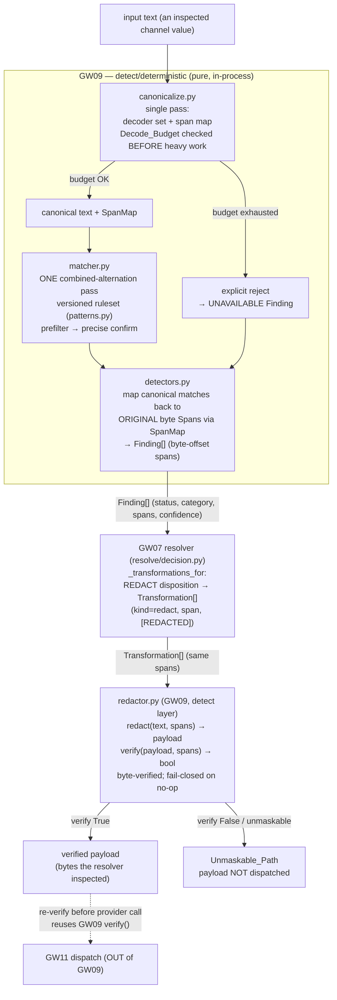

# Design Document

## Overview

GW09 fills the empty `gateway_v2/gateway_v2/detect/deterministic/` package with the deterministic PII / secret / credential / injection-command detectors that run **in-process, pure, and local** behind the shipped `gateway_v2.detect.base.Detector` protocol (GW08, DONE). It removes two v1 defects named in the runbook card (§10.9, `## GW09 — Implement deterministic detectors with byte-verified redaction`, ~L5058, plus its v2.1 CORRECTION C21/C26):

1. **Two redactors, one wire.** v1 decided REDACT against `INPUT_SCANNER.redact_pii` on a flattened prompt while the wire was produced by `llm_router._apply_redaction → patterns.redact_all` (its own docstring: "by construction WEAKER"). GW09 ships **exactly one redactor** whose output is **byte-verified** against the finding spans: a redaction that did not remove what it claimed is a failure (fail-closed), not a pass.
2. **A bare backtick pair hard-blocked benign code.** `ATTACK_PATTERNS["command_injection"]` matched any `` `[^`]+` `` and terminally blocked 5 of 5 benign inline-code prompts. GW09 **demotes injection and command patterns from a terminal block to a signal** — they contribute a Finding only; the plan/resolver decides the action. This is a §10.2.2 behaviour change requiring a Ledger_Note and a C3 score.

The card's third defect, C26, is the **canonicalization cost** problem: an 18× NFKC-expanding 1 MiB body cost 7.4 s of event-loop CPU because the heavy decode ran *before* any size/expansion rejection. GW09's canonicalization enforces a **Decode_Budget evaluated before the expansion-heavy work**, and on exhaustion **explicitly rejects** rather than silently truncating.

### Scope (local half)

GW09 owns: the single canonicalization pass (with a span map and a bounded decode budget), the single multi-pattern matcher, the detector classes that emit `Finding[]` with byte-offset spans, the one byte-verified redactor plus its reusable `verify` function, the Ledger_Note, and a labeled local Fixture_Corpus with a per-family recall/FPR scorer.

GW09 does **not** own (R11): the dispatch-layer re-verify before the provider call (GW11 — GW09 provides the `verify` function it reuses), the streaming/recorder PII-redact assertion (LGW09-2 → GW15), the Hyperscan engine (perf deferral; `re` is the local default), the full production C3 corpus (deferred; a representative local corpus is built), the GW02 parity-harness machinery (deferred; the Ledger_Note still ships), and the semantic detector + real guard model (GW10, excluded).

### Grounding summary (verified against the tree, do not redefine)

- `detect/base.py` — `Detector` is a `@runtime_checkable Protocol`: `detector_version: str`, `required_capabilities: frozenset[str]`, `detect(self, text: str, context: DetectorContext) -> tuple[Finding, ...]`; `DetectorContext(phase, rules, budget)`. Hard rules: emit `Finding[]` only; never mutate `text`; never decide disposition; never raise HTTP; never import a higher layer. A detector that cannot execute returns `status=UNAVAILABLE`, never an empty tuple presented as clean.
- `domain/finding.py` — frozen `Finding(detector, detector_version, category, status, confidence, spans, evidence)`; `FindingStatus(EXECUTED | SKIPPED | UNAVAILABLE)`; `Span(start, end)`. `__post_init__`: an `EXECUTED` finding **requires** a non-`None` `confidence`; any non-`EXECUTED` finding (incl. `UNAVAILABLE`) **requires** `confidence is None`; `evidence` capped at 256 chars.
- `domain/category.py` — `Category` members GW09 emits: `PII`, `SECRET`, `CREDENTIAL`, `COMMAND`, `PROMPT_INJECTION`, `JAILBREAK`. GW09 adds none.
- `domain/decision.py` — frozen `Transformation(kind, span, replacement)`. The GW07 resolver (`resolve/decision.py`) builds these from finding spans via `_transformations_for`.
- `egress/output_guard.py` — `REDACTION_PLACEHOLDER = "[REDACTED]"` (re-declared locally in `resolve/decision.py`, pinned equal by a test); `apply_decision` applies transformations fail-closed.
- `audit/record.py` — serializes finding **span offsets** + `detector_version`, never the raw matched value; `Finding.evidence` is deliberately never serialized.
- `detect/holdback.py` — the house idiom GW09 mirrors: `from __future__ import annotations`, `re`, frozen `@dataclass(frozen=True, slots=True)`, `MappingProxyType` immutable tables, a `# Reference` note citing an evidence snapshot (self-contained COPIES of patterns, not imports), a tuple `__all__`; imports only `gateway_v2.domain` + sibling `gateway_v2.detect.*`.
- `domain/channels.py` — `unscanned_channels()` must stay `()`.
- The AST gates in `gateway_v2/lint/` and the `pyproject.toml` import-linter layer contract (`detect` above `resolve`/`egress`/`domain`); R8.7 further restricts GW09 to `gateway_v2.domain` + `gateway_v2.detect.*` only.

## Architecture

### Data flow



The single enforcement authority principle (one canonicalization, one matcher, one redactor) is the spine. The resolver and the redactor operate over the **same span space**: the detector emits byte-offset spans into the inspected text, the resolver builds `Transformation`s from exactly those spans, and the redactor transforms + verifies exactly those spans. There is no second redactor and no second span space.

### Layering

Every GW09 module declares `from __future__ import annotations` and imports only `gateway_v2.domain` and sibling `gateway_v2.detect.*` modules (R8.7). The `[REDACTED]` placeholder is re-declared locally (detect may not import `egress`/`resolve`), pinned equal to `egress.output_guard.REDACTION_PLACEHOLDER` by a test, exactly as `resolve/decision.py` and `detect/holdback.py` already do for cross-layer constants.

## Components and Interfaces

Module layout in `gateway_v2/gateway_v2/detect/deterministic/`. The split preserves **one canonicalization, one matcher pass, one redactor**.

### `canonicalize.py` — the single canonicalization pass + span map + decode budget (R2, C26)

```python
REDACTION_PLACEHOLDER: str = "[REDACTED]"  # re-declared locally; pinned == egress

@dataclass(frozen=True, slots=True)
class SpanMap:
    """Maps a canonical-space [start, end) back to an original-text byte Span."""
    def to_original(self, canonical_start: int, canonical_end: int) -> Span: ...

@dataclass(frozen=True, slots=True)
class DecodeBudget:
    """Declared bound on canonicalization cost. Carries no capacity field (R8.4);
    its bound comes from a module-level named constant, not a dataclass field."""
    def within(self, text: str) -> bool: ...   # the CHEAP pre-check (R2.6)

class BudgetExceeded(Exception):
    """A LOCAL sentinel, never an HTTP error. Caught inside detect/deterministic and
    mapped to an UNAVAILABLE Finding; it never escapes the detect layer."""

def canonicalize(text: str, budget: DecodeBudget) -> tuple[str, SpanMap]:
    """ONE pass. (1) Evaluate the Decode_Budget CHEAP pre-check (size / expansion
    ratio / part counts) BEFORE any expansion-heavy decode (R2.6, the C26 fix); on
    exhaustion raise BudgetExceeded (R2.5 — explicit reject, never silent truncation).
    (2) Apply the ordered Decoder_Set once, accumulating a SpanMap. Pure."""
```

The ordered **Decoder_Set** (R2.2), applied once with span-map accumulation:

1. Percent-encoding **including double `%`-encoding** (`%2541` → `%41` → `A`)
2. HTML entities (`&#64;`, `&amp;`)
3. base64 (bounded expansion segments)
4. fullwidth → ASCII fold
5. zero-width / `Default_Ignorable` / `Mn` combining-mark strip (the full category, not the 22-of-2,155 subset v1 shipped)
6. `\u` escape unescape
7. Cyrillic / confusable homoglyph fold
8. RTL-reversed-key normalization
9. "at"/"dot" email de-obfuscation

**Span map.** Each decoder records, per emitted canonical character, the `[start, end)` byte range in the *original* text it came from. `SpanMap.to_original` collapses a canonical match range to the minimal original `Span` covering it. The invariant: the original `Span` returned, when redacted in the **original** text, removes the planted sensitive bytes (P2).

**Decode budget before heavy work (C26).** `DecodeBudget.within(text)` is the cheap, authentication-independent pre-check (length, cheap expansion-ratio estimate, part counts). `canonicalize` evaluates it **first**; only if it passes does the expansion-heavy decode run. An over-budget body never reaches the heavy pass — it raises `BudgetExceeded`, which `detectors.py` catches and maps to an `UNAVAILABLE` Finding. There is no silent truncation path.

### `patterns.py` — the versioned, hashed deterministic ruleset (R3, R4, R8.3)

```python
class PatternKind(StrEnum):
    REDACTABLE = "redactable"   # a value pattern whose span is a redaction target
    SIGNAL = "signal"           # an injection/command signal; never a redaction target

@dataclass(frozen=True, slots=True)
class PatternSpec:
    name: str
    category: Category          # a shipped domain Category member
    kind: PatternKind
    prefilter: str              # fast superset regex (R3.3)
    precise: str                # precise confirming regex
    detector_name: str          # the family detector that owns it

RULESET: Mapping[str, PatternSpec] = MappingProxyType({ ... })   # immutable (R8.5)

def ruleset_version() -> str:
    """sha256 over the serialized (name, category, kind, prefilter, precise) tuples,
    sorted by name. Same ruleset → same version; any pattern change → changed
    version (R8.3, the rollback/versioned-hashed rule)."""
```

Pattern families and their shipped `Category` (R4) — patterns are **self-contained copies** adapted from the evidence snapshot `rvproto/detect/...` with a `# Reference` note, never imports:

| Family | `Category` | `PatternKind` | Examples |
|---|---|---|---|
| PII | `PII` | `REDACTABLE` | email, phone, SSN-like |
| secret | `SECRET` | `REDACTABLE` | AWS `AKIA`/`ASIA`, generic API key, token |
| credential | `CREDENTIAL` | `REDACTABLE` | PEM/private-key header, card number |
| injection | `PROMPT_INJECTION` / `JAILBREAK` | `SIGNAL` | instruction-override phrases |
| command | `COMMAND` | `SIGNAL` | shell/command constructs — **no bare backtick-pair pattern** |

`REDACTABLE` patterns produce spans the redactor targets. `SIGNAL` patterns (injection/command) emit a Finding only; their spans are never redaction targets and never force a block (R6).

### `matcher.py` — the single multi-pattern matcher (R3)

```python
@dataclass(frozen=True, slots=True)
class RawMatch:
    pattern_name: str
    canonical_start: int
    canonical_end: int

def scan(canonical_text: str) -> tuple[RawMatch, ...]:
    """ONE pass over canonical_text (R3.1/R3.2). A single COMBINED alternation
    regex with a named group per pattern (the prefilter superset) is compiled once
    at import and run with ONE finditer. Each prefilter hit is CONFIRMED by the
    pattern's precise matcher before a RawMatch is emitted (R3.3). No per-pattern
    loop over the text."""
```

**Mechanism.** One combined `re` alternation `(?P<name1>pf1)|(?P<name2>pf2)|...` compiled once at module import; `scan` runs a single `finditer`. `match.lastgroup` identifies the pattern; the match is confirmed against that pattern's `precise` regex before emission. This is single-pass by construction — the invariant is one scan over the text, not N. The combined regex is the superset **prefilter**; the precise confirm removes prefilter-only near-misses (R3.3). The equivalence to a per-family union is Property 6.

**Why `re`, not Hyperscan (R3.4, R11.3).** Python `re` is the local default. The card measures one Hyperscan pass at ~30 µs/5 KB vs `re` at ~1.9 ms, but an `auto` fallback to `re` **loses Unicode word boundaries** — so `re` is chosen deliberately, not as a fallback. Hyperscan is a deferred performance optimization (GW20-class), out of GW09's local scope.

### `redactor.py` — the one byte-verified redactor + reusable verify (R5)

```python
REDACTION_PLACEHOLDER: str = "[REDACTED]"  # re-declared locally; pinned == egress

@dataclass(frozen=True, slots=True)
class RedactResult:
    payload: str
    verified: bool
    unmaskable_spans: tuple[Span, ...]   # spans a safe transform could not cover

def redact(text: str, transformations: Sequence[Transformation]) -> RedactResult:
    """Apply each Transformation's span → replacement over `text`, composing
    left-to-right with overlap detection (mirrors egress.apply_decision). Then
    byte-verify (R5.2). verified is True iff every targeted span's original bytes
    are absent from the result; a span that could not be safely covered is
    recorded in unmaskable_spans and verified is False (fail-closed, R5.3/R5.4)."""

def verify(payload: str, original: str, spans: Sequence[Span]) -> bool:
    """The reusable byte-verify (R5.5). True iff, for every span, the original
    bytes `original[span.start:span.end]` no longer appear in `payload`. A no-op
    transformation leaves the bytes present → False. GW11's dispatch-layer
    re-verify imports and reuses THIS function (R11.2)."""
```

**Reconciliation with the GW07 resolver and egress (no duplicate redactor).** This is the critical interface:

- GW09 detectors emit `Finding[]` with byte-offset spans into the inspected text.
- The **GW07 resolver** (`resolve/decision._transformations_for`, already shipped) maps a REDACT disposition to `Transformation(kind="redact", span, replacement=[REDACTED])`, one per finding span. GW09 does **not** build `Transformation`s and does **not** decide disposition.
- GW09's **`redact`** is the single detect-layer function that produces the transformed bytes **and** the byte-verify, consuming the resolver's `Transformation`s. The egress `apply_decision` already applies transformations to released bytes fail-closed; GW09's contribution is the **span-accurate byte-verify** (`verify`) that proves the transformed bytes removed what the finding claimed.
- So there is **exactly one redactor** (`redactor.py`) and exactly one `verify`. The resolver carries the spans; GW09's `redact`/`verify` is the fail-closed byte authority over those spans; GW11 re-verifies by importing GW09's `verify` before the provider call. No second redactor exists anywhere.

### `detectors.py` — the concrete `Detector`-protocol classes (R1)

A **shared canonicalization, per-family finding emission** — one canonicalization pass feeds several family detectors. This matches the card ("detectors" plural, one canonicalization pass): each family detector is a thin wiring of `canonicalize → matcher → Finding[]`, filtering `matcher.scan` output to its family's patterns.

```python
@dataclass(frozen=True, slots=True)
class _DeterministicBase:
    """Shared wiring. Not a dataclass carrying a capacity field (R8.4)."""
    required_capabilities: frozenset[str] = frozenset()

    @property
    def detector_version(self) -> str:
        return ruleset_version()                     # a hash of the ruleset (R8.3)

    def detect(self, text: str, context: DetectorContext) -> tuple[Finding, ...]:
        try:
            canonical, span_map = canonicalize(text, _BUDGET)
        except BudgetExceeded:
            return (self._unavailable(),)            # R1.6 / R2.5 — never empty-as-clean
        matches = scan(canonical)
        return tuple(self._finding(m, span_map) for m in matches if self._owns(m))

class PiiDetector(_DeterministicBase): ...           # emits category PII
class SecretDetector(_DeterministicBase): ...        # SECRET / CREDENTIAL
class InjectionSignalDetector(_DeterministicBase): ...# PROMPT_INJECTION / JAILBREAK / COMMAND, SIGNAL only
```

Each detector:
- is a concrete class satisfying the `@runtime_checkable Detector` protocol structurally (R1.2);
- exposes `detector_version` (ruleset hash) and `required_capabilities: frozenset[str]` (R1.3);
- never mutates `text` (R1.4 — canonicalize returns a new string, `text` is untouched);
- runs in-process with no `GuardBackend` (R1.5);
- on a cannot-execute condition emits a `Finding(status=UNAVAILABLE, confidence=None, spans=(), evidence=None)` (R1.6 — honouring `Finding.__post_init__`).

A deterministic regex match is emitted as `status=EXECUTED` with a **declared confidence constant `1.0`** (the match is exact; `__post_init__` requires a non-`None` confidence for `EXECUTED`). `evidence` is set to **`None`** (never the raw matched value) — spans + `detector_version` locate the finding; the audit layer keeps offsets, not values.

### `docs/injection-demoted-to-signal.md` — the Ledger_Note (R6.4)

A short markdown deliverable co-located under `detect/deterministic/docs/`, mirroring the B8 declared-failure-behaviour doc convention. It records the §10.2.2 behaviour change: `command_injection`'s bare backtick-pair pattern is removed; injection/command patterns are demoted from terminal block to signal; the plan/resolver now decides the action; the C3 developer-traffic FPR delta is cited.

### `__init__.py` — exports

Replaces the empty stub with a tuple `__all__` exporting the detector classes, `canonicalize`, `scan`, `redact`, `verify`, `ruleset_version`, and the value types.

## Data Models

- **`SpanMap`** (frozen) — canonical `[start, end)` → original `Span`. Internally an immutable tuple of `(canonical_index, original_start, original_end)` records built during the single pass.
- **`DecodeBudget`** (frozen) — bound carried via a module-level named constant, not a dataclass field (R8.4); `within(text) -> bool` is the cheap pre-check.
- **`PatternSpec`** (frozen) — `name, category: Category, kind: PatternKind, prefilter, precise, detector_name`.
- **`RawMatch`** (frozen) — `pattern_name, canonical_start, canonical_end`.
- **`RedactResult`** (frozen) — `payload, verified, unmaskable_spans`.
- Emitted **`Finding`** (shipped, not redefined) — `detector` (family name), `detector_version` (ruleset hash), `category` (shipped member), `status`, `confidence` (`1.0` for EXECUTED, `None` for UNAVAILABLE), `spans` (byte offsets into inspected text), `evidence=None`.

All value types are `@dataclass(frozen=True, slots=True)` (R8.2); `RULESET` is a `MappingProxyType` (R8.5, no module-level mutable); `BudgetExceeded` is a local exception caught inside the layer (no HTTP, R8.6).

## Correctness Properties

*A property is a characteristic or behavior that should hold true across all valid executions of a system — essentially, a formal statement about what the system should do. Properties serve as the bridge between human-readable specifications and machine-verifiable correctness guarantees.*

GW09 is pure, deterministic logic over text (parsers/matchers/transformers), so property-based testing applies. The properties below are the consolidated output of the prework analysis; recall per family is scored as a corpus **outcome** (R7.5), not as a tuned property.

### Property 1: Purity and determinism

*For any* input text, two invocations of a detector's `detect` yield identical finding tuples, and the input text is byte-for-byte unchanged after the call.

**Validates: Requirements 1.4, 8.1**

### Property 2: Span soundness end-to-end

*For any* input text (including obfuscated/encoded forms) carrying a planted sensitive value, every emitted `EXECUTED` finding's spans are in bounds (`0 <= start <= end <= len(text)`), and applying the resolver's redaction `Transformation`s over exactly those spans removes the planted value from the **original** text.

**Validates: Requirements 2.3, 4.3, 5.1**

### Property 3: Injection and command emit signal only

*For any* input that matches the injection or command family (including any benign inline-code or backtick-pair prompt), the detector emits findings whose `category` is `PROMPT_INJECTION`, `JAILBREAK`, or `COMMAND` as a signal, and never a disposition or a block-forcing outcome.

**Validates: Requirements 6.1, 6.2, 6.3**

### Property 4: Canonicalization never silently misses

*For any* planted sensitive value and *for any* obfuscation drawn from the declared Decoder_Set, the canonicalize-then-match pipeline either detects the value or explicitly rejects on the Decode_Budget — it never returns a clean, silently-truncated result that drops the value.

**Validates: Requirements 2.2, 9.3**

### Property 5: Decode budget is monotonic and precedes the heavy work

*For any* input whose cheap pre-check exceeds the Decode_Budget bound, canonicalization raises `BudgetExceeded` **before** the expansion-heavy decode runs, and no over-budget input is ever silently truncated.

**Validates: Requirements 2.4, 2.5, 2.6**

### Property 6: Single-pass matcher equals the per-family union, with prefilter confirmation

*For any* canonicalized text, the single combined-alternation matcher emits exactly the match set that looping each family's precise pattern over the text would emit, and a string that matches only a prefilter superset (not its precise matcher) produces no finding.

**Validates: Requirements 3.1, 3.2, 3.3**

### Property 7: `detector_version` is a deterministic hash of the ruleset

*For any* ruleset, `ruleset_version()` is a deterministic function of the ruleset content: the same ruleset yields the same version, and any changed pattern yields a changed version.

**Validates: Requirements 8.3**

### Property 8: Redactor verify is sound, and a no-op fails closed

*For any* text and set of finding spans, `verify` of the redacted payload is `True` (the claimed bytes are gone), and `verify` of a no-op transformation (bytes still present) is `False`, driving the Unmaskable_Path.

**Validates: Requirements 5.2, 5.3**

## Error Handling

- **Decode budget exhausted (R2.5, C26):** `canonicalize` raises the local `BudgetExceeded`; `detect` catches it and returns a single `Finding(status=UNAVAILABLE, confidence=None)`. No HTTP, no silent truncation, never an empty-tuple-as-clean.
- **Cannot execute (R1.6):** any inability to run yields `status=UNAVAILABLE` (confidence `None`), surfaced to the resolver which already treats absence as a status, not as clean.
- **Prefilter-only near-miss (R3.3):** the precise confirm rejects it; no finding is emitted. Covered by Property 6.
- **Redaction no-op / unmaskable (R5.3/R5.4):** `verify` returns `False`; `redact` records `unmaskable_spans` and `verified=False`; the caller runs the Unmaskable_Path and the payload is not dispatched. GW09 asserts the local half (spans a redactor removes + verify-false detection); the provider-call wiring is GW11.
- **No `raise` of HTTP in `detect` (R8.6):** `BudgetExceeded` is caught internally and never escapes the layer; the static no-raise/HTTP AST gates stay green.

## Testing Strategy

### Dual approach

- **Property tests** (universal correctness) — the 8 properties above, each a single seeded `random.Random` loop of **≥ 10,000 iterations**, no `hypothesis` (the house idiom, mirroring `tests/detect/test_lgw12b_holdback.py`). The seed is logged in each assertion message so a counterexample is reproducible. Each test is tagged:
  - `# Feature: deterministic-detectors-gw09, Property N: <property text>`
  - `# Validates: Requirements X.Y`
- **Unit / example tests** — protocol conformance (`isinstance(detector, Detector)`, attribute shapes), the single-pass structural assertion, the `re`-engine assertion, the `[REDACTED]` pin test, and the LGW09 example fixtures.

### Fixture corpus and scorer (R7) — location

The **Fixture_Corpus** lives in the **test tree**, not production: a sibling constants module `gateway_v2/tests/detect/fixtures_gw09.py` holding three labeled families (benign Developer_Traffic_Family inline-code/backticks; positive PII/secret; obfuscated/encoded). A scoring helper in the test file computes **recall and FPR per family** and reports the **Developer_Traffic_Family FPR separately** (R7.3). Scores are **outcomes** (R7.5): the scorer reads `RULESET`, never case-specific overrides, and the agent must not tune a pattern to make an individual case pass.

### Test file layout (R9)

All tests in **one** new file `gateway_v2/tests/detect/test_deterministic_detectors_gw09.py`, with the corpus in the sibling `fixtures_gw09.py`. The local-half acceptance tests:

- **LGW09-1** — the five benign inline-code prompts produce zero terminal blocks, signal only (generalized by Property 3).
- **LGW09-3** — a secret split across a chunk + UTF-8 boundary: the emitted spans redact to no-leak and the payload stays valid text (streaming recorder deferred to GW15, R11.1).
- **LGW09-4** — obfuscated/encoded PII is detected within the Decode_Budget or explicitly rejected, never silently missed (Property 4).
- **LGW09-5** — a deliberate no-op transformation is detected pre-dispatch (`verify` False), the Unmaskable_Path runs, nothing is dispatched (Property 8 + example).
- **LGW09-6** — the C3 scoring run publishes per-family recall/FPR with the Developer_Traffic_Family FPR materially below v1's bare-backtick behaviour (v1 blocked 5/5 → FPR 1.0; v2 target zero terminal blocks).

### The gate (R10)

Run from cwd `gateway_v2` under `.venv`:

- full `pytest` green: baseline **1752 passed / 95 skipped / 1 xfailed** plus the new GW09 tests;
- `mypy --strict`;
- `ruff check gateway_v2 state_control audit_control load_harness lint tests`;
- `lint-imports` (the `detect` layer contract kept; GW09 imports only `gateway_v2.domain` + `gateway_v2.detect.*`);
- the **6 AST gates** each exit 0 (`check_capacity_literals`, `check_no_module_mutable`, `check_frozen_dataclasses`, `check_http_outside_edge_resolve`, `check_sizes`, `check_tenant_scale`) over the trees;
- `unscanned_channels() == ()`.

## Deferred and out-of-scope (R11)

| Item | Disposition |
|---|---|
| LGW09-2 streaming/recorder PII-redact assertion | → GW15 (local half still asserts spans a redactor removes) |
| Dispatch-layer re-verify before the provider call | → GW11 (GW09 provides the reusable `verify` function, not the provider wiring) |
| Hyperscan matcher engine | perf deferral; `re` is the local default (`auto`→`re` loses Unicode word boundaries) |
| Full production C3 corpus + signed numbers | → evidence; GW09 ships a representative local Fixture_Corpus + per-family recall/FPR |
| GW02 parity-harness + expected-diff machinery | deferred; the Ledger_Note still ships |
| Semantic detector (GW10) + real guard model | excluded |

## Requirements traceability

| Requirement | Design element |
|---|---|
| 1 Detector-protocol-conforming detectors | `detectors.py` concrete classes satisfying `Detector`; `detector_version`/`required_capabilities`; no mutation; no `GuardBackend`; `UNAVAILABLE` on cannot-execute |
| 2 Single canonicalization + decoder set + bounded budget | `canonicalize.py`: one pass, `SpanMap`, ordered `Decoder_Set`, `DecodeBudget.within` cheap pre-check before heavy work, `BudgetExceeded` explicit reject |
| 3 Single matcher, no per-pattern loop | `matcher.py`: one combined-alternation `re` scan, prefilter → precise confirm, `re` default |
| 4 PII / secret / credential families | `patterns.py` families → `PII` / `SECRET` / `CREDENTIAL`; byte-offset spans; shipped `Category` members |
| 5 One byte-verified redactor + unmaskable fail-closed | `redactor.py`: single `redact` consuming resolver `Transformation`s + reusable `verify`; `verify` False → Unmaskable_Path |
| 6 Injection/command demoted to signal + ledger note | `patterns.py` `PatternKind.SIGNAL` (no bare backtick pair); `docs/injection-demoted-to-signal.md` |
| 7 Per-family recall/FPR on a local corpus | `tests/detect/fixtures_gw09.py` + scorer; dev-traffic FPR reported separately; scores as outcomes |
| 8 Purity, determinism, versioned-hashed ruleset, layer/AST | pure `detect`; `ruleset_version()` sha256 of `RULESET`; frozen dataclasses; `MappingProxyType`; no capacity field; no HTTP; domain + detect-sibling imports only |
| 9 Local acceptance tests | `test_deterministic_detectors_gw09.py`: LGW09-1/3/4/5/6 + the 8 properties |
| 10 Gate | cwd `gateway_v2`/`.venv`: pytest, `mypy --strict`, `ruff`, `lint-imports`, 6 AST gates, `unscanned_channels()==()` |
| 11 Deferred/out-of-scope | the deferred table above |
