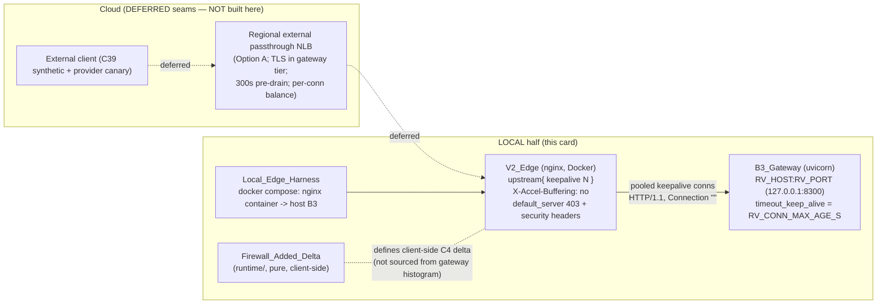

# Design Document — GW16b (card B5): Production edge, upstream keepalive + SSE transparency + firewall-added-delta SLO

## Overview

GW16b builds the **local half** of the production edge for the `gateway_v2` serving path. It has
two deliverables that sit in two different trees:

1. **A v2 edge nginx configuration** (infra, under `gateway_v2/deploy/edge/`) that fronts the B3
   serving entrypoint (`gateway_v2/gateway_v2/edge/serve.py`, a plain-TCP uvicorn host on
   `RV_HOST`/`RV_PORT`). This config fixes the measured defect in the repository's v1 edge: no
   `upstream { ... keepalive N; }` block, so nginx opens **0.9986 new TCP connections per request**
   and fails with **HTTP 502 above ~420 req/s** per edge→gateway pair; with upstream keepalive the
   same edge sustained **≥ 30,000 req/s at p99 < 0.4 ms** (runbook §601 "Why"; §0-A.4 micro-claims
   row "nginx without upstream keepalive"; C20). It also makes SSE transparent via
   `X-Accel-Buffering: no` rather than `proxy_buffering` (§601 "Why"), recycles pooled connections
   on `RV_CONN_MAX_AGE_S` (the per-connection-balancing NLB requirement, §1.2 AMENDMENT), and
   reuses the v1 edge's Host-isolation + security-header hardening.

2. **A firewall-added-delta SLO definition** (Python, under
   `gateway_v2/gateway_v2/runtime/`) — a small, pure, testable module computing
   `Firewall_Added_Delta = C4(through-firewall) − C4(direct)` from **paired client-side** path
   samples over the same network, **excluding** the ≈ 40 ms lost-segment tails present on both
   paths, erroring when the direct baseline is absent, and **never** sourcing the delta from the
   gateway's own under-reading histogram (runbook §1.2 line 686; R2-11/R2-12; GW14d under-read
   3.2–5.8 ms).

**Grounding and source of truth.** The runbook `docs/AI_MESH_MASTER_RUNBOOK_v3_BACKEND_REWRITE.md`
is authoritative. The binding card text is §601 ("GW16b — Production edge (C16, C20; absorbs
T16)") with its inline **v3 AMENDMENT (R2-12, R2-16)**; the SLO contract is §1.2 / the R2-12
register row; the card format (why → implementation → live acceptance tests → exit → evidence →
rollback) is §10.9, referenced from §0.4. Where the runbook is silent on a purely-local detail
(the exact in-`gateway_v2/` config path, the harness mechanism), this design makes an in-spec
decision and says so — each such decision is flagged below and traces to the ambiguities already
recorded in `requirements.md`.

**Where B5 sits in the dependency graph.** Phase Hardening; depends on GW12 (the shipped SSE
egress pipeline) and GW19 (admission + the SIGTERM drain state machine); required by GW20 and GW22
(runbook §601 field table; §0-A.5 task index). B3 (`serve.py`) explicitly **deferred** "real TLS
termination at the edge + NLB bake-off / internet-vantage" to B5/GW16b (`serve.py` docstring R7.3,
gates G-10/G-11/G-13). GW16b builds the edge that B3 pointed at.

**Category-2 card.** Only the local half is built here. The fleet/cloud halves (NLB bake-off, TLS
cost, internet-vantage, store-outage-behind-NLB, fleet-scale RPS, the > 350 s soak, the
drain-one-gateway drill) stay explicit named `Deferred_Seam`s and are **not** scaffolded (design
§7; requirements R8).

### Why the Python half respects the layer contract

The import-linter `layers` contract orders `edge > admit > plan > detect > resolve > dispatch >
egress > audit > runtime > contracts > domain` (`gateway_v2/pyproject.toml`). The
`Firewall_Added_Delta` definition is a **pure latency-sample computation** — paired client-side
samples in, a delta + an assert-within-SLO decision out. It has no HTTP object, no I/O, no upward
import, and reads the SLO bound (`target_p99_ms`) from the one capacity authority
(`runtime/resources.py`). It therefore belongs in `runtime/` (the layer that already owns
`serving_config.py`, `resources.py`, and the env→value idiom), below `edge`, imported by nobody
upward in this card. Placing it in `runtime/` introduces **no new import edge** and **no**
AST/import-linter break:

- `lint/check_capacity_literals.py` — the SLO bound is read via `ResourceContract.target_p99_ms`;
  the module holds **no** capacity literal (requirements R5.5). The ≈ 40 ms tail-exclusion
  threshold is an *operational / statistical* constant (a measured network artefact, not a
  CPU/RAM/FD-derived capacity position), handled the same way `serving_config.py`'s port/drain
  defaults are allowed outside `resources.py` — see Data Models for the exact classification.
- `lint/check_no_module_mutable.py` — no module-level list/dict/set.
- `lint/check_frozen_dataclasses.py` — the sample/result containers are `frozen=True, slots=True`.
- `lint/check_http_outside_edge_resolve.py` — no HTTP type in a non-`edge`/`resolve` module.
- `lint/check_sizes.py` — the module stays ≤ 800 lines / ≤ 120-line functions.
- `lint/check_tenant_scale.py` / `lint/check_secret_headers.py` — not touched by this module.

The nginx config is infrastructure: it is **not** Python and is **not** under the Python gates. It
is kept clean, commented, and gated by a static grep-shaped checker (design §7, mirroring
`scripts/test_nginx_security.sh`).

## Architecture

### Topology (settled by the runbook, recorded not re-measured)

Edge = **regional external passthrough NLB → gateways (Option A)**, with **TLS terminated in the
gateway tier**. The regional **ALB added 8–10 ms p99 and is rejected for token streams**; the
passthrough NLB measured the same as a plain external IP (Δ C4 p99 −0.12 … +0.27 ms). The NLB
**balances per connection**, which is why connection recycling (`RV_CONN_MAX_AGE_S`) is mandatory.
On MIG scale-in the NLB **drains 300 s before VM deletion + SIGTERM**, so streams up to ≈ 375 s
survive (runbook §601 v3 AMENDMENT; R2-12 register row). B5 records these as settled; the NLB
bake-off itself is a `Deferred_Seam` (requirements R8.2).

The **local half** stands the V2_Edge (nginx) directly in front of one B3_Gateway over loopback —
there is no local NLB. The NLB-specific behaviour (per-connection balancing, 300 s pre-drain) is
documented in the config and the `Edge_Drain_Contract` note, not simulated.



### The two deliverables and their boundary

| Deliverable | Tree | Under Python gates? | Verified by |
|---|---|---|---|
| V2_Edge nginx config + include + Dockerfile/compose | `gateway_v2/deploy/edge/` | No (infra) | static grep gate (no docker) + docker-gated live L16b subset |
| `Firewall_Added_Delta` SLO definition | `gateway_v2/gateway_v2/runtime/` | Yes | pytest / mypy --strict / ruff / lint-imports / 6 AST gates; property + unit tests |
| Local_Edge_Harness scripts + L16b tests | `gateway_v2/tests/edge/` + `gateway_v2/deploy/edge/` | Python tests under pytest; harness scripts are infra | the harness runs the live subset; the Python delta tests run under pytest |

### Contrast with the v1 defect (the thing being fixed)

The v1 product edge (`deploy/nginx.conf`, **reference only — not edited**) proxies `/v1/` with:

```nginx
location /v1/ {
    resolver 127.0.0.11 ipv6=off valid=30s;
    set $gateway_upstream "gateway:8300";
    proxy_pass http://$gateway_upstream;   # per-request connection via Docker DNS — NO pool
    proxy_http_version 1.1;
    proxy_buffering off;                    # SSE relies on buffering-off, NOT X-Accel-Buffering
    proxy_read_timeout 360s;
    chunked_transfer_encoding on;
}
```

This is exactly the GW16b defect: **no `upstream { ... keepalive }` block** (the `set
$var; proxy_pass http://$var;` + resolver pattern forces a fresh connection per request → 0.9986
conns/request → 502 above ~420 RPS) and **no `X-Accel-Buffering: no`**. The v2 edge keeps the good
v1 patterns (`server_tokens off`, the `security-headers.inc` set, the `default_server` unknown-Host
403) and adds the two missing pieces.

## Components and Interfaces

### Component 1 — V2_Edge nginx config (requirements R1, R2, R3, R4)

**Decision (flagged, requirements ambiguity 1): path = `gateway_v2/deploy/edge/`.** The runbook
does not pin a path inside `gateway_v2/` (cloud is NLB-fronted). This design places the v2 edge
under `gateway_v2/deploy/edge/` so it lives with its serving tree and is distinct from the v1
`deploy/nginx.conf`, which it must not modify (R1.4). Files:

| File | Role |
|---|---|
| `gateway_v2/deploy/edge/gateway-edge.conf` | the v2 edge server + the `upstream` keepalive block |
| `gateway_v2/deploy/edge/security-headers.inc` | the reused v1 security-header set (own copy, not a cross-tree include of `deploy/`) |
| `gateway_v2/deploy/edge/Dockerfile.edge` | builds the nginx image, COPYs the conf + include |
| `gateway_v2/deploy/edge/docker-compose.edge.yml` | the Local_Edge_Harness: nginx container → host B3 |

**The `upstream` keepalive block (R1.1, R1.2, the fix).** A named upstream to the B3_Gateway with a
`keepalive` directive, used on the proxy location with `proxy_http_version 1.1` and
`proxy_set_header Connection ""` (clearing the hop-by-hop `Connection` header is what lets nginx
reuse the pooled connection rather than close it):

```nginx
upstream b3_gateway {
    # Parameterised for the harness: an envsubst placeholder resolved to the
    # B3 host:port at image/compose build (default host.docker.internal:8300).
    server ${B3_UPSTREAM};              # e.g. host.docker.internal:8300
    keepalive 64;                       # pool size — the per-pair fix for 0.9986 conns/req
    keepalive_timeout 30s;              # aligned to RV_CONN_MAX_AGE_S (R3)
    keepalive_requests 1000;            # bounded reuse before recycle (R3)
}

server {
    listen 80;
    server_name gateway.local;          # named vhost; unknown Host -> default_server 403
    include /etc/nginx/edge/security-headers.inc;

    location / {
        proxy_pass http://b3_gateway;
        proxy_http_version 1.1;         # keepalive correctness (R1.2)
        proxy_set_header Connection "";  # clear hop-by-hop Connection -> reuse pool (R1.2)
        proxy_set_header Host $host;
        proxy_set_header X-Real-IP $remote_addr;
        proxy_set_header X-Forwarded-For $proxy_add_x_forwarded_for;
        proxy_set_header X-Forwarded-Proto $http_x_forwarded_proto;

        # SSE transparency: X-Accel-Buffering, NOT proxy_buffering (R2.1).
        proxy_set_header X-Accel-Buffering no;   # upstream hint
        add_header X-Accel-Buffering no always;  # client-facing header on the response
        proxy_buffering off;                      # defence in depth, NOT the mechanism relied on
        proxy_cache off;
        chunked_transfer_encoding on;             # streaming / chunked passthrough (R1.5)
        proxy_read_timeout 400s;                  # covers a > 350 s stream (R2.5 / L16b-4)
        proxy_send_timeout 400s;
    }
}
```

- **SSE transparency (R2).** `X-Accel-Buffering: no` is set as the mechanism; `proxy_buffering off`
  is kept only as defence in depth, matching §601 "SSE is protected by `X-Accel-Buffering: no`,
  not by `proxy_buffering`." Each upstream token is passed through in its own read; the edge adds
  no buffering stage that could coalesce tokens (R2.2, R2.3). `proxy_read_timeout 400s` covers a
  stream lasting longer than 350 s (R2.5, the config support L16b-4 needs).
- **Connection recycling (R3).** `keepalive_timeout 30s` and a bounded `keepalive_requests` align
  the edge's pooled-connection lifetime to `RV_CONN_MAX_AGE_S` (default 30 s, read from
  `runtime/serving_config.py` as the B3 `timeout_keep_alive`), so the per-connection-balancing NLB
  can redistribute connections to scaled-out gateways (R3.1–R3.3). The config documents the 30 s
  alignment with a comment pointing at `RV_CONN_MAX_AGE_S`; the two sides recycle on the same age.
- **Unknown-Host rejection + security headers (R4).** A `listen 80 default_server; server_name _;`
  catch-all returns 403 for an unrecognised Host (CWE-1021), and does **not** proxy or serve named
  content — exactly the v1 pattern. `security-headers.inc` carries the v1 set
  (`X-Content-Type-Options nosniff`, `X-Frame-Options DENY`,
  `Referrer-Policy strict-origin-when-cross-origin`, `Content-Security-Policy frame-ancestors
  'none'`, `Strict-Transport-Security max-age=31536000`) and `server_tokens off`.
- **Upstream address parameterisation (harness).** `${B3_UPSTREAM}` is substituted (nginx
  `envsubst` on container start, the stock `nginx` image's `/docker-entrypoint.d/` templating) so
  the same conf points at `host.docker.internal:8300` locally and at the real gateway service in
  cloud. The static gate checks the **template** (the literal `upstream` + `keepalive` directives),
  which survives substitution.

### Component 2 — Firewall_Added_Delta SLO definition (requirements R5)

**Decision (flagged, requirements ambiguity 2): a `gateway_v2` module, not prose.** A pure module
makes the delta definition CI-checkable (R5.4) rather than documentation only.

**Decision (flagged, requirements ambiguity 2): placement = `runtime/latency_slo.py`.** It is a
pure computation below `edge`, no HTTP, reads `target_p99_ms` from `resources.py`. Module surface
(all pure functions + frozen value types):

```python
# gateway_v2/gateway_v2/runtime/latency_slo.py  (new; ~<=200 lines)

@dataclass(frozen=True, slots=True)
class PathSamples:
    """Client-side C4 latency samples (milliseconds) for one measured path."""
    samples_ms: tuple[float, ...]

@dataclass(frozen=True, slots=True)
class PairedPathSamples:
    """A through-firewall path and its Direct_Path baseline over the SAME network."""
    through_firewall: PathSamples
    direct: PathSamples          # the baseline; absence is an ERROR (R5.6)

@dataclass(frozen=True, slots=True)
class FirewallDelta:
    delta_p99_ms: float          # C4(through) p99  -  C4(direct) p99, tails excluded
    through_p99_ms: float
    direct_p99_ms: float
    excluded_through: int        # count of Lost_Segment_Tail samples trimmed from each path
    excluded_direct: int

class DirectBaselineMissing(ValueError):
    """Raised when a delta is requested with no Direct_Path samples (R5.6)."""

def exclude_lost_segment_tails(samples: PathSamples) -> tuple[PathSamples, int]: ...
def firewall_added_delta(paired: PairedPathSamples) -> FirewallDelta: ...
def assert_within_slo(delta: FirewallDelta, contract: ResourceContract) -> None: ...
```

- **Definition (R5.1).** `firewall_added_delta` computes
  `delta_p99_ms = p99(through_firewall, tails excluded) − p99(direct, tails excluded)`, both sides
  **client-side** (R5.3) — the function accepts only `PathSamples` carrying client-measured C4; it
  never reads the gateway histogram and has no access to one.
- **Tail exclusion (R5.2) — precise rule.** The ≈ 40 ms `Lost_Segment_Tail` appears on **every**
  external path (through-firewall *and* direct) and is not the firewall's cost. The exclusion is a
  **threshold tail-trim applied symmetrically to each path before the p99**: samples at or above
  the `Lost_Segment_Tail` threshold are dropped from both paths independently, then the per-path
  p99 is taken, then subtracted. This keeps the tail "out of the firewall's account" because it is
  removed from the through-firewall path's p99 (where it would otherwise inflate the delta) while
  the direct path's own tail is likewise removed (so the subtraction is between two
  tail-free quantiles). The `excluded_through` / `excluded_direct` counts are returned for
  evidence/honesty. (Alternative considered: a paired per-sample subtraction that cancels tails
  present on both paths; rejected because client samples are not 1:1 paired in time, so a
  per-path symmetric trim is the honest definition for unpaired client fleets.)
- **Not the gateway histogram (R5.3).** The module's only inputs are `PathSamples`; there is no
  code path that reads `edge`/metrics exposition. A comment cites GW14d (histogram under-reads C4
  by 3.2–5.8 ms, cannot certify) at the type.
- **Direct baseline absent → error (R5.6).** If `paired.direct.samples_ms` is empty,
  `firewall_added_delta` raises `DirectBaselineMissing` rather than returning an absolute latency
  — the firewall is never charged an absolute number, only a delta against a present baseline.
- **SLO assert (R5.4).** `assert_within_slo` reads the bound from
  `contract.target_p99_ms` (gate G-11's "firewall-added delta < 20 ms p99", runbook §0.5) and
  raises if `delta.delta_p99_ms` exceeds it. The bound comes from the one capacity authority; the
  module holds **no** capacity literal (R5.5).
- **No capacity literal (R5.5).** `target_p99_ms` is read through `ResourceContract`. The
  `Lost_Segment_Tail` threshold is an operational statistical constant (a measured ≈ 40 ms network
  artefact), classified like `serving_config.py`'s operational defaults — see Data Models.

### Component 3 — Local_Edge_Harness (requirements R6)

**Decision (flagged, requirements ambiguity 1 + environment): nginx via the official Docker
image, fronting the host-run B3.** nginx is not installed on the host; Docker 29.5 + Compose v2.39
are. The harness is `gateway_v2/deploy/edge/docker-compose.edge.yml`: an `nginx` service built from
`Dockerfile.edge` mapping a published port, with `${B3_UPSTREAM}` pointing at the B3 host via
`host.docker.internal` (Compose `extra_hosts: host-gateway`). B3 is started by the test harness as
a local uvicorn process on `127.0.0.1:8300` (the shipped `serve.py`). This is the cleanest of the
two options (compose vs a scripted throwaway container) because it declares the nginx→B3 edge
once and the live tests just drive it; the static gate needs no container at all.

The harness mirrors `scripts/test_nginx_security.sh`: **static source checks run with no Docker**
(so CI without Docker still gates the config), and the **live container tests gate behind Docker
availability** (`command -v docker` / an `AMF_EDGE_DOCKER` toggle, same shape as that script's
`NGINX_DOCKER` / `SKIP_NGINX_DOCKER`).

Local L16b subset the harness runs:

- **L16b-1 (R6.2) — conns/request ≤ 0.01.** Honest local measurement: enable nginx `stub_status`
  (or parse `$upstream_addr` reuse) and read the active/handled connection counters before and
  after a fixed request count at the qualified local plateau; `new_upstream_connections /
  requests ≤ 0.01`. With the keepalive pool a batch of N requests should open ~1 upstream
  connection, not N. (If `stub_status` is awkward in the throwaway image, the fallback is counting
  upstream SYNs via the container's `/proc/net` snapshot before/after — decided at harness-build
  time; the honest metric is "new upstream TCP connections per request".)
- **L16b-3 (R6.3) — SSE per-token read + hold + injected-hold detection.** A fixed-interval SSE
  source (the B3 stub provider emits one token per fixed interval) and a client that timestamps
  each read: assert each token arrives in its **own** read, max hold ≤ 1 ms, and that a **30 ms**
  injected hold is **detected** (the test injects a 30 ms pause and confirms the client sees it —
  proving the edge is transparent, not smoothing).
- **L16b-6 (R6.4) — unknown Host 403 + security headers.** curl with `Host: evil.example` → 403;
  curl a served response → assert the five security headers present. Direct reuse of the
  `test_nginx_security.sh` header assertions.
- **L16b-4 (R6.5) — short proxy-passthrough proof.** A bounded stream (longer than a short bound,
  e.g. a few seconds) passes through without the edge closing it, demonstrating the
  `proxy_read_timeout 400s` config supports a > 350 s stream. The full > 350 s soak is deferred
  (R8.6); this is only the passthrough proof.

### Component 4 — Edge_Regression_Gate (requirements R7, L16b-7)

A static checker `gateway_v2/deploy/edge/check_edge_keepalive.sh` (grep-shaped, mirrors
`scripts/test_nginx_security.sh`) asserts the conf contains the `upstream` block **and** a
`keepalive` directive inside it, plus `proxy_http_version 1.1` and `proxy_set_header Connection ""`
and `X-Accel-Buffering no`. It **fails** if the keepalive directive is removed (R7.2). It runs with
no Docker (pure source grep, R7.3) as part of the `gateway_v2` edge test suite — invoked from a
pytest wrapper `tests/edge/test_edge_config_gate.py` (so it is collected by the standard `pytest`
run and by CI) that shells the script and asserts exit 0, matching how the suite surfaces infra
gates.

## Data Models

### Firewall_Added_Delta value types

All frozen (`frozen=True, slots=True`) per `check_frozen_dataclasses.py`:

- `PathSamples(samples_ms: tuple[float, ...])` — immutable client-side C4 samples, milliseconds.
- `PairedPathSamples(through_firewall: PathSamples, direct: PathSamples)` — the two paths over the
  same network; `direct` empty ⇒ `DirectBaselineMissing`.
- `FirewallDelta(delta_p99_ms, through_p99_ms, direct_p99_ms, excluded_through, excluded_direct)`
  — the result, carrying the delta, both tail-free p99s, and the exclusion counts for evidence.

### Constant classification (capacity-literal gate)

| Value | Source | Classification | Why allowed outside `resources.py` |
|---|---|---|---|
| SLO bound (delta p99 ceiling) | `ResourceContract.target_p99_ms` | capacity position | read through the contract; no literal in the module (R5.5) |
| `Lost_Segment_Tail` threshold (≈ 40 ms) | module constant with runbook-cited rationale | operational / statistical | a measured network artefact (R2-12 "≈ 40 ms lost-segment tails"), not derived from CPU/RAM/FD — same class as `serving_config.py`'s port/drain operational defaults, which the gate already permits outside `resources.py` |

The `Lost_Segment_Tail` threshold is a named module constant with a docstring citing R2-12, parsed
with the same warn-and-default env idiom as `serving_config.py` if an override is ever wired —
default baked, no bare literal at the call site.

## Correctness Properties

*A property is a characteristic or behavior that should hold true across all valid executions of a
system — a formal statement about what the system should do, serving as the bridge between
human-readable specifications and machine-verifiable correctness guarantees.*

**PBT applicability assessment.** The two deliverables split cleanly:

- The **nginx edge behaviours** (keepalive reuse, SSE transparency, Host rejection, headers) are
  **integration** concerns verified against a real nginx container (L16b-1/-3/-6) and a static conf
  grep (L16b-7). Per the runbook's own "when NOT to use PBT" guidance they are external-service /
  infrastructure behaviours — docker-gated integration tests with 1–3 representative runs, **not**
  property tests. No correctness property is written for the nginx config.
- The **`Firewall_Added_Delta` computation** is a **pure function over latency samples** with
  genuine universal properties (tail-exclusion invariants, baseline-absence error, delta
  definition). These **are** property-testable and the properties below cover them.

### Property 1: Tail exclusion never raises a path's p99

For all `PathSamples`, the p99 of `exclude_lost_segment_tails(samples)` is less than or equal to
the p99 of `samples` (dropping at-or-above-threshold samples cannot increase the quantile).

**Validates: Requirements 5.2**

### Property 2: Tail exclusion is idempotent

For all `PathSamples`, applying `exclude_lost_segment_tails` twice yields the same trimmed samples
as applying it once (`f(f(x)) == f(x)`): once the tail samples are gone, re-trimming removes
nothing.

**Validates: Requirements 5.2**

### Property 3: Excluded samples are exactly the at-or-above-threshold samples

For all `PathSamples`, the count returned as excluded equals the number of input samples at or
above the `Lost_Segment_Tail` threshold, and every retained sample is strictly below it.

**Validates: Requirements 5.2**

### Property 4: Delta is the difference of tail-free path p99s

For all `PairedPathSamples` with a non-empty direct baseline, `firewall_added_delta` returns
`delta_p99_ms == through_p99_ms − direct_p99_ms`, where each `*_p99_ms` is the p99 of that path
after symmetric tail exclusion.

**Validates: Requirements 5.1, 5.2**

### Property 5: Absent direct baseline is an error, never an absolute latency

For all `PairedPathSamples` whose `direct` path has no samples, `firewall_added_delta` raises
`DirectBaselineMissing` and returns no `FirewallDelta` (the firewall is never charged an absolute
latency when the baseline is absent).

**Validates: Requirements 5.6**

### Property 6: assert_within_slo honours the contract bound

For all `FirewallDelta` and all `ResourceContract`, `assert_within_slo` raises if and only if
`delta_p99_ms` is strictly greater than `contract.target_p99_ms` (the bound comes from the
capacity authority, never a literal).

**Validates: Requirements 5.4, 5.5**

## Error Handling

- **Direct baseline absent (R5.6).** `firewall_added_delta` raises `DirectBaselineMissing` (a
  `ValueError` subtype) naming that the Direct_Path baseline is required; the SLO is a delta, so an
  absolute latency is never attributed to the firewall. Covered by Property 5.
- **SLO exceeded (R5.4).** `assert_within_slo` raises a clear error naming the measured
  `delta_p99_ms` and the `target_p99_ms` bound it exceeded. The module never silently passes an
  over-budget delta.
- **Empty through-firewall samples.** A delta with a present direct baseline but no
  through-firewall samples is a measurement error (nothing to compare); the function raises rather
  than returning a meaningless delta.
- **Edge config load failure.** `nginx -t` in the Dockerfile build / harness start fails the
  harness (same `nginx -t` gate as `test_nginx_security.sh`); a malformed conf never serves.
- **Unknown Host (R4.1).** The `default_server` returns 403; it never falls through to a named
  vhost or the SPA — the v1 CWE-1021 posture.
- **Upstream unavailable.** With the keepalive pool, a dead upstream yields nginx's standard 502
  for that request; the pool does not mask upstream death. (The 502-under-churn that GW16b fixes is
  ephemeral-port exhaustion from per-request connections, not upstream-down — the keepalive pool
  removes the churn source.)

## Testing Strategy

Mapped onto the §10.9 card shape (why → implementation → **live acceptance tests** → exit →
evidence → rollback). The task list will emit evidence in that order.

### Static conf gate (no Docker, always runs)

- `check_edge_keepalive.sh` — asserts the `upstream` block, the `keepalive` directive,
  `proxy_http_version 1.1`, `proxy_set_header Connection ""`, and `X-Accel-Buffering no` are all
  present; **fails** if keepalive is removed (R7, L16b-7). Grep-shaped, mirrors
  `scripts/test_nginx_security.sh`'s always-run static section.
- A reused security-header static check (the five headers + `server_tokens off` +
  `default_server` 403 not serving named content), same assertions as `test_nginx_security.sh`
  (R4).
- Surfaced to CI via `tests/edge/test_edge_config_gate.py`, which shells the script and asserts
  exit 0, so the gate is part of the `gateway_v2` edge test suite (R7.3).

### Docker-gated live L16b subset (integration, gated behind Docker)

Run against the Local_Edge_Harness (nginx container → host B3), skipped cleanly when Docker is
absent (mirror `test_nginx_security.sh`):

- **L16b-1** conns/request ≤ 0.01 (R6.2) — 1–3 representative plateau runs.
- **L16b-3** fixed-interval SSE: each token its own read, hold ≤ 1 ms, 30 ms injected hold detected
  (R6.3).
- **L16b-6** unknown Host 403 + security headers (R6.4).
- **L16b-4** short proxy-passthrough proof (R6.5); the full > 350 s soak is a `Deferred_Seam`.

These are **integration** tests (external nginx behaviour), not property tests — 1–3 examples each,
per the runbook's PBT-exclusion guidance for infrastructure.

### Firewall_Added_Delta tests (pure, under the Python gates)

- **Property tests (minimum 100 iterations each)** for Properties 1–6, using the house idiom —
  a seeded `random.Random` generating latency-sample tuples (including tail samples, empty
  baselines, and boundary values at the threshold). **No hypothesis** (the gateway_v2 house idiom;
  see the shipped `tests/` property suites). Each test is tagged
  `# Feature: edge-gw16b, Property N: <text>` and references its design property.
- **Unit tests** for concrete examples / edge cases: a sample set with no tail (exclusion is a
  no-op), a set that is all tail (p99 of the empty remainder handled), the exact ≈ 40 ms boundary,
  and the `DirectBaselineMissing` / SLO-exceeded error messages.

### The Python-half gate (B5's gateway_v2 Python only)

Run on the delta module + its tests (not the nginx config):

- `.venv/bin/python -m pytest`
- `mypy --strict` (files = `gateway_v2 state_control audit_control lint`)
- `ruff check gateway_v2 state_control lint tests`
- `lint-imports` (import-linter; the layers + resolve-forbidden contracts)
- the 6 AST gates: `check_capacity_literals`, `check_no_module_mutable`,
  `check_frozen_dataclasses`, `check_http_outside_edge_resolve`, `check_sizes` (≤ 800 / ≤ 120),
  and the remaining gate (`check_tenant_scale` / `check_secret_headers`) — all expected to pass
  untouched since the module is pure `runtime/`.

### Dual approach summary

Unit tests pin specific examples and the two error messages; property tests verify the universal
delta/exclusion behaviour across generated inputs; docker-gated integration tests verify the real
nginx edge; the static grep gate verifies the config cannot silently lose the keepalive fix. The
nginx config itself has no property tests (correctly — it is infrastructure).

## Edge drain contract and deferred seams (requirements R8)

### Edge_Drain_Contract (R8.1) — documented, edge side only

On MIG scale-in the NLB **drains 300 s before VM deletion and SIGTERM**, so streams up to ≈ 375 s
survive. The **in-gateway** drain is owned by B3 (`serve.py install_drain_hook`:
`RV_DRAIN_ACCEPT_S` 15 s + `RV_DRAIN_S` 60 s driving the GW19 `ACCEPTING → DRAINING → TERMINATING →
FLUSHED → EXITED` machine). B5 documents only the **edge/NLB** side of that contract (a comment
block in `gateway-edge.conf` + this design section); it builds no drain code and simulates no
fleet drill. (Runbook §601 v3 AMENDMENT; §1.2 NLB-balancing row.)

### Named Deferred_Seams (R8.2–R8.7) — nothing scaffolded

Each is named with its owning card/gate; none is scaffolded:

| Deferred_Seam | Owner | Recorded where |
|---|---|---|
| NLB bake-off vs ALB (Option A settled; ALB rejected for streams) | cloud / GW20 | config comment + §Architecture (R8.2) |
| TLS termination in the gateway tier — **knob defined**, cost deferred | G-10 | a uvicorn `ssl_keyfile`/`ssl_certfile` note (B3 binds plain TCP today, `serve.py` R7.3); cost not measured (R8.3) |
| Internet-vantage latency | G-11 | named, no measurement scaffolded (R8.4) |
| Store outage behind a health-checked NLB | G-13 | named, no drill scaffolded (R8.5) |
| Edge ≥ 2× fleet qualified RPS adding < 1 ms p99 | L16b-2 / GW20 | named (R8.6) |
| Full > 350 s healthy-stream soak | L16b-4 | config supports it (`proxy_read_timeout 400s`); soak deferred (R8.6) |
| Drain one gateway during active streams | L16b-5 | documented via Edge_Drain_Contract; fleet drill deferred (R8.6) |

**TLS knob (R8.3), defined not measured.** TLS terminates in the gateway tier. The config knob is
**defined**: either a uvicorn `ssl_keyfile`/`ssl_certfile` pair on `serve.py`'s host (the plaintext
B3 socket today, `serve.py` R7.3) **or** an edge TLS-listen (`listen 443 ssl`) with cert paths in
`gateway-edge.conf`. This design records the plaintext-vs-TLS listen decision as a knob and defers
the **cost** (G-10). No cert handling is scaffolded.

Every `Deferred_Seam` reference in the config or the delta module names its owning card or gate
(R8.7), the same discipline B3's `serve.py` uses for its R7 seams.

## Design decisions and rationale

1. **Delta module in `runtime/`, not `edge/`.** It is a pure sample computation with no HTTP and no
   upward import; `runtime/` already owns `resources.py` + `serving_config.py` and the env→value
   idiom, so placement there adds no import edge and keeps the SLO bound at the one capacity
   authority. (Flagged ambiguity 2 resolved.)
2. **Config under `gateway_v2/deploy/edge/`, v1 untouched.** Keeps the v2 edge with its serving
   tree and honours R1.4 (do not edit `deploy/nginx.conf`). (Flagged ambiguity 1 resolved.)
3. **Harness = Docker nginx → host B3 via compose.** nginx is not on the host; Docker is. Compose
   declares the edge once; static checks need no Docker; live tests gate behind it — the exact
   `test_nginx_security.sh` shape. (Flagged ambiguity 1 + environment resolved.)
4. **Symmetric per-path tail-trim for the delta.** Client fleets are not 1:1 time-paired, so a
   symmetric per-path trim before the p99 is the honest tail-exclusion; a per-sample cancellation
   was considered and rejected for unpaired samples. (R5.2.)
5. **nginx behaviours are integration, delta is PBT.** Honest PBT applicability: external nginx
   behaviour is docker-gated integration; the pure delta function is property-tested.
6. **TLS knob defined, cost deferred.** B5 may define the knob (R8.3) but G-10 owns the cost; no
   cert scaffolding. (Flagged ambiguity 3 resolved.)
