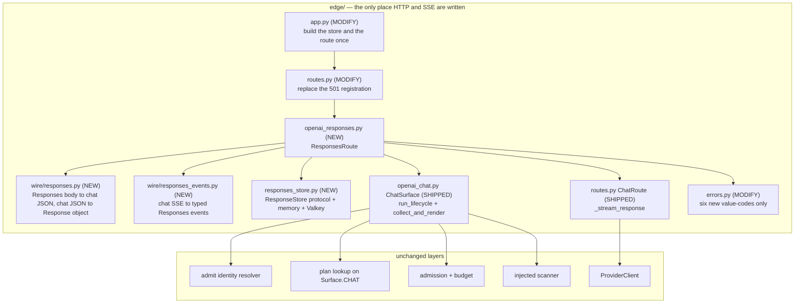
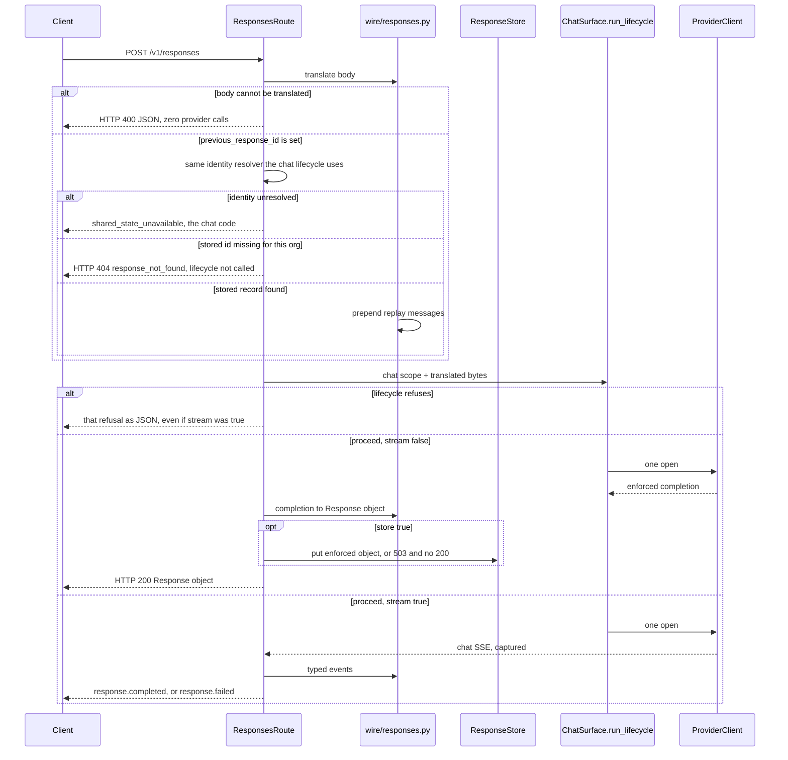

# Design Document

## Overview

This design closes the remaining GW15 partial: `POST /v1/responses` and the three read/delete routes beside it. Chat completions, legacy completions, and embeddings already run. `gateway_v2/gateway_v2/edge/openai_responses.py` is empty, and `build_routes` registers `("POST", "/v1/responses")` as the HTTP 501 placeholder.

v1 already proved the shape. `proxy_responses` translates a Responses body into a chat body, runs that body through `proxy_chat`, and translates the chat result back (`gateway/ai_mesh_gateway/responses_adapters.py`, `main.py` `_dispatch_chat_internally`). This card does the same thing on the shipped v2 lifecycle. It does not add a detector, a resolver, a plan surface, or a second budget.

The parent spec `.kiro/specs/chat-surface-gw15/` stays the record of the shipped chat surface. This design supersedes only that spec's decision to leave `/v1/responses` as a placeholder.

### What is already true in the code

| Fact | Where | What this design does with it |
| --- | --- | --- |
| Chat lifecycle is one ordered pipeline: pre-checks, parse, identity, one plan read, admit, budget, input scan, then the provider | `edge/openai_chat.py` `ChatSurface.run_lifecycle`, `edge/routes.py` `ChatRoute.handle` | Responses calls `run_lifecycle` on a translated chat body. It does not re-implement those phases. |
| A refusal from that lifecycle makes zero provider calls | `ChatRoute.handle` returns before `provider.open` | A Responses refusal returns at the same point. |
| Input block is HTTP 400 `invalid_request_error` with code `input_blocked`. Output block is HTTP 403 `gateway_error` with code `output_blocked` | `edge/errors.py` `_ENVELOPE` | Responses returns those envelopes unchanged. It does not rename them to v1's `content_filter`. |
| Unresolved identity, including a missing credential, is `shared_state_unavailable` (HTTP 503), not a separate 401 | `ChatSurface._identity`, `REFUSE_IDENTITY_UNRESOLVED` | A Responses caller with no usable identity gets that same code. |
| The chat parser only scans text channels: `message_content`, `content_part_text`, `tool_arguments`, `function_arguments` | `edge/wire/openai.py` `fold_input_channels` | Every Responses text field is placed into one of those channels. A part that cannot land in one of them is rejected. |
| `ChatSurface._surface_of` accepts only `/v1/chat/completions` and `/v1/completions` | `openai_chat.py` `_PATH_TO_SURFACE` | The translated body is parsed under a scope whose path is `/v1/chat/completions`, so the plan surface stays `Surface.CHAT`. |
| A streaming chat refusal is an SSE error frame. A non-streaming refusal is JSON | `ChatRoute._render_refusal` | Responses does not use that branch. A refusal before any Responses byte is always JSON, including when the caller set `stream: true`. |
| `trace()` may follow an error frame, and the console object is six stages | `edge/wire/sse.py`, `console_from_holds` | The translator copies that object onto the terminal Responses event. It does not forward `amf.trace` as its own event. |
| `routes.py` is 794 lines, under the 800-line gate | `edge/routes.py` | Route registration changes by a handful of lines. The adapter lives in new modules. |
| MCP, RAG, and vector are the same placeholder helper | `build_routes` | Those three registrations stay. |

### The central design decision

> A Responses call must be a chat call after translation. Where does the translation sit so the chat lifecycle stays the only enforcement path?

**Option 1 — a second lifecycle inside `openai_responses.py`.** Parse the Responses body, then call admission, budget, the scanner, and the provider directly.

*Rejected.* That is a second firewall. A rule fixed on chat would not apply here, which is the bug this card exists to prevent.

**Option 2 — an HTTP loopback to `POST /v1/chat/completions`.**

*Rejected.* The loop spends a second admission slot and a second budget charge, and it depends on the process being able to reach itself. v1 did not do this. v1 called `proxy_chat` in process.

**Option 3 — call `ChatRoute.handle` and let it write the client response.**

*Rejected for the write path.* `handle` is the right lifecycle, but its streaming refusal opens an SSE error frame (`_render_refusal` when `req.streaming`). Requirement 5 says a refusal before any stream byte is JSON. `handle` also writes chat chunks, which a Responses client cannot parse. Wrapping `send` and hoping the refusal shape is right couples the adapter to a branch that is correct for chat and wrong for Responses.

**Option 4 — translate, then call `ChatSurface.run_lifecycle` in process, and let the Responses handler write the client bytes.** Chosen.

The handler builds a chat JSON body, copies the caller scope, sets the path to `/v1/chat/completions`, and calls `run_lifecycle` with the original `Authorization` header still on the scope. On a refusal it renders JSON through `edge/errors.py`. On a proceed it calls the same `collect_and_render` or `_stream_response` the chat route uses, captures those bytes, and translates them. Identity, the plan read, admission, the budget, both scans, and the provider open stay inside the chat lifecycle.

`previous_response_id` is the one step that cannot live inside that lifecycle, because the chat parser has no response store. The handler resolves it before `run_lifecycle`, with the same identity resolver, and prepends the stored replay messages to the chat body. A miss returns HTTP 404 and never calls the lifecycle, so the provider is not opened and no slot is taken.

## Architecture



`egress` still does not import `detect`. The Responses modules sit in `edge` and call the chat surface, which already holds the injected scanner.

### Request order



The plan read inside `run_lifecycle` stays the one shared-state read of the chat lifecycle. The response store is a different keyspace. Chat requests never touch it. A Responses request reads it only when `previous_response_id` is present, and writes it only when `store` is true and the write happens before the HTTP 200.

## Components

### 1. `edge/wire/responses.py` — pure translation

No I/O, no scanner, no plan. Functions stay at or under 120 lines.

`translate_request(body) -> ChatBody | TranslateRefusal`

- A string `input` becomes one user message.
- An input-item list becomes chat messages. `input_text`, `output_text`, and `text` become message text. `function_call` becomes an assistant `tool_calls` entry. `function_call_output` becomes a tool message. The v1 MCP item types (`mcp_call`, `mcp_approval_request`, `mcp_approval_response`, `mcp_list_tools`, `custom_tool_call_output`) become tool messages too, so their text is scanned and not dropped. This does not implement `/v1/mcp`.
- `instructions` becomes the system message.
- `max_output_tokens` becomes `max_tokens`, so the shipped clamp and the shipped token charge apply. `max_completion_tokens` is copied through under its own name. The known chat behavior, that this field is validated and not charged, stays the chat behavior.
- `temperature`, `top_p`, `tools`, `tool_choice`, `parallel_tool_calls`, `stop`, `seed`, `user`, `metadata`, `stream`, `response_format`, `n`, and `text.format` (mapped to `response_format` when the caller did not already set one) pass through. Anything else is ignored rather than forwarded as a second policy channel.
- `previous_response_id` is not interpreted here. The handler passes the replay messages in, and this function prepends them before the new user turn.

`TranslateRefusal` carries a value-code and a `param`. The codes are new spellings so they can be mapped to HTTP 400 without changing chat. Chat's `malformed_request_body` is unmapped today and renders HTTP 500 on purpose (`tests/edge/test_v2_leaks_enforcement_preservation.py` pins that). This design does not add that spelling to `_ENVELOPE`.

| Condition | Code | HTTP | `param` |
| --- | --- | --- | --- |
| Body is not a JSON object | `responses_malformed_body` | 400 `invalid_request_error` | none |
| `model` missing or not a string | `responses_invalid_model` | 400 `invalid_request_error` | `model` |
| `input` and `instructions` both absent | `responses_missing_input` | 400 `invalid_request_error` | `input` |
| A content part is not one of the translated types. This includes `input_file`, `input_audio`, and `input_image` | `unsupported_content_part` | 400 `invalid_request_error` | `input` |

`input_image` is rejected because the v2 chat fold has no image channel. Forwarding it would skip the scan. v1 allows `input_image`. That difference is intentional.

`response_object(completion, *, response_id, model, store) -> dict`

- `id` is `resp_` plus 24 hex bytes from `secrets.token_hex`. The chat `zs-` request id stays the request id.
- `object` is `response`, `status` is `completed` when the chat finish reason is a normal stop.
- `output_text` is the assistant `content` the chat renderer already enforced. Tool calls become `function_call` output items. Usage is copied when the chat body has it: `prompt_tokens` to `input_tokens`, `completion_tokens` to `output_tokens`.
- `zeroshield` and `pipeline_trace` are copied from the chat body when present. A key named `evidence` anywhere in that copy is dropped before the object is returned or stored.
- The model field is the caller's model, not an upstream model id, matching the v1 leak fix.

### 2. `edge/wire/responses_events.py` — pure stream translation

Input is the captured chat SSE byte stream. Output is Responses SSE: `event: <type>\ndata: <json>\n\n`. No `data: [DONE]`. The stock SDK terminates on `response.completed` or `response.failed`.

A clean text stream emits, in this order:

1. `response.created`
2. `response.output_item.added`
3. `response.content_part.added`
4. one `response.output_text.delta` per released chat content delta
5. `response.output_text.done`
6. `response.output_item.done`
7. `response.completed`

The last delta precedes `output_text.done`. The last event is `response.completed`, and that event's `response.output_text` is the assembled text. `zeroshield` and `pipeline_trace` from the chat `amf.trace` frame are fields on that response object. The `amf.trace` frame is not forwarded. An unknown event would not be a typed Responses event, and the SDK cell reads `model_extra` on the completed response.

A chat `output_blocked` frame after the stream has started emits `response.failed` and stops. That event's response has `status` `failed`, `output_text` `""`, and no `response.completed` is emitted. Deltas that the chat pipeline already released are still emitted as deltas. That is the shipped incremental holdback (GW13). This card does not buffer the stream to hide them, and it does not switch the saved plan to strict withhold. The failed object's `output_text` stays empty, which is what the SDK cell asserts.

A refusal that happens before `run_lifecycle` returns a proceed outcome never reaches this translator. The handler writes JSON.

### 3. `edge/openai_responses.py` — `ResponsesRoute`

Holds the booted `ChatRoute` and a `ResponseStore`. It does not hold a scanner.

`handle` serves `POST /v1/responses`:

1. Read the body with the same bounded reader chat uses.
2. `translate_request`. On a refusal, render that code through `render_http` and return. Provider open count is unchanged.
3. If `previous_response_id` is set, call `chat.identity.resolve(scope)`. On `None`, render `shared_state_unavailable` and return. On an identity, `store.get(org_id, id)`. `None` renders `response_not_found` and returns without `run_lifecycle`. A record prepends its replay messages.
4. Build the chat scope: copy the caller scope, set `path` to `/v1/chat/completions`.
5. `ChatSurface(deps=chat).run_lifecycle(chat_scope, chat_bytes, holds)`.
6. On `refuse_code`, render JSON with `_emit_error_code`, passing `console_from_holds` when the lifecycle got far enough to fill `holds`. Do not call `_render_refusal`, because that opens SSE for `stream: true`.
7. On proceed and `stream` false, call `collect_and_render` with a capturing `send`. Translate the captured completion. If `store` is true, `store.put` the enforced object and the replay messages taken from the upstream body (the masked messages) plus the enforced assistant text. A failed put renders `response_store_unavailable` and does not write the 200. If `store` is omitted or false, do not write.
8. On proceed and `stream` true, call `ChatRoute._stream_response` with a capturing `send`, then write the translated events and the SSE response headers. `store: true` on a clean stream persists the object carried by `response.completed`, before that event is written, so a failed put becomes `response.failed` rather than a completed id that cannot be retrieved. A stream that ends `response.failed` is not stored.
9. `finally` calls `emit_chat_audit` and `holds.release`, the same pair `ChatRoute.handle` uses, so a Responses call takes one slot and returns it once.

`retrieve`, `delete`, and `input_items` share one identity check:

- Unresolved identity renders `shared_state_unavailable`, the chat code. The handler does not look at the store first, so a missing credential cannot probe an id.
- A resolved identity and a missing record render `response_not_found`. A foreign org misses because the key contains the caller's org. The handler returns the same 404 it returns for an unknown id.
- `retrieve` returns the stored object.
- `delete` removes it and returns `{"id", "object": "response", "deleted": true}`.
- `input_items` returns `{"object": "list", "data": <stored items>}`. The items are the enforced replay inputs, not a second copy of the raw request.

### 4. `edge/responses_store.py` — org-keyed store

```python
class ResponseStore(Protocol):
    async def put(self, org_id: str, record: StoredResponse) -> bool: ...
    async def get(self, org_id: str, response_id: str) -> StoredResponse | None: ...
    async def delete(self, org_id: str, response_id: str) -> bool: ...
```

`StoredResponse` is a frozen dataclass: the client response object, the replay messages, and the input items. It has no `Finding` and no `evidence` field.

`MemoryResponseStore` is the in-process map the tests inject. The key is `(org_id, response_id)`.

`ValkeyResponseStore` is what `app.py` builds when the process already has a dev Redis URL (`AMF_DEV_REDIS_URL`, the same URL `dev_admit` uses). The key is `{rv2}:responses:{org_id}:{response_id}`. The `{rv2}` hash tag matches the other cluster keys. The key is not `{rv2}:dev:firewall-plan` and this store never writes that key. The TTL is `ResourceContract.response_store_ttl_s()`, a new method whose only literal lives in `runtime/resources.py`. A process with no Redis URL gets `MemoryResponseStore`, which is the right store for the in-process SDK proof. A multi-worker dev profile uses the Valkey store so a retrieve can land on another worker.

`put` returns false on a store error. The handler treats false as `response_store_unavailable`. v1 swallows that error and still returns 200. This design does not.

### 5. Registration

`build_routes(chat, misc, responses)` replaces the responses placeholder:

- `("POST", "/v1/responses")` → `responses.handle`
- prefix `("GET", "/v1/responses/")` → one handler that splits `scope["path"]` into retrieve (`/v1/responses/{id}`) or input items (`/v1/responses/{id}/input_items`)
- prefix `("DELETE", "/v1/responses/")` → delete

The exact table still has one `POST` entry for that path. The prefix table is consulted only after an exact miss (`app.py` `_match_prefix`), so `POST /v1/responses` cannot fall through to the id prefix. `POST /v1/mcp`, `POST /v1/rag/query`, and `POST /v1/vector/query` stay on `_placeholder`.

`app.py` builds one store and one `ResponsesRoute` at boot and passes them in. `routes.py` gains the parameter and three table entries. It does not gain the translator.

### 6. Envelope rows

Add these six keys to `_ENVELOPE` in `edge/errors.py` and the matching messages in `edge/wire/sse.py` `error_frame_for`, so HTTP and SSE stay one vocabulary. Chat does not emit them.

| Code | Status | `error.type` |
| --- | --- | --- |
| `responses_malformed_body` | 400 | `invalid_request_error` |
| `responses_invalid_model` | 400 | `invalid_request_error` |
| `responses_missing_input` | 400 | `invalid_request_error` |
| `unsupported_content_part` | 400 | `invalid_request_error` |
| `response_not_found` | 404 | `not_found_error` |
| `response_store_unavailable` | 503 | `service_unavailable` |

The table above is six rows. The first four are the translate refusals. The last two are the store. All six are new spellings.

## Deliberate differences from v1

| Topic | v1 | v2 under this design |
| --- | --- | --- |
| Input content block | HTTP 400, code `content_filter` | HTTP 400, code `input_blocked`, type `invalid_request_error`. The stock SDK still raises `BadRequestError`. |
| Output content block, non-stream | often the same content-filter envelope | HTTP 403, code `output_blocked`, the chat envelope |
| Mid-stream withhold | `response.failed` | `response.failed`, and the failed object's `output_text` is empty |
| Bad chat JSON | v1's own 400 | unchanged on the chat route (HTTP 500 while the code stays unmapped). Responses uses `responses_malformed_body` |
| `input_image` | forwarded | HTTP 400 `unsupported_content_part` |
| Store write failure | swallowed, HTTP 200 | HTTP 503 `response_store_unavailable`, no claim the id is stored |
| `response.in_progress` | emitted | not emitted. The required sequence does not include it, and the SDK cell does not require it |
| Console | v1 trace frame | the six-stage `zeroshield` and `pipeline_trace` already produced for chat |

The v1 suite in `gateway_v2/tests/openai_conformance/test_openai_sdk_compat.py` keeps driving the v1 app. Its `content_filter` assertion is a v1 cell. The v2 proof is a new module next to `test_gw15_chat_surface_v2.py`, using `build_app`, `StubProviderClient`, and `tests.edge._chat_lifecycle_fixtures`. It does not flip the v1 cells.

## Local proof

One new in-process module covers Requirement 9:

- non-streaming create parses as a Response, `output_text` equals the stub provider text, `zeroshield.action` is present, six stage names, no `kill_switch`
- streaming create yields the seven event types in order and ends on `response.completed`
- an input block opens the provider zero times and is HTTP 400 `input_blocked`, as JSON, for both `stream` false and `stream` true
- a streamed output withhold ends on `response.failed`, `output_text` empty, no `response.completed`
- `store` true, then retrieve, input items, `previous_response_id`, delete, then retrieve is HTTP 404 `response_not_found`
- `store` omitted, then retrieve is HTTP 404
- a second org's retrieve of the first org's id is HTTP 404
- `input_file` is HTTP 400 `unsupported_content_part` and the provider is not opened
- the exact route table contains one `("POST", "/v1/responses")`, and the MCP, RAG, and vector entries still render 501

These existing assertions become false when the placeholder is removed, and the implementation updates them in the same change. They are not new product behavior:

- `tests/edge/test_lgw15_app.py` `test_responses_placeholder_is_not_implemented_not_404` and the responses member of the placeholder set
- `tests/edge/test_lgw12_app.py` the responses 501 cell
- `tests/edge/test_gw16_app.py`, `test_gw16_routes.py`, and `test_gw16_matcher_edges.py` wherever they list `("POST", "/v1/responses")` as a placeholder

Chat, completions, and embeddings tests stay as they are. Real TCP, the Node SDK, and the 10,000-request replay are not given a local stand-in.

## Requirements coverage

| Requirement | Design section |
| --- | --- |
| 1. One adapter, one POST, other surfaces stay 501 | Option 4, Registration |
| 2. Every text channel becomes a chat message before the lifecycle | `translate_request` |
| 3. Bad bodies are HTTP 400 and zero provider calls | Translate refusals, handler step 2 |
| 4. Non-streaming Response object | `response_object` |
| 5. Typed event order, pre-stream refusal is JSON | `responses_events.py`, handler steps 6 and 8 |
| 6. Same disposition as chat, fail closed | `run_lifecycle`, no second scanner |
| 7. Six-stage console, no evidence stored | copy from the chat body, drop `evidence` |
| 8. Org-scoped store, default off, 404 for a miss | `ResponseStore`, handler steps 3 and 7 |
| 9. In-process SDK proof, deferred gates stay deferred | Local proof |

## Out of scope

- Changing `/v1/chat/completions`, `/v1/completions`, embeddings, models, or moderations, except the six new envelope rows, which chat never emits.
- MCP, RAG, and vector, beyond leaving their 501 registrations in place.
- A real provider socket, the Node SDK, real-TCP conformance, and the C2 replay.
- Any edit under `gateway/ai_mesh_gateway/`.
- Rewriting the saved firewall plan, or writing `{rv2}:dev:firewall-plan`.
- Marking GW15 done in the runbook. That waits until the local proof has been reviewed.

## Risks

- **Capturing `send` can miss a header the translator needs.** The translator uses status, content-type, and the body bytes. The implementation test drives a real ASGI scope so a missed `http.response.start` fails the SDK parse, not a private assertion.
- **`routes.py` is four lines under the module cap.** The implementation adds the route entries and the `build_routes` parameter, and keeps the translator out of that file. If the file would pass 800 lines, the new registration helper moves to `openai_responses.py` instead of being squeezed in.
- **Two identity resolutions on a `previous_response_id` hit.** The handler resolves identity to key the store, then `run_lifecycle` resolves it again. Both calls use `chat.identity.resolve`. The second is the one that gates the provider. A disagreement between them fails closed: the handler stores and replays only under the org the lifecycle recorded on `holds`.
- **Incremental release before `output_blocked`.** Prefix deltas can still reach the client. The failed response object's `output_text` is empty. Changing holdback is a GW13 change, not this card.
