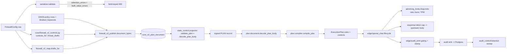

# Design Document

## Overview

GW27 gives every one of the 45 `FirewallConfig` fields that `firewall_v2_map.py` marks `unsupported` exactly one signed disposition: **BUILT** (a console change takes effect on v2 traffic) or **RETIRED-BY-NAME** (a named owner or documented reason, and a save that keeps failing loudly). This design fixes **15 BUILT** and **30 RETIRED** (45 in scope), and records `org_token_budget`, the 46th `unsupported` entry, as a GW36 delegation so nothing is dropped silently.

Path note: the brief points at `gateway_v2/gateway_v2/**/firewall_v2_map.py`. The module actually lives in the control tree at `control/ai_mesh_control/core/firewall_v2_map.py`; it never imports `gateway_v2` (it only emits JSON). Its test is `gateway_v2/tests/plan/test_firewall_v2_map.py`, which loads the file by path. This design keeps that arrangement.

The design has one seam. The control plane builds the per-org plan document (`core/firewall_v2_publish.py::document_bytes`), the state projector signs it, and every gateway decodes it with `plan.document.decode_plan_body` and compiles it with `plan.compiler.compile_plan`. Today that body carries only `org_id`, `streaming_mode`, and `rules[]`. Fields that are naturally rules (blocked keywords, threat-intel blocking, output-policy enable and fallback action) ride as **rule drafts**. Fields that are operational controls (request rate, burst, org TPM, response-token cap, audit enable, incident logging, retention, compliance frameworks) have no rule shape, so the body gains one new optional object, `controls`, decoded into a frozen `OrgControls` value that hangs off `ExecutionPlan`. Enforcement is then done by three small consumers, each in the layer that already owns the concern: `admit` (rate/burst/TPM), `edge` (response-token cap, audit gating), and `audit_control` (retention sweep).

**Technology stack (locked on approval):** Python 3.12 with `from __future__ import annotations`, frozen+slotted dataclasses, `json` and `hashlib` from the standard library, `pytest` with seeded `random.Random` property tests (house idiom, no hypothesis), `mypy --strict`, `ruff`, `import-linter`, and the five AST gates in `gateway_v2/lint/`. Control side: Django 5, DRF serializers, plain-Python pure functions. Store: the existing signed PLAN record path (Valkey) and the existing Postgres audit sink (`audit_control/sink_pg.py`). No new dependency is added.

### Requirement → component map

| Requirement | Component |
|---|---|
| R1 (one disposition per field) | `FIELDS` table gains `disposition`/`owner`/`reason`; drift test; retire ledger |
| R2 (honest save, rewrite refused) | `selection_errors` (retired value, `rewrite`), new `built_value_errors` |
| R3 (rate/burst/TPM) | `OrgControls.rate`/`org_tpm_limit`, `admit/org_limits.py`, lifecycle phase 5b |
| R4 (blocked keywords via GW26) | `firewall_v2_publish.keyword_row` (policy-row path) |
| R5 (cap, output policy, audit, retention, compliance, threat intel) | `OrgControls`, `policy_drafts` extension, `threat_drafts`, edge/audit consumers |
| R6/R7 (delegations, conservative retires) | `RETIRED` ledger + `retired_errors` message naming the owner |
| NFR 1–7 | Layering, `ResourceContract` derivations, frozen values, tests (see below) |

## Architecture



### Layering (bottom-up, import-linter)

The contract is `edge > admit > plan > detect > resolve > dispatch > egress > audit > runtime > contracts > domain`; a layer imports only layers below it. The change lands bottom-up in this order, and each step imports only what is already below it:

1. `domain/plan.py` (value types `OrgControls`, `RateControl`, `AuditControl`; `ExecutionPlan.controls`).
2. `runtime/resources_org.py` (new; the only new numeric constants and derivations) plus the one-line gate change that allows it (DECISION D-13). `runtime/resources.py` is at the 800-line cap and is **not edited**.
3. `plan/document.py` + `plan/compiler.py` (decode, encode, validate, hash).
4. `audit/record.py` (stamp fields in `detail`; no schema bump).
5. `admit/org_limits.py` (imports `domain`, `runtime`, `admit.gcra`, `admit.grant`).
6. `edge/*` (lifecycle phase, upstream body, audit gating, boot wiring).
7. `audit_control/retention.py` (outside `root_packages`, like `state_control`; imports `gateway_v2.runtime` and `gateway_v2.domain` only).
8. Control tree: `firewall_v2_map.py`, new `firewall_v2_controls.py`, `firewall_v2_publish.py`, serializer. The control tree never imports `gateway_v2`; the JSON shape is the contract and is pinned by a cross-tree contract test (below).

The existing `Resolve imports only domain` and `No HTTP framework outside edge` contracts are unaffected: no new HTTP object appears below `edge`. The 429 is the existing `BudgetVerdict` with `posture.RATE_LIMITED`, rendered by `edge/errors.py` (already mapped to 429 `rate_limit_error`, `Retry-After` from `retry_after_s`).

## Components and Interfaces

### 1. Disposition table (`control/ai_mesh_control/core/firewall_v2_map.py`)

Each of the 46 entries that is `{"kind": "unsupported"}` today is rewritten to one of two shapes. `"unsupported"` disappears as a kind, so a bare undispositioned field cannot exist.

```python
"requests_per_minute": {"kind": "built", "via": "controls.rate"},
"routing_enabled":    {"kind": "retired", "owner": "GW28",
                        "reason": "weighted routing is GW28's pre-dispatch selection",
                        "off": (False,)},
```

`kind` values: `identity`, `mapped` (unchanged), `built`, `retired`. `built` entries carry `via` (where the effect is published: `controls.<name>`, `rules.keywords`, `rules.threat`, `rules.output_policy`). `retired` entries carry `owner` (a card id, or `"GW27"` for the standalone-reason fields) and a non-empty `reason`, and keep their existing `off` tuple. `reject` stays on `built`/`mapped` entries (the `rewrite` refusals).

`selection_errors` keeps its signature. `_rejected` changes so that `built` and `mapped` fields reject only through `reject`, and `retired` fields reject when the value is not in `off` (the old `unsupported` logic, unchanged). The message for a retired field becomes:

`"{field} is retired and not enforced (owner {owner}): {reason}. Change refused so the value is never stored and ignored."`

It still contains the field name, so `test_turning_rag_on_names_the_field` holds. For `reject` values: `"{field}: 'rewrite' is not enforced (owner GW33)."`.

A new pure function `built_value_errors(merged: Mapping) -> dict[str, str]` validates cross-field facts the gateway cannot represent. It runs on the merged (stored + incoming) payload for BUILT fields only. See Error Handling.

A module-level function `retire_ledger() -> list[dict]` returns the sorted retired entries (`field`, `owner`, `reason`) and `built_ledger()` the built ones. A test pins them to the committed ledger file `docs/plans/evidence/2026-10-27-gw27/retire-list.json`. That file is the "signed decision naming the field": changing a disposition without changing the ledger in the same commit fails the test.

### 2. BUILT field to enforcement map (15 fields)

| # | Field | Published as | Enforced in | Mapped in |
|---|---|---|---|---|
| 1 | `rate_limit_enabled` | `controls.rate.enabled` | `admit/org_limits.py::OrgLimits.check` | `firewall_v2_controls.controls_for` |
| 2 | `requests_per_minute` | `controls.rate.requests_per_minute` | same (GCRA rate) | same |
| 3 | `burst_limit` | `controls.rate.burst` | same (GCRA burst) | same |
| 4 | `org_tpm_limit` | `controls.org_tpm_limit` (0 = off) | `OrgLimits.check` token window | same |
| 5 | `blocked_keywords` | one keyword rule through the GW26 policy-row path | existing resolver (`RuleKind.KEYWORDS`) | `firewall_v2_publish.keyword_row` (not in `firewall_v2_map.py`) |
| 6 | `max_response_tokens` | `controls.max_response_tokens` | `edge/openai_chat.py` clamp + `edge/upstream_body.py` | `controls_for` |
| 7 | `output_policy_enabled` | drops output-scope and rewrites both-scope GW26 policy rows to input scope when false | resolver (rule absent) | `firewall_v2_publish.policy_drafts` |
| 8 | `output_policy_action` (non-rewrite) | fallback action per the section 10 table (own action `monitor`/empty) | resolver | `policy_drafts` |
| 9 | `output_incident_logging_enabled` | `controls.audit.incident_logging` | `edge/audit_emit.py` gating | `controls_for` |
| 10 | `audit_logging_enabled` | `controls.audit.enabled` | `edge/audit_emit.py` gating | `controls_for` |
| 11 | `retention_days` | `controls.audit.retention_days` and stamped on each audit record | `audit_control/retention.py` | `controls_for` |
| 12 | `compliance_frameworks` | `controls.compliance.frameworks` | stamped on every audit record; violations surfaced at publish | `controls_for` |
| 13 | `threat_intel_enabled` | threat rules present or absent | resolver | `firewall_v2_controls.threat_drafts` |
| 14 | `auto_block_threats` | threat rule action `block` (true) or `flag` (false) | resolver | `threat_drafts` |
| 15 | `threat_score_threshold` | threat rule `threshold = value/100` | resolver | `threat_drafts` |

Count check: rate group 4 + keywords 1 + response cap 1 + output policy 2 + incident logging 1 + audit group 3 + threat intel 3 = 15. `output_hallucination_action` is a GW33 delegation and counts as RETIRED.

`drafts_for` is not given any new primitive for these. `firewall_v2_controls.py` is a new sibling module with two pure functions, `controls_for(payload) -> dict` and `threat_drafts(payload) -> list[dict]`, so `firewall_v2_map.py` stays a classifier plus the existing input/output draft builders and does not duplicate GW26 keyword compilation (Req 4.4).

### 3. The `controls` object

Body shape, written only when at least one control is set (keys omitted otherwise, so a body without `controls` is byte-identical to today's). When `controls` is present the body also carries the top-level `"requires": ["controls/1"]` (D-10); `decode_plan_body` refuses any `requires` entry it does not know:

```json
"controls": {
  "version": 1,
  "rate": {"enabled": true, "requests_per_minute": 1000, "burst": 150},
  "org_tpm_limit": 0,
  "max_response_tokens": 4096,
  "audit": {"enabled": true, "incident_logging": true, "retention_days": 90},
  "compliance": {"frameworks": ["ISO27001", "SOC2"]}
}
```

`domain/plan.py` gains:

```python
@dataclass(frozen=True, slots=True)
class RateControl:
    enabled: bool
    requests_per_minute: int
    burst: int

@dataclass(frozen=True, slots=True)
class AuditControl:
    enabled: bool
    incident_logging: bool
    retention_days: int

@dataclass(frozen=True, slots=True)
class OrgControls:
    rate: RateControl | None = None
    org_tpm_limit: int = 0
    max_response_tokens: int = 0          # 0 = not set; the contract default applies
    audit: AuditControl | None = None     # None = not set; audit stays ON
    compliance_frameworks: tuple[str, ...] = ()

UNSET_CONTROLS = OrgControls()           # frozen, hashable, safe module constant
```

`ExecutionPlan` gains `controls: OrgControls = UNSET_CONTROLS` as the last field with a default, so every existing constructor call keeps working.

**Decision on "absent".** An absent `controls` object, or an absent member, means *no org-specific control*: no org rate limit, contract-default response ceiling, audit on. This preserves behaviour for orgs not yet republished. It is not a fail-open, because an absent control is today's behaviour and the explicit `false`/`0` values are carried only when the operator set them.

### 4. Plan layer (`plan/document.py`, `plan/compiler.py`)

`PlanDocument` gains `controls: OrgControls = UNSET_CONTROLS`. `encode_plan_body` writes `controls` only when `document.controls != UNSET_CONTROLS`. `decode_plan_body` parses it with a new `_controls(body)` helper that is strict in the same style as the existing helpers: wrong types, `bool` where an int is required, negative numbers, non-finite values, unknown `version`, and duplicate or empty framework strings raise `CompileError`. Unknown *extra* keys inside `controls` are refused (fail-closed on skew); unknown top-level body keys keep today's tolerant behaviour.

`compile_plan` takes `controls: OrgControls = UNSET_CONTROLS` and puts it on the plan. `_hash_rules` appends one extra line `controls|<canonical-json>` only when controls are not UNSET, so every plan that has no controls hashes exactly as before and no tenant is republished by this deploy. `store.py` needs no change. `compile_plan(` has **three** call sites, and all three are changed to forward `document.controls`: `plan/delta.py:62` (production feed), `edge/dev_components.py:218` (dev profile) and `edge/dev_plan_feed.py:141` (dev feed, which compiles from a document and would otherwise silently drop `controls`, the stored-and-ignored condition the card prohibits). `tests/plan/test_gw27_compile_sites.py` builds a `PlanDocument` with non-UNSET controls and drives each of the three document-driven compile paths, asserting the resulting `ExecutionPlan.controls` equals the document's; an AST test additionally asserts every `compile_plan(` call in the tree passes a `controls=` keyword, so a fourth site cannot be added unnoticed.

### 5. Org request rate, burst and TPM (`admit/org_limits.py`, new)

```python
@dataclass(frozen=True, slots=True)
class OrgLimitParams:
    t_req_s: float; tau_req_s: float; t_tok_s: float; tau_tok_s: float   # emission intervals and tolerances (section 5)

class OrgLimits:
    def __init__(self, contract: ResourceContract, *, clock: Callable[[], float] = time.monotonic): ...
    def check(self, org: str, controls: OrgControls, cost: int, *, request_id: str) -> BudgetVerdict | None: ...
    def refund_tokens(self, org: str, cost: int) -> None: ...
    def invalidate(self, org: str) -> None: ...
```

`check` returns `None` to admit, or `rate_limited_verdict(request_id)` (HTTP 429 via `edge/errors.py`, `should_retry=False`, `retry_after_s` floored at `MIN_RETRY_AFTER_S`). It performs no store I/O and no `await`; it is pure over the injected clock.

State is per instance (`dict[str, _OrgState]` keyed by org), never module-level. Each `_OrgState` holds the params it was built from and two `_Bucket` objects (requests, tokens). `_Bucket` is a `__slots__` class holding one float TAT plus its `(T, tau)`; `take(now, units) -> bool` is the GCRA admit rule (`max(tat, now) + units*T <= now + tau`, advance only on admit). It is written here rather than reusing `LocalGCRA` because `LocalGCRA` keeps `_tat` private and cannot be re-seeded, and the rebuild rule below needs to carry the TAT forward. `gcra.GcraParams` is not used.

**Rebuild on changed controls (carry-forward).** `check` compares the incoming `OrgControls` with the cached ones by value. On a change it calls `_Bucket.retarget(new_T, new_tau, now)`, which keeps the outstanding debt: `tat = now + min(max(tat - now, 0.0), new_tau)`. A republish therefore never refills a bucket; it can only clamp the debt to the new, possibly smaller, tolerance. A change from enabled to disabled drops the bucket; a later re-enable starts a fresh bucket (an explicit operator action, not an eviction side effect).

**No eviction (finding 4).** `OrgLimits` never evicts a live org. The org table has a hard capacity `OrgBounds.slots`, derived as `metrics_directory_slots()` (the repo's one per-replica tenant bound, GW14d R2-10) in `runtime/resources_org.py::derive_org_bounds`. Only orgs whose controls enable rate or TPM occupy a slot; an org with no controls costs nothing. Two guards: (1) at boot `OrgLimits.require_capacity(controlled_org_count)` is called by the boot wiring with the number of controlled orgs found in the plan store and raises `CapacityUnavailable` (process refuses to start) when it exceeds `slots`; (2) at runtime, a controlled org that arrives when the table is full is **refused** with `rate_limited_verdict` (fail-closed), an ERROR line is emitted once per period via `event_log`, and the label-free counter `org_limits_table_full_total` increments. Slots are freed only by `invalidate(org)` (offboarding) or by an org's controls becoming disabled. Property 12 asserts that for any sequence of checks over at most `slots` orgs no bucket is ever dropped or reset.

**Scope of the guarantee: per gateway replica (revision pass 2, findings 2 and 3; DECISION D-4).** Workers are separate processes and the request path performs no store I/O, so org state cannot be shared across workers or replicas. Each worker holds `1/workers()` of the org rate, and each replica holds a full copy of that split. Therefore **every org limit (`requests_per_minute`, `burst_limit`, `org_tpm_limit`) is a per-gateway-replica limit**: with R replicas behind a load balancer, the fleet-wide ceiling is up to R times the configured value. This is a stated semantic, not a bug, and it is written into Req 3.1/3.4, AC-4, AC-5, the ledger `via` text and the console note returned by `publish_for_org` (`"org_limits_scope": "per gateway replica"`). The alternative of a signed `replica_count` contract input (divide by `workers() * replicas`) was rejected: replica count changes with autoscaling and a stale value would silently over- or under-limit. A fleet-wide org bound needs the store-backed lease doctrine of R2-09 and is out of GW27 scope (GW36 owns the org token budget lease, which already is "never multiplied by worker/replica").

**Request bucket parameters (explicit).** Let `W = workers()`. `rpm_worker = requests_per_minute / W`, `T_req = 60 / rpm_worker` seconds (the emission interval), `burst_worker = ceil(burst / W)` (ceiling, not floor, so `W * burst_worker >= burst` and burst is never lost to rounding; this differs deliberately from `GcraCache`, which passes burst through unchanged because a per-key limit is not split, whereas this limit is), and **`tau_req = burst_worker * T_req`**. The admit rule is the GCRA rule `max(tat, now) + T_req <= now + tau_req`, advancing `tat` to `max(tat, now) + T_req` only on admit. With `tat = now` initially, this admits exactly `burst_worker` back-to-back requests (spacing `0`) and refuses the `burst_worker + 1`-th. Lower bound on aggregate admitted at a burst instant: `W * burst_worker >= burst` if requests spread evenly across workers; upper bound: `W * burst_worker < burst + W`. Under uneven spread (a worker receives more than its share) the effective burst seen by one connection is `burst_worker`, which is documented. `GcraCache`/`LocalGCRA` were not reused because `LocalGCRA` keeps its TAT private and cannot be re-seeded on a republish (carry-forward below), and its constructor rejects rate 0.

**L27-2 procedure (finding 3).** `requests_per_minute` fixed in the test (offline: `6000 * W`, so `T_req = 10 ms`; live: 6000 at `W = 1`, and the serializer maximum 10000 at production `W`, so `T_req = 6 ms * W`; the default 1000 rpm gives `T_req = 60 ms * W` and would let a 100 ms-spaced stream pass), `burst_limit = 5`, `W = 1`: send 6 requests back to back with spacing below `T_req` (in the offline test spacing is 0 on the injected clock; in the live gate they are sent concurrently on one connection). Expected: requests 1 to 5 admitted, request 6 refused with 429 and `Retry-After >= MIN_RETRY_AFTER_S`. At production `W`, N back-to-back requests are admitted up to `<= W * ceil(5 / W) = W` (for `W >= 5`) and request `W + 1` or earlier is refused; the live gate records the admitted count and asserts `<= max(5, W)`. Six requests spread over a second at the default 1000 rpm are all admitted and that is correct behaviour, so AC-5 is restated against the procedure, not against "in a second".

**Token bucket and the per-worker tolerance floor (finding 1; DECISION D-11 estimate-based).** `org_tpm_limit` is enforced against the admission-time estimate, the same `cost = _estimated_cost(req)` the budget lease charges (prompt estimate plus the clamped output ceiling times `n`). No post-response true-up (no tokenizer on the hot path, and provider-reported usage is provider-controlled). Parameters: `tpm_worker = org_tpm_limit / W`, `T_tok = window_s / tpm_worker`, with `window_s = 60.0` named in `resources_org.py`, and tolerance

`tau_tok = max(window_s, T_tok * single_request_cost_bound)` where `single_request_cost_bound = contract.estimate_request_tokens(contract.max_request_bytes(), contract.max_output_tokens(), contract.max_completions())`

derived in `derive_org_bounds` as `OrgBounds.max_single_request_cost` from existing public contract members (verified: `max_request_bytes`, `max_output_tokens`, `max_completions`, `estimate_request_tokens`). Because `tau_tok >= T_tok * cost` for every request the gateway can admit past parsing, **no request below the org limit is ever permanently refused** (the false-429 outage of the earlier draft). The accepted overshoot is stated: in any window the replica admits at most `org_tpm_limit + W * single_request_cost_bound` estimated tokens (each worker may run one maximum-size request ahead of its share). A request is admitted when `max(tat, now) + cost * T_tok <= now + tau_tok`. The "can never fit" refusal row is removed from the error table; with the floor it cannot occur. As a second guard the control plane refuses nothing on TPM magnitude (any positive value is meaningful), so Property 7 has a variant for `org_tpm_limit < W * default_response_token_ceiling` asserting a request whose cost is below the org limit is admitted when the bucket is idle. `refund_tokens` moves `tat` back by `cost * T_tok`, floored at `now`. `org_tpm_limit == 0` builds no token bucket.

**Lifecycle wiring and surfaces (finding 4).** The check lives in one helper, `edge/org_gate.py::enforce_org_limits(deps, plan, identity, cost, holds, request_id) -> BudgetVerdict | None`, called as a new phase 5b between admission and the budget lease: after `holds.admitted(...)` and `cost = self._estimated_cost(req)`. A verdict returns `_refused(verdict.code, request_id=...)` with zero provider calls. On success, `holds.org_charged(org_id, cost)` records the charge. Order: admission, org rate/burst/TPM, per-key GCRA + org budget lease, input scan; the rate check precedes the budget lease so a rate-limited request never touches the budget.

| Surface | Org rate / burst / TPM | Audit gating | Response cap |
|---|---|---|---|
| `/v1/chat/completions` (`openai_chat.py::run_lifecycle`) | wired through `org_gate` | wired | wired |
| `/v1/responses` (`openai_responses.py:135` delegates to the chat lifecycle) | covered by delegation (test asserts it) | covered | covered |
| `/v1/embeddings` (`openai_misc.py`, own `_estimated_cost` and budget phase, resolves the plan at phase 3) | wired through `org_gate` after its admission phase, cost = its own estimate | wired | n/a (no output budget) |
| `/v1/moderations` (scan-only, no admission/budget/plan phase, never opens the provider) | **retired from GW27 org rate scope**: not billable, no admission phase; recorded in the ledger as `surface_exclusions` | wired where it emits audit | n/a |
| MCP routes (`edge/mcp*.py`) | **retired from GW27 org rate scope**, owner GW17/GW32 (MCP surface posture) | owner GW17/GW32 | n/a |

AC-4 and AC-6 are amended to read "on the OpenAI-compatible billable surfaces (chat, responses, embeddings)"; the MCP and moderations exclusions are named in the ledger so the fields are not claimed to cover them. A test per wired surface proves a 429 with zero provider calls.

**`RequestHolds` changes (finding 10).** `RequestHolds` gains slots `_org_tokens: int`, `_org_charged: bool` and the method `org_charged(self, org_id: str, cost: int) -> None`. `release` becomes `release(self, admission, quota, org_limits: OrgLimitDecider | None = None)`; the existing call sites (`openai_chat.py` finally block, `openai_misc.py:391`) pass `self._deps.org_limits`. Inside `release`, behind the same `_released` latch and the same best-effort `try/except`, the org refund runs under the identical condition as the lease refund (`charged and not dispatched`): `org_limits.refund_tokens(org_id, cost)`. The request-count slot is never refunded (a refused request still consumed its rate slot; a conservative choice). If `org_limits is None` the refund is skipped, which is only reachable from older tests.

`ChatRoute` and the embeddings surface get a required `org_limits: OrgLimitDecider` field (a `Protocol` in `chat_deps.py` mirroring `BudgetDecider`). It has **no default**: a route built without it is a construction-time `TypeError`. The dev profile (`dev_components.py`), the production profile (`production_profile.py`) and the test helpers are updated to pass a real `OrgLimits`.

**Fast path and boot enumeration (finding 11).** `OrgLimits.check` begins with `if controls.rate is None and controls.org_tpm_limit == 0: return None` **before** the `try`, so an unrelated bug cannot 429 an uncontrolled org (an org with no controls costs nothing, section 3). Only the controlled path is inside the fail-closed catch-all. Boot enumeration: the boot wiring calls `PlanStore.known()` (exists, `plan/store.py:63`) after the first state-feed snapshot has been applied, reads each plan, and counts those whose controls enable rate or TPM; that count is passed to `OrgLimits.require_capacity`. Plans arriving later are covered by the runtime table-full refusal.

### 6. Response-token cap (`edge/openai_chat.py`, `edge/upstream_body.py`)

`runtime/resources.py::default_response_token_ceiling` is documented as "the org ceiling until the plan carries the org value". GW27 is that moment. In `run_lifecycle`, `clamp_output_budget(req, org_ceiling=..., contract=...)` takes `org_ceiling = plan.controls.max_response_tokens or contract.default_response_token_ceiling()`. `with_openai_body` and `_apply_budget` gain an `org_ceiling: int` argument with the same expression, so the forwarded `max_tokens`/`max_completion_tokens` and the budget estimate use one ceiling. The hard cap `max_output_tokens()` still applies (`min(org, hard cap)`). This applies to streaming and non-streaming because both go through the one staging path.

### 7. Audit gating, incident logging, compliance stamp (`edge/audit_emit.py`)

`emit_chat_audit` gains the plan's `AuditControl` and frameworks. **Classify first, then gate** (finding 3). `_is_mandatory(record)` is true for a hard block (final disposition `BLOCK` in either phase), `SHED`, and `REJECTED` (admission records); it reads only the record, never the control. Rules, evaluated in this order:

1. If `_is_mandatory(record)`: emit. Neither `audit.enabled` nor `audit.incident_logging` can suppress it. (Matches v1 "hard blocks always log".)
2. Else if `audit.enabled is False`: suppress and increment the label-free counter `audit_suppressed_by_org_total`.
3. Else if `audit.incident_logging is False` and the record is an output-phase record whose disposition is `REDACT` or `FLAG`: suppress and count (same counter).
4. Else emit.

Full truth table (Property 10 enumerates all 2 x 2 x disposition x phase combinations): mandatory records are emitted in all four `(enabled, incident_logging)` states; non-mandatory input-phase records are emitted iff `enabled`; non-mandatory output-phase `REDACT`/`FLAG` are emitted iff `enabled and incident_logging`; non-mandatory output-phase `ALLOW` is emitted iff `enabled`. Every emitted record gets `detail["retention_days"]` and `detail["compliance_frameworks"]` stamped from the plan. Stamping uses `AuditRecord.detail` (a `Mapping`, confirmed in `audit/record.py`: `detail: Mapping[str, object]`, "the seam those fields arrive through"), so `SCHEMA_VERSION` does not change; the values are plain numbers and short labels, never request content, so the "no raw evidence" invariant is unaffected.

`audit_completeness_ratio` is measured against admitted requests; org-suppressed requests are an operator choice, not loss. The suppressed counter is added to the existing audit producer in `audit/metrics.py` and the fixed `SERIES_COUNT` and `tests/admit/test_metrics_series_count.py` are updated in the same commit (the producer stays label-free).

If the plan lookup fails to supply controls, `audit` is `None` and audit stays **on** (fail-closed toward recording).

### 8. Retention (`audit_control/retention.py`, `audit_control/schema.py`)

**Semantics (finding 9).** Retention is **stamped at write time and non-retroactive**. A record carries the `retention_days` in force when it was emitted. Changing `retention_days` affects only records written afterwards; shortening it never purges existing rows and lengthening it never un-purges. Records with `retention_days IS NULL` (written before this card, or by a gateway that did not stamp) are never deleted. This is stated in the console note returned by `publish_for_org`.

**Schema.** `audit_control/schema.py` adds `ALTER TABLE amf_audit_record ADD COLUMN IF NOT EXISTS retention_days smallint` (idempotent, nullable) and `CREATE INDEX IF NOT EXISTS amf_audit_record_retention ON amf_audit_record (recorded_at_ns) WHERE retention_days IS NOT NULL`. `sink_pg.py` writes `retention_days` from `record.detail.get("retention_days")` only when it is an `int` in `1..365`, else NULL. The table's actual timestamp column is `recorded_at_ns bigint` (nanoseconds); the primary key is `(org_id, stream_id)`.

**Exact sweep SQL**, one statement per batch inside one `pg.cursor_tx()` (R2-04 session bounds apply), org-scoped by iterating the orgs that have eligible rows, never a cross-org delete without the `org_id` predicate:

```sql
DELETE FROM amf_audit_record
WHERE (org_id, stream_id) IN (
  SELECT org_id, stream_id
    FROM amf_audit_record
   WHERE org_id = %(org)s
     AND retention_days IS NOT NULL
     AND retention_days >= %(hard_floor_days)s
     AND recorded_at_ns < %(now_ns)s - retention_days::bigint * 86400000000000
   ORDER BY recorded_at_ns
   LIMIT %(batch)s
   FOR UPDATE SKIP LOCKED
)
```

`now_ns` is passed in from the injected clock (not `now()`), so the predicate is testable. `hard_floor_days` (1) comes from `derive_org_bounds(contract).retention_hard_floor_days`; a stamped value below it (which cannot be produced by the serializer) is never deleted. `batch` is `retention_sweep_batch` and the period is `retention_sweep_period_s`, both from `derive_org_bounds`. The sweeper loops batches until a batch deletes fewer than `batch` rows, then sleeps one period; on any DB error it deletes nothing, logs WARNING, and `audit_retention_last_sweep_age_s` grows and alarms.

**Host process, enable flag, dry-run, org enumeration (finding 8).** The sweeper is not a new service. It is a periodic task inside the existing exporter process `python -m audit_control` (`audit_control/service.py::main`, R2-05's process and image; no new image and no new compose service, which avoids the R2-04 image-omission failure mode). It is controlled by the environment setting `AMF_AUDIT_RETENTION_SWEEP` with values `off|dry_run|on`, **default `off`**; an unknown value is treated as `off` with a WARNING (fail toward not deleting). In `dry_run` it runs the same selection with `SELECT count(*)` instead of `DELETE`, logs `would_delete=<n> org=<id>` at INFO per org per sweep, and deletes nothing. Org enumeration query (served by the partial index):

```sql
SELECT DISTINCT org_id FROM amf_audit_record
 WHERE retention_days IS NOT NULL
   AND retention_days >= %(hard_floor_days)s
   AND recorded_at_ns < %(now_ns)s - retention_days::bigint * 86400000000000
 LIMIT %(org_page)s
```

`org_page` is `OrgBounds.retention_sweep_batch`; the sweep repeats the query until it returns no orgs. Preconditions to set `on` (recorded in the evidence and the deploy runbook, not just here): (1) the exporter process is deployed (its `audit_retention_last_sweep_age_s` gauge is present on `/metrics`), (2) at least one full `dry_run` cycle has been reviewed, (3) the owner has signed D-12 (the compliance floors). Because `audit_control` is outside `root_packages`, the module imports only `gateway_v2.runtime` and `gateway_v2.domain`, and a test asserts the three settings values behave as above.

**Compliance floor.** The control plane refuses a `retention_days` lower than the strictest declared framework floor (`RETENTION_FLOOR_DAYS` in `core/firewall_v2_controls.py`, control tree, so not a gateway capacity literal): `PCI-DSS: 365`, `HIPAA: 365` (the real HIPAA documentation period is six years; 365 is the serializer's existing `<= 365` ceiling, so this is the strongest floor expressible and is flagged to the owner as DECISION D-12). Frameworks with no entry impose no floor. The refusal is in `built_value_errors` and is field-keyed on `retention_days`. This means the sweeper cannot be asked to delete data younger than a declared framework's floor at the time the record is stamped.

The exporter's accounting is unaffected: `records_lost = acknowledged - durable - pending` is computed from `amf_audit_cursor` high-water marks, not from row counts, so deleting expired rows does not read as loss. If a cursor is ever reset and an old page is re-read, the idempotent insert may re-insert an expired row and the next sweep deletes it again; that is wasteful but safe. Disk sizing remains the R2-05 owner decision.

### 9. Blocked keywords via the GW26 path (`firewall_v2_publish.py`)

`blocked_keywords` is a comma-separated text. `keyword_row(payload)` splits on `,`, strips, drops empties, de-duplicates case-insensitively preserving the first spelling, and returns one *policy-shaped* row, which is then passed through the **existing** `_policy_rule` / `_condition` helpers rather than a second compiler:

```python
{"code": "fw-blocked-keywords", "policy_domain": "pipeline", "enabled": True, "category": "exfil",
 "priority": 100, "rules": [{"id": "keywords", "name": "blocked_keywords", "enabled": True,
   "rule_type": "keywords", "action": "block", "priority": 100,
   "pipeline_stage": "", "condition": {"keywords": [...], "field": "input"}}]}
```

It is appended to the policy list before `policy_drafts`, so it produces `RuleKind.KEYWORDS` with `scope=input`, `action=block`, `on_unavailable=fail_closed`, rule id `pol-fw-blocked-keywords-keywords`. Empty text, or only separators, yields no row (Req 4.2). `enforcement_mode == "monitor"` maps the action to `monitor` (the existing `_policy_rule` turns it into `mode=monitor, action=flag`). The row is skipped when `firewall_enabled` or `content_filtering_enabled` is false, mirroring `drafts_for`.

The keyword cap (`len`, per-keyword length) is a control-plane validator (see Error Handling), so no capacity literal enters the gateway. GW26 is on this tree (`policy_drafts`, `_policy_rows`, `tests/plan/test_gw26_org_plan.py`), so Req 4.4's "dependent on GW26" is satisfied and nothing is duplicated.

### 10. Output policy enable and fallback action (`firewall_v2_publish.policy_drafts`)

`policy_drafts(policies, *, output_enabled=True, output_fallback="flag")`. The GW26 policy-row vocabulary is established by `_policy_rule`: a row's `action` is one of `allow|flag|redact|block|monitor` (plus the refused `rewrite`); `monitor` is an **action**, converted by `_policy_rule` to `mode=monitor, action=flag`. An empty or unknown action is refused/omitted by `_policy_rule` today (unsupported list). The fallback therefore applies to the row's **own action string before conversion**.

`output_policy_enabled = false` (finding 6): for each emitted draft, `scope == "output"` is **dropped**; `scope == "both"` is **rewritten to `scope = "input"`** (its input half keeps enforcing, so input protection is never weakened by an output toggle); `scope == "input"` is untouched. The signed document shows the absence of the output half.

`output_policy_action` fallback (finding 7). Applies only when `output_policy_enabled` is true and the draft's resulting scope is `output` or `both`. Let `own` be the row's own action string (lowercased, stripped) and `F` the field value (`allow|flag|redact|block`; `rewrite` is refused at save):

| `own` | Final `action` | Final `mode` | Notes |
|---|---|---|---|
| `block` | `block` | `enforce` | explicit own action wins |
| `redact` | `redact` | `enforce` | explicit own action wins |
| `flag` | `flag` | `enforce` | explicit own action wins |
| `allow` | `allow` | `enforce` | explicit own action wins |
| `monitor` | `F` (when `F != "allow"`) | `enforce` | the operator fallback replaces monitor |
| `monitor` | `flag` | `monitor` | when `F == "allow"`: the monitor-only intent is kept (a fallback of allow never turns a monitor rule into a silent allow) |
| empty / missing | `F` | `enforce` | was omitted before this card; now takes the fallback |
| `rewrite` or other unknown | omitted + listed in `unsupported` | n/a | unchanged legacy path (D-9) |

Global `enforcement_mode == "monitor"` still forces `mode = monitor` on every draft afterwards (the same override `drafts_for` applies), so the table's `enforce` rows become `monitor` in monitor posture. There is one test per row, plus one for the monitor-posture override and one for `scope == "both"` rewriting.

### 11. Threat intel (`firewall_v2_controls.threat_drafts`)

v1 blocks when the key's `auth_ctx.risk_score` reaches `threat_score_threshold/100`. v2 has no per-principal risk score (the signed KEY record carries `key_id/org_id/rate_per_s/burst` only), and adding one needs a new KEY schema, outside this card. DECISION D-1 maps the three fields to the closest *enforceable* v2 behaviour and says so by name in the ledger.

**Verified vocabulary.** `domain/category.py` defines `PROMPT_INJECTION = "prompt_injection"`, `JAILBREAK = "jailbreak"`, `COMMAND = "command"`. `domain/plan.py::Action` is `allow|flag|redact|block|rewrite`, so `flag` is a valid draft action. `RuleDraft.threshold` must lie in `[0.0, 1.0]` (`plan/compiler.py:99`) and is applied only by the semantic detector, as an operator floor: `threshold = max(derived_cut, rule.threshold)` (`detect/semantic/detector.py`). It is **not** applied by non-semantic detectors.

When `firewall_enabled`, `content_filtering_enabled` and `threat_intel_enabled` are all true, `threat_drafts` emits one input rule per category in `(prompt_injection, jailbreak, command)` with `rule_id = fw-threat-<category>-input`, `threshold = threat_score_threshold/100`, `action = block if auto_block_threats else flag`, `mode` from `enforcement_mode`, `on_unavailable` from `tier2_fail_closed_enabled`, `priority = 100`. The resolver's most-severe-wins conflict rule makes these a floor: they can add a block or flag, never weaken `fw-prompt_injection-input` (rule id differs; both coexist).

**Threshold semantics, stated honestly.** The value is an operator confidence floor over the semantic detector's derived cut: a higher setting makes the rule fire on fewer, higher-confidence semantic findings. `threat_score_threshold = 0` maps to `threshold = 0.0`, which is a valid draft and means "no operator floor above the derived cut", **not** "every finding blocks" (the derived cut still applies). `100` maps to `1.0`. For a category served by a non-semantic detector the threshold has no effect and the rule fires on any finding of that category; the ledger `via` text names this. Fixtures: threshold 0 yields `threshold == 0.0` and a block rule when auto-block is on; threshold 100 yields `1.0`.

`threat_intel_enabled = false` removes **only** the `fw-threat-*` rules; it never touches `fw-prompt_injection-input`, `fw-toxicity-input`, or any other rule (asserted by a test that diffs the draft list with the toggle on and off).

This is a **content-threat score floor**, not a reputation lookup. The divergence from v1 (no actor reputation) is in the ledger `via` text and in the console note returned by `publish_for_org` (`"threat_intel": "content-score floor; no actor reputation feed in v2"`). It is not a silent drop and not a pretence of parity.

### 12. Compliance frameworks

v1 uses `compliance_frameworks` for reporting (`core/compliance.py`, `generate_compliance_report`), not for forcing config. DECISION D-2 keeps that: v2 does **not** override operator values. `controls.compliance.frameworks` is published (sorted, unique) and stamped on every audit record, so the audit evidence names the regimes the tenant declared. `publish_for_org` also runs `validate_compliance_requirements(config)` and returns the violations list in its status note, so a declared framework whose requirement the effective config violates is visible at publish and in the console, not buried. Unknown framework strings are accepted (the model allows them) but must be short printable labels (validator below).

### 13. Retired fields (30)

Each is `kind: "retired"`, keeps its `off` tuple, and refuses any change to a value outside `off`. `owner` and `reason` are what the error message and the ledger print.

| Field | Owner | Reason |
|---|---|---|
| `output_hallucination_action` | GW33 | grounding/hallucination output action; `rewrite` also refused |
| `log_level` | GW27 | v2 observability is the typed GW14d exposition with bounded cardinality; no per-org log-detail knob exists to build. SOC2/HIPAA/PCI "log_level_minimum" requirements stay report-only |
| `model_isolation_enabled` | GW29 | isolation is plan state built by GW29 |
| `allowed_models`, `default_model` | GW28 | per-org model catalogue and default selection |
| `semantic_analysis_enabled`, `tier2_enabled` | GW10 | semantic detection is governed by the GW10 detector and policy set |
| `tier2_execution_mode` | GW27 | no v2 plan primitive for sync/async Tier-2; v2 detection runs in the resolver; not named for build |
| `tier2_stream_hold_enabled`, `tier2_stream_hold_timeout_ms` | GW13 | stream hold is the output streaming-mode surface |
| `mcp_tier2_enabled`, `mcp_policy_only_enforcement` | GW17 | MCP surface posture |
| `mcp_ext_scan_action` | GW17 | external MCP proxy posture (GW32 consumes it) |
| `tier2_strict` | GW27 | subsumed by per-rule `on_unavailable`, which `drafts_for` already emits from `tier2_fail_closed_enabled` |
| `factuality_check_enabled`, `hallucination_grounding_mode`, `hallucination_grounding_threshold`, `hallucination_grounding_model` | GW33 | grounding/hallucination output parity |
| `rag_enabled`, `vector_db_isolation`, `rag_max_documents`, `rag_relevance_threshold`, `rag_redaction_enabled`, `rag_tier2_enabled` | GW31 | the six RAG settings |
| `routing_risk_weight`, `routing_cost_weight`, `routing_latency_weight`, `routing_priority_weight`, `default_data_sensitivity`, `routing_enabled` | GW28 | weighted deterministic routing |
| `org_token_budget` (46th, outside the 45) | GW36 | signed `StateKind.BUDGET` record spent by the per-org `BudgetLease`; already documented in the map |

Count: `output_hallucination_action` 1, `log_level` 1, `model_isolation_enabled` 1, GW28 model fields 2, GW10 2, `tier2_execution_mode` 1, GW13 2, GW17 3 (`mcp_tier2_enabled`, `mcp_policy_only_enforcement`, `mcp_ext_scan_action`), `tier2_strict` 1, GW33 grounding 4, GW31 RAG 6, GW28 routing 6 = 30. The drift test asserts 15 / 30 / 1 from the table itself.

Retirement is made explicit in four places so it cannot be silent: the `FIELDS` entry, the field-named save error, the committed ledger, and the `publish_for_org` status note (`"retired_unchanged": [...]` lists retired fields whose stored value is not in `off`, i.e. values the operator holds that v2 does not enforce).

## Data Models

Plan body (signed): as in section 3. Plan-time value types: `RateControl`, `AuditControl`, `OrgControls` (all `@dataclass(frozen=True, slots=True)`). Per-instance runtime state: `_OrgState` (slots class, mutable only inside one `OrgLimits` instance) and `_TokenWindow` (slots class holding one float TAT). Ledger file `retire-list.json`: `{"built": [{"field", "via"}], "retired": [{"field", "owner", "reason"}], "delegated_outside_45": ["org_token_budget"]}`. Audit row: nullable `retention_days smallint` added through an idempotent `ALTER TABLE ... ADD COLUMN IF NOT EXISTS` in `audit_control/schema.py`.

**New capacity literals live in `runtime/resources_org.py`, and the gate is extended (DECISION D-13, finding 1).** `runtime/resources.py` is exactly 800 lines (the `check_sizes.py` cap), so it cannot take new members, and `lint/check_capacity_literals.py` allows exactly `ALLOWED_REL = "runtime/resources.py"` (line 42, matched at line 129). The shipped `runtime/resources_vector.py` precedent keeps its literals in `resources.py` and holds only name references, which is not possible here. This design therefore: (a) changes `ALLOWED_REL` to `ALLOWED_RELS: frozenset[str] = frozenset({"runtime/resources.py", "runtime/resources_org.py"})` and the match at line 129 to test membership (exact `rel` or `rel.endswith("/" + allowed)`); (b) adds `tests/gates/test_gw27_capacity_gate_allowlist.py` with a positive case (a literal in `runtime/resources_org.py` passes) and negative cases (the same literal in `runtime/other.py` and in `admit/org_limits.py` fails, and an unlisted `resources_x.py` fails), so the allowlist cannot silently widen; (c) leaves `resources.py` untouched (no mixin, no new base class, no line added), and `resources_org.py` exposes a pure function `derive_org_bounds(contract: ResourceContract) -> OrgBounds` that reads only existing public contract methods (`workers()`, `metrics_directory_slots()`, `metrics_window_s()`, `audit_queue_depth(...)`). This ordering is step 2 of the implementation order, with the gate change and its test landing in the same commit as the first literal.

`OrgBounds` is `@dataclass(frozen=True, slots=True)` with: `request_interval_s(rpm)` (`60 / (rpm / workers())`), `burst_per_worker(burst)` (`ceil(burst / workers())`), `tpm_window_s` (60.0, named `_ORG_TPM_WINDOW_S`), `token_interval_s(tpm)`, `token_tolerance_s(tpm)` (`max(window, T_tok * max_single_request_cost)`), `max_single_request_cost`, `slots` (= `contract.metrics_directory_slots()`), `retention_sweep_batch`, `retention_sweep_period_s` (= `metrics_window_s()` times named `_RETENTION_SWEEP_PERIOD_MULT`), `retention_hard_floor_days` (named `_RETENTION_HARD_FLOOR_DAYS = 1`). Each raises `CapacityUnavailable` if a derivation falls below its minimum or `workers()` is unavailable, like every shipped method; `OrgLimits` calls it once in its constructor so an unusable contract is a boot-time failure.

## Error Handling

All gateway-side faults fail closed. The table is by operation.

| Operation | Failure | Class | Caller receives | Log |
|---|---|---|---|---|
| Save: retired field changed outside `off` | refused | recoverable (user edit) | 400, `{field: message naming field+owner+reason}` | none (normal validation) |
| Save: any action field set to `rewrite` | refused | recoverable | 400, field-keyed message naming GW33 | none |
| Save: BUILT value cross-field invalid (`built_value_errors`) | refused | recoverable | 400, field-keyed | none |
| Publish: `controls` fails `decode_plan_body` in the projector | `CompileError` | recoverable; previous record keeps serving | note in the projector report (`validate_plan` already does this), console status `unavailable` | WARNING with org and reason |
| Gateway decode of a `controls` body it cannot parse | `CompileError` | recoverable per tenant; round continues for others | previous plan keeps serving (GW05 rule) | ERROR once per record |
| `OrgLimits.check` internal exception | any `Exception` | recoverable | `rate_limited_verdict` (429), zero provider calls; never admit | ERROR with request id, rate-limited by `event_log` |
| `OrgLimits` rate/TPM exceeded | normal refusal | recoverable | 429 `rate_limit_error` with `Retry-After` >= `MIN_RETRY_AFTER_S` | counted in `rejected` by reason `rate_limited`, no per-request line |
| Contract derivation below minimum (`CapacityUnavailable`) | boot | fatal | process refuses to start | CRITICAL at boot |
| Controlled-org count exceeds `OrgBounds.slots` at boot | `CapacityUnavailable` | fatal | process refuses to start | CRITICAL at boot |
| Controlled org arrives with the org table full | table full | recoverable | 429 `rate_limit_error`, zero provider calls; never admit, never evict | ERROR once per period + `org_limits_table_full_total` |
| `decode_plan_body` meets an unknown `requires` entry | `CompileError` | recoverable per tenant | previous plan keeps serving | ERROR once per record |
| Save of a controls-backed BUILT field while controls are not eligible for the org (flag off or org not in `V2_PLAN_CONTROLS_ORGS`) | refused | recoverable | 400, field-keyed (fleet not at plan schema 1) | none |
| `retention_days` below the declared framework floor | refused | recoverable | 400 naming `retention_days` | none |
| `ChatRoute` built without `org_limits` | wiring | fatal at construction | `TypeError` | n/a |
| Audit gating: plan has no `AuditControl` | absent | n/a | audit stays on | none |
| Audit emit failure | queue full / callback raises | recoverable | unchanged: counted drop, chat continues | existing path |
| Retention sweep DB error | `ControlPlaneBoundExceeded` / `ControlPlaneUnavailable` | recoverable; batch not retried tightly | none to users; `last_sweep_age_s` grows and alarms | WARNING; deletes nothing on error |
| Retention row without `retention_days` | NULL | n/a | never deleted | none |

### Input validation

Control-side, enforced in the serializer through `built_value_errors(merged)` (the control plane owns ranges, the gateway only checks types and signs, so no range literal enters `gateway_v2`):

| Field | Required | Type | Rule on failure |
|---|---|---|---|
| `rate_limit_enabled` | optional | bool | non-bool refused by DRF |
| `requests_per_minute` | optional | int | `>= 1` when `rate_limit_enabled` is true; existing `<= 10000` validator stays; else `"must be at least 1 when rate limiting is on"` |
| `burst_limit` | optional | int | `>= 1` when `rate_limit_enabled`; existing `<= 1000`; message as above |
| `org_tpm_limit` | optional | int | `>= 0` (0 = off); a positive value is accepted as given |
| `max_response_tokens` | optional | int | `>= 1`; existing `<= 32000` |
| `retention_days` | optional | int | `>= 1`; existing `<= 365`; message names the field |
| `blocked_keywords` | optional | text | at most 100 entries after de-dup and at most 128 characters per entry (control-plane policy constants in `core/firewall_v2_controls.py`); refusal names the field |
| `compliance_frameworks` | optional | list[str] | each 1 to 32 printable characters, no control characters, at most 16 entries; non-list refused |
| `output_policy_action` | optional | choice | `rewrite` refused; others accepted |
| `threat_score_threshold` | optional | int | `0..100` (existing `<= 100`) |

An unchanged stored value for a BUILT field is always accepted (the console posts the whole row); `built_value_errors` runs on the merged payload for fields that changed **and** for every field whose rule depends on a changed field (finding 12). The dependency pairs are: `rate_limit_enabled` with `requests_per_minute` and `burst_limit` (turning the switch **on** with a stored `requests_per_minute = 0` or `burst_limit = 0` is refused, naming the zero field, even though only the switch changed; lowering a rate field to 0 while the switch is on is refused likewise); `retention_days` with `compliance_frameworks` (adding PCI-DSS or HIPAA while the stored `retention_days` is below the floor is refused, naming `retention_days`). Each pair has a test in both directions.

### Invariant ownership

| Invariant | Owning layer | Why |
|---|---|---|
| Every unsupported field has one disposition | `firewall_v2_map.FIELDS` + drift test | one table, read by serializer and ledger |
| A retired value never reaches storage as an active choice | serializer (`selection_errors`) | refusal must precede persistence |
| Rate/TPM bound is never multiplied by workers | `ResourceContract` helpers | the only module allowed to divide by `workers()` |
| No org control admits on error | `OrgLimits.check` catch-all | single decision point |
| Unwired org limits cannot serve | `ChatRoute` constructor | structural, not behavioural |
| Audit of hard blocks and admission rejects is never suppressed by an operator toggle | `edge/audit_emit.py::_is_mandatory`, evaluated before any control | one gating function, classification precedes gating |
| Org rate bucket never resets on eviction or republish | `admit/org_limits.py` (no eviction, `retarget` carries debt) | single owner of bucket state |
| Capacity literals only in the two allowlisted modules | `lint/check_capacity_literals.py::ALLOWED_RELS` + gate test | the AST gate is the one authority |
| Controls never published to a fleet that would drop them | `V2_PLAN_CONTROLS_ENABLED` + `check_fleet_plan_schema.py` + serializer refusal | publish and save sit on the control side |
| No retention deletion without a stamped value | `audit_control/retention.py` SQL predicate | NULL never matches |
| Control never imports `gateway_v2` | import discipline + cross-tree contract test | JSON is the contract |

## Decisions (conservative ambiguity resolutions)

- **D-1 Threat intel is a content-score floor.** v2 has no principal risk score; adding one is a KEY-schema change owned elsewhere. The three fields are BUILT as attack-class input rules (prompt_injection, jailbreak, command) at `threshold/100`, `block` when auto-block is on, else `flag`. The divergence from v1 is named in the ledger and the publish note. Alternative considered: retire all three. Rejected because the requirements fix them as BUILD and an enforceable, honest floor exists.
- **D-2 Compliance is declarative, not a floor.** Matches v1 (report only). Operator values are never overridden; frameworks are published, stamped on audit evidence, and violations are surfaced at publish.
- **D-3 `controls` is separate from `rules`.** Operational controls have no category/action/threshold shape; forcing them into `RuleDraft` would pollute the resolver. A separate object keeps the resolver untouched.
- **D-4 Org limits are per gateway replica; burst is exact only for one worker.** Org state is per worker (no request-path store I/O). Each worker holds `1/workers()` of the rate, `ceil(burst / workers())` of the burst and `1/workers()` of the TPM, and every replica holds a full copy, so **the three limits are per-replica limits** (fleet ceiling up to R times the configured value). The unqualified claim that the sustained rate never exceeds the org rate is deleted from the design, requirements and console note. Aggregate burst at one instant is between `burst` (even spread) and `burst + workers() - 1`; with `workers() == 1` it is exact (6th back-to-back request at burst 5 gets 429). A fleet-wide bound would need a store-backed org lease (R2-09 doctrine, GW36's budget lease) and a store round trip per request; rejected for GW27. A signed `replica_count` input was rejected as it goes stale under autoscaling.
- **D-11 TPM is estimate-based** (section 5): admission-time estimate, no true-up, error bound stated; ledger `via` says so.
- **D-12 Retention floors are conservative and owner-confirmable, and gate enabling the sweeper.** `PCI-DSS: 365`, `HIPAA: 365` (capped by the existing serializer maximum of 365 although HIPAA's documentation period is longer); other frameworks impose none. The owner may revise `RETENTION_FLOOR_DAYS` (control tree constant) without a gateway change. Retention is non-retroactive. Signing D-12 is a precondition for `AMF_AUDIT_RETENTION_SWEEP=on`.
- **D-13 Capacity-literal allowlist is extended, `resources.py` is not edited.** New derivations live in `runtime/resources_org.py`; `ALLOWED_REL` becomes a two-entry frozenset with a gate test. Alternative (split `resources.py`) rejected: it moves shipped, signed capacity code for no behavioural gain.
- **D-5 Rate, TPM and response cap apply regardless of `firewall_enabled` and `enforcement_mode`.** They are operational limits, not content detection. `drafts_for` still returns `[]` when the firewall is off, as today.
- **D-6 Response cap is enforced by clamping the upstream request.** Gateway-side token counting on the response is out of scope (no tokenizer on the hot path); a provider that ignores `max_tokens` is a residual risk, recorded in the evidence and handed to GW33 output parity. Requirements Req 5.1 and AC-8 are amended to "request-side clamp; response-side counting is GW33".
- **D-7 Absent controls mean "no org-specific control"** (section 3), which keeps unpublished tenants at today's behaviour and avoids a republish storm. This holds only for orgs whose document is *not* republished: after the first republish a row on defaults is not absent (see D-8 and D-14).
- **D-8 Default-on blast radius is gated, not just flagged (revision pass 2, finding 6).** Model defaults are `rate_limit_enabled=True, requests_per_minute=1000, burst_limit=150`, `blocked_keywords="password, secret, api_key, token"`, `threat_intel_enabled=True, auto_block_threats=True, threat_score_threshold=75`. The first republish of a default org would therefore add a 1000 rpm replica cap, a block rule on substring matches of `password`/`token`, and three block rules on `prompt_injection`, `jailbreak`, `command` (non-semantic detectors ignore the threshold, so any finding blocks). Two gates apply: (a) controls (rate group, TPM, cap, audit, retention, compliance) are gated by D-10 plus a per-org canary list `V2_PLAN_CONTROLS_ORGS`; (b) the keyword and threat rows, which are rule drafts and so not covered by D-10, are gated by the control-plane setting `V2_PLAN_NEW_RULES_MODE` in `off|monitor|enforce`, **default `monitor`**: in `monitor` the rows are published with `mode=monitor, action=flag` (visible in audit and trace, never blocking), in `off` they are omitted, in `enforce` they carry their real action. Moving from `monitor` to `enforce` is an explicit owner act and is a precondition in the implementation order. Keyword match semantics are pinned to the shipped matcher (`detect/conditions.py::_keyword_spans`): **case-insensitive (`casefold`) substring match**, so `token` also matches `tokenizer`; this is documented in the ledger `via` text and the console note, and a fixture asserts it.
- **D-9 `rewrite` is refused for all five output action fields**, as stated in the requirements. Only `output_policy_action` and `output_hallucination_action` are in the 45; the other three stay `mapped` with `reject`.
- **D-10 Rollout skew is a machine-checked publish gate, not a deploy note (finding 8).** Old gateways tolerate unknown top-level body keys, so a `requires` key alone cannot stop already-deployed gateways from dropping `controls`. Two mechanisms: (1) gateway side: this change adds a body key `requires: ["controls/1"]` (written only when `controls` is present) and `decode_plan_body` refuses any `requires` entry outside its supported set `{"controls/1"}` with `CompileError` (so every future gateway fails closed on a body from a newer control plane, and a later schema can use `controls/2`); the gateway exports the label-free gauge `plan_schema_version` (value 1 here) through the existing state producer. (2) control side: `publish_for_org` writes `controls` only when the setting `V2_PLAN_CONTROLS_ENABLED` is true (default **false**). Flipping it is gated by `scripts/check_fleet_plan_schema.py`, which scrapes `plan_schema_version` from every replica's `/metrics` and exits non-zero if any replica is missing or below 1; the deploy runbook runs it before the flip. While the flag is false, `publish_for_org` returns status `controls_withheld`, and `built_value_errors` **refuses a change to any controls-backed BUILT field** (rate group, `org_tpm_limit`, `max_response_tokens`, audit group, `retention_days`, `compliance_frameworks`) with the field-keyed message "the gateway fleet is not yet at plan schema 1; change refused so the value is never stored and ignored". Rules-backed BUILT fields (keywords, output policy, threat intel) need no gate because old gateways already decode rule drafts. An unchanged stored value is still accepted, so the console can post the whole row. **Requirements amendment (revision pass 2, finding 5):** Req 2.4, AC-4, AC-6 and AC-8 gain the explicit precondition "once the fleet plan-schema gate has passed and controls are enabled for the org"; before that, a controls-backed change is refused loudly (Honest_Save, never stored-and-ignored), which is a conforming outcome for AC-6 ("takes effect or is rejected with a field-level message"). The live gates L27-1 and L27-2 run with `V2_PLAN_CONTROLS_ENABLED=true`, the test org in `V2_PLAN_CONTROLS_ORGS` and `V2_PLAN_NEW_RULES_MODE=enforce`, and the evidence says so. Eligibility of an org for controls is `V2_PLAN_CONTROLS_ENABLED and (org_id in V2_PLAN_CONTROLS_ORGS or V2_PLAN_CONTROLS_ORGS == "*")`; both the publish and the save refusal use the one `controls_eligible(org_id)` function.

## Correctness Properties

1. **Total disposition.** For every field in `FirewallConfig._meta`, exactly one of `identity|mapped|built|retired` holds, and `|built| == 15`, `|retired| == 30`, with `org_token_budget` the only extra delegated entry. The drift test also asserts that the pre-change map (read from the base commit's committed ledger snapshot `docs/plans/evidence/2026-10-27-gw27/pre-change-unsupported.json`) holds exactly **46** `unsupported` entries, so the "45 + 1" claim is machine-checked (finding 11).
2. **Honest save.** For any random payload pair, a field is refused if and only if (retired and value not in `off` and changed) or (value in `reject`) or (built cross-field rule violated).
3. **No stored-and-ignored built field.** For any accepted payload, every BUILT field's value is recoverable from the document built by `document_bytes` (round trip via `controls_for`/`threat_drafts`/`keyword_row`).
4. **Round trip.** `decode_plan_body(encode_plan_body(d)) == d` for random `OrgControls`.
5. **Hash stability.** Random plans without controls hash identically before and after this change; adding controls changes the hash.
6. **Rate bound.** In any window `w`, the number of requests `OrgLimits` admits is at most `burst_worker + rate_worker * w + 1`; across `N` simulated workers on one replica the aggregate burst is in `[burst, burst + N - 1]` and the sustained rate is at most the org rate **per replica** (no cross-replica claim). Variant: with burst 5, rpm fixed and spacing below `T_req`, exactly 5 are admitted then the 6th is refused at `N = 1`.
7. **TPM conservation.** Admitted tokens in any window are at most `tpm_worker * window/60 + tau-floor slack (one maximum-size request)`; `refund_tokens` after a charge restores the pre-charge allowance.
8. **Fail-closed.** Any injected exception inside `check` yields a 429 verdict and never `None`.
9. **Keyword shape.** For any comma text, the emitted rule's keywords are the stripped, de-duplicated, non-empty items in first-seen order; empty text emits no rule.
10. **Audit gating.** Enumerates the full truth table of `(enabled, incident_logging, disposition, phase)`: mandatory records (hard block, SHED, REJECTED) are always emitted; every other record is emitted per section 7 rule order; the suppression counter increments exactly once per suppressed record and never for a mandatory record.
11. **Retention safety.** The sweep predicate never matches a NULL `retention_days`, never matches a row younger than its own `retention_days`, never matches a different `org_id`, and never matches a stamped value below `retention_hard_floor_days`.
12. **No rate-limiter reset.** For any interleaving of checks over at most `slots` orgs and any sequence of control republishes, no bucket's debt decreases except through time passing or `refund_tokens`; a republish never lowers `tat - now` below `min(old debt, new tau)`; a full table refuses (429), never evicts.
13. **Gate allowlist.** The capacity-literal gate accepts a capacity literal only in the two allowlisted files.

## Testing Strategy

**Unit (offline):**

- `tests/plan/test_gw27_dispositions.py`: the drift test (Property 1) loading the map by path as `test_firewall_v2_map.py` does; the committed ledger equals the map; every retired entry has non-empty `owner` and `reason`; message names field and owner; `rewrite` refusal for all five fields; unchanged retired value accepted; cross-field `built_value_errors` cases.
- `tests/plan/test_gw27_document.py`: encode/decode of `controls`, strict rejection of bad types, bool-as-int, negative, non-finite, unknown version and unknown inner keys; hash stability.
- `tests/plan/test_gw27_publish_contract.py`: builds a document with `document_bytes` from `control/…` (loaded by path) and decodes it with the real `decode_plan_body` and `compile_plan`. This is the cross-tree contract test that pins the JSON shape without a code import.
- `tests/admit/test_gw27_org_limits.py`: burst/rate buckets; with `workers() == 1` the 6th request in one second at burst 5 gets a 429 verdict with `retry_after_s >= MIN_RETRY_AFTER_S`; with a simulated `workers() == 36` the aggregate admitted equals `max(burst, workers())` and not more; TPM window and refund; rebuild carry-forward (Property 12); full table refuses and boot `require_capacity` raises; fail-closed catch-all; rate-limit-disabled path.
- `tests/plan/test_gw27_compile_sites.py` (all three `compile_plan` paths carry controls; AST check on `controls=`).
- `tests/edge/test_gw27_surfaces.py`: chat, responses (delegation) and embeddings each return 429 with zero provider calls; refund of org tokens in `release` only when not dispatched.
- `tests/edge/test_gw27_lifecycle.py`: phase order (rate before budget), zero provider calls on 429, refund of org tokens when the budget refuses, response ceiling reaching the upstream body on stream and non-stream paths, `ChatRoute` construction without `org_limits` raising.
- `tests/edge/test_gw27_audit_gating.py`: Property 10, stamps, counter.
- `tests/audit/test_gw27_retention.py` and a live Postgres arm (skipped without `AMF_PG_DSN`, like R2-05): Property 11.
- `control/ai_mesh_control/core/tests/test_firewall_v2_gw27.py`: serializer integration for each BUILT field reaching the published document, keyword row shape, output-policy drop and fallback, threat drafts (on, off, auto-block off, threshold 0 and 100), compliance note.

**Property tests** (seeded `random.Random`, at least 10,000 iterations, `asyncio.run` where needed): Properties 2, 3, 4, 5, 6, 7, 9, 10.

**Integration:** a boot-wiring test that the production and dev profiles supply `org_limits`, and that `compile_plan` receives `document.controls` through `delta.py`.

**Live gates (recorded under `docs/plans/evidence/2026-10-27-gw27/`):** L27-1 changes each of the 60 console settings and records "takes effect" or "refused naming a retired field" for each; L27-2 sets burst to 5 and sends 6 requests in a second against a single-worker gateway, expecting the 6th to get 429 with `Retry-After`; it then repeats at the production worker count and records the admitted count, which must be `<= max(5, workers())` with a 429 from the first request beyond that (D-4).

**Offline gate suite:** full `pytest` offline, `mypy --strict`, `ruff`, import-linter 2/2 kept, and the five AST gates over `gateway_v2` (and the control tree where applicable). `lint/check_sizes.py` limits (120 lines per function, 800 per module) apply: `resources.py` is at 800 and is not edited (D-13); `openai_chat.py` is 712 lines, so the new lifecycle phase is a call to a small helper in a new module `edge/org_gate.py` (phase 5b logic, refund, fail-closed catch-all), keeping `openai_chat.py` well under the cap. The GW14b console inventory (`lint/check_console_inventory.py`) is re-run and its committed JSON refreshed in the same commit if it reads field kinds.

## Implementation order (dependency-safe)

1. `domain/plan.py` value types. 2. `lint/check_capacity_literals.py` allowlist + its gate test, then `runtime/resources_org.py` (same commit). 3. `plan/document.py` (incl. `requires`), `compiler.py`, `delta.py` forwarding, hash. 4. `audit/record` stamps + `audit/metrics` counters (`audit_suppressed_by_org_total`, `org_limits_table_full_total`) + `plan_schema_version` gauge and series count. 5. `admit/org_limits.py`. 6. `edge` lifecycle (`org_gate.py`), upstream body, audit gating, `chat_deps`, boot wiring. 7. `audit_control` column + sweeper. 8. Control: map dispositions, `V2_PLAN_NEW_RULES_MODE` and `V2_PLAN_CONTROLS_ORGS` settings and `controls_eligible`, `firewall_v2_controls.py`, publish (flag-gated), serializer, ledger files, `scripts/check_fleet_plan_schema.py`. 9. Cross-tree contract test, drift test, live gates, evidence, changelog pointer in `AGENTS.md`/runbook progress.

Preconditions before enabling anything in production (owner act, recorded in evidence): fleet `check_fleet_plan_schema.py` pass; `V2_PLAN_CONTROLS_ORGS` canary list; keyword/threat rows move `V2_PLAN_NEW_RULES_MODE` from `monitor` to `enforce` only after the owner reviews the monitor-mode audit sample and signs the default-on blast radius (D-8); D-12 signed before `AMF_AUDIT_RETENTION_SWEEP=on`.

Steps 1 to 7 are gateway-only and can land before step 8; step 8 ships with `V2_PLAN_CONTROLS_ENABLED=false` and the flag flips only after `check_fleet_plan_schema.py` passes (D-10).

## Requirements amendments made by this revision

Applied to `requirements.md` in the same pass: Req 3.1/3.4 and AC-4/AC-5 (limits are per gateway replica; L27-2 procedure with fixed rpm and back-to-back spacing; billable surfaces chat, responses, embeddings only; MCP and moderations named exclusions); Req 2.4, AC-4, AC-6, AC-8 (precondition: fleet gate passed and controls enabled for the org; otherwise a loud refusal is conforming); Req 5.1 and AC-8 (request-side clamp; response-side counting is GW33); Out of Scope serving-wiring bullet narrowed (org-control serving wiring IS in scope; per-org token budget lease stays GW36); NFR 2 (control-tree validation constants such as keyword limits, `RETENTION_FLOOR_DAYS` and serializer ranges are exempt; the AST capacity gate scans `gateway_v2` only).

## Out of scope (restated)

REWRITE transformations and grounding (GW33); routing, model catalogue (GW28); isolation (GW29); RAG (GW31); per-org token budget lease (GW36); MCP posture (GW17/GW32); console forms (GW35); per-principal risk scores and actor reputation feeds; gateway-side response token counting.

## Review responses (revision pass 2)

| # | Sev | Response |
|---|---|---|
| 1 | HIGH | Addressed. Token tolerance floor `tau_tok = max(window, T_tok * max_single_request_cost)`, with `max_single_request_cost` derived in `derive_org_bounds` from `max_request_bytes`, `max_output_tokens`, `max_completions`; accepted overshoot `W * cost_bound` stated; "can never fit" row removed; Property 7 variant for `org_tpm_limit < W * default_ceiling` (section 5). |
| 2 | HIGH | Addressed. All three limits are explicitly per gateway replica; the unqualified "never exceeds org rate" claim is deleted from D-4, Property 6 and requirements; `replica_count` input rejected with reason; console note `org_limits_scope` (section 5, D-4). |
| 3 | MED | Addressed. `T_req = 60 / (rpm/W)`, `tau_req = burst_worker * T_req`, explicit admit rule; `ceil(burst / W)` with stated bounds; L27-2 procedure with fixed rpm and back-to-back spacing; reason `GcraCache` was not reused (private TAT, no re-seed, rate 0) (section 5). |
| 4 | MED | Addressed. Surface table: chat, responses, embeddings wired through `org_gate`; moderations and MCP named exclusions with owners; AC-4/AC-6 amended; per-surface tests (section 5). |
| 5 | MED | Addressed by the amendment route: Req 2.4, AC-4, AC-6, AC-8 gain the fleet-gate precondition; live gates run with controls enabled and say so (D-10). |
| 6 | MED | Addressed. `V2_PLAN_NEW_RULES_MODE` (default `monitor`) gates keyword and threat rows; `V2_PLAN_CONTROLS_ORGS` canary gates controls; casefold-substring keyword semantics pinned and fixtured; owner sign-off is a recorded precondition (D-8, implementation order). |
| 7 | MED | Addressed. Req 5.1/AC-8 amended to request-side clamp with response counting to GW33; Out-of-Scope bullet narrowed so org-control serving wiring is in scope (amendments section, D-6). |
| 8 | MED | Addressed. Runs inside `python -m audit_control`; `AMF_AUDIT_RETENTION_SWEEP=off|dry_run|on` default off; dry-run logs would-delete counts; org enumeration SQL given; D-12 sign-off is an enable precondition (section 8). |
| 9 | MED | Addressed. All three `compile_plan` sites (`delta.py:62`, `dev_components.py:218`, `dev_plan_feed.py:141`) forward controls; per-path test plus AST `controls=` check (section 4). |
| 10 | NIT | Addressed. `RequestHolds.org_charged(org_id, cost)`, `release(admission, quota, org_limits=None)`, call sites named, refund only when not dispatched, same latch (section 5). |
| 11 | NIT | Addressed. UNSET fast path precedes the `try`; boot count from `PlanStore.known()` after the first snapshot (section 5). |
| 12 | NIT | Addressed. NFR 2 amended: control-tree validation constants exempt; AST gate scans `gateway_v2` only. |
