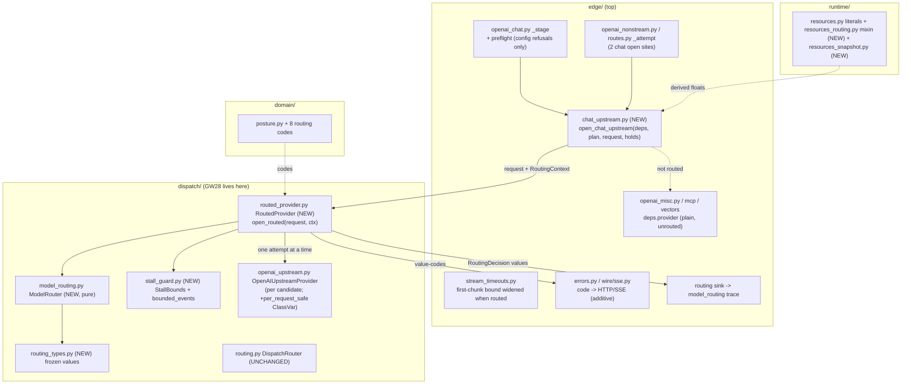

# Design Document — Card GW28: Multi-model routing + bounded stalled-upstream read

## Overview

GW28 adds a deterministic, fail-closed multi-model router to the `gateway_v2` dispatch layer and
closes the recorded-not-fixed "stalled upstream holds a request up to 300 s" defect that GW36 S5
depends on. The router is a new class, `RoutedProvider`, that is used **only by the chat surface**
(streaming and non-streaming `/v1/chat/completions`). It is deliberately **not** a `ProviderClient`:
it exposes `open_routed(request, ctx)` and carries the routing inputs **out of band** as a typed
`RoutingContext` argument, never inside `UpstreamRequest.body`. Embeddings, responses, MCP and
vector surfaces keep the plain `OpenAIUpstreamProvider` as `deps.provider`, unchanged apart from the
lowered transport timeout (Decision D-11). `ProviderClient`, `UpstreamRequest`, `UpstreamEvent` and
`Transform` do not change (requirements, "Out of Scope").

Five structural choices, each argued below:

1. **Routing is a pure ranking** over a frozen, boot-time `RoutingTable`, using weighted
   rendezvous (HRW) hashing on plan identity + a request key. The ranking is a total order, so the
   *primary* choice and every *fallback* are re-derivable (Req 1, 2.5).
2. **No double generation is structural.** `open_routed` is one async generator with one sequential
   attempt loop, one candidate-open call site and one "content committed" latch. A second attempt
   cannot be opened until the first iterator has been closed inside the cancellation bound, and
   cannot be opened at all once any content has been forwarded (Req 2). The edge layer offers the
   route exactly one provider open per request (verified in source, D-12).
3. **No policy bypass.** The router never sees enforcement and never sees prompt text. It
   receives the *already-verified* `UpstreamRequest` from `stage_upstream`, and the only byte
   `rebind` changes is the `model` field. Every attempt reuses the same verified body (Req 3).
4. **Stream integrity** follows from the attempt state machine: pre-content events are withheld,
   the first content event commits the stream to that attempt, nothing from another attempt can
   follow it (Req 4).
5. **The stall bound is app-level and phase-specific**: a cumulative pre-content deadline
   (30 s), a mid-stream gap bound (0.8 s) and a total ceiling, enforced by `bounded_events` around
   each attempt; the httpx transport timeout is unchanged (`max_stream_duration_s()`) and is only a
   backstop, since the 30 s bound is application-level; and the edge's own streaming timer is widened so it can never pre-empt the router
   (D-13). All numbers are derived in `runtime/resources.py` (Req 5).

**Technology stack (locked on approval):** Python ≥ 3.12, `asyncio` (`asyncio.wait_for`), stdlib
`hashlib.sha256`, `dataclasses(frozen=True, slots=True)`, `httpx` (already used by
`openai_upstream.py`), seeded `random.Random` property tests under `pytest` (house idiom, no
`hypothesis`). No new third-party dependency.

## Grounding (what the code actually does today, all read from source)

- `dispatch/routing.py::DispatchRouter.select(plan)` is pure and returns one string
  `amf://upstream/{org}/{version}#{fp}`. `edge/openai_chat.py::_stage` calls it and uses the result
  as `LifecycleOutcome.destination` and for the audit `record_started`. It is **left unchanged**;
  GW28 adds a sibling, as B4 did with `GuardRouter`.
- `ExecutionPlan` (`domain/plan.py`) has **no** model/provider/destination field. Adding one would
  change the compiler and `content_hash` (plan layer, GW14b). See D-1.
- The chat provider is opened at exactly **two** sites: `edge/routes.py::_next_attempt._attempt`
  (`self.provider.open(request)`, streaming) and `edge/openai_nonstream.py` (`deps.provider.open(
  UpstreamRequest(...))`, non-streaming). Both are preceded by `holds.mark_dispatched()`. The
  misc/embeddings surface opens `self._deps.provider.open(upstream)` in `edge/openai_misc.py`
  (L589) from a **separate** `_build_misc_route(provider=provider)` in `edge/app.py` (L319), so the
  chat route and the other surfaces already receive the provider through separate parameters.
- `_next_attempt` is a one-shot: an `offered` latch returns an attempt on the first call and `None`
  on every later call ("exactly ONE signed upstream to try"), so `run_with_no_splice` can never
  open the provider twice for one request today.
- `OpenAIUpstreamProvider._stream` always uses an SSE upstream request, so "non-streaming" is a
  drained stream; a stall looks the same in both modes.
- **Root cause of the 300 s symptom:** `edge/dev_profile.py::_provider` builds
  `httpx_client_factory(..., timeout_s=contract.max_stream_duration_s())`;
  `max_stream_duration_s()` is `_MAX_STREAM_DURATION_MULT (15000) × 20 ms = 300 s`. httpx applies
  one float to connect/read/write/pool and the read timeout is per read gap, so an upstream that
  sends nothing holds the request 300 s. On the non-streaming path nothing else bounds it.
- On the **streaming** path `edge/stream_timeouts.py::StreamTimeouts.next_event` wraps **every**
  upstream `__anext__` (including the first) in `asyncio.wait_for(..., inter_chunk_timeout_s())`
  (`_INTER_CHUNK_TIMEOUT_MULT = 50` → 1 s). That timer would fire before any 30 s pre-content bound
  and make fallback unreachable; D-13 resolves this.
- `OpenAIUpstreamProvider._drain` holds one frame back (`pending`) so the last event carries
  `final=True`. The first `UpstreamEvent` therefore appears when the **second** frame arrives (or at
  end of stream), and the role frame arrives as an empty-delta event. D-14 accounts for this.
- `OpenAIUpstreamProvider.abort()` is a deliberate no-op: a request's read is cut by closing its own
  iterator. `HttpProviderClient.abort()` is instance-level and not safe to share. See D-6.
- `RequestHolds` (`edge/request_holds.py`) is the per-request ledger already threaded to both open
  sites; it exposes `request_id` (the pure hash minted by `ChatSurface._request_id` from
  `(org_id, model, input channels)`, never a client header) and refunds a spend iff spent and not
  dispatched.
- `runtime/resources.py` is **exactly 800 lines** (`check_sizes` module cap). `lint/check_capacity_
  literals.py` exempts only `runtime/resources.py`, so every literal must stay there (D-15).
- `dispatch/authorized.py::AuthorizedProviderEntry` is the GW11 provider entry with a witness
  assertion. GW28 sits *behind* whichever entry calls the provider; it neither weakens nor replaces
  it (D-8).

## Architecture



### Layering

All new `dispatch` modules import only `gateway_v2.domain` and `dispatch` siblings (plus stdlib).
`stall_guard` and `routed_provider` import `UPSTREAM_TIMEOUT`, `BODY_OPENAI_KEY` and friends from
`dispatch.openai_upstream`, and `UpstreamRequest`/`UpstreamEvent`/`ProviderClient` from
`dispatch.provider` (siblings). Nothing imports `plan`, `detect`, `admit`, `edge` or `resolve`.
`runtime/resources_routing.py` and `resources_snapshot.py` import only `runtime.*`. Bounds cross
from `runtime` to `dispatch` **by injection** (floats/ints passed by `edge`), the same way
`owner_queue_bound_s` reaches `GuardRouter`. The import-linter contracts need no change.
`edge/chat_upstream.py` is `edge`, the top layer, so it may import `dispatch` and `runtime`.

## Design decisions on ambiguous points (conservative, fail-closed)

- **D-1 — Candidate set source.** A2 says candidates come "from the pinned plan", but
  `ExecutionPlan` has no routing field and changing it is a plan-layer/compiler change outside this
  card. **Decision:** the candidate set is a frozen `RoutingTable` (org_id → `CandidateSet`) built
  once at boot and injected. Selection is still a function of the *plan identity*. An org absent
  from the table is refused (`routing_no_candidates`); there is **no** implicit default. An operator
  may configure an explicit `fallback_set` (the dev profile does, for its single provider);
  production wiring sets none. Live table reload is out of scope (restart to change).
  **Requirement trace (honest, review F3):** Req 1.2 ("function of plan identity") is met **only
  through the HRW ranking key** (`org_id, epoch, sequence, content_hash` + `request_key`). A2's
  "candidates pinned by the signed plan" is **not** met: the table is boot-time, keyed by org, unsigned,
  and a plan epoch change does not invalidate it. This is a recorded deviation, not a claim of A2. **Round 4:** requirements A2 is amended (see
  requirements.md, "A2 (amended)") to say exactly this, so requirement and design no longer conflict.
- **D-2 — Selection key includes a request key.** Plan identity alone would pin every request of
  an org to one candidate. `RoutingContext.request_key` is `holds.request_id`, the existing pure
  hash of `(org_id, model, input channels)` (not a client header, not a clock). Same request on the
  same plan → same ranking; a retried identical request lands identically.
- **D-3 — "Requested model" is a client alias, not an upstream model name.** A candidate declares
  `served_models` (aliases it answers) and `upstream_model` (the name sent upstream). If no
  candidate serves the requested alias → `routing_unknown_model`. No wildcard, no "closest model".
  **One narrow, explicit exception:** a `Candidate` may set `passthrough=True` (answers any alias,
  sends the requested name upstream unchanged; `served_models` and `upstream_model` empty). It is
  accepted **only inside `RoutingTable.fallback_set`** (the dev-profile opt-in); `CandidateSet.build`
  for an org entry rejects it with `RoutingConfigError`. This keeps the dev profile working with
  arbitrary model names without opening a wildcard in a production table.
- **D-4 — Health is an injected snapshot, never a probe.** `RoutingSnapshot.unavailable` is a
  frozenset of candidate ids supplied by `edge` through a snapshot source callable. It is read
  **once per request** and the whole ranking (primary + fallbacks) is derived from that single
  reading. No per-candidate failure counter or breaker lives in the router (that would be mutable
  cross-request state and a second source of nondeterminism). Default snapshot = nothing unavailable.
- **D-5 — Retryable failure set is closed and explicit.** Fallback is considered only when the
  attempt's *first forwarded-candidate* event is a `gateway_error` in `{upstream_timeout,
  upstream_unavailable, upstream_rate_limited, upstream_error}`. `upstream_invalid_request`,
  `upstream_auth_error`, `upstream_not_found`, `upstream_request_unbuildable`,
  `stream_malformed_upstream`, every `routing_*` code and any provider `error_frame` are **not**
  retried. Unknown codes are non-retryable.
- **D-6 — Teardown is by iterator close; `RoutedProvider.abort()` is a no-op.** Mirrors
  `OpenAIUpstreamProvider`. **Mechanism for rejecting instance-latch clients:** every candidate
  client class must declare a class-level `per_request_safe: ClassVar[bool] = True`.
  `RoutedProvider.__init__` rejects any client whose `type(client)` lacks that attribute or has it
  not `True` (`getattr(type(c), "per_request_safe", False) is not True` → `RoutingConfigError`).
  `OpenAIUpstreamProvider` gains this one-line ClassVar (additive; the only edit to that file);
  `HttpProviderClient` and `StubProviderClient` do not have it and are therefore rejected. Test
  fakes declare it. Teardown confirmation = `aclose()` completed within
  `cancellation_bound_s()`; if it raises or times out, **no further attempt is opened** and the
  request refuses `routing_teardown_unconfirmed`.
- **D-7 — Attempt exhaustion code.** Two or more attempts all failed retryably → terminal
  `routing_attempts_exhausted` (per-attempt causes in the trace). Only one attempt possible/allowed
  → that attempt's own code (e.g. `upstream_timeout`) unchanged, because no routing happened.
- **D-8 — Enforcement stays upstream of routing; Req 3.4 is structural.** The real call chain
  (read from source): `ChatRoute` stages the body (`stage_upstream`, verified + masked), then
  `routes.py::_next_attempt._attempt` (streaming) or `openai_nonstream.py` (non-streaming) calls
  `provider.open(...)` **directly**; `AuthorizedProviderEntry` is **not** on the chat path and this
  design does not rely on it. GW28 replaces those two `provider.open` calls with
  `open_chat_upstream` -> `RoutedProvider.open_routed`. Enforcement runs in `edge` on **both sides**
  of `open_routed`: input enforcement before it (the body handed in is already masked), output
  guard + error-frame scan after it (`_as_chunks` / the non-streaming output resolver wrap whatever
  `open_routed` yields, whichever attempt produced it). `open_routed` has no parameter that can
  disable either side, and `rebind` mutates only `model` and the destination label.
  **Req 3.4 resolution:** "routing cannot guarantee enforcement applies" is satisfied
  **structurally**, not by a runtime check: there is exactly one path to a candidate client
  (`open_routed`, AST-tested P6/P12), and that path is only reachable from the two enforced edge
  sites. The router fails closed on every case it *can* observe (`ctx=None`, bad table, unvalidated
  destination at boot via `CandidateSet.build`). **Recorded residual:** there is no per-candidate
  enforcement attestation (a candidate cannot prove it was enforced); adding one needs a plan-layer
  field and is out of scope. Adding a new caller of `open_routed` outside `chat_upstream.py` fails
  the P12 AST test.
- **D-8a — Candidate destination validation.** `CandidateSet.build` rejects (`RoutingConfigError`,
  fatal at boot) any `Candidate.destination` that is empty, longer than the destination label cap
  (derived in `resources.py`), contains `\x1f` or any control character, or duplicates another
  candidate's destination in the same set. **What consumes it:** `rebind` stamps it on
  `UpstreamRequest.destination` and the trace records it. `OpenAIUpstreamProvider` ignores
  `destination` (it sends to its configured base URL), so the label is **descriptive only** and
  cannot redirect traffic; this is stated so nobody treats it as an address. Audit keeps the
  plan-derived logical destination (D-16).
- **D-9 — Mid-stream gap bound is strictly *inside* the edge's.** `upstream_gap_timeout_s()` is
  0.8 × `inter_chunk_timeout_s()` (0.8 s at default) so the router's timer fires before the edge's
  1 s one and the terminal code is deterministically `upstream_timeout` from the router (D-13). It is
  *new* strictness for the non-streaming path, and it also tightens **routed streaming**, where the
  shipped mid-stream bound was 1 s (now 0.8 s). Risk recorded: a BYOK model pausing >0.8 s between
  tokens mid-response is now cut on non-streaming requests. Mitigation: one constant
  (`_UPSTREAM_GAP_FRACTION`); the pre-content bound covers "thinking" pauses *before* content.
  **Owner notice (review F5):** the PR description MUST state this behaviour change explicitly, for both non-streaming and routed streaming.
- **D-10 — Empty provider iterators fail closed.** A candidate iterator ending with zero events is a
  protocol violation → terminal `stream_malformed_upstream`, non-retryable. An iterator ending after
  content without a `final` event → terminal `stream_malformed_upstream`, never silent truncation.
- **D-11 — Which surfaces are routed; ONE shared pool (revised round 4, review F1).** Only the two
  chat open sites go through `open_chat_upstream`. `app.py` keeps passing the plain provider to the
  misc/embeddings, responses, MCP and vector builders. `build_app` and `_build_chat_route` gain one
  optional keyword, `routing: RoutedProvider | None = None`, stored as `ChatRoute.routing` (default
  `None`, today's behaviour). **There is no second client.** Rounds 1-3 built a separate
  `chat_provider` with a lower httpx timeout; that doubled `pool_size(PROVIDER)` sockets and had no
  shutdown owner (`dev_profile` closers close only `deps["provider"]`). The 30 s stall bound is
  enforced at the **application level** by `bounded_events` (an `asyncio.wait_for` on each await,
  which cancels the pending read and closes the httpx stream), so the transport read timeout is only
  a backstop and does not need to differ. The dev profile therefore keeps its single
  `OpenAIUpstreamProvider` with `timeout_s=contract.max_stream_duration_s()` **unchanged**, and the
  routing table's `fallback_set` passthrough candidate uses that same instance. Consequences, stated:
  (a) the 300 s httpx read timeout is no longer what ends a stalled **routed chat** request: the
  router bound does, at 30 s; (b) with `routing=None` (production today) nothing changes, so the 300 s
  value still applies there until GW36 S5 calls `build_routed_provider`; (c) non-chat surfaces are
  untouched by construction, because the bound lives inside `RoutedProvider`, not in the client;
  (d) `closers` in `dev_profile` stay `(provider.aclose,)` and are correct because there is exactly
  one pool.
  **Production multi-client lifecycle and budget.** `build_routed_provider` may receive several
  distinct clients (one per provider). It (1) returns a frozen `RoutedBundle(routed, closers)` where
  `closers` is the `aclose` of every **factory-built** client only (one per distinct provider key, so no
  `id()` de-duplication is needed). Clients the caller already owns are passed as
  `owned_elsewhere: Mapping[ProviderKey, ProviderClient]` and are never closed here (so the dev
  profile's shared `deps["provider"]` is never closed twice). **Mapping rule:** `ProviderKey = str`
  (C1). For each candidate, `clients[candidate_id] = owned_elsewhere.get(c.provider_key)` if present,
  else the factory-built client for `c.provider_key` (built once per distinct key, shared by every
  candidate with that key). `n` = number of distinct provider keys **not** in `owned_elsewhere`;
  `RoutedProvider.clients` is this candidate_id-keyed mapping. `RoutedBundle` is
  `@dataclass(frozen=True, slots=True)` with `routed: RoutedProvider` and
  `closers: tuple[Callable[[], Awaitable[None]], ...]`; the caller must extend `closers` with
  `bundle.closers`; (2) sizes the pools itself. `pool_size(PROVIDER)` equals `workers()`, so the budget is small.
  `provider_pool_share(n)` is `pool_size(PROVIDER) // n` with **no floor**; it raises
  `CapacityUnavailable` when the result is `< 1` or `n < 1`. A table with more distinct clients than
  `pool_size(PROVIDER)` therefore **refuses to boot** (fail closed, `RoutingConfigError` wrapping the
  cause). The budget is made checkable by construction: `build_routed_provider` takes a
  `client_factory: Callable[[ProviderKey, int], OpenAIUpstreamProvider]` (key, share -> built client) and
  calls it with `connections=share` for each distinct non-owned provider key; it never receives pre-built
  clients for sizing. Callers that already own a client pass it via `owned_elsewhere` (not sized,
  not closed). As a second check, `OpenAIUpstreamProvider` gains a read-only `connections: int`
  property (additive, same spirit as `per_request_safe`) and the factory asserts
  `sum(c.connections) <= pool_size(PROVIDER)` over created clients (`RoutingConfigError`, fatal at
  boot). The shared-pool dev case has `n = 1`, i.e. the full signed budget. Tests: T-edge-7 (below)
  and T-life-1 (all pools closed on lifespan shutdown, no double close of a shared instance).
- **D-12 — Exactly one provider open per chat request (invariant, tested).** With `routing` set,
  `open_chat_upstream` is called at most once per request: `_next_attempt`'s `offered` latch already
  returns `None` after the first attempt, and non-streaming has a single call site. All fallback
  belongs to `RoutedProvider`; the edge no-splice loop is **not** widened by this card. If a later
  card widens `_next_attempt`, test T-edge-1 (counting `open_routed` calls under a byte-less
  failure) fails, which is its purpose. The edge latch trips on *released* bytes, the router's
  latch on *upstream content*; the router commits first, so the edge latch can only trip after the
  router is already committed — they never disagree in the unsafe direction.
- **D-13 — Streaming timer precedence.** `StreamTimeouts` gains an optional constructor argument
  `first_event_s: float | None = None`. When set, the **first** `next_event` await uses it instead
  of `inter_chunk_timeout_s()`; every later await still uses the inter-chunk bound. `ChatRoute` sets
  it to `contract.routing_pre_content_budget_s(max_attempts)` only when `routing is not None`
  (otherwise `None` → unchanged behaviour). The budget formula is
  `n × (first_event + cancellation_bound) + cancellation_bound` (the final `cancellation_bound` is
  margin), strictly greater than the router's worst-case pre-content time, so the router's own
  `upstream_timeout` always lands first. After commit the router's gap bound (0.8 s) is below the
  edge's 1 s bound for the same reason. Net effect, stated plainly: **on streaming, a stall before
  content is bounded by the router (30 s per attempt, fallback reachable); a stall after content is
  bounded by the router at 0.8 s; the edge inter-chunk and write timers are backstops that should
  never fire. The edge *idle* timer is NOT a backstop and needs the D-18 re-seed**, and if
  the backstops do (clock skew, scheduler delay) the stream ends with the edge's existing
  `STREAM_INTER_CHUNK_TIMEOUT` frame, still a single declared terminal. If the edge cuts a live
  `open_routed` iterator, the consumer `aclose()` propagates into step 7 of the flow and the
  upstream is released.
- **D-18 — Edge Idle_Timeout must measure client back-pressure, not upstream latency (review F1,
  HIGH).** `StreamTimeouts.send()` cuts with `STREAM_IDLE_TIMEOUT` when `now - _last_write_s >
  idle_timeout_s()` (3 s default), and `_last_write_s` is seeded at construction. With routing on, the
  first `send` (first released content frame, or the router's terminal error frame) can follow a
  legitimate pre-content wait of up to the pre-content budget, so unmodified it would kill a slow
  first-content stream, and would replace the router's declared `upstream_timeout` with
  `stream_idle_timeout`. **Decision:** when `first_event_s` is set, `StreamTimeouts.next_event`
  re-seeds `_last_write_s = clock()` immediately after the **first** `next_event` await returns,
  for an event of **any** kind (content, role-only, `final`, `error_frame`, or a `gateway_error`
  terminal), guarded by the same one-cell "first await pending" flag (so it happens once). Idle then
  measures the gap between the first upstream event and the first downstream write (client
  back-pressure), which is what R9.3 means. The re-seed is only active when `first_event_s is not
  None`, so `routing=None` behaviour is byte-for-byte unchanged. If the first await times out
  (edge backstop) the re-seed never runs and the cut code is the inter-chunk one, as today.
  `__slots__` gains `_first_event_s` and `_first_pending`.
- **D-14 — The pre-content budget is cumulative and content-indexed.** `bounded_events` starts
  one deadline `start + first_event_s` that governs **every** event until the first event carrying
  non-empty `text_deltas`, an `error_frame`, `final` or a `gateway_error`. A role-only empty-delta
  event does not reset or extend it, and does not switch to the 0.8 s gap. Only after that first
  content/terminal event does the per-event `gap_s` bound apply. This matches the router's
  commit rule (content-indexed), so a role frame followed by a long pause is cut at 30 s total.
- **D-15 — Size gate without moving any literal.** All capacity literals stay in
  `runtime/resources.py`. To get under 800 lines, move the **literal-free** `snapshot()` function
  (L766-800, about 35 lines) to a new `runtime/resources_snapshot.py` and update its two importers
  (`runtime/pools.py`, `tests/runtime/test_lgw12_resources.py`) to import it from there. No
  re-export from `resources.py` (it would be circular). The new literals add about 8 lines to
  `resources.py`. `McpBounds` is **not** moved.
- **D-16 — Audit vs trace destination.** The audit `record_started(request_id, destination)` keeps
  the plan-derived logical destination from `DispatchRouter.select(plan)` (unchanged, deterministic
  per plan). The per-attempt `RoutingDecision.destination` is `Candidate.destination`, the label sent
  upstream. They are different fields with different meanings; a test asserts that the audit value is
  unchanged by routing and that the trace destination equals the one `rebind` stamped.
- **D-17 — Unexpected exceptions.** The router catches `Exception` only, never `BaseException`.
  `asyncio.CancelledError` and `GeneratorExit` propagate after the `finally` closes the live
  attempt iterator. An unexpected `Exception` closes the live iterator, then emits one terminal
  event with the **new non-retryable code `routing_internal_error`** (not `upstream_unavailable`,
  which is retryable). It never opens another candidate. Sink policy: a sink exception **before**
  the first content byte refuses the request with `routing_internal_error` (the trace is part of
  the decision record and no content has flowed); a sink exception **after** commit cannot unsend
  content, so it is logged at ERROR and the stream continues to its natural terminal.

## Components and Interfaces

### C1. Value types — `dispatch/routing_types.py` (NEW)

All `@dataclass(frozen=True, slots=True)`; no module-level mutable state; no capacity literals.
Mapping-valued fields are stored as sorted `tuple`s of pairs (never a `dict`).

```python
@dataclass(frozen=True, slots=True)
class Candidate:
    candidate_id: str            # unique within the set; non-empty; no "\x1f"
    destination: str             # label stamped into UpstreamRequest.destination
    upstream_model: str          # model name sent upstream; non-empty unless passthrough;
                                 # `_UPSTREAM_MODEL` fullmatch (round 8 F2), NOT `_IDENT`
    served_models: frozenset[str]  # client aliases; non-empty unless passthrough
    weight: int                  # >= 1 (vnode count)
    provider_key: str            # ProviderKey = str; selects the client; `_IDENT` fullmatch in build;
                                 # part of P1 equal-input comparison, NOT part of the HRW key
    passthrough: bool = False    # D-3: fallback_set only

@dataclass(frozen=True, slots=True)
class CandidateSet:
    candidates: tuple[Candidate, ...]   # sorted by candidate_id at build; unique ids; non-empty
    @classmethod
    def build(cls, candidates: Iterable[Candidate], *, max_candidates: int, max_weight: int,
              allow_passthrough: bool = False) -> CandidateSet: ...

@dataclass(frozen=True, slots=True)
class RoutingTable:
    by_org: tuple[tuple[str, CandidateSet], ...]   # sorted by org_id
    fallback_set: CandidateSet | None = None        # explicit operator opt-in only (D-1)
    def candidates_for(self, org_id: str) -> CandidateSet | None: ...

@dataclass(frozen=True, slots=True)
class RoutingContext:                 # passed as an ARGUMENT, never placed in the body
    org_id: str; epoch: int; sequence: int; content_hash: str
    request_key: str; requested_model: str
    sink: Callable[[RoutingDecision], None]   # PER-REQUEST (review round 4 F2); never ranked on
    @classmethod
    def from_plan(cls, plan: ExecutionPlan, *, request_key: str, requested_model: str,
                  sink: Callable[[RoutingDecision], None]) -> RoutingContext: ...
    # Round 8 F1: `from_plan` is the SINGLE canonicalisation point for the client-supplied name.
    # `requested_model` is accepted iff `isinstance(str)` and `_IDENT.fullmatch(name)` (the same
    # `_IDENT = [A-Za-z0-9._:-]{1,N}`, `N = routing_max_identifier_len()`, compiled with re.ASCII,
    # defined once in `routing_types.py`). No case folding, trimming or Unicode normalisation is
    # applied: the charset is ASCII-only, so there is nothing to normalise and no two distinct raw
    # strings map to one accepted value. A rejected name is stored as the EMPTY string "" in the
    # context, so no unvalidated client text can reach the HRW key, a RoutingDecision, the console
    # or the event line. A pure helper `is_valid_model_name(name: str, max_len: int) -> bool` is
    # exported for `rank` (defence in depth) and for tests.

@dataclass(frozen=True, slots=True)
class RoutingSnapshot:
    unavailable: frozenset[str] = frozenset()

@dataclass(frozen=True, slots=True)
class RoutingRefusal:
    code: str
    reason: str

@dataclass(frozen=True, slots=True)
class RoutingDecision:                # the Routing_Decision of the requirements; NO content, NO HTTP
    request_key: str
    requested_model: str
    selected_candidate: str | None
    selected_model: str | None        # upstream model actually sent
    destination: str | None           # Candidate.destination (D-16)
    attempt_index: int                # 0 = primary
    remapped_from: str | None         # candidate_id of the previous attempt, else None
    routing_reason: str               # closed vocabulary below
    decision_source: str              # always "plan_hrw" for GW28
    candidate_count: int
    refusal_code: str | None          # set iff the decision is a refusal
    cause: str | None                 # upstream code that triggered a fallback / terminal
```

`routing_reason` vocabulary (module constants, not free text): `primary`, `fallback_after_timeout`,
`fallback_after_unavailable`, `fallback_after_rate_limited`, `fallback_after_upstream_error`,
`refused_no_candidates`, `refused_unknown_model`, `refused_all_unavailable`,
`refused_attempts_exhausted`, `refused_context_missing`, `refused_teardown_unconfirmed`,
`refused_snapshot_unavailable`, `refused_internal_error`.

`RoutingConfigError(ValueError)` is raised only at boot-time construction.

### C2. Pure ranking — `dispatch/model_routing.py::ModelRouter` (NEW)

`__slots__ = ()`. Sibling of `DispatchRouter`; no instance state, no clock, no `random`, no I/O.

```python
class ModelRouter:
    def rank(self, ctx: RoutingContext, cset: CandidateSet,
             snapshot: RoutingSnapshot) -> tuple[Candidate, ...] | RoutingRefusal: ...
```

`RoutingRefusal` is **returned**, not raised, so the fail-closed branch is a normal value flow that
mypy forces callers to handle. Algorithm (pure and total):

0. **Client-name guard (round 8 F1).** If `not is_valid_model_name(ctx.requested_model,
   routing_max_identifier_len())` (empty, over-length, or any character outside `_IDENT`, including
   `|`, `\x1f`, `/`, whitespace, newline and every control character) → return
   `RoutingRefusal(ROUTING_UNKNOWN_MODEL)` **before** matching, so a passthrough candidate can never
   accept an unvalidated name. This re-checks what `from_plan` already enforced (the context is a
   public value type, so `rank` does not trust its constructor). Fail closed: refusal, 0 provider
   opens, HTTP 404 `model_not_found` (existing mapping), never a fallback to another model.
1. `matching = [c for c in cset.candidates if c.passthrough or ctx.requested_model in c.served_models]`.
   Empty → `RoutingRefusal(ROUTING_UNKNOWN_MODEL)`.
2. `eligible = [c for c in matching if c.candidate_id not in snapshot.unavailable]`.
   Empty → `RoutingRefusal(ROUTING_ALL_UNAVAILABLE)`.
3. Key = `"\x1f".join((org_id, str(epoch), str(sequence), content_hash, request_key, requested_model))`.
   `compiled_at`, `feed_seq`, `streaming_mode`, `integrity_locked` are **not** inputs: the function
   takes no `ExecutionPlan`, only `RoutingContext`, which does not carry them (exclusion by type).
4. Score for candidate `c`: `max(int.from_bytes(sha256(key + SEP + c.candidate_id + SEP + str(v)).digest(), "big") for v in range(c.weight))`.
   **Cost (round 4, F7).** Worst case is `max_candidates x max_weight = 8 x 16 = 128` sha256 calls per
   `rank`. `key + SEP + candidate_id + SEP` is encoded once per candidate and the prefix hasher is
   `copy()`-ed per vnode, so only `str(v)` is hashed per vnode (a copy plus one short update). Rank
   happens once per request (not per attempt). P2 gains a micro-benchmark assertion: worst-case
   `rank` (8 candidates, weight 16, 2 KB key) p99 over 1,000 calls is below
   `contract.target_p99_ms / 100` of the SLO in seconds (budget derived from the contract accessor,
   not a literal; ~0.2 ms at 20 ms), measured on injected-size inputs; the assertion is
   non-flaky because it compares a p99 over many calls against a 100x-margin budget. Output is
   byte-identical to the unoptimised formula (pinned by a golden-vector test).
   Integer arithmetic only (no float nondeterminism); `weight` vnodes give weighted rendezvous.
5. Sort by `(-score, candidate_id)`: a total order even on a 256-bit tie.
6. Return the full ordered tuple. Index 0 is the primary; index `k` is the `k`-th fallback.

Why HRW rather than hash-mod-N: adding or removing a candidate changes only requests that ranked it
first, so a health flip does not reshuffle the fleet, and the fallback order falls out of the same
sort. An adaptive load-weighted scheme was rejected (A1): it needs a live signal and makes replay
depend on time. `rank` has no `Decision`, `Rule`, `plan.rules` or `Disposition` parameter, so it
cannot condition on enforcement (Req 3.2).

### C3. Stall guard — `dispatch/stall_guard.py` (NEW)

```python
@dataclass(frozen=True, slots=True)
class StallBounds:
    first_event_s: float   # cumulative pre-content deadline (D-14)
    gap_s: float           # max wait between events AFTER the first content/terminal event
    total_s: float         # absolute ceiling for the whole attempt
    teardown_s: float      # bound for iterator aclose()
    def __post_init__(self) -> None: ...   # 0 < gap_s < first_event_s < total_s, teardown_s > 0

def bounded_events(it: AsyncIterator[UpstreamEvent], bounds: StallBounds,
                   ) -> AsyncIterator[UpstreamEvent]: ...
```

`StallBounds.__post_init__` raises `RoutingConfigError` on a violated ordering (fail at start).
"Strictly below 300 s" (Req 5.1) and `total_s < max_stream_duration_s()` (by at least one
`cancellation_bound_s()`, round-4 F5) are asserted by the derivation test against
`upstream_total_timeout_s()` and the 300 s default (P7), not by a literal here.

`bounded_events` behaviour:

- `loop.time()` stamps `start` (event-loop clock, a stall-guard input, never a selection input, so
  `ModelRouter` purity is intact).
- Phase 1 (pre-content): each await is `asyncio.wait_for(it.__anext__(), limit)` with
  `limit = min(start + first_event_s, start + total_s) - now`. The deadline is **cumulative**: empty
  non-terminal events do not reset it (D-14). The phase ends at the first event with non-empty
  `text_deltas`, an `error_frame`, `final` or `gateway_error`.
- Phase 2 (after the first such event): `limit = min(gap_s, start + total_s - now)`.
- `limit <= 0` or `TimeoutError` yields exactly one `UpstreamEvent(text_deltas=(), final=True,
  gateway_error=UPSTREAM_TIMEOUT)` and returns. `StopAsyncIteration` ends normally.
- `wait_for` cancels the pending `__anext__`; for the async generator in `OpenAIUpstreamProvider`
  this raises `CancelledError` inside `_stream`, exiting its `async with ...stream(...)` block, and
  httpx closes (not pools) a connection with unread body bytes, so **a half-open socket is never
  returned to the pool** (Req 5.4; local proof via an in-process transport that records closes).
- The `finally` block runs `await asyncio.wait_for(it.aclose(), bounds.teardown_s)`; any
  `Exception` or timeout is raised as `TeardownUnconfirmed(Exception)` (module-local), which
  `RoutedProvider` converts into `routing_teardown_unconfirmed`. `CancelledError`/`GeneratorExit`
  are not swallowed (D-17).

### C4. `RoutedProvider` — `dispatch/routed_provider.py` (NEW)

Deliberately **does not** satisfy `ProviderClient` (no `open` method), so mypy and the runtime
`isinstance(x, ProviderClient)` check both refuse it as `deps.provider` anywhere. A test asserts
`not isinstance(rp, ProviderClient)`.

```python
class RoutedProvider:
    __slots__ = ("_router", "_table", "_clients", "_bounds", "_max_attempts",
                 "_snapshot_source")
    def __init__(self, *, router: ModelRouter, table: RoutingTable,
                 clients: Mapping[str, ProviderClient], bounds: StallBounds,
                 max_attempts: int, snapshot_source: Callable[[], RoutingSnapshot]) -> None: ...
    def preflight(self, ctx: RoutingContext) -> str | None: ...   # pure; refusal code or None
    def open_routed(self, request: UpstreamRequest,
                    ctx: RoutingContext | None) -> AsyncIterator[UpstreamEvent]: ...
    async def abort(self) -> None: ...   # no-op (D-6)
```

All attributes are set once in `__init__`; no per-request state on the instance; one
`RoutedProvider` serves every request on a worker. Per-request state lives in locals of the
generator.

Construction validation (all `RoutingConfigError`, fatal at boot): every `candidate_id` in the
table (including `fallback_set`) has a client; every client class has `per_request_safe is True`
(D-6); `max_attempts >= 1`; `StallBounds` valid.

`open_routed(request, ctx)` flow, as one async generator:

1. **Context.** `ctx is None` or not a `RoutingContext` → refusal `routing_context_missing`
   (wiring bug). **Zero client opens.**
2. **Table.** `cset = table.candidates_for(ctx.org_id) or table.fallback_set`; both `None` →
   `routing_no_candidates`.
3. **Snapshot + rank, once.** `snapshot = snapshot_source()` (raises or wrong type →
   `routing_snapshot_unavailable`; never "assume all healthy"), then
   `ranked = router.rank(ctx, cset, snapshot)`; a `RoutingRefusal` becomes the terminal event.
4. **Attempt budget.** `n = min(max_attempts, len(ranked))`.
5. **Attempt loop** `for k, cand in enumerate(ranked[:n])`:
   - record `RoutingDecision(attempt_index=k, remapped_from=prev, reason=primary|fallback_after_*)`
     through `ctx.sink` (D-17 failure policy).
   - `attempt_request = rebind(request, cand)` (C5).
   - `it = bounded_events(clients[cand.candidate_id].open(attempt_request), bounds)`.
   - Read events with the **committed latch** (`committed: bool`, local):
     - `gateway_error` and `not committed`: retryable (D-5) and `k + 1 < n` → close `it` (its
       `finally` awaits `aclose`), record `cause`, continue the outer loop; else terminal.
     - `error_frame`, `final`, or non-empty `text_deltas`: set `committed = True` and **yield** it.
       After commit every event is forwarded unchanged up to and including the first terminal event
       (`final` / `error_frame` / `gateway_error`), then the generator returns.
     - empty deltas, not final, no error, `not committed`: **withheld** (carries no content).
     - iterator exhausted: not committed → `stream_malformed_upstream`; committed without a
       terminal → `stream_malformed_upstream` terminal event (D-10).
   - `except TeardownUnconfirmed` → terminal `routing_teardown_unconfirmed`; no more attempts.
6. **Terminal on exhaustion.** `>= 2` attempts and the last failure retryable →
   `routing_attempts_exhausted` (D-7); one attempt → its own `gateway_error` unchanged.
7. **Failure and cancellation (D-17).** The generator body is wrapped in `try: ... except Exception:
   ... finally: <close live attempt iterator>`. `Exception` → one terminal `routing_internal_error`
   (logged ERROR, no further open). `CancelledError`/`GeneratorExit` are never caught; the
   `finally` closes the live attempt iterator, releasing the single open upstream on client
   disconnect (Req 4.4). The body is split into `_run_attempt(...)` and `_terminal(...)` helpers to
   respect the 120-line function cap.

`abort()` does nothing: the `CancellationController` cuts by closing the consumer's iterator, which
propagates into step 7.

**Why double generation cannot happen.** (a) There is exactly one `<client>.open(` call site in
the module, inside the sequential loop in step 5. (b) The loop advances only after the previous
`it` has left `bounded_events`, whose `finally` awaits `aclose()`. (c) The loop is re-entered only
via the `gateway_error and not committed` branch; once `committed`, the only exit is `return`.
(d) `n ≤ max_attempts` from the contract. (e) `max_completions()` is 1, so one attempt never asks
for multiple choices. (f) The edge offers the route a single `open_routed` call per request (D-12).
Tests record an open/close/yield timeline from fake clients and assert (a)-(d) over randomized fault
scripts (P4).

### C5. Rebind — the only mutation of the verified request

`rebind(request, cand) -> UpstreamRequest` (module-level pure function in `routed_provider.py`):

- Returns `UpstreamRequest(destination=cand.destination,  # validated in CandidateSet.build (D-8a) body=<new dict copy of request.body>)`.
- It replaces **only** `body[BODY_OPENAI_KEY]` with `MappingProxyType({**openai_body, "model":
  cand.upstream_model})`. A `passthrough` candidate leaves `model` untouched. There is no routing
  key in the body to strip, because the context is out of band.
- If `BODY_OPENAI_KEY` is absent or not a mapping, `rebind` returns the request unchanged and the
  client's own `upstream_request_unbuildable` path refuses (the body is never synthesized here).
- Messages, tools, `forwarded` params and every other key are the *same objects*, so a second
  attempt carries byte-identical verified content (Req 3.3). The raw prompt is never re-admitted:
  `RoutedProvider` has only the verified body it was handed.

### C6. Edge integration (minimal, additive)

- **`edge/chat_upstream.py` (NEW).**
  `open_chat_upstream(deps: ChatRoute, plan: ExecutionPlan, request: UpstreamRequest,
  holds: RequestHolds) -> AsyncIterator[UpstreamEvent]`. If `deps.routing is None` it returns
  `deps.provider.open(request)` (today's behaviour). Otherwise it builds
  `ctx = routing_context(plan, request.body, holds.request_id)` and returns
  `deps.routing.open_routed(request, ctx)`. `routing_context` reads `requested_model` from
  `request.body[BODY_OPENAI_KEY]["model"]` (the same value `upstream_body.py` set from `req.model`);
  a missing or non-`str` model yields `ctx = None`, so `open_routed` refuses `routing_context_missing`.
  The two chat open sites (`routes.py::_next_attempt._attempt`, `openai_nonstream.py`) replace
  `provider.open(...)` with this helper. Nothing else calls `open_routed` (AST test).
- **`edge/openai_chat.py::_stage`.** After `with_openai_body`, when `self._deps.routing` is set, call
  `routing.preflight(routing_context(plan, body, request_id))`. A non-`None` code returns
  `_refused(code, request_id=request_id)` with **zero provider calls**; the budget spend made
  earlier is **refunded by `RequestHolds.release`** (spent and never dispatched). Preflight catches
  only the configuration refusals (`routing_no_candidates`, `routing_unknown_model`); it does not
  read the snapshot, so there is no time-of-check/time-of-use gap. `all_unavailable` is decided in
  `open_routed`.
- **`edge/chat_deps.py` / `edge/routes.py`.** `ChatRoute` gains `routing: RoutedProvider | None =
  None` (a defaulted field placed with the other defaulted fields) and builds `StreamTimeouts(...,
  first_event_s=...)` per D-13. `edge/stream_timeouts.py` gains the optional `first_event_s`
  constructor argument, a per-instance "first await pending" one-cell flag, and the D-18 idle re-seed
  after the first `next_event` await returns (`__slots__` gains `_first_event_s`, `_first_pending`).
- **`edge/app.py`.** `build_app(..., routing=None)` and `_build_chat_route(..., routing=None)`;
  `_build_misc_route` and the other builders are untouched.
- **`edge/dev_profile.py`.** `_provider()` returns `(provider, routing, log)`. When `provider_url`
  is set: keep the single plain `OpenAIUpstreamProvider` as `provider` with
  `timeout_s=contract.max_stream_duration_s()` unchanged (D-11: no second client), and build `routing`
  with a single `passthrough` candidate in an explicit `fallback_set` (D-1, D-3) whose client **is
  that same instance** (per-request-safe, D-6). With `provider_url` unset (EchoProvider)
  `routing = None`. The kwargs dict (`"provider": provider, ...` near L356) gains `"routing": routing`.
  `closers` (near L518) is unchanged and sufficient. The boot log states the four bounds (Req 5.6).
- **`edge/production_profile.py`.** Leaves the fail-closed provider default. GW28 exposes
  `build_routed_provider(contract, table, client_factory, snapshot_source, *, owned_elsewhere: Mapping[ProviderKey, ProviderClient] = {}, log)` in
  `edge/` (a thin factory reading every bound from `ResourceContract`) returning
  `RoutedBundle(routed, closers)` (D-11). **It logs the four bounds itself** at construction through
  the same `log` callable the dev boot uses, one line
  `routing bounds first_event_s=.. gap_s=.. total_s=.. pre_content_budget_s=..` (review F4), so the
  Req 5.6 start-up record exists in production as well as dev. Test T-log-1 asserts the line and its
  four values on both paths. GW36 S4/S5 call it.
- **`edge/errors.py` / `edge/wire/sse.py`.** Additive entries: `routing_unknown_model` → 404
  `model_not_found`; `routing_no_candidates`, `routing_all_unavailable`,
  `routing_attempts_exhausted`, `routing_teardown_unconfirmed`, `routing_context_missing`,
  `routing_snapshot_unavailable`, `routing_internal_error` → 503 `service_unavailable` with the
  standard Retry-After rules. Matching SSE-frame entries sit beside `upstream_timeout`. Unmapped
  codes already fall back to a generic envelope, so a missed entry fails closed.
- **Trace (rewritten round 4, review F2).** The sink is **per request**, never worker-level.
  `RoutedProvider` has no sink attribute. For each chat request the edge (in `open_chat_upstream`'s
  caller, the same place that builds `RoutingContext`) creates a `RoutingTrace` (`edge/routing_trace.py`,
  NEW, `__slots__ = ("_decisions",)`, bounded by `routing_max_attempts() + 1` entries, appends beyond
  the bound are dropped and counted, never raised) and passes `trace.append` as `RoutingContext.sink`.
  The trace object travels **by reference with the request's own call chain** (a local in
  `routes.py::_next_attempt` for streaming and in `openai_nonstream.py` for non-streaming, handed to
  `console_from_holds(..., routing=trace.decisions())`). It is **not** stored in a dict keyed by
  `request_key`. `request_key = holds.request_id` is a pure content hash
  `(org, model, input channels)` and is **not unique across concurrent requests**, so it is used for
  HRW ranking only (identical requests must rank identically) and is never a trace key.
  This avoids the PIPELINE-0023 conflation class: two concurrent identical requests own two disjoint
  `RoutingTrace` objects. Test T-edge-8 drives two concurrent identical requests with different fake
  fallbacks and asserts disjoint decision lists.
  **Destination record (read from source in round 4).** The per-request console is built by
  `edge/console_projection.py::chat_console(...)`, which emits six fixed stages
  (`auth, rate_limit, input_scan, model_routing, model_output, output_guardrail`) and calls
  `audit.console_schema.validate_console`. That schema is **closed**: a stage may carry only
  `name, action, ran, deciding_rule`; any other key raises `SchemaError`. `chat_console` and
  `console_from_holds` gain one optional keyword `routing: Sequence[RoutingDecision] = ()` (default
  `()` keeps every existing caller and test byte-identical). Field mapping table:
  | `RoutingDecision` (last entry = final) | `model_routing` stage key |
  |---|---|
  | `selected_candidate is not None` and provider called | `action="allow"`, `ran=True` (as today) |
  | refusal (`refusal_code` set) | `action="skip"`, `ran=False` |
  | `routing_reason`, `selected_candidate`, `attempt_index`, `remapped_from`, `requested_model` | `deciding_rule` = `"{reason}|{sel}|{attempt}|{from}|{alias}"`, `-` for None |
  `alias` is `requested_model` only if it appears in the `served_models` of some **non-passthrough**
  candidate (operator-configured, `_IDENT`-validated at boot), else `-`. A passthrough match does not
  make a name "known" (round 8 F1), so in the dev profile `alias` is always `-`. Independently, the
  name was already `_IDENT`-validated in `RoutingContext.from_plan` and `rank`, so even the
  `RoutingDecision.requested_model` field only ever holds an accepted or empty value. No
  client-supplied free text reaches the record (Req 6.4); `sel`/`from` are operator-defined
  `candidate_id`s validated in `CandidateSet.build` (`_IDENT` fullmatch, see Input validation; excludes `|`). `selected_model`
  (upstream name), `decision_source`, `destination` and `candidate_count` do **not** fit the closed
  schema; they are emitted on the existing `edge/event_log` path as one rate-limited structured line
  per decision (class `routing_decision`, no content parameter by construction) and are **not**
  added to the console. Widening `console_schema._STAGE_KEYS` is an owner decision recorded in Open
  Items; GW28 does not touch the audit schema. Req 6.1's "requested vs selected" is satisfied on the
  console by `alias` + `sel` (candidate id names the model/destination) and in full by the event line.
### C7. Posture codes — `domain/posture.py` (codes only)

Add and export: `ROUTING_NO_CANDIDATES`, `ROUTING_UNKNOWN_MODEL`, `ROUTING_ALL_UNAVAILABLE`,
`ROUTING_ATTEMPTS_EXHAUSTED`, `ROUTING_TEARDOWN_UNCONFIRMED`, `ROUTING_CONTEXT_MISSING`,
`ROUTING_SNAPSHOT_UNAVAILABLE`, `ROUTING_INTERNAL_ERROR`. Single spelling per the file's
convention. `upstream_*` codes are reused from `openai_upstream`.

### C8. Capacity — `runtime/resources.py` + `runtime/resources_routing.py` (the ONLY literals)

New literals in `resources.py` (one line each, with a short comment); **no literal lives anywhere
else**:

```python
_UPSTREAM_FIRST_EVENT_MULT = 1500.0   # pre-content budget = p99_s x mult (30 s at 20 ms)
_UPSTREAM_GAP_FRACTION = 0.8          # mid-stream gap = fraction x inter-chunk bound (D-9)
_ROUTING_MAX_ATTEMPTS = 2
_ROUTING_MAX_CANDIDATES = 8
_ROUTING_MAX_WEIGHT = 16
_ROUTING_MAX_IDENT_LEN = 64           # identifier length cap (Finding 1, round 7)
```

Accessors in `RoutingBoundsMixin` (new file, `VectorBoundsMixin` pattern: function-local import of
the constants, no literal in the mixin):

| Accessor | Value at 20 ms SLO | Derivation |
|---|---|---|
| `upstream_first_event_timeout_s()` | 30 s | `_stream_timeout_s(_UPSTREAM_FIRST_EVENT_MULT)` |
| `upstream_gap_timeout_s()` | 0.8 s | `max(_UPSTREAM_GAP_FRACTION × inter_chunk_timeout_s(), p99_s)` |
| `upstream_total_timeout_s()` | 299.94 s | `max_stream_duration_s() - cancellation_bound_s()` (per attempt, measured from that attempt's start; strictly below the edge max-duration kill for a single attempt. After a fallback the edge deadline, measured from stream start, may fire first and the terminal is then the edge's declared `stream_killed`; still exactly one terminal, fail closed; round 5 F2) |
| `routing_pre_content_budget_s(n)` | 60.18 s for n=2 | `n × (first_event + cancellation_bound) + cancellation_bound` (edge first-chunk bound, D-13) |
| `provider_pool_share(n)` | `pool_size(PROVIDER)` for n=1 | `pool_size(PROVIDER) // n`, no floor; `CapacityUnavailable` if n < 1 or result < 1 (D-11) |
| `routing_max_attempts()` | 2 | `_ROUTING_MAX_ATTEMPTS`, fail closed if < 1 |
| `routing_max_candidates()` | 8 | `_ROUTING_MAX_CANDIDATES` |
| `routing_max_weight()` | 16 | `_ROUTING_MAX_WEIGHT` |
| `routing_max_identifier_len()` | 64 | `_ROUTING_MAX_IDENT_LEN`, fail closed if < 1 |

`teardown_s` is the existing `cancellation_bound_s()` (60 ms). Every accessor raises
`CapacityUnavailable` on a non-positive result. The moved `snapshot()` (D-15, now in
`runtime/resources_snapshot.py`) adds `upstream_first_event_timeout_s`, `upstream_gap_timeout_s`,
`upstream_total_timeout_s`, `routing_pre_content_budget_s` to the start-up default log (Req 5.6).

**Size gate (D-15).** `resources.py` is 800 lines; moving `snapshot()` frees ~35 lines for the ~8
added. Gate steps: after step 2 of the implementation order run `check_sizes` **and**
`check_capacity_literals`; both must exit 0 before any later step starts.

The `dispatch` modules hold **no** numeric capacity literal: `StallBounds`, `max_attempts`,
`max_candidates`, `max_weight` arrive by injection. `range(c.weight)` and the `"\x1f"` separator
are formatting, as in `routing.py`.

## Data Models

| Type | Layer / file | Frozen/slotted | Notes |
|---|---|---|---|
| `Candidate`, `CandidateSet`, `RoutingTable` | `dispatch/routing_types.py` | yes | boot-time config, by value |
| `RoutedBundle` | `edge/production_profile.py` | yes (`frozen=True, slots=True`) | `routed` + `closers` tuple |
| `RoutingContext`, `RoutingSnapshot` | `dispatch/routing_types.py` | yes | `Selection_Inputs`, out of band |
| `RoutingDecision`, `RoutingRefusal` | `dispatch/routing_types.py` | yes | trace/audit values, no content |
| `StallBounds` | `dispatch/stall_guard.py` | yes | validated ordering |
| `ModelRouter` | `dispatch/model_routing.py` | `__slots__ = ()` | pure |
| `RoutedProvider` | `dispatch/routed_provider.py` | `__slots__`, set-once | no per-request state, not a `ProviderClient` |
| `UpstreamRequest`, `UpstreamEvent`, `ProviderClient`, `Transform` | existing | unchanged | |

There is **no** new key in `UpstreamRequest.body`, so no existing body consumer (`with_openai_body`,
`LifecycleOutcome.body`, audit, `repr` logging, `AuthorizedProviderEntry`) can see, copy or
serialise routing state. This removes the forged-body and serialisation concerns by construction.

## Invariants and their owning layer

| Invariant | Owner | Why that layer |
|---|---|---|
| Same inputs → same ranking | `dispatch/model_routing.py` (by type: no clock/IO inputs) | the only place a choice is made |
| ≤ 1 live generation; no re-generation after content | `dispatch/routed_provider.py` (sole candidate `open` site + latch) | owns the only loop; `edge` offers one call (D-12) |
| Enforcement identical for every candidate | `edge` enforces on both sides of `open_routed` (input `stage_upstream`, output guard/error-frame scan); `rebind` changes only `model`+label; sole `open_routed` caller AST-tested (D-8) | enforcement is decided outside routing; router has no enforcement parameter; residual: no per-candidate attestation |
| Idle timer measures client back-pressure | `edge/stream_timeouts.py` (D-18 re-seed) | otherwise upstream latency masquerades as client idle |
| Router timer pre-empts edge timers | `runtime/resources.py` (`routing_pre_content_budget_s`, gap fraction) | one capacity authority; ordering tested (P11) |
| Terminal-frame discipline on the wire | `edge/wire/sse.py` (shipped state machine) | unchanged; the router guarantees one terminal *event* |
| Stall bound ordering and values | `runtime/resources.py` (values), `StallBounds.__post_init__` (ordering) | ordering checked at boot |
| Only chat surfaces are routed | `edge/chat_upstream.py` is the sole `open_routed` caller | AST-tested (P12) |
| HTTP rendering of refusals | `edge/errors.py` | only `edge`/`resolve` render |

## Input validation

| Input | Required | Type / limits | On failure |
|---|---|---|---|
| `CandidateSet.build(candidates)` | yes | 1..`routing_max_candidates()` items; unique non-empty ids; **every** `candidate_id`, `provider_key`, `served_models` alias must `fullmatch` `_IDENT = [A-Za-z0-9._:-]{1,N}`; a (non-passthrough) `upstream_model` must `fullmatch` the looser `_UPSTREAM_MODEL = [A-Za-z0-9._:/@+-]{1,N}` (round 8 F2: real upstream names such as `meta-llama/Llama-3` or `accounts/x/models/y`; it never reaches the console, only the upstream body and the event line, which carries no free text beyond this validated name; still excludes `|`, `\x1f`, whitespace and control chars; `N` is the same accessor) with `N = routing_max_identifier_len()` (excludes `|`, `\x1f`, whitespace and control chars by construction); `1 <= weight <= routing_max_weight()`; non-empty `served_models` and `upstream_model` unless `passthrough`; `passthrough` only with `allow_passthrough=True` | `RoutingConfigError`, fatal at boot, ERROR |
| `RoutingTable` | yes | org ids unique, non-empty; `fallback_set` optional | `RoutingConfigError`, fatal at boot |
| `RoutedProvider(clients=...)` | yes | covers every candidate id; each class `per_request_safe is True` | `RoutingConfigError`, fatal at boot |
| `StallBounds` | yes | `0 < gap < first_event < total`, `teardown > 0` | `RoutingConfigError`, fatal at boot |
| `ctx` argument | yes per request | `RoutingContext` | `routing_context_missing`, 0 opens, WARN |
| `ctx.requested_model` (client-supplied, reaches us via the request body `model`) | yes | `str`; `_IDENT.fullmatch`, length `1..routing_max_identifier_len()` (default 64), ASCII only; checked in `RoutingContext.from_plan` (invalid → stored as `""`) and again in `ModelRouter.rank` step 0 and `preflight` | invalid/empty/over-length → `RoutingRefusal(routing_unknown_model)`, HTTP 404 `model_not_found`, 0 opens, INFO event line (class `routing_decision`, no model text); not a boot error. Note: names with `/` or `@` are refused as client aliases (fail closed, documented; operators expose such upstreams through an `_IDENT` alias in `served_models`) |
| `snapshot_source()` | yes | returns `RoutingSnapshot` | raises or wrong type → `routing_snapshot_unavailable`, ERROR |

## Error Handling

Every failure terminates the stream with **one** `UpstreamEvent(text_deltas=(), final=True,
gateway_error=<code>)`, the channel `OpenAIUpstreamProvider` already uses; `edge` renders it through
the error envelope. `dispatch` builds no HTTP object. "Recoverable" means the router may try the
next candidate; nothing is retried by the caller.

| Failure | Recoverable? | Caller receives | Log level |
|---|---|---|---|
| Boot config invalid (table, bounds, missing client, non-`per_request_safe` client) | fatal | process does not start | ERROR |
| `routing_context_missing` | fatal for request | that code, 0 opens | WARN |
| Org has no candidate set and no `fallback_set` | fatal | `routing_no_candidates` (preflight, zero provider calls, spend refunded) | INFO |
| No candidate serves the model | fatal | `routing_unknown_model` (preflight) | INFO |
| All matching candidates unavailable | fatal | `routing_all_unavailable` | WARN |
| Snapshot source raises | fatal | `routing_snapshot_unavailable` | ERROR |
| Retryable `gateway_error` before content, attempts remain | **recoverable** | none; next candidate; trace records `remapped_from` + `cause` | INFO |
| Same, ≥ 2 attempts tried and all failed | fatal | `routing_attempts_exhausted` | WARN |
| Same, only 1 attempt possible | fatal | the attempt's own code (e.g. `upstream_timeout`) | WARN |
| Non-retryable `gateway_error` (auth, invalid request, malformed) | fatal | that code unchanged | WARN |
| Provider `error_frame` | fatal | forwarded as today (scanned before any byte, R11) | per shipped path |
| No content within cumulative `first_event_s` | recoverable if attempts remain, else fatal | `upstream_timeout` | WARN |
| Gap > `gap_s` after content | fatal (content committed, **no** fallback) | terminal `upstream_timeout` after the content already sent | WARN |
| Attempt exceeds `total_s` | fatal | `upstream_timeout` | WARN |
| `aclose()` raises or exceeds `teardown_s` | fatal, no further attempt | `routing_teardown_unconfirmed` | ERROR |
| Candidate iterator empty / ends after content without `final` | fatal | `stream_malformed_upstream` | WARN |
| Consumer disconnect / cancel mid-attempt | n/a | `CancelledError`/`GeneratorExit` re-raised after the live iterator is closed | DEBUG |
| Unexpected `Exception` in rank / rebind / sink (pre-content) / snapshot / mid-iteration | fatal | live iterator closed, then terminal `routing_internal_error`, zero further opens | ERROR |
| Sink raises after commit | continue | stream proceeds to its natural terminal; failure logged | ERROR |
| Edge backstop timer fires anyway (should not, P11) | fatal | existing `STREAM_INTER_CHUNK_TIMEOUT` frame, single terminal | WARN |

## Stalled-upstream behaviour (the GW36 S5 dependency), end to end

1. Request staged (preflight passes). `open_routed` ranks once and opens candidate 0 inside
   `bounded_events`.
2. The upstream accepts the connection but sends nothing, or sends only a role frame. After the
   cumulative `first_event_s` (30 s default, `1500 × p99`, strictly less than `total_s`,
   which is itself strictly less than the edge's `max_stream_duration_s`, and than the old 300 s read gap) `wait_for` fires.
3. `bounded_events` cancels the pending read; the generator exits the httpx stream context; the
   connection is closed, not pooled. `aclose()` is awaited within `cancellation_bound_s()` (60 ms).
4. `bounded_events` yields one `gateway_error=upstream_timeout`. `open_routed` sees an uncommitted
   retryable failure: with `n >= 2` it opens the next-ranked candidate; otherwise it forwards the
   `upstream_timeout` terminal. `edge` renders 504 `timeout_error` (existing map) on non-streaming,
   or the declared timeout error frame on streaming.
5. A stall *after* content began is bounded by `gap_s` (0.8 s) and ends the stream with a terminal
   `upstream_timeout`; no fallback because content was forwarded (Req 2.4).
6. The 30 s bound is **application-level** (`bounded_events`), not a transport timeout: the shared
   httpx client keeps its 300 s read timeout as a backstop that can no longer be the effective bound
   for a routed chat request; non-chat surfaces are unaffected (D-11).
7. On streaming, the edge's first-chunk wait is `routing_pre_content_budget_s(n)` (≈ 60.18 s) and
   its later waits stay at 1 s, so the router's timers always fire first (D-13). The edge idle clock
   is re-seeded when the first upstream event (any kind, including the router's terminal
   `upstream_timeout`) arrives (D-18), so a 30 s pre-content wait neither cuts the stream with
   `stream_idle_timeout` nor masks the declared `upstream_timeout` frame.

Worst-case non-streaming wall time before a terminal with two attempts is
`2 × (first_event_s + teardown) ≈ 60.12 s`, far below the 300 s symptom per attempt. Lowering
`_UPSTREAM_FIRST_EVENT_MULT` (one line in `resources.py`) shortens it.

## Testing Strategy

Property tests follow the house idiom: seeded `random.Random`, no `hypothesis`, each tagged
`# Feature: gw28-multi-model-routing, Property N: <text>` in source. Pure properties run ≥ 10,000
iterations (matching `test_lgw12_routing.py`); async/fault-script properties run ≥ 200 iterations
(the requirement floor is 100). Files live in `gateway_v2/tests/dispatch/` (tests are not under the
layer contract, so they may import `edge` for the SSE codec).

**Timing tolerance (flake control).** Real-asyncio timing tests use `StallBounds` built directly at
50 ms (first-event) / 20 ms (gap) / 2 s (total) / 20 ms (teardown) and assert
`0.9 × bound <= elapsed <= bound + 0.25 s`. Which timer fires first is **not** left to a race:
P11 proves the ordering arithmetically over the derivation, and the timing tests only check that each
bound fires near its value.

| # | Property (tag text) | File | Kind |
|---|---|---|---|
| P1 | Ranking is a pure function of `(plan identity, request_key, model, table, snapshot)`: repeated and independently constructed equal inputs give an identical ranking and `RoutingDecision`; `compiled_at`, `feed_seq`, `streaming_mode`, `integrity_locked` and candidate input order do not change it; `preflight` verdict agrees with `rank` refusals | `test_gw28_routing_determinism.py` | property |
| P2 | Selection is total and closed: result ∈ eligible matching candidates, or a typed `RoutingRefusal`; never a candidate outside the table; passthrough accepted only in `fallback_set`; frequency over many keys ∝ weight (±tolerance) | same | property |
| P3 | Minimal disruption: marking one candidate unavailable changes the primary only for requests that ranked it first; relative order of the others is unchanged | same | property |
| P4 | No double generation: over random fault scripts (fail-before-content, fail-after-content, stall, role-only-then-stall, clean) the timeline never has two live opens, a second open occurs only after the first's `aclose` completed with zero content yielded, opens ≤ `max_attempts`, and after any content no further open occurs | `test_gw28_no_double_generation.py` | property (async) |
| P5 | Stream integrity: ≤ 1 terminal event, nothing after it, no content after an error; concatenated text byte-identical to the one committing attempt's text; sentinel text from abandoned attempts never appears; round-trips through `Transform` and `SSEEncoder`/`SSEDecoder` | `test_gw28_stream_integrity.py` | property (async) |
| P6 | No policy bypass: (a) `rebind` changes only `model` (random nested bodies, deep equality elsewhere); (b) every attempt's body equals the verified body modulo `model`; (c) `ctx=None` or wrong type → 0 client opens; (d) `ModelRouter.rank` has no enforcement/decision parameter and `routed_provider`/`model_routing`/`stall_guard` import none of `edge/admit/detect/plan/resolve` (AST); (e) exactly one candidate `.open(` call site in `routed_provider.py` (AST) | `test_gw28_no_policy_bypass.py` | property + static |
| P7 | Stall bound: a fake upstream that never yields terminates with exactly one `upstream_timeout` at `first_event_s`, iterator observed closed, no `final` success; **a role-only empty-delta event then silence is also cut at the cumulative `first_event_s`, not at `gap_s`**; mid-stream stall ends at `gap_s`; slow trickle ends at `total_s`; derivation: for random `target_p99_ms ∈ [1, 100]`, `0 < gap < first_event < total < max_stream_duration_s()` (new P11 clause, single-attempt case only: slow trickle terminates with `upstream_timeout` from the router, never `stream_killed`/max-duration, over random p99; after a fallback the edge max-duration code is an accepted single declared terminal), at the default `first_event < 300 s`, accessors raise `CapacityUnavailable` on non-positive | `test_gw28_stall_bound.py` | property + integration |
| P8 | Attempt bound and exhaustion: attempts ≤ `routing_max_attempts()`; ≥ 2 retryable failures → `routing_attempts_exhausted`; single possible attempt surfaces its own code; teardown failure → no further open | `test_gw28_attempt_bound.py` | property (async) |
| P9 | Trace is content-free: with a planted secret in the prompt, no `RoutingDecision`/refusal field contains it; fields hold only closed-vocabulary strings and `_IDENT`-validated candidate ids; planted `|`/newline ids are rejected at boot; **round 8:** a seeded generator (≥10,000 iterations) draws client model names from the full printable and control range plus the planted separators and lengths 0..2N, and asserts for every draw that (a) accept ⇔ `_IDENT.fullmatch` and `len <= N`, (b) on accept the console `deciding_rule` splits into exactly 5 fields and contains no character outside `_IDENT ∪ {"|"}`, (c) on reject there are 0 opens and the code is `routing_unknown_model`, (d) no rejected raw string appears in any `RoutingDecision`/console/event field, (e) accepted names rank identically across repeated calls | `test_gw28_trace_redaction.py` | property |
| P10 | Fault injection: an injected `Exception` at each point (`rank`, `sink` pre-content, `snapshot_source`, `rebind`, mid-iteration, `aclose`) yields exactly one terminal event, code `routing_internal_error` (or `routing_snapshot_unavailable`/`routing_teardown_unconfirmed` where defined), zero further opens, and the live iterator closed; `CancelledError` and `GeneratorExit` injected mid-attempt propagate (not converted to an event) and the live iterator is closed; a post-commit sink raise does not alter the forwarded stream | `test_gw28_fault_injection.py` | property (async) |
| P11 | Timer precedence: for random `target_p99_ms ∈ [1, 100]` and `n ∈ [1, max_attempts]`, `gap < inter_chunk`, and `routing_pre_content_budget_s(n) > n × (first_event + cancellation_bound)`; integration: with routing on, a stalled streaming upstream ends with the router's `upstream_timeout` (never the edge `STREAM_INTER_CHUNK_TIMEOUT`), and fallback after a pre-content stall is reachable on streaming; **(D-18)** with small injected contract values (idle bound I), a fake upstream sending first content after 2×I delivers that content (no `stream_idle_timeout`), and a never-yielding upstream ends with the router's `upstream_timeout` frame, not `stream_idle_timeout`; with `first_event_s=None` the idle behaviour is unchanged (regression) | `test_gw28_timer_precedence.py` | property + integration |
| P12 | Seam: `RoutedProvider` is not a `ProviderClient`; `open_routed` is called only from `edge/chat_upstream.py` (AST over `gateway_v2/`); a client class without `per_request_safe is True` (`HttpProviderClient`, `StubProviderClient`) is rejected at construction, `OpenAIUpstreamProvider` accepted | `test_gw28_seam.py` | static + unit |

Unit/integration (non-property):

- **T-edge-1 (D-12).** Streaming and non-streaming chat with `routing` set: a byte-less candidate
  failure leads to exactly one `open_routed` call per request (fallback happens inside it); with
  `routing=None` the plain provider is opened exactly once.
- **T-edge-2 (per-surface, F2).** In the dev profile with `AMF_DEV_PROVIDER_URL` set, drive each
  surface wired in `app.py` (chat streaming, chat non-streaming, embeddings/misc, responses) against
  a fake upstream: all succeed; the non-chat surfaces never touch `open_routed`; chat uses it.
- **T-edge-3.** A preflight refusal makes zero provider calls, never calls `mark_dispatched`, and
  `RequestHolds.release` refunds the budget spend (assert the quota fake saw the refund).
- **T-edge-5 (Req 3.3 output half, review F2).** Candidate 0 fails byte-less (`upstream_unavailable`),
  candidate 1 streams output containing a planted secret: the output guard / error-frame scan wraps
  attempt 1 identically to attempt 0, so the secret is redacted or blocked (streaming and
  non-streaming). Same test with a planted secret in a mid-stream `error_frame` of attempt 1.
- **T-edge-6 (D-8a).** `CandidateSet.build` rejects empty, over-cap, control-char/`\x1f` and duplicate
  destinations, and any `candidate_id`/`provider_key`/alias failing `_IDENT`, or `upstream_model` failing `_UPSTREAM_MODEL` (accepted: `meta-llama/Llama-3`, `accounts/x/models/y`; planted `|`, newline, space, over-length) with `RoutingConfigError`; asserts the label never changes the HTTP target.
- **T-edge-9 (round 8 F1, client `requested_model`).** With a dev-profile `fallback_set` holding a
  passthrough candidate: `RoutingContext.from_plan` and `ModelRouter.rank` given `llama-3`,
  `gpt-4o:2024-08` (accepted), and planted `a|b`, `a\nb`, `a\x1fb`, `a b`, `meta/llama-3`, `\x00`,
  `ünï`, a trailing-newline `abc\n` (fullmatch, not match), an empty string, and a 65-char name
  (rejected, `ROUTING_UNKNOWN_MODEL`, zero `open` calls, 404 `model_not_found` via the real
  `_stage` preflight). Asserts the console `deciding_rule` has exactly 5 `|`-separated fields and its
  `alias` field is `-` for every passthrough-only match, and that the planted text appears nowhere
  in the console, the event line, or the `RoutingDecision`. A name exactly `routing_max_identifier_len()`
  long is accepted; one longer is rejected.
- **T-edge-8 (round-4 F2).** Two concurrent identical requests (same `request_key`) with different
  injected per-attempt outcomes: each request's `RoutingTrace` holds only its own decisions; the
  stage `deciding_rule` of each console reflects its own final decision; schema validation passes
  (`validate_console`) for primary, fallback and refusal traces.
- **T-edge-7 (D-11).** Dev profile: a non-chat surface (embeddings) against a fake upstream silent
  for longer than the chat first-event bound but shorter than `max_stream_duration_s` still succeeds
  (the client and its timeout are unchanged); the same silence on routed chat yields `upstream_timeout`
  at `first_event_s`. Also asserts the profile builds exactly one `OpenAIUpstreamProvider`.
- **T-life-1 (D-11, round-4 F1).** `build_routed_provider` with three distinct provider keys plus one key supplied via
  `owned_elsewhere`: `bundle.closers` has exactly three entries (factory-built only); running them closes each client once
  and the shared one zero times; for a contract with pool_size(PROVIDER)=P, `sum` of `n * provider_pool_share(n)` is `<= P` for every n in 1..P; negative case: n = P+1 raises `CapacityUnavailable` and `build_routed_provider` refuses to boot; clients are created by the factory with `connections == share` (checked via the `connections` property).
- **T-log-1 (Req 5.6, round-4 F4).** Both the dev boot and `build_routed_provider` emit the bounds line
  with four values equal to the contract accessors.
- **T-edge-4 (D-16).** Audit `record_started` destination equals `DispatchRouter.select(plan)`
  and is unchanged by routing; the trace destination equals the candidate destination `rebind` set.
- `dev_profile` builds exactly one `OpenAIUpstreamProvider` whose timeout equals
  `contract.max_stream_duration_s()` (unchanged).
- `edge/errors.py` maps every `ROUTING_*` code to a non-generic body (iterate the posture codes);
  `sse.py` likewise.
- End-to-end through `openai_nonstream` with a never-yielding fake upstream returns 504 within the
  derived first-event bound and the fake records its connection closed.
- Size and literal gates (`check_sizes`, `check_capacity_literals`) are asserted by running the CLI
  in a test, so the D-15 relocation cannot regress.

Not unit-testable here (deferred `Live_Gate`, A6): real BYOK sockets, real httpx pool behaviour on
cancel under load, and fleet capacity. The no-half-open-socket claim (Req 5.4) is verified locally
against an in-process transport that records connection close; the live-socket confirmation is a
Live_Gate.

## Gate checklist (Req 7)

`lint-imports` (no new edge); `python -m lint.check_capacity_literals gateway_v2`;
`check_no_module_mutable`; `check_frozen_dataclasses`; `check_sizes`;
`check_http_outside_edge_resolve`; `check_dispatch_provenance` (GW28 never constructs a
`DispatchAuthorization`); `mypy --strict`; `ruff`. New modules stay well under 800 lines / 120-line
functions.

## Implementation order (bottom-up)

1. `domain/posture.py` codes.
2. `runtime/resources.py` literals + `resources_routing.py` mixin + move `snapshot()` to
   `resources_snapshot.py` (update `pools.py` and the one test import); accessor tests.
   **Exit gate: `check_sizes` and `check_capacity_literals` exit 0.**
3. `dispatch/routing_types.py`.
4. `dispatch/model_routing.py` + P1-P3.
5. `dispatch/stall_guard.py` + P7.
6. `dispatch/routed_provider.py` + `per_request_safe` ClassVar on `OpenAIUpstreamProvider` +
   P4, P5, P6, P8, P9, P10, P12.
7. `edge/` wiring: `chat_upstream.py`, `_stage` preflight, `ChatRoute.routing`, `StreamTimeouts`
   first-event arg, `app.py` kwarg, `dev_profile` routing wiring (single shared pool), `RoutedBundle` closers, per-request `RoutingTrace`, error maps, sink; P11 and T-edge-1..4.
8. Run the full gate checklist.

## Open items (recorded, not blocking)
- **Residual: provider-side generation after a timeout fallback (round-4 F6).** Closing the socket
  after `upstream_timeout` releases the connection and aborts reading (Req 2.3) but does not prove
  the provider stopped generating (`OpenAIUpstreamProvider.abort()` is a no-op and HTTP offers no
  cancel acknowledgement). A fallback attempt can therefore overlap billed provider work for the
  abandoned attempt. This does **not** violate A3 (at most one generation stream delivers content to
  the client; the abandoned attempt had forwarded zero bytes) but is a cost/quota residual. It is
  mitigated by the 2-attempt cap and recorded for operators in the PR description; no provider cancel
  API is assumed.

- **GW36 S5** consumes `build_routed_provider(...)` and the logged bounds; the production table
  source (signed state vs. env) is S4/S5's call. Until then production has no table and refuses
  (`routing_no_candidates`), the fail-closed default.
- **Console schema widening (owner decision).** `audit/console_schema.py` is closed (stage keys
  `name, action, ran, deciding_rule`). GW28 packs routing detail into `deciding_rule` and the event
  log (C6 Trace). Adding first-class `selected_model`/`routing_reason` stage keys would be a schema
  change owned by the audit/console card; not done here, not blocking.
- **Mid-stream gap (D-9)** may need loosening for slow BYOK models on non-streaming: one constant.
- **Pre-existing, not changed:** with `routing=None` the streaming first chunk is still bounded at
  1 s by `StreamTimeouts`; GW28 changes that only when routing is set (D-13).
- **Circuit breaker feeding `RoutingSnapshot`** and adaptive/cost routing are additive and out of scope.

## Responses to review findings (pass 1)

- **F1 (HIGH) — addressed (D-15, C8).** `McpBounds` is no longer moved. All literals stay in
  `resources.py`. Room comes from moving the literal-free `snapshot()` function to
  `runtime/resources_snapshot.py` (two importers updated). "No literal leaves `resources.py`" is an
  explicit rule, and `check_sizes` + `check_capacity_literals` are an exit gate at implementation
  step 2 and a CLI-driven test.
- **F2 (HIGH) — addressed (Overview, D-11, C4, C6).** Option A: only the two chat open sites route,
  through `edge/chat_upstream.py` and `ChatRoute.routing`. `deps.provider` stays the plain provider
  for every other surface. `RoutedProvider` is not a `ProviderClient`, so it cannot be wired as
  `provider=`. Overview wording fixed. Test T-edge-2 drives each surface; P12 asserts the seam.
- **F3 (MEDIUM) — addressed (D-12, D-13, P11, T-edge-1).** The effective streaming bounds are stated.
  The edge first-chunk wait is widened to `routing_pre_content_budget_s(n)` only when routing is set,
  and the router's gap bound (0.8 s) sits below the edge's 1 s, so the router fires first and
  fallback is reachable on streaming. The single-open invariant is cited from source
  (`_next_attempt`'s `offered` latch) and tested. The terminal code when the edge cuts a live
  iterator is defined.
- **F4 (MEDIUM) — addressed (D-6, P12).** Concrete rule: class-level `per_request_safe: ClassVar[bool]
  is True`, checked on `type(client)` at construction; `OpenAIUpstreamProvider` gets the ClassVar;
  `HttpProviderClient`/`StubProviderClient` are rejected; construction tests for each.
- **F5 (MEDIUM) — addressed (C4, C6, Data Models).** The context is passed out of band as an
  argument to `open_routed`; nothing is added to `UpstreamRequest.body`, so no body consumer needs
  auditing, and a forged body cannot reach a candidate.
- **F6 (MEDIUM) — addressed (D-17, flow step 7, Error Handling, P10).** `except Exception` only;
  `CancelledError`/`GeneratorExit` re-raised after the `finally` closes the live iterator; new
  non-retryable `routing_internal_error`; defined sink-failure policy (refuse pre-content, log
  post-commit); a fault-injection property covers rank/sink/snapshot/rebind/mid-iteration/aclose.
- **F7 (LOW) — addressed (D-14, C3, P7).** The pre-content deadline is cumulative and content-indexed;
  P7 covers role-only-then-silence.
- **F8 (LOW) — addressed (D-16, T-edge-4).** Audit keeps the plan-derived logical destination; trace
  records the candidate destination; a test asserts both.
- **F9 (LOW) — addressed (C6 `_stage`, T-edge-3).** Wording corrected to "refunded by
  `RequestHolds.release`", with a refund assertion.
- **F10 (LOW) — addressed (Testing Strategy, P11).** Fixed tolerance `[0.9 × bound, bound + 0.25 s]`
  on small injected bounds; timer ordering is proven arithmetically rather than raced.

## Responses to review findings (pass 2)
- **Finding 1 (HIGH) — addressed (D-18, D-13, C6, Stalled step 7, P11).** The edge idle clock is
  re-seeded after the first upstream event of any kind when `first_event_s` is set; P11 gains the
  slow-first-content and never-yielding integration cases. The false "edge timers never fire" claim
  is corrected.
- **Finding 2 (MEDIUM) — addressed (D-8, D-8a, Invariants, T-edge-5, T-edge-6).** `AuthorizedProviderEntry`
  claim removed; the real call chain is stated; Req 3.4 is structural with the residual recorded;
  destination validated in `CandidateSet.build`; output-half test added.
- **Finding 3 (LOW) — addressed (D-1).** Req 1.2 trace stated as HRW-key only; A2 deviation explicit.
- **Finding 4 (LOW) — addressed (D-11, C6 dev_profile, T-edge-7).** Separate chat client for the lower
  timeout; non-chat unchanged.
- **Finding 5 (LOW) — addressed (D-9).** PR description must tell the owner about the 0.8 s gap.

## Review responses (round 4)
- **Finding 1 (MEDIUM) — resolved (D-11, C6 dev_profile/production_profile, C8, T-edge-7, T-life-1).**
  The second pooled `chat_provider` is removed. One shared pool; the 30 s bound is application-level
  (`bounded_events`), so `dev_profile` closers stay correct. `build_routed_provider` returns
  `RoutedBundle(routed, closers)` with identity de-duplication and `owned_elsewhere`, and each
  distinct client is sized by `provider_pool_share(n)` with a boot-time sum assertion against
  `pool_size(PROVIDER)`. Consequences for the 300 s transport timeout are stated in D-11.
- **Finding 2 (MEDIUM) — resolved (C4, C6 Trace, Open Items, T-edge-8).** Sink moved to
  `RoutingContext.sink`, bound per request to a request-local `RoutingTrace`; `request_key` is for
  ranking only. `console_projection.chat_console` was read: the console schema is closed, so a field
  mapping table (decision -> `model_routing` stage + `deciding_rule`, remaining detail on the event
  log) is specified, with the no-free-text rule. Schema widening is recorded as an owner decision.
- **Finding 3 (LOW) — resolved (requirements A2 amended + glossary; D-1).**
- **Finding 4 (LOW) — resolved (C6 production_profile, T-log-1).** `build_routed_provider` logs the
  four bounds itself.
- **Finding 5 (LOW) — resolved (C8 `upstream_total_timeout_s`, P7/P11).** `total_s =
  max_stream_duration_s() - cancellation_bound_s()`; P11 asserts `total < max_stream_duration`.
- **Finding 6 (LOW) — resolved by recording (Open Items).** Provider-side generation after a timeout
  fallback is a documented residual; A3 is not violated.
- **Finding 7 (LOW) — resolved (C2 step 4, P2).** Prefix-hasher copy reduces per-vnode work, plus a
  worst-case `rank` micro-benchmark assertion with a contract-derived budget and a golden vector.
- **Honoured constraints.** Capacity literals stay only in `runtime/resources.py` (D-15; the new
  `provider_pool_share` and total-timeout derivations add no literal); no gate allowlist extension is
  needed, so there is no conflict with GW27 D-13's two-file allowlist. No live gate is run or claimed.

## Review responses (round 5)
- **Finding 1 (MEDIUM) — resolved (D-11, C8 `provider_pool_share`, C6 `build_routed_provider`, T-life-1).**
  The `max(1, ...)` floor is removed; the share is `pool_size(PROVIDER) // n` and raises
  `CapacityUnavailable` when `< 1`, so an oversized table refuses to boot. T-life-1 is bounded to
  `n <= pool_size(PROVIDER)` with a negative case at `P+1`. The budget is checkable: clients are built
  by a `client_factory` called with `connections=share`, backed by a read-only `connections` property
  on `OpenAIUpstreamProvider` and a sum assertion.
- **Finding 2 (LOW) — resolved by scoping (C8, P7/P11).** `total_s` stays per attempt; the router-wins
  claim is limited to a single attempt. After a fallback the edge's `stream_killed` is an accepted,
  single, declared terminal.
- **Finding 3 (LOW) — resolved by stating behaviour (C6 `_stage`).** Zero-provider-call refusals
  produced inside `open_routed` (`routing_all_unavailable`, `routing_snapshot_unavailable`,
  `routing_context_missing`, `routing_internal_error`) occur after `mark_dispatched`, so the budget
  spend is NOT refunded, unlike preflight refusals. This is conservative (over-charges, never
  under-charges). Releasing the mark via a "no candidate opened" signal is recorded as a follow-up.
- **Finding 4 (LOW) — resolved (D-9).** D-9 and the PR notice now cover routed streaming (1 s to 0.8 s).
- **Finding 5 (NIT) — resolved.** Candidate ids in `deciding_rule` are operator-defined, org-owned
  identifiers validated by `CandidateSet.build`; they are safe to expose in the client-visible
  `pipeline_trace`. Upstream model names are not included.
- **Honoured constraints.** No capacity literal added outside `runtime/resources.py`; GW27 D-13
  two-file allowlist unchanged. No live gate is run or claimed.
## Review responses (round 6)
- **Finding 1 (MEDIUM) — resolved (C1 `Candidate.provider_key`, D-11, C6, Data Models, T-life-1).**
  `ProviderKey = str` added to `Candidate` (charset-checked in `CandidateSet.build`, in P1 equality, not
  in the HRW key). `owned_elsewhere` is a `Mapping[ProviderKey, ProviderClient]`; the
  candidate_id -> client mapping rule, `n`, closers (factory-built only, `id()` dedupe dropped) and
  `RoutedBundle` (frozen, slotted) are defined.
- **Finding 2 (MEDIUM) — resolved (Overview item 5, Testing Strategy).** Stale text rewritten: the
  httpx timeout is unchanged; test asserts one client with timeout `max_stream_duration_s()`.
- **Finding 3 (LOW) — addressed.** The PR description must state Req 5 is closed for routed chat and
  the dev profile only; with `routing=None` the 300 s stall persists until GW36 S5.
- **Finding 4 (NIT) — kept as Open Item** (closed console schema; owner decision).
- **Honoured constraints.** No capacity literal added; GW27 D-13 two-file allowlist unchanged. No live
  gate is run or claimed.

## Review responses (round 7)
- **Finding 1 (MEDIUM) — resolved (C1, C6, C8, Input validation, T-edge-6, P9).** One shared rule
  `_IDENT = re.compile(r"[A-Za-z0-9._:-]{1,N}")` applied with `fullmatch` in `CandidateSet.build` to
  `candidate_id`, `provider_key`, every `served_models` alias and non-passthrough `upstream_model`;
  violation is `RoutingConfigError` at boot. `N` comes from the new accessor
  `routing_max_identifier_len()` backed by `_ROUTING_MAX_IDENT_LEN` (one line in `resources.py`, the
  existing allowlisted file); the pattern is a format, not a capacity, so no literal lands in
  `dispatch`. T-edge-6 and P9 add planted `|`, newline, space and over-length cases.
- **Finding 2 (LOW) — addressed.** The PR description must state that non-streaming pre-content
  waits are now bounded at 30 s (previously up to 300 s) and name `_UPSTREAM_FIRST_EVENT_MULT` as the knob.
- **Finding 3 (LOW) — addressed.** PR description: Req 5 closed for routed chat and dev profile only
  until GW36 S5.
- **Finding 4 (NIT) — kept as Open Item.**
- **Honoured constraints.** GW27 D-13 two-file capacity-literal allowlist unchanged (new literal sits in
  `resources.py`). No live gate is run or claimed.

## Review responses (round 8)
- **Finding 1 (MEDIUM) — resolved (C1 `from_plan`, C2 step 0, C6 `alias`, Input validation, T-edge-9, P9).**
  The client `requested_model` is validated with the same `_IDENT` charset and the same
  `routing_max_identifier_len()` cap as operator identifiers, at the single canonicalisation point
  `RoutingContext.from_plan` (invalid stored as `""`) and again in `ModelRouter.rank` step 0 and
  `preflight`, before it can reach the HRW key, a `RoutingDecision`, the console or the event line.
  Rejection = `RoutingRefusal(ROUTING_UNKNOWN_MODEL)` → 404 `model_not_found`, 0 opens, no fallback
  to another model. No new code, accessor or capacity literal: `ROUTING_UNKNOWN_MODEL` and
  `routing_max_identifier_len()` already exist. The trace `alias` is now informative only for
  non-passthrough served aliases (reviewer's fix point 1). Trade-off stated: client names containing
  `/` or `@` are refused (fail closed); an operator maps them via a `served_models` alias.
  No allowlist change (GW27 D-13), no module-level mutable state (`_IDENT` is a compiled immutable
  pattern built from the accessor value at construction, held on the frozen `CandidateSet`/router
  config, not a mutable global), frozen/slotted types unchanged, no HTTP object outside `edge`.
- **Finding 2 (LOW) — addressed (C1, Input validation).** Separate documented `_UPSTREAM_MODEL`
  pattern for `upstream_model` allowing `/`, `@`, `+`; `_IDENT` unchanged for ids and aliases.
  T-edge-6 gains accepted cases `meta-llama/Llama-3` and `accounts/x/models/y` and a rejected `a|b`.
- **Finding 3 (LOW) — carried (accepted).** PR description states the 30 s pre-content bound and
  names `_UPSTREAM_FIRST_EVENT_MULT`.
- **Finding 4 (LOW) — carried (accepted).** PR description states Req 5 closed for routed chat and the
  dev profile only until GW36 S5 (default `routing=None` path unchanged).
- **Finding 5 (NIT) — unchanged**, recorded owner decision (closed `console_schema._STAGE_KEYS`).
- **Unverified assumptions** (httpx pool on `wait_for` cancel; non-streaming request deadline) remain
  deferred to the Live_Gate; nothing run or claimed.

## Implementation deviations (iteration 1; mirrored in `.agents/tasks/deviations.md`)
Implementation showed the design is wrong or silent on these points; the code follows this section.
- **Injected identifier length.** `dispatch` cannot import `runtime`, so `routing_max_identifier_len()`
  reaches it by injection: `CandidateSet.build(..., max_ident_len=)`, `RoutingContext.from_plan(...,
  max_ident_len=)`, `ModelRouter.rank(..., *, max_ident_len)` and `RoutedProvider(..., max_ident_len=)`.
  `RoutingTable.build(by_org, *, fallback_set)` and `RoutedProvider.serves_alias(name)` are added.
  The destination-label cap is the same value (no separate accessor).
- **Trace location (C6 "Trace").** The per-request `RoutingTrace` is attached to the request's own
  `RequestHolds` (`note_routing` / `routing_trace`), created in `open_chat_upstream`, not threaded as a
  local through `routes.py`/`openai_nonstream.py`. `RequestHolds` is already per request, never shared,
  and already reaches both open sites, `console_from_holds` and the audit emitter, so every console
  builder sees the same trace without a signature change. `chat_console` gains `routing` and
  `routing_alias` (the alias is decided at trace creation by `RoutedProvider.serves_alias`).
- **Event line.** `edge/event_log.StructuredEventLog` has a closed vocabulary and is not reachable from
  `ChatRoute`, so the `routing_decision` line is a plain INFO record from `RoutingTrace.append`
  (bounded: at most `routing_max_attempts()+1` lines per request). It is not rate-limited.
- **Responses surface (D-11, T-edge-2).** `/v1/responses` is built from the same `ChatRoute`, so it is
  routed too (a stall bound there is desirable). Only embeddings, moderations, models, MCP and vector
  stay unrouted.
- **Factory location.** `build_routed_provider` / `RoutedBundle` live in `edge/routing_boot.py` (the
  dev wiring lives there too) and are re-exported by `edge/production_profile.py`.
- **Duck-typed dependency bundles.** Several shipped tests drive the chat open path with bundles that
  have no `routing` field, so `open_chat_upstream` and `_stage` read it with `getattr(..., None)`.
- **Preflight code.** `_stage` maps `routing_unknown_model` to the existing `model_not_found` code
  (HTTP 404). `edge/errors.py` also declares `routing_unknown_model` as 404 `not_found_error` for the
  `open_routed`-time path.
- **`OpenAIUpstreamProvider.connections`** is a constructor argument (default 0 = not declared), read by
  the factory's budget check.
- **Size headroom.** `edge/app_defaults.py` (default boot seams) and `edge/route_support.py`
  (`ProducedModeHolder`, `placeholder`) were extracted from `app.py` / `routes.py`, behaviour-free.
- **Dev-profile behaviour change.** Because the dev `fallback_set` is a passthrough candidate, client
  model names must match `_IDENT` (so `meta/llama-3` is refused with 404 `model_not_found`), as the
  round-8 trade-off already states.

