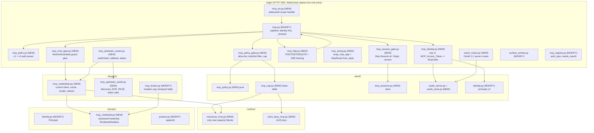

# Design Document: GW32 / GW17b / GW17c MCP transport, authenticated upstreams, per-key tool controls

## Overview

This design extends the shipped GW17 MCP surface (`gateway_v2/gateway_v2/edge/mcp.py`, `edge/mcp_registry.py`, `dispatch/mcp_broker.py`) with three cards. The build order is fixed by the requirements: Requirement 1 first (identity before `initialize`, a security defect in shipped code), then GW17b (credential path), then GW32 (client transports and the OAuth server, which needs GW17b's setup routes), then GW17c (per-key policy, which depends only on GW17 and GW05).

The shape of the change, in one paragraph. `McpRoute._serve` is restructured so that an `McpCaller` (identity, key hash, org, principal, transport, origin check result) is resolved before any method is looked at. A new `edge/mcp_identity.py` accepts either the API key or an `MCP_Access_Token` as `Authorization: Bearer` and always resolves to the live `Principal` through `IdentityCache`. The same pipeline (`_forward`) serves four client transports: POST (JSON or one-event SSE), GET (SSE keepalive stream), DELETE (end session) and WebSocket (one JSON-RPC message per text frame). It is mounted at both `/v1/mcp/{slug}` and the v1 path `/gateway/{org}/mcp/{srv}`. Upstream credentials stay in control; the gateway fetches one server's credential per use through a new internal endpoint, keeps it in a per-worker RAM cache keyed `(org, slug)`, renders it into `upstream.headers` of the broker body only, and never gives it to a type that logs, audits, scans or serialises it. Per-key `mcp_allowed_tools` and `mcp_max_tool_calls` ride on `Principal` through the signed KEY record. The allow-list is a pure function evaluated per request; the cap is a per-key lease table that follows the GW06 `BudgetLease` idiom.

**Technology stack (locked on approval).** Python 3.12, raw ASGI 3.0 (no framework), `mypy --strict`, `ruff`, `import-linter`, pytest with seeded `random.Random` properties (house idiom, no hypothesis), `fakeredis` for store-backed tests. Optional libraries stay lazy and test-only: `httpx` (already the lazy transport in `dispatch/mcp_broker.py`), `websockets` (not installed in the dev interpreter today; tests `importorskip` it and also ship an asyncio-streams WebSocket fixture so the offline lane has a real-socket proof without it). Control is Django/DRF (new internal endpoints, same style as `MCPGatewayNeedsReauthView`).

## Verified starting point (read in this tree)

| Fact | Where | Consequence |
|---|---|---|
| `_serve` answers `initialize`/`ping`/`notifications/initialized` through `_local()` before `_tenant()` | `edge/mcp.py` `_serve`, `_local` | Defect. `_local` moves behind identity (R1). |
| `_refuse_reply_message` and `_forward` each call `_tenant()`; the budget phase passes `key_hash=hashed_bearer_key(ctx.scope) or ""` | `edge/mcp.py` `_admit_and_charge` | A request authenticated by an `MCP_Access_Token` has no 48-char key in `Authorization`, so `hashed_bearer_key` is `None` and the per-key GCRA would see `""`. The caller's `key_hash` must come from `McpCaller`, not be re-derived from the header. |
| `bearer_key`/`hashed_bearer_key` accept only `[A-Za-z0-9_-]{48}` | `edge/identity_resolver.py` | Tokens use a different shape (prefix `zsmcp_`), so the existing namer can never resolve one by accident, and chat cannot accept one (R7.1). |
| `CachingIdentityResolver.resolve_outcome` names the key then calls `IdentityCache.resolve(key_hash)` | `edge/identity_resolver.py` | Add one additive method `resolve_hash(key_hash)` that `resolve_outcome` itself calls. Chat behaviour is unchanged (R7.4). |
| `Principal(key_id, org_id, rate_per_s, burst, feed_seq)`, frozen+slotted; `principal_of` builds it from a KEY record | `domain/identity.py`, `admit/identity.py` | Append two defaulted fields (R15, 21.8). |
| `_key_body(key_id, org_slug)` writes four fields; `SourceKey(key_hash,key_id,org_slug,active)`; `_KEYS` selects explicit columns | `state_control/projector.py:527`, `state_control/source.py`, `state_control/source_pg.py` | Both fields flow through source, projector and `principal_of`. |
| Control already has `GatewayAPIKey.mcp_allowed_tools` (JSON list) and `mcp_max_tool_calls` (PositiveInteger) | `control/ai_mesh_control/core/models.py:352-357` | No control migration for GW17c. |
| `MCPServerRegistration.AUTH_TYPE_CHOICES` is `none, bearer, basic, authheaders, query_param, oauth`; secrets are `EncryptedCharField`; OAuth access token lives in `auth_token`; `needs_reauth`, `oauth_token_expires_at`, `oauth_state`, `oauth_code_verifier` exist | `control/ai_mesh_control/mcp_connector/models.py:137-190` | The wire name for custom header is `authheaders` in control and `header` in the requirements. The credential endpoint maps `authheaders` to `header`. `query_param` puts the secret in the URL, which R12.1 forbids, so it is an unimplemented type and keeps the legacy refusal `mcp_upstream_auth_unsupported` (R11.9). |
| `IsGatewayInternalOnly` and `IsAuthenticatedOrGatewayInternal` use `secrets.compare_digest` on `X-Gateway-Internal-Key` | `control/.../mcp_connector/views.py:100-129` | New credential endpoints use `IsGatewayInternalOnly` (never console users, R11.2). |
| `McpBroker._payload` sends `"headers": {}` and `oauth_client_role: forbidden_in_sandbox` for non-stdio | `dispatch/mcp_broker.py` | `headers` is where the credential goes; `auth none` must stay byte-identical (R12.7). |
| `BudgetLease` takes an injected client, WATCH/MULTI acquire, synchronous `try_spend`, off-path refill via injected `spawn`, store-clock TTL | `admit/lease.py` | The cap lease copies the idiom; it does not extend `BudgetLease`, whose keys are per-org token pools (`runtime/store_keys.py` `budget_*`). |
| `runtime/resources.py` is exactly 800 lines; `check_capacity_literals.py` has `ALLOWED_REL = "runtime/resources.py"` matched by `rel == ALLOWED_REL or rel.endswith("/" + ALLOWED_REL)` | `runtime/resources.py`, `lint/check_capacity_literals.py` | See Decision D-5 and "Capacity literals and the size gate". |
| `edge/app.py` is 800 lines and declines any non-`http`/`lifespan` scope; `edge/routes.py` is 799 | `edge/app.py` `asgi`, `edge/routes.py` | Neither file may grow. HTTP routes join through `edge/surface_entries.py`; the WebSocket scope is handled by an ASGI wrapper applied at boot (see "WebSocket"). |
| `SSEEncoder`/`SSEDecoder` are chat-delta shaped (`DownstreamFrame`, `[DONE]`) | `edge/wire/sse.py` | They cannot carry a JSON-RPC body. See "SSE framing" for the deliberate deviation from R4.3 / P12 wording. |
| `lint/check_secret_headers.py` scans for PEM private-key headers only | `lint/check_secret_headers.py` | It cannot satisfy R14.6. A new AST gate `lint/check_credential_flow.py` is required. |

## Decisions

The requirements recorded D-1 to D-7. They stand; this section adds what the design had to decide.

- **D-1 (open owner decision 11, recorded).** The MCP client URL is kept as `/gateway/{org}/mcp/{srv}` (working default). No redirect plan, no signed redirect, no migration notice. `/v1/mcp/{slug}` stays served as a second path to the same handler. This is a working default, **not an owner signature**. The implementer appends this exact sentence to the runbook note for owner decision 11: "kept `/gateway/{org}/mcp/{srv}` (working default); no redirect shipped; no migration notice; not owner-signed". The signed-redirect option is rejected for this iteration because it adds a key-bearing redirect surface for a cutover problem that serving the path directly already solves.
- **DD-1 Identity before method (R1).** `handle()` resolves `McpCaller` first for every method, including malformed bodies. Order: path parse, `Origin`, identity (headers only), org match, session check, then the bounded body read, then the JSON-RPC parse. Reason: R1.5 says a malformed body from an unauthenticated caller is 401, so identity must precede any parse refusal. Identity depends only on headers, so the body is not read at all when identity fails (the server discards the unread body), which satisfies "body reading stays bounded before identity" trivially and is cheaper than reading first.
- **DD-2 Session store is shared (Valkey), not per worker.** Requests of one session land on different workers, so a per-worker table would reject valid sessions. Sessions are small records in the `{rv2}` keyspace with TTL. A request that carries `Mcp-Session-Id` costs one store read and one write (the touch, see `check`). Requests without it cost none (R3.3). Alternative: stateless HMAC-signed ids. Rejected: R3.4 (DELETE) and R3.8 (bounded count per key/org/global) need server-side state anyway.
- **DD-3 Gateway refreshes OAuth upstream tokens, with a cross-worker lock.** R13 says the gateway refreshes. The refresh token therefore travels on the credential endpoint (R11.3), but only when the gateway asks (`need_refresh=1`), which it does only when its cached access token is expired or inside the skew. Ordinary fetches return the access token only. A Valkey lock `SET NX PX` per `(org, slug)` serialises refresh across workers and replicas, because rotating refresh tokens make two concurrent refreshes mutually destructive (the second gets `invalid_grant` and would wrongly mark `needs_reauth`). Lock losers wait (bounded) and re-fetch from control.
- **DD-4 Upstream OAuth setup flow runs in the gateway, with transient flow state in control.** `oauth/start` does discovery, dynamic registration and PKCE in the gateway (`dispatch/mcp_upstream_oauth.py`, every outbound URL through `check_remote`). The PKCE verifier and `state` are written to control's existing encrypted `oauth_code_verifier`/`oauth_state` fields through an internal endpoint, so the verifier is never held in gateway Valkey and the flow has one home for stored state (R9.2). The callback has no API key (it is a browser redirect); it is authenticated by the single-use `state`, which control bound to key id, org and server at start.
- **DD-5 Tool-name validity.** `params.name` for `tools/call` must be a string of 1 to `tool_name_max` characters with no control characters. Anything else is `mcp_invalid_params` before the policy lookup (R16.3). This also guarantees no real tool name can equal the deny-all sentinel (R15.6).
- **DD-6 Allow-list check position.** The allow-list check runs after identity, plan, validation, admission and budget, and before the registry gate. A denied call is therefore rate-limited like any other call (a free probing channel is not created), and the budget charge is refunded through `chat.quota.refund(cost, request_id=…, owner=…)` (`admit/quota.py:406`). Alternative (check before admission) rejected: it is cheaper but makes denied calls free to spam.
- **DD-7 Cap check position.** The cap is spent last, immediately before `mark_dispatched()` and the broker call, after every other refusal (R17.7). A refusal there refunds the budget and releases the admission slot once.
- **DD-8 Cold-start overshoot is declared, not hidden.** A worker with no lease for a key spends a contract-derived `bootstrap` allowance locally (default 1) and schedules the acquire off the request path. This is the only source of overshoot; bound = `workers × bootstrap` per replica per window, published as a metric. The alternative (refuse the first call of a cold worker, bootstrap 0) would 429 legitimate first calls. A `touch()` on every non-counted MCP method (`initialize`, `tools/list`, `ping`) pre-warms the lease so typical clients are warm by their first `tools/call`.
- **DD-9 Cap window is store-driven.** The window starts at a key's first acquire and ends on the store key's TTL (PEXPIRE with NX), not at a wall-clock boundary. No worker clock skew enters; the 2x boundary burst of fixed wall-clock windows does not exist. A worker's local lease expires at `acquire_monotonic + pttl` so it never outlives the store window.
- **DD-10 Access-token shape and storage.** `zsmcp_` + 43 chars of `token_urlsafe(32)`. Stored only as `HMAC-SHA256(oauth_hash_key, token)`; the record holds the API key's sha256 hash (the same value the identity cache keys on), key id, client id, family id, expiry. Per request: store read (or a per-worker RAM hit with TTL `token_cache_ttl_s`, contract-derived ≤ `FRESH_MS`), then `IdentityCache.resolve(key_hash)`. A token never caches a `Principal` (R7.2).
- **DD-11 Over-bound allow-list at projection time.** Projected as `["\u0000deny-all"]` (R15.6), with an operator-visible note in the projector's notes list, as the over-bound branch in `_project_keys`. Cap over its bound is projected as the bound itself (stricter than the operator asked, never unlimited), with a note.
- **DD-12 `MCP-Protocol-Version`.** Supported set `{"2025-06-18", "2025-03-26", "2024-11-05"}`, declared in `edge/wire/mcp.py` (not a capacity value). Missing means `2025-03-26` (the MCP spec default for a missing header). An unsupported value is `mcp_transport_unsupported` (400).
- **DD-13 Origin rule.** `Origin` absent: pass. Present: pass only if its authority equals the request `Host` header authority, or it is in `AMF_MCP_ALLOWED_ORIGINS` (exact match, comma list). Anything else, including an unparsable value or `null`, is `mcp_origin_refused` (403). Behind a proxy that rewrites `Host`, the operator sets the allow set; the default is the safe side. This is only a browser DNS-rebinding defence (it compares against the client-supplied `Host`); it is not an authentication control and nothing relies on it as one.
- **DD-14 Reflected-secret handling.** If the credential (or a derived form) appears in the broker reply, the reply is withheld with `output_blocked`, never partly masked. A mask would need span-exact bookkeeping for a value that must not have reached the reply at all; withholding is the conservative, simpler choice.
- **DD-15 Short credentials are refused.** A fetched secret shorter than `credential_min_len` (**8** after trimming, the single constant in `resources_mcp.py`; review finding 2: it is also the reflection guard's minimum match length and prefix length, no second constant exists) is `mcp_upstream_credential_invalid`. A short secret would turn the reflection check into a total outage or a no-op.
- **DD-16 `query_param` auth is not implemented.** It places the secret in the URL (logs, `Referer`, proxies). It stays refused with `mcp_upstream_auth_unsupported`. Recorded as a gap, not silently supported.
- **DD-17 Tool-call cap on SSE/WebSocket.** One shared function `mcp_policy_gate.apply_tool_policy(caller, method, params)` and one `cap.spend(caller.principal)` call sit in `_forward`, which every transport reaches, so no transport can bypass (R16.5, R17.9).
- **DD-18 Test-only loopback.** `url_guard.check_remote` refuses loopback even if allow-listed, and that stays. The offline real-server fixtures register a **non-loopback test hostname** (`mcp-ws.test.example`) whose injected `Resolver` returns a public address, and the protocol-faithful sandbox stand-in dials loopback through a test-side host map. No production code path gains a loopback permission (R8.5).

## Architecture



Layering respects `edge > admit > plan > detect > resolve > dispatch > egress > audit > runtime > contracts > domain`. `admit` modules import only `runtime` and `domain` and return frozen verdict values; `edge` renders them (as GW19 and GW06 do). `dispatch` modules use `httpx` lazily through injected transports, the same way `dispatch/mcp_broker.py` and `dispatch/http_provider.py` do; they import no framework. `resolve` is untouched.

### Request order after the change

```mermaid
sequenceDiagram
    participant C as MCP client
    participant M as McpRoute
    participant R as Registry
    participant K as Credential gate
    participant B as Broker
    C->>M: POST|GET|DELETE|WS /gateway/{org}/mcp/{srv}
    M->>M: parse path (zero calls on malformed)
    M->>M: Origin, MCP-Protocol-Version
    M->>M: identity: key or MCP_Access_Token (refuse 401/503, zero other calls)
    M->>M: path org == control slug of the key's org, else mcp_org_mismatch
    M->>M: session check if header present
    M->>M: bounded body read, JSON-RPC parse
    alt initialize / ping / notifications/initialized
        M-->>C: local answer (touch cap lease; open session on initialize)
    else forwarded method
        M->>M: plan, fold, size, tool-name validity
        M->>M: admission + budget
        M->>M: allow-list (403 + refund) / tools/list filter later
        M->>R: server + tools (RAM, else control)
        M->>M: scan + redact, destination gate
        M->>K: credential (only if auth_type != none)
        M->>M: cap spend (429 + refund), synchronous, no store call
        M->>B: broker call with upstream.headers
        M->>M: filter tools/list, reflect-check, output scan
        M-->>C: JSON or one SSE event
    end
```

## Requirement 1 and the identity step

**Files:** `edge/mcp.py` (modify `handle`, `_serve`, `_local`), `edge/mcp_identity.py` (new), `edge/identity_resolver.py` (additive `resolve_hash`).

`McpCaller` is a `@dataclass(frozen=True, slots=True)` in `edge/mcp_identity.py`: `identity: TenantIdentity`, `key_hash: str`, `via_token: bool`. It carries no raw key and no raw token.

`resolve_caller(chat_identity, token_store, scope) -> McpCaller | Refusal`:

1. Read `Authorization` with the existing `bearer_key`. Absent or not Bearer: `invalid_api_key`.
2. If the token starts with `zsmcp_`: `token_store.resolve(token)` returns `key_hash | None` or raises `StoreDataUnavailable`. `None` is `invalid_api_key`. A store failure (`StoreDataUnavailable`) is `shared_state_unavailable`. A `zsmcp_` token arriving while `token_store` is not configured is `invalid_api_key`: a deployment with no OAuth server configured has no valid tokens, so `invalid_api_key`, not 503.
3. Otherwise the 48-char shape check (`hashed_bearer_key`); no match is `invalid_api_key` with no store read (same junk-token rule chat has).
4. `resolve_hash(key_hash)` on the resolver (the IdentityCache path); `None` is `invalid_api_key`, `StoreDataUnavailable` is `shared_state_unavailable`.

For WebSocket the same function runs against the upgrade scope (headers are in `scope["headers"]`). The query string is never read for a credential (R5.2).

Every 401 on an MCP route, and a 401 caused by a token, carries `WWW-Authenticate: Bearer resource_metadata="<public_base>/.well-known/oauth-protected-resource"` (R7.3). If no public base URL is configured the header is `WWW-Authenticate: Bearer` with no `resource_metadata` (a guessed URL is never advertised, R6.2).

The identity refusal uses `refusal_request_id(code)` (random id, existing behaviour) and the existing audit path with `route="mcp"`. Because `ctx.holds` has no org yet, the audit record carries `org_id=""` exactly as chat's identity refusals do.

**Regression gate for R1.6.** `tests/edge/test_gw32_identity_first.py` drives every method (`initialize`, `ping`, `notifications/initialized`, `tools/list`, `tools/call`, unknown, malformed JSON, empty body, oversize body, JSON-RPC reply message) with no key, a bad key, a token that does not exist, and a 503 store, using a counting fake registry/broker/session store/credential client. It asserts 401 or 503, zero calls on all four counters, no session created. The negative control (`test_negative_control_local_before_identity`) monkeypatches `McpRoute._serve` with the pre-GW32 order and asserts the same test body fails (`pytest.raises(AssertionError)` around the shared assertion helper).

## Requirement 2: paths

**File:** `edge/mcp_paths.py` (new, pure, no ASGI objects).

```python
@dataclass(frozen=True, slots=True)
class McpPath:
    server_slug: str
    path_org: str | None   # None for /v1/mcp/{slug}
```

`parse_mcp_path(raw: str) -> McpPath | None`. The raw path is the ASGI `scope["raw_path"]` when present (so a percent-encoded separator is visible), else `scope["path"]`. Rules: `/v1/mcp/{slug}` or `/gateway/{org}/mcp/{srv}`, with at most one trailing `/` for the v1 form; the **server segment must match `BROKER_SLUG`** (imported from `dispatch.mcp_broker`, `^(?!-)[A-Za-z0-9_.-]{1,64}(?<!-)$`, as `mcp_registry.py` already does); the **org segment** matches `ORG_SEGMENT = ^[a-z0-9][a-z0-9_-]{0,62}$` (control org slugs; max 63, defined in `domain/mcp_path.py`); a `%` anywhere, a NUL, an extra segment, an empty segment, `.` or `..` as a segment yields `None`. `None` renders a declared 404 (`mcp_server_not_found` via the existing `_routing_miss` shape) with zero calls. Because the server segment is validated by `BROKER_SLUG.match` itself (not a copy of its character class), a slug that parses can never be an unsafe broker path component, and an over-long or hyphen-edged slug is refused at the parser with zero calls (R2.3).

**Route table (pinned by `tests/edge/test_gw32_route_table.py`).** `edge/surface_entries.py` adds, from `McpRoute`:

| Method | Path | Handler |
|---|---|---|
| POST, GET, DELETE | `/v1/mcp/{slug}` (prefix `/v1/mcp/`) | `route.handle` (dispatches by method) |
| POST, GET, DELETE | `/gateway/{org}/mcp/{srv}[/]` (prefix `/gateway/`) | `route.handle_gateway` |
| POST | `/gateway/{org}/mcp/{srv}/oauth/start` | same prefix handler |
| GET | `/gateway/{org}/mcp/{srv}/oauth/status` | same prefix handler |
| GET | `/gateway/oauth/callback` | same prefix handler |
| GET | `/.well-known/oauth-protected-resource`, prefix `/.well-known/oauth-protected-resource/` | `oauth.discovery` |
| GET | `/.well-known/oauth-authorization-server` | `oauth.discovery` |
| POST | `/oauth/register`, `/oauth/token` | `oauth.*` |
| GET, POST | `/oauth/authorize` | `oauth.authorize` |
| WebSocket | `/v1/mcp/{slug}`, `/gateway/{org}/mcp/{srv}` | `mcp_ws.serve` via wrapper |

The single `/gateway/` prefix handler classifies the remainder with `classify_gateway_path` and answers anything that is not one of the five shapes above (`…/tools`, `…/tools/call`, `…/health`, any other) with **the same routing-miss response the router returns today for an unregistered path**. Verified in this tree: `edge/routes.py` and `edge/surface_entries.py` register no `/gateway/` route, so those paths already get the routing miss, and `lint/admin_ledger.py` references only the `oauth/start` shape (no ledger rows for `/tools`, `/tools/call`, `/health` are claimed). R2.4 byte-equality is tested against goldens captured from the pre-change router for each of those paths, captured in implementation step 1 before any route is added. The prefix handler never serves a bare REST shape. The ledger's `oauth/start` row moves `retire -> build`, owner "GW32" (R9.6). If `lint/admin_ledger.py` demands a signature field the run cannot supply, the row stays `retire` and the handoff lists it as DEFERRED with that reason.

**Org check.** After identity: `control_slug = org_map.control_slug(identity.org_id)`; `None` is `mcp_org_unmapped` (existing). If `path_org is not None and path_org != control_slug`, `mcp_org_mismatch` (403) with the same body for "wrong org" and "no such org", before any registry or broker call. The path org is never used for any decision.

## Requirements 3 and 4: sessions, GET, DELETE, SSE

**Files:** `admit/mcp_sessions.py`, `edge/mcp_session_gate.py`, `edge/mcp_http.py`, `edge/wire/mcp_sse.py`, `runtime/store_keys_mcp.py`.

### Session store (`admit/mcp_sessions.py`)

Id: `secrets.token_urlsafe(32)` (43 visible-ASCII chars). Stored as `sha256(id)` hex only. State per session (Valkey hash with `PEXPIRE`): `key_id`, `org_id`, `server_slug`, `created_ms`. Counts per key, per org and global are ZSETs of session hashes scored by expiry (all under the `{rv2}` tag so one WATCH/MULTI covers them, the GW06 idiom, not Lua).

```python
@dataclass(frozen=True, slots=True)
class SessionBinding:  # what a session is bound to
    key_id: str; org_id: str; server_slug: str

class SessionStore(Protocol):
    async def open(self, binding: SessionBinding, now: float) -> str | SessionRefusal
    async def check(self, session_id: str, binding: SessionBinding, now: float) -> bool
    async def close(self, session_id: str, binding: SessionBinding) -> bool
```

`open`: under WATCH on the three ZSETs, `ZREMRANGEBYSCORE` expired members, compare each `ZCARD` with `sessions_per_key`, `sessions_per_org`, `sessions_global` (from `McpTransportBounds`); if any is at its bound return `SessionRefusal("mcp_session_limit")` and add nothing, otherwise `ZADD` x3 + `HSET` + `PEXPIRE` in one MULTI. A refused open never evicts another key's session (R3.8). `check` is `HGETALL` of the hash; returns `True` iff every field equals `binding` and the idle TTL has not passed; it then extends the idle TTL in the same WATCH/MULTI: `PEXPIRE` on the hash **and `ZADD XX` with the new expiry score on all three ZSETs**, the new expiry clamped to `created_ms + session_max_lifetime_s`, so a live session is never trimmed from a count at its original expiry and the R3.8 bounds hold. A touch whose transaction fails after `_MAX_CAS_TRIES` raises `StoreDataUnavailable` (503), never "valid without touch". Property test (>= 100 iterations, tagged): over a random open/touch/expire/close schedule the live count never exceeds any bound and an active session is never absent from a count. A store failure raises `StoreDataUnavailable`; the edge maps it to `shared_state_unavailable` (503), never to "session valid". `close` deletes the hash and ZSET members and returns whether anything was bound to this binding. An in-memory twin implementing the same Protocol (instance-owned, no module state) is used in tests.

`edge/mcp_session_gate.py` holds the HTTP-facing logic: `check_origin(scope, allowed) -> bool`, `check_protocol_version(scope) -> str | None`, `session_header(scope) -> str | None` (visible ASCII only, max 128 bytes, else treated as an invalid session). A session id never appears in audit or logs; audit detail has `session=<first 8 hex of sha256>`.

### POST, GET, DELETE (`edge/mcp_http.py`)

`McpRoute.handle` dispatches on `scope["method"]`:

- **POST:** the existing pipeline. After a successful `initialize` the response carries `Mcp-Session-Id` (open failure `mcp_session_limit`, 429 with `Retry-After`). A request with `Mcp-Session-Id` is checked after identity and org match; invalid/expired/foreign is `mcp_session_invalid` (404). A request without the header proceeds (R3.3).
- **GET:** requires `Accept: text/event-stream` else 405 with `Allow: GET, POST, DELETE`. Requires a live session (a GET stream with no session is `mcp_session_invalid` 404). The stream sends `: keepalive\n\n` every `stream_keepalive_s`, re-resolves identity every `stream_recheck_s` (closing on revocation), and closes at `stream_max_lifetime_s`. It waits on `receive()` for `http.disconnect` and stops within `cancellation_bound_s` (existing `ResourceContract` method used by `edge/cancel.py`). No task outlives the handler: the loop is a single coroutine using `asyncio.wait({receive_task, sleep_task}, FIRST_COMPLETED)` with both tasks cancelled in `finally`.
- **DELETE:** identity, org match, then `close`. Live and bound: 204. Invalid: 404. No identity: 401.

### SSE framing (`edge/wire/mcp_sse.py`)

`encode_message(body: bytes) -> bytes` returns `b"event: message\ndata: " + json + b"\n\n"`. The JSON is re-serialised with `ensure_ascii=True, separators=(",", ":")` (the same discipline as `SSEEncoder._data_frame`), so no raw newline or non-ASCII byte exists; as a second line of defence any `\r` or `\n` that survived would be split into multiple `data:` lines per the SSE grammar. Headers: `Content-Type: text/event-stream`, `Cache-Control: no-store`, `X-Accel-Buffering: no`.

**Deviation from R4.3 and P12 wording, recorded.** R4.3 says reuse `SSEEncoder`; P12 says decode with `SSEDecoder`. Both are chat-delta shaped (`DownstreamFrame`, `[DONE]`) and reject a JSON-RPC body as malformed, so they cannot be reused. The design reuses their framing rules (ASCII-escaped compact JSON, `data:` grammar) in a new MCP-specific module, and P12 decodes with a test helper that implements the same `data:` field grammar as `SSEDecoder._data_payload`. A cross-check test feeds a frame with a `data:`-only form to the shipped `SSEDecoder` and asserts it sees the identical payload text, tying the two grammars together.

**When the reply is SSE.** `Accept` is parsed once (`wire/mcp_accept.py` inside `wire/mcp.py`): SSE is chosen only if `text/event-stream` is listed and `application/json` is not preferred (higher q) over it; absent or `*/*` is JSON. The choice is made *after* `enforce_reply` has produced the final body, so framing cannot change what was scanned (R4.2). A refusal is always the same JSON error body; with SSE the error is one `message` event with the same HTTP status (status codes cannot change after the header is sent, so the status is chosen before the event is written).

## Requirement 5: WebSocket

**Files:** `edge/mcp_ws.py` (new), `edge/mcp_wiring.py` (new). `edge/app.py` is **not** edited.

`app.py` declines the websocket scope and is at 800 lines. `edge/mcp_wiring.py::wrap_mcp_app(app, route)` returns an ASGI callable that sends `scope["type"] == "websocket"` whose path parses as an MCP path to `mcp_ws.serve(route, scope, receive, send)` and delegates every other scope to `app` unchanged; any other websocket path gets a clean `websocket.close` (code 1000) before accept, exactly the "decline" behaviour of today. The wrapper is applied where `McpDeps` is wired: `edge/dev_mcp.py` (next to `wrap_dev_app` in `edge/dev_profile.py`). **Production wiring (review M3).** `edge/production_profile.py` has no MCP reference and `McpDeps` is built only in `edge/dev_mcp.py`. This card does **not** make the production profile serve MCP (serving-entrypoint wiring, human-owned). It adds `build_mcp_deps(...)` in `edge/mcp_wiring.py` that a profile can call later, with a boot test that builds it from a fake Valkey client. `McpDeps` stays a frozen dataclass; new fields are appended **with default `None`** (`sessions`, `cap_table`, `credentials`, `token_store`, `ws_limiter`, `oauth_store`) so `tests/edge/_mcp_fixtures.py`'s positional construction keeps working. A `None` dependency fails closed: sessions `None` means no session id is issued and a presented `Mcp-Session-Id` is `mcp_session_invalid`; cap table `None` with a capped Principal is `mcp_tool_call_cap_exceeded`; credential service `None` with `auth_type != none` is `mcp_upstream_credential_unavailable`; token or OAuth store `None` makes `zsmcp_` tokens `invalid_api_key` and OAuth routes 503 `oauth_unavailable`; `ws_limiter` `None` closes every WebSocket 1013 before accept. One test per `None`. `McpRoute.from_deps(chat, deps)` is a classmethod used by both `surface_entries` and the wrapper; the two instances share the same injected stateful objects (session store, cap table, credential cache, token store) because those live on `McpDeps`, not on the route.

`serve` flow:

1. Parse path, check `Origin`, resolve `McpCaller` from the upgrade scope, check path org. Any failure: send `{"type": "websocket.close", "code": 1008}` **without** `websocket.accept`; ASGI servers surface that as an HTTP 403 handshake. No session, zero registry/broker/credential calls. The `receive()` for `websocket.connect` is consumed first, as the ASGI spec requires.
2. Connection bounds: a `WsLimiter` (instance on `McpDeps`, counters under `asyncio` single-thread discipline, per worker) enforces `ws_per_key`, `ws_per_org`, `ws_global` per worker. Over the bound: close 1013 (try again later) before accept. Reason for per-worker counters: a cross-replica WebSocket count would be a request-path store write for a non-safety bound; the safety bounds that matter (per-worker memory) are per worker, and the contract derives the per-worker figures from `connection_budget()`.
3. `accept`, then loop: `receive()` with timeout `ws_idle_s`; text frame only (a `bytes` frame closes 1003); frame over `ws_frame_bytes` closes 1009; a JSON array (batch) is answered with a JSON-RPC invalid-request error frame and is not forwarded.
4. Per message: **re-resolve the caller** (`resolve_hash(key_hash)` is a RAM hit; `McpCaller` is rebuilt so a policy edit applies, R18.4). Revoked or org disabled closes 1008. Then the same `McpRoute._handle_message(caller, message, ctx)` an HTTP POST runs. Replies are sent as text frames with `await asyncio.wait_for(send(...), ws_send_timeout_s)`; the bytes queued are bounded by `ws_send_backpressure_bytes`, and a timeout closes 1013 (slow reader never buffers without limit).
5. In-flight: at most one message per connection (`ws_in_flight = 1`), strictly ordered. A watchdog coroutine re-checks identity every `ws_recheck_s` (≤ `FRESH_MS/2`) and, on revocation, sets a `revoked` flag and cancels the in-flight handler task; `_handle_message` checks the flag immediately before `mark_dispatched()` so no broker call starts after revocation is observed (R5.5).
6. Disconnect (`websocket.disconnect`) cancels the in-flight task; `RequestHolds.release` runs in `finally`, exactly once (the existing `holds` idempotence), and the broker call is cancelled within `cancellation_bound_s`.

**Admission slot (R5.7; working default D-8, not owner-signed; amendment A-2).** R5.7 says the connection holds its admission slot. A full slot per idle socket would let a few idle sockets starve the owner's admission queue, so the design uses two parts: a per-connection **idle weight** held for the connection's life (`ws_idle_weight`, a contract-derived fraction of one slot, accounted in `WsLimiter` and counted against `connection_budget()` as `ceil(sum of idle weights of open sockets)` whole slots, recomputed on open/close, so fractional weights never under-count the integer budget), plus a full admission slot **per message** for its duration, with budget charged per message exactly as an HTTP request. R5.7 is amended to say this and it is recorded as D-8. Setting `ws_idle_weight` to one whole slot restores the literal R5.7 reading at the price of the starvation described.

**`_handle_message` split (review L3).** `McpRoute.handle` is split into `_prepare(scope_like)` (identity, org, origin, session), `_process(caller, message, ctx)` (policy gate, cap, credential, broker, `enforce_reply`) and `_finish(ctx, outcome)` (exactly one audit record and exactly one `holds.release`, in `finally`). HTTP POST calls all three once. A WebSocket message builds a fresh `ctx` per message, calls `_process` then `_finish`, so each message yields one audit record and one release; the connection-level `_prepare` runs once at upgrade and the per-message caller re-resolution replaces it for later messages. Test: N messages on one connection give N audit records and N releases, none leaked on disconnect mid-message.

## Requirement 6 and 7: OAuth 2.1 server and token authentication

**Files:** `admit/oauth_server.py` (pure state machine), `admit/oauth_store.py` (Valkey adapter + in-memory twin), `edge/oauth_routes.py` (HTTP rendering), `runtime/store_keys_mcp.py`.

`OAuthStore` (Protocol) holds everything R6.11 lists: clients, codes, access tokens, refresh tokens, token families, form tokens, per-source failure counters. All keys are `{rv2}`-tagged and carry TTLs. Codes, tokens and form tokens are stored only as `HMAC-SHA256(oauth_hash_key, value)` (`AMF_OAUTH_HASH_KEY`, at least 32 bytes; a keyring: that variable is the current key and optional `AMF_OAUTH_HASH_KEY_PREVIOUS` the previous. New values are HMACed with the current key and lookups try current then previous, so one rotation keeps live codes and tokens valid, a second invalidates them, and removing both is the documented emergency revoke). **If `AMF_GATEWAY_PUBLIC_URL` or `AMF_OAUTH_HASH_KEY` is unset in a production profile the OAuth routes answer a declared 503 `oauth_unavailable`** and discovery advertises nothing; a `zsmcp_` token then resolves to `invalid_api_key` (no tokens can exist). The public URL is validated at boot (`https`, or `http` only for `127.0.0.1`/`[::1]`/`localhost`) and is the only source of any URL in a document (R6.2).

### Endpoints

- **Discovery.** Protected-resource metadata: `{"resource": <public>, "authorization_servers": [<public>], "bearer_methods_supported": ["header"]}`, served at the bare path and at the `/{path}` suffix path (the suffix is accepted if it parses as an MCP path, else 404). Authorization-server metadata advertises `response_types_supported: ["code"]`, `grant_types_supported: ["authorization_code", "refresh_token"]`, `code_challenge_methods_supported: ["S256"]`, `token_endpoint_auth_methods_supported: ["none", "client_secret_post"]`, and the three endpoints. Nothing unimplemented appears. Other methods return 405 with `Allow`.
- **`POST /oauth/register`.** Body ≤ `oauth_body_bytes`; `redirect_uris` required, 1 to `oauth_redirects_max`; each URI: `https`, or `http` on `127.0.0.1`/`[::1]`/`localhost`, or a scheme in `{vscode, vscode-insiders, cursor}`; no fragment, no userinfo, no `*`. Counts bounded per source and in total (`oauth_clients_per_source`, `oauth_clients_total`). **Client TTL and eviction (review M8):** every registered client has a TTL (`oauth_client_ttl_s`) refreshed on each successful `authorize` or `token` use; slots are counted over *live* clients (expired members removed before counting); a client that never completed an authorization within `oauth_client_unused_ttl_s` (much shorter) is evicted first, and the per-source bound is checked before the global one, so unauthenticated registration cannot hold the global slots for long. **Source key:** the peer address from `scope["client"]`; `X-Forwarded-For` is honoured only when `AMF_TRUSTED_PROXY_HOPS` is a positive integer (default 0 = never trusted), taking the entry `hops` from the right. With the default behind a shared proxy all callers share one source; the deployment notes say to set the hops value. The source is stored as `HMAC(oauth_hash_key, address)`, never raw. Returns `client_id` (`token_urlsafe(16)`) and, only for `client_secret_post`, a secret shown once and stored hashed.
- **`GET /oauth/authorize`.** Requires `response_type=code`, registered `client_id`, `redirect_uri` that **equals** a registered one, `code_challenge` (43 to 128 chars of the RFC 7636 alphabet), `code_challenge_method=S256`. A bad `client_id` or `redirect_uri` renders a fixed local HTML error page with no redirect. Other errors redirect with `error` and `state` only after the redirect URI validated. The page is a fixed template with escaped values (`html.escape`), `Content-Security-Policy: default-src 'none'; style-src 'unsafe-inline'; form-action 'self'`, `Cache-Control: no-store`, `X-Frame-Options: DENY`, and a hidden single-use form token bound to the validated request parameters.
- **`POST /oauth/authorize`.** Body ≤ `oauth_body_bytes`. Verifies and consumes the form token, then resolves the submitted API key through the same `resolve_hash` path. Unknown or malformed key: one generic error page, same text and status; the key shape is not checked before a constant-cost `hmac.compare_digest` dummy comparison so timing class is the same (the cost that differs is a cache lookup, identical for known and unknown keys because both go through the identity cache's negative cache). Failures per source counted in the store (`oauth_fail_max` per `oauth_fail_window_s`); over the bound is `429` with `Retry-After`. Success: mint a code (`token_urlsafe(32)`, 256 bits), bind to client, exact redirect, challenge, key hash, key id; redirect with `code` and `state`.
- **`POST /oauth/token`.** `authorization_code`: verify code (single use: consumed with `GETDEL`-equivalent under WATCH), `client_id`, exact `redirect_uri`, `base64url(sha256(code_verifier)) == code_challenge` by `compare_digest`; the confidential client's secret by `compare_digest` of HMACs. Issue `access_token` (TTL `oauth_access_ttl_s`) and `refresh_token` (TTL `oauth_refresh_ttl_s`, family id). A code presented a second time fails with `invalid_grant` and revokes the family that code produced (members of the family set deleted). `refresh_token`: rotated single use; presenting a rotated one revokes the whole family (R6.9). Response: `Cache-Control: no-store`, `Pragma: no-cache`, `token_type: Bearer`, `expires_in`, `scope: mcp`.
- **Error bodies.** RFC 6749 `{"error", "error_description"}` from a fixed table in `edge/oauth_routes.py`: `invalid_request`, `invalid_client`, `invalid_grant`, `unauthorized_client`, `unsupported_grant_type`, `invalid_scope`, `access_denied`, `server_error`, `temporarily_unavailable`. No input echo, no exception text. Store outage: 503 `temporarily_unavailable`.
- **Audit** on every event with route `oauth`: `oauth_register`, `oauth_authorize_ok`, `oauth_authorize_denied`, `oauth_token_issued`, `oauth_token_refused`. Detail carries the code (reason), client id, key id and source hash; never a code, token, verifier, secret or key.

### Token resolution on MCP routes (R7)

`token_store.resolve(token)`: HMAC the presented token, check a per-worker RAM table (`token_cache_ttl_s`, bounded size from the contract, instance-owned) then the store; return the stored `key_hash` if live and unexpired. The resolver then runs `resolve_hash(key_hash)`, so key revocation, deactivation and plan/rate edits take effect on the identity cache's own bound and a revoked key's token dies with it. Family revocation lags at most `token_cache_ttl_s` (≤ `FRESH_MS`). Chat, embeddings, responses and the rest never call `resolve_caller`; a `zsmcp_` string there fails the 48-char shape and is an ordinary invalid key. A v1-style client that stored the raw API key as its "token" keeps working (the key path is unchanged).

**Residual risk recorded.** `POST /oauth/authorize` accepts a long-lived API key typed into a browser form (v1 parity). A phishing page can ask for it. Mitigations in the design: CSP and no framing, exact redirect matching, and `redirect_uri` allow-listing. It is not a stronger user authentication than v1 had.

## Requirement 8: transports against real servers

**Files:** `dispatch/mcp_broker.py` (modify), `dispatch/mcp_transports.py` (new table), tests only for the fixtures.

`mcp_transports.py` declares one table, `TRANSPORTS: Mapping[str, TransportSpec]` (a `MappingProxyType` built at import from literals, never mutated), with `streamable-http`, `sse`, `websocket`, `stdio`, each carrying `remote: bool` and `schemes: frozenset[str]` (`http/https`, `http/https`, `ws/wss`, none). `ServerEntry.transport` is normalised against it in `McpRegistry._server_entry`; an unknown name is `mcp_transport_unsupported` and the entry is unusable (it is never coerced to `streamable-http`, which today's `str(...).strip().lower()` default does for a *missing* field only; missing, `null` and empty string all default to `streamable-http` (matching the shipped `row.get("transport") or ...`); every other non-table value, including `0`, `false` and an unknown name, is `mcp_transport_unsupported`; a test row exists for each). The destination gate checks the URL's scheme against `schemes`.

`url_guard.check_remote` already accepts `ws`/`wss`. A new `plaintext_policy` check sits beside it in `edge/mcp_cred_gate.py`: a credential is never attached to `http://` or `ws://` for a non-loopback host unless `AMF_MCP_ALLOW_PLAINTEXT_CREDENTIAL_HOSTS` lists the host exactly (default empty = refuse, `mcp_upstream_insecure_transport`). Non-credential plaintext remote traffic is unchanged from GW17.

**Offline real-server proof (R8.1, 8.2, 8.6).** `tests/dispatch/_mcp_real_servers.py` provides two asyncio-streams servers on `127.0.0.1:0`: an HTTP+SSE MCP server (`GET /sse` then `POST /messages`) and a minimal RFC 6455 WebSocket MCP server (handshake, masked frames, ping/pong, close). A `SandboxAgentStandIn` plays the part of the sandbox agent: it receives the exact `SandboxRpcRequest` body the gateway built, reads `transport`, `upstream.url`, `allowed_hosts`, `headers`, `oauth_client_role`, asserts `oauth_client_role == "forbidden_in_sandbox"` and that the URL host is in `allowed_hosts`, resolves the test hostname through a host map to loopback, and speaks the real protocol over a real socket. Scenarios: `initialize`/`tools/list`/`tools/call` round trips, mid-stream disconnect, an oversize frame, a server that never answers (timeout), a JSON-RPC error reply. `tests/dispatch/test_gw32_real_ws.py` `importorskip("websockets")` for a second run against that library's server; the asyncio-streams server keeps the proof independent of the optional library. Headers state DL-3 is deferred.

## GW17b: authenticated upstreams

**Files:** `domain/mcp_credential.py`, `dispatch/mcp_credentials.py`, `dispatch/mcp_upstream_oauth.py`, `dispatch/mcp_broker.py` (modify), `edge/mcp_registry.py` (modify), `edge/mcp_cred_gate.py`, `edge/mcp_upstream_routes.py`; control: `mcp_connector/views.py`, `urls.py`, `serializers.py` (new views only).

### Value types (`domain/mcp_credential.py`)

```python
@dataclass(frozen=True, slots=True)
class UpstreamCredential:
    kind: str                      # "bearer" | "basic" | "header" | "oauth"
    token: str = field(repr=False)             # bearer / oauth access token / header value
    username: str = field(default="", repr=False)
    header_name: str = ""          # header kind: not secret
    expires_at: float | None = None
    refreshable: bool = False
    version: int = 0
    def __repr__(self) -> str: return "<redacted>"
    __str__ = __repr__
    def __reduce__(self): raise TypeError("credentials are not serialisable")
    def __copy__(self)/__deepcopy__: raise TypeError
```

`RenderedHeaders` (frozen, slotted, same redaction behaviour) wraps the final `tuple[tuple[str, str], ...]`. `ServerEntry` and `McpServer` gain **no** credential field; `ServerEntry` gains `auth_type: str` and `needs_reauth: bool` (not secrets), and loses the `needs_auth` property, whose callers are updated.

`McpRegistry._server_entry` classification: `auth_type` in `{none, bearer, basic, authheaders, oauth}` is known (control's `authheaders` is normalised to `header`); anything else (`query_param`, a missing field, an unknown future value) sets `auth_type="unsupported"`, which `_registry_gate` refuses with the legacy `mcp_upstream_auth_unsupported` (R11.9, fail closed). A missing `auth_type` still counts as authenticated-unknown, never as `none` (GW17 rule kept).

### Credential rendering and validation (`dispatch/mcp_credentials.py`, pure)

`render(cred: UpstreamCredential) -> RenderedHeaders | CredentialRefusal`:

- `bearer`: `Authorization: Bearer <token>`. `basic`: `Authorization: Basic base64(utf-8 "user:password")`; `username` containing `:` is refused. `header`: `<name>: <value>`. `oauth`: `Authorization: Bearer <token>`; `token_type` other than `bearer` (case-insensitive) is refused `mcp_upstream_credential_invalid`.
- Header name: RFC 7230 token (`^[!#$%&'*+\-.^_`|~0-9A-Za-z]+$`), length ≤ `header_name_max`, not in the deny list (`host, content-length, content-type, transfer-encoding, connection, upgrade, x-request-id, x-mcp-broker-key, cookie, keep-alive, proxy-authorization, te, trailer`, compared case-insensitively). Value: length ≤ `header_value_max`, printable ASCII `0x20-0x7E` only (no CR, LF, NUL, tab or non-ASCII). Any violation is `mcp_upstream_credential_invalid`, zero broker calls.
- A secret shorter than `credential_min_len` is refused (DD-15).
- A `stdio` server with a credential is refused `mcp_upstream_credential_invalid` (R12.6).
- The credential is attached only when the transport is remote, the destination gate passed, and `upstream.allowed_hosts == [registered host]` exactly (R12.4); a mismatch is `mcp_destination_refused`.

`BrokerClient.call` gains a keyword `headers: RenderedHeaders | None = None`. `_payload` builds `upstream.headers` from it (`{}` when `None`, so the `auth none` body is byte-identical, asserted by a golden-bytes test). `_request_id` hashes only `(org, method, raw message)`, so the credential cannot enter it; a test pins that. The broker client's failure paths already return value-codes only; a test asserts no header value appears in any `BrokerReply`, log record or exception.

### Credential client and cache (`dispatch/mcp_credentials.py`)

`ControlCredentialClient` (transport injected, same shape as `ControlTransport`) calls `GET {control}/api/mcp-connector/internal/credential/` with headers `X-Gateway-Auth: true`, `X-Gateway-Internal-Key`, `X-Org-Slug` and query `server_slug`, optionally `need_refresh=1`. It refuses at construction a non-`https` base URL unless the host is loopback or listed in `AMF_CONTROL_PLAINTEXT_HOSTS`, and the production profile refuses to start with an unsafe setting (R11.6). Response size is bounded by `credential_response_bytes`. Status mapping: 200 parsed; 404 `server_not_found` (indistinguishable from "not yours", R11.5); 429 and 5xx and transport errors are `mcp_upstream_credential_unavailable` (503); a malformed body is `mcp_upstream_credential_invalid`. The exception text and the response body are never put into any message.

`CredentialCache` is an **instance** owned by `McpDeps`, per worker, a dict keyed `(org, slug)` holding `(fetched_at, UpstreamCredential)`, with size bounded by `credential_cache_slots`, TTL `min(registry_ttl_s, …)` (equal to `registry_ttl_s`, R14.3), and **no `lru_cache`**. **Invalidation does not rely on today's scan-version behaviour.** Control's `mcp_connector/signals.py` bumps `mcp:scan_ver` only on a full `save()` or an `update_fields` save touching `_SERVER_RELEVANT_FIELDS` (`default_scan_action`, `is_active`, `is_exposed_to_agents`, `name`, `server_slug`); credential, `needs_reauth` and `oauth_*` writes are skipped. This card therefore (a) adds `auth_type, auth_token, auth_username, auth_password, auth_header_key, auth_header_value, needs_reauth, credential_version` to `_SERVER_RELEVANT_FIELDS`, and (b) has each new control write view and the existing `needs-reauth` view call `bump_scan_version(org, slug)` explicitly after commit. A control test per field asserts the bump. On the gateway, `McpRegistry.poll_once` watches only registry-cached servers, so the credential cache is watched on its own: `poll_once(extra_keys=cache.keys())` also polls the versions of the credential cache's keys, and the cache records the `mcp:scan_ver` it saw at fetch and drops the entry on a change. The TTL (`registry_ttl_s`) remains the hard upper bound. A gateway test asserts the credential entry is dropped on a version change even when the registry entry is not cached. The registry exposes `subscribe_drop(callback)` (instance list, set at boot) and the cache registers `drop(org, slug)`. The cache never stores a credential across `auth_type` change (R14.9): the cached value records the `auth_type` it was fetched under, and a registry entry with a different `auth_type` or `none` bypasses and drops the cache.

### Refresh and `needs_reauth`

`CredentialService.acquire(org, slug, server) -> UpstreamCredential | CredentialRefusal` (in `dispatch/mcp_credentials.py`):

1. Cache hit and not `expiring` (`expires_at - now > refresh_skew_s`): return it.
2. Otherwise fetch from control. For `oauth` kind, if the fetched token is expired/within skew and `refreshable`, take the **refresh lock** (`SET NX PX refresh_total_budget_s`) at `{rv2}:mcp:refresh:{org}:{slug}`.
   - **Pinned dial (review finding 1).** Every gateway-originated call that can carry a refresh token, client secret, code or PKCE verifier (discovery, DCR, token, refresh, callback) goes through `dispatch/pinned_transport.py`: `resolve_checked(url, resolver, allow_hosts) -> tuple[str, ...] | Refusal` (added beside `url_guard.check_remote`, same checks per address, returns the approved IPs) and `PinnedTransport(httpx.AsyncBaseTransport)` which dials one approved `ip:port` while sending the original `Host` header and TLS SNI/verification name. There is no second resolution at connect time. Each redirect hop is not followed; a 3xx is a failure (setup follows at most `oauth_redirects` hops, each re-resolved and pinned). Tests: a resolver returning a public IP first and `169.254.169.254` second sends zero bytes to the second; a resolver returning mixed public/private addresses is refused. `check_remote` itself is unchanged, and the sandbox's DNS-rebinding hole stays a separate residual.
   - Lock holder: re-fetch with `need_refresh=1` (control returns the refresh token and token endpoint only now), `check_remote` on the token endpoint, call the endpoint once (timeout `refresh_timeout_s`, response ≤ `refresh_response_bytes`, **no redirects**: a 3xx is a failure), validate the response (`token_type` Bearer, `access_token` string, `expires_in` positive int, optional rotated `refresh_token`), write back to control with `version`. The lock value is a random per-holder token (`secrets.token_urlsafe(16)`); release is **compare-and-delete** under WATCH/MULTI (the `BudgetLease` idiom), so a holder whose lock expired mid-refresh never deletes another worker's lock. A lost lock after the token endpoint answered is treated as a refresh failure only if write-back is rejected by `version`; a test expires the lock mid-refresh and asserts no second concurrent refresh and no wrongful `needs_reauth`. Release runs in `finally`.
   - Lock loser: poll the credential every `refresh_poll_s` up to the remaining budget; use it once its `version` advanced; else `mcp_upstream_credential_unavailable`.
   - One refresh attempt per request (R13.6); total wall time across fetch, lock, refresh and write-back is bounded by `refresh_total_budget_s` using one `asyncio.timeout` (R13.7), which on expiry yields `mcp_upstream_credential_unavailable`. Admission holds release in the caller's existing `finally`.
3. In-worker single flight: concurrent requests for one `(org, slug)` await one `asyncio.Task` (a per-instance dict of futures, shielded; the loser tasks never start a second HTTP refresh). The cross-worker lock covers workers; the task dict covers one worker. Test: N concurrent requests, one refresh call (P8).
4. Failure classes:
   - **Permanent** (`invalid_grant`, `invalid_client`, no refresh token, malformed 200, token endpoint refused by the destination check): if control's version advanced since the read (another replica refreshed), use the new credential; else call `POST internal/needs-reauth/` (existing view; `reason` is the fixed text "OAuth refresh failed", never the upstream body), drop the cache entry, return `mcp_upstream_needs_reauth`. Zero broker calls.
   - **Transient** (timeout, connection error, 5xx, 429): `mcp_upstream_credential_unavailable` (503). A per-`(org,slug)` failure count (instance dict) increments; only after `needs_reauth_after_failures` consecutive transient failures is `needs_reauth` marked (R13.4). A success resets it.
   - **Write-back failure:** the waiting request may use the new access token once; WARNING log without the token; the cache entry is **not** stored, so the next request refreshes again. If the response carried a **rotated** refresh token and write-back failed, the old refresh token may now be dead; the server is marked `needs_reauth` (R13.3).
5. `needs_reauth` seen on the registry entry (`ServerEntry.needs_reauth`) refuses at the registry gate with `mcp_upstream_needs_reauth` and zero broker calls, before any credential fetch. Control clears it when new tokens are stored (the write-back view sets `needs_reauth=False`), and the registry cache picks that up on the next `mcp:scan_ver` change or TTL.

### Reflection guard (`edge/mcp_cred_gate.py`)

`leaks(credential, envelope) -> bool` JSON-decodes the envelope, walks **every string leaf and every object key** (`isError` text blocks, resource URIs, tool descriptions; a string leaf that itself parses as JSON is decoded once more) plus the error message, and also scans the raw serialised bytes. For each secret field it tests: the value; lower/upper-case forms; hex; base64 (standard and urlsafe, padded and unpadded, at all three 3-byte phase alignments so an embedded base64 is caught); percent-encoding; JSON-escaped form; for `basic` also `base64("user:password")` and the password alone; and a **sliding-prefix check**: any run of `credential_min_len` (8) consecutive characters of the secret in a leaf. **False-positive rule:** the credential validator refuses to store a secret shorter than `credential_min_len` (8) (`mcp_upstream_credential_invalid`), so the substring and prefix rules apply to every secret the gateway attaches; there is no short-secret branch: the validator is the only entry, and a secret under 8 characters cannot be stored or attached, so `cred_reflection_short` is deleted. A hit returns `output_blocked` (DD-14) with audit detail naming the form (`plain|case|hex|b64|pct|json|prefix`), never the value; the reply is neither scanned further nor returned. P5 is restated to exactly this set: the 8-character prefix is absent from every sink. Residual (recorded): a fragment under 8 characters of a secret can be echoed. It runs before `enforce_reply`. Derived forms live on the stack for the call and are not stored.

### Control side (new endpoints, `control/ai_mesh_control/mcp_connector/`)

- `GET internal/credential/` (`IsGatewayInternalOnly`, DRF scoped throttle `mcp-internal-credential`): resolves the org from `X-Org-Slug` (the gateway derived it from the key's org map, never from a client), looks up `MCPServerRegistration(organization=org, server_slug=…)`. No row: 404 with the same body as an unowned server. Returns `Cache-Control: no-store` and
  `{"auth_type", "version", "token"|"username"+"password"|"header_name"+"header_value"|"access_token"+"expires_at"+"refreshable", "needs_reauth"}`. With `need_refresh=1` and `auth_type=oauth` it additionally returns `{"refresh": {"refresh_token", "token_endpoint", "client_id", "client_secret"}}`. `version` is a new integer column `credential_version` bumped on every credential write (migration `0xxx_mcp_credential_version`, additive, default 0).
- `POST internal/credential/oauth-tokens/` (same permission): body `{server_slug, version, access_token, refresh_token?, expires_in}`. Compare-and-set on `credential_version`: equal applies and bumps; already at `version+1` with identical access-token hash is an idempotent 200 (R11.4); otherwise 409. Clears `needs_reauth`. Encrypted fields are written through the model (Fernet via `EncryptedCharField`).
- `POST internal/oauth-flow/` and `POST internal/oauth-flow/consume/` for DD-4: store `{server_slug, state, code_verifier, key_id, endpoints, client_id, client_secret}` in the existing encrypted `oauth_*` fields; consume returns and clears them atomically and refuses an unknown or expired `state`.
- The list endpoint is unchanged and gains a regression test that walks the JSON of a list response for every credential field name and value (R11.1).

### Upstream OAuth setup routes (`edge/mcp_upstream_routes.py`, R9)

`mcp_upstream_oauth.discover` verifies RFC 8414 `issuer` equality: the metadata `issuer` must equal the issuer URL the metadata URL was derived from (exact string match after removing one trailing `/` from each); a mismatch is `mcp_upstream_oauth_failed` with zero further calls and no secret sent. Test row per mismatch shape.

All three are served under the `/gateway/` prefix handler.

- `POST /gateway/{org}/mcp/{srv}/oauth/start`: identity (key or token), org match, body ≤ `oauth_body_bytes`. **Replacement control (review M7).** The stored upstream credential is org-wide, so a restricted client must not replace it. `start` and `callback` refuse (`mcp_tool_not_permitted`, 403, audit `oauth_start_refused_restricted`) when the key's `Principal` has a non-empty `mcp_allowed_tools` or `mcp_max_tool_calls > 0`, and when the caller authenticated with an OAuth-issued `zsmcp_` token (tokens are for MCP clients; only a raw API key may configure upstreams). When the server is already `authorized`, `start` requires `force=true` in the body (else `invalid_request`, 400). Every start and callback is audited with `key_id`, server slug and `force`. Residual risk recorded: any *unrestricted* raw key of the org can still replace the credential; narrowing that to an admin role is a control-side roles change and an owner decision (D-9, default as stated). `server_url` is the **registered** URL from the registry, not a client value (a client-supplied URL is ignored). `mcp_upstream_oauth.discover` fetches RFC 9728/8414 metadata, each fetch through `check_remote` with no redirect following across hosts (a 3xx re-runs `check_remote` on the `Location` host, at most `redirects_max`, else failure), including the registration, authorization and token endpoints learned from metadata. It registers a client (RFC 7591) when none is stored, builds the PKCE S256 challenge and a `token_urlsafe(32)` `state`, saves flow state to control (DD-4) with TTL `oauth_state_ttl_s`, and returns `{"authorization_url": …}`. The redirect URI is `<public>/gateway/oauth/callback`; without `AMF_GATEWAY_PUBLIC_URL` the route is a declared 503.
- `GET /gateway/oauth/callback`: no key. Consumes `state` at control (single use; unknown, expired, replayed or mismatched is a fixed error page), exchanges the code with the verifier through the destination-checked token endpoint, writes the tokens back (`internal/credential/oauth-tokens/`), clears flow state, renders a fixed page. `error_description` and every echoed value go through `html.escape`; no token is rendered.
- `GET /gateway/{org}/mcp/{srv}/oauth/status`: returns exactly `authorized`, `expired`, `refreshable`, `needs_reauth`, `obtained_at`. No token, secret, verifier or endpoint URL.

## GW17b security design

This section is the deliverable of R10.

### Where each credential lives, who reads it, how it moves, how long it is held

| Credential | At rest | Who can read it | Transport | In gateway memory | Dropped when |
|---|---|---|---|---|---|
| Bearer token | `MCPServerRegistration.auth_token`, Fernet (`EncryptedCharField`) in Postgres | Control process (decrypts on read); console users cannot (write-only serializer fields) | Control to gateway: `GET internal/credential/`, internal network, internal key, `Cache-Control: no-store`. Gateway to broker: `upstream.headers` on `POST /v1/sandbox/{slug}/rpc` | `CredentialCache` entry, per worker RAM, ≤ `registry_ttl_s` | TTL; `mcp:scan_ver` change; `needs_reauth`; `auth_type` change |
| Basic user/password | `auth_username`, `auth_password`, Fernet | as above | as above | as above (base64 form derived only inside `render`) | as above |
| Custom header | `auth_header_key` (plain, not secret), `auth_header_value` Fernet | as above | as above | as above | as above |
| OAuth access token | `auth_token`, Fernet; expiry in `oauth_token_expires_at` | Control | as above | as above | as above, plus on refresh success (replaced) |
| OAuth refresh token and client secret | `oauth_refresh_token`, `oauth_client_secret`, Fernet | Control only | **Only** on `internal/credential/?need_refresh=1`, only when the gateway holds an expired/expiring access token and the refresh lock | Local variables of the one refresh call; **never cached**; no closure outlives the call | Function exit (references released; CPython cannot zero memory, stated as a residual risk) |
| PKCE verifier (upstream setup) | `oauth_code_verifier`, Fernet, TTL via `oauth_state` | Control | Gateway to control `internal/oauth-flow/`; consumed once | Local in `start` and `callback` | Function exit |
| `MCP_Access_Token` (client side) | Valkey as HMAC only | Nobody can read the token back | Authorization header on the client connection | RAM table keyed by HMAC | `token_cache_ttl_s` |

### Threats and controls

| Threat | Control | Test that shows it |
|---|---|---|
| Secret in list responses | List serializer unchanged; credentials only on `internal/credential/`; regression walks list JSON | `control` test `test_list_has_no_credentials` |
| Secret in gateway/control/broker/sandbox logs | Credential types redact in `repr`/`str`; no log call receives them (AST gate); registry/broker/credential failure text is fixed value-codes; control views never log request bodies for these endpoints | L17b-1 harness P5; `check_credential_flow` |
| Secret in audit, console object, trace | `RenderedHeaders` and `UpstreamCredential` are never passed to `emit_chat_audit`, `mcp_console`, trace builders; audit `detail` is built from a closed key set | P5 over audit and console sinks |
| Secret in exceptions / error envelopes | `__reduce__` refuses; `CredentialRefusal` holds a code only; `except Exception` blocks do not format `exc` | P5 injected-failure variants |
| Secret in metrics labels | Label-free producers (house rule); credential never reaches `observe_*` | exposition captured in P5 |
| Secret scanned/stored/masked as input text | Credential is never in `fold`/`Finding`; `Finding.evidence` is never serialised (R2-05) | structural test: fold leaves compared to credential forms |
| Cross-org credential use | Cache key `(org, slug)` with `org` from the key's org map only; control endpoint scopes by `X-Org-Slug` | P6, L17b-4 |
| Confused deputy via slug-only cache | Same; the registry cache is already `(org, slug)` | L17b-4 |
| DNS rebinding on gateway-side OAuth calls | `resolve_checked` + `PinnedTransport` dial only the approved IP (zero second resolution) | rebinding resolver test, zero bytes |
| SSRF to attacker-chosen URL that receives the credential | URL comes from control's registry, not the client; `check_remote` (resolve-then-check, loopback/metadata refused) before attach; `allowed_hosts == [host]` | destination-gate tests with credential |
| Redirect forwards credential to another host | Credential goes only to the broker; refresh and discovery calls follow no redirect without re-running `check_remote` and send the credential to the token endpoint only | refresh test with 302 |
| Downgrade to http | `mcp_upstream_insecure_transport` unless host explicitly allowed | R12.5 tests |
| Revoked credential still cached | TTL ≤ `registry_ttl_s`; poll drop; `needs_reauth` drop; `auth_type` check | L17b-3 injected clock |
| Refresh-token theft and rotation | Refresh token only on the refresh path, never cached; rotation write-back; failed persistence of a rotated token forces `needs_reauth`; family revocation for client-side tokens | P8, refresh tests |
| Replay of a refresh | Single use rotation; compare-and-set on `credential_version` | write-back idempotence test |
| Credential in a core dump or `repr` | `repr` redacted, pickling refused; core dumps are residual | repr/pickle test |
| Header injection via name/value | RFC 7230 token check, CR/LF/NUL/non-printable refusal, deny list | P7 |
| Upstream reflects the secret to the client | Exact-match reflection guard, withhold | P5 reflecting-upstream scenario |
| Timing/enumeration on the internal endpoint | `compare_digest` on the key; 404 body identical for unowned and absent; throttle | control tests |

### Residual risks (stated, not claimed away)
- Query strings of `GET /gateway/oauth/callback` (`code`, `state`) and `GET /oauth/authorize` reach ASGI server access logs. Both are single-use and PKCE-bound, so the risk is low; deploy note: disable query-string access logging for these paths. The P5 secret-in-logs claim covers gateway sinks only.
- An 8-character sliding-prefix match can withhold a legitimate reply when a secret shares a standard prefix (`ghp_`, `sk-proj-`) with text a tool returns. Mitigation: `WELL_KNOWN_PREFIXES` (a frozen tuple in `domain/mcp_credential.py`: `ghp_`, `gho_`, `github_pat_`, `sk-proj-`, `sk-`, `xox`, `Bearer `, `AKIA`) are stripped from the secret before the sliding-prefix rule, so the run must lie beyond the prefix and still be 8 characters; the full-value and encoded-form rules are unaffected. A secret that is entirely a known prefix plus under 8 characters is refused by the validator. Availability cost recorded: a reply echoing 8 characters of the non-prefix part is withheld.
- Credential cap semantics: the tool-call cap counts attempts that reached the broker, not successes (see "Cap").

- The broker and sandbox agent hold the header in process memory and may log it; the broker is out of scope. The credential path does **not** make the sandbox a trusted boundary. GW17's open sandbox holes (DNS rebinding only partly closed, `MCP_AGENT_ALLOW_INTERNAL_HOSTS`, shared broker key compared in non-constant time, runc fallback) stay open.
- CPython cannot reliably zero a `str`; "dropped from memory" means "no live reference".
- The control-to-gateway link is as safe as the internal network; the https requirement is enforced in the gateway client but a loopback or declared-plaintext host weakens it by operator choice.
- A compromised gateway worker can read the cached credentials of the servers it has served in the last TTL.
- Control stores Fernet-encrypted secrets with a key from `FIELD_ENCRYPTION_KEY` with a `SECRET_KEY` fallback (existing behaviour, unchanged here).

## GW17c: per-key tool controls

**Files:** `domain/identity.py`, `admit/identity.py`, `state_control/source.py`, `state_control/source_pg.py`, `state_control/projector.py`, `admit/mcp_policy.py`, `admit/mcp_cap.py`, `runtime/store_keys_mcp.py`, `runtime/resources_mcp.py`, `edge/mcp_policy_gate.py`, `edge/mcp.py`.

### Principal and the signed record

```python
@dataclass(frozen=True, slots=True)
class Principal:
    key_id: str
    org_id: str
    rate_per_s: float
    burst: float
    feed_seq: int
    mcp_allowed_tools: frozenset[str] = frozenset()   # empty = unrestricted
    mcp_max_tool_calls: int = 0                        # 0 = unlimited
```

The new fields are appended after `feed_seq` with defaults, so every existing keyword or positional construction keeps working and a GW31 `project` field merges as a union. `DENY_ALL_TOOLS = "\x00deny-all"` is a constant in `domain/identity.py`.

`SourceKey` gains `mcp_allowed_tools: tuple[str, ...] = ()` and `mcp_max_tool_calls: int = 0` (defaults keep fixtures building). `_KEYS` in `source_pg.py` adds `k.mcp_allowed_tools, k.mcp_max_tool_calls` to the explicit column list (no `SELECT *`); the row decoder accepts a JSON list or a Python list from the driver and treats anything else as a malformed row that projects as deny-all with a note (a corrupt control value is never unrestricted).

`_key_body(key_id, org_slug, allowed=(), cap=0)` in the projector writes `mcp_allowed_tools` (sorted, deduplicated list) and `mcp_max_tool_calls` **only when they differ from the defaults**. A key with defaults produces the same bytes as today, so existing records and content hashes do not churn on rollout, and a change in only these fields produces a different body, a new record and a feed delta (R15.5). Over-bound handling (DD-11) runs in `_project_keys` before `_key_body`: more than `mcp_tools_max` tools or a name longer than `mcp_tool_name_max` projects `["\x00deny-all"]`; a cap above `mcp_cap_max` projects `mcp_cap_max`; each appends a note naming the key id (not the key).

### `principal_of` strict parsing

Absent fields: defaults. Present: `mcp_allowed_tools` must be a `list` of 1 to `mcp_tools_max` unique `str`, each 1 to `mcp_tool_name_max` characters with no control characters, except the exact sentinel; `mcp_max_tool_calls` must be an `int` that is not a `bool`, in `0..mcp_cap_max`. A float with a fraction, a negative, a bool, a string, `null` or a wrong list type raises `StoreDataUnavailable` (the key does not resolve; never unrestricted). The bounds come from `resources_mcp.mcp_policy_bounds()`, a **contract-free** function (the identity cache has no `ResourceContract`), the same shape as GW27's `derive_retention_bounds()`.

**Rolling deploy (R15.4).** The signature covers the canonical body bytes as published, so an old gateway verifies a new record unchanged. The old `principal_of` reads only the four names it knows and ignores the rest, so an old gateway keeps working with new records and merely does not enforce the new fields. A fixture test signs a record with the new fields and parses it with a copy of the pre-change function, and parses an old-shape record with the new function.

**Deploy ordering (review M9).** An old gateway ignoring the fields is a policy-bypass window: keys with an allow-list or cap are unrestricted on old replicas. So: (1) deploy gateways first with projector emission **off**; (2) set `AMF_PROJECT_MCP_KEY_POLICY=1` on the projector only after every gateway replica reports the new version (the gateway exports `amf_mcp_policy_enforcement_version`; the handoff file lists this check). With the flag off (the default, read once at start) the projector emits default-only bodies, byte-identical to today. Until the flag is flipped GW17c is **code present, projection off by default**: it enforces nothing in production, and the handoff and `AI_MESH_RUNBOOK_v3.1_PROGRESS.md` entry must say exactly that, not "complete". The version check is a manual handoff step (a projector-side marker check is not added: the projector cannot read gateway replica versions without a new store contract). If an operator flips it early the bypass window is a declared residual (D-10) in the security section and the handoff.

### Allow-list (`admit/mcp_policy.py`, pure)

```python
def tool_permitted(principal: Principal, name: str) -> bool:
    allowed = principal.mcp_allowed_tools
    return not allowed or name in allowed

def filter_listed(principal: Principal, tools: Sequence[object]) -> list[object]
```

`filter_listed` keeps a tool only if it is a `dict` with a `str` `name` that is permitted; it never reorders or mutates kept entries (P2). `edge/mcp_policy_gate.py::apply_tool_policy` is the one function every transport reaches through `_forward`: for `tools/call` it requires `params.name` valid (DD-5) and returns `mcp_tool_not_permitted` (403) when denied; the denial path calls `refund`, writes the audit record with `tool`, `key_id` and the code, and carries no Console_Object. For `tools/list` the gate composes with the existing registry filter: `_filter_tools(envelope, tools)` first, then `filter_listed`, **both before `enforce_reply`**. An allow-list matching nothing returns a valid empty list. `resources/read`, `prompts/get`, `completion/complete` are not restricted (R16.9, recorded decision, v1 parity).

**Unrestricted keys are untouched (R16.8, L17c-4).** `tool_permitted` short-circuits on an empty set; the cap gate returns before touching anything when `mcp_max_tool_calls == 0`. A byte-identical golden test replays a fixture set through a Principal built with defaults and asserts equal response bytes and zero store calls from the cap and policy code.

### Cap (`admit/mcp_cap.py`)

`CallCapTable` is an instance (per worker, on `McpDeps`) of bounded per-key leases.

```python
@dataclass(frozen=True, slots=True)
class CapVerdict:
    admitted: bool
    code: str            # posture.MCP_TOOL_CALL_CAP_EXCEEDED when refused, "" otherwise
    retry_after_s: float
    should_retry: bool   # False
    request_id: str
```

State per key (mutable carrier `_Lease`, `@dataclass(slots=True)`, instance-owned, same pattern as `_LeaseState`): `cap`, `remaining`, `debt`, `window_end: float | None` (monotonic; `None` until an acquire has completed for this window), `bootstrap_used: int`, `retry_at: float` (monotonic, 0 = none), `refill_in_flight`. The table holds at most `cap_table_slots` entries (`metrics_directory_slots()`).

`try_spend(principal, now, request_id) -> CapVerdict` is **synchronous, local, and never touches the store**:

1. `cap = principal.mcp_max_tool_calls`; `0` is not routed here (the edge skips).
2. Look up the lease for `key_id`. If absent, create it with `window_end=None`, `bootstrap_used`/`debt` taken from the key's tombstone (below) or 0, and schedule an acquire (single flight). Reset **only** in two cases: (a) `lease.cap != cap` (the generation tag, R18.3): `remaining = 0`, `debt = 0`, `cap = cap`, `window_end = None`, `bootstrap_used` **kept**; (b) `window_end is not None and now >= window_end` (the window really ended): `remaining = 0`, `debt = 0`, `window_end = None`, `bootstrap_used = 0`. A pending, slow or failed acquire never zeroes `bootstrap_used` or `debt`, and `window_end` is set only by a completed acquire, never by a spend. Keeping `bootstrap_used` in case (a) means a cap edit cannot mint fresh bootstrap calls.
3. If `remaining > 0`: decrement, admit. Else if `window_end is None and bootstrap_used < bootstrap`: `bootstrap_used += 1`, `debt += 1`, admit (DD-8). Else refuse. `retry_after_s = min(cap_window_s, clamp(remaining_window, MIN_RETRY_AFTER_S, cap_window_s) + jitter)` where `remaining_window = window_end - now` when known, else `cap_window_s` (jitter from the injected `random.Random`, `shed_retry_after_s` style). The outer `min` guarantees the value never exceeds the window (R17.2); a test asserts `MIN_RETRY_AFTER_S <= retry_after_s <= cap_window_s` over the whole input space. `should_retry=False`.
4. If the call leaves `remaining <= low_watermark`, no refill is in flight, and `now >= retry_at`, schedule one acquire.

**Eviction and tombstones.** Inserting at `cap_table_slots` evicts the lease with the earliest `window_end` (`None` sorts first). The evicted lease's `bootstrap_used` and `debt` go into a bounded **tombstone map** (instance-owned `dict[key_id, (bootstrap_used, debt, stored_at)]`, at most `cap_table_slots` entries, oldest evicted first, each entry dropped after `cap_window_s`). A recreated lease inherits them. If the tombstone map is full and the key has neither a lease nor a tombstone, the call is **refused with the cap code**: key churn above the table bounds yields 429, never free calls. Eviction therefore costs only stranded allowance (under-admission), never an overshoot beyond `workers x bootstrap` per key per window.

`acquire` (store-touching, off path, same optimistic-transaction idiom as `BudgetLease.acquire`): keys `used` and `window` under `{rv2}:mcp:cap:{key_id}` from `runtime/store_keys_mcp.py`. In one WATCH/MULTI, read `used`; if the key does not exist, create it with `PEXPIRE cap_window_s` NX; `grant = min(chunk, max(0, cap - used))`; `INCRBY used grant`; read `PTTL`. On **success** (even `grant == 0`): `lease.remaining += grant - lease.debt`, `lease.debt = 0`, `lease.window_end = t0 + pttl/1000` where `t0` is the monotonic clock read **before** the store call (review finding 7), so the local window never outlives the store window, `retry_at = 0`. On **failure** (error, CAS exhaustion): the lease keeps `remaining`, `debt`, `bootstrap_used` and `window_end` unchanged and sets `retry_at = now + cap_retry_backoff_s` (contract-derived), and no acquire starts before it, so an outage cannot become a retry storm. **A store outage never admits beyond the held allowance plus `bootstrap` per key per worker per window**, and the failure path returns the cap code, not `shared_state_unavailable` (R17.5). The cap code is `mcp_tool_call_cap_exceeded` even for an outage-driven refusal, a recorded deliberate difference from v1, which failed open on a Redis error. `MAX_CAS_TRIES` is a field of `CapBounds`. Property test (P-cap-outage, >= 100 iterations, tagged in-source): with the store injected to fail for the whole run, admitted calls per key per worker <= `bootstrap + held remaining`, across random call sequences, cap edits, evictions and clock steps; a negative control runs the pre-fix state machine (reset on every expiry) and must fail the same property.

**Failed calls are charged (review finding 6).** The cap counts attempts that reached the broker, not successes: a broker error, timeout or upstream failure after `try_spend` does not return the unit. Rationale: refunding would let a key probe a failing upstream for free and would need a store write on the failure path. Calls refused before the broker (403 non-allowed, 429, validation) never spend. Documented in the user docs beside the stranded-allowance note.

**Why this conserves.** Every unit spent from `remaining` was granted by an atomic `INCRBY` that only grants `min(chunk, cap - used)`, so the sum of grants in a window is at most `cap`. The only admissions not backed by a grant are bootstrap debts, at most `bootstrap` per key per worker per window (enforced by `bootstrap_used`, which survives pending or failed acquires, cap edits and eviction), repaid out of the next grant. So admitted ≤ `cap + workers × bootstrap` (the declared overshoot bound, published as `amf_mcp_cap_overshoot` = unpaid debt at lease reset), and fewer when stranded allowance sits in idle workers (under-admission is the safe direction and a documented cost: chunked leases can strand up to about `cap/2` of a window's allowance in idle workers, so a key may see 429 before `cap` real calls; this goes in the user docs). Changing the cap needs no store generation: the new cap is read from the new `Principal`, held allowance for the old cap is dropped locally, and `used` persists, so a lowered cap is honoured immediately at the next acquire and a raised cap grants more.

`chunk = max(1, min(cap_chunk_max, ceil(cap / (2 × workers()))))`, `low_watermark = chunk // 2`, `bootstrap = cap_bootstrap` (1); all three come from `resources_mcp.derive_cap_bounds(contract)`, none is a literal in `admit/`. `touch(principal)` schedules a pre-warm acquire (single flight) for any request by a capped key on a non-counted method.

Metrics (label-free, seeded at zero, published through the existing producer pattern in `admit/metrics.py`'s style, new `McpPolicyMetrics`): `amf_mcp_tool_denied_total`, `amf_mcp_cap_refused_total`, `amf_mcp_cap_async_refill_total`, `amf_mcp_cap_overshoot`, `amf_mcp_cap_evicted_total`, `fail_open_total` pinned 0. Series count is fixed and added to the publisher's `SERIES_COUNT` accounting.

### Freshness bound (R18)

The bound is `domain.locks.FRESH_MS` (5000 ms), the constant `runtime/state_stamp.py` and the identity cache use: a cached `Principal` is valid as of a known feed position and the stamp refuses beyond `FRESH_MS`. The change takes effect when the identity cache evicts the key on the feed delta (existing per-key eviction), so MCP enforces on the same bound chat does and never serves an older `Principal` than chat (R18.2). The test (`tests/admit/test_gw17c_freshness.py`) imports `FRESH_MS`, injects a clock, changes the record at `t0`, and asserts the policy seen at `t0 + FRESH_MS` is the new one, and that a session or WebSocket message at that time uses it (the caller is rebuilt per message and per request).

## Error vocabulary (R19)

Additions are append-only blocks in `edge/errors.py` (the GW17 table at lines 235-249 is the neighbour) and `domain/posture.py`. Statuses follow R19.1; the only choices left open were:

| Code | HTTP | Type | Producer |
|---|---|---|---|
| `mcp_tool_not_permitted` | 403 | `permission_error` | policy gate |
| `mcp_tool_call_cap_exceeded` | 429 | `rate_limit_error` | cap |
| `mcp_session_invalid` | 404 | `not_found_error` | session gate |
| `mcp_session_limit` | 429 | `rate_limit_error` | session store |
| `mcp_origin_refused` | 403 | `permission_error` | session gate |
| `mcp_org_mismatch` | 403 | `permission_error` | path check |
| `mcp_upstream_needs_reauth` | **403** | `permission_error` (pinned; R19.1 allows it. It is the upstream's authentication state, not the client's. A 401 is wrong: `render_http` adds `WWW-Authenticate: Bearer` to every 401 at `edge/errors.py:412-414` and MCP clients would restart the gateway OAuth flow in a loop) | credential service |
| `mcp_upstream_credential_unavailable` | 503 | `service_unavailable` | credential service |
| `mcp_upstream_credential_invalid` | **502** | `gateway_error` (it is a configuration fault in the gateway's own upstream record, not a caller fault) | render |
| `mcp_upstream_insecure_transport` | 403 | `permission_error` | cred gate |
| `mcp_transport_unsupported` | 400 | `invalid_request_error` | registry, protocol version |

Each has a fixed message with no matched text. 429 codes carry `Retry-After` (whole seconds, ≥ `MIN_RETRY_AFTER_S`) and `x-should-retry: false` for the cap and session-limit codes. A drift test (`tests/edge/test_gw32_error_drift.py`) parses `edge/mcp*.py`, `edge/oauth_routes.py`, `edge/mcp_cred_gate.py` and the credential modules for string literals passed to `_Refuse(...)` or `CredentialRefusal(...)` and asserts membership in the table both ways. The OAuth error set lives in `edge/oauth_routes.py` only (RFC 6749 bodies), not the OpenAI-shaped table.

### MCP-only 401 builder

R7.3 needs `WWW-Authenticate: Bearer resource_metadata="<public>/.well-known/oauth-protected-resource"` on MCP 401s, and R7.4 forbids changing chat 401s. `render_http` is **not modified**. `edge/mcp_identity.py::unauthorized_response(public_base)` builds the 401 status, the same OpenAI-shaped JSON body from the shared error table, and its own headers (the challenge carries `resource_metadata` only when the validated `AMF_GATEWAY_PUBLIC_URL` is set, else a bare `Bearer`), without the header-appending branch of `render_http`. Every MCP identity 401 goes through it; `mcp_upstream_needs_reauth` never does. Tests: a chat 401 is byte-identical to a golden captured before the change; an MCP 401 carries exactly one `WWW-Authenticate`; a needs_reauth refusal is 403 with none.

## Capacity literals and the size gate

`runtime/resources.py` is exactly 800 lines and is **not edited** (D-5). `runtime/resources_vector.py` kept its literals in `resources.py` and holds only name references; that is impossible here because the literals are new. The GW27 design (`.worktrees/gw27/.kiro/specs/gw27-firewall-config-fields/design.md`, D-13) chose an extended allowlist, and this design makes the same change in the same shape so the two merge as a union:

- `lint/check_capacity_literals.py`: `ALLOWED_REL` becomes `ALLOWED_RELS: frozenset[str] = frozenset({"runtime/resources.py", "runtime/resources_mcp.py"})` (plus `"runtime/resources_org.py"` when GW27 lands; the line is an append-only block so the merge is a union), and the match `rel == ALLOWED_REL or rel.endswith("/" + ALLOWED_REL)` becomes membership over the set with the same `endswith` rule. The violation message lists the allowed modules.
- `tests/gates/test_gw32_capacity_gate_allowlist.py`: positive (a capacity literal in `runtime/resources_mcp.py` passes); negatives (the same literal in `runtime/other.py`, in `admit/mcp_cap.py` and in an unlisted `runtime/resources_x.py` fails).
- `runtime/resources_mcp.py` also owns every value the review found bare: WebSocket close codes (`WS_CLOSE_POLICY=1008`, `WS_CLOSE_UNSUPPORTED=1003`, `WS_CLOSE_TOO_BIG=1009`, `WS_CLOSE_RETRY=1013`), `MAX_CAS_TRIES`, `ws_in_flight`, `ws_idle_weight`, `cap_retry_backoff_s`, the credential match lengths, as named constants or bounds-dataclass fields; `admit/` and `edge/` reference names only. `tests/gates/test_gw32_capacity_gate_allowlist.py` also runs `check_capacity_literals` over every new `admit/mcp_*.py`, `edge/mcp_*.py`, `edge/oauth_routes.py` and `dispatch/mcp_*.py` and asserts zero violations (the gate is executed, not assumed).
- `runtime/resources_mcp.py` exposes pure functions that read only existing public `ResourceContract` methods: `derive_transport_bounds(contract) -> McpTransportBounds` (sessions, WebSocket, streams, OAuth, token cache), `derive_credential_bounds(contract) -> McpCredentialBounds`, `derive_cap_bounds(contract) -> CapBounds`, and the contract-free `mcp_policy_bounds() -> McpPolicyBounds` (tool count, name length, cap max). Each value is a `@dataclass(frozen=True, slots=True)`; each constant has a named module-level definition with a one-line rationale; each function raises `CapacityUnavailable` when a derived bound is below its minimum, like `mcp_bounds()`. `McpBounds` in `resources.py` is untouched; the existing `mcp_bounds().body_bytes` is reused as the WebSocket frame bound.
- Keys: `runtime/store_keys.py` (181 lines) is under the cap but this card adds about 14 key builders (session, three ZSETs, cap, OAuth families, refresh lock). They go in a new `runtime/store_keys_mcp.py` with a `McpStoreKeys` class that takes the same `namespace` as `StoreKeys` so the `{rv2}` hash tag is shared, each builder rejecting an empty `org`/`key_id` (the `budget_*` idiom). **Recorded deviation from R17.8** (which names `runtime/store_keys.py`): the file is under the size gate (181 lines), so size is not the reason. The reason is only that about 14 builders of one card stay together and merge cleanly with GW27/GW31 edits to `store_keys.py`. `McpStoreKeys` shares the namespace and `{rv2}` tag, so the key layout is what R17.8 intends. Amended in `requirements.md` (A-4).

`edge/app.py` (800) and `edge/routes.py` (799) are not touched. `edge/mcp.py` grows by about 120 lines (to ~540) and stays under 800; each function stays under 120 lines because the new work lives in the new modules. New edge modules target ≤ 400 lines each.

## Value types, mutable state and fail-closed rules

- Every verdict, bound, credential, binding, caller and path value is `@dataclass(frozen=True, slots=True)`. The only mutable carriers are per-instance: `_Lease` (cap), the credential cache and its failure counters, the token RAM table, the WebSocket limiter, the in-memory store twins. All are constructed in `McpDeps`/boot and injected; none is a module-level name, none uses `lru_cache`. `TRANSPORTS` is a `MappingProxyType` built from literals and is never mutated (the AST gate accepts it as it accepts the existing `_SERVER_INFO`).
- `check_frozen_dataclasses.py` exempts nothing new; `_Lease` is mutable by necessity and follows the exemption the shipped `_LeaseState` uses (private name, slotted, instance-owned). If the gate has no exemption mechanism for it, `_Lease` is instead a plain class with `__slots__`.
- Every uncomputable check refuses: tool-policy parse failure (`principal_of` raises), counter error, credential fetch/refresh error, token lookup error, session lookup error, unparsable `Origin`, unknown transport, unknown `auth_type`. `FAIL_OPEN` is never incremented; each failure-injection test asserts the counter is 0 afterwards (R21.9).

## Error handling

| Operation | Failure | Recoverable | Caller receives | Logged |
|---|---|---|---|---|
| Identity | no/invalid key, junk, unknown token | yes | 401 `invalid_api_key` + `WWW-Authenticate` | no (audit only) |
| Identity | store down / stamp stale | yes | 503 `shared_state_unavailable` | WARNING once per outage (existing) |
| Path parse | malformed | yes | 404 | no |
| Org check | mismatch | yes | 403 `mcp_org_mismatch` | audit only |
| Origin | present and not allowed or unparsable | yes | 403 `mcp_origin_refused` | audit only |
| Protocol version | unsupported | yes | 400 `mcp_transport_unsupported` | no |
| Session | unknown/expired/foreign | yes | 404 `mcp_session_invalid` | audit |
| Session store | Valkey error | yes | 503 `shared_state_unavailable` | WARNING (no id) |
| Session open | bound hit | yes | 429 `mcp_session_limit` + `Retry-After` | audit |
| JSON-RPC parse | malformed (after identity) | yes | existing GW17 codes | no |
| Allow-list | denied | yes | 403 `mcp_tool_not_permitted`, budget refunded | audit |
| Registry | control down | yes | 503 `mcp_registry_unavailable` (existing) | existing |
| Credential fetch | control 429/5xx/timeout | yes | 503 `mcp_upstream_credential_unavailable` | WARNING, no secret |
| Credential fetch | malformed body, invalid header name/value, short secret, stdio | no (config) | 502 `mcp_upstream_credential_invalid` | ERROR once per `(org,slug)` per TTL, fixed text |
| Refresh | permanent | until reauth | `mcp_upstream_needs_reauth`, control marked | ERROR fixed text |
| Refresh | transient | yes | `mcp_upstream_credential_unavailable` | WARNING |
| Refresh write-back | failure | yes | request proceeds once; next refreshes | WARNING |
| Cap | exhausted or outage | yes | 429 `mcp_tool_call_cap_exceeded` + `Retry-After`, budget refunded | audit |
| Cap acquire | store error | yes (off path) | none | WARNING rate-limited by `event_log` |
| Broker | existing codes | per GW17 | per GW17 | per GW17 |
| Reflection | secret in reply | no | `output_blocked` | ERROR fixed text, no value |
| SSE/GET stream | client gone | yes | none | no |
| WebSocket | bad frame / over bound / revoked / idle | yes | close 1003/1009/1008/1001 | no |
| OAuth routes | store down, unset public URL/key | yes | 503 `temporarily_unavailable`/`oauth_unavailable` | WARNING |
| OAuth | any validation | yes | RFC 6749 error JSON/page | audit |

A single `except Exception` fence sits at the top of `McpRoute.handle` and `mcp_ws.serve`: an unexpected exception becomes the generic 503/`server_error` value-code with the request id and is logged as ERROR with the exception **class name only** (never `str(exc)`, never a traceback that could include a frame local holding a credential: the logger call uses `exc_info=False`).

## Input validation

| Input | Rule | On failure |
|---|---|---|
| Path segments | server: `BROKER_SLUG.match` (1-64, no edge `-`); org: `ORG_SEGMENT` (1-63); no `%`, NUL, `.`, `..`, extra/empty segment | 404, zero calls |
| `Authorization` | `Bearer` + 48-char key or `zsmcp_`+43 | 401 |
| `Origin` | optional; equals `Host` authority or allow-listed | 403 |
| `MCP-Protocol-Version` | optional; in supported set | 400 |
| `Mcp-Session-Id` | optional; visible ASCII ≤ 128 B | 404 |
| `Accept` | optional; parsed with q | JSON default |
| POST body | ≤ `mcp_bounds().body_bytes`, one JSON-RPC object | existing codes |
| WS frame | text, ≤ `ws_frame_bytes`, one object | close 1003/1009 or JSON-RPC error |
| `params.name` (tools/call) | `str`, 1..`tool_name_max`, no control chars | `mcp_invalid_params` |
| OAuth register body | JSON object ≤ `oauth_body_bytes`, rules above | `invalid_client_metadata`-class error JSON |
| OAuth authorize/token params | exact grammar above, every length bounded | RFC 6749 error |
| `state`, `code`, `code_verifier` | `[A-Za-z0-9_.~-]`, 43..128 | `invalid_request` |
| Control credential response | JSON object ≤ `credential_response_bytes`; `kind` enum; strings with length bounds | `mcp_upstream_credential_invalid` |
| KEY record MCP fields | strict (above) | `StoreDataUnavailable` |

## Invariants and who enforces them

| Invariant | Owning layer | Why there |
|---|---|---|
| Identity precedes every method and body parse | `edge/mcp.py` (`handle`) | The only place that sees every transport's entry |
| The org used for any decision is the key's org | `edge/mcp.py` + `OrgMap` | Path is untrusted input |
| Tool policy and cap apply on every transport | `edge/mcp.py::_forward` calling `edge/mcp_policy_gate.py` | `_forward` is the single convergence point (HTTP, SSE, WS) |
| Cap check makes no store call | `admit/mcp_cap.py::try_spend` (synchronous, no `await`) | Statically provable: the function is not `async` |
| Cap conservation | `admit/mcp_cap.py` + store atomic acquire | The sum of grants is bounded by the store transaction |
| Credential never in a log/audit/trace/error | `domain/mcp_credential.py` (redacting types) + `lint/check_credential_flow.py` | Redaction at the type, enforced structurally |
| Credential only to the broker, only over a checked destination | `edge/mcp_cred_gate.py` + `dispatch/mcp_broker.py` | The one place the header is assembled |
| Raw API key never leaves the identity step | `edge/identity_resolver.py` | Existing |
| Everything bounded | `runtime/resources_mcp.py` | Only capacity-literal home |
| No HTTP/WebSocket object below `edge` | import-linter + `check_http_outside_edge_resolve.py` | Existing gates |

### New AST gate `lint/check_credential_flow.py`

Walks `gateway_v2/`; fails when (a) a call to a logging method (`debug/info/warning/error/exception/critical/log`), `emit_chat_audit`, `mcp_console`, or `Exception(...)`/`raise X(...)` receives an argument that is a name bound to, or annotated as, `UpstreamCredential`, `RenderedHeaders` or a name matching `^(credential|cred|secret|rendered|headers_secret)$`; (b) any `f"…{x}…"` interpolates such a name; (c) `functools.lru_cache`/`cache` decorates a function in `dispatch/mcp_credentials.py` or `edge/mcp_cred_gate.py`. The `headers_secret` name is only one alias: the gate also matches by annotation, so the broker parameter `headers: RenderedHeaders | None` is caught under its real name and must not be renamed to fit the regex. It is syntactic (names and annotations), so it is a tripwire, not a proof; the runtime harness (P5) is the semantic check. A negative control writes a temp module with `logger.info("%s", cred)` and asserts exit 1.

## Testing

**Unit-testable (pure, no I/O):** `parse_mcp_path`, `check_origin`, `check_protocol_version`, `render`, `leaks`, `tool_permitted`, `filter_listed`, `principal_of` MCP fields, projector `_key_body` and over-bound branches, `CallCapTable.try_spend` (injected clock/rng), PKCE and redirect validation in `oauth_server`, SSE encode/decode, error-table drift.

**Integration (in-process, fakes):** the ASGI harness already used by `tests/edge/_mcp_fixtures.py` extended with: counting fake registry/broker/credential client/session store; fakeredis for `mcp_sessions`, `mcp_cap`, `oauth_store`, the refresh lock; an in-process OAuth flow; a WebSocket ASGI driver (feeds `websocket.connect/receive/disconnect` messages, records `accept/send/close`); the real-socket servers from "Requirement 8".

**Property tests (≥ 100 iterations, seeded `random.Random`, tag in source `# Feature: gw32-mcp-transport, Property N: <title>`).** One file per property, 200 iterations unless noted:

| P | Title | Generator and assertion |
|---|---|---|
| 1 | Identity first | random method × {none, junk, bad key, unknown `zsmcp_`, store-down} × {valid, malformed, huge body}: 401/503, all four counters 0, no session |
| 2 | Allow-list | random allow-list (incl. empty, sentinel), tool names (incl. near-matches, case/unicode/prefix): forwarded iff empty or exact member; `tools/list` equals registry-filtered ∩ allow-list, order preserved |
| 3 | Cap conservation | random cap 1..200, workers 1..12 over one fakeredis, random call schedule across workers and window rollovers: admitted per window ≤ `cap + workers × bootstrap`; other keys' counts unchanged |
| 4 | Cap fail-closed | random store-failure schedule (raise on acquire, on read, timeouts): admitted ≤ held allowance + bootstrap; code is the cap code, never `shared_state_unavailable` |
| 5 | Credential secrecy | random credential (all kinds, with random prefixes) × scenarios {success, upstream error, refresh failure, reflecting upstream, timeout, malformed reply}: forms (plain/base64/URL-encoded/8-character run) absent from responses, headers, logs, audit, console, trace, metrics, exception text. Negative control with a leaking patch fails |
| 6 | Org isolation | random two orgs, same slug, different credentials: each broker body carries only its own; org with no credential gets none |
| 7 | Header validation | random names/values from a generator that mixes valid and hostile bytes: rendered iff rules pass; no CR/LF/NUL in any body |
| 8 | Refresh single flight | random N 1..50 concurrent requests (across 1..4 workers sharing a store): ≤ 1 refresh call; a failed refresh yields zero broker calls |
| 9 | PKCE and redirect | random code/verifier/redirect/client: token iff all match and code unused; second redemption never succeeds and revokes the family |
| 10 | Session binding | random (key, org, slug) triples vs. the session's: accepted iff all equal and live |
| 11 | Principal round trip | random allow-lists and caps: `principal_of(sign(_key_body(...)))` equals input as sets; random malformed fields all raise `StoreDataUnavailable` |
| 12 | SSE framing | random JSON-RPC bodies incl. `\n`, `\r`, U+2028, surrogates: decoder returns the same body; no extra event |

Other required suites: every refusal row in the error table with a counting fake broker asserting zero calls; L17b-1..4 offline forms (R14); L17c-1..4 offline forms (R16–R18); route-table pinning; WS frames, close codes, re-check, bounds; OAuth end to end (register, authorize, token, MCP call with token, replay, wrong verifier, wrong redirect, revoked key); upstream `oauth/start|callback|status`; rolling-deploy fixture; golden bytes for the `auth none` broker body and the unrestricted-key replay; control tests for the new endpoints (permission, org scoping, 404 uniformity, throttle, CAS idempotence, list-has-no-credentials).

**Tests that must be updated, not deleted (R22.1):** any GW17 test that asserts `initialize`/`ping` answer without a key (`tests/edge/test_dev_mcp.py`, `tests/edge/_mcp_fixtures.py` callers); any test asserting `mcp_upstream_auth_unsupported` for a `bearer` server (now served; the code remains for `query_param` and unknown types); any test asserting a websocket scope is declined for an MCP path; any test that builds `ServerEntry(needs_auth=…)` or reads `.needs_auth`. The implementer lists them in the change summary.

**Gates to run:** full offline pytest, `mypy --strict` over `gateway_v2`, `state_control`, `audit_control`, `ruff`, `import-linter` (both contracts kept), `check_capacity_literals`, `check_no_module_mutable`, `check_frozen_dataclasses`, `check_http_outside_edge_resolve`, `check_tenant_scale` (known pre-existing `state_control/valkey.py:100` finding untouched), `check_sizes`, the new `check_credential_flow`, and `lint/admin_ledger.py`. The negative controls of R22.5 are tests that run the guarded behaviour with the guard removed and assert red (reorder `_local`, drop the allow-list call, add a credential log line, widen the capacity allowlist).

## Implementation order (bottom-up, one commit per layer)

1. `lint/check_capacity_literals.py` allowlist + gate test, then `runtime/resources_mcp.py` and `runtime/store_keys_mcp.py` (same commit as the first literal).
2. `domain`: `Principal` fields, `mcp_credential.py`, `posture.py` codes. `admit/identity.py` strict parse; `state_control` source/projector; contract test pinning field names across control, projector, `principal_of` (P11).
3. **Requirement 1:** `edge/identity_resolver.py::resolve_hash`, `edge/mcp_identity.py`, reorder `McpRoute.handle`/`_serve`; update superseded tests; identity-first property and negative control. (Ships first; independent of everything else.)
4. **GW17b:** control endpoints + migration and tests; `dispatch/mcp_credentials.py`, `mcp_transports.py`, broker `headers` arg; registry `auth_type`/`needs_reauth`; `edge/mcp_cred_gate.py`; `lint/check_credential_flow.py`; L17b suites; the GW17b security design is this document's section and is copied to `docs/plans/` with the card.
5. **GW32:** `edge/mcp_paths.py`, `mcp_session_gate.py`, `admit/mcp_sessions.py`, `mcp_http.py`, `wire/mcp_sse.py`; `admit/oauth_*`, `edge/oauth_routes.py`; `dispatch/mcp_upstream_oauth.py`, `edge/mcp_upstream_routes.py`; `mcp_ws.py`, `mcp_wiring.py`; real-server fixtures; route table; ledger row.
6. **GW17c:** `admit/mcp_policy.py`, `admit/mcp_cap.py`, `edge/mcp_policy_gate.py`, metrics and `SERIES_COUNT`; L17c suites.
7. Error table + drift test, docs: runbook note for owner decision 11, progress file ("code on this tree, offline gates green, live gate not run"), `docs/plans/…/human-handoff.md` listing DL-1..DL-7, the exact command per item, and D-1..D-7 plus DD-1..DD-18.

Parallelism: steps 4 and 6 touch disjoint modules (credential path vs policy/cap) once step 2 lands, so they can be built in parallel; step 5's OAuth server (`admit/oauth_*`, `edge/oauth_routes.py`) is independent of its transport work.

## Deferred (not claimed)

DL-1 to DL-7 stay human items, as in the requirements. This design adds nothing that would let a local pass stand in for them.

## Open decisions for the human (all have a conservative working default)

D-1 client URL (kept, not signed; `/gateway/{org}/mcp/{srv}` stays the v1 path and the owner decision on the URL clients are told to use is open and recorded here); D-5 allowlist shape (shared with GW27); D-3 token model; DD-3 gateway-side refresh; DD-8 cold-start bootstrap = 1 (set 0 for exactness at the price of a 429 on a cold worker's first call); DD-13 Origin default; DD-16 `query_param` auth unsupported; D-8 WebSocket idle weight plus per-message slot (amends R5.7); D-9 who may replace an org-wide upstream credential (default: unrestricted raw key only, `force=true` when already authorized); D-10 deploy order for the key-policy emission flag.

## Registry polling signature (review: unverified `poll_once`)
The shipped signature is `McpRegistry.poll_once(self, mget)`, building its key list from `self._cached()`. This card adds `poll_once(self, mget, *, extra_keys: Callable[[], Iterable[str]] = lambda: ())` (keyword-only, default empty, so existing callers and tests are unchanged) and `subscribe_drop(cb: Callable[[str, str], None])`. `_versions` stays keyed by `(org, slug)`; credential cache entries are dropped by `cb(org, slug)` when a polled scan-version key for that pair changes. A test asserts the shipped call shape still works.

## Responses to review findings

Iteration 2. Every finding is addressed in the section named; none is ignored or backlogged.

- **H1 (cap fail-open, eviction):** Addressed in "Cap". `_Lease` gains `window_end`, `bootstrap_used`, `retry_at`; reset only on cap change or a really ended window; bootstrap only while `window_end is None and bootstrap_used < bootstrap`; failed acquire sets `retry_at`; eviction writes a bounded tombstone map, and a full map with an unknown key refuses; the "never an overshoot" claim is corrected. Outage property test and negative control added.
- **H2 (needs_reauth 401):** Pinned to 403 `permission_error` in the error table; the "implementer checks" branch is deleted. New "MCP-only 401 builder" (`edge/mcp_identity.py::unauthorized_response`) adds `resource_metadata` without touching `render_http`; chat 401 golden test.
- **M1 (cache invalidation):** Addressed in "Credential client and cache": `_SERVER_RELEVANT_FIELDS` extended, explicit `bump_scan_version` in every credential write and the needs-reauth view, the credential cache polled on its own keys, control test per field, TTL stays the upper bound.
- **M2 (R5.7):** Owner decision D-8 and amendment A-2: per-connection idle weight plus per-message slot; literal reading available via `ws_idle_weight`.
- **M3 (production wiring):** Production profile does not serve MCP in this card; `build_mcp_deps` factory plus boot test; new `McpDeps` fields default `None`, each `None` fails closed with a named code and a test.
- **M4 (Retry-After):** `min(cap_window_s, clamp(...) + jitter)` with a bound test.
- **M5 (/gateway pre-card state):** Corrected: routing-miss today, no ledger rows claimed except `oauth/start`; goldens captured in step 1.
- **M6 (reflection guard):** Rewritten: decoded leaves and keys, hex, case, base64 phases, JSON-escaped, 8-char sliding prefix, false-positive rule (8-char minimum stored secret), audit form names; P5 restated to match; sub-8 fragment recorded as residual.
- **M7 (credential replacement):** Restricted keys and OAuth tokens refused, `force=true` when already authorized, audit with key id; residual and D-9 recorded.
- **M8 (OAuth abuse):** Client TTL and unused-client eviction, live-client counting, source key defined with `AMF_TRUSTED_PROXY_HOPS` (default untrusted), hashed source, hash-key keyring with previous key.
- **M9 (rolling deploy):** Deploy order and `AMF_PROJECT_MCP_KEY_POLICY` emission flag (default off), version metric, handoff item, residual D-10.
- **L1:** Deviation from R17.8 recorded with the honest reason; amendment A-4.
- **L2:** Amendment A-1 added to `requirements.md` for R4.3/P12.
- **L3:** `handle` split into `_prepare/_process/_finish`; one audit and one release per WebSocket message.
- **L4:** Close codes, CAS tries, `ws_in_flight` moved into `resources_mcp.py`; the gate test runs `check_capacity_literals` over every new module; stranded-allowance cost documented.
- **N1:** Origin check is a browser DNS-rebinding defence only (it compares to the client-supplied `Host`); it is not an authentication control and nothing relies on it for that (DD-13 note).

### Iteration 3 (review findings 1 to 15)
- **1 HIGH (DNS rebinding on OAuth calls):** Fixed. "Refresh and `needs_reauth`" gains the pinned dial: `resolve_checked` returns approved IPs, `PinnedTransport` dials only those with original Host/SNI, redirects not followed or re-pinned; new threat-table row and rebinding tests (zero bytes to the second address).
- **2 MEDIUM (credential length):** Fixed. One constant `credential_min_len = 8` in `resources_mcp.py` used by DD-15, validator and reflection guard; P5 restated to the 8-character run; `cred_reflection_short` deleted.
- **3 MEDIUM (path grammar):** Fixed. Server segment uses `BROKER_SLUG.match`; separate `ORG_SEGMENT`; `.` rejected; input table updated.
- **4 MEDIUM (session ZSET scores):** Fixed. `check` is WATCH/MULTI with `PEXPIRE` plus `ZADD XX` on all three ZSETs, clamped to the absolute lifetime; DD-2 corrected to one read and one write; property test added.
- **5 LOW (lock release):** Fixed. Holder token, compare-and-delete release, mid-refresh expiry test.
- **6 LOW (failed calls):** Fixed. Attempts that reached the broker are charged; stated with rationale.
- **7 LOW (window_end):** Fixed. `t0` captured before the store call.
- **8 LOW (prefix false positives):** Addressed. `WELL_KNOWN_PREFIXES` stripped before the sliding rule; trade-off recorded in residuals.
- **9 LOW (transport normalisation):** Fixed. missing/null/empty default; everything else non-table refused; row per case.
- **10 LOW (flag default off):** Addressed. Handoff and progress wording "code present, projection off by default"; version check stays manual, with the reason a projector marker check was not added (backlogged, no store contract for replica versions).
- **11 LOW (query strings in logs):** Addressed as a residual plus deploy note.
- **12 LOW (issuer binding):** Fixed. RFC 8414 issuer equality in `discover`.
- **13 LOW (D-8):** Fixed. Relabelled working default, not owner-signed; `ceil(sum of weights)` accounting.
- **14 NIT:** Fixed. Sentence split.
- **15 NIT:** Fixed. Annotation matching stated; parameter not renamed.
- **Unverified `poll_once`:** Addressed by the new "Registry polling signature" section. Control-side claims (`IsGatewayInternalOnly`, `EncryptedCharField`, throttle scopes, ledger row change) remain to be confirmed by the implementer in step 1 goldens; no design choice depends on a different answer.
