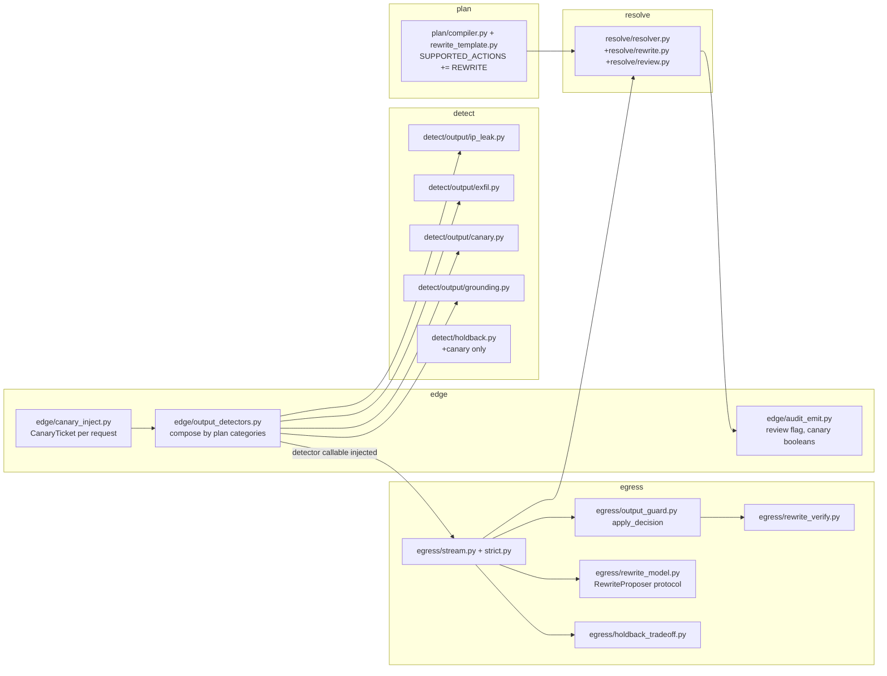

# Design Document

## Overview

GW33 restores v1's output guardrails on `gateway_v2` and replaces the interim "REWRITE is REDACT" mapping with a real, byte-verified REWRITE. It adds three deterministic output detectors (IP/infrastructure leak, exfiltration channels, per-request canary), one whole-response grounding detector (lexical, with an optional local-model mode), a human-review flag computed once by the resolver, and the control-plane changes that stop naming `rewrite` as unsupported and turn five GW27-retired fields into built ones.

The shape follows the shipped architecture and changes as little of it as possible. Detectors live in `detect/` and emit `Finding[]` only. The resolver (`resolve/`, imports only `domain`) stays the single authority: it gains `Disposition.REWRITE`, renders the rule's declared template into a `Transformation(kind="rewrite", ...)`, and computes `review_required`. Egress keeps applying and verifying bytes (`egress/output_guard.py::apply_decision` plus a new `egress/rewrite_verify.py`); it never imports `detect`, so every scanner is injected from `edge/`. Streaming is handled honestly (revision 3): the shipped bounded holdback cannot hold an exfil sink head (`, cannot hold IPv6 or `host:port` forms (`:` breaks runs), and cannot give a category-level IP guarantee from IPv4 alone, so a byte-altering or blocking IP-leak/exfil/hallucination rule is **STRICT_WITHHOLD-only** (a deliberate scope choice for IP, a mechanical necessity for exfil; see D-9) (the compiler refuses it for INCREMENTAL and the publisher promotes such orgs to STRICT_WITHHOLD); in INCREMENTAL those categories are flag-only and run once on the completed buffer. Only the canary (a single-word token that fits the cap) gets a new holdback class, `canary`, with the hold bound and cap untouched; its per-delta detection is a STATELESS overlap scan (D-23), and its secrecy guarantee is stated for the plain form only (D-26).

Technology stack (locked on approval): Python 3.12, stdlib only (`re`, `ipaddress`, `secrets`, `math`, `hashlib`, `dataclasses`, `types.MappingProxyType`), the existing `gateway_v2` packages, pytest with seeded `random.Random` for properties (no `hypothesis`), mypy `--strict`, ruff, import-linter, and the repo's AST gates. Control-plane changes are plain Django/Python edits in `control/ai_mesh_control/core/`. No new third-party dependency.

## Verified baseline (read from the tree on this worktree)

- `domain/decision.py`: `Disposition` is `ALLOW|FLAG|REDACT|BLOCK`; `_rank` is 0/1/2/3; `Decision.__post_init__` enforces "request disposition is `most_restrictive(per_finding)`"; `Transformation(kind, span, replacement)` is untyped on `kind`.
- `resolve/decision.py::_action_to_disposition` maps `Action.REWRITE -> Disposition.REDACT` (the interim); `_transformations_for` emits `kind="redact"` with the local `REDACTION_PLACEHOLDER`.
- `resolve/resolver.py::resolve` builds one `FindingDisposition` per finding, `_normalise_redactions` merges same-kind same-replacement overlaps, and `resolve/conflict.py::_winning_action` picks the winner by priority then most restrictive `Disposition`.
- `domain/plan.py::Rule` has no template field; `plan/compiler.py::SUPPORTED_ACTIONS = {ALLOW, FLAG, REDACT, BLOCK}` and `_check_draft` refuses everything else; `_hash_rules` hashes a fixed field list; `plan/document.py::_rule_body` encodes the signed body.
- `egress/output_guard.py::apply_decision` applies transformations by span (kind-blind), raises `OutputBlocked` on BLOCK, raises `ValueError` on partial coverage or overlap. `enforcing_output_rules` already counts `REWRITE`. `_CLASS_DISPOSITION` is the egress mirror of `detect.holdback.TRADE_OFF`.
- `egress/holdback_tradeoff.py::derive_trade_off_outcome` knows only BLOCK and REDACT (anything else returns `None`, which the stream turns into `undefined_tradeoff`). `with_remainder_redactions` builds a `Decision(disposition=REDACT, ...)` and would raise on a decision that already holds a stronger per-finding disposition.
- `dispatch/verify.py::apply_and_verify` reuses `apply_decision`; `_REDACTING_DISPOSITIONS = {REDACT}`. `dispatch/authorized.py` carries a `rewrite: bool` bit and a `RewriteBackend` protocol whose only method is `classify(windows)`; when `rewrite=True` the entry runs the local seam and yields no provider bytes. No `edge/` caller passes `rewrite=True` (grep `rewrite=` over `gateway_v2` finds only `dispatch/authorized.py`).
- `detect/deterministic/{canonicalize,matcher,patterns,detectors,redactor}.py`: one `canonicalize(text, DEFAULT_BUDGET) -> (canonical, SpanMap)`, `BudgetExceeded` on a decode-budget miss, detectors that emit `evidence=None`, a single `UNAVAILABLE` finding on budget miss, `ruleset_version()` as `detector_version`.
- `detect/holdback.py`: `TRADE_OFF` is a `MappingProxyType` of nine classes; `classify_hold` returns `(held_class, is_relaxed)`; numeric runs classify as `card` (terminate), so dotted IPv4 prefixes currently fall into that class.
- `detect/registry.py::_DETECTOR_REGISTRY` is empty; the dev/prod composition builds detector callables in `edge/dev_components.py` (`PiiDetector().detect(...)` etc.). The stream/strict pipelines take an injected `detector: Callable[[str], Sequence[Finding]]`.
- `edge/upstream_body.py` states "every text byte the provider receives is a verified delta" and fills a fixed `TextSlot` template; a gateway-added message outside the slots would break that invariant.
- `control/.../firewall_v2_publish.py`: `_UNSUPPORTED_ACTIONS = {"rewrite", "model_downgrade"}`; `_OUTPUTS` maps `output_ip_leakage_*` to category `"exfil"`; `firewall_v2_map.py` marks `factuality_check_enabled`, the three `hallucination_grounding_*` fields and `output_hallucination_action` as `unsupported`, and `reject: ("rewrite",)` sits on five action fields; `firewall_config_serializer.py` refuses `rewrite` at save.
- `lint/check_sizes.py` caps modules at 800 lines and functions at 120. `wc -l`: `egress/stream.py` 800, `runtime/resources.py` 800 (both AT the cap), `egress/strict.py` 449, `egress/holdback_tradeoff.py` 187, `resolve/resolver.py` 222. Any edit to the two 800-line modules must first be preceded by a behaviour-preserving extraction (see C13/C14).
- `runtime/resources_vector.py::VectorBoundsMixin` is the shipped precedent for splitting accessors out of `resources.py` (`ResourceContract(VectorBoundsMixin)`); its docstring records that the capacity LITERALS stayed in `resources.py` because `lint/check_capacity_literals.py` exempts exactly one path (`ALLOWED_REL = "runtime/resources.py"`).
- `egress/stream.py::StreamPipeline` holds ONE sync `self._detector` and calls it as `text.hits = list(self._detector(text.whole))` inside `_process_delta` for EVERY delta over the whole accumulated buffer (so existing GW09 detection is already O(n^2) in stream length; this card does not change that for existing detectors). `egress/strict.py::StrictWithholdPipeline._finalize` calls `self._detector(text)` once per channel, then `self._resolver.decide(findings)`, then `apply_decision(text, decision, 0)`. Neither pipeline has an async detector hook.
- `detect/guard/backend.py::GuardBackend.classify(windows, budget)` is `async`; detector callables are sync `Callable[[str], Sequence[Finding]]`.
- `detect/holdback.py`: a canary-shaped word run (`cnry_` + 26 chars, one `_WORD` token) is held by `hold_start` as a trailing word run and today classifies as `api_token` (redact-remainder); a word run is one token, so a 31-char canary can never exceed the 3-token cap and is never force-released.
- `plan/compiler.py::compile_plan(org_id, drafts, *, streaming_mode=INCREMENTAL, previous=None, compiled_at, epoch=1, ...)`; `SUPPORTED_STREAMING = {INCREMENTAL, STRICT_WITHHOLD}`. `firewall_v2_publish.py::document_bytes` hardcodes `"streaming_mode": "incremental"`.
- `runtime/resources.py` already exposes `max_output_tokens()` (v1 default 4096 ceiling) and `max_output_tokens_boundary()`; GW27 D-6 clamps the upstream request `max_tokens` with them (resources.py docstring ~L162-180).
- No `rewrite_served_by_v2`, `controls_eligible` or `V2_PLAN_CONTROLS_ORGS` exists on this tree (GW27 has not landed here). The only v2 org settings in `control/` are `V2_AUDIT_ORG_MAP` (audit ingest).
- Authoritative card text (extracted with `zipfile` from `AI_MESH_MASTER_RUNBOOK_v3.1_CLEAN.docx`, verbatim): *"GW33 — Output guardrail parity. Phase: Detection. **Depends on GW09, GW10, GW12.** Required by GW21, GW23. Objective: Restore v1's output guardrails on v2. Implementation work: IP and infrastructure leakage; exfiltration channels (zero-click images, links, HTML sinks, DNS labels); hallucination and grounding on a local model; human-review flag; REWRITE through a local model or a declared template (today REWRITE is mapped to REDACT); canary tokens checked on output. Category.EXFIL exists but nothing produces it. L33-1: model emits a markdown image whose URL carries encoded data -> defanged or blocked; never delivered live. L33-2: internal hostname and an RFC1918 address -> handled per the org's IP-leakage action. L33-3: ungrounded answer on a RAG request -> flagged per the org's hallucination action."* Because GW33 **depends on GW09, GW10 and GW12**, no GW33 deferral may name GW10 (or GW09/GW12) as a *later* owner. The GW27 text in the same runbook lists "hallucination and grounding (GW33)" among the fields GW27 retires to this card.
- `egress/stream.py::_process_delta` (L556-L625) appends the delta to `text.pending` and `text.whole`, and the detector hook is `text.hits = list(self._detector(text.whole))` with NO channel argument and NO previous-length argument; `_Text` (L256) is the per-channel state object (one per text stream/channel), so any per-channel state belongs on `_Text`, not on the detector. `unsplittable_hold(text.hits, ...)` decides what may be released.
- `detect/holdback.py:53` `_WORD` = `A-Za-z0-9._%+@/=-`: `.` `/` `-` `%` `+` `=` `@` `_` are word characters, so `10.0.0.1`, `db.internal` and a base64 payload (`+/=`) are each ONE word run (one token); `( : ? & # space` and quotes break runs.
- `plan/compiler.py::compile_plan` has four non-test call sites: `edge/dev_components.py:218`, `edge/dev_plan_feed.py:141`, `plan/delta.py:62` (the production record-to-plan path) and `state_control/projector.py:515` (control-side validation); none holds a `ResourceContract` (`plan/` and `state_control/` never import it).
- `domain/context.py::apply_stage` builds `Finding(status=step.status, spans=())` with an arbitrary status and `detect/conditions.py::_finding(rule, spans)` takes any tuple, so the claim "no producer emits an empty-span EXECUTED finding" is NOT established; the empty-span upgrade is therefore scoped (C8).
- `dispatch/authorized.py` (L221-L319): `rewrite: bool` routes a REWRITE to the LOCAL `RewriteBackend.classify(windows)` seam with zero provider calls (LGW11-4); `resolve/authorize.py` docstring still says REWRITE maps to REDACT; no `edge/` caller passes `rewrite=True`.
- `detect/guard/backend.py::GuardBackend` exposes `classify`, `readiness`, `capacity_hint`; it advertises NO category capability. The shipped local backends are the injection/PII model, so a `hallucination` result can never come from them.

## DECISIONS (ambiguity resolved conservatively; fail-closed)

- **D-1 Category spellings.** `Category.IP_LEAK = "ip_leak"`, `Category.HALLUCINATION = "hallucination"`, `Category.CANARY = "canary"`. `Category.EXFIL` is reused for exfiltration channels and not renamed. One spelling each; `parse_category` rejects aliases as today.
- **D-2 IP-leakage re-categorisation (rename + legacy-aware compiler; the legacy window is the status quo, not a new regression).** The GW26 publisher publishes `output_ip_leakage_*` under category `"exfil"` today. It moves to `"ip_leak"` and the rule id prefix changes from `output_ip_leakage` to `out_ip_leak`; the legacy prefix is kept as the frozen constant `LEGACY_IP_RULE_PREFIX` in `domain/plan.py`. Before this card **nothing produced `EXFIL`**, so a legacy rule enforced nothing; an already-published plan can carry action `redact` or `block` on it and INCREMENTAL streaming (GW26 hardcodes `"streaming_mode": "incremental"`). The new compiler MUST still install those plans (H-1), so the D-9 refusal is **legacy-aware**: `_check_draft` treats a rule whose id starts with `LEGACY_IP_RULE_PREFIX` as exempt from the D-9 refusal (it is never rejected for being byte-altering under INCREMENTAL). Runtime behaviour of a legacy rule is: **INCREMENTAL: inert, exactly as today** (no detector is built for it, no hold, no enforcement; counter `legacy_ip_rule_in_use` and one `warning` per plan install so the gap is visible); **STRICT_WITHHOLD: enforced** through a shim in `edge/output_detectors.py` that feeds the rule the `IpLeakDetector` findings re-labelled with category `EXFIL` (v1 semantics), and does NOT construct `ExfilDetector` for it. The window is therefore *not* closed by the gateway (it is the pre-existing status quo: no enforcement before this card); it is closed by the one-time republish (task 12.3), after which the publisher emits `out_ip_leak` + `ip_leak` and promotes the org to strict (D-20). The shim touches no signed body and no `content_hash`. **No refusal on mixed plans (revision 5, M-1).** A GW26 plan can legitimately hold the legacy `output_ip_leakage_*` rule (category `exfil`) together with customer rows published under the fallback category `exfil` (`_category()`), and possibly `out_exfil`; the composer therefore never refuses on category labels. The interaction is defined by identity (D-32): in STRICT the shim emits one re-labelled finding per legacy rule, bound to THAT rule's id via `Finding.detector`; `ExfilDetector` findings are bound to the `out_exfil` rule id; neither can reach the other's rule or any customer row. Required test (task 8.4a): a plan holding the legacy IP rule, an unmapped-category keyword row and an unmapped-category `condition` row (and a variant that also holds `out_exfil`) installs through all four `compile_plan` sites in INCREMENTAL and STRICT. **Required test:** the GW26-shaped plan from `tests/plan/test_dev_plan_publish.py` (INCREMENTAL, legacy `output_ip_leakage_*` with `redact` and with `block`) compiles and installs unchanged under the new compiler, through all four `compile_plan` call sites.
- **D-3 REWRITE is a first-class disposition.** `Disposition.REWRITE = "rewrite"`; rank `ALLOW 0 < FLAG 1 < REDACT 2 < REWRITE 3 < BLOCK 4`, as the requirements order them. The ordering is about the request-level disposition. The security-preserving choice for overlaps stays REDACT (D-7).
- **D-4 The declared template lives on the rule.** `Rule` and `RuleDraft` gain `rewrite_template: str = ""` (additive, default empty). It is encoded in the signed body only when non-empty and hashed only when non-empty, so every existing plan keeps its `content_hash`. The compiler refuses a REWRITE rule with no usable template (never defaults to `[REDACTED]`). The control-plane publisher supplies the template from a platform-declared per-category table in `firewall_v2_publish.py`; the table content is signed with the plan, so the template is "declared" and covered by `content_hash`. Customer policy rows may carry their own template.
- **D-5 Local-model rewrite is optional, STRICT_WITHHOLD only, off by default.** The template is the baseline in every mode. A local-model proposer runs only on the STRICT_WITHHOLD path, because it is asynchronous and needs the whole span in hand; INCREMENTAL always uses the template. The existing `dispatch.authorized.RewriteBackend` is a classification seam (`classify(windows)`) and cannot generate text, so GW33 defines its own local `RewriteProposer` protocol in `egress/rewrite_model.py` and leaves the dispatch seam untouched. No real generative local backend ships in this card (deferred to GW10 backends); the offline tests use a stub. The proposer is never a provider.
- **D-6 Input-phase REWRITE: supported with the template, same resolver path; the GW11 `rewrite` bit keeps its separate meaning.** The resolver is phase-agnostic, so a REWRITE rule on the INPUT scope yields `kind="rewrite"` transformations whose BYTES (the template-substituted request) are what the provider receives. `dispatch/verify.py::_REDACTING_DISPOSITIONS` adds `REWRITE` so the request-side obligation, coverage check and survivor check cover rewritten spans, and the shared `apply_decision` verification (C5) runs on the request side too. **Two meanings, kept distinct on purpose (M-5):** (1) `Disposition.REWRITE` = "replace these spans with the declared template and send the result"; (2) the shipped `dispatch/authorized.py` `rewrite: bool` argument = "run the LOCAL `RewriteBackend.classify(windows)` seam and send NOTHING to the provider" (R5.2, LGW11-4). The bit is **retained unchanged and not deprecated** (reserved for a future local-model request rewrite); GW33 never sets it. All existing LGW11-4 tests are **kept unchanged**; none is edited. `resolve/authorize.py` is changed only in its docstring (it no longer says REWRITE is mapped to REDACT) and `authorize()` mints for `Disposition.REWRITE` exactly as for REDACT (`str(decision.disposition)` stamps `"rewrite"`); a new test covers that mint. `dispatch/authorized.py` docstrings at L251-L256 that say the resolver erases REWRITE are corrected. A grep/AST test asserts no `edge/` caller passes `rewrite=True` for a `Disposition.REWRITE` decision. The console `audit/console_schema.py::_ACTIONS` gains `"rewrite"`; `contracts/parity` is unaffected (verified by the reviewer on this tree; re-run in task 12.1).
- **D-7 Any overlap of edits with differing replacements resolves to REDACT of the union.** `normalise_edits` groups edits into overlap-connected components (overlap = share at least one byte, the predicate `_normalise_redactions` already uses; touching edits are not merged). A component whose edits all have the same `kind` and the same `replacement` collapses to one edit of that kind over the union (existing behaviour, extended to `rewrite`). Every other component (redact x rewrite, rewrite x rewrite with different templates such as an RFC1918 IP inside an exfil image URL, redact x redact with different replacements) collapses to ONE `redact` transformation over the union with the platform `REDACTION_PLACEHOLDER` and appends the code `edit_overlap_redacted` to `Decision.codes`. The output is therefore always pairwise non-overlapping, so `apply_decision` never sees a benign overlap (its overlap `ValueError` stays as the second line of defence). The per-finding disposition stays `REWRITE` because it records what the rule asked for; the bytes follow the stricter outcome and the divergence is visible in the audit record through `codes` and the derived `bytes_action` (C13), so Requirement 5.11 and the bytes agree (L-1).
- **D-8 INCREMENTAL and REWRITE.** The template is applied at release time to spans that are still held, exactly like a redaction. If a REWRITE finding's prefix has already been force-released by the hold cap, the rewrite cannot be applied to released bytes, so `derive_trade_off_outcome` returns `TRADE_OFF_TERMINATE` for a `REWRITE` disposition and the stream ends with the existing `forced_release_tradeoff` terminal frame (requirement 8.4). This is stricter than a class table's default and cannot disagree with it: `MinimalOutputResolver` never yields `REWRITE`, so the drift test is unaffected.
- **D-9 Byte-altering or blocking built-in IP-leak / exfil / hallucination detector rules are STRICT_WITHHOLD-only (premises corrected in revision 3).** Facts from `detect/holdback.py` (`_WORD` includes `. / - % + = @ _`): `hold_start` holds only a trailing word run, numeric run, PEM header or generic-secret tail. (a) **Exfil** is not holdable, for a different reason than revision 2 claimed: the sink head `. Whether a long payload exceeds the token cap is irrelevant. (b) **IP leak** IS partly holdable: an IPv4 dotted-quad (`10.0.0.1`) and a dotted internal hostname (`db.internal`) are single word runs and would be held to completion; IPv6 (`fe80::1`, `::1`) and `host:port` forms are NOT (`:` breaks runs, so a prefix is released). A category-level guarantee ("the org's IP-leakage action is enforced") cannot be given from IPv4 alone, and a half-enforced redact is worse than an honest flag. **Decision (deliberate scope choice, conservative):** IP leak with `redact`/`rewrite`/`block` is STRICT_WITHHOLD-only. **Cost, stated plainly:** v1's INCREMENTAL IP redaction is NOT restored (parity gap), and orgs that choose an enforcing IP-leakage action lose TTFT (the publisher promotes them to strict, D-20). **Follow-up recorded (not in this card):** an IPv4/dotted-hostname-only INCREMENTAL hold class using the same stateless overlap scan as the canary (D-23) could be added later. (c) **Hallucination** is whole-response by nature and cannot be localised before the response completes. `compile_plan` therefore **refuses at compile time**, with a field-level message, any plan that selects INCREMENTAL and contains an OUTPUT/BOTH-scope **built-in detector rule (D-28: `builtin_output_detector(rule)` is `"exfil"`, `"ip_leak"` or `"grounding"`; NOT the category label, revision 4)** whose action is `redact`, `rewrite` or `block` — **except** rules whose id starts with `LEGACY_IP_RULE_PREFIX` (D-2, inert in INCREMENTAL). `flag` and `allow` are legal in INCREMENTAL: the check runs once on the completed buffer and only sets the review flag (no byte is held, nothing is claimed about released bytes). `CANARY` is exempt because it fits the cap (D-16/C6). The control-plane publisher closes the loop (D-20). The INCREMENTAL residual (a flag-only finding is reported after the bytes are out) is an owner-visible, documented trade-off, restated in Requirements amendments below.
- **D-10 Review flag semantics.** `Decision.review_required` is `True` iff the resolver ran in `Phase.OUTPUT` and at least one per-finding disposition is non-`ALLOW`. No per-rule "requests review" field is added; every OUTPUT rule requests review (the requirement's "that requests review" is read as "any OUTPUT-phase enforcing or flagging rule"). `Decision.__post_init__` rejects `review_required=True` with no non-`ALLOW` per-finding disposition. The "should have been True" direction is covered by the resolver property test, because `Decision` does not know the phase. Review-queue publication (`output_incident_logging_enabled`) is an audit-emission gate in `edge/audit_emit.py` fed by an injected `ReviewQueuePolicy`; it never recomputes the flag.
- **D-11 Canary opt-in is plan-driven.** A canary is injected iff the pinned plan contains a non-`OFF` `Category.CANARY` rule scoped OUTPUT or BOTH. No new `FirewallConfig` column is added in this card (no Django migration). The publisher emits the canary rule (action `block`) only for orgs listed in the deployment setting `V2_CANARY_ORGS`, the same shape as GW27's `V2_PLAN_CONTROLS_ORGS`. A console toggle is GW35.
- **D-12 `model_downgrade` is retired by name to GW28.** It selects a model; GW28 owns routing and GW29 owns isolation. The publisher keeps naming it unsupported and the message names GW28. Only `rewrite` leaves `_UNSUPPORTED_ACTIONS`.
- **D-13 `max_response_tokens` response-side bound is BUILT here, not retired (revision 2).** The card that would own it is not GW36 (the progress doc defines GW36 as production boot plus local guard model), and no other card owns it. GW27 D-6 clamps the upstream request (`min(max_tokens, org max_response_tokens, 65536)`, `ResourceContract.max_output_tokens()`); GW33 adds the backstop for a provider that ignores the clamp: `edge/output_length.py::bounded_upstream(source, max_chars, on_exceed)` wraps the upstream chunk iterator, counts characters of text deltas across channels and, once the sum exceeds `ResourceContract.output_ceiling_chars()` (= `max_output_tokens() * output_chars_per_token_bound`, both contract-derived), raises `OutputLengthExceeded`. Both pipelines map it, in the same generic arm as `rewrite_unverified`, to the declared terminal code `output_length_exceeded` (defined in `domain/posture.py` and `edge/errors.py`; STRICT: nothing was released, so a withheld-error envelope; INCREMENTAL: terminal frame, never silent truncation). Counted in characters, not tokens, because no tokenizer exists on the stream path; the char-per-token multiplier is a deliberately generous upper bound so the check never fires on a compliant provider.
- **D-14 Exfil allow-list and payload minimum.** The allow-list of image hosts comes from the rule's dedicated `RuleCondition.allow_hosts` field (D-29; NOT `keywords`), holding allowed host suffixes (exact registrable-suffix match, lower-cased). An empty list means no host is allowed, so every remote image is a candidate and only the payload test separates fetch-of-a-logo from beacon. The minimum payload length is `ResourceContract.exfil_min_payload_chars()`. `RuleCondition.kind` for these built-in detector rules is `DETECTOR`, so the existing category join applies.
- **D-15 Grounding source of context.** The grounding detector is constructed per request with `context_chunks: tuple[str, ...]` supplied by the edge lifecycle (GW31 owns producing RAG chunks; until it lands, only an explicitly injected tuple, such as the one the offline equivalent of L33-3 builds, is non-empty). Empty chunks produce `SKIPPED`. No chunks are ever read from the module level.
- **D-16 Canary format.** `cnry_` followed by 26 lower-case base32 characters (130 bits from `secrets.token_bytes(17)`). The fixed public lead `cnry_` is what the holdback class keys on; the body is the secret. The body alphabet cannot match any GW09 pattern (a property test over many canaries asserts zero input-scan findings), so injecting the canary as ordinary verified text is safe.
- **D-17 Canary is injected as a verified template slot.** `edge/canary_inject.py` adds one synthetic system-message `TextSlot` and its delta (channel `canary_marker`) to the `CanonicalRequest` before staging. That keeps the `edge/upstream_body.py` invariant ("every text byte is a verified delta") instead of adding a message after verification.
- **D-18 Failure of any new detector is data.** Every new detector returns one `UNAVAILABLE` finding for its category on a budget miss, a cap overflow or an internal exception (caught at the detector boundary). The resolver routes it by `on_unavailable`. Default posture the publisher emits: `FAIL_CLOSED` for any rule whose action is `redact`, `rewrite` or `block`, and `FAIL_OPEN` for `flag` and `allow`, where it has no effect on disposition.
- **D-19 Canary failure semantics.** Decided by the canary rule's `on_unavailable`: if it is `FAIL_CLOSED` (the publisher default for `block`, D-18) and a canary cannot be injected (unsupported request shape, entropy source raised, slot template refuses) the request is **refused before dispatch** with the declared code `canary_unavailable`; if the rule is `FAIL_OPEN` (action `flag`/`allow`) the request proceeds with `canary_checked=False` and no detector. `canary_unavailable` is added to `domain/posture.py` (single spelling) and to `edge/errors.py` (HTTP 503, `should_retry=False`, generic body).
- **D-20 Publisher promotes streaming mode.** `firewall_v2_publish.document_bytes` computes `streaming_mode_for(rules)`: `"strict_withhold"` when any rule is OUTPUT/BOTH with `builtin_output_detector(rule)` in `{exfil, ip_leak, grounding}` (D-28; the category label is NOT consulted, so ordinary customer rows that fell back to category `exfil` never promote) and action `redact`, `rewrite` or `block`; otherwise the existing `"incremental"`. The promotion is listed in the publish report (`streaming_mode_promoted: [rule ids]`) so it is never silent; the latency consequence (no TTFT for that org's streams) is the documented price of enforcement and is the fail-closed choice.
- **D-21 `rewrite_served_by_v2(org_slug)` is defined here with a fail-closed default.** Signature `rewrite_served_by_v2(org_slug: str) -> bool`, in `firewall_v2_map.py`. It reads the deployment setting `V2_REWRITE_ORGS` (comma-separated org slugs or `*`), default empty, so the default is `False` and `rewrite` stays refused at save for every org until an operator names the orgs. When GW27 lands its `controls_eligible` / `V2_PLAN_CONTROLS_ORGS`, the one-line follow-up in the integration note makes `rewrite_served_by_v2` delegate to it; GW33 does not depend on a GW27 function existing and does not guess its name.
- **D-22 Grounding final path.** A new async protocol `FinalDetector = Callable[[str, str], Awaitable[Sequence[Finding]]]` (arguments: channel, whole-channel text), declared in `egress/output_guard.py` (egress knows only the type). INCREMENTAL: `StreamPipeline` awaits it once per channel after the final chunk has been processed (insertion point: after the loop in `_run_enforcing` that sets `frames_out_before_final`, before `_publish`), and merges via `domain/decision.py::combine_decisions` (most restrictive disposition, `review_required` OR, ordered union of `deciding_rules` and `codes`, per-finding concatenation, transformations of the kept decision only; the merged decision here is the audit aggregate, bytes are applied from the per-channel decisions). A non-FLAG/ALLOW final disposition in INCREMENTAL is unreachable by D-9 but, for a hand-built plan, fails closed: terminal code `final_check_unapplied`. **INCREMENTAL final-check unavailability is reported, never enforced (L-3):** if the final detector returns an `UNAVAILABLE` finding in INCREMENTAL (timeout, backend absent, decode budget) the bytes are already out, so no `on_unavailable` value can change them; the pipeline records the finding, sets `StreamStats.review_required = True` (NOT `Decision.review_required`: under `FAIL_OPEN` the finding yields no per-finding disposition, so the `Decision` invariant of C1 correctly forbids the flag there, and `combine_decisions` re-validates), increments `final_check_unavailable`, and does NOT terminate even when a customer set `FAIL_CLOSED` on a flag rule. The publisher emits `FAIL_OPEN` for flag rules (D-18) and the compiler refuses `FAIL_CLOSED` on a flag-only INCREMENTAL final-check category with a field message, so the customer cannot configure a promise the mode cannot keep. In STRICT_WITHHOLD, `UNAVAILABLE` routes by `on_unavailable` normally because nothing was released. STRICT_WITHHOLD (L-3, revision 4): `_finalize` no longer calls the sync detector inline on the event loop; it awaits `ScanExecutor.run` (the edge-injected `sync_runner`, default inline only when no executor is wired so the dev profile and existing tests are unchanged) for `sync_whole(text)`, so IP/exfil/canary canonicalisation and regex run off-loop like grounding; loop-lag is covered by a test that runs a worst-case buffer and asserts the loop-lag input stays under the GW12 C38 bound. `_finalize` awaits it per channel and appends its findings to the sync detector's findings BEFORE the single `resolver.decide` call (no merge function is needed on that path). The async `GuardBackend.classify` is awaited directly inside the edge-composed final detector, wrapped in `asyncio.wait_for(..., grounding_wait_budget_s())`; timeout or exception becomes one `UNAVAILABLE` finding. Lexical mode runs on the existing `edge/executor.py::ScanExecutor` (off-loop), never inline on the loop.
- **D-23 Per-delta work is bounded for every NEW detector; the canary scan is stateless and overlap-based (H-2, M-3).** New detectors never run per delta over the whole buffer. INCREMENTAL: `IpLeakDetector`, `ExfilDetector` and `GroundingDetector` run once at `final` (D-9, D-22). The canary runs per delta through a **stateless** callable `canary_delta(whole: str, previous_len: int) -> Sequence[Finding]` that scans `whole[start:]` with `start = max(0, previous_len - (canary_scan_overlap_chars() - 1))` (NOT a fixed trailing window: a delta longer than any window is scanned in full, so a canary mid-delta is always seen). `previous_len = len(text.whole) - len(delta)` is known to the pipeline, so no detector-side state exists. `canary_scan_overlap_chars()` is measured on ORIGINAL (pre-canonical) characters: `token_chars * decode_expansion_bound`, both contract/Decode_Budget-derived, because percent (x3) and entity (up to x10) decoding expand; an obfuscation wider than the overlap is not caught per delta and is caught by the full-buffer scan at `final` (D-26). Findings carry ABSOLUTE offsets (slice offset `start` added after `SpanMap.to_original`). **Hook change (stream.py):** `StreamPipeline` gains a second optional hook `delta_detector: Callable[[str, int], Sequence[Finding]] | None`; `_Text` gains `delta_hits: list[Finding]` (per channel, because `_Text` is per channel, so offsets of `output_content` never mix with `output_reasoning` or `output_tool_arguments`); `_process_delta` computes `text.hits = list(self._detector(text.whole)) if self._detector else []` then `text.delta_hits.extend(self._delta_detector(text.whole, previous_len))` and uses `text.hits + text.delta_hits`; when extending `delta_hits` the pipeline dedupes by `(start, end)` (a canary found in delta N lies inside delta N+1's overlap window and would otherwise be reported twice; absolute offsets make the key exact, L-4). A two-channel test is mandatory. STRICT_WITHHOLD: every detector runs once on the whole channel. The pre-existing per-delta whole-buffer scan of GW09 detectors is unchanged (out of scope, FOUND, NOT FIXED). Property 16 bounds total canonicalised characters.
- **D-24 The template length limit is a single immutable constant in the exempt resources module, not a `compile_plan` argument (M-6).** `compile_plan` has four production call sites that hold no `ResourceContract` (`edge/dev_components.py:218`, `edge/dev_plan_feed.py:141`, `plan/delta.py:62`, `state_control/projector.py:515`), so a required keyword would turn every REWRITE plan into an install refusal on whichever site was missed. Instead `runtime/resources_output.py` (exempt under D-25) defines `REWRITE_TEMPLATE_MAX_CHARS: Final[int]` (immutable, so the no-module-mutable gate passes); `ResourceContract.rewrite_template_max_chars()` returns it, and `plan/rewrite_template.py` imports it (plan sits above runtime in the layer contract). `compile_plan`'s signature is UNCHANGED. A test compiles the same REWRITE plan through all four call sites, and an AST test enumerates every non-test `compile_plan(` call so a fifth site must be added to the test's frozen list consciously.
- **D-25 Capacity-literal gate: one explicit new exemption.** New accessors live in `runtime/resources_output.py::OutputBoundsMixin` (mirroring `VectorBoundsMixin`) because `resources.py` is at its 800-line cap. Their constants must sit next to the accessors, so `lint/check_capacity_literals.py` changes from one `ALLOWED_REL` to a frozen tuple `ALLOWED_RELS = ("runtime/resources.py", "runtime/resources_output.py")`, with a planted-violation test proving every other module still fails.

- **D-26 Canary secrecy and detection claim, restated (M-2).** Chosen option: **restate, do not promote to STRICT_WITHHOLD.** The canary is a *leak tripwire*, not a customer secret; its value is detecting that protected context left the model, and a released prefix of a canary token reveals no customer data. Guarantee in INCREMENTAL: (i) a **plain-form** canary (`cnry_` + 26 base32 characters, one `_WORD` run) is held to completion and never released raw; (ii) **obfuscated forms** (zero-width interleaved, percent- or entity-encoded, `:`/space-split) are *detected* — per delta when the obfuscation fits `canary_scan_overlap_chars()`, otherwise by the full-buffer scan at `final` — and the rule's action then applies (`block` terminates the stream with `output_blocked`), but **a prefix of an obfuscated canary may already have been released**. STRICT_WITHHOLD: nothing is released before the decision, so no canary byte (plain or obfuscated) is ever delivered when the action is `block`/`redact`/`rewrite`. An org that needs zero canary-prefix exposure sets the canary rule's `block` with a strict plan: the publisher promotes an org to `strict_withhold` for the canary rule too when `V2_CANARY_STRICT_ORGS` (comma-separated, default empty) names it. `canary_leaked` audit is true in all cases where detection occurred, so the residual is observable. Properties 1 and 10 and the C6 `terminate` text are restated accordingly.
- **D-27 Grounding "local model" scope is an owner-visible deviation from the card text (M-4).** The card says "hallucination and grounding on a local model". GW10's shipped backends are injection/PII classifiers and advertise no hallucination capability. Decision: (1) **lexical mode is the only mode GW33 ships as working**; (2) **model mode is capability-gated**: `GuardBackend` gains no required member; instead a new optional runtime-checkable protocol `HallucinationCapable` (`supported_categories: frozenset[Category]`) in `detect/guard/backend.py`, and `GroundingDetector` in model mode requires `isinstance(backend, HallucinationCapable)` and `Category.HALLUCINATION in backend.supported_categories`, else it returns one `UNAVAILABLE` finding (never a clean `EXECUTED`); (3) the control map accepts `hallucination_grounding_mode = "model"` only when `hallucination_grounding_model` is in the platform allow-set `GROUNDING_MODEL_BACKENDS` (frozenset, default EMPTY), so by default a model-mode save is refused with the message "grounding model mode unavailable: no backend advertises hallucination"; (4) the close-out states: *"grounding on a local model: lexical shipped; model mode UNAVAILABLE until a backend advertises hallucination."* (5) Because GW33 depends on GW10, this is **not** a deferral to GW10: it is an open item against the card text with no owning card, recorded in the changelog for the owner to schedule. The offline tests use a stub backend that advertises `HALLUCINATION`, proving the model path end to end.
- **D-28 Built-in detector rules are identified by detector identity, never by category label (revision 4, H-1).** `GW26`'s publisher falls back to category `"exfil"` for any Policy Management row whose category is not in `_CATEGORIES` (`firewall_v2_publish._category`, verified: `return _CATEGORIES.get(key, "exfil")`), so the category label `exfil` is NOT a signal for "exfil protection". Everything this card keys on a built-in output detector therefore keys on a new predicate, `domain/plan.py::builtin_output_detector(rule) -> str | None`, which returns the detector family (`"exfil"`, `"ip_leak"`, `"grounding"`, `"canary"`) iff `rule.condition is not None and rule.condition.kind is RuleKind.DETECTOR and rule.condition.detector_class` matches `^output\.(exfil|ip_leak|grounding|canary)(\.[a-z0-9_:-]+)?$` (the optional suffix carries the grounding mode, D-27: `output.grounding.lexical`, `output.grounding.model:<backend>`), else `None`. It is a pure function of the signed rule, so every layer agrees. Consumers: D-9/C9 (compile refusal), D-20 (strict promotion), C10 (composer builds a detector only for a rule with a family), C6 (canary class). **Customer rules are untouched whatever their category:** a `KEYWORDS`/`REGEX`/`PATTERN` row, or a `DETECTOR` row whose `detector_class` is outside the reserved `output.` namespace, never has a family, so it compiles unchanged under INCREMENTAL with `redact`/`block`, is never promoted, and never causes a detector to be built. **Reserved namespace (anti-spoof):** the publisher `_condition()` drops (reports in `unsupported`, loud) any customer row whose `detector_class` starts with `output.`; only the platform emitters (D-29, `_OUTPUTS`, canary) produce such rules. The existing category join (`resolve/conflict.py::_rules_for`/`_category_join`, verified: keyword/regex rules are excluded from the category join; `condition is None or kind is DETECTOR` are included) is unchanged; a customer `DETECTOR` row cannot occupy the reserved namespace, but the category join alone WOULD let a fallback-`exfil` customer DETECTOR or condition-less row (any priority) govern built-in findings once this card produces them; that is closed by D-32 (identity join plus category-join exclusion), not by the namespace. **`_category()` fallback stays `"exfil"` (decision):** changing it would change the `content_hash` of every already-published plan with such a row and needs a new `Category` member for no benefit once identity is keyed on the detector rule; it is documented as a legacy catch-all with a comment in `firewall_v2_publish.py`. **Required tests (task 8.4a, 11.1):** a GW26-shaped INCREMENTAL plan with an unmapped-category policy row (keyword and regex conditions, and one `condition=None`) plus `redact`, and another with `block`, compiles unchanged, is not promoted by D-20, and the composer builds no `ExfilDetector`/`IpLeakDetector`; a customer row with `detector_class="output.exfil"` is rejected by the publisher.
- **D-29 Exfil rule origin and allow-list (revision 4, H-2; replaces the keyword-carried allow-list of D-14).** Nothing before this card published an exfil rule, and `FirewallConfig` has no exfil field (no console surface until GW35). This card adds a **deployment-driven origin**, the same shape as `V2_CANARY_ORGS` (D-11): setting `V2_EXFIL_ORGS` (comma-separated org slugs or `*`; default empty, so no org is enabled and the behaviour of every existing org is unchanged; unparseable: no org enabled plus a boot warning). For an enabled org `firewall_v2_publish.py` emits exactly one rule `out_exfil`: `RuleKind.DETECTOR`, `detector_class="output.exfil"`, scope OUTPUT, mode `enforce`, default action `block` (overridable per deployment by `V2_EXFIL_ACTION` in `{flag, redact, rewrite, block}`, invalid value: `block`), `on_unavailable=FAIL_CLOSED` for `block`/`redact`/`rewrite` (FAIL_OPEN for `flag`, D-22), priority 200. Because the action is byte-altering/blocking, D-20 promotes that org to `strict_withhold` and lists `out_exfil` in `streaming_mode_promoted`: the TTFT cost is the documented price. **Allow-list:** a dedicated field `RuleCondition.allow_hosts: tuple[str, ...] = ()` (domain/plan.py), NOT `keywords`; encoded in the signed body and in `_condition_token` only when non-empty (so no existing plan's `content_hash` changes), type-checked in `plan/document.py::_draft`, and validated by the compiler: only on `output.exfil`, each entry a lower-case DNS suffix (`[a-z0-9.-]{1,253}`, no scheme, no path, no wildcard), at most `ResourceContract.exfil_allow_hosts_max()` entries, else `CompileError` with a field message. Source of the entries: the platform setting `V2_EXFIL_ALLOW_HOSTS` (comma-separated suffixes, default empty), applied to every enabled org; a per-org console field is GW35's. An empty list means no host is allowed (D-14 semantics otherwise unchanged). The `payload minimum` stays `exfil_min_payload_chars()`. **Consequence stated plainly:** with the settings at their defaults no org receives exfil protection, exactly as before this card; live L33-1 is demonstrated on an org listed in `V2_EXFIL_ORGS` (runbook step recorded in tasks 11.6 and 12.5), and the deployment owner enabling it is an owner action recorded in the changelog. **Required tests:** publisher emits the rule only for listed orgs; document round trip preserves `allow_hosts`; a plan without `allow_hosts` hashes as before; compile refuses a bad entry and `allow_hosts` on a non-exfil rule; a published exfil plan compiled through all four `compile_plan` sites yields an `ExfilDetector` that defangs the L33-1 fixture.
- **D-32 Built-in findings join their rule by identity, not by category (revision 5, M-2).** `resolve/conflict.py::_rules_for` already prefers `by_id` (`rule.rule_id == finding.detector`) over the category join (verified, `gateway_v2/gateway_v2/resolve/conflict.py:83-88`). Every built-in output detector (`IpLeakDetector`, `ExfilDetector`, `GroundingDetector`, `CanaryDetector`, and the legacy shim) is constructed by the edge composer (C10) with the `rule_id` of the platform rule that selected it and stamps that id on every finding it emits (`Finding.detector`, including `UNAVAILABLE` findings). The by_id branch then returns exactly that one rule and priority is irrelevant to the join, so a customer `DETECTOR` row with fallback category `exfil` and any priority (including > 200) can neither downgrade nor replace the platform action. Defence in depth: `_category_join` additionally returns `False` for a rule with `builtin_output_detector(rule) is None` whose category is one of `{EXFIL, IP_LEAK, HALLUCINATION, CANARY}` (pure, `resolve` imports only `domain`); this changes no pre-card behaviour because nothing produced those categories before this card, and the legacy condition-less IP rule is reached by `by_id` via the shim instead. Where platform rules are emitted (L-2): `out_exfil`, `out_ip_leak`, grounding and canary rules are appended by the publisher AFTER the `drafts_for` priority stamping in `document_bytes` (which sets `_PRIORITY = 100` only on `drafts_for` rows), with their own explicit priority (200 for `out_exfil`); the legacy rule keeps the stamped 100. **Required resolver test (task 5.6):** unmapped-category `DETECTOR` row, priority 1000, action `allow`, plus `out_exfil` `block`: the exfil finding resolves to BLOCK; same with a `redact` customer row; and a legacy condition-less rule plus a customer row, legacy finding bound by id only.
- **D-30 Detector construction parameters come from one shared immutable source (revision 4, M-4).** `runtime/resources_output.py` defines `@dataclass(frozen=True, slots=True) class OutputBounds` (fields: `exfil_min_payload_chars`, `exfil_min_label_chars`, `output_scan_candidate_cap`, `decode_expansion_bound`, `canary_token_chars`) and a module constant `DEFAULT_OUTPUT_BOUNDS: Final[OutputBounds]` whose values are the MOST SENSITIVE the contract can derive (smallest payload/label minimums, so a detector built from it flags a superset of what any contract-derived detector flags). `OutputBoundsMixin.output_bounds()` returns the contract-derived instance, clamped so each value is `>=`/`<=` the default in the sensitive direction (clamp asserted by a test). All detector constructors take a single `bounds: OutputBounds` argument (never individual contract reads), so the runtime composer calls `IpLeakDetector(bounds=contract.output_bounds())` and the compile-time template check calls `IpLeakDetector(bounds=DEFAULT_OUTPUT_BOUNDS)`; there is no second parameter source. `plan/rewrite_template.py::check_template` applies TWO checks: (1) a conservative SYNTACTIC check independent of any bounds (reject `://`, `, which is what makes the check sound; (2) the detector run on `DEFAULT_OUTPUT_BOUNDS`, which can only add refusals. No re-scan of rewritten output exists in any pipeline (`apply_decision` is single-pass), so even a hypothetical disagreement cannot loop; it could only leave a template-shaped string in the output. Tests: every platform template in `REWRITE_TEMPLATES` passes both checks and yields no finding under the contract-derived detectors at three contract sizes; the clamp test; a template that passes (1) cannot be flagged by any contract-derived detector (random templates, >=100 iterations).
- **D-31 Typed fail-closed exceptions live in `egress`, with explicit `except` arms (revision 4, M-3).** New module `egress/output_errors.py` (imports `domain` only) defines `RewriteVerificationFailure(ValueError)` and `OutputLengthExceeded(ValueError)`. `edge/output_length.py::bounded_upstream` imports and raises the latter (edge is above egress). `StreamPipeline` (`stream.py`, the two arms around L455 and L539) and `StrictWithholdPipeline` (`strict.py`, the arms around L263 and L315) each gain an explicit `except RewriteVerificationFailure` arm and an explicit `except OutputLengthExceeded` arm placed BEFORE the existing generic `except Exception`; the explicit arms set the terminal code (`rewrite_unverified`, `output_length_exceeded`), `stats.incomplete = True`, emit the declared terminal frame (INCREMENTAL) or the withheld envelope (STRICT), and do not re-raise. The generic arm is unchanged (sets `incomplete`, records, re-raises): the earlier claim that it "already fails closed" was wrong and is deleted. Test: an unrelated `ValueError`/`RuntimeError` from the detector still reaches the generic arm and re-raises; each typed exception maps to its code in both pipelines.

## Architecture



Data flow for one response. The edge reads the pinned plan, builds the output detector callable from the categories the plan's non-OFF OUTPUT/BOTH rules name (a plan with none builds nothing and the pipeline holds nothing), and injects it with the phase-bound `PlanResolver` into `StreamPipeline` (INCREMENTAL) or `StrictWithholdPipeline` (STRICT_WITHHOLD). The pipeline obtains findings from the detector, the resolver turns them into one `Decision`, `apply_decision` applies the transformations to the released slice and verifies rewrites, and the stats carry the kept decision to `audit_emit`.

### Layering (import-linter contract, unchanged)

`edge > admit > plan > detect > resolve > dispatch > egress > audit > runtime > contracts > domain`.

- `domain/`: new enum members and default-valued fields only.
- `resolve/`: imports only `domain` (the "Resolve imports only domain" contract). Template rendering is a pure string function in `resolve/rewrite.py`.
- `egress/`: `rewrite_verify.py`, `rewrite_model.py` import `domain` only. The `egress -> detect` edge stays forbidden; class names needed by egress are mirrored locally and pinned by a drift test.
- `dispatch/`: only `verify.py` changes (one frozenset member).
- `detect/output/`: imports `domain`, `detect.base`, and the GW09 `canonicalize`/`SpanMap`. It does not import `resolve` or `egress`.
- `plan/`: the compiler may import `detect` (plan is above detect) to check templates against the deterministic detectors.
- `edge/`: composition only.
- `runtime/resources.py` and `runtime/resources_output.py` (D-25): the only homes for new capacity numbers.
- `egress/stream_publish.py` (new, extracted first so `stream.py` has headroom): `_publish`, `_note_output`, final-check merge; imports `domain` only.

## Components and Interfaces

### C1 — Domain additions (`domain/category.py`, `decision.py`, `plan.py`, `__init__.py`)

```python
class Category(StrEnum):            # + three members
    IP_LEAK = "ip_leak"; HALLUCINATION = "hallucination"; CANARY = "canary"

class Disposition(StrEnum):         # + REWRITE
    REWRITE = "rewrite"
# _rank: ALLOW 0, FLAG 1, REDACT 2, REWRITE 3, BLOCK 4

@dataclass(frozen=True, slots=True)
class Decision:
    ...existing fields...
    review_required: bool = False
    codes: tuple[str, ...] = ()     # declared codes only, never content

# Rule / RuleDraft: rewrite_template: str = ""
# RuleCondition: allow_hosts: tuple[str, ...] = ()   (D-29; encoded/hashed only when non-empty)
# domain/plan.py: builtin_output_detector(rule) -> Literal["exfil","ip_leak","grounding","canary"] | None   (D-28)
```

`Decision.__post_init__` keeps its most-restrictive check unchanged and adds one rule: `review_required` with no non-`ALLOW` per-finding disposition raises `ValueError`. `codes` accepts only members of a closed set defined in `domain/posture.py` (single-spelling pattern): `edit_overlap_redacted`, `rewrite_template_missing`. Stream/request terminal codes added there: `rewrite_unverified`, `final_check_unapplied`, `output_length_exceeded`, `canary_unavailable`. `domain/decision.py` also gains the pure `combine_decisions(a, b) -> Decision` (D-22), which re-validates through `Decision.__post_init__`.

### C2 — Resolver (`resolve/`)

`resolve/decision.py::_action_to_disposition` becomes total and maps `REWRITE -> Disposition.REWRITE`; the interim docstring is removed. `_transformations_for(finding, disposition, rule)` gains the deciding rule: for `REWRITE` it emits one `Transformation(kind="rewrite", span, replacement=render_template(rule, finding.category))` per span.

`resolve/rewrite.py` (new, pure):

```python
def render_template(template: str, category: Category, rule_id: str) -> str:
    # exactly two tokens substituted, by str.replace: "{category}" and "{rule_id}"
def normalise_edits(transformations: Sequence[Transformation]) -> tuple[tuple[Transformation, ...], tuple[str, ...]]:
    # overlap-connected components (D-7): identical (kind, replacement) -> one edit of that kind over the union;
    # any component with differing kind OR replacement -> ONE redact over the union + code edit_overlap_redacted
```

`resolve/review.py` (new, pure): `review_required(per_finding, phase) -> bool`.

`resolve/resolver.py::_executed_candidate` returns `(disposition, rule)` instead of `(disposition, rule_id)`. When the winning action is `REWRITE` and the rule's `rewrite_template` is empty (a hand-built `Rule`; the compiler makes this unreachable), the candidate becomes `BLOCK` and the code `rewrite_template_missing` is recorded. `_normalise_redactions` keeps its signature and behaviour for plans without rewrite (the preservation property compares against it); `normalise_edits` wraps it.

The resolver stays pure and total: no I/O, no clock, no logging, no exception for declared inputs. `resolve/conflict.py::_winning_action` needs no change because it ranks by `_action_to_disposition`.

`lint/check_single_authority.py` (new AST gate, L-3 made precise). Rule A: in any module outside `gateway_v2/resolve/` and `gateway_v2/domain/`, flag every `ast.FunctionDef` that contains BOTH a reference to an `Action.<MEMBER>` attribute AND a `return`/assignment whose value is a `Disposition.<MEMBER>` attribute (an Action-to-Disposition mapping in any shape: if-chain, dict literal, `match`). Rule B: flag every `ast.Call` to `Transformation` whose `kind=` argument is a string literal `"rewrite"` or `"redact"` (or the first positional of those literals) outside the allow-list. The allow-list is a frozen tuple of `(relative_path, qualified_function_name, reason)`: `egress/output_guard.py::MinimalOutputResolver.decide` (minimal harness), `egress/holdback_tradeoff.py::with_remainder_redactions` (force-release remainder). The gate exits 1 on any hit and prints `path:line: symbol`. The test suite ships a planted-violation fixture directory (`tests/lint/fixtures/single_authority/bad_*.py`, one file per rule and one per shape) that must each exit non-zero, and a clean-tree run that exits 0; a stale allow-list entry (function no longer exists) also fails, so the list cannot rot.

### C3 — IP leak detector (`detect/output/ip_leak.py`)

`IpLeakDetector` is a frozen slotted dataclass satisfying `Detector`: `detector_version` is `ruleset_version_of(IP_RULESET)` (sha256 over the ordered ruleset records, same idiom as `patterns.ruleset_version`), `required_capabilities = frozenset()`, `_detector_id = "output.ip_leak"`, category `IP_LEAK`.

Algorithm: `canonicalize(text, DEFAULT_BUDGET)`; on `BudgetExceeded` return one `UNAVAILABLE` finding. Candidate extraction runs a single compiled regex over the canonical text for dotted-quad IPv4, colon-hex IPv6 and hostname tokens. Each candidate is confirmed with `ipaddress` (IPv4 requires four octets each `0..255`, so `10.2.3` and `v1.2.3.4-rc1` fail; the regex uses lookarounds against `[\w.-]` so a version string is not a candidate). The internal-range table is a `MappingProxyType` of `ipaddress` networks: `10/8`, `172.16/12`, `192.168/16`, `127/8`, `::1/128`, `169.254/16`, `fe80::/10`, `fc00::/7`, `100.64/10`, and the metadata addresses (covered by link-local and `fc00::/7`; kept listed for the ruleset hash). Documentation ranges `192.0.2.0/24`, `198.51.100.0/24`, `203.0.113.0/24`, `2001:db8::/32` and every global-unicast address are explicitly not findings. IPv4-mapped IPv6 (`::ffff:10.0.0.1`) is unwrapped before the range check.

Hostnames: a candidate is a finding when it ends in a suffix from a `frozenset` (`.internal`, `.local`, `.lan`, `.corp`, `.intranet`, `.home.arpa`, `.svc`, `.svc.cluster.local`) or is a single-label name in a URL authority or `host:port` position (the regex requires `://` before it or `:\d{2,5}` after it, so ordinary words are not findings). Spans map back through `SpanMap.to_original`; `evidence` is `None`; confidence is `1.0` (exact confirm), as in `detectors.py`.

All exceptions inside `detect()` are caught at the boundary and converted to the `UNAVAILABLE` finding (D-18). The detector emits `UNAVAILABLE` findings with `spans=()`; the resolver's empty-span BLOCK upgrade (C8) is scoped to `EXECUTED` findings only, so an `UNAVAILABLE` finding is routed by `on_unavailable` and never by that upgrade. Running mode: once per channel at `final` in INCREMENTAL (flag-only, D-9/D-23) and once in `_finalize` in STRICT_WITHHOLD. Work bound: the input length is bounded by the existing Decode_Budget and the candidate count by `ResourceContract.output_scan_candidate_cap()`; exceeding it yields one `UNAVAILABLE` finding for the remainder.

### C4 — Exfiltration detector (`detect/output/exfil.py`)

`ExfilDetector(allow_hosts: frozenset[str])`, id `output.exfil`, category `EXFIL`. The allow-list is read from `rule.condition.allow_hosts` (D-29) by the edge composer and passed at construction (a frozen value, per request or per plan snapshot); the detector also receives the platform `rule_id` and stamps it on every finding (D-32).

Structure on canonical text (so `h\u200bttp`, fullwidth, percent- and entity-obfuscated schemes and hosts are caught): one regex set finds (a) markdown inline images ``, reference-style image definitions `[id]: url` that are referenced by `![alt][id]`, (b) HTML/SVG/CSS auto-fetch sinks from requirement 2.1 (`img|iframe|video|audio|source|embed|object|input|script|link` with `src|href|srcset|poster|data`, `svg image|use href`, `base href`, `meta http-equiv=refresh`, CSS `url(...)` and `@import`, `dns-prefetch|preconnect|stylesheet` rels), (c) anchors `<a href>` and markdown links `[t](url)`, (d) bare hostnames in URL authorities for the DNS-label test.

Payload classification runs on the ORIGINAL slice of the URL (via `SpanMap`), not on the canonical text, because canonicalisation decodes percent, entity and base64 forms and would hide the very length and encoding it must measure. A URL is a candidate channel when any holds: query or path-plus-fragment length at least `exfil_min_payload_chars()`; an encoded run (base64/base64url of at least `exfil_min_encoded_run()` characters, hex run of the same length, three or more percent escapes in a row, or an HTML entity inside the URL) whose decoded bytes are at least 85 percent printable; or the host is not in the allow-list (for images and auto-fetch sinks only). Anchors and markdown links are findings only on the first two conditions or on the DNS-label test (requirement 2.4); a plain link to an allow-listed host is not. DNS-label test: the leftmost label of a hostname is at least `exfil_min_label_chars()` long and either all hex/base32/base64url characters or has Shannon entropy at least a ruleset constant (detection-semantic constant in the ruleset module, not capacity).

The finding span covers the sink: for an auto-fetch tag the whole tag, for a markdown image the whole ``, for a link or bare hostname the URL. That makes REDACT and REWRITE a full defang: no scheme-plus-host of the removed URL remains (property 7). A markdown image is always replaced as a whole, never only its URL, so the `![...]` shell cannot be left to render a broken fetch.

Bounds: at most `output_scan_candidate_cap()` URLs are examined; beyond that one `UNAVAILABLE` finding covers the remainder (requirement 2.5). Pathological hostnames longer than `exfil_max_host_chars()` are one finding, not a loop. Exceptions are converted to `UNAVAILABLE`.

### C5 — Rewrite verification and `apply_decision` (`egress/rewrite_verify.py`, `egress/output_guard.py`)

`apply_decision` keeps its signature and every existing branch. After composing `out`, it calls `verify_rewrites(released, out, decision, base_offset)` only when the decision contains at least one `kind="rewrite"` transformation inside the slice. A decision with none follows the exact pre-change code path, which is what the byte-equality differential test (property 4) compares.

`verify_rewrites` fails closed by raising `RewriteVerificationFailure(ValueError)` (defined in `egress/output_errors.py`, D-31; the existing generic `except Exception` arms re-raise, so they do NOT handle it: explicit arms are added before them in both pipelines) when any of these holds:

- a rewrite span is not fully inside the slice (already raised earlier by `_covers`; kept as a second check);
- two edits overlap (already raised; kept; after D-7 normalisation this is unreachable from the resolver);
- for any rewrite edit, the output at the expected offset (the span start shifted by the summed length change of earlier edits) is not exactly the replacement text;
- **survivor check (L-2 narrowed):** let the *retained segments* be the maximal pieces of `out` that lie between replacement texts. For any rewrite edit whose original bytes have length at least `ResourceContract.rewrite_survivor_min_chars()`, the original bytes occur as a substring of a single retained segment. Because a retained segment is contiguous input that was never edited, a coincidental concatenation across an edit boundary (which would only ever span two segments and a replacement) can never match, and spans shorter than the minimum are exempt (they are covered by the coverage check, which is exact). A template that equals a span's own bytes is refused by the compiler (C9), so the replacement text is never mistaken for a survivor.

The stream and strict pipelines map a `RewriteVerificationFailure` (explicit `except` arm before the generic one, D-31) to a new terminal code `rewrite_unverified` (added to `domain/posture.py` with the other stream codes, single spelling, and to `edge/errors.py`'s envelope table). In STRICT_WITHHOLD nothing was released, so the client receives the generic withheld-error envelope; in INCREMENTAL the stream ends with the declared terminal frame (never a silent truncation).

### C6 — Trade-off tables and holdback class (`detect/holdback.py`, `egress/holdback_tradeoff.py`, `egress/output_guard.py`)

**What changed from revision 1.** `ip_leak` and `exfil_sink` holdback classes are NOT added: an exfil sink head is not a held suffix (punctuation breaks word runs, D-9a), and IP leak is a deliberate STRICT-only scope choice (D-9b), not a consequence of the token cap. Their INCREMENTAL behaviour is flag-only at `final` (D-9) and their enforcement is STRICT_WITHHOLD, where nothing is released and no trade-off table applies. `classify_hold`'s numeric-run test is untouched, so the `card` class and every existing outcome are unchanged for every plan (M-5 gone by construction).

The one addition is `canary`: `TRADE_OFF["canary"] = TERMINATE`, and `_classify_word_suffix` returns `"canary"` when `suffix.startswith("cnry_")` (the fixed public lead of D-16; shorter prefixes keep their current classification, because a one-to-four character prefix is not distinguishable from ordinary words and, being one `_WORD` token, can never be force-released anyway). `canary` is a word-class (not relaxed) entry. Effect on existing behaviour: only a held suffix literally beginning `cnry_` is reclassified, from `api_token` to `canary`; because a canary-shaped run is one token (<= cap 3), the class only matters on force-release, which cannot occur for it, so `hold_index`, `forced_release` and `overflow` are byte-identical to today (asserted by a differential test over random buffers that include `cnry_` runs: the full `ScanResult` except `held_class` is equal). The held-token cap and the relaxed ceiling are untouched.

A **plain-form** canary split across chunks is held (one token) until a non-word byte arrives or `final`; the stateless overlap canary scan (D-23) then finds it and the rule's action applies (`block` terminates with `output_blocked`). The `terminate` outcome is the declared trade-off if a future change ever made a plain-form run exceed the cap. Obfuscated forms are NOT covered by this hold (`:`, zero-width characters and `&#...;` are not `_WORD`); they are detected and terminate the stream but a prefix may have been released (D-26).

`egress/output_guard.py::_CLASS_DISPOSITION` gains only `canary -> BLOCK`. `egress/holdback_tradeoff.py` changes:

- `derive_trade_off_outcome(decision)` returns `TRADE_OFF_TERMINATE` for `Disposition.REWRITE` (D-8) and is otherwise unchanged;
- `with_remainder_redactions` computes `has_restriction` over `{REDACT, REWRITE, BLOCK}` and builds the folded `Decision` with `disposition = most_restrictive((decision.disposition, Disposition.REDACT))`, and carries `review_required` and `codes` forward. Without this fix a decision holding a `REWRITE` per-finding disposition would raise in `Decision.__post_init__`.

The drift test (`tests/egress/test_lgw12b_stream.py`) is extended for `canary`, and a new assertion pins the *absence* of `ip_leak`/`exfil_sink` from both tables with a comment pointing at D-9, so nobody adds an unreachable class later.

### C7 — Canary (`edge/canary_inject.py`, `detect/output/canary.py`, `domain/`)

`CanaryTicket` (frozen slotted dataclass in `edge/canary_inject.py`) holds the token string, with `__repr__` and `__str__` overridden to return `"CanaryTicket(<redacted>)"` so a stray log or trace cannot print it. `new_ticket(source: Callable[[int], bytes], length: int)` takes the entropy source as an argument (`secrets.token_bytes` in production, a seeded function in tests) and builds `cnry_` plus the base32 body from `ResourceContract.canary_entropy_bytes()` bytes. No module-level token or cache exists.

`with_canary(req: CanonicalRequest, ticket: CanaryTicket) -> CanaryInjection` (N-1, D-19) returns a closed union: `Injected(request)` or `NotInjected(reason)`. `edge/upstream_body.py` builds `{"role", "content"}` messages from a fixed `TextSlot` template, so the canary is supported only for the chat-messages shape: the frozen set `CANARY_SHAPES = frozenset({"chat_messages"})` names the shapes with a system-capable slot, and every other shape (completions-style `prompt`, embeddings, a provider shape without a system role, a template that cannot take one more slot) yields `NotInjected("shape_unsupported")`. On `Injected` it appends one synthetic system `TextSlot` and one delta `("canary_marker", f"Internal reference {token}. Do not repeat it.")`, bounded by `ResourceContract.canary_text_max_chars()`. On `NotInjected` or an entropy-source exception the lifecycle applies D-19: a `FAIL_CLOSED` canary rule refuses the request with `canary_unavailable` before dispatch; otherwise the request proceeds, no `CanaryDetector` is built and the audit record carries `canary_checked=False`. When no CANARY rule is in the plan the edge never calls `with_canary`.

`CanaryDetector(ticket)` (id `output.canary`, category `CANARY`) canonicalises the output, casefolds both sides, and finds every occurrence of the casefolded token in the canonical text with `str.find`. Spans map to original bytes. A canary that is split across zero-width characters, wrapped in them, upper-cased, percent- or entity-encoded is found because canonicalisation strips and decodes before comparison. The detector holds the token only in its instance. Findings carry `evidence=None`. `detector_version` is the sha256 of the detector's code constants (not of the token). If canonicalisation exceeds the budget it returns one `UNAVAILABLE` finding.

Audit and trace never see the token. `audit_emit` records `canary_checked: bool` (the detector ran on this request) and `canary_leaked: bool` (at least one `EXECUTED` canary finding). Per-request detector instances are built by `edge/output_detectors.py`; they are dropped with the request.

Streaming: see C6, D-23, D-26. The plain-form canary is one word-run token held to completion; the stateless `canary_delta(whole, previous_len)` scans from `previous_len - (canary_scan_overlap_chars() - 1)` to the end per delta (so a canary in the middle of an arbitrarily large delta is always seen), plus one full-buffer scan at `final` that also catches wide obfuscations. `CanaryDetector` therefore exposes two entry points sharing one core: `detect(text)` (whole) and `detect_from(text, start)` (absolute offsets); neither holds per-request mutable state beyond the immutable token.

### C8 — Grounding detector (`detect/output/grounding.py`)

`GroundingDetector(mode, context_chunks, threshold, backend=None, budget=...)`, id `output.grounding`, category `HALLUCINATION`. Modes are a closed set `{"lexical", "model"}` defined in `domain/plan.py` as `GroundingMode`; the compiler refuses any other value (requirement 3.2).

No chunks: return one `SKIPPED` finding (`confidence=None`). Otherwise the detector reads only the C21 output channels it is handed (`output_content`, `output_refusal`, `output_reasoning`, `output_tool_arguments`); it never adds a channel, so `unscanned_channels() == ()` stays true.

Lexical mode: canonicalise and casefold context and answer; split the answer into sentences with a deterministic splitter; for each sentence take the content words (length at least `grounding_min_word_chars` ruleset constant, minus a frozen stop-word set) and word 3-gram shingles. A sentence is supported when at least `SENTENCE_SUPPORT` (ruleset constant, detection semantics) of its content words occur in the context and at least one shingle matches, or when it has fewer than `grounding_min_content_words` content words (too short to judge, counted as supported). Risk is `1 - supported_weight / total_weight`, weighted by content-word count. If `risk >= threshold` the detector emits one `EXECUTED` finding with `confidence=risk` and spans over the ungrounded sentences (original offsets). Otherwise it returns `()` after an executed run.

Model mode: the detector first requires the backend to advertise the capability (`HallucinationCapable`, `Category.HALLUCINATION in supported_categories`, D-27), else it returns `UNAVAILABLE` WITHOUT calling `classify`. It then builds `(claim, best context excerpt)` windows and calls the injected `GuardBackend.classify(windows, Budget)`. `GuardResult.category` carries a `Category` spelling and `score` the risk; the detector reads only results whose category is `hallucination` and treats a call that returned results for no window of that category as `UNAVAILABLE` (a backend that never answers `hallucination` can not produce a clean `EXECUTED`). `hallucination_grounding_model` selects among local backends by name through the existing `select_backend` configuration and never resolves to a provider; the detector has no network import; a model name that is not a registered, hallucination-capable local backend yields `UNAVAILABLE` at run time and is refused at save time by the control map (D-27), never an install refusal that could leave a restart with no plan. If the backend is absent, over budget or raises, the detector returns one `UNAVAILABLE` finding (not a clean `EXECUTED`). A response longer than `grounding_max_input_chars()` is `UNAVAILABLE`.

Localisation: lexical mode always localises (per-sentence spans). Model mode localises to the windows whose score reaches the threshold. A finding with an empty span tuple under `redact` or `rewrite` cannot be applied, so `resolve` yields transformations for zero spans, and the egress verification of "obligation covered" (C5, and the request-side `_indexed_redacting_spans`) would see no span to remove and pass silently. To prevent that, the resolver does not treat an empty-span redacting finding as satisfied: `_executed_candidate` upgrades a `REDACT` or `REWRITE` candidate for an **EXECUTED `Category.HALLUCINATION` finding with no spans** to `BLOCK` (whole-response action), the requirement-3.7 fail-closed rule. **Scope (M-6):** the upgrade is deliberately limited to `Category.HALLUCINATION`, because it is not proven that no other producer emits an EXECUTED empty-span finding (`domain/context.py::apply_stage` builds `Finding(status=step.status, spans=())` with arbitrary status; `detect/conditions.py::_finding(rule, spans)` takes any tuple). All other categories keep today's behaviour byte-for-byte (the preservation property, Property 4, covers generated plans with empty-span EXECUTED findings of other categories and asserts equality with the frozen reference `resolve`). `UNAVAILABLE`/`SKIPPED` findings are never upgraded (routed by `on_unavailable`).

Streaming (D-9, D-22): the detector is exposed to the pipelines only as part of the async `FinalDetector`, so it runs once on the completed buffer (INCREMENTAL: after the final chunk, flag-only; STRICT_WITHHOLD: in `_finalize`, before the single resolver call). It cannot hold bytes, which is why byte-altering hallucination actions are refused for INCREMENTAL plans at compile time.

### C9 — Compiler and plan document (`plan/compiler.py`, `plan/document.py`, `plan/rewrite_template.py`)

- `SUPPORTED_ACTIONS` gains `Action.REWRITE`.
- `_check_draft` adds `_check_rewrite(draft)` for REWRITE rules, calling `plan/rewrite_template.py::check_template(draft)`:
  - non-empty after strip, else `CompileError("rule <id>: rewrite action requires a rewrite_template")`;
  - length at most `REWRITE_TEMPLATE_MAX_CHARS` (D-24; constant imported from `runtime/resources_output.py`; `compile_plan`'s signature is unchanged);
  - only the tokens `{category}` and `{rule_id}` may contain braces; any other `{` or `}` is refused;
  - the template rendered with the rule's category and id must pass the conservative syntactic check and produce no `EXECUTED` finding from the deterministic detectors (`PiiDetector`, `SecretDetector`, `InjectionSignalDetector`, `IpLeakDetector`, `ExfilDetector` with an empty allow-list), the last two constructed from `DEFAULT_OUTPUT_BOUNDS` (D-30, the same `OutputBounds` type the runtime composer uses) and, for a customer-condition rule, must not match the rule's own condition (via `detect/conditions.py::scan_conditions`), so a rewrite cannot re-emit its own finding;
  - a REWRITE template on a rule that is not REWRITE is refused (a stray template is not silently ignored).
- `_check_draft` also refuses OUTPUT/BOTH rules whose `builtin_output_detector(rule)` is `exfil`, `ip_leak` or `grounding` (D-28, keyed on detector identity, not on the category label) with action in `{redact, rewrite, block}` when the compile call's `streaming_mode` is `INCREMENTAL` and the rule id does not start with `LEGACY_IP_RULE_PREFIX` (D-9, D-2; message names the rule id, the category and "use strict_withhold"); it also refuses `on_unavailable = FAIL_CLOSED` on a flag-only INCREMENTAL final-check category (D-22), and `GroundingMode` outside the closed set (the mode rides on the `detector_class` suffix, D-28: `output.grounding.lexical` or `output.grounding.model:<name>`); it validates `RuleCondition.allow_hosts` (D-29) and refuses `detector_class` in the reserved `output.` namespace unless it matches D-28's pattern.
- `_hash_rules` appends the template token only when non-empty, so plans without templates hash exactly as before (preservation). `RuleDraft`/`Rule` carry the field; `compile_plan` copies it.
- `plan/document.py::_rule_body` writes `"rewrite_template"` only when non-empty and `"allow_hosts"` only when non-empty; `_draft` reads it with type validation (`str`, else `CompileError`). `encode_plan_body` adds a top-level `requires` entry `"rewrite/1"` only when a rewrite rule exists; `decode_plan_body` accepts `rewrite/1` (and refuses unknown `requires` entries exactly as GW27 D-10 specifies). If GW27 has not merged, this card adds the `requires` mechanism with the supported set `{"rewrite/1"}`; GW27's merge extends it to `{"controls/1", "rewrite/1"}`. An old gateway that does not know `rewrite_template` fails closed anyway, because its `SUPPORTED_ACTIONS` rejects `rewrite` and the previous plan keeps serving.

### C10 — Output detector composition (`edge/output_detectors.py`)

```python
@dataclass(frozen=True, slots=True)
class OutputDetectors:
    per_delta: Callable[[str], Sequence[Finding]] | None   # INCREMENTAL, existing GW09 detectors, run on text.whole each delta
    canary_delta: Callable[[str, int], Sequence[Finding]] | None  # INCREMENTAL, STATELESS (whole, previous_len), D-23
    sync_whole: Callable[[str], Sequence[Finding]] | None  # STRICT_WITHHOLD, run once per channel
    final: FinalDetector | None                            # async, run once after the last chunk

def build_output_detectors(plan, *, ticket, context_chunks, backend, contract, executor) -> OutputDetectors
```
`sync_whole` is invoked from `StrictWithholdPipeline._finalize` through the injected executor (D-22, L-3).

It reads `builtin_output_detector(rule)` for the plan's non-OFF OUTPUT/BOTH rules (D-28; customer rules and category labels do not select a detector) and constructs only the matching detectors from `contract.output_bounds()` (D-30), plus the existing PII/secret/injection detectors the edge already builds. Assignment by mode (D-23): INCREMENTAL -> `per_delta` = existing detectors; `canary_delta` = stateless canary overlap scan; `final` = IP + exfil (flag-only) + canary full-buffer + grounding. STRICT_WITHHOLD -> `sync_whole` = existing + IP + exfil + canary; `final` = grounding only. The result is `OutputDetectors(None, None, None, None)` when the plan has no output rule, so `enforcing_output_rules(plan) == ()` and the pipeline holds nothing (requirements 2.9, 8.7). Each wrapped detector catches any exception and turns it into one `UNAVAILABLE` finding for that detector's category (D-18); findings are concatenated in a fixed detector order for determinism. The legacy-IP-rule shim (D-2: STRICT-only enforcement, inert in INCREMENTAL) lives here and is the only consumer that still keys on the `LEGACY_IP_RULE_PREFIX` id prefix.

`final` is built as one coroutine function: it runs the sync detectors for the INCREMENTAL final scan on `ScanExecutor`, awaits the grounding detector under `asyncio.wait_for(..., contract.grounding_wait_budget_s())` (D-22), and converts timeout/exception to one `UNAVAILABLE` finding.

**Pipeline wiring (H-3), exact edits.** (1) `egress/output_guard.py` declares `FinalDetector`. (2) `StreamPipeline.__init__`/`for_plan` gain `final_detector: FinalDetector | None = None` and `delta_detector: Callable[[str, int], Sequence[Finding]] | None = None` (D-23); `StrictWithholdPipeline.__init__`/`for_plan` gain `final_detector` only. (3) `stream.py`: after the final chunk is processed in `_run_enforcing` and before `_publish`, call `egress/stream_publish.py::apply_final_check(self, texts, stats)`, which awaits the detector per channel, calls `self._resolver.decide(findings)`, merges with `combine_decisions`, and sets `stats.review_required`. (4) `strict.py::_finalize`: per channel, `findings = [*sync_findings, *await final_detector(channel, text)]`. (5) `edge/serve.py` and `edge/dev_components.py` pass the `OutputDetectors` fields to the pipeline selected by `plan.streaming_mode`. Existing behaviour with none of the new categories present is byte-identical (a `None` final detector is skipped without an await).

For the production boot (`edge/serve.py`) and the dev profile (`edge/dev_components.py`) this replaces the inline detector list; the dev profile keeps its current behaviour when no new category is in the plan.

### C11 — Strict path model rewrite (`egress/rewrite_model.py`, `egress/strict.py`)

```python
class RewriteProposer(Protocol):
    async def propose(self, original: str, template: str, max_chars: int) -> str | None: ...

async def refine_rewrites(
    text: str, decision: Decision, proposer: RewriteProposer | None,
    reinspect: Callable[[str], Sequence[Finding]], resolver: OutputResolver, max_chars: int,
) -> Decision: ...
```

`refine_rewrites` runs only when `proposer is not None` and the decision has rewrite transformations. For each rewrite span it asks the proposer for a replacement. A proposal is accepted only if it is non-empty, at most `rewrite_proposal_max_chars()` long, and `reinspect(proposal)` followed by `resolver.decide(...)` returns `Disposition.ALLOW`. Any miss (None, empty, too long, non-ALLOW, exception, timeout) keeps the template replacement for that span. The returned decision swaps replacements only, and ONLY via `dataclasses.replace(t, replacement=...)` on each existing `Transformation` (never a `Transformation(kind="rewrite", ...)` constructor call, so `check_single_authority.py` Rule B is neither tripped nor blinded; an AST test asserts `refine_rewrites` contains no `Transformation(` call and never passes `kind=`/`start=`/`end=` to `replace`); spans, kinds, dispositions and `deciding_rules` are unchanged, so `apply_decision` and `verify_rewrites` verify the model output exactly like the template. If a template replacement itself fails verification, the whole response is blocked (`OutputBlocked` path), never released. The model text never enters logs, evidence, audit or metric labels; metrics count only `rewrite_applied`, `rewrite_fallback_template`, `rewrite_blocked`. `egress/rewrite_model.py` imports `domain` only; the `reinspect` callable and the proposer are injected by the edge (the proposer adapter is the only piece that talks to a local model, deferred to GW10 backends).

### C12 — Control plane (`firewall_v2_publish.py`, `firewall_v2_map.py`, `firewall_config_serializer.py`)

- `_UNSUPPORTED_ACTIONS = {"model_downgrade"}`; the unsupported message becomes `"{label} (model_downgrade): owner GW28"`.
- `_policy_rule` accepts `rewrite` in its allowed set and emits `rewrite_template` from the row (`rule["rewrite_template"]`) or the platform table `REWRITE_TEMPLATES` keyed by category (`pii`, `credential`, `secret`, `ip_leak`, `exfil`, `hallucination`, `canary`, plus a `policy` default), each a short literal such as `"[{category} removed]"`. A rewrite row for a category with no table entry and no row template is reported in `unsupported` (loud), never published with an empty template.
- Publisher origins for built-in detector rules (revision 4, D-28/D-29): `_OUTPUTS` ip-leak, hallucination and canary rows are emitted as `RuleKind.DETECTOR` rules with `detector_class` `output.ip_leak`, `output.grounding.<mode>` and `output.canary`; `V2_EXFIL_ORGS`/`V2_EXFIL_ACTION`/`V2_EXFIL_ALLOW_HOSTS` emit `out_exfil` (D-29); `_condition()` rejects customer `detector_class` values starting with `output.`; `_category()` keeps its `"exfil"` fallback with a comment (D-28).
- `_OUTPUTS` re-maps `output_ip_leakage_*` to category `"ip_leak"` (D-2). New rows add `factuality_check_enabled` + `output_hallucination_action` (category `hallucination`, default `flag`) with the grounding mode, threshold and model carried on `threshold` and `condition.detector_class`. The publisher never emits the legacy IP-leak prefix again (new ids use `out_ip_leak`); already-published legacy plans keep installing (the compiler is legacy-aware, D-2); they are inert in INCREMENTAL as before this card until the one-time republish. `document_bytes` sets `streaming_mode` through `streaming_mode_for(rules)` (D-20) and lists promotions in the report.
- `firewall_v2_map.FIELDS`: `factuality_check_enabled`, `hallucination_grounding_mode`, `hallucination_grounding_threshold`, `hallucination_grounding_model`, `output_hallucination_action` move from `unsupported` to `mapped` (GW27's `built` kind when its branch has landed, with `via: rules.output_hallucination`). `reject: ("rewrite",)` is removed from the five action fields, and a new per-org check `rewrite_served_by_v2(org_slug) -> bool` (D-21: reads setting `V2_REWRITE_ORGS`, default empty so default `False`; does NOT depend on any GW27 function) gates it: for an org not served by v2 the serializer still refuses `rewrite` with the message `"rewrite is only enforced on the v2 gateway"`. Save-time range checks: `hallucination_grounding_threshold` in `[0, 1]`, `hallucination_grounding_mode` in `{lexical, model}`.
- `firewall_config_serializer.py`: the blanket `_unsupported = frozenset({"rewrite"})` refusal is replaced by a call to `rewrite_served_by_v2`, so refusal stays for non-v2 orgs and is lifted otherwise.
- Cross-check test (requirement 12.9): for every mapped field and every value the map accepts, `compile_plan` on the published draft succeeds.
- `max_response_tokens` is neither retired nor deferred: D-13 builds the response-side bound in `edge/output_length.py` (no control-plane change; the org value rides the existing GW27 clamp).
- Merge order with GW27: either order must end in the same state (requirement 9.4). GW33's change is written against the mainline file contents; if GW27 has landed, the five fields are changed from `retired(owner=GW33)` to `built`, and GW27's ledger and its tests that assert "`rewrite` refused" and "retired to GW33" are updated in the same commit.

### C13 — Audit and review flag plumbing (`edge/audit_emit.py`, `audit/`)

`audit_emit` copies `StreamStats.review_required` (= `decision.review_required or final_check_unavailable`, D-22; never the bare decision flag), the deciding rule ids and the finding category names onto the audit record, plus `canary_checked` and `canary_leaked`. It never copies a span's text, a replacement, or the canary. The record schema gains the optional booleans (additive; `audit/console_schema.py::_ACTIONS` gains `"rewrite"`, so a `rewrite` output action validates). A `ReviewQueuePolicy` callable (default: always true) decides whether a review-queue item is emitted for `REDACT`/`REWRITE` dispositions (requirement 4.3); `FLAG` and `BLOCK` always emit, and the in-record flag is set in all cases. GW27's `output_incident_logging_enabled` control is wired into the policy when GW27 is present.

`edge/mcp_reply.py::_WITHHOLD_ON_RESCAN` and the `Disposition.REDACT` branch add `REWRITE`, so MCP replies treat a rewrite like a redact for the re-scan.

**Multi-channel aggregation (M-2, revision 4).** Both `StreamPipeline._note_output` (moved to `stream_publish.py`) and `StrictWithholdPipeline._stricter_decision` replace their keep-the-stricter-single-`Decision` logic with `domain.combine_decisions(kept, new)` for the audit aggregate `stats.decision` (ordered union of `deciding_rules` and `codes`, OR of flags, per-finding concatenation), so `edit_overlap_redacted`, rules and the canary finding from every channel survive. Bytes are never taken from the aggregate: each channel applies its own decision. In addition `StreamStats` accumulates `canary_leaked` (OR over channels of "any `CANARY` finding with status EXECUTED") and `bytes_action` (the highest-ranked per-channel `bytes_action`) at the same site, and `audit_emit` copies those, so a flag-only canary in `output_reasoning` alongside a PII redact in `output_content` still reports `canary_leaked=true` and `bytes_action="redact"`. Task 9.5 adds the two-channel audit test (9.5 extended).
Audit action vs bytes (L-1): `audit_emit.bytes_action(decision)` returns `"rewrite"` when the decision holds at least one `kind="rewrite"` transformation, `"redact"` when its disposition is `REWRITE` but no rewrite transformation remains (all collapsed by D-7), and `decision.disposition.value` otherwise; the record also carries `codes`. The audit action therefore always agrees with the bytes.

**Size headroom (M-1).** `egress/stream.py` is at 800 lines and is edited by this card (review flag, `rewrite_unverified` mapping, final check, `output_length_exceeded` mapping). Task 3.0 is a behaviour-preserving extraction FIRST: `_publish`, `_note_output` and `_forced_release_remainder_edits` move to `egress/stream_publish.py` (free functions taking the pipeline state), and the full existing egress suite plus `check_sizes.py` must pass before any other edit; the target is `stream.py` <= 740 lines. `StreamStats.review_required` is set in the extracted `publish` function as `decision.review_required or final_check_unavailable` (M-1); `audit_emit` reads the STATS value, and `StrictWithholdPipeline` sets it identically (a strict-mode `UNAVAILABLE` finding under `FAIL_OPEN` also sets it), so both modes agree. `egress/strict.py` (449 lines) has room.

### C14 — Resource derivations (`runtime/resources.py`, `runtime/resources_output.py`)

`runtime/resources.py` is at the 800-line cap, so (M-1, D-25) the accessors go in `runtime/resources_output.py::OutputBoundsMixin`, mixed into `ResourceContract` exactly as `VectorBoundsMixin` is (`class ResourceContract(VectorBoundsMixin, OutputBoundsMixin)`), and the constants sit beside the accessors under the explicit gate exemption of D-25. The only edit to `resources.py` is the import and the base-class list (two lines; the implementer re-runs `check_sizes.py`). `resources_output.py` also defines `OutputBounds` and `DEFAULT_OUTPUT_BOUNDS` (D-30) and `exfil_allow_hosts_max()` (D-29).
**Import-in-image (L-5).** `plan/compiler.py` gains imports of `gateway_v2.detect.output.*` and `gateway_v2.runtime.resources_output`, and `state_control/projector.py` reaches them through `plan.compiler`. `Dockerfile` copies packages selectively (R2-04 lesson), so a test walks the transitive `gateway_v2` imports of `gateway_v2.plan.compiler` (AST, no execution) and asserts every package is in the `ai-mesh-state-control` image's copy list; task 8.6 also runs `python -c "import gateway_v2.plan.compiler"` inside the built image where Docker is available.

Accessors (each a documented multiplier or fraction of existing contract fields, fail-closed with `CapacityUnavailable` on a non-positive result): `exfil_min_payload_chars()`, `exfil_min_encoded_run()`, `exfil_min_label_chars()`, `exfil_max_host_chars()`, `output_scan_candidate_cap()`, `rewrite_template_max_chars()`, `rewrite_proposal_max_chars()`, `rewrite_survivor_min_chars()`, `canary_entropy_bytes()` (17), `canary_text_max_chars()`, `canary_scan_overlap_chars()`, `grounding_max_input_chars()`, `grounding_wait_budget_s()` (from `target_p99_ms`), `output_ceiling_chars()` (D-13). Detector modules receive values through constructor arguments built by the edge composer; no detector module holds a numeric capacity literal. Detection-semantics constants (CIDR tables, suffix lists, scheme names, the 85 percent printable ratio, sentence-support ratio, entropy threshold) are not capacity and live in each detector's ruleset module under `ruleset_version`. **Gate check (L-1):** `lint/check_capacity_literals.py` is keyword- and call-based (`CAPACITY_KEYWORDS`, `CAPACITY_CALLS`), not semantic, and exempts only the paths in D-25. Task 0.2 runs the gate on a stub `detect/output/ruleset.py` holding one constant of each planned shape (ratio, entropy, min-word-chars, shingle size) FIRST; any shape it flags is fixed by renaming the constant out of `CAPACITY_KEYWORDS` or expressing it as a derivation, never by widening the exemption.

## Data Models

```python
# detect/output/ruleset.py  (per detector, frozen, hashed)
IP_RULESET: Mapping[str, ...]        # MappingProxyType
EXFIL_RULESET, GROUNDING_RULESET     # same idiom
def ruleset_version_of(ruleset) -> str   # sha256 over sorted records

# egress/rewrite_verify.py
@dataclass(frozen=True, slots=True)
class RewriteCheck:                  # result carrier for tests/metrics, no content
    verified: bool
    edits: int

# edge/canary_inject.py
@dataclass(frozen=True, slots=True)
class CanaryTicket: ...              # token held privately; repr redacted

# egress/rewrite_model.py
@dataclass(frozen=True, slots=True)
class RefineStats: applied: int; fallback_template: int; blocked: int   # counters only
```

Existing frozen types change additively (`Decision.review_required`, `Decision.codes`, `Rule.rewrite_template`, `RuleDraft.rewrite_template`). All new value types are `@dataclass(frozen=True, slots=True)`. Module-level data is `MappingProxyType`, `frozenset` or tuples only.

## Error Handling

| Operation | Failure | Recoverable? | Caller receives | Log |
|---|---|---|---|---|
| Any new detector `detect()` | exception, decode budget miss, candidate cap exceeded | Yes, becomes data | one `UNAVAILABLE` finding for its category; resolver routes by `on_unavailable` (FAIL_CLOSED -> BLOCK) | none inside the detector; the edge increments a label-free `detector_unavailable` counter |
| Grounding model backend | absent, over `Budget`, raises, input over bound | Yes | `UNAVAILABLE` finding | counter only |
| Grounding, no context chunks | n/a | n/a | `SKIPPED` finding, no disposition effect | none |
| Resolver: REWRITE rule with empty template | hand-built `Rule` only | Yes | candidate `BLOCK`, code `rewrite_template_missing` | none (pure) |
| Resolver: redacting finding with no spans | model detector could not localise | Yes | candidate `BLOCK` (whole-response) | none |
| Resolver: cross-kind overlap | rewrite span overlaps redact span | Yes | one redact over the union, code `edit_overlap_redacted` | none |
| `apply_decision` rewrite verification | replacement not at expected offset, original bytes survive, overlap, uncovered span | Fatal for the response | STRICT: withheld error envelope, no bytes; INCREMENTAL: terminal frame `rewrite_unverified` | `warning` with request id and rule ids only, never content |
| Model proposer | None, empty, too long, non-ALLOW on re-inspection, exception, timeout | Yes | template replacement for that span | counter `rewrite_fallback_template` |
| Template cannot be verified after fallback | n/a | Fatal | BLOCK (`OutputBlocked`) | counter `rewrite_blocked` |
| Force-release of a REWRITE finding | prefix already released | Fatal for the stream | existing terminal frame `forced_release_tradeoff` | existing |
| Canary injection | shape unsupported, template cannot take the slot, entropy source raises | Yes | rule `on_unavailable == FAIL_CLOSED`: request refused before dispatch, HTTP 503 `canary_unavailable`; rule `FAIL_OPEN`: proceeds, `canary_checked=False`, no detector | `warning`, no token |
| Cross-edit overlap with differing replacements | e.g. IP inside exfil URL | Yes | one redact over the union, code `edit_overlap_redacted` (never a raw `ValueError`) | none (pure) |
| Final check (grounding / INCREMENTAL final scan) | backend absent, timeout, exception, over bound | Yes | one `UNAVAILABLE` finding routed by `on_unavailable` | counter only |
| Final check yields non-FLAG disposition in INCREMENTAL | hand-built plan only (compile forbids) | Fatal for the stream | terminal frame `final_check_unapplied` | `warning` rule ids only |
| Response exceeds `output_ceiling_chars()` | provider ignored the max_tokens clamp | Fatal for the stream | STRICT: withheld error envelope; INCREMENTAL: terminal frame `output_length_exceeded` | `warning`, counts only |
| Customer policy row with `detector_class` in the reserved `output.` namespace | publish-time | Yes | row listed in `unsupported`; not published | existing publisher log |
| `V2_EXFIL_ORGS`/`V2_EXFIL_ACTION`/`V2_EXFIL_ALLOW_HOSTS` unparseable or invalid | boot/publish | Yes | no org enabled / action `block` / empty allow-list | `warning` at boot |
| Unmapped-category customer row under INCREMENTAL + `redact`/`block` | publish/compile | n/a | compiles unchanged, not promoted (D-28) | none |
| `OutputLengthExceeded` / `RewriteVerificationFailure` in a pipeline | see D-31 | Fatal for the response | explicit arm before the generic one; unrelated exceptions still re-raise | `warning`, counts and ids only |
| `compile_plan` REWRITE draft without a limit argument | wiring bug | Yes | `CompileError` | `info` |
| Legacy `exfil` rule with `LEGACY_IP_RULE_PREFIX` | pre-republish plan | Yes | handled by shim (D-2) | one `warning` per plan install, counter `legacy_ip_rule_in_use` |
| Compile: bad template, unknown grounding mode, INCREMENTAL + redact/rewrite/block on a built-in exfil, ip_leak or grounding detector rule, REWRITE with no template, stray template | save-time | Yes | `CompileError` with a field-level message; the previous plan keeps serving | `info` with org id and rule id |
| Control save of `rewrite` for a non-v2 org | save-time | Yes | 400 with the field-keyed message | none |
| Publisher: rewrite row with no template available | publish-time | Yes | row listed in `unsupported`; not published | existing publisher log |
| Plan body with unknown `requires` entry | decode | Fatal for that body | `CompileError`; previous plan keeps serving | existing |

Nothing in the new machinery propagates a raw exception to the client; every path ends in data (a finding status), a declared terminal code, or a `CompileError` before the plan is installed.

## Validation of external inputs

| Input | Required | Type / limits | On failure |
|---|---|---|---|
| `rewrite_template` (plan body, rule row) | required iff action is `rewrite`, forbidden otherwise | `str`, 1..`REWRITE_TEMPLATE_MAX_CHARS`, only `{category}`/`{rule_id}` braces, no detector finding on its rendering | `CompileError` |
| `hallucination_grounding_threshold` | optional | float in `[0, 1]` | save error / `CompileError` |
| `hallucination_grounding_mode` | optional (default `lexical`) | `lexical` or `model` | save error / `CompileError` |
| `hallucination_grounding_model` | required when mode is `model` | name of a registered local backend | save error / `CompileError` |
| Exfil allow-list (`RuleCondition.allow_hosts`, D-29) | optional; only on `output.exfil` | tuple of lower-case DNS suffixes `[a-z0-9.-]{1,253}`, no scheme/path/wildcard, at most `exfil_allow_hosts_max()` | `CompileError` |
| Output text given to detectors | required | `str`; length bounded by the Decode_Budget and per-detector caps | `UNAVAILABLE` finding |
| `context_chunks` | optional | tuple of `str`, count and total length bounded by `grounding_max_input_chars()` | over bound: `UNAVAILABLE`; empty: `SKIPPED` |
| `V2_CANARY_ORGS` | optional | comma-separated org ids or `*` | unparseable: no org enabled, warning at boot |

## Invariant ownership

- Disposition ordering and the single Action-to-Disposition map: `resolve/` (and `domain/decision.py::_rank` for the order). Why: it is the one pure, total authority; the AST gate in C2 enforces it.
- Which spans are edited, with which kind, and the default replacement: `resolve/` only. Egress applies and verifies; the model proposer may only substitute the replacement TEXT of a transformation the resolver already produced (via `dataclasses.replace`, kind and span untouched, AST-tested), and every substituted text is re-inspected by the resolver and byte-verified by `apply_decision`.
- Byte verification of any rewrite: `egress/output_guard.py` + `egress/rewrite_verify.py` (output) and `dispatch/verify.py` (input, via the shared `apply_decision`). Why: they are the last code before bytes leave.
- Review flag: `resolve/review.py` alone. Egress, edge and audit copy it.
- Template safety and unsupported-mode refusal: `plan/compiler.py` (save time), because a bad template must never reach a gateway.
- Canary secrecy: `CanaryTicket` lifetime in the edge request scope; the audit schema has no field that could carry the token.
- No capacity literal outside `runtime/resources.py`: the AST gate (`check_capacity_literals`).

## Correctness Properties

Sixteen properties; all are seeded `random.Random` tests, at least 10,000 iterations where cheap and never fewer than 100, each tagged `# Feature: gw33-output-parity, Property N: <name>` with a docstring that names the requirement it validates. No `hypothesis`.

1. **No raw leak after rewrite, redact or defang (restated, revisions 2-3).** Random output with embedded IP, exfil and canary spans, random chunkings. STRICT_WITHHOLD with every enforcing action: released bytes contain none of the matched bytes (plain and obfuscated). INCREMENTAL: for existing classes and for the **plain-form** canary, released bytes contain none of the matched bytes; for **obfuscated** canaries (zero-width, percent, entity) the property is only "detected, stream terminated, `canary_leaked` recorded" and a released prefix is permitted (D-26). INCREMENTAL with IP/exfil rules is generated with `flag`/`allow` only (compile refuses the rest, asserted by a separate test) and the property there is only "no byte is held and the finding is reported at `final`". Validates 1.7, 2.7, 7.5, 8.6 as amended.
2. **Rewrite verification soundness.** Random text and non-overlapping spans: `apply_decision` with `kind="rewrite"` verifies iff all spans are covered; a shifted span, a surviving raw byte, or an overlap is rejected. Validates 5.7.
3. **Disposition order and no downgrade.** `most_restrictive` over random multisets equals the declared maximum; adding BLOCK yields BLOCK; adding REWRITE never lowers REDACT or BLOCK. Validates 5.2.
4. **Preservation.** Random plans without REWRITE rules or new categories: new `resolve` equals the pre-change `resolve` (kept as a frozen reference copy in the test) in disposition, transformations, deciding rules; `review_required` is `False` for INPUT, and for OUTPUT equals the declared function. Differential byte equality of `apply_decision` output on non-rewrite decisions. Validates 5.8, 10.6.
5. **Single authority.** The `check_single_authority.py` gate exits 0 on the tree and exits non-zero on a planted violation fixture. Validates 5.3.
6. **IP classification.** Random IPv4/IPv6 addresses and hostnames: flagged iff in the declared internal set; none in public or documentation ranges; obfuscated forms (zero-width, fullwidth, percent) found at the correct original span; `10.2.3` and `v1.2.3.4-rc1` never flagged. Validates 1.1-1.4.
7. **Exfil defang completeness.** Random sinks with plain, base64, hex, entity and DNS-label payloads: after REDACT or REWRITE no auto-fetchable URL remains; allow-listed plain links produce no finding; the candidate cap yields `UNAVAILABLE`. Validates 2.2-2.8.
8. **Review flag consistency.** `review_required` equals the declared function of per-finding dispositions for every random resolved decision, and is equal between INCREMENTAL and STRICT_WITHHOLD for the same input; constructing an inconsistent `Decision` raises. **Includes the `UNAVAILABLE` + `FAIL_OPEN` case (M-1):** the audit-visible flag (`StreamStats.review_required`) is `True` in both modes while `Decision.review_required` stays `False`, and the `Decision` constructor still rejects the inconsistent combination. Validates 4.1, 4.5, 4.6.
9. **Fail-closed unavailability.** Random detector failures: an enforcing FAIL_CLOSED rule yields BLOCK, a FAIL_OPEN rule does not, and no failure yields a clean `EXECUTED` finding. Includes grounding model absent/over budget. Validates 3.4, 10.1.
10. **Canary secrecy and detection.** The per-request token never appears in any audit record, trace, metric label, log line (captured with `caplog`) or `repr` of any pipeline object. Detection: plain-form, case-folded, and chunk-split canaries are held and detected before any byte is released (INCREMENTAL and STRICT); zero-width, percent- and entity-obfuscated canaries are detected (per delta within the overlap, else at `final`) and the stream terminates, with the explicit allowance that an obfuscated prefix may have been released in INCREMENTAL (D-26) and none in STRICT. Includes a canary placed mid-delta in a single delta larger than any window, and a two-channel case (canary in `output_reasoning` must not create a hit in `output_content`). Validates 7.2, 7.3, 7.6.
11. **Template safety.** Random templates: compiler refuses empty, over-length, stray-brace and finding-re-emitting templates, accepts the rest; `content_hash` changes when the template changes; a plan without templates hashes identically to the pre-change value. Validates 5.4, 5.5, 10.4.
12. **Map/serializer/compiler agreement.** (includes: a GW26-shaped INCREMENTAL plan with legacy `output_ip_leakage_*` redact/block still compiles; grounding `model` mode refused at save while `GROUNDING_MODEL_BACKENDS` is empty.) Random `FirewallConfig` action values: the map accepts a value iff the compiler can represent it (`rewrite` only when `rewrite_served_by_v2`; an INCREMENTAL plan with a byte-altering exfil/ip_leak/hallucination action is promoted to strict by the publisher and compiles). Validates 9.2, 12.9.
13. **Grounding classification.** (model mode: a backend that does not advertise `hallucination`, or returns no hallucination-category result, yields `UNAVAILABLE`, never a clean `EXECUTED`.) Random answer/context pairs built to be fully supported, fully unsupported and mixed: risk is monotone in the unsupported share, spans cover exactly the ungrounded sentences, no-context yields `SKIPPED`. Validates 3.1-3.8.
14. **Holdback unchanged.** Differential over random buffers (including `cnry_` runs): `scan()` output equals the pre-change `scan()` in every field except `held_class` for `cnry_` suffixes; the maximum held-token count never exceeds the existing bound; the two trade-off tables agree for every class and neither contains `ip_leak`/`exfil_sink`. Validates 8.1-8.3 as amended.
15. **Edit normalisation.** Random multisets of redact/rewrite edits with random templates and random overlaps (rewrite x rewrite with different templates, rewrite x redact, chains): the normalised output is pairwise non-overlapping, covers exactly the union of the inputs' removed bytes, uses one redact over a component iff the component had differing kind or replacement, and `apply_decision` never raises on it; identical-kind-identical-replacement components keep their kind. Validates 5.2, 5.7.
16. **Bounded per-delta work and no mid-delta miss.** For random chunkings of a long stream (including 1-byte deltas and deltas larger than the overlap) under an INCREMENTAL plan with a canary rule, total characters canonicalised by the canary scan <= `len(stream) + deltas * canary_scan_overlap_chars()` (linear in the stream; the constant is `canary_scan_overlap_chars() = canary_token_chars * decode_expansion_bound`, about 310 on the default contract, so 1-byte deltas amplify roughly 300x for canary-enabled orgs only, measured against the 20 ms hot-path budget in task 10.3); `delta_hits` has no duplicate `(start, end)`; a canary placed anywhere inside any delta is found; with only IP/exfil flag rules the new detectors canonicalise <= `len(stream) * constant` (once at final). Validates 8.3 and the pathological-stream requirement.

## Testing Strategy

Unit tests (no I/O): detectors (C3, C4, C7, C8) against fixtures, resolver (C2) including the preservation differential, `verify_rewrites`, template checker, trade-off derivation, `with_remainder_redactions` with a REWRITE decision, `render_template`, canary ticket redaction, resource derivations, publisher and map functions, serializer. Integration tests (in-process, stub provider): `StreamPipeline` and `StrictWithholdPipeline` with the composed detector and `PlanResolver`, covering both modes for IP, exfil, canary, rewrite and grounding; MCP re-scan with a rewrite; request-side rewrite through `apply_and_verify`; plan round trip (`encode_plan_body` -> sign -> `decode_plan_body` -> `compile_plan`); control-plane tests for the map, publisher and serializer using the existing loader (`tests/plan/test_firewall_v2_map.py`, `test_dev_plan_publish.py`).

Offline equivalents of the live tests, each in its own module and described in its docstring as "offline equivalent, not the live gate": `tests/e2e/test_lgw33_1_exfil_image.py` (markdown image with encoded data URL, every action), `tests/e2e/test_lgw33_2_ip_leak.py` (internal hostname plus RFC1918 address, per action), `tests/e2e/test_lgw33_3_grounding.py` (ungrounded RAG answer flagged per action, zero provider calls from the grounding path). Pathological-input test: deeply encoded text, very many URLs and a very long hostname, each asserted to finish inside a wall-clock bound derived from `ResourceContract` and to return a bounded result or `UNAVAILABLE`.

Not unit-testable offline and deferred: a real local grounding model (GW10 backends), real SSE transport (GW13/GW16), fleet certification (GW20/GW21/GW23), live L33-1..L33-3.

## Offline gate list

Run in the container-run style used by prior cards (`docs/plans/2026-11-02-gw30-offline-verification-gate.md`):

1. `pytest -q` over the whole `gateway_v2` tree, plus the targeted `lgw33` subset; no new failures, no new skips or xfails without a recorded reason; passing count increases.
2. Control-plane tests: `tests/plan/test_firewall_v2_map.py`, `tests/plan/test_dev_plan_publish.py`, and the serializer tests.
3. `mypy --strict` over `gateway_v2` (and `state_control`, `audit_control`).
4. `ruff check gateway_v2`.
5. `lint-imports` (all contracts kept, no `egress -> detect` edge).
6. AST gates (with the D-25 allow-list change and its planted-violation test): `lint/check_capacity_literals.py`, `check_no_module_mutable.py`, `check_frozen_dataclasses.py`, `check_http_outside_edge_resolve.py`, `check_tenant_scale.py`, `check_sizes.py`, and the new `check_single_authority.py`; also `check_dispatch_provenance.py`, `check_secret_headers.py`, `check_console_inventory.py` because the console schema and dispatch verify change.
7. Property tests present and tagged: a grep gate asserts every `Property N` (1-16) of this spec has a `# Feature: gw33-output-parity, Property N:` tag and a >= 100 iteration constant.

Status wording for every artefact: "local half closed; live L33-1..L33-3 deferred". Nothing claims GW33 exit.

## Deferred and out of scope

Live L33-1..L33-3 and the Docker/staging gate; a real generative local rewrite backend and a real local grounding model (GW10 backends); end-to-end SSE transport (GW13/GW16); fleet certification (GW20/GW21/GW23); `model_downgrade` (GW28); console toggle for canary and review UI (GW35); the review-queue UI and `HumanReviewItem`.

## Requirements traceability

| Requirement | Components |
|---|---|
| 1 IP leak (built-in detector rules) | C3, C6, C10, C14, D-1, D-2, D-32 |
| 2 Exfil (built-in detector rules) | C4, C6, C10, C14, D-14, D-29, D-32 |
| 3 Grounding | C8, C9, C10, C12, D-9, D-15, D-22 |
| 4 Human review | C1, C2, C13, D-10 |
| 5 REWRITE | C1, C2, C5, C9, C11, C12, D-3..D-8 |
| 6 model_downgrade | C12, D-12 |
| 7 Canary | C7, C6, C13, D-11, D-16, D-17 |
| 8 Streaming | C6, C5, D-8 |
| 9 GW27 handoff | C12, C9, D-13 |
| 10 Fail-closed | C2, C3, C4, C7, C8, D-18 |
| 11 Live deferred | Testing Strategy, Deferred |
| 12 Gates | Layering, C14, Offline gate list |
| 13 Properties | Correctness Properties 1-16 |

## Requirements amendments (consequence of D-9, D-13, D-23)

`requirements.md` is not edited by this design step. Task 0.1 applies exactly these amendments before implementation starts; each is a narrowing forced by the verified holdback mechanics, with the stricter alternative (STRICT_WITHHOLD) kept:

| Req | Original | Amended |
|---|---|---|
| 2.7, 2.8 | Redact/rewrite removes the exfil URL (scheme+host) in every mode | Holds in STRICT_WITHHOLD. In INCREMENTAL, exfil rules with redact/rewrite/block are refused at compile; exfil is flag-only at `final` |
| 2.10, 8.1 | Exfil/IP/canary classified in both trade-off tables | Only `canary` is classified; `ip_leak` and `exfil_sink` are intentionally absent and pinned absent by test |
| 1.x (IP action) | IP leak redact/block in streaming | STRICT-only by deliberate scope choice (D-9b; IPv6/`host:port` are not holdable; INCREMENTAL IP redaction parity gap, TTFT cost accepted); legacy-prefix rules inert in INCREMENTAL (D-2) |
| 3.1/3.2 (local model) | Grounding on a local model | Lexical shipped; model mode capability-gated and UNAVAILABLE until a backend advertises hallucination (D-27) |
| 7.x (canary) | Never release raw canary bytes | Plain form only; obfuscated prefix may release in INCREMENTAL (D-26) |
| 3.10 | Refuse INCREMENTAL + byte-altering hallucination (option 1) | Unchanged, and extended to exfil and ip_leak |
| Property 1 | All actions, all modes | As restated in Correctness Properties |
| 9.6 | built here or retired by name | Built here (D-13) |

## Responses to design-review findings, round 1 (historical; superseded where revision 3 says so)

- **H-1 (addressed, option b).** D-9 refuses INCREMENTAL + redact/rewrite/block for exfil, ip_leak and hallucination at compile time; D-20 promotes such orgs to STRICT_WITHHOLD in the publisher; C6 drops the unreachable `ip_leak`/`exfil_sink` classes and keeps only `canary`; the INCREMENTAL residual (flag-only, reported at `final`) and the amended requirements are stated above; Property 1 and 14 restated.
- **H-2 (addressed).** D-7 generalised: any overlap component with differing kind or replacement collapses to one redact over the union with `edit_overlap_redacted`; new Property 15 and `tests/resolve/test_gw33_overlap.py`.
- **H-3 (addressed).** D-22 defines `FinalDetector` (async, `(channel, whole) -> Awaitable[Sequence[Finding]]`), the exact insertion points in `stream.py` (after final chunk, before `_publish`) and `strict.py::_finalize` (findings concatenated before the single `decide`), the async backend handling (`asyncio.wait_for` in the edge wrapper, `ScanExecutor` for lexical), and the merge rule (`domain.combine_decisions`). C10 lists the wiring; tasks 3.5, 9.2 added.
- **M-1 (addressed).** `stream.py` extraction first (C13, task 3.0, target <= 740 lines); `resources.py` untouched except two lines, new accessors in `runtime/resources_output.py` (C14); D-25 changes the capacity gate allow-list to a tuple with a planted-violation test.
- **M-2 (round 1; superseded by revision 3 D-24 / round-2 M-6).** The keyword argument was replaced by an immutable constant in `runtime/resources_output.py`.
- **M-3 (round 1; superseded by revision 3 D-2).** D-2: rename plus a compat shim (now legacy-aware compiler, inert in INCREMENTAL, enforced in STRICT) that addressed the interim window without a signed-body or hash change; no refuse-to-emit branch; shim removal is a named follow-up.
- **M-4 (addressed).** D-19 keys on `on_unavailable`; `canary_unavailable` defined in `domain/posture.py` and `edge/errors.py`; "intent" removed.
- **M-5 (addressed by removal).** No `ip_leak` class and no change to numeric-run precedence; the `cnry_` reclassification is proven behaviour-neutral by Property 14's differential.
- **M-6 (addressed).** D-23: new detectors never rescan the whole buffer per delta; canary uses a windowed per-request wrapper; IP/exfil/grounding run once at `final`; Property 16 bounds total work; the pre-existing GW09 per-delta rescan is recorded as FOUND, NOT FIXED.
- **M-7 (addressed, built).** D-13: `edge/output_length.py` with `output_ceiling_chars()` and terminal code `output_length_exceeded`; GW36 is not named as owner.
- **M-8 (addressed).** D-21 defines `rewrite_served_by_v2(org_slug)` in `firewall_v2_map.py` against the `V2_REWRITE_ORGS` setting, default `False` (rewrite stays refused), independent of GW27; GW27's later delegation is a one-line follow-up.
- **L-1 (addressed).** C13 `bytes_action` plus `codes` on the audit record; D-7 text updated.
- **L-2 (addressed).** C5 survivor check restricted to retained segments and spans of at least `rewrite_survivor_min_chars()`.
- **L-3 (addressed).** C2 specifies rules A and B, the allow-list shape, a stale-entry failure and per-shape planted-violation fixtures.
- **N-1 (addressed).** C7 `CanaryInjection` union, `CANARY_SHAPES`, unsupported shapes follow D-19.
- **Verified assumptions noted by the reviewer** (UNAVAILABLE findings carry `spans=()` and the empty-span upgrade is EXECUTED-only; `RuleKind.DETECTOR` skipped by `_prepare`) are stated in C3 and D-14.

## Responses to design-review findings (round 2 -> this revision 3)

- **H-1 (addressed).** D-2 rewritten: the compiler is legacy-aware (`LEGACY_IP_RULE_PREFIX` rules are exempt from the D-9 refusal), so every already-published GW26 INCREMENTAL plan with legacy `redact`/`block` IP rules installs unchanged. Runtime: inert in INCREMENTAL (exactly the pre-card status quo: nothing produced `EXFIL`, so flag-only/inert is not a regression), enforced via the shim in STRICT_WITHHOLD. The claim that the gateway "closes the window" is withdrawn; the republish (task 12.3) closes it. Required test: a GW26-shaped plan (`tests/plan/test_dev_plan_publish.py`) compiles and installs unchanged through all four `compile_plan` call sites.
- **H-2 (addressed).** D-23: canary detection scans from `previous_len - (overlap - 1)` to the end of the buffer, not a fixed trailing window; overlap measured on original characters (decode expansion); Property 16 restated as `len(stream) + deltas * overlap` with a mid-delta canary in a delta larger than the overlap.
- **M-1 (addressed, option a).** D-9 premises corrected (`_WORD` includes `. / - % + = @ _`; IPv4 and dotted hostnames are single runs and ARE holdable; IPv6 and `host:port` are not; exfil fails because the sink head is released, not because of token count). IP stays STRICT-only as a deliberate, documented scope choice with its TTFT/parity cost and a recorded follow-up; C6, the amendments table and the overview are corrected.
- **M-2 (addressed, restate).** D-26: plain-form canary held to completion; obfuscated forms detected and terminate but may release a prefix in INCREMENTAL; optional `V2_CANARY_STRICT_ORGS` promotion for zero exposure; Properties 1/10 and C6/C7 restated.
- **M-3 (addressed, stateless).** The canary hook is `canary_delta(whole, previous_len)` with per-channel `delta_hits` kept on `_Text` (already per channel); `WindowedCanary` and any cross-channel state removed; two-channel test required (D-23, Property 10).
- **M-4 (addressed).** D-27: model mode requires an advertised `hallucination` capability (`HallucinationCapable`) or returns `UNAVAILABLE`; default-empty `GROUNDING_MODEL_BACKENDS` makes model mode save-refused; lexical-first recorded as an owner-visible deviation from the card; the circular "deferred to GW10" wording removed (GW33 depends on GW10; the item is an unowned open item).
- **M-5 (addressed).** D-6: two meanings kept distinct; the `rewrite` bit retained unchanged, LGW11-4 tests unchanged, `resolve/authorize.py` and `dispatch/authorized.py` docstrings corrected, `authorize()` mint for `REWRITE` tested, `_ACTIONS` gains `rewrite`, parity re-checked; tasks 4.1-4.3.
- **M-6 (addressed).** (a) D-24 replaced: no new `compile_plan` argument; the template limit is an immutable `Final` in the exempt `runtime/resources_output.py`; the four real call sites (`dev_components.py:218`, `dev_plan_feed.py:141`, `plan/delta.py:62`, `state_control/projector.py:515`) are enumerated and covered by a test plus an AST enumeration test. (b) The resolver-wide empty-span upgrade is scoped to EXECUTED `Category.HALLUCINATION` findings; other categories are unchanged and covered by Property 4.
- **L-1 (addressed).** C14: run `check_capacity_literals.py` on a stub ruleset first (task 0.2); fix by renaming/derivation, never by widening the exemption.
- **L-2 (addressed).** Verbatim card text and "Depends on GW09, GW10, GW12" recorded in the baseline.
- **L-3 (addressed).** D-22: INCREMENTAL final-check unavailability is reported, never enforced, sets `review_required`; compiler refuses `FAIL_CLOSED` on flag-only INCREMENTAL categories.
- **N-1 (addressed).** `tasks.md` uses "then" for implementation order.

## Responses to design-review findings (round 3 -> this revision 4)
- **H-1 (addressed).** D-28: D-9, D-20, C9 and the composer key on `builtin_output_detector(rule)` (RuleKind.DETECTOR + reserved `output.*` detector_class), never on the category label. Verified in the tree: `_category()` falls back to `"exfil"` (`firewall_v2_publish.py:272-274`) and `resolve/conflict.py::_category_join` already excludes keyword/regex rules from the category join. The fallback is kept (changing it would change every affected plan's `content_hash`) and documented; customer rows cannot enter the reserved namespace (publisher rejects them). Required tests added to 8.4a and 11.1: unmapped-category rows (keyword, regex, `condition=None`) with `redact` and with `block` compile unchanged, are not promoted, build no detector.
- **H-2 (addressed).** D-29: deployment-driven origin `V2_EXFIL_ORGS` (default empty, so unchanged behaviour), `V2_EXFIL_ACTION`, `V2_EXFIL_ALLOW_HOSTS`; the publisher emits `out_exfil` (DETECTOR, `output.exfil`, OUTPUT, default `block`, FAIL_CLOSED); allow-list moved to a dedicated `RuleCondition.allow_hosts` field (hash-preserving, compile-validated), not `keywords`. The default-empty consequence (no org protected until the owner enables it; GW35 supplies a per-org console field) is stated plainly; new tasks 1.5, 2.3, 8.5, 8.7, 11.6, 12.5.
- **M-1 (addressed).** D-22/C13: the forced flag lives on `StreamStats.review_required` (= `decision.review_required or final_check_unavailable`); `audit_emit` reads the stats value; STRICT sets it identically; Property 8 extended with the `UNAVAILABLE` + `FAIL_OPEN` case and asserts the `Decision` constructor still rejects the inconsistent combination.
- **M-2 (addressed).** C13: `combine_decisions` at `_note_output` and `_stricter_decision` for the audit aggregate; `StreamStats` accumulates `canary_leaked` and `bytes_action` across channels; bytes still come from per-channel decisions. Task 9.5 two-channel audit test (flag-only canary in `output_reasoning` plus PII redact in `output_content`).
- **M-3 (addressed).** D-31: both exceptions defined in `egress/output_errors.py`; explicit `except` arms before the generic one at the four sites; the incorrect C5 claim deleted; test that unrelated exceptions still re-raise.
- **M-4 (addressed).** D-30: one `OutputBounds` type; `DEFAULT_OUTPUT_BOUNDS` (most sensitive values, immutable `Final`) for compile time, `contract.output_bounds()` (clamped to never be less sensitive) for runtime; the template check is primarily a bounds-independent conservative syntactic check, with the detector run only able to add refusals; no re-scan exists, so no loop.
- **L-1 (acknowledged, not a design defect).** D-27 stands. The changelog entry at close-out must carry the sentence "grounding on a local model: lexical shipped; model mode UNAVAILABLE until a backend advertises hallucination", and the follow-up is opened as `GW33-F1` (model-backed grounding, owner to schedule) in the new task 12.6; owner acknowledgement is requested in the final report, but merge is not blocked on it (conservative, fail-closed default already in place).
- **L-2 (addressed).** C11/invariants: `dataclasses.replace` only, AST test that `refine_rewrites` has no `Transformation(` call and never replaces `kind`/span; invariant reworded; Rule B allow-list unchanged.
- **L-3 (addressed, offload).** D-22: `_finalize` runs `sync_whole` through the injected `ScanExecutor` (inline only when none is wired); loop-lag test added.
- **L-4 (addressed).** D-23: dedupe `delta_hits` by `(start, end)`; Property 16 states the constant; task 10.3 measures it against the hot-path budget.
- **L-5 (addressed).** C14: transitive-import-vs-Dockerfile test plus in-image import where Docker is available (task 8.6).
- **N-1 (addressed).** `tasks.md` section 0 renumbered in prerequisite order.

## Responses to design-review findings (round 4 -> this revision 5)
- **M-1 (addressed, refusal dropped).** D-2: no category-keyed or identity-keyed refusal of mixed plans; interaction defined by identity (D-32): STRICT shim emits one finding per legacy rule bound to that rule id, `ExfilDetector` bound to `out_exfil`. Combined-plan install test (legacy IP rule + unmapped-category keyword and `condition` rows, with and without `out_exfil`; INCREMENTAL and STRICT; four `compile_plan` sites) added to tasks 8.4a.
- **M-2 (addressed, options a + b).** New D-32: built-in detectors stamp `Finding.detector` = platform rule id so the existing `by_id` branch of `_rules_for` wins; `_category_join` also excludes non-built-in rules for the four new categories. D-28's incorrect "cannot be joined" claim rewritten. Resolver test with priority-1000 `allow`/`redact` DETECTOR row vs `out_exfil` `block` added (task 5.6).
- **M-3 (addressed).** C4, validation table and tasks 8.1 aligned on `RuleCondition.allow_hosts` and `builtin_output_detector(rule)`; grep for category-keyed wording done.
- **L-1 (addressed).** C13 reads `StreamStats.review_required`.
- **L-2 (addressed).** D-32 states platform output rules are appended after the `drafts_for` priority stamping with explicit priority; irrelevant to the join anyway.
- **N-1 (addressed).** "built-in detector rules" in D-9 heading and traceability rows.
