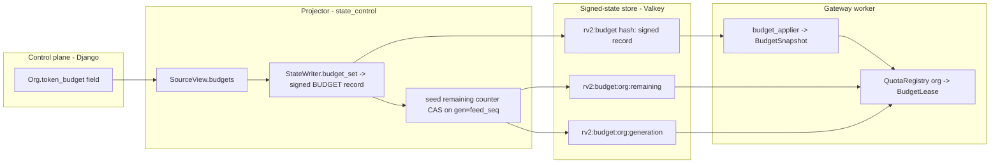

# Design Document

## Overview

S4 turns the honest-but-refusing production boot into one that admits real traffic subject to three
gates: a declared concurrency/queue bound, a per-principal burst and sustained rate, and a per-org
token budget. Slices S0–S3 already stood up `AMF_PROFILE=production` (`edge/production_profile.py`):
it resolves signed KEY and PLAN records per worker, hashes identity, splits 401/503, and gates
`/readyz` on per-kind freshness. But `edge/chat_deps.py` still carries `fail_closed_admission`
(`_AlwaysShedAdmission`) and `fail_closed_budget` (`_AlwaysRefuseBudget`) as the `ChatRoute`
deciders, so every request sheds at the door. S4 replaces exactly those two defaults with the
shipped GW19 `AdmissionController` and GW06 `QuotaComponent`, wires the per-principal GCRA cache and
the per-org lease registry around them, adds a `budget_applier` to the gateway `StateSynchroniser`,
and closes the control→state→gateway budget path that S2 explicitly deferred (control has no budget
field today; `state_control/source.py::SourceView` carries orgs/keys/plans/switches and nothing
else).

Nothing in this design invents new capacity numbers. Every bound is a `ResourceContract` call
(`admit/quota.py::derive_bounds`, `derive_lease_cap_tokens`, `derive_low_watermark`); `AMF_Q_SAFE` is
read, validated, and passed straight to `derive_bounds`, which raises `CapacityUnset` when it is
`None` or `<= 0`. The production boot refuses to start on any missing or non-positive input rather
than guessing. Signing stays in one authority (`state_control` via `runtime/state_sig.py`); the
projector is the only new writer of BUDGET records, and Django is never imported by `gateway_v2`.

This design scopes S4 only. The overall GW36 design (`docs/plans/2026-11-02-gw36-production-boot.md`
§5.4, §9.4, review finding N4) is settled and is not re-opened.

### Requirement → component map

| Req | What it asks | Where it lands |
|---|---|---|
| 1 | Refuse to start without a declared `AMF_Q_SAFE` | `edge/production_profile.py` new `_resolve_q_safe` + `apply_production`; propagates `derive_bounds`'s `CapacityUnset` |
| 2 | Wire the real `AdmissionController` | `production_profile.apply_production` builds `AdmissionController(bounds=derive_bounds(...))`; injected as `ChatRoute.admission` via `chat_deps` |
| 3 | Per-principal `LocalGCRA` cache | New `admit/gcra_cache.py::GcraCache` keyed by key hash, rebuilt on KEY delta; `rate/Worker_Count` per worker |
| 4 | Per-org `BudgetLease` registry | New `admit/quota_registry.py::QuotaRegistry` keyed by org id; builds `QuotaComponent` per org from the served BUDGET record |
| 5 | Compose admission → GCRA → budget | New `edge/quota_gate.py::QuotaGate` (a `BudgetDecider`) composing the GCRA cache + the registry; short-circuits and refunds |
| 6 | Owner on `evaluate`/`refund` | `QuotaGate.evaluate(cost, *, request_id, owner)` / `refund(..., owner)` resolves the owner's `QuotaComponent`; fail-closed on unknown owner |
| 7 | `budget_applier` for `StateKind.BUDGET` | New `admit/budget_state.py::BudgetSnapshot` + `budget_applier`; registered in `StateRuntime.sync`; `READY_KINDS` gains BUDGET |
| 8 | Control budget field | New Django field + `SourceView.budgets`; default 100,000; range `[0, 1_000_000_000]` |
| 9 | Projector writes BUDGET records | `state_control/projector.py` new `_budgets` phase; `StateWriter.budget_set`; generation advances only on change |
| 10 | Projector seeds the live pool counter | `state_control/projector.py` seeds `{rv2}:budget:{org}:remaining` with CAS on generation = `feed_seq` |
| 11 | Live acceptance | Compose service + evidence run; one boot-log line per wired dependency |

## Architecture

### The request-path gate chain

The `ChatRoute` lifecycle (`edge/openai_chat.py::ChatSurface`) already calls two narrow surfaces in
order: `admission.admit(owner_id, request_id, enqueued_at)` then `quota.evaluate(cost, *,
request_id)`. S4 keeps those surfaces exactly and injects real implementations behind them.

```mermaid
flowchart TD
    REQ[request: owner_id, cost, request_id] --> ADM{AdmissionController.admit}
    ADM -- ShedVerdict --> SHED[refuse: OVERLOAD_SHED, retry_after >= 1s, 0 provider calls]
    ADM -- Admitted --> QG[QuotaGate.evaluate owner=org]
    QG --> GCRA{GcraCache[key].admit}
    GCRA -- reject --> RL[refuse: 429 rate-limited, 0 provider calls, allowance unchanged]
    GCRA -- admit --> REG{QuotaRegistry[org].evaluate}
    REG -- BudgetVerdict --> BU[refuse: budget_unavailable, 0 provider calls]
    REG -- Admitted --> OK[proceed to provider]
    OK -. refused before provider .-> RF[QuotaGate.refund owner=org -> net budget change 0]
```

The order is fixed and each gate short-circuits at the first refusal (Req 5.1–5.3). `admission` is
the GW19 `AdmissionController` wired straight in. `quota` becomes a new `QuotaGate` that owns the
GCRA-then-budget composition, because the `BudgetDecider` protocol in `chat_deps.py` is the single
seam the lifecycle couples to for everything after admission — folding the per-principal rate check
into the quota surface keeps the lifecycle untouched while giving S4 one place to compose GCRA, the
owner lookup, and the lease.

### The state path (control → projector → store → gateway)



The projector reads control's new per-org budget, writes a signed `StateKind.BUDGET` record through
the one signing authority (`StateWriter.put`, which is already generic over `StateKind` and for which
BUDGET is a `HASH_KINDS` member in `runtime/store_keys.py`), and seeds the live pool counter. The
gateway's `budget_applier` turns the drained BUDGET record into a served `BudgetSnapshot`; the
`QuotaRegistry` reads that snapshot once per org to build a `BudgetLease`, which then spends locally
against `{rv2}:budget:{org}:remaining` with no request-path record read.

### Layering and conventions honoured

- **No capacity literal outside the contract.** `AMF_Q_SAFE` is an injected measurement, not a
  literal; every bound is a `ResourceContract` call. The lease chunk/watermark come from
  `derive_lease_cap_tokens` / `derive_low_watermark`. The control budget range `[0, 1e9]` and the
  default `100_000` are control-plane policy values (Django validators), not gateway capacity
  positions, so they live in control and never in `gateway_v2`.
- **Fail closed on undecidable.** Every new decision path refuses rather than admits when it cannot
  decide: unset `q_safe` → refuse to start; unknown owner → `budget_unavailable`; a drift or
  unverifiable BUDGET delta → cursor unchanged, served record unchanged.
- **One signing authority.** Only the projector (via `StateWriter`) writes BUDGET records. The
  gateway never signs.
- **Django must not import `gateway_v2`.** The control budget field is a plain Django model field and
  validators; the projector (which already imports both sides through the value types in
  `state_control/source.py`) is the only hop that reads control and writes signed state.

## Components and Interfaces

### 1. `AMF_Q_SAFE` refuse-to-start (`edge/production_profile.py`)

`apply_production` gains a `_resolve_q_safe(env)` step run before any component is built:

```python
def _resolve_q_safe(env: Mapping[str, str]) -> float:
    raw = (env.get("AMF_Q_SAFE") or "").strip()
    if not raw:
        raise ProfileError("AMF_Q_SAFE is required (the DECLARED guard service rate; GW20 measures it)")
    try:
        q_safe = float(raw)
    except ValueError as exc:
        raise ProfileError(f"AMF_Q_SAFE={raw!r} is not a decimal number") from exc
    if q_safe <= 0.0:
        raise ProfileError(f"AMF_Q_SAFE={raw!r} must be strictly greater than 0")
    return q_safe
```

- No default, no literal. Absent/blank/whitespace, non-decimal, and `<= 0` all raise `ProfileError`
  naming `AMF_Q_SAFE` and (for a bad parse) reproducing the rejected value (Req 1.1, 1.2, 2.2).
- The resolved `q_safe` is passed to `derive_bounds(contract, q_safe=q_safe,
  audit_drain_rate_per_s=..., audit_bytes_per_record=...)`. `derive_bounds` raises `CapacityUnset`
  when `q_safe` is `None` or `<= 0` and `CapacityUnavailable` when a bound cannot be computed; both
  propagate out of `apply_production` and refuse to start (Req 1.6, 2.3). Because
  `production_profile_active` / `apply_production` run inside the per-worker factory path, the
  parent's refuse-to-start probe raises before any worker is spawned (Req 1.4).
- Boot log records that `q_safe` is DECLARED and owned by GW20 (Req 1.5), and names it as the missing
  variable on refusal (Req 1.1).

Audit sizing (Req 2.7/2.8): when `AuditSink.calibrate` is wired its measured drain rate and
bytes-per-record feed `derive_bounds`; until then `apply_production` reads the declared
`AMF_AUDIT_DRAIN_RATE_PER_S` / `AMF_AUDIT_BYTES_PER_RECORD` from the environment exactly as the dev
profile does.

### 2. Admission controller wiring (`production_profile.py` + `chat_deps.py`)

`apply_production` builds the real controller from the derived bounds:

```python
bounds = derive_bounds(contract, q_safe=q_safe, audit_drain_rate_per_s=..., audit_bytes_per_record=...)
admission = AdmissionController(
    bounds=bounds, params=CoDelParams(...from contract...), rng=random.Random(),
    supervisor=..., metrics=AdmissionMetrics(), drain_window_s=..., clock=clock,
)
deps["admission"] = admission   # replaces fail_closed_admission in the ChatRoute
```

- The `AdmissionController` already satisfies the `AdmissionDecider` protocol
  (`admit(owner_id, request_id, enqueued_at) -> Admitted | ShedVerdict`, `complete(request_id)`),
  fails closed to a shed on any undecidable path, and sheds at the door on a full bounded queue. S4
  does not change it; it only constructs and injects it (Req 2.1, 2.4).
- A shed returns a `ShedVerdict` whose `retry_after_s` is `>= MIN_RETRY_AFTER_S` (1.0 s, floor +
  jitter from `grant.shed_retry_after_s`) and carries the `request_id`; `edge` renders the 503. The
  shed happens before the quota phase, so zero provider calls occur (Req 2.5, 5.2).
- `complete(request_id)` is slot-exact and idempotent (releases exactly one slot per prior unmatched
  admit); the lifecycle already calls it when an admitted request finishes (Req 2.6).

### 3. Per-principal GCRA cache (`admit/gcra_cache.py`, new)

```python
class GcraCache:
    def __init__(self, *, worker_count: int, clock=time.monotonic): ...
    def for_principal(self, key_hash: str, principal: Principal) -> LocalGCRA | None: ...
    def invalidate(self, key_hashes: Iterable[str]) -> None: ...
```

- Keyed by the key's sha256 hash (the same hash identity resolves on). `for_principal` returns the
  cached `LocalGCRA` when the cached principal's `(rate_per_s, burst)` are unchanged, else builds a
  new one and caches it (Req 3.2). First request builds and caches (Req 3.2); the first arrival of a
  newly built GCRA is always admitted (`LocalGCRA.admit` first-arrival rule, Req 3.1).
- **Per-worker rate.** The `GcraParams.rate_per_s` is `principal.rate_per_s / worker_count`
  (`Worker_Count` read from the boot config / `AMF_WORKERS`), so N workers sum to the principal's
  configured rate (Req 3.4). `burst` is the `Local_Burst_Limit` per worker, passed through.
- **Rate 0 = no per-key limit.** When `principal.rate_per_s == 0` the cache returns `None` (a
  `LocalGCRA` rejects a non-positive rate at construction). `QuotaGate` treats `None` as "admit with
  respect to this limit", and the boot log records the absence marked DECLARED (Req 3.5). This matches
  the projector's `_key_body` which already writes `rate_per_s: 0.0` today (per GW36 §9.3, control
  configures TPM only; per-key request GCRA is GW27).
- **Rebuild on KEY delta.** `invalidate` drops the cached GCRA for each key hash the KEY delta names,
  so the next request for that key rebuilds from the updated principal (Req 3.3). This hooks the same
  per-key eviction the `IdentityCache` already performs from `identity_applier`; the GCRA cache is
  invalidated alongside it (wired in `StateRuntime`).
- A rejected arrival does not advance the TAT (`LocalGCRA` leaves the allowance untouched on reject),
  so the next legitimately-timed arrival is still served (Req 3.6). A rate/burst refusal is surfaced
  by `QuotaGate` as the declared 429 rate-limited response with zero provider calls.
- No per-key request-count limit beyond burst+rate is added (Req 3.7, GW27 out of scope).

### 4. Per-org budget lease registry (`admit/quota_registry.py`, new)

```python
class QuotaRegistry:
    def __init__(self, snapshot: BudgetSnapshot, *, make_component: Callable[[str, BudgetRecord], QuotaComponent]): ...
    def component_for(self, org: str) -> QuotaComponent | None: ...   # None when org has no BUDGET record
    def on_generation_change(self, org: str) -> None: ...             # mark for re-acquire
```

- One `QuotaComponent` (and thus one `BudgetLease`) per org, created on first use from the org's
  served `BudgetRecord` (pool tokens + generation) and cached (Req 4.1, 4.2). A later request for an
  org already present reuses the existing component without re-reading the record on the request path
  (Req 4.3) — the record was read once from the `BudgetSnapshot` the applier maintains, never from the
  store on the hot path.
- `component_for(org)` returns `None` when no `BudgetRecord` is served for that org; `QuotaGate` then
  refuses with `budget_unavailable` (not `shared_state_unavailable`), spending zero tokens and making
  zero provider calls (Req 4.5).
- Isolation: each org's `QuotaComponent` holds its own `BudgetLease` over its own
  `{rv2}:budget:{org}:remaining` pool, so a spend for one org decrements only that org (Req 4.4) and
  one org's exhaustion never blocks another whose pool still covers the cost (Req 4.6). A request the
  org's lease cannot cover is refused `budget_unavailable` with zero tokens spent and zero provider
  calls (Req 4.7); the `QuotaComponent` already returns `budget_verdict` (never
  `shared_state_unavailable`) and fails closed on its catch-all.
- The `BudgetLease` the registry builds is constructed with a stable per-worker `worker_id`, a
  contract-derived `chunk` (`derive_lease_cap_tokens`) and `low_watermark` (`derive_low_watermark`),
  an injected store client (the state runtime's bounded Valkey client), and an off-path `spawn`.

### 5. The composed quota gate (`edge/quota_gate.py`, new)

`QuotaGate` is the `BudgetDecider` the production boot injects as `ChatRoute.quota`. It composes GCRA
then budget and owns the owner lookup and the refund-before-provider contract:

```python
class QuotaGate:
    async def evaluate(self, cost: int, *, request_id: str, owner: str) -> BudgetVerdict | Admitted: ...
    def refund(self, cost: int, *, request_id: str, owner: str) -> None: ...
```

Decision order inside `evaluate` (fail-closed catch-all around the whole body, Req 5.5):

1. Resolve the owner's GCRA via the request's principal (key hash → `GcraCache`). A `None` GCRA
   (rate 0) skips the rate check. A non-`None` GCRA whose `admit()` returns `False` → refuse with the
   declared 429 rate-limited verdict, zero provider calls, allowance unchanged (Req 3.6, 5.3).
2. Resolve `QuotaRegistry.component_for(owner)`. `None` (or a missing/unknown owner) → refuse
   `budget_unavailable`, zero tokens, zero provider calls (Req 4.5, 6.5).
3. Delegate to `component.evaluate(cost, request_id=request_id)` (the shipped `QuotaComponent`, which
   runs GCRA-internal-to-itself then the local lease spend). On `Admitted`, proceed to the provider
   (Req 5.6). The `Admitted` carries `owner_id = component.lease.config.org`, which equals the owner
   passed in (Req 6.4).

`refund(cost, *, request_id, owner)` resolves the same owner's component and calls
`component.refund(cost, request_id=request_id)`, which returns exactly the spent cost to that org's
lease and no other (Req 5.4, 6.1–6.3). It is synchronous, no store I/O, best-effort/fail-closed —
exactly the shipped `QuotaComponent.refund` contract. The lifecycle calls `refund` when a request
spent budget and was then refused before any provider call (input BLOCK, scan failure, REDACT verify
failure), so the net budget change for that request is zero (Req 5.4).

**Owner threading.** The `BudgetDecider` protocol today is `evaluate(cost, *, request_id)`. S4 widens
the production wiring's surface to carry `owner` (review finding N4). This is done by extending the
protocol with an `owner` keyword and updating the one lifecycle call site to pass the resolved org;
the fail-closed defaults (`_AlwaysRefuseBudget`) accept and ignore it, so unwired routes stay
fail-closed. A spend and its refund are always attributed to the resolved org, never guessed.

### 6. BUDGET applier and snapshot (`admit/budget_state.py`, new)

```python
@dataclass(frozen=True, slots=True)
class BudgetRecord:
    org: str
    pool_tokens: int
    generation: int   # == the record's feed_seq

class BudgetSnapshot:
    def record_for(self, org: str) -> BudgetRecord | None: ...
    def fresh(self) -> bool: ...   # gated by the KEY/PLAN/KS-style KindGate for BUDGET

def budget_applier(snapshot: BudgetSnapshot, registry_hook: Callable[[str], None]) -> Applier: ...
```

- `budget_applier` is the synchroniser `Applier` for `StateKind.BUDGET`, registered in
  `StateRuntime.sync` alongside the KEY/PLAN/KS appliers so the appliers map has all four kinds
  (Req 7.1). It is added to `inline_kinds` is **not** required (BUDGET has no unlocked RAM cache like
  the identity cache); it follows the plan/KS pattern and may offload.
- On a drained BUDGET round it replaces the served `BudgetRecord` for every org named in the round and
  leaves every unnamed org's record unchanged (Req 7.2). The applier decodes and verifies the signed
  record (`decode_record` / `decode_manifest` against the kind's cursor+floor, the same
  anti-regress path the other appliers use); a drift relative to the cursor, or a signature/
  completeness failure, raises `StoreDataUnavailable` from the applier. `StateSynchroniser.round_once`
  already treats an applier `StoreDataUnavailable` as "cursor stays put, served state unchanged,
  reported with an error" — so a refused BUDGET delta leaves the cursor unchanged and the next round
  retries from the same position (Req 7.4).
- **Generation change → re-acquire.** When a drained delta changes an org's generation to a value
  other than the one currently served, the applier calls `registry_hook(org)`
  (`QuotaRegistry.on_generation_change`), which marks that org's lease for re-acquisition under the
  new generation. The `QuotaComponent` / `BudgetLease` already carry the revoke-on-change path: a
  spend against a stale generation returns `stale_generation`, the façade re-acquires under the
  current generation and only admits if that re-acquire granted budget, else refuses. Until a lease
  under the new generation is acquired, the org's requests are refused with the re-acquiring
  indication (`budget_unavailable`, the narrow posture) (Req 7.3).
- **Readiness.** `StateRuntime.READY_KINDS` gains `StateKind.BUDGET`, and the `BudgetSnapshot` reads
  through the `KindGate` for BUDGET (`StateRuntime.gates.gate(StateKind.BUDGET)`), so if BUDGET has not
  been verified within the 5000 ms freshness window `/readyz` returns 503 naming BUDGET as the
  unavailable dependency, consistent with KEY/PLAN/KS (Req 7.5). `FRESH_MS` (`domain/locks.py`) is
  unchanged.

### 7. Control budget source (Django + `state_control/source.py`)

- Control gains a per-org token budget field: a `PositiveIntegerField`-style column on the org model
  with validators `MinValueValidator(0)` and `MaxValueValidator(1_000_000_000)` and a default of
  `100_000`. The write surface (console/API) validates and, on an out-of-range or non-integer value,
  rejects the request, retains the previously stored value, and returns a range error (Req 8.1–8.3).
- A new org without an explicit budget stores the declared default 100,000 (Req 8.2). The column is a
  plain integer token count; it never holds a credential or secret (Req 8.5).
- The projector's read view gains the budget: `SourceView.budgets: Mapping[str, int]` (org slug →
  token budget), populated by `source_pg.py` (SQL read, no Django import) and the `MemorySource` twin.
  Because the projector reads a consistent snapshot each round and the source evaluates liveness at
  `as_of`, a committed budget change is readable by the projector within one round, well under 5 s at
  the shipped period (Req 8.4).

### 8. Projector BUDGET writes + pool seeding (`state_control/projector.py` + `StateWriter`)

A new `_budgets` phase runs after the safety heartbeat (budget is liveness, not a revocation):

```python
def budget_set(self, org_id: str, pool_tokens: int) -> WriteOutcome:   # StateWriter
    return self.put(StateKind.BUDGET, org_id, {"org_id": org_id, "pool_tokens": pool_tokens})
```

- For every org with a stored control budget in the round's snapshot, the projector writes one signed
  `StateKind.BUDGET` record carrying `pool_tokens` (non-negative int) via `StateWriter.put` with
  `if_changed=True`. `StateWriter.put` already bumps the version/`feed_seq` only when the body
  changed (the `if_changed` compare-and-skip under the counters lock). So an unchanged budget writes
  nothing and leaves the generation unchanged (Req 9.5); a changed budget writes a record whose
  `feed_seq` (the Budget_Generation) is strictly greater than the previous one (Req 9.4); a first-time
  org gets its first record with an initial generation (Req 9.3). Every org with a stored budget has a
  record written-or-current by round end (Req 9.1, 9.2). An org with no stored budget gets no record
  and any prior record is left unchanged (Req 9.6).
- **Pool seeding (Req 10).** After writing (or finding unchanged) an org's record, the projector seeds
  the live counter. It uses a WATCH/MULTI compare-and-set over `{rv2}:budget:{org}:remaining` and
  `{rv2}:budget:{org}:generation` conditioned on the stored generation equalling the record's
  `feed_seq`:
  - On a new generation: `SET remaining = pool_tokens`, `SET generation = feed_seq` atomically
    (Req 10.1, 10.2, 10.4).
  - The CAS guards against a concurrent writer under a different generation (Req 10.3). The two
    projector replicas are already single-writer under the lease (`projector.py`), so this CAS is
    defence-in-depth and also protects against a stale re-seed racing a live decrement.
  - When the stored generation already equals the record's `feed_seq`, the projector does **not**
    re-seed, so live lease decrements are not clobbered (Req 10.5).
  - On a CAS failure the counter is left unchanged and the seed is retried on a later round, bounded by
    a small attempt count (Req 10.6).

  The seed is **not** `StateWriter.put` (that writes the signed config record); it is a direct store
  operation on the live-counter family that `runtime/store_keys.py` already defines
  (`budget_remaining`, `budget_generation`). Only the projector touches these keys for seeding; the
  gateway's `BudgetLease` only decrements `remaining` and reads `generation`.

### 9. Boot log (Req 2, 3.5, 11.4)

`apply_production` emits one line per wired dependency, extending the S3 boot log:

```
boot: admission -> AdmissionController (q_safe DECLARED=<v>, GW20 owns the measured value;
      request_depth=<n> concurrency=<n> audit_depth=<n>)
boot: rate -> per-principal LocalGCRA, per-worker rate = rate_per_s / <worker_count>
      (rate_per_s 0 = no per-key request limit, DECLARED; per-key request-count is GW27)
boot: budget -> per-org BudgetLease registry over signed BUDGET records
      (chunk=<n> tokens, watermark=<n>); budget_unavailable on empty pool, never shared_state_unavailable
```

The `_REPLACED` set in `production_profile.py` grows to drop the S3 fail-closed `admission` / `quota`
lines so they are replaced, not duplicated.

## Data Models

### New domain/value types

```python
# admit/budget_state.py
@dataclass(frozen=True, slots=True)
class BudgetRecord:
    org: str
    pool_tokens: int      # >= 0, decoded from the signed BUDGET record body
    generation: int       # == the record's feed_seq (the Budget_Generation)
```

### Signed BUDGET record body (written by the projector, decoded by the applier)

```json
{ "org_id": "<slug>", "pool_tokens": <non-negative int> }
```

Hash-stored under `{rv2}:budget` (BUDGET ∈ `HASH_KINDS`), keyed by org slug. The record's `feed_seq`
is the Budget_Generation — the gateway reads it from the decoded `SignedRecord`, so the generation is
never a separate body field that could disagree with the cursor.

### Live budget counter family (existing, `runtime/store_keys.py`)

| Key | Meaning | Writer | Reader |
|---|---|---|---|
| `{rv2}:budget:{org}:remaining` | live remaining token pool | projector seeds; `BudgetLease` decrements | `BudgetLease.acquire` |
| `{rv2}:budget:{org}:generation` | live generation tag | projector sets on seed | `BudgetLease` generation check |
| `{rv2}:budget:{org}:lease:{worker}` | one worker's outstanding chunk (TTL-reclaimed) | `BudgetLease` | `BudgetLease` |
| `{rv2}:budget:{org}:workers` | active lease workers (ZSET, fair share) | `BudgetLease` | `BudgetLease` |

### Control view extension (`state_control/source.py`)

```python
@dataclass(frozen=True, slots=True)
class SourceView:
    as_of: float
    orgs: tuple[SourceOrg, ...]
    keys: tuple[SourceKey, ...]
    plans: tuple[SourcePlan, ...]
    switches: tuple[SourceSwitch, ...]
    budgets: tuple[SourceBudget, ...]   # NEW: (org_slug, pool_tokens)
```

### In-memory lease registry / GCRA cache state (per worker, not persisted)

- `QuotaRegistry`: `dict[str, QuotaComponent]` keyed by org id, plus a `set[str]` of orgs marked for
  re-acquire.
- `GcraCache`: `dict[str, tuple[Principal, LocalGCRA | None]]` keyed by key hash. All instance-level;
  no module-level mutable state.

## Correctness Properties

*A property is a characteristic or behavior that should hold true across all valid executions of a system — essentially, a formal statement about what the system should do. Properties serve as the bridge between human-readable specifications and machine-verifiable correctness guarantees.*

S4 is a composition of pure decision logic (`_resolve_q_safe`, `GcraCache`, `QuotaRegistry`,
`QuotaGate`) over store-backed counters whose generation discipline is itself logic. That logic has
universal invariants worth proving over generated inputs rather than a handful of examples. The
infrastructure arms — `/readyz` gating (Req 7.5), the control→projector freshness window (Req 8.4),
and the live wire evidence (Req 11) — do not vary meaningfully with input and are covered by
integration and live tests in the Testing Strategy, not by properties.

Each property test runs a minimum of 100 iterations and is tagged in-source with
`# Feature: gw36-s4-admission-quota, Property N: <text>`.

### Property 1: Per-org budget isolation and owner attribution

For any interleaved sequence of `evaluate`/`refund` calls across two or more orgs, every spend and
every refund changes only the lease of the owner named on that call, leaving every other org's
`{rv2}:budget:{org}:remaining` balance unchanged; an `Admitted` outcome reports `owner_id` equal to
the owner passed to `evaluate`, and a cost the owner's lease cannot cover refuses with
`budget_unavailable` (never `shared_state_unavailable`) having spent zero tokens.

Generators: a set of org ids; a sequence of `(op, owner, cost)` tuples with `op ∈ {evaluate, refund}`,
`owner` drawn from the org set, `cost` drawn spanning below/at/above each org's pool.

**Validates: Requirements 4.4, 4.6, 4.7, 6.1, 6.2, 6.3, 6.4**

Lives in `gateway_v2/tests/admit/test_gw36_s4_budget_isolation_property.py` (complements
`test_v2_leaks_budget.py` and `test_lgw06_lease_conservation.py`).

### Property 2: Refund net-zero before a provider call

For any request that spends a cost against its owner's lease and is then refused before any provider
call, applying `refund(cost, request_id=..., owner=...)` returns the owner's lease remaining balance
to exactly its pre-spend value — the net budget change for that request is zero.

Generators: arbitrary non-negative `cost`; arbitrary pre-existing remaining balance ≥ `cost`;
arbitrary `request_id` and `owner`.

**Validates: Requirements 5.4**

Lives in `gateway_v2/tests/admit/test_gw36_s4_refund_netzero_property.py`.

### Property 3: GCRA allowance preserved on reject

For any sequence of arrival timestamps evaluated against a `LocalGCRA` built from a principal's
`(rate_per_s, burst)`, the first arrival is always admitted, a rejected arrival never advances the
theoretical arrival time, and consequently the number of admits in any window never exceeds
`burst + rate_per_s * window`, and a reject never starves the next legitimately-timed arrival (an
arrival spaced at ≥ `1/rate_per_s` after the last admit is still admitted).

Generators: `(rate_per_s > 0, burst ≥ 1)`; a monotonic-ish sequence of arrival offsets mixing
bursts tighter than the rate with gaps at or beyond `1/rate_per_s`.

**Validates: Requirements 3.1, 3.6**

Lives in `gateway_v2/tests/admit/test_gw36_s4_gcra_cache_property.py` (complements
`test_lgw06_gcra.py`).

### Property 4: Per-worker rate split sums to the principal rate

For any `worker_count = N ≥ 1` and any principal `rate_per_s`, each worker's `GcraCache` builds a
`LocalGCRA` at `rate_per_s / N`, and the sum of the N per-worker sustained rates equals the
principal's configured `rate_per_s` (within floating-point tolerance).

Generators: `N ∈ [1, 64]`; `rate_per_s` drawn over `[0, 10_000]` including 0 (the no-limit branch,
which yields `None` and contributes 0 to the sum).

**Validates: Requirements 3.4**

Lives in `gateway_v2/tests/admit/test_gw36_s4_gcra_cache_property.py`.

### Property 5: Fail closed on any undecidable input

For any undecidable input the decision is a refusal, never an admit: a blank/whitespace/non-decimal/
non-positive `AMF_Q_SAFE`, or a `derive_bounds` that raises `CapacityUnset`/`CapacityUnavailable`,
refuses startup with a `ProfileError` and continues no further; an unknown or missing owner, or an
org with no served `BudgetRecord`, refuses with `budget_unavailable`, zero tokens spent, zero
provider calls; a drift or unverifiable BUDGET delta refuses the delta, leaving the cursor and every
served record unchanged.

Generators: a tagged union of undecidable inputs — bad `q_safe` strings/floats; owner ids absent from
the registry; BUDGET deltas that regress the cursor or carry a broken signature/incomplete manifest.
The property asserts the common post-condition: outcome is a refusal and no provider call / no admit
occurred.

**Validates: Requirements 1.1, 1.2, 1.4, 1.6, 2.2, 2.3, 4.5, 5.5, 6.5, 7.4**

Lives in `gateway_v2/tests/admit/test_gw36_s4_failclosed_property.py` (complements
`test_lgw06_failclosed.py` and `test_lgw05b_failclosed.py`).

### Property 6: Budget generation monotonicity

For any sequence of control budget values an org passes through consecutive projector rounds, the
written `Budget_Generation` (the record's `feed_seq`) is non-decreasing across rounds and strictly
increases on exactly those rounds where the budget body changed; an unchanged value writes no new
record and does not advance the generation.

Generators: a sequence of budget values (with repeats) drawn over `[0, 1_000_000_000]` fed round by
round through `StateWriter.budget_set` with `if_changed=True`.

**Validates: Requirements 9.4, 9.5**

Lives in `gateway_v2/tests/state_control/test_gw36_s4_projector_budget_property.py` (complements
`test_lgw06_generation.py`).

### Property 7: CAS seed safety

For any interleaving of projector seeds and live lease decrements over
`{rv2}:budget:{org}:remaining` / `{rv2}:budget:{org}:generation`, a seed takes effect only when the
stored generation equals the record's `feed_seq`: a seed under a mismatched generation never
overwrites the counter, and a generation already equal to the record's `feed_seq` is never re-seeded,
so a live decrement is never clobbered by a stale re-seed.

Generators: a start generation and pool; a sequence of operations mixing `seed(gen, pool)` calls
(some matching, some stale) with `decrement(n)` calls; assert the counter reflects decrements and
only advances on a matching-generation seed.

**Validates: Requirements 10.3, 10.5**

Lives in `gateway_v2/tests/state_control/test_gw36_s4_projector_budget_property.py`.

### Property 8: Gate short-circuit order

For any triple of gate verdicts `(admission, gcra, budget)`, `QuotaGate` evaluates admission first,
then GCRA, then budget, and stops at the first gate that refuses: a shed refuses without evaluating
GCRA or budget; a GCRA reject refuses without spending budget; budget is spent only when admission
admitted and GCRA allowed, and only then does the request proceed to the provider. No downstream gate
is evaluated and no budget is spent after an earlier refusal.

Generators: each gate's verdict drawn from `{pass, refuse}` (8 combinations), with instrumented
spies asserting which gates were invoked and whether a spend occurred.

**Validates: Requirements 2.4, 2.6, 5.1, 5.2, 5.3, 5.6**

Lives in `gateway_v2/tests/edge/test_gw36_s4_gate_order_property.py`.

### Property 9: Control budget range validation

For any integer `v`, the control budget write accepts `v` and stores it if and only if
`0 ≤ v ≤ 1_000_000_000`; any `v` outside that range, or a non-integer, is rejected with a range error
and the previously stored value is retained unchanged.

Generators: integers spanning below 0, within `[0, 1_000_000_000]`, and above the ceiling, plus a few
non-integer inputs.

**Validates: Requirements 8.1, 8.3**

Lives in the control test suite alongside `gateway_v2/tests/state_control/`.

### Reflection on the property set

The nine properties above are the consolidated set. The fail-closed clauses scattered across Req 1,
4.5, 5.5, 6.5, and 7.4 collapse into a single parameterised refusal property (Property 5) because they
share one post-condition — undecidable input yields a refusal, never an admit. Isolation (4.4/4.6) and
owner attribution (6.1–6.4) are one underlying invariant — a charge or refund touches exactly the
named owner's lease — so they are one property (Property 1), which also carries the 4.7 posture
assertion. Refund net-zero (Property 2) is kept separate because it is a single-owner round trip over
time rather than a cross-org isolation claim. The remaining properties (3, 4, 6, 7, 8, 9) each assert a
distinct invariant — TAT preservation, rate arithmetic, generation monotonicity, CAS safety, gate
ordering, and range validation — with no subsumption among them.

## Error Handling

S4 keeps the S0–S3 discipline: a configuration or capacity problem is **loud** and refuses startup; a
request-path problem is a **declared refusal** rendered on the wire with zero provider calls; only a
genuine infrastructure fault surfaces as a 503 server-side posture. Nothing degrades to an admit.

### Boot-time (loud — refuse to start)

| Failure | Detected at | Response |
|---|---|---|
| `AMF_Q_SAFE` absent / blank / whitespace | `_resolve_q_safe` | `ProfileError` naming `AMF_Q_SAFE` as missing; startup stops (Req 1.1, 1.4). |
| `AMF_Q_SAFE` non-decimal | `_resolve_q_safe` | `ProfileError` naming `AMF_Q_SAFE` and reproducing the rejected value (Req 1.2). |
| `AMF_Q_SAFE` ≤ 0 | `_resolve_q_safe` | `ProfileError`; no default, no literal substituted (Req 1.2, 1.4, 2.2). |
| `derive_bounds` raises `CapacityUnset` | `apply_production` | `ProfileError`/propagated; boot log states admission capacity is unset; no fallback to `fail_closed_admission` (Req 1.6, 2.2, 2.3). |
| `derive_bounds` raises `CapacityUnavailable` (a bound cannot be derived from the contract) | `apply_production` | Propagated; refuse to start; no fallback (Req 2.3). |

Because `apply_production` runs inside the per-worker factory path, the parent's refuse-to-start probe
raises before any worker is spawned, so no worker ever boots with a guessed bound (Req 1.4).

### Request-path (declared refusals — zero provider calls, rendered on the wire)

| Failure | Gate | Posture |
|---|---|---|
| Admission shed (full bounded queue / undecidable admission) | `AdmissionController.admit` | `ShedVerdict` → 503 with `retry_after_s ≥ 1.0` (floor + jitter) carrying the `request_id`; evaluated before quota, so GCRA and budget are untouched (Req 2.5, 5.2). |
| GCRA reject (over burst or per-worker sustained rate) | `GcraCache[key].admit` | Declared 429 rate-limited response; the TAT is not advanced, so the allowance is unchanged and the next legitimately-timed arrival is still admitted; budget is not spent (Req 3.6, 5.3). |
| Unknown or missing owner on `evaluate`/`refund` | `QuotaGate` | `budget_unavailable`; every lease left unchanged (Req 6.5). |
| Org has no served `BudgetRecord` | `QuotaRegistry.component_for` → `None` | `budget_unavailable` (explicitly **not** `shared_state_unavailable`); zero tokens spent (Req 4.5). |
| Lease cannot cover the request cost | `QuotaComponent.evaluate` | `budget_unavailable` (**not** `shared_state_unavailable`); zero tokens spent (Req 4.7). |
| Spend succeeded, request then refused before provider (input BLOCK, scan failure, REDACT verify failure) | lifecycle → `QuotaGate.refund` | `refund` returns exactly the spent cost; net budget change zero (Req 5.4). |
| Stale generation on a spend | `BudgetLease` / `QuotaComponent` | Re-acquire under the current generation; admit only if the re-acquire granted budget, else refuse `budget_unavailable` (Req 7.3). |
| Any undecidable admission/rate/budget decision | `QuotaGate` catch-all | Refuse; no provider call; lease net balance unchanged (Req 5.5). |

### State-path (applier and projector)

| Failure | Handled at | Response |
|---|---|---|
| Drift relative to the BUDGET cursor, or signature/completeness failure on a drained delta | `budget_applier` | Raise `StoreDataUnavailable`; `StateSynchroniser.round_once` leaves the BUDGET cursor and every served `BudgetRecord` unchanged, reports the refusal with a drift/unverifiable reason, and retries from the same position next round (Req 7.4). |
| Generation change on a drained delta | `budget_applier` → `QuotaRegistry.on_generation_change` | Mark the org for re-acquire; the org's requests refuse `budget_unavailable` (the re-acquiring posture) until a lease under the new generation is acquired (Req 7.3). |
| BUDGET not verified within the 5000 ms freshness window | `KindGate(StateKind.BUDGET)` via `StateRuntime.READY_KINDS` | `/readyz` returns a non-success response naming BUDGET as the unavailable dependency, consistent with KEY/PLAN/KS (Req 7.5). |
| Projector CAS on `generation == feed_seq` fails | `projector._budgets` seed step | Leave `{rv2}:budget:{org}:remaining` unchanged; retry on a later round, bounded by a small attempt count (Req 10.6). |
| Control budget write out of `[0, 1_000_000_000]` or non-integer | Django validators on the org model | Reject the write, retain the previously stored value, return a range error (Req 8.3). |

### Infrastructure faults (server-side posture)

A Valkey/store transport fault (timeout, connection loss, bounded-client rejection) is converted at the
store adapter to the shared-state posture — a 503 `shared_state_unavailable` — never a 401 (not an
auth failure), never a bare 500 (not an unhandled crash), and never a budget refusal. This keeps the
request-path budget refusals (`budget_unavailable`) strictly distinct from a store outage
(`shared_state_unavailable`): an empty pool is a declared policy refusal, while an unreachable store is
an infrastructure outage. Server faults are the only loud request-path outcome; everything else is a
declared refusal.

## Testing Strategy

S4 is proven by a dual suite — example-based unit tests for specific branches and wiring, and
property-based tests for the universal invariants above — plus integration tests on the production
boot, the full offline gate suite, and a live acceptance run for Req 11. The suite follows the repo's
conventions: tests live under `gateway_v2/tests/<area>/` with `test_lgw*`/`test_gw36_s*` prefixes and a
`_property`/`_properties` suffix for property tests; property tests use the repo's existing
property-based testing library and run a minimum of 100 iterations each, tagged
`# Feature: gw36-s4-admission-quota, Property N: <text>`.

### Unit tests (examples, branches, edge cases)

- **q_safe resolution** (`edge/test_gw36_s4_boot.py`): valid value passed to `derive_bounds`; boot log
  records DECLARED and GW20 ownership; `CapacityUnset`/`CapacityUnavailable` propagation; audit sizing
  sourced from `AuditSink.calibrate` when wired, from the declared env vars otherwise (Req 1.3, 1.5,
  1.6, 2.3, 2.7, 2.8).
- **GcraCache** (`admit/test_gw36_s4_gcra_cache.py`): build and cache on first use; same instance
  returned for an unchanged principal; new instance after `invalidate`; `None` returned at
  `rate_per_s == 0` with the DECLARED boot-log note (Req 3.2, 3.3, 3.5).
- **QuotaRegistry** (`admit/test_gw36_s4_quota_registry.py`): create on first use from the served
  record; reuse without a request-path record read; `component_for` returns `None` for an org with no
  record; `on_generation_change` marks re-acquire (Req 4.1, 4.2, 4.3, 7.3).
- **QuotaGate** (`edge/test_gw36_s4_quota_gate.py`): admission→GCRA→budget order with a shed example;
  GCRA-reject skips the spend; refund returns exactly the spent cost; unknown/missing owner fails
  closed to `budget_unavailable`; `Admitted.owner_id` equals the passed owner (Req 5.3, 5.4, 6.4, 6.5).
- **budget_applier** (`admit/test_gw36_s4_budget_applier.py`): appliers map carries all four kinds;
  replace named orgs / leave unnamed unchanged; drift and signature-failure examples leave the cursor
  and served records unchanged; generation-change triggers the registry hook; BUDGET added to
  `READY_KINDS` and gated on `/readyz` (Req 7.1, 7.2, 7.3, 7.4, 7.5).
- **projector budget writes + seed** (`state_control/test_gw36_s4_projector_budget.py`): `budget_set`
  with `if_changed=True` writes only on change; first record gets an initial generation; no stored
  budget writes nothing and leaves any prior record unchanged; seed sets `remaining = pool_tokens` and
  `generation = feed_seq` on a new generation and re-seeds on advance; forced CAS failure leaves the
  counter unchanged and retries bounded (Req 9.1, 9.3, 9.6, 10.1, 10.2, 10.4, 10.6).
- **control budget field**: default 100,000 on org creation; the value is a numeric token count with no
  credential or secret (Req 8.2, 8.5).

### Property tests

The nine properties in the Correctness Properties section, one property per single property-based test,
each at ≥ 100 iterations:

- Property 1 — per-org isolation + owner attribution → `admit/test_gw36_s4_budget_isolation_property.py`
- Property 2 — refund net-zero → `admit/test_gw36_s4_refund_netzero_property.py`
- Property 3 — GCRA allowance preservation → `admit/test_gw36_s4_gcra_cache_property.py`
- Property 4 — per-worker rate split → `admit/test_gw36_s4_gcra_cache_property.py`
- Property 5 — fail closed on undecidable → `admit/test_gw36_s4_failclosed_property.py`
- Property 6 — generation monotonicity → `state_control/test_gw36_s4_projector_budget_property.py`
- Property 7 — CAS seed safety → `state_control/test_gw36_s4_projector_budget_property.py`
- Property 8 — gate short-circuit order → `edge/test_gw36_s4_gate_order_property.py`
- Property 9 — control budget range validation → control test suite

### Integration tests (production boot wiring)

- The production boot replaces `fail_closed_admission` and `fail_closed_budget`: after
  `apply_production`, `ChatRoute.admission` is an `AdmissionController` and `ChatRoute.quota` is the
  composed `QuotaGate`, and neither fail-closed default remains in `deps` (Req 2.1, 2.2).
- `/readyz` gates on BUDGET: with the BUDGET `KindGate` expired past the 5000 ms window, the probe
  returns a non-success response naming BUDGET, alongside the KEY/PLAN/KS gating (Req 7.5).
- Control→projector freshness: a committed budget change is readable through `SourceView.budgets`
  within one projector round, under the 5 s bound (Req 8.4).

### Offline gate suite

Run in the repo's container-run offline suite exactly as S1–S3 did: `mypy --strict`, `ruff`, the
`import-linter` contracts (Django never imported by `gateway_v2`; the projector is the only hop
reading control and writing signed state), and the AST gates — notably the **capacity-literal** gate
(no capacity number outside a `ResourceContract` call; `AMF_Q_SAFE` is an injected measurement, and the
control range `[0, 1e9]`/default `100_000` are Django policy values, not gateway positions) and the
**module-mutable** gate (the `QuotaRegistry` and `GcraCache` hold only instance state, no module-level
mutable state).

### Live acceptance (Req 11)

A live run against the live stack / T02-style setup, producing wire evidence as the prior GW36 slices
did, captured in an evidence `SUMMARY.md`:

- A burst for one key beyond its configured burst or sustained rate returns an HTTP 429 carrying the
  declared rate-limited indicator, observable on the wire (Req 11.1).
- An org whose token budget is exhausted gets its next request rejected with a `budget_unavailable`
  indicator on the wire, with that org's budget state left unchanged (Req 11.2).
- A second org whose budget is not exhausted still receives a success response with no rate-limited or
  `budget_unavailable` indicator while the first org stays exhausted (Req 11.3).
- Startup emits a single boot-log line naming each wired admission, rate, and budget dependency
  (Req 11.4).
