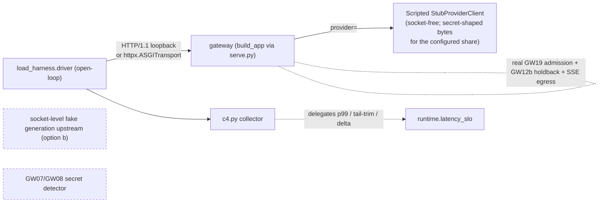

# Design Document — B6 / R2-21: load harness v2.3 (local half)

## Overview

B6 (R2-21) builds the **local half** of the open-loop Poisson load-and-measurement instrument —
"harness v2.3" — for the `gateway_v2` serving path. It is a new top-level Python package
`load_harness/` (sibling to `state_control/` and `audit_control/`), outside the `gateway_v2`
import-linter serving layers, that:

1. generates **open-loop** request arrivals (Poisson + constant) with scheduled-time accounting,
   under an injected clock and an injected `random.Random` seed, so offered load is independent of
   server speed and reproducible offline (Req 1, 13);
2. mixes in the five GW20b **strata** — multi-key, long-prompt corpus, SDK-retry clients,
   secret-shaped outputs, tenant-scale (Req 3–7);
3. collects **client-side C4** (worst inter-chunk latency per stream, 100% chunk sampling, holdback
   excluded, errored streams `+∞`) and reconciles it with the shipped
   `gateway_v2/runtime/latency_slo.py` `Firewall_Added_Delta` definition rather than duplicating it
   (Req 8, 9);
4. runs a **rate ladder** (≤ 10% steps, 3 repeats, highest-repeatable-pass / first-repeatable-fail)
   and emits a per-run **report** carrying the GW20b diagnostic fields (Req 10, 11);
5. drives a **local dry-run** against one gateway built by B1's `build_app` and hosted by B3's
   uvicorn entrypoint (`gateway_v2/gateway_v2/edge/serve.py`) with B4's fake guard, over the
   non-TLS path, proving correct distributions, strata, and C4 numbers locally (Req 12).

**Authority and source of truth.** The binding authority is the GW20 / GW20b amendment in
`docs/AI_MESH_MASTER_RUNBOOK_v3_BACKEND_REWRITE.md`; the local scope is `docs/LOCAL_WORKLIST_v3.md`
block "B6"; the 15 approved requirements in `requirements.md` are the proximate contract and every
design section below traces to them (see Traceability). Where the runbook is silent on a purely
local detail (the exact package layout, the dry-run topology), this design makes an in-spec decision
and flags it.

**Category boundary (local half only).** The fleet-scale knee **numbers** (R2-01), autoscaling
(G-01), fleet-scale retry amplification (G-06), the integrated re-measure (G-09), the real GPU-busy
data source, and the TLS client / edge-TLS gate (G-10) are **Deferred_Cloud_Gates** — explicitly out
of scope and left as named seams, never scaffolded (Req 15; design §Deferred Cloud Gates).

**Testing posture.** No PBT library is used (house idiom): correctness properties are expressed as
seeded `random.Random`, ≥ 10,000-iteration tests, with `asyncio.run` for async; the local dry-run is
an integration test. All harness Python is gated: `mypy --strict`, `ruff`, `lint-imports`, the
shipped AST gates, and `unscanned_channels() == ()` (unchanged by this card) stay green (Req 14).

---

## Architecture

### Placement: a top-level `load_harness/` package, outside the layer contract

The harness is an **offered-load client and an offline generator**, not a serving-path layer. Like
`state_control/` and `audit_control/`, it must be deployable and testable without being inside the
`gateway_v2` import-linter `layers` contract (`root_packages = ["gateway_v2"]`). It therefore lands
as its own top-level package `gateway_v2/load_harness/`, a sibling of `gateway_v2/gateway_v2/`,
`gateway_v2/state_control/`, and `gateway_v2/audit_control/`.

**Import direction (the one allowed edge).** The harness may import *downward* into `gateway_v2`
value types and pure helpers — specifically `gateway_v2.runtime.latency_slo` (C4 reconciliation, Req
9) and `gateway_v2.runtime.resources.ResourceContract` (the pass bound, Req 9.3) — exactly as
`state_control` imports `gateway_v2.domain.state_knobs`. `gateway_v2` never imports `load_harness`,
so no serving-path import edge is added and the `layers` + `forbidden` contracts are untouched. The
dry-run reaches the gateway **over a socket / ASGI transport**, not by importing `edge` internals,
so the harness holds no `edge`→`load_harness` or `load_harness`→`edge` code edge beyond constructing
`build_app` for the in-process integration variant (test-tree only; see Dry-run topology).

### Exact `pyproject.toml` / tooling edits (Req 14.1)

The following lists in `gateway_v2/pyproject.toml` gain `load_harness` so it is packaged, type-
checked strict, lint-sorted, and ruff-scoped identically to the other out-of-contract packages —
while `[tool.importlinter].root_packages` stays `["gateway_v2"]` so the harness sits **outside** the
layer contract:

```toml
[tool.setuptools.packages.find]
include = ["gateway_v2*", "state_control*", "audit_control*", "load_harness*", "lint*"]

[tool.ruff]
src = ["gateway_v2", "state_control", "audit_control", "load_harness", "lint", "tests"]

[tool.ruff.lint.isort]
known-first-party = ["gateway_v2", "state_control", "audit_control", "load_harness", "lint"]

[tool.mypy]
files = ["gateway_v2", "state_control", "audit_control", "load_harness", "lint"]

[tool.importlinter]
root_packages = ["gateway_v2"]   # UNCHANGED — load_harness stays outside the contract
```

No new runtime dependency is required for the pure generator/report code or the offline property
tests. The local dry-run that boots a real uvicorn host reuses the existing optional extras
(`.[dev,serve,conformance]`): `serve` supplies uvicorn (B3's host), `conformance` supplies
`httpx`/`pytest-asyncio` for an in-process ASGI transport variant. The dry-run module `importorskip`s
these so a framework-free `.[dev]` tree skips it cleanly, mirroring the B3 / GW15 convention.

### Gate posture (Req 14.2–14.5)

| Gate | How the harness satisfies it |
|---|---|
| `check_capacity_literals.py` | Harness holds **no** capacity-position literal. The pass bound is read from `ResourceContract.target_p99_ms`; the lost-segment tail comes from `latency_slo` (not re-declared). Operational constants the harness needs (schedule-drop tolerance, ladder step cap, headroom margin, repeat count, strata tolerances) are **named operational constants with a documented rationale**, the same category as `latency_slo._LOST_SEGMENT_TAIL_MS` and `serving_config`'s port/drain defaults — none is a CPU/RAM/FD-derived capacity position. (The AST gate runs over `gateway_v2` only, but the harness keeps the discipline.) |
| `check_no_module_mutable.py` | No module-level `list`/`dict`/`set`; registries built inside functions/`__init__`. |
| `check_frozen_dataclasses.py` | Every value type is `@dataclass(frozen=True, slots=True)`. |
| `check_http_outside_edge_resolve.py` | The harness holds no `edge`/`resolve` HTTP type; it speaks HTTP via a client (`httpx`) at the driver boundary, not a gateway HTTP object. |
| `check_sizes.py` | Modules ≤ 800 lines, functions ≤ 120 lines. |
| `check_tenant_scale.py` / `check_secret_headers.py` | Not touched. |
| `unscanned_channels() == ()` | Unchanged — the harness adds no channel. |

### Module map (`load_harness/`)

Each module gets a one-line responsibility and its key frozen value types. The decomposition keeps
pure generation (offline-testable, Req 13.3) strictly separate from the async driver (needs a
running target).

| Module | Responsibility | Key frozen+slots value types |
|---|---|---|
| `config.py` | Parse/validate a run spec (offered rate, arrival mode, enabled strata + shares, tolerances, seed) from args/env; no capacity literal. | `RunSpec`, `StrataConfig`, `LadderConfig`, `Tolerances` |
| `arrivals.py` | Open-loop arrival generator: Poisson (exponential inter-arrivals) + constant, from injected clock + `random.Random`; yields scheduled start times. | `Arrival`, `ArrivalSchedule` |
| `strata/keys.py` | Multi-key stratum: key/org population (≥2k keys / ≥200 orgs, up to 50k) + per-request assignment. | `KeyPopulation`, `KeyAssignment` |
| `strata/prompts.py` | Long-prompt corpus stratum: 4–7k-token prompts mixed at a configured share vs ≤1,024-token prompts. | `PromptCorpus`, `PromptPick` |
| `strata/retry.py` | SDK-retry client model: base + aggressive retry shares, honoring `x-should-retry: false`; counts amplification. | `RetryPolicy`, `RetryOutcome` |
| `strata/secret_output.py` | Secret-shaped-output stratum: marks a configured share of requests to drive the gateway's holdback path; records realized share. | `SecretOutputPlan` |
| `strata/tenants.py` | Tenant-scale stratum: tenant population (≥10k) + per-request assignment. | `TenantPopulation`, `TenantAssignment` |
| `request_plan.py` | Compose per-arrival `PlannedRequest` by layering all enabled strata onto one arrival (deterministic given seed). | `PlannedRequest` |
| `c4.py` | Client-side C4 collector: worst per-chunk latency per stream, 100% sampling, holdback excluded, errors `+∞`; builds `PathSamples` and delegates p99 / tail-exclusion / delta to `runtime.latency_slo`. | `ChunkArrival`, `StreamC4`, `C4Summary` |
| `ladder.py` | Rate ladder: ≤10% steps, 3 repeats at a candidate pass, highest-repeatable-pass / first-repeatable-fail decision. | `LadderStep`, `LadderResult` |
| `report.py` | Per-run report value type carrying all GW20b fields. | `RunReport`, `ReasonMix`, `GpuBusy` |
| `driver.py` | Async open-loop dispatcher: fires each `PlannedRequest` at its scheduled time against the booted gateway over HTTP, records schedule drops + loadgen headroom, feeds the C4 collector. | `DispatchRecord`, `OfferedRun` |
| `dryrun.py` | Local dry-run orchestration: boot/attach a target, run the full Poisson ladder, assert arrival/strata/C4 against tolerances. | `DryRunResult` |
| `__main__.py` | `python -m load_harness ...` entrypoint, mirroring `state_control`/`audit_control` `__main__`. | — |

The `strata/` sub-package keeps the five generators cohesive; each is a pure function of
`(population/config, random.Random, arrival)` so it is offline-deterministic and property-testable.

---

## Data Models

All harness value types are `@dataclass(frozen=True, slots=True)` (Req 14.3). They are defined inline in the module map (Architecture) and the interfaces below (Components and Interfaces); this section is the consolidated index. Capacity/SLO numbers are never fields here — the pass bound is read from `gateway_v2.runtime.resources.ResourceContract.target_p99_ms` and the lost-segment tail from `gateway_v2.runtime.latency_slo` (Req 9.3, 14.2).

| Module | Value types | Notes |
|---|---|---|
| `config.py` | `RunSpec`, `StrataConfig`, `LadderConfig`, `Tolerances` | parsed run spec; named operational constants only |
| `arrivals.py` | `Arrival`, `ArrivalSchedule` | open-loop Poisson/constant schedule, computed up front |
| `strata/keys.py` | `KeyPopulation`, `KeyAssignment` | ≥2k keys / ≥200 orgs, up to 50k |
| `strata/prompts.py` | `PromptCorpus`, `PromptPick` | 4–7k-token long-prompt corpus at 1/5/25% |
| `strata/retry.py` | `RetryPolicy`, `RetryOutcome` | base + aggressive retry; honors `x-should-retry:false` |
| `strata/secret_output.py` | `SecretOutputPlan` | shape-matched scripted output share (holdback mechanism) |
| `strata/tenants.py` | `TenantPopulation`, `TenantAssignment` | ≥10k tenants |
| `request_plan.py` | `PlannedRequest` | one arrival + all enabled strata, deterministic per seed |
| `c4.py` | `ChunkArrival`, `StreamC4`, `C4Summary` | worst-chunk, holdback-excluded, errors `+∞`; delegates p99/tail/delta to `latency_slo` |
| `ladder.py` | `LadderStep`, `LadderResult` | ≤10% steps, 3 repeats, highest-pass / first-fail |
| `report.py` | `RunReport`, `ReasonMix`, `GpuBusy` | GW20b per-run fields; `GpuBusy.UNAVAILABLE` sentinel (never fabricated) |
| `driver.py` | `DispatchRecord`, `OfferedRun` | async open-loop dispatch, schedule-drop + headroom accounting |
| `dryrun.py` | `DryRunResult` | boots/attaches target, runs the ladder, asserts distributions/strata/C4 |

Reused (not redefined) from `gateway_v2.runtime.latency_slo`: `PathSamples`, `PairedPathSamples`, `FirewallDelta`, `DirectBaselineMissing`. Reused from `gateway_v2.runtime.resources`: `ResourceContract`.

## Components and Interfaces

### Determinism spine (Req 13)

Every generation path threads two injected dependencies and nothing wall-clock or global:

```python
Clock = Callable[[], float]            # injected monotonic clock (same shape as serve.py's clock)
# rng: random.Random                   # injected, seeded; never module-global random.*
```

`ArrivalSchedule`, every stratum assignment, and `PlannedRequest` composition are produced from
`(rng, clock)` alone, with **no** network or server dependency, so a schedule + strata assignment is
generated and verified offline (Req 13.3). Same seed + same clock ⇒ byte-identical schedule and
assignments (Req 13.2) — a correctness property.

### Open-loop scheduler contract (Req 1)

```python
@dataclass(frozen=True, slots=True)
class Arrival:
    index: int
    scheduled_s: float          # absolute scheduled start, from the arrival process

@dataclass(frozen=True, slots=True)
class ArrivalSchedule:
    mode: ArrivalMode           # POISSON | CONSTANT
    offered_rate_per_s: float
    arrivals: tuple[Arrival, ...]
```

- **Poisson**: inter-arrival `-ln(1 - rng.random()) / offered_rate_per_s` (exponential),
  accumulated — the inverse-CDF draw (Req 1.2).
- **Constant**: inter-arrival `1 / offered_rate_per_s` (Req 1.6); the ladder/report label its limits
  as upper bounds.
- The schedule is computed **up front** from the arrival process; the driver dispatches each arrival
  at `scheduled_s` and **never** waits on a prior response (Req 1.1, 1.5).
- `Schedule_Drop`: a dispatch whose actual start exceeds `scheduled_s` by more than
  `_SCHEDULE_DROP_TOLERANCE_S` (named operational constant) is recorded as a drop (Req 1.3); the
  count is in every report (Req 1.4) and any non-zero count flags the run as not a clean server
  measurement (Req 2.4) and fails the run's pass test (Req 10.3).

### Generator headroom self-proof (Req 2)

`driver.py` measures `Loadgen_Headroom` as the margin between the rate the generator *can* issue
(observed dispatch throughput at saturation / dry-fire calibration) and the configured offered rate.
If headroom falls below `_MIN_HEADROOM_MARGIN` (named operational constant) the run is marked
**generator-bound** and excluded from knee determination (Req 2.2); headroom is reported every run
(Req 2.3, gate LGW20-5).

### Client-side C4 collector + reconciliation with `latency_slo` (Req 8, 9)

```python
@dataclass(frozen=True, slots=True)
class StreamC4:
    worst_chunk_ms: float       # max per-chunk client-side latency, holdback excluded
    errored: bool               # True -> C4 is +inf

@dataclass(frozen=True, slots=True)
class C4Summary:
    c4_p99_ms: float            # p99 over ALL offered streams, +inf included
    long_prompt: PathSamples    # samples for 4-7k-token prompts
    short_prompt: PathSamples   # samples for <=1,024-token prompts
```

- Per stream, the collector samples **100%** of chunks (Req 8.2), records the **maximum** inter-chunk
  client-side latency as that stream's C4 (Req 8.1), and **subtracts holdback-attributed latency**
  (the gateway surfaces holdback timing; the collector excludes it per Req 8.3).
- An errored stream's C4 is `+∞` (Req 8.4); the C4 p99 is computed over **all offered requests
  including the `+∞` ones** (Req 8.5) — so enough errors push p99 to `+∞` and fail the SLO.
- **Reconciliation (Req 9).** The collector does **not** re-implement p99 or tail exclusion. Finite
  per-stream C4 values become a `gateway_v2.runtime.latency_slo.PathSamples`; the firewall-added
  delta against a Direct_Path baseline is computed by `latency_slo.firewall_added_delta(...)`, which
  applies `exclude_lost_segment_tails` and the nearest-rank `_p99_ms` (Req 9.1, 9.2). The `+∞`
  entries are a harness-level overlay on top of the finite p99 (the SLO authority defines the finite
  delta; the harness escalates to `+∞` when any offered stream errored, which is strictly worse than
  any finite bound). The pass bound is read from `ResourceContract.target_p99_ms`; the harness holds
  **no** SLO/capacity literal (Req 9.3). `DirectBaselineMissing` from `latency_slo` propagates (see
  Error Handling).

### Rate ladder (Req 10)

```python
@dataclass(frozen=True, slots=True)
class LadderResult:
    highest_repeatable_pass_rate: float | None
    first_repeatable_fail_rate: float | None
    steps: tuple[LadderStep, ...]
```

- The ladder advances offered rate in steps of at most `_MAX_LADDER_STEP_FRACTION` (≤ 0.10) (Req
  10.1); at a candidate pass rate it runs **3 repeats** (Req 10.2).
- A single run **passes** iff: C4 p99 < `target_p99_ms` **and** infra-error share ≤
  `_MAX_INFRA_ERROR_SHARE` **and** `Schedule_Drop` count == 0 (Req 10.3). Generator-bound runs are
  excluded, never counted as pass or fail (Req 2.2).
- `Highest_Repeatable_Pass` = greatest rate passing 3/3 (Req 10.4). `First_Repeatable_Fail` = lowest
  rate failing 3/3, and never a rate that passed at least once (Req 10.5) — an invariant the ladder
  enforces by construction and a property test checks.

### Per-run report (Req 11)

`RunReport` (frozen+slots) carries: `c4_p99_ms` + pass/fail vs `SLO_Bound` (11.1), `owner_queue_wait`
(11.2), `event_loop_lag` (11.3), `ReasonMix` over offered requests (11.4), and a windowed `GpuBusy`
field (11.5). `GpuBusy` is an explicit sum type — `GpuBusy.available(value)` vs
`GpuBusy.UNAVAILABLE` — so with **no** configured GPU source the field is reported *unavailable*
rather than a fabricated number (11.6; and Req 15.2). Owner queue wait, loop lag, and reason mix are
read from the gateway's exposed telemetry (GW14d exposition / per-request exports) at the client
boundary; the harness never fabricates them.

### Strata interfaces (Req 3–7)

Each stratum is a pure generator keyed by `rng`:

- **Multi-key** (`KeyPopulation`): ≥2,000 keys over ≥200 orgs, up to 50k; per-request key drawn by
  the configured distribution; report distinct keys + orgs exercised.
- **Long-prompt** (`PromptCorpus`): 4–7k-token prompts mixed at 1% / 5% / 25%; realized share within
  tolerance; separate long vs ≤1,024-token C4 stats.
- **Retry** (`RetryPolicy`): base + aggressive retry shares following SDK semantics; honors
  `x-should-retry: false` (never re-issues); reports total/original offered ratio (amplification).
- **Secret-shaped output** (`SecretOutputPlan`): see Dry-run topology for how the harness *arranges*
  secret-shaped bytes through the real holdback path; reports realized share.
- **Tenant-scale** (`TenantPopulation`): ≥10,000 tenants; per-request tenant by distribution; reports
  distinct tenants exercised.

---

## Dry-run topology (Req 12) — resolving the StubProviderClient vs socket-fake tension

**The tension.** Req 12 drives a *booted* gateway over a *real socket* via B3's `serve.py`. But B4's
`FakeUpstream` is an **in-process `httpx.MockTransport`** (no socket) wired into
`HttpProviderClient` — it cannot stand behind a separately-booted uvicorn process. Meanwhile B3's
honest-boot default is `provider -> StubProviderClient` (empty, socket-free), which does **not** dial
any upstream.

**Resolution — option (a): boot with `StubProviderClient` for the pure dry-run; a socket-level fake
generation upstream is a named later extension.** This is the simpler honest choice and is what B3
already boots:

- `python -m load_harness` (and the integration test) boots the gateway via `serve.py` / `build_app`
  with the shipped `StubProviderClient`. The gateway serves a **deterministic SSE stream with no
  external upstream**, which is sufficient to exercise the client-visible serving path the harness
  measures: admission (GW19), the input scan path, the SSE egress pipeline + bounded holdback
  (GW12/GW12b), connection handling, and **client-side C4** over a real loopback socket. The arrival
  distribution, all strata assignment, schedule-drop accounting, loadgen headroom, the ladder, and
  the C4 collector are all fully driven this way.
- The `StubProviderClient` default replays an **empty** script, so to produce a non-trivial stream
  the dry-run injects a **scripted stub** — a `StubProviderClient` constructed with a scripted
  `UpstreamEvent` tuple — via the same `build_app(provider=...)` keyword the honest boot uses. This
  is socket-free and deterministic; it is a *test/dry-run wiring choice at the boot site*, not a
  change to `build_app` or `serve.py`.
- **In-process ASGI variant.** For the offline-leaning integration test, the harness may also attach
  via `httpx.ASGITransport` to a `build_app(...)` instance (the GW15 conformance pattern) instead of
  a real uvicorn socket. Both variants exercise the same serving path; the real-socket uvicorn
  variant is the fidelity target, the ASGI variant is the CI-cheap default. Both `importorskip`
  their extras.

**What each stratum can drive locally vs what defers:**

| Stratum | Locally drivable against the stub-provider gateway? |
|---|---|
| Open-loop Poisson arrivals, schedule drops, headroom | **Yes** — pure client-side, fully exercised. |
| Multi-key / tenant-scale | **Yes** — keys/tenants are request identity the client sets; distinct counts are observed from offered traffic. |
| Long-prompt corpus | **Yes** — prompt size is request *input*; the client sends 4–7k-token bodies; share + per-size C4 are measured. |
| SDK-retry (incl. `x-should-retry:false`) | **Yes** — retry is pure client behavior reacting to shed responses from GW19 admission. |
| Secret-shaped output | **Partially — see below.** |

**Secret-shaped-output stratum (the trickiest wiring — explicit and honest).** The holdback path
(GW12b) triggers on **output bytes shaped like secrets**, i.e. the *stream the gateway emits*, which
with a stub provider is whatever the stub was scripted to emit — the harness does **not** need a real
LLM to produce secret-shaped bytes. So the dry-run arranges it by **scripting the injected
`StubProviderClient` to emit secret-shaped content frames** for the configured share of requests
(the stub's `UpstreamEvent` script carries deltas whose byte shapes match the GW12b holdback
classes). Those bytes then flow through the **real** egress + bounded-holdback path in the booted
gateway, so the client observes real holdback timing (which the C4 collector excludes per Req 8.3)
and the realized secret-shaped share (Req 6.2).

The honest limitation and clean defer: the stub emits bytes the *harness chose*; it does **not**
prove the gateway's **detector** (GW07/GW08) classifies those bytes as secrets — B4's own notes make
clear the request-path detector model call is a GW07/GW08 deferred seam, and B5/GW12b ships the
holdback *mechanism* keyed on shape, not a live detector. Therefore the local dry-run drives and
measures the **holdback mechanism and its client-visible C4/share** using shape-matched scripted
output; **detector-driven** secret classification and any real-upstream secret generation are a
`Deferred_Seam` (GW07/GW08 for the detector; a socket-level fake generation upstream — option (b) —
as a later harness extension if real-upstream fidelity is ever needed). This defer is stated in the
report and the Deferred Cloud Gates section.

**TLS (Req 15.3).** The dry-run drives the gateway over the **non-TLS** plain-TCP path B3 binds; the
TLS client (G-10) is not built.



---

## Error Handling

- **Schedule drops surface, never hide.** Any `Schedule_Drop` is counted, reported (Req 1.4, 2.4),
  and forces the run to **fail** the pass test (Req 10.3) — the generator slipping is treated as an
  invalid server measurement, not silently absorbed.
- **Generator-bound runs excluded.** A run below the headroom margin is marked generator-bound and
  excluded from knee determination (Req 2.2) rather than counted as a server pass/fail.
- **Errored streams `+∞`.** An errored stream contributes `+∞` to C4 (Req 8.4) and is included in the
  p99 (Req 8.5), so errors degrade the measured C4 rather than being dropped.
- **GPU-busy never fabricated.** With no configured source, `GpuBusy.UNAVAILABLE` is reported (Req
  11.6 / 15.2); the harness never invents a value.
- **`DirectBaselineMissing` propagates.** When a Direct_Path baseline is absent or every direct
  sample is a lost-segment tail, `latency_slo` raises `DirectBaselineMissing`; the harness lets it
  propagate (surfacing it in the run report as a measurement error) rather than fabricating a delta —
  consistent with the shipped `latency_slo` fail-closed contract.
- **Honest-boot gateway.** The dry-run target boots with B3's fail-closed defaults; a capacity-
  starved host makes `load_contract` refuse to start, which the dry-run surfaces rather than
  measuring a half-built app.

---

## Correctness Properties

*A property is a characteristic that should hold true across all valid executions of the system — a
formal statement bridging the human-readable spec and machine-verifiable correctness.*

### Property 1: Poisson arrivals match the configured process within tolerance
*For any* seed and offered rate, the realized inter-arrival times of a Poisson `ArrivalSchedule` have
a mean within the declared tolerance of `1/offered_rate` (exponential), over a large sample.
**Validates: Requirements 1.2, 12.3**

### Property 2: Open-loop independence from server speed
*For any* schedule and any sequence of (arbitrary, even increasing) simulated response latencies, the
dispatched start times equal the pre-computed scheduled times (within the drop tolerance) — offered
rate never shrinks because responses slowed. **Validates: Requirements 1.1, 1.5**

### Property 3: Schedule-drop accounting is exact
*For any* schedule and injected dispatch delays, a request is recorded as a `Schedule_Drop` iff its
actual start exceeds its scheduled start by more than the tolerance, and the reported count equals
the number of such requests. **Validates: Requirements 1.3, 1.4**

### Property 4: Strata shares converge to configured shares
*For any* seed and configured strata shares (long-prompt 1/5/25%, retry, secret-shaped), the realized
shares over a run converge within the declared tolerance. **Validates: Requirements 4.2, 5.3, 6.2, 12.4**

### Property 5: Key/org/tenant populations honor their floors
*For any* enabled multi-key/tenant config, assignments draw only from the configured population and
the distinct-count report never exceeds the population nor falls below what the distribution admits
(≥2k keys/≥200 orgs; ≥10k tenants when the offered count allows). **Validates: Requirements 3.1, 3.3, 3.4, 7.1, 7.3**

### Property 6: C4 is the worst chunk, holdback-excluded, errors `+∞`
*For any* stream of per-chunk arrivals with injected holdback segments, `StreamC4.worst_chunk_ms`
equals the maximum non-holdback inter-chunk latency; *for any* errored stream the recorded C4 is
`+∞`; and the C4 p99 over all offered streams includes the `+∞` entries.
**Validates: Requirements 8.1, 8.3, 8.4, 8.5, 12.5**

### Property 7: C4 reconciliation matches `latency_slo`
*For any* set of finite per-stream C4 samples and a Direct_Path baseline, the harness's firewall-
added delta equals `latency_slo.firewall_added_delta` of the same `PathSamples` (same p99, same
lost-segment-tail exclusion) — never a duplicate computation. **Validates: Requirements 8.2, 9.1, 9.2**

### Property 8: Ladder highest-pass / first-fail invariants
*For any* assignment of per-rate pass/fail results, `highest_repeatable_pass_rate` is the greatest
rate passing 3/3, `first_repeatable_fail_rate` is the lowest rate failing 3/3, and the reported
failing rate is never a rate that passed at least once; steps advance by ≤ 10%.
**Validates: Requirements 10.1, 10.2, 10.4, 10.5**

### Property 9: Retry honors `x-should-retry: false` and reports amplification
*For any* configured retry/aggressive shares and shed responses, a response carrying
`x-should-retry: false` is never re-issued, and the reported total/original offered ratio equals the
realized amplification. **Validates: Requirements 5.1, 5.2, 5.4**

### Property 10: Determinism — same seed + clock ⇒ identical schedule and strata
*For any* seed and injected clock, two independent runs of the generator produce an identical
`ArrivalSchedule` and identical `PlannedRequest` strata assignments. **Validates: Requirements 13.1, 13.2, 13.3**

## Testing Strategy

### Property-based testing applies here

The generator/collector/ladder core is **pure logic over a large input space** (arrival draws,
strata distributions, C4 aggregation, ladder decisions) — the archetype PBT fits. House idiom:
**seeded `random.Random`, ≥ 10,000 iterations, no hypothesis**; `asyncio.run` for async code. See
Correctness Properties below for the universally-quantified properties; each maps to one test.

### Property test configuration
- Minimum 100 iterations (target ≥ 10,000 per Req 14.5) per property, seeded `random.Random`, no
  hypothesis.
- Each test tagged: **Feature: load-harness-r2-21, Property N: {property text}**.
- Async properties driven via `asyncio.run`.

### Unit + integration tests
- **Unit tests**: edge cases and error conditions — empty schedule, offered rate at ladder floor,
  all-errored run (C4 p99 == `+∞`), `GpuBusy.UNAVAILABLE`, `DirectBaselineMissing` propagation,
  constant-arrival "upper bound" labeling, headroom-below-margin exclusion.
- **Integration test — local dry-run (Req 12)**: boot the gateway via `serve.py` (real loopback
  socket, `importorskip('uvicorn')`) or attach via `httpx.ASGITransport` (`importorskip('httpx')`)
  to `build_app(provider=scripted_stub, ...)`; run the full Poisson ladder end to end; assert the
  realized arrival distribution matches Poisson within tolerance (12.3), strata shares match config
  within tolerance (12.4), and C4 numbers match the Req 8 definition (12.5). Uses B4's `FakeGuard` /
  scripted stub for determinism.

### Gates that apply (Req 14.4)
`mypy --strict` (harness Python is in `[tool.mypy].files`), `ruff` (in `src`), `lint-imports`
(root_packages unchanged — the harness sits outside and adds no edge), the shipped AST gates
(`check_capacity_literals`, `check_no_module_mutable`, `check_frozen_dataclasses`,
`check_http_outside_edge_resolve`, `check_sizes`, plus `check_tenant_scale` / `check_secret_headers`
untouched), and `unscanned_channels() == ()` (unchanged). The harness Python is gated the same as the
serving tree.

---

## Deferred Cloud Gates (Req 15)

Named seams, **not** scaffolded here:

- **R2-01 fleet-scale knee numbers** — the actual Poisson knee RPS across the real split-gateway
  fleet. The harness produces the *instrument*; the signed numbers are a cloud measurement (Req 15.1).
- **G-01 autoscaling step tests**, **G-06 fleet-scale retry amplification**, **G-09 integrated
  re-measure** — fleet-resource gates out of scope (Req 15.1).
- **Real GPU-busy data source** — the harness defines and positions the windowed GPU-busy field but
  reports it `UNAVAILABLE` with no configured source (Req 15.2).
- **TLS client / G-10 edge-TLS gate** — not built; the dry-run uses the non-TLS path (Req 15.3).
- **GW07/GW08 secret detector + socket-level fake generation upstream (option b)** — the detector-
  driven secret classification and real-upstream secret generation are deferred; the local dry-run
  drives the GW12b holdback **mechanism** with shape-matched scripted stub output (see Dry-run
  topology).

---

## Traceability

| Design section | Requirements |
|---|---|
| Placement + `pyproject` edits + gate posture | 14.1, 14.2, 14.3, 14.4 |
| Module map | 1–13 (decomposition) |
| Determinism spine | 13.1, 13.2, 13.3 |
| Open-loop scheduler contract | 1.1–1.6 |
| Generator headroom self-proof | 2.1, 2.2, 2.3, 2.4 |
| C4 collector + `latency_slo` reconciliation | 8.1–8.5, 9.1, 9.2, 9.3 |
| Rate ladder | 10.1–10.5 |
| Per-run report | 11.1–11.6 |
| Strata interfaces | 3.1–3.4, 4.1–4.3, 5.1–5.4, 6.1, 6.2, 7.1–7.3 |
| Dry-run topology | 12.1–12.5, 6.1, 6.2, 15.3 |
| Error Handling / fail-closed | 1.3, 1.4, 2.2, 2.4, 8.4, 8.5, 9.1, 11.6 |
| Testing Strategy + Correctness Properties | 12.3, 12.4, 12.5, 14.5, and all testable ACs |
| Deferred Cloud Gates | 15.1, 15.2, 15.3 |
