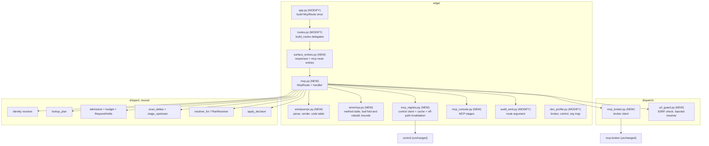
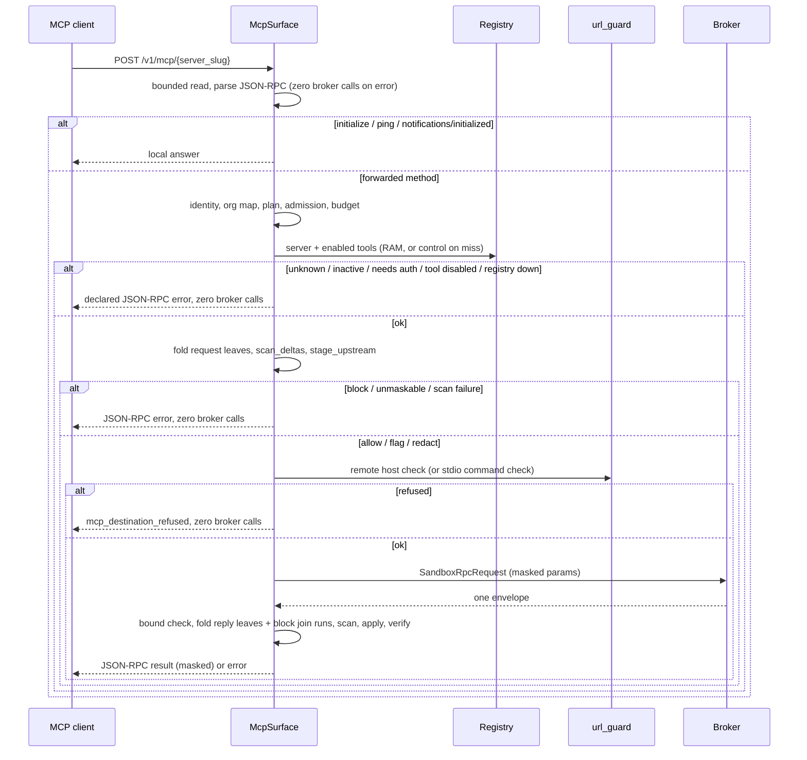

# Design Document

## Overview

GW17 serves MCP JSON-RPC at `POST /v1/mcp/{server_slug}` on the shipped v2 lifecycle. A request is handled in this order:

1. Parse the JSON-RPC message.
2. Resolve identity and the plan, then admission and budget, exactly as chat and embeddings do.
3. Scan the request text with chat's detector and resolver.
4. Forward through the existing broker.
5. Scan the reply.
6. Return a JSON-RPC response.

The sandbox, the host allowlist, the stdio allowlist, and the agent-side SSRF check stay in `services/mcp-broker/` and are not rebuilt. The gateway adds its own SSRF check on top of them.

The approved requirements are `.kiro/specs/mcp-surface-gw17/requirements.md`. Two of them changed because of facts this design found, and one refusal was added. The operator accepted all three on 2026-10-27, and the requirements file now carries them as Requirements 2.6, 5.4, and 7.6.

### What is already true in the code

| Fact | Where | Consequence for the design |
| --- | --- | --- |
| The broker API is one call: `POST /v1/sandbox/{org}/rpc`, with header `X-MCP-Broker-Key` and optional `X-Request-ID` | `services/mcp-broker/src/sandbox/routes.py:328-441`, `auth.py:17-23` | The v2 broker client posts the same `SandboxRpcRequest` v1 posts |
| The broker returns one JSON-RPC envelope per call, plus `_meta` | `sandbox-image/agent/upstream_manager.py:327-346` | No SSE or server-initiated request reaches the gateway through this route |
| The broker requires `method` on every RPC | `routes.py:102-124` | A client's reply to a server-initiated request cannot be forwarded |
| The sandbox agent checks the upstream host against `allowed_hosts` and does a DNS SSRF check | `upstream_manager.py:48-133` | v2 sends `allowed_hosts` and adds its own SSRF check before the call |
| The broker accepts org slugs that match `[a-zA-Z0-9_.-]`, 1 to 64 characters | `routes.py:32-45` | The v2 org id is mapped to control's org slug, and that slug is also the Broker_Slug, so v2 and v1 share one sandbox per org |
| `GET /api/mcp-connector/servers/` and `GET /api/mcp-connector/internal/enabled-tools/` accept `X-Gateway-Auth: true`, `X-Gateway-Internal-Key`, `X-Org-Slug` (and `X-Server-Slug`) | control `mcp_connector/views.py:94-100, 1173, 2535`; v1 `mcp_proxy.py:77-92, 731-982` | The registry client sends those headers |
| The server list carries `transport`, `url`, `command`, `args`, `env_vars`, `is_active`, `is_exposed_to_agents`, `auth_type`, `oauth_authorized`. Tokens, passwords, and header values are write-only and never returned | control `mcp_connector/serializers.py:26-73, 99-106` | v2 cannot authenticate to an upstream. A server whose `auth_type` is not `none` is refused with a declared code, never called without credentials |
| `lookup_plan` drops the surface; `resolve()` ignores `Rule.surfaces` | `plan/lookup.py:9-12`, `resolve/conflict.py:31-53` | MCP gets chat's rules (the operator's decision) |
| `scan_deltas` is generic over `(channel, text)` pairs and join runs | `edge/input_enforcement.py:138-181` | MCP reuses it for both directions |
| `stage_upstream` masks a REDACT and byte-verifies it, returning the verified deltas under `text_deltas` | `edge/input_enforcement.py:208-240`, `dispatch/transform.py:82-97` | MCP input redaction reuses it, then writes the verified deltas back into the JSON leaves |
| `apply_decision` applies a decision to one slice at a base offset and fails closed on a partly covered span | `egress/output_guard.py:229-285` | MCP output redaction applies per leaf. A span that straddles two leaves withholds the reply |
| The misc fold check treats any channel path that is not `messages[]` or `choices[]` as misc | `edge/wire/openai_misc.py:360-420` | MCP channels use an `mcp:` path prefix that the misc check excludes |
| `console_schema` accepts any stage name; `chat_console._stage` rejects non-chat names | `audit/console_schema.py:140-150`, `edge/console_projection.py:155-157` | MCP gets its own console builder with its own stage names |
| `emit_chat_audit` writes `route` `chat` | `edge/audit_emit.py:32, 144` | It gains a `route` argument with `chat` as the default |
| `routes.py` is 798 lines | `edge/routes.py` | Route entries are built in a new helper module. `routes.py` must not grow past 800 |
| The dev image has `httpx` (conformance extra). `gateway-v2` resolves `mcp-broker`, which is running | `gateway_v2/Dockerfile:26-28`, compose | The broker and registry clients use lazy `httpx` with an injected client factory, the `dispatch/http_provider.py` pattern |

## Requirement changes (accepted 2026-10-27)

1. **Requirement 2.6, client replies to server-initiated requests.** The requirement says to scan the reply as input and then forward it. It cannot be forwarded: the broker has no channel for it, and every RPC must carry a `method`. Proposed text: a JSON-RPC message with `result` or `error` and no `method` is scanned as input so its findings are audited, then refused with invalid-request (-32600) and zero broker calls.
2. **Requirement 5.4, interleaved notifications and server-initiated requests.** Through the broker the gateway receives one envelope, so it never sees interleaved progress or a server request. Proposed text:
   - Every message in the broker reply is scanned. A reply that is a list is treated as several messages, and a block on any one withholds all of them.
   - A server-initiated request found in a reply (`sampling/createMessage` or elicitation) is scanned and withheld, never relayed.
   - The true SSE interleave stays untestable through the broker and is recorded as such.

One addition follows from the server-list fact above. It is a new declared refusal and does not loosen any requirement:

- A server with `auth_type` other than `none`, or with `oauth_authorized` true, is refused with `mcp_upstream_auth_unsupported`, and no broker call is made. The gateway must not call an authenticated upstream anonymously. That would mean a 401 from the upstream at best, and data from an unintended identity at worst.

## Architecture

Every new `dispatch/` module imports only `runtime` and `domain`. `egress` still does not import `detect`. Domain and runtime changes are additions only.

### Request order

`initialize` and `ping` are answered before identity, the same as v1. They read no tenant state and cost nothing. Every other method passes the full lifecycle before any registry or broker call.

## Components

### 1. `runtime/resources.py` — MCP bounds

New named constants with docstrings, each read through one `ResourceContract` method. No other module holds these numbers:

| Method | v1 source | Default |
| --- | --- | --- |
| `mcp_max_body_bytes()` | `MCP_MAX_BODY_BYTES` | 10 MiB |
| `mcp_max_argument_bytes()` | argument cap | 512 KiB |
| `mcp_max_json_depth()` | depth cap | 200 |
| `mcp_max_argument_nodes()` | argument node cap | 50,000 |
| `mcp_max_result_bytes()` | response cap | 10 MiB |
| `mcp_max_result_nodes()` | result node cap | 1,000,000 |
| `mcp_max_result_blocks()` | content-block cap | 10,000 |
| `mcp_broker_init_timeout_s()`, `mcp_broker_method_timeout_s()` | `MCP_STDIO_INIT_TIMEOUT` / `MCP_STDIO_METHOD_TIMEOUT` | 120 / 60 |
| `mcp_broker_retry_max()`, `mcp_broker_backoff_base_s()`, `mcp_broker_backoff_cap_s()` | `MCP_SANDBOX_RETRY_MAX` and backoff | 5 / 0.5 / 8 |
| `mcp_registry_ttl_s()`, `mcp_registry_timeout_s()` | server config cache and fetch timeout | 120 / 10 |
| `mcp_registry_poll_s()` | new: off-path `scan_ver` poll interval | 2 |

The request body bound is `min(mcp_max_body_bytes(), max_request_bytes())`, so MCP is never looser than chat's pre-check.

### 2. `domain/channels.py` and the fold checks

Four new `TextChannel` entries. Each path starts with `mcp:`:

- `mcp_arguments` (`mcp:params.arguments`)
- `mcp_completion` (`mcp:params.argument.value`)
- `mcp_result` (`mcp:result`)
- `mcp_error` (`mcp:error`)

Tool names, descriptions, and `inputSchema` text all fold into `mcp_result`, because they are part of the `tools/list` result.

`edge/wire/openai_misc.py` adds `mcp:` to the prefixes its misc fold check excludes. `edge/wire/mcp.py` adds its own totality check at import: the channels the MCP fold emits must equal the `mcp:` entries in `TEXT_CHANNELS`. The existing channel tests are updated for the four new entries.

### 3. `edge/wire/jsonrpc.py` — message shape and errors

Pure functions:

- `parse_message(body) -> JsonRpcMessage | JsonRpcError`. Valid JSON, a single object, `jsonrpc == "2.0"`, a string `method` or a `result`/`error` reply, and an `id` that is a string, an integer, or null. A batch list is `-32600`.
- `result(id, value) -> bytes` and `error(id, code, message, data) -> bytes`. Each echoes `id` with its original type.
- `MCP_CODES`: one `MappingProxyType` from value-code to `(jsonrpc_code, http_status)`. The HTTP status is read from `errors._ENVELOPE` for every code already there, so `input_blocked` stays 400, `output_blocked` 403, and `plan_unavailable` 503. The protocol codes are new:

| Value-code | JSON-RPC | HTTP |
| --- | --- | --- |
| `mcp_parse_error` | -32700 | 400 |
| `mcp_invalid_request` | -32600 | 400 |
| `mcp_method_not_found` | -32601 | 200 |
| `mcp_invalid_params` | -32602 | 200 |
| every gateway refusal (block, plan, budget, registry, broker, bounds) | -32000 | from `_ENVELOPE` |

`error.data` is `{"code": <value-code>, "request_id": <id or null>}`. Nothing else goes in it. The message is the declared `error_frame_for` message.

New value-codes are added to `edge/errors.py` `_ENVELOPE` and `edge/wire/sse.py` `ERROR_SHAPES`:

| Code | HTTP | Meaning |
| --- | --- | --- |
| `mcp_server_not_found` | 404 | No active, exposed server with this slug in the caller's org |
| `mcp_tool_disabled` | 403 | Tool disabled or not in a non-empty known set |
| `mcp_upstream_auth_unsupported` | 403 | Upstream needs credentials v2 cannot forward |
| `mcp_destination_refused` | 403 | Gateway SSRF or stdio allowlist refusal |
| `mcp_org_unmapped` | 403 | v2 org has no control slug, or the slug is not a valid Broker_Slug |
| `mcp_registry_unavailable` | 503 | Control unreachable or bad reply |
| `mcp_broker_unavailable` | 503 | Broker unreachable, 503 after retries, 429, timeout |
| `mcp_upstream_error` | 502 | Broker 502, oversize reply, malformed envelope |
| `mcp_request_too_large` | 413 | Body or argument bound |
| `mcp_result_too_large` | 502 | Reply bound |
| `mcp_parse_error`, `mcp_invalid_request`, `mcp_method_not_found`, `mcp_invalid_params` | see above | JSON-RPC protocol errors |

### 4. `edge/wire/mcp.py` — methods, leaf fold, rebuild, bounds

`METHODS` is an immutable table. For each method it records whether the method is answered locally or forwarded, which request fields are scanned, and which reply fields are scanned:

| Method | Handling | Request scan | Reply scan |
| --- | --- | --- | --- |
| `initialize` | local | none | none |
| `ping` | local | none | none |
| `notifications/initialized` | local, HTTP 202, no body | none | none |
| `tools/list` | forward | none | `result` (after the enabled-tools filter) |
| `tools/call` | forward | `params.arguments` | `result`, or `error` |
| `resources/read` | forward | none (the URI is deliberately not scanned) | `result`, or `error` |
| `prompts/get` | forward | `params.arguments` | `result`, or `error` |
| `completion/complete` | forward | `params.argument.value`, `params.context.arguments` | `result`, or `error` |
| anything else | -32601 | n/a | n/a |

The leaf fold:

- `fold(value, channel) -> Fold` walks one JSON value depth-first in a deterministic key order. It records each Text_Leaf as `(path, channel, text)`. Object keys are leaves too, so a secret used as a key is scanned.
- The fold counts nodes and depth as it walks and stops with a bounds error at the first breach. It does not build a partial result.
- `join_runs(fold)` returns the index ranges of adjacent `content[i].text` leaves of one reply. `scan_deltas` scans each range joined with no separator, so a secret split across two blocks is found (LGW17-6). Request folds have no join runs.
- `rebuild(value, fold, texts) -> value` writes masked texts back into a deep copy by path, keys first and then values. The count of texts must equal the count of leaves, or it raises, and the caller then fails closed.

`check_request(params, contract)` and `check_reply(envelope, contract)` apply the byte, depth, node, and block bounds before any scan.

### 5. `dispatch/url_guard.py` — gateway SSRF check

`async check_remote(url, resolver, allow_hosts) -> None | str` returns `None`, or the reason a refusal happened. The rules are ported from v1 `_url_guard.py:59-196`:

- The scheme must be `http`, `https`, `ws`, or `wss`.
- No userinfo is allowed, and no `@` in the authority.
- A literal IP is checked directly. A hostname is resolved through the injected async resolver (default `loop.getaddrinfo`), and every resolved address is checked.
- Loopback, private, link-local (all of `169.254/16`), reserved, multicast, unspecified, IPv4-mapped IPv6, and the metadata addresses `169.254.169.254` and `fd00:ec2::254` are refused.
- A DNS failure is a refusal.

`allow_hosts` is an exact-match set from `RV_MCP_ALLOW_INTERNAL_HOSTS`, a comma list. It is stricter than v1 in two ways:

- An empty or unset value allows nothing. v1's agent flag disabled the check for any non-empty value.
- An allowlisted host still may not resolve to a metadata address. v1's allowlist skipped the metadata check.

`check_stdio(command, args, allowed)` refuses a path-qualified command or one outside `RV_MCP_STDIO_ALLOWED_COMMANDS`. The default is `npx,node,python,python3,uvx,uv`, the v1 and agent default. The package allowlist and pinning stay agent-side.

DNS rebinding is narrowed, not closed. The broker and agent resolve again when they connect. This stays recorded as a gap.

### 6. `dispatch/mcp_broker.py` — broker client

`BrokerClient.call(slug, server, method, params, request_id) -> BrokerReply` builds a `SandboxRpcRequest`:

- **stdio:** `stdio{command, args, env}`.
- **Remote transports:** `upstream{url, allowed_hosts=[host], headers={}, oauth_client_role="forbidden_in_sandbox"}`.
- **Every request:** `timeouts{init_seconds, method_seconds}` from the contract.

It posts with `X-MCP-Broker-Key` and `X-Request-ID`. The client:

- Uses an injected client factory, so tests pass a fake transport. The default is lazy `httpx`. If `httpx` is missing at boot and MCP is configured, boot fails.
- Retries a broker 503 up to `mcp_broker_retry_max()` times, with backoff `min(cap, base * 2**n)` and jitter from an injected `random.Random`.
- Does not retry `tools/call` after any error that could mean the request was sent. Only a connect failure or pool timeout before send is retried.
- Reads the body with `bound_nonstream_body` at `mcp_max_result_bytes()`.

Broker errors map to one value-code each, and no exception text leaves the module:

| Broker result | Value-code |
| --- | --- |
| 401 | `mcp_broker_unavailable` (a broker key mismatch is an operator error, not the client's) |
| 429 | `mcp_broker_unavailable` |
| 502 | `mcp_upstream_error` |
| 503 after retries | `mcp_broker_unavailable` |
| timeout | `mcp_broker_unavailable` |
| oversize reply | `mcp_result_too_large` |
| non-JSON or non-envelope reply | `mcp_upstream_error` |

`_meta` is dropped before the reply is scanned or returned.

### 7. `edge/mcp_registry.py` — server registry

`McpRegistry.server(control_slug, server_slug) -> ServerEntry | str` and `tools(control_slug, server_slug) -> ToolSet | str`:

- `ServerEntry` is frozen: transport, url, command, args, env_vars, active, exposed, `needs_auth` (`auth_type != "none" or oauth_authorized`).
- `ToolSet` is frozen: known, enabled, disabled.

Caching:

- An in-RAM per-org cache with TTL `mcp_registry_ttl_s()`. A miss fetches from control on the request path with timeout `mcp_registry_timeout_s()`.
- Any control error returns `mcp_registry_unavailable`. Nothing is cached on error, and an error is never treated as an empty registry.
- **Off the request path:** a lifespan task polls `mcp:scan_ver:{org}` and `mcp:scan_ver:{org}:{server}` for cached orgs every `mcp_registry_poll_s()` and drops entries whose version changed. The request path does no Redis read for the registry. Chat's one shared-state round trip (the plan) is unchanged for chat. MCP keeps the plan read plus a RAM read. On a cold cache it adds control HTTP calls, which is the cost of choosing control as the source.

Headers sent to control: `X-Gateway-Auth: true`, `X-Gateway-Internal-Key`, `X-Org-Slug: <control slug>`, and `X-Server-Slug` for enabled-tools.

### 8. Org map

`OrgMap` is parsed from `RV_MCP_ORG_MAP` (`v2org=controlslug,...`), or `AMF_DEV_MCP_ORG_MAP` in the dev profile. It maps the identity org id to control's org slug. That slug is also the Broker_Slug. A missing entry, or a slug that fails the broker's pattern, refuses with `mcp_org_unmapped` before any registry or broker call. This is the same mapping control already applies to audit (`AMF_V2_AUDIT_ORG_MAP=dev-org=zeroshield`), now applied on the gateway side.

### 9. `edge/mcp.py` — `McpRoute` and the handler

`McpRoute` is frozen and holds the injected dependencies. It is built once in `app.py`:

- **Shared with chat:** contract, identity, snapshot_source, admission, quota, input_detector, output_detector (falling back to error_scanner), resolver, phase_resolvers, transform, clock, audit.
- **MCP-only:** registry, broker, org_map, url resolver, allow_hosts, stdio allowlist.

The request path:

1. `read_body_bounded`, a new helper in `edge/asgi_sse.py`, reads at most `min(mcp_max_body_bytes(), max_request_bytes())` and stops reading past the bound. Chat's `read_body` is unchanged.
2. Path to `server_slug`. An empty slug, or one containing `/`, is `mcp_server_not_found`. Bare `POST /v1/mcp` is an exact route that returns `mcp_server_not_found` with `id` null.
3. `parse_message`. Local methods are answered here.
4. A `result` or `error` message with no `method` is folded, scanned as input, audited, and refused with `-32600`. This follows requirement change 1.
5. Identity, then `OrgMap`, then `lookup_plan(..., Surface.MCP)`, then the request id `zs-{org}-{hash}`, then admission, then budget. The cost is `estimate_request_tokens(scanned request chars, 0, 1)`. `RequestHolds` records each step and is released once in `finally`.
6. Registry: server active and exposed, `needs_auth` false. For `tools/call`, the tool must be enabled and in the known set when that set is not empty.
7. Request fold and bounds. `scan_deltas` with `resolver_for(self, plan, Phase.INPUT)`. A block is `input_blocked`. Then `stage_upstream(decision, GatewayRequest(destination="mcp", model=server_slug, text_deltas=pairs), transform)`. A string result refuses. On success the verified `text_deltas` are written back with `rebuild`.
8. `url_guard`, then `holds.mark_dispatched()`, then `BrokerClient.call`.
9. Reply bounds. Fold every message in the reply: one envelope, or each item of a list. Scan with `resolver_for(self, plan, Phase.OUTPUT)` and the block join runs.
   - A block, or any server-initiated request in the reply, withholds the reply with `output_blocked`.
   - A redact is applied per leaf with `apply_decision` at the leaf's base offset, then the redacted leaves are scanned again with the same detector. A remaining finding withholds the reply with `scan_failure`. An `apply_decision` error, including a span that straddles two leaves, also withholds with `scan_failure`.
10. For `tools/list`, drop tools the registry marks disabled before the scan, so their text is neither scanned nor returned.
11. Render the JSON-RPC result, with the Console_Object as a top-level `zeroshield` / `pipeline_trace` sibling of `result`. Emit audit with route `mcp`.

The handler is split so each method stays at or under 120 lines: lifecycle, registry gate, request scan, forward, reply scan, render. `edge/mcp.py` must stay at or under 800 lines. If it would not, the reply scan moves to `edge/mcp_reply.py`.

### 10. `edge/mcp_console.py` — console stages

Stages: `auth`, `rate_limit`, `input_scan`, `tool_call`, `output_guardrail`. Each carries `ran` and `action` exactly as the request went:

- An input block has `tool_call` and `output_guardrail` set to `ran: false` / `skip`.
- A broker failure has `tool_call` set to `ran: true` and `output_guardrail` set to `skip`.
- An output block has `output_guardrail` set to `block` with the deciding rule.

The object is validated with `validate_console`. No chat stage name is used and no stage is filled in.

The frontend Stage Timeline renders whatever stage names it receives. It still falls back to its nine-stage template for traces with fewer than six stages. The MCP console page belongs to UI08, so this card does not change the frontend. The five-stage fallback is recorded.

### 11. Audit

`emit_chat_audit(emit, holds, refuse_code, route="chat")`. MCP passes `route="mcp"` and adds `server_slug` and `tool` to the record detail. `Finding.evidence`, argument values, and result values are never written.

### 12. Registration

`edge/surface_entries.py` builds the exact and prefix entries for responses and MCP. `build_routes(chat, misc, response_store=None, mcp=None)` calls it through a local import, the same pattern responses uses. The entries:

- `("POST", "/v1/mcp")` → bare-route handler (`mcp_server_not_found`)
- prefix `("POST", "/v1/mcp/")` → `McpRoute.handle`

When `mcp` is `None`, the MCP routes are the existing 501 placeholders, so a boot with no MCP configuration still answers honestly. `/v1/rag/query` and `/v1/vector/query` stay 501. `routes.py` stays at or under 800 lines because the MCP and responses lines move into the helper.

The GW14b admin-ledger row for `/v1/mcp` changes from `retire` to `build` with owner GW17. The other MCP rows (ext-proxy, health, internal, OAuth, record-event) stay `retire`.

### 13. Boot and dev profile

`app.build_app(..., mcp=None)` takes an `McpRoute` factory input. The dev profile builds one when all of these are set:

- `AMF_DEV_MCP_BROKER_URL`
- `AMF_DEV_MCP_BROKER_KEY`
- `AMF_DEV_CONTROL_URL`
- `AMF_DEV_GATEWAY_INTERNAL_KEY`
- `AMF_DEV_MCP_ORG_MAP`

The boot log names each one with its secret redacted. If any of them is missing, the log says MCP stays 501. The compose `gateway-v2` service gets those variables pointing at `mcp-broker:8311` and `control:8100`, with the existing dev keys. Your saved firewall plan key is not touched.

## Deliberate differences from v1

| Topic | v1 | v2 |
| --- | --- | --- |
| Detection default | off unless scan controls or flags are set | the plan's rules, the same as chat |
| Tier-2 enablement | two flags | none; the plan decides |
| Unmaskable redact | never escalates to block | withholds (`input_unmaskable`, or `scan_failure` on output) |
| Scanner failure | Tier-2 can fail open | fails closed |
| Registry failure | enabled-tools fails open | `mcp_registry_unavailable` |
| Authenticated upstream | forwards a gateway OAuth or control token | refused, `mcp_upstream_auth_unsupported` |
| Gateway SSRF on the sandbox path | none | `url_guard` before every remote call |
| Allow-internal override | any non-empty agent flag disables the check; the gateway allowlist skips the metadata check | exact hosts only; metadata always refused |
| Split secret across blocks | block posture withholds, others mask every block | detected through join runs; redact applies per leaf; a straddling span withholds |
| Org | from the URL, checked against the key | from the key only |
| Routes | org route + REST + ext-proxy + internal + OAuth | `POST /v1/mcp/{server_slug}` only |

## Local proof

New test modules: `tests/edge/test_mcp_jsonrpc.py`, `test_mcp_wire.py`, `test_mcp_route.py`, `test_mcp_registry.py`, `tests/dispatch/test_mcp_broker.py`, and `test_url_guard.py`. They use a fake broker transport, a fake control transport, and a fake resolver. Property tests use a seeded `random.Random` for at least 10,000 iterations:

- Fold and rebuild round-trip with every text replaced.
- No text leaf escapes the fold.
- The bounds stop at the first breach.

Cells, one per requirement item:

- **Protocol:** every JSON-RPC error class; local `initialize`, `ping`, and `notifications/initialized` with zero broker calls.
- **Input:** input block, zero broker calls; input redact, raw bytes absent from the captured broker body.
- **Output:** output block; output redact; a straddling span withholds.
- **LGW17-1:** chat and MCP give the same disposition on the same fixture under the same plan.
- **LGW17-2:** enabling one rule takes effect with no second flag.
- **LGW17-3:** the gateway refuses loopback, `127.0.0.1` by name, link-local, metadata, private, and DNS failure, each with zero broker calls.
- **LGW17-4, local half:** two orgs run concurrently through the fake broker with no slug, result, or audit crossover.
- **LGW17-5:** a poisoned tool description is scanned and decided.
- **LGW17-6:** a secret split across two content blocks is detected.
- **Registry:** down, unknown server, inactive server, needs-auth server, disabled tool — each refused with zero broker calls.
- **Broker:** 503 is retried; `tools/call` is not retried after send; 502, timeout, and oversize replies are refused.
- **Console and audit:** the console validates against the schema, and audit records carry route `mcp`.

These existing tests are updated in the same change:

- `test_lgw12_app.py`, `test_gw16_routes.py`, `test_gw16_matcher_edges.py`, `test_gw16_app.py`, `test_lgw15_app.py`, and `test_responses_route.py`: `/v1/mcp` is no longer 501. RAG and vector keep their 501 assertions.
- The channel and fold tests: the four new channels.
- `tests/lint/test_admin_ledger.py`: the `/v1/mcp` row is now `build`.

**Live check.** If you agree, it runs against the dev broker and an MCP server registered in control for the mapped org. It is recorded as local evidence and is not reported as LGW17-4 at fleet scale. If no upstream is registered, it is skipped and recorded as not run. No server is registered for it without your say-so.

## Risks

- **`routes.py` is 798 lines.** The entries move to `surface_entries.py`. If even the signature change pushes it past 800, `build_routes` moves there too, and `routes.py` re-exports it.
- **Deep-copy cost on large results.** The reply cap is 10 MiB. The fold and rebuild are linear and bounded by the node cap. Detection runs on the event loop, the same known v2 limitation chat has.
- **Control as the registry source adds a request-path HTTP call on a cold cache.** The poller keeps that call rare. It is still a dependency chat does not have, and when control is down, MCP fails closed.
- **One shared sandbox per org between v1 and v2.** Both use control's org slug, so v1 and v2 traffic for one org lands in the same container. That matches the isolation boundary (per org, not per gateway), and it is recorded.
- **Five-stage console.** The frontend falls back to its nine-stage template for traces under six stages. The MCP page belongs to UI08, so this card leaves it and records it.

## Requirements coverage

| Requirement | Design section |
| --- | --- |
| 1 Route, org from key | Components 9, 12 |
| 2 JSON-RPC and protocol methods | Components 3, 4, 9; requirement change 1 |
| 3 Lifecycle before broker | Components 1, 8, 9 |
| 4 Request scan | Components 2, 4, 9 |
| 5 Reply scan | Components 4, 9; requirement change 2 |
| 6 Broker only | Components 5, 6 |
| 7 Registry | Component 7 |
| 8 Error vocabulary | Component 3 |
| 9 Bounds | Components 1, 4 |
| 10 Audit and console | Components 10, 11 |
| 11 Local proof | Local proof |

## Out of scope

- The bare REST, ext-proxy, OAuth, and internal routes. Their ledger rows stay `retire`.
- Forwarding upstream credentials, and therefore authenticated MCP servers.
- Per-key tool allowlist and call cap.
- Surface filtering of plan rules.
- Any change to control, the broker, the sandbox agent, v1, or the frontend.
- LGW17-7 and fleet-scale LGW17-4.
