# Design Document — GW14d Observability Contract v3

## Overview

GW14d unifies the six already-shipped, label-free metric **producers** in `gateway_v2` behind one
**Publisher** that implements the `MetricsRegistry.exposition()` contract the raw-ASGI `/metrics`
endpoint in `edge/app.py` already consumes but that nothing provides yet. It closes R2-10 (CRITICAL:
request-path metric registration that could raise an HTTP 500) and R2-11 (HIGH: a server-side view
that could not certify the SLO — untyped exposition, negative rates on reset, merged 503 causes,
uncounted postures, FAIL_CLOSED counted as a policy BLOCK, invisible audit loss).

The producers are not rebuilt. Each already emits a fixed, label-free series set with the
real-zeros-never-absence discipline, and each already states its cardinality as a fixed
`SERIES_COUNT` expression (R2-10). The Publisher READS them, merges them, types every family with a
`# TYPE` line, renders native Prometheus histogram buckets, and owns the three mechanisms that do not
belong in any single producer: the bounded per-tenant **Cardinality_Directory** (R2-10 core), the
**Windowed_Histogram** that measures the C4 add-on latency the client synthetic uses (R2-11), and the
reason/posture counter families + rate-limited event log that keep each 503 cause and each
fail-closed posture distinct (R2-11 M2).

### What is already shipped (verified against the repo)

The six producers and their shapes, read directly from source:

| Producer | Module | Reading shape | Prefix(es) | `SERIES_COUNT` today |
|---|---|---|---|---|
| `AdmissionMetrics` | `gateway_v2/admit/metrics.py` | `snapshot() -> AdmissionReading` (QueueReport + `oldest_age_s_hist: Histogram` + scalars + `shed_total` map by `ShedReason`) | `amf_admit` | **not yet defined** (add) |
| `QuotaMetrics` | `gateway_v2/admit/metrics.py` | `snapshot() -> QuotaReading` (3 scalars) | `amf_quota` | **not yet defined** (add) |
| `AuditMetrics` | `gateway_v2/audit/metrics.py` | `series() -> dict[str,float]` (flat; `# TYPE` already via `render`) | `amf_audit`, `amf_store` | `8+6+8+7 = 29` |
| `RehydrationMetrics` | `gateway_v2/state_control/metrics.py` (OUTSIDE `root_packages`) | `series() -> dict[str,float]` (label tags baked into key) | `amf_rehydration`, `amf_state_*`, `amf_rehydrator_*` | `13 + 4·len(StateKind) + len(FAULT_CATEGORIES) + len(ALL_REASONS)` |
| `StateMetrics` | `gateway_v2/runtime/state_metrics.py` | `series() -> dict[str,float]` (label tags baked into key; `ABSENT=-1.0` sentinel gauges) | `amf_state` | `9·len(StateKind) + 6 + 3 + 6 + 8` |
| `PerRequestExports` | `gateway_v2/runtime/stream_metrics.py` | `snapshot() -> PerRequestReading` (2 `Histogram` + scalars) | `amf_stream` | **not yet defined** (add) |
| `HoldbackMetrics` | `gateway_v2/runtime/holdback_metrics.py` | `snapshot() -> HoldbackReading` (3 `Histogram` + scalars) + the reusable integer `Histogram` dataclass | `amf_holdback` | **not yet defined** (add) |

**Two reading shapes, and the merge must handle both.** `audit` / `state_control` / `state_metrics`
expose `series() -> dict[str, float]` — already flat, with any label tags (`{kind="plan"}`) baked
into the key string. `admit` / `stream` / `holdback` expose `snapshot() -> <Reading>` carrying
`Histogram` objects that must be rendered into Prometheus histogram families (`_bucket`/`_sum`/`_count`).
The design uses a **thin, explicit adapter per producer** — never a reflection layer — so each
producer's shape is handled in named code a reviewer can read.

### Scope boundaries (from requirements, restated so the design respects them)

- `rc3-obs-v1` is a SPEC REFERENCE only; the repo has no Prometheus client library. The renderer and
  parser are reimplemented in the gateway_v2 idiom.
- The windowed-busy gauge **mechanism** is in scope; a GPU data source is OUT. The Windowed_Histogram
  is built generically and accepts externally supplied samples, so GW20b/GW25 can feed GPU samples
  later. No GPU producer is fabricated.
- "Metrics shared memory" is modelled as the Cardinality_Directory being initialized and available —
  not a new mmap segment. `gateway_v2` is single-process-per-worker with in-memory producers.
- Local-only. Verification is offline `pytest`, `mypy --strict`, `ruff`, `import-linter` (both
  contracts), and the five AST gates. L14d-1..5 are certified by injected-clock equivalents.

## Architecture

### Layer placement — the Publisher lives in `edge`, and why

The Publisher must read producers in four packages: `admit` (`AdmissionMetrics`, `QuotaMetrics`),
`audit` (`AuditMetrics`), `runtime` (`StateMetrics`, `PerRequestExports`, `HoldbackMetrics`), and
`state_control` (`RehydrationMetrics`). The import-linter layers contract (verified in
`gateway_v2/pyproject.toml`) is, top→bottom:

```
edge > admit > plan > detect > resolve > dispatch > egress > audit > runtime > contracts > domain
```

A layer may import only layers **below** it. `admit` sits second from the top; the only layer above
`admit` is `edge`. `state_control` sits OUTSIDE `root_packages = ["gateway_v2"]`, so import-linter
does not govern imports of it at all — exactly as `state_control.metrics` already imports
`gateway_v2.domain.state` across that boundary, and exactly how `edge/app.py` already deployment-wires
things the contract does not model.

**Decision: the Publisher lives in `edge` (new module `gateway_v2/edge/publisher.py`).** Justification:

1. `edge` is the ONLY layer that sits above `admit`, so it is the only in-contract layer that can
   legally import `admit.metrics`. A new top layer would also satisfy the ordering, but it would
   duplicate `edge`'s role for no benefit.
2. `edge` already owns `/metrics` and `/readyz` and already **defines** the `MetricsRegistry`
   Protocol and the `ReadinessProbe` seam. The Publisher IS the implementation of that Protocol; it
   belongs with the contract it satisfies.
3. Reading `state_control` (outside `root_packages`) is a deployment-wiring/exposition concern, which
   is already `edge`'s job — `build_app` is where the gateway is assembled from parts the layer
   contract does not model. Putting the cross-boundary read in `edge` keeps the single boundary
   crossing in the one place that is allowed to make it.
4. The capacity authority stays in `runtime/resources.py`; `edge` holds no capacity literal (the
   Cardinality_Directory capacity, window length and event-log rate all derive from an injected
   `ResourceContract`). This keeps the capacity-literals AST gate green and the Publisher a pure
   consumer of derived bounds.

A rejected alternative — a NEW dedicated top layer `gateway_v2.observe` above `edge` — would force
`edge/app.py` (which constructs the Publisher) to import a layer above it, inverting the contract. It
is rejected.

### Component diagram

```mermaid
flowchart TB
    subgraph edge["edge layer (gateway_v2.edge)"]
        APP["app.py build_app()\nASGI skin"]
        PUB["publisher.py\nPublisher (implements MetricsRegistry)"]
        REND["render.py\nPrometheusRenderer + parser"]
        CARD["cardinality.py\nCardinalityDirectory (Top-K + other + Overflow_Counter)"]
        WIN["windowed.py\nWindowedHistogram (C4 add-on, injected clock)"]
        RATE["rates.py\nResetSafeRate"]
        REASONS["counters.py\nRejectionCounters + PostureCounters"]
        LOG["event_log.py\nStructured_Event_Log (rate-limited)"]
        PROBE["readiness.py\nMetricsReadinessProbe (extends state_ready)"]
    end

    subgraph producers["Shipped producers (NOT rebuilt)"]
        ADM["admit.metrics\nAdmissionMetrics / QuotaMetrics\nsnapshot()"]
        AUD["audit.metrics\nAuditMetrics\nseries()"]
        STM["runtime.state_metrics\nStateMetrics\nseries()"]
        STR["runtime.stream_metrics\nPerRequestExports\nsnapshot()"]
        HLD["runtime.holdback_metrics\nHoldbackMetrics + Histogram\nsnapshot()"]
    end

    subgraph outside["Outside root_packages"]
        REH["state_control.metrics\nRehydrationMetrics\nseries()"]
    end

    RC["runtime.resources\nResourceContract\n(only capacity literals)"]

    APP -->|"GET /metrics → to_thread"| PUB
    APP -->|"GET /readyz"| PROBE
    PUB --> REND
    PUB --> CARD
    PUB --> WIN
    PUB --> RATE
    PUB --> REASONS
    PUB --> LOG
    PUB -->|reads snapshot/series| ADM
    PUB -->|reads series| AUD
    PUB -->|reads series| STM
    PUB -->|reads snapshot| STR
    PUB -->|reads snapshot| HLD
    PUB -->|reads series across boundary| REH
    PROBE -->|composes| CARD
    PROBE -->|gates first| SR["runtime.state_stamp.state_ready(view)"]
    RC -->|metrics_directory_slots / window_s / event_log_rate| CARD
    RC --> WIN
    RC --> LOG
```



### Request paths

- **`/metrics` (scrape path, off the serving loop).** `edge/app.py` already offloads
  `metrics_registry.exposition()` via `asyncio.to_thread` (R1.8 / C38 R13.2 — verified in `_metrics`).
  `Publisher.exposition()` reads each producer, renders one typed body, and returns it. A producer
  that raises is omitted; the body is still returned (R1.3).
- **Request-path observation (serving path, must never raise).** When the serving code attributes a
  per-tenant magnitude or records a C4 add-on latency, it calls `Publisher.observe_tenant(...)` /
  `Publisher.observe_addon_latency_ms(...)`. These wrap every internal failure to the Overflow_Counter
  and return control without raising (R2). They are O(1) and touch no collection proportional to the
  tenant count (R15.4 / tenant-scale gate).
- **`/readyz` (readiness path).** `edge/app.py`'s existing `ReadinessProbe` seam is wired to the new
  `MetricsReadinessProbe`, which composes `state_ready(view)` AND Cardinality_Directory availability,
  gating state first (R10).

## Components and Interfaces

### 1. Publisher (`gateway_v2/edge/publisher.py`, NEW)

A slotted class implementing the `edge.app.MetricsRegistry` Protocol. Holds injected references to the
six producers, the `PrometheusRenderer`, the `CardinalityDirectory`, the `WindowedHistogram`, the
`ResetSafeRate` book-keeper, the `RejectionCounters`, the `PostureCounters`, the
`Structured_Event_Log`, and the `ResourceContract`.

```python
class Publisher:  # implements MetricsRegistry
    SERIES_COUNT: int  # fixed expression (see §SERIES_COUNT composition)

    def __init__(self, *, admission, quota, audit, rehydration, state, stream, holdback,
                 contract, clock) -> None: ...

    # --- exposition (scrape path, off the serving loop) ---
    def exposition(self) -> str: ...                       # R1.1 — the MetricsRegistry method

    # --- request path (serving path, NEVER raises) ---
    def observe_tenant(self, tenant_key: str, magnitude: int) -> None: ...   # R2, R3, R12
    def observe_addon_latency_ms(self, ms: int) -> None: ...                 # R4.1
    def observe_rejection(self, status: int, reason: str) -> None: ...       # R6
    def observe_posture(self, code: str) -> None: ...                        # R7
    def observe_windowed_busy(self, sample: float) -> None: ...              # R11.3

    # --- readiness ---
    def directory_available(self) -> tuple[bool, str | None]: ...            # R10.1
```

`exposition()` is a six-step merge, one explicit adapter per producer:

1. **Flat producers** (`audit`, `state_control`, `state_metrics`): call `series()`, hand each
   `(name, value)` to the renderer. The renderer types each by the suffix rule and de-dups family
   names (R1.4, R1.5, R1.7, R11.1). `ABSENT=-1.0` sentinel gauges pass through untouched (they are
   not rates — R5.5).
2. **Reading producers** (`admit`, `stream`, `holdback`): call `snapshot()`, read scalars into
   `(name, value)` pairs, and feed each `Histogram` to the renderer's histogram-bucketing helper
   (R1.6, R8).
3. **Reset-safe rates**: for each counter the Publisher derives a rate from, consult `ResetSafeRate`;
   emit a non-negative rate or OMIT (R5).
4. **Bounded tenant families**: render the Top-K individual series + the `other` series + the
   Overflow_Counter from the Cardinality_Directory (R3, R2.5).
5. **Reason/posture/windowed-busy families**: render `rejected{status,reason}`, each Posture_Code
   counter, and the windowed-busy gauge — each a real zero from first exposition (R6.4, R7.5, R11.3/4).
6. **Count assertion**: assert the number of rendered families equals `SERIES_COUNT` (R15.2); the
   per-tenant+`other` count never exceeds K+1 (R3.8).

Per-producer failure isolation (R1.3): each adapter runs inside a guarded block; a raising producer's
families are omitted and the remaining producers' output is still returned. The guard records the
failure to a `publisher_producer_read_failures_total` counter so a silently-omitted producer is itself
observable (never a silent drop).

### 2. PrometheusRenderer (`gateway_v2/edge/render.py`, NEW)

ONE renderer plus a matching parser. The renderer is the single place a `# TYPE` line is produced.

```python
def metric_type(name: str) -> str:                 # "_total" ⇒ counter else gauge (reuses audit rule)
def render_scalar(name: str, value: float) -> list[str]      # # TYPE + one series line
def render_histogram(base: str, hist: Histogram, bounds: tuple[int, ...]) -> list[str]
def render_families(families: Iterable[Family]) -> str       # de-dup, stable order, one # TYPE/family
def parse(text: str) -> list[ParsedFamily]                   # for the round-trip property (Property 8)
```

- `metric_type` is the exact suffix rule shipped in `audit/metrics.py` (`_total` ⇒ counter, else
  gauge). Histograms are typed `histogram` explicitly (R1.5, R11.1).
- `render_histogram` turns the shipped lifetime `Histogram` (its `samples` list and `total`) into
  native Prometheus buckets: for each finite boundary `b`, `base_bucket{le="b"}` = count of samples
  ≤ b (cumulative); a terminal `base_bucket{le="+Inf"}` equal to `base_count`; `base_sum` = sum of
  samples; `base_count` = len(samples) (R1.6, R8.2). Bucket boundaries are explicit and finite with
  the single `+Inf` terminal (R4.4 for the windowed histogram; the lifetime histograms get a
  documented boundary set derived from their domain, e.g. token counts, ms).
- `render_families` de-dups by family base name so no family emits two `# TYPE` lines (R1.7), and
  renders in a deterministic (sorted) order so the output is byte-stable.
- `parse` reads the rendered text back into `(family, type, samples/value)` tuples for the round-trip
  property; re-rendering a parse result is byte-identical (Property 8).

### 3. CardinalityDirectory (`gateway_v2/edge/cardinality.py`, NEW) — the R2-10 core

A bounded in-memory directory of per-tenant magnitude slots. Capacity derives from
`ResourceContract.metrics_directory_slots()`. `observe()` NEVER raises.

```python
@dataclass(slots=True)
class CardinalityDirectory:
    _capacity: int                      # = contract.metrics_directory_slots()
    _k: int                             # = contract.metrics_top_k()  (≤ capacity)
    _slots: dict[str, int]              # tenant_key -> magnitude, len ≤ capacity
    _overflow_total: int                # Overflow_Counter, real zero from construction
    _available: bool                    # initialized/available flag for /readyz

    def observe(self, tenant_key: str, magnitude: int) -> None: ...   # NEVER raises (R2.1/2.2)
    def top_k_series(self) -> list[tuple[str, int]]: ...              # K highest, tie-broken (R3)
    def other_value(self) -> int: ...                                 # sum of non-top-K (R3.5)
    def overflow_total(self) -> int: ...                              # exported counter (R2.5)
    def available(self) -> bool: ...                                  # R10.1
```

- `observe()` wraps its whole body in a guard: any internal failure (allocation, type, unexpected)
  routes the observation to the Overflow_Counter and returns (R2.2). This is the never-raise contract.
- **Size-check-before-insert** (R2.6): if the key is absent AND `len(_slots) == _capacity`, route to
  overflow (increment by exactly one, modify no slot — R2.3, R2.4) and return. The decision is reached
  before any insert.
- An existing key updates its magnitude in place (no new slot, never overflows).
- `top_k_series()` selects the K highest magnitudes with a **deterministic tie-break**: order by
  `(magnitude desc, tenant_key asc)`, so repeated exposition of the same input set yields the same K
  (R3.6). The remaining slots sum into `other` (R3.5). Conservation holds: Σ(top-K) + other =
  Σ(all observed slots) (Property 3).
- `other` is emitted as an explicit zero from the first exposition (R3.7); the Overflow_Counter is a
  single process-local `_total` series present with value zero before the first overflow (R2.5).
- The directory never attaches a tenant-derived label to any *producer* series — top-K individual
  series are the ONE place per-tenant visibility is restored, and they are bounded at K+1 (R3.2, R3.8).
  The series count K+1 is invariant to the observed tenant count (R15.3, tenant-scale gate R15.4).

### 4. WindowedHistogram (`gateway_v2/edge/windowed.py`, NEW)

A rolling-window integer histogram, distinct from the shipped lifetime `Histogram`. Window length from
`ResourceContract.metrics_window_s()`; an injected clock drives window boundaries.

```python
@dataclass(slots=True)
class WindowedHistogram:
    _window_s: float                    # = contract.metrics_window_s()
    _clock: Callable[[], float]
    _samples: deque[tuple[float, int]]  # (observed_at, ms), pruned to window on read
    _bounds: tuple[int, ...]            # explicit finite ms boundaries, 0..≥1000 + terminal

    def observe(self, ms: int) -> None: ...                 # record a C4 add-on sample (R4.1)
    def prune(self, now: float | None = None) -> None: ...  # discard out-of-window (R4.6)
    def p50(self) -> float: ...                             # in-window only (R4.3)
    def p99(self) -> float: ...                             # in-window only (R4.3)
    def buckets(self) -> list[tuple[str, int]]: ...         # native Prometheus (R4.4)
    EMPTY_WINDOW: float                                     # defined empty-window value (R4.7)
```

- Records the C4_Definition add-on (gateway-attributable) latency per completed request (R4.1). The
  server-side quantity is exactly what the client synthetic compares against (R4.5 / L14d-1).
- Quantiles are computed from **in-window samples only**: `prune()` discards samples older than
  `now - _window_s` before any quantile is reported (R4.3, R4.6). Out-of-window samples never
  influence the reported quantile (Property 4).
- Empty window reports `EMPTY_WINDOW` (a defined non-negative indication, e.g. `0.0` typed as the
  documented empty signal), never a stale/lifetime/negative value (R4.7, R13.4).
- `buckets()` emits explicit finite ms boundaries spanning 0..≥1000ms plus a single terminal overflow
  bucket; no infinite boundary other than that terminal (R4.4). Native `_bucket`/`_sum`/`_count` via
  the renderer.
- The windowed-busy gauge for the autoscaler (R11.3/R11.4) reuses this mechanism: it accepts
  externally supplied samples (`Publisher.observe_windowed_busy`) and exposes a `# TYPE gauge` family
  even when no sample has been supplied — no GPU source fabricated, no synthesized value.

### 5. ResetSafeRate (`gateway_v2/edge/rates.py`, NEW)

Given a per-counter `(prev_baseline, current)`, emit a non-negative rate or omit.

```python
@dataclass(slots=True)
class ResetSafeRate:
    _baselines: dict[str, int]          # counter name -> last baseline

    def rate_or_omit(self, name: str, current: int, interval_s: float) -> float | None: ...
```

- No prior baseline for `name` ⇒ adopt `current` as baseline, return `None` (omit) — never zero
  (R5.1, R13.3).
- `current < baseline` ⇒ classify as reset: adopt `current` as the new baseline, return `None` (omit)
  for this interval; the next non-decreasing interval publishes a non-negative rate (R5.2, R5.3, R13.2).
- Otherwise return `(current - baseline) / interval_s ≥ 0` and advance the baseline (R5.4).
- Applied to counter-derived rate series ONLY. `ABSENT=-1.0` sentinel gauges from `state_metrics` /
  `state_control` are NOT rates: they are emitted with their reserved value unchanged (R5.5).

### 6. RejectionCounters + PostureCounters (`gateway_v2/edge/counters.py`, NEW)

Fixed-vocabulary counter sets. `rejected` is keyed by the `audit.record` Admission_Reason vocabulary;
posture counters are keyed by `domain.posture` codes. Each distinct from Policy_BLOCK.

```python
REASON_VOCAB: tuple[str, ...] = (record.SHED, record.REJECTED)  # closed set from audit.record
POSTURE_CODES: tuple[str, ...] = (
    posture.KILL_SWITCH_UNAVAILABLE, posture.SHARED_STATE_UNAVAILABLE, posture.PLAN_UNAVAILABLE,
    posture.BUDGET_UNAVAILABLE, posture.OVERLOAD_SHED,
    posture.STREAM_KILLED, posture.STREAM_INTER_CHUNK_TIMEOUT, posture.STREAM_IDLE_TIMEOUT,
    posture.STREAM_WRITE_TIMEOUT, posture.STREAM_MAX_DURATION, posture.STREAM_KEY_REVOKED,
    posture.STREAM_PLAN_CHANGED, posture.STREAM_SNAPSHOT_STALE, posture.STREAM_MALFORMED_UPSTREAM,
    posture.STREAM_BUFFER_UNAVAILABLE,
)

class RejectionCounters:
    def observe(self, status: int, reason: str) -> None: ...   # R6.1/6.2; out-of-vocab ⇒ error (R6.5)
    def series(self) -> dict[str, float]: ...                  # rejected{status,reason}, real zeros (R6.4)

class PostureCounters:
    def observe(self, code: str) -> None: ...                  # R7.2; unknown code ⇒ coverage-gap error
    def series(self) -> dict[str, float]: ...                  # one per code, real zeros (R7.5)
```

- `rejected{status,reason}` carries exactly two labels; `reason` is drawn solely from the closed
  Admission_Reason set — never from tenant/org/request input (R6.1, R6.3).
- Distinct reasons increment distinct series; never merged into `rejected_503` (R6.2).
- First exposition emits one series per reason bucket and one per Posture_Code, each exactly 0 (R6.4,
  R7.5, Property 7).
- An out-of-vocabulary `reason` does NOT fall back to a merged/default series: the per-reason counters
  are preserved and the Publisher surfaces an error indication (a `publisher_vocab_error_total` counter
  increment + the Structured_Event_Log coverage-gap line) (R6.5, R14.3).
- Posture counters are named with the exact single-spelled code string from `domain.posture`; no
  alternative spelling (R7.4). A posture refusal increments only its own posture counter and leaves
  every Policy_BLOCK series unchanged (R7.3, R7.6, Property 6). The posture/reason counters are a
  series distinct from, never conflated with, Policy_BLOCK (R14.2).

### 7. Structured_Event_Log (`gateway_v2/edge/event_log.py`, NEW)

A per-error-class rate-limited log emitter. The rate bound derives from
`ResourceContract.event_log_rate()`.

```python
@dataclass(slots=True)
class StructuredEventLog:
    _max_per_window: int                # = contract.event_log_rate()
    _window_s: float
    _clock: Callable[[], float]
    _emitted: dict[str, deque[float]]   # error class -> emission timestamps in window
    _counters: RejectionCounters | PostureCounters  # one counter per class

    def record(self, error_class: str, reason_or_posture: str) -> None: ...   # R9.2/9.3/9.4
```

- One counter series per client error class, in one-to-one correspondence with the classes (R9.1,
  R14.1). The classes ARE the Admission_Reason vocabulary ∪ the Posture_Codes.
- Under the rate limit for the current window ⇒ emit exactly one structured line (R9.2 / L14d-5).
- At the rate limit ⇒ increment the class counter and suppress the line (R9.4). The counter always
  increments regardless of suppression.
- Per-class per-window line volume never exceeds the configured maximum (R9.3, Rate_Limited).
- The line carries the error class identifier and either the Admission_Reason or the Posture_Code
  (R9.5), and NEVER raw request content or any secret — no byte from the request body or any secret
  appears in the line (R9.6). This mirrors `audit.record`'s discipline of never serializing
  `Finding.evidence`.
- An error class with no mapped counter+line surfaces a coverage-gap error indication rather than a
  silent drop (R14.3).

### 8. MetricsReadinessProbe (`gateway_v2/edge/readiness.py`, NEW)

A `ReadinessProbe` (the `Callable[[], tuple[bool, str | None]]` shape `edge/app.py` already accepts)
that composes `state_ready(view)` AND Cardinality_Directory availability.

```python
def make_metrics_readiness(view, directory) -> ReadinessProbe:
    def probe() -> tuple[bool, str | None]:
        ready, reason = state_ready(view)        # gate state FIRST (R10.4)
        if not ready:
            return False, reason                 # names the state dep (single reason)
        if not directory.available():
            return False, "metrics_directory"    # names the metrics dir (R10.1/10.3)
        return True, None                        # both gates ready (R10.2)
    return probe
```

- Extends rather than replaces `state_ready(view)`; evaluates both gates every call; ready only when
  both return ready (R10.5).
- State dependency gated first (R10.4): when both are unavailable, exactly one reason is returned,
  naming the state dep.
- When not ready because the directory is unavailable, `edge/app.py`'s existing `_not_ready_body`
  renders HTTP 503 with the reason naming the metrics directory (R10.3 — already wired, no change to
  the response path).
- Wired into `build_app` via its existing `readiness` parameter (the only `app.py` change for this).

### 9. ResourceContract additions (`gateway_v2/runtime/resources.py`, MODIFIED)

New derivation methods, each a function of existing contract fields, each with a documented `_MULT`
literal in `resources.py` ONLY (the single capacity authority). Mirrors the existing
`_stream_timeout_s(mult)` pattern.

```python
_METRICS_DIRECTORY_SLOTS_MULT = ...   # directory capacity = f(queue_depth / connection_budget)
_METRICS_TOP_K_FRACTION = ...         # K = floor(fraction · metrics_directory_slots())
_METRICS_WINDOW_MULT = ...            # window_s = (target_p99_ms/1000) · mult
_EVENT_LOG_RATE_MULT = ...            # lines/window = f(workers / target rate)

def metrics_directory_slots(self) -> int: ...   # R2.7, R3.3 — capacity (fails closed if < 1)
def metrics_top_k(self) -> int: ...              # R3.3 — K ≤ metrics_directory_slots()
def metrics_window_s(self) -> float: ...         # R4.2
def event_log_rate(self) -> int: ...             # R9.3
```

- `metrics_directory_slots()` derives from the contract's slot counts (e.g. a multiple of
  `queue_depth` or `connection_budget`), not a literal (R2.7, Property 9). It fails closed with
  `CapacityUnavailable` if the derived value is below 1, matching the shipped contract methods.
- `metrics_top_k()` is a fixed fraction of the directory capacity, so K does not change with the
  observed tenant count (R3.3).
- These are the ONLY new capacity-position literals, and they live where the capacity-literals AST
  gate exempts them.

## Data Models

New types (all in `edge` except the contract additions). Frozen+slotted where the value is read-only
after construction; the mutable accumulators (directory, windowed histogram, rate book-keeper, event
log) are slotted classes, matching the shipped producer idiom (producers like `AdmissionMetrics` are
mutable slotted recorders; their `*Reading` snapshots are frozen).

```python
# gateway_v2/edge/render.py
@dataclass(frozen=True, slots=True)
class Family:
    base: str                      # family base name (histograms share base across _bucket/_sum/_count)
    type: str                      # "counter" | "gauge" | "histogram"
    lines: tuple[str, ...]         # fully rendered series lines (without the # TYPE line)

@dataclass(frozen=True, slots=True)
class ParsedFamily:
    base: str
    type: str
    samples: tuple[tuple[str, float], ...]   # (series_name_with_labels, value)

# gateway_v2/edge/cardinality.py
@dataclass(slots=True)
class CardinalityDirectory: ...    # see Components §3

# gateway_v2/edge/windowed.py
@dataclass(slots=True)
class WindowedHistogram: ...       # see Components §4

# gateway_v2/edge/rates.py
@dataclass(slots=True)
class ResetSafeRate: ...           # see Components §5

# gateway_v2/edge/counters.py
class RejectionCounters: ...       # fixed REASON_VOCAB from audit.record
class PostureCounters: ...         # fixed POSTURE_CODES from domain.posture

# gateway_v2/edge/event_log.py
@dataclass(slots=True)
class StructuredEventLog: ...      # see Components §7

# gateway_v2/edge/publisher.py
class Publisher: ...               # implements edge.app.MetricsRegistry; SERIES_COUNT fixed expr
```

### Reused shipped types (NOT redefined)

- `gateway_v2.runtime.holdback_metrics.Histogram` — the renderer's histogram-bucketing helper consumes
  its `samples`/`total`. Reused directly (already reused by `admit`/`stream`).
- `gateway_v2.admit.metrics.ShedReason`, `AdmissionReading`, `QuotaReading`, `QueueReport`.
- `gateway_v2.runtime.stream_metrics.PerRequestReading`.
- `gateway_v2.runtime.holdback_metrics.HoldbackReading`.
- `gateway_v2.audit.record.SHED`, `REJECTED` (the Admission_Reason vocabulary).
- `gateway_v2.domain.posture.*` code strings (the Posture_Code vocabulary).
- `gateway_v2.runtime.state_stamp.state_ready` (composed, not replaced).
- `gateway_v2.runtime.resources.ResourceContract` (extended with new derivations).

### SERIES_COUNT composition (R15)

```
Publisher.SERIES_COUNT =
      admit.metrics.AdmissionMetrics.SERIES_COUNT      # ADD as a fixed expression (this card)
    + admit.metrics.QuotaMetrics.SERIES_COUNT          # ADD as a fixed expression (this card)
    + audit.metrics.SERIES_COUNT                       # exists = 8+6+8+7
    + state_control.metrics.SERIES_COUNT               # exists
    + runtime.state_metrics.SERIES_COUNT               # exists
    + runtime.stream_metrics.PerRequestExports.SERIES_COUNT   # ADD as a fixed expression (this card)
    + runtime.holdback_metrics.HoldbackMetrics.SERIES_COUNT   # ADD as a fixed expression (this card)
    + (K + 1)                                          # Top_K_Directory + other
    + 1                                                # Overflow_Counter
    + len(REASON_VOCAB)                                # rejected family
    + len(POSTURE_CODES)                               # posture family
    + 1                                                # windowed-busy gauge
```

Three Reading-producers (`AdmissionMetrics`, `PerRequestExports`, `HoldbackMetrics`) and
`QuotaMetrics` do not yet expose a `SERIES_COUNT`. This card ADDS one to each as a fixed by-construction
expression (counting their scalar series + each histogram family rendered as `_bucket`+`_sum`+`_count`
= 3 series under the renderer's chosen bucket set), matching the audit/state convention. `exposition()`
asserts the rendered family count equals this fixed expression (R15.2); the count is invariant to the
observed tenant count because K+1 is fixed (R15.3, Property 2).

## Correctness Properties

*A property is a characteristic or behavior that should hold true across all valid executions of a
system — essentially, a formal statement about what the system should do. Properties serve as the
bridge between human-readable specifications and machine-verifiable correctness guarantees.*

Each property below is implemented as a single seeded ≥10,000-iteration property test in the house
idiom (a seeded `random.Random`, no `hypothesis` library), tagged
`# Feature: observability-contract, Property N: <text>`. The first nine are the properties named in
the requirements; the last two are universal behaviours (event-log bounded emission + redaction, and
readiness composition precedence) that are genuinely "for all" and are not subsumed by the first nine.

### Property 1: No request-path raise on overflow

*For any* sequence of per-tenant observations of any length against a `CardinalityDirectory` of any
derived capacity, no `observe()` call raises; every observation beyond capacity increments the
Overflow_Counter by exactly one; and the directory size never exceeds its derived capacity.

**Invariant checked:** never-raise on the request path; `overflow_total` equals the number of
over-capacity (or internally-failed) observations; `len(_slots) ≤ capacity` always; an existing key's
update never allocates a new slot. Generators include adversarial inputs (duplicate keys, a key that
forces an internal failure, capacities of 1).

**Validates: Requirements 2.1, 2.2, 2.3, 2.4, 2.5, 2.6, 12.3, 12.4**

### Property 2: Exposition is bounded and fully typed

*For any* observed tenant set, `exposition()` emits exactly `SERIES_COUNT` families and emits exactly
one `# TYPE` line for every family; the per-tenant plus `other` series count never exceeds K + 1; and
the rendered family count is invariant to the observed tenant count.

**Invariant checked:** rendered family count == `Publisher.SERIES_COUNT` (the fixed expression); every
family carries exactly one `# TYPE` line; `0 ≤ tenant_series ≤ K + 1`; varying the tenant count from 0
to well beyond capacity does not change the rendered family count.

**Validates: Requirements 1.2, 3.3, 3.8, 15.1, 15.2, 15.3**

### Property 3: Top-K preserves the largest magnitudes

*For any* multiset of per-tenant magnitudes, the K individual series retained are exactly the K largest
magnitudes (tie-broken deterministically by `(magnitude desc, tenant_key asc)`), and the `other` series
equals the sum of all remaining magnitudes; the sum of exposed per-tenant values plus `other` equals
the total observed (conservation).

**Invariant checked:** retained set == K-largest under the documented tie-break; `other` == Σ(rest);
Σ(top-K) + other == Σ(all slots); repeated exposition of the same input set yields the same selection.

**Validates: Requirements 3.1, 3.4, 3.5, 3.6**

### Property 4: Windowed p99 tracks the injected window

*For any* injected sample window, the `WindowedHistogram` p99 is within 0.5 ms of the quantile computed
directly over that same window's samples and does not under-read it by more than 0.5 ms; samples
outside the window never influence the reported quantile; and an empty window reports the defined
`EMPTY_WINDOW` value, never a stale, lifetime, zero-by-accident, or negative quantile.

**Invariant checked:** `|server_p99 − direct_p99| ≤ 0.5 ms` and `server_p99 ≥ direct_p99 − 0.5 ms`;
inserting out-of-window samples (older than `now − window_s`) does not change p50/p99; a zero-sample
window reports `EMPTY_WINDOW` and never a value < 0. Generators place samples on both sides of window
boundaries and include empty windows (covers Req 4.7 / 13.4 edge).

**Validates: Requirements 4.1, 4.3, 4.4, 4.5, 4.6, 4.7, 13.4**

### Property 5: Reset-safe rate omits rather than publishes a negative

*For any* sequence of counter samples, the Publisher either emits a non-negative rate or omits the
series; it never emits a negative rate; when the later sample is strictly smaller than the earlier it
omits and adopts the current value as the new baseline; and when no prior baseline exists it omits
rather than publishing zero. Sentinel gauges (`ABSENT = -1.0`) are emitted with their reserved value
unchanged and are never rate-processed.

**Invariant checked:** every emitted rate ≥ 0; first observation of a counter ⇒ omit; `current <
baseline` ⇒ omit this interval, then the next non-decreasing interval publishes ≥ 0; a restart
(baseline loss or counter decrease) is modelled as these two cases and produces no negative value;
`ABSENT` gauges pass through unchanged (covers Req 5.5 / 13.1 / 13.2 / 13.3).

**Validates: Requirements 5.1, 5.2, 5.3, 5.4, 5.5, 13.1, 13.2, 13.3**

### Property 6: Every posture code and admission reason has its own counter distinct from policy BLOCK

*For any* sequence of posture refusals, admission rejections, and policy blocks, each Posture_Code and
each Admission_Reason has its own counter whose value equals the count of its own events; the
Policy_BLOCK series equals the policy-block count and is incremented by no posture or admission event;
and distinct reasons never merge into a single aggregated series.

**Invariant checked:** for each code/reason, `counter == events(code)`; `policy_block == count(blocks)`;
no posture/admission event changes any Policy_BLOCK series; counters are named with the exact
single-spelled strings from `domain.posture` / `audit.record`; an out-of-vocabulary reason creates no
merged/default series and increments the vocab-error indicator instead (covers Req 6.5 / 14.3 edge).

**Validates: Requirements 6.1, 6.2, 6.3, 7.1, 7.2, 7.3, 7.4, 7.6, 14.1, 14.2**

### Property 7: Real zeros never absent

*For* a freshly constructed Publisher with no observations, every bounded series — the `other` bucket,
the Overflow_Counter, every `reason` bucket, every Posture_Code counter, every held-tokens /
latency histogram `_count`, and the windowed-busy gauge — is present and equal to zero (or the
documented empty value) in the first exposition.

**Invariant checked:** parsing the first exposition finds each named bounded series present with value
exactly 0; no bounded series is absent on a fresh Publisher.

**Validates: Requirements 2.5, 3.7, 6.4, 7.5, 8.1**

### Property 8: Round-trip of the exposition text

*For any* Publisher state, parsing the rendered exposition back into `(family, type, value)` tuples and
re-rendering produces byte-identical output, every `# TYPE` line's declared type matches the suffix
rule (`_total` ⇒ counter, else gauge; histogram families typed `histogram`), and every histogram
family's `+Inf` bucket equals its `_count` with cumulative-monotone finite buckets.

**Invariant checked:** `render(parse(render(state))) == render(state)` byte-for-byte; type == suffix
rule for every family; histogram `_bucket` values are non-decreasing, `_bucket{le="+Inf"} == _count`,
`_sum == Σsamples`. (Mandatory round-trip because the exposition format is a serializer.)

**Validates: Requirements 1.4, 1.5, 1.6, 1.7, 8.1, 8.2, 11.1**

### Property 9: Directory capacity derives from the contract, never a literal

*For any* `ResourceContract`, the derived K, directory capacity, window length, and event-log rate are
a function of the contract's existing fields alone, and no capacity-position literal appears outside
`runtime/resources.py`.

**Invariant checked:** `metrics_directory_slots()`, `metrics_top_k()`, `metrics_window_s()`, and
`event_log_rate()` are deterministic functions of the contract fields (same contract ⇒ same values;
scaling a field scales the derivation); each fails closed below its minimum; and the capacity-literals
AST gate finds no capacity literal in `edge` or elsewhere outside `resources.py`.

**Validates: Requirements 2.7, 3.3, 4.2, 9.3, 15 (bounded-by-construction)**

### Property 10: Event log emission is bounded and never leaks

_(Supplementary property — universal, beyond the 9 required.)_

*For any* event rate and window schedule under an injected clock, the emitted Structured_Event_Log line
volume per error class per window never exceeds `event_log_rate()`, the per-class counter equals the
total number of events of that class regardless of how many lines were suppressed, and no byte of
request content and no secret appears in any emitted line.

**Invariant checked:** `lines(class, window) ≤ max` for every class/window; `counter(class) ==
events(class)`; for secret-bearing inputs, no secret substring and no request-body byte appears in any
emitted line.

**Validates: Requirements 9.2, 9.3, 9.4, 9.6**

### Property 11: Readiness composition gates state first

_(Supplementary property — universal, beyond the 9 required.)_

*For any* pair of (`state_ready(view)` result, directory availability), the `MetricsReadinessProbe`
reports ready if and only if both gates report ready; when both are unavailable it returns exactly one
reason, naming the state dependency (evaluated before the metrics-directory gate).

**Invariant checked:** `ready ⇔ (state_ready.ready ∧ directory.available)`; when `¬state_ready.ready`
the reason is the state reason regardless of directory availability; when `state_ready.ready ∧
¬directory.available` the reason names the metrics directory; a single reason is always returned.

**Validates: Requirements 10.1, 10.2, 10.4, 10.5**

## Error Handling

The whole card is fail-closed, and the two hazardous paths are kept strictly apart.

- **Request path never raises (R2-10).** `Publisher.observe_tenant`, `observe_addon_latency_ms`,
  `observe_rejection`, `observe_posture`, and `CardinalityDirectory.observe` wrap their entire body so
  that any internal failure (allocation, type, unexpected) routes to the Overflow_Counter (or the
  relevant error indicator) and returns control to the serving request. A metric operation can never
  turn a successful request into an HTTP 500 (R2.1, R2.2, Property 1). This is the opposite of the
  shipped behaviour R2-10 measured (≈40% of a new tenant's first requests returning 500 at ~480
  tenants, per-org series truncated at 512/worker).

- **Scrape path isolates producers (R1.3).** `exposition()` reads each producer inside a guarded
  adapter. A producer that raises is omitted from the body and a
  `publisher_producer_read_failures_total` counter is incremented, so an omitted producer is itself
  observable — never a silent gap — while the remaining producers' families are returned and the body
  is complete. `exposition()` never raises to the ASGI handler.

- **Fail-closed capacity derivation (R2.7).** The new `ResourceContract` derivations fail closed with
  `CapacityUnavailable` if a derived value falls below 1 (matching every shipped contract method). A
  misconfigured deployment refuses to start rather than booting with a zero-slot directory.

- **Reset = omit, never a guess (R5).** A counter with no baseline or a backwards jump omits its rate
  for that interval rather than publishing a zero or a negative. The sentinel gauges that signal
  "never happened" (`ABSENT = -1.0`) are deliberately exempt and pass through unchanged — the only
  values the Publisher is allowed to emit outside the non-negative rate rule.

- **Empty window = defined value, never stale (R4.7 / R13.4).** A zero-sample window reports
  `EMPTY_WINDOW`, never a lifetime/stale/negative quantile.

- **Out-of-vocabulary input = error indication, never a merge (R6.5 / R14.3).** An out-of-vocab
  rejection reason or an unmapped error class never falls back to a merged/default series; the
  per-reason counters are preserved and a coverage-gap error indicator (`publisher_vocab_error_total`
  + a Structured_Event_Log coverage-gap line) is surfaced.

- **Redaction discipline (R9.6).** The Structured_Event_Log carries only the error-class identifier
  and the Admission_Reason / Posture_Code — never raw request content or secrets, mirroring
  `audit.record`'s refusal to serialize `Finding.evidence`.

## Testing Strategy

**Dual approach.** Property-based tests verify the universal invariants (the eleven properties above);
example-based unit tests cover the specific structural contracts and edge cases the prework classified
as EXAMPLE / EDGE_CASE; injected-clock in-process harness runs cover the scale assertions (L14d-2).

PBT applies here: the Publisher, renderer, directory, windowed histogram, rate wrapper, counters, and
event log are pure in-memory logic with clear input/output behaviour and large input spaces (sample
multisets, counter sequences, tenant magnitude multisets, event-rate schedules). It is exactly the
parser/serializer/data-transformation/bounded-structure shape PBT is strongest on.

### Property tests (house idiom, seeded ≥10,000 iterations, no `hypothesis`)

- `tests/edge/test_publisher_overflow_property.py` — Property 1.
- `tests/edge/test_publisher_exposition_count_property.py` — Property 2.
- `tests/edge/test_cardinality_topk_property.py` — Property 3.
- `tests/edge/test_windowed_histogram_property.py` — Property 4 (injected clock).
- `tests/edge/test_reset_safe_rate_property.py` — Property 5.
- `tests/edge/test_counters_distinct_property.py` — Property 6.
- `tests/edge/test_real_zeros_property.py` — Property 7.
- `tests/edge/test_exposition_roundtrip_property.py` — Property 8 (render/parse round-trip).
- `tests/edge/test_capacity_derivation_property.py` — Property 9.
- `tests/edge/test_event_log_property.py` — Property 10 (bounded emission + redaction, injected clock).
- `tests/edge/test_readiness_composition_property.py` — Property 11.

Each test is tagged `# Feature: observability-contract, Property N: <text>` and seeds a `random.Random`
for reproducibility; a counterexample is printed with its seed on failure.

### Example / edge-case unit tests

- `tests/edge/test_publisher_contract.py` — `exposition()` returns a `str` (1.1); a representative gauge
  family carries `# TYPE gauge` so an autoscaler resolves it (11.2); the windowed-busy gauge emits
  `# TYPE gauge` with no sample supplied and no fabricated value (11.3/11.4).
- `tests/edge/test_cardinality_edge.py` — capacity-1 directory; existing-key update does not allocate.
- `tests/edge/test_rates_sentinel.py` — `ABSENT` sentinel gauges emitted unchanged (5.5).
- `tests/edge/test_counters_vocab.py` — out-of-vocab reason/class ⇒ error indicator, no merged series
  (6.5 / 14.3).
- `tests/edge/test_metrics_offload.py` — `/metrics` offloads via `asyncio.to_thread` (1.8) — extends the
  shipped `edge/app.py` behaviour.
- `tests/edge/test_readiness_probe.py` — the 2×2 readiness matrix + 503 body naming the metrics
  directory (10.3).

### Scale harness (L14d-2 offline equivalent)

- `tests/edge/test_tenant_scale_harness.py` — injected-clock, in-process run of 2,000 and 20,000
  UUID-named tenants (the latter at a raised slot capacity), asserting zero metric-attributable HTTP
  500s across all tenant requests and all `/metrics` scrapes, and that over-capacity observations are
  counted in the Overflow_Counter rather than dropped silently (Req 12).

### Producer `SERIES_COUNT` additions

- `tests/admit/test_metrics_series_count.py`, `tests/runtime/test_stream_metrics_series_count.py`,
  `tests/runtime/test_holdback_metrics_series_count.py` — assert each newly-added `SERIES_COUNT` fixed
  expression equals the rendered family count for that producer (the audit/state convention), so a
  tenant-derived series fails the gate instead of shipping.

### Static gates (all must pass)

- `mypy --strict` over the new `edge` modules and the modified `runtime/resources.py`.
- `ruff` clean.
- `import-linter` — BOTH contracts kept: the "Gateway v2 layers" contract (the Publisher lives in
  `edge`, the only layer that may import `admit`; it reads `state_control` across the
  `root_packages` boundary exactly as the shipped producers do) and the "Resolve imports only domain"
  forbidden contract (untouched by this card).
- The five AST gates (`tests/gates` / `lint/`): **capacity-literals** (`check_capacity_literals.py` —
  no capacity-position literal outside `resources.py`; Property 9), **no-module-mutable**
  (`check_no_module_mutable.py` — the directory/window/rate/event-log state is instance state, no
  module-level mutable), **frozen-dataclasses** (`check_frozen_dataclasses.py` — `Family`,
  `ParsedFamily` and every snapshot/reading are frozen+slotted), **http-outside-edge-resolve**
  (`check_http_outside_edge_resolve.py` — all the HTTP rendering stays in `edge`), and **tenant-scale**
  (`check_tenant_scale.py` — no `exposition()` path does work proportional to the tenant count; the
  K+1 bound is fixed; R15.4).

## Files: NEW vs MODIFIED

**NEW**
- `gateway_v2/edge/publisher.py` — the Publisher (implements `MetricsRegistry`).
- `gateway_v2/edge/render.py` — `PrometheusRenderer` + parser + histogram-bucketing helper.
- `gateway_v2/edge/cardinality.py` — `CardinalityDirectory` (Top-K + `other` + Overflow_Counter).
- `gateway_v2/edge/windowed.py` — `WindowedHistogram` (C4 add-on + windowed-busy mechanism).
- `gateway_v2/edge/rates.py` — `ResetSafeRate`.
- `gateway_v2/edge/counters.py` — `RejectionCounters` + `PostureCounters`.
- `gateway_v2/edge/event_log.py` — `StructuredEventLog`.
- `gateway_v2/edge/readiness.py` — `MetricsReadinessProbe` (`make_metrics_readiness`).
- The property/unit/harness test files listed above.

**MODIFIED**
- `gateway_v2/edge/app.py` — wire the `MetricsReadinessProbe` into `build_app`'s existing `readiness`
  seam, and construct/inject the Publisher as the `metrics_registry`. The `/metrics` and `/readyz`
  response paths and the `asyncio.to_thread` offload already exist and are unchanged.
- `gateway_v2/runtime/resources.py` — add `metrics_directory_slots()`, `metrics_top_k()`,
  `metrics_window_s()`, `event_log_rate()` and their `_MULT`/`_FRACTION` literals (the only new
  capacity literals, in the one exempt module).
- `gateway_v2/admit/metrics.py` — add a fixed `SERIES_COUNT` expression to `AdmissionMetrics` and
  `QuotaMetrics`.
- `gateway_v2/runtime/stream_metrics.py` — add a fixed `SERIES_COUNT` to `PerRequestExports`.
- `gateway_v2/runtime/holdback_metrics.py` — add a fixed `SERIES_COUNT` to `HoldbackMetrics`.

**NOT rebuilt:** all six producers' recording/`series()`/`snapshot()` surfaces are read as-is; the
shipped `Histogram`, `ShedReason`, `state_ready`, `audit.record` vocabulary, and `domain.posture` codes
are reused, not redefined.
