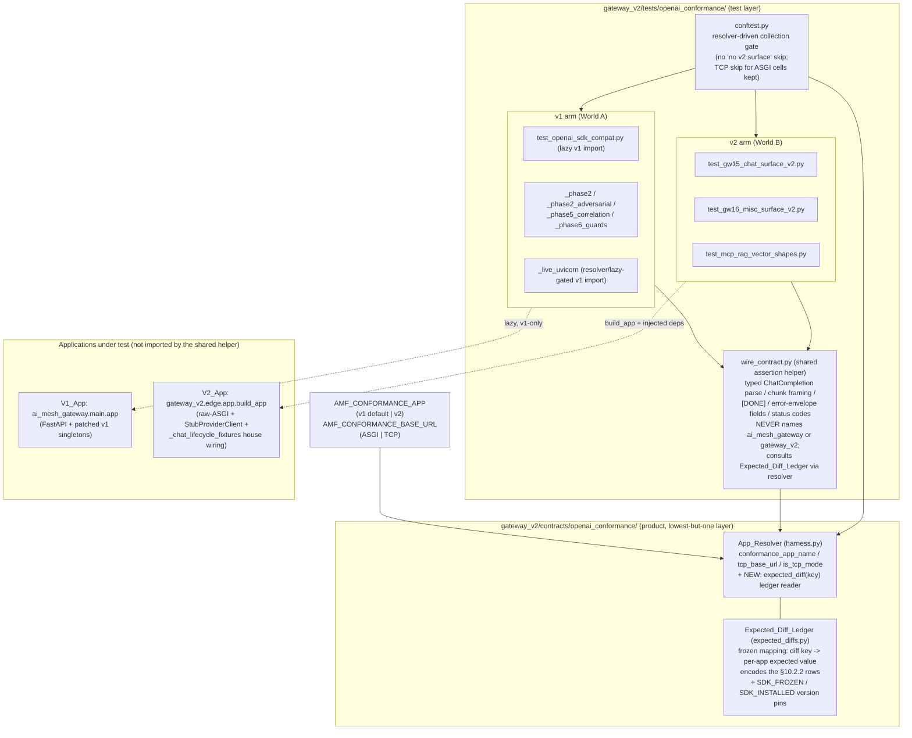

# Design Document

## Overview

GW01's local half makes the already-ported OpenAI conformance suite in
`gateway_v2/tests/openai_conformance/` run **green against both apps** — `AMF_CONFORMANCE_APP=v1`
(default) and `=v2` — so the suite is a genuine implementation-agnostic specification of the
gateway's public wire surface, exactly as runbook §10.2.1 / §10.2.2 / §10.8 require ("the suite
IS the specification of gateway-v2's public surface").

The decisive fact the design is built around is that the ported directory is **two structurally
different worlds**, discovered by reading every file on disk (branch `suraj-revamp`):

- **World A — the ported v1-shaped suite.** `test_openai_sdk_compat.py` plus its siblings
  (`_phase2.py`, `_phase2_adversarial.py`, `_phase5_correlation.py`, `_phase6_guards.py`,
  `_live_uvicorn.py`). These build the **v1 FastAPI app** through a `T._make_sdk_app` helper that
  does `from ai_mesh_gateway import main` and patches v1 singletons (`gm.CONFIG`, `gm.CONFIG_SYNC`,
  `gm.LLM_ROUTER`, `gm.INPUT_SCANNER`, `AuthMiddleware._get_redis`, a fakeredis auth payload keyed
  by `sha256(API_KEY)`, and `_fake_completion` / `_fake_stream` / `_fake_embedding` upstream
  stubs). They drive the stock `openai` SDK over `httpx.ASGITransport`. Two of them
  (`_phase2.py`, `_live_uvicorn.py`) import `ai_mesh_gateway.*` **at module top level** →
  collection errors under v2; `test_openai_sdk_compat.py` imports v1 **lazily inside fixtures**,
  so its cells collect-then-skip under v2.

- **World B — the already-correct v2 subsets.** `test_gw15_chat_surface_v2.py`,
  `test_gw16_misc_surface_v2.py`, `test_mcp_rag_vector_shapes.py`. These drive the **v2 app the
  right way**: the stock `openai` SDK over `httpx.ASGITransport` against
  `gateway_v2.edge.app.build_app`, with the shipped `StubProviderClient` as the in-process
  provider and the shared house wiring `tests.edge._chat_lifecycle_fixtures` (`AdmittingAdmission`,
  `AdmittingBudget`, `ResolvingIdentity`, `warm_snapshot_source`). They `pytest.importorskip`
  `openai`/`httpx`, carry `# Validates:` requirement refs, and cover the S01–S07 scenario catalog
  (ALLOW / BLOCK / REDACT / MONITOR / FLAG / OFF / conflict), streaming and non-streaming.

The App_Resolver already exists at `gateway_v2/gateway_v2/contracts/openai_conformance/harness.py`
(`conformance_app_name()` reads `AMF_CONFORMANCE_APP`, default `v1`, fail-closed on unknown;
`tcp_base_url()`; `is_tcp_mode()`). The `conftest.py` currently skips every `sdk_app`-fixture cell
under v2 with the stale reason `"v2 has no OpenAI surface yet (GW15)"` — GW15–GW18 have shipped
that surface, so the skip is obsolete.

This design covers only the LOCAL half. The CI Node matrix, branch protection / required checks /
reproducible image, and the GW02 live-v1 parity harness are explicit non-goals (Requirement 8).

### The central design decision

> **How does ONE implementation-agnostic suite assert the frozen WIRE contract against two
> structurally different apps (v1 FastAPI + v1 singletons vs v2 `build_app` + injected deps)?**

Three candidates were evaluated against the runbook's "the suite IS the specification" and the
§10.2.2 deliberate-diff mandate.

**Option 1 — one body, two app-builders behind the resolver.** Abstract the app-under-test
construction (today v1-only `T._make_sdk_app`) behind a resolver-selected builder: `v1` → the
existing v1 FastAPI builder, `v2` → a builder assembling `build_app` with `StubProviderClient` +
`_chat_lifecycle_fixtures` and equivalent upstream stubs. The SAME wire-contract cells run against
whichever app the resolver returns.
*Rejected.* The two apps are not interchangeable behind one body: the v1 cells reach deep into v1
internals (singleton patching, `sdk_app.routes` introspection, the v1 responses adapter, v1 request
-id correlation seams) that have no v2 equivalent, and the v2 app is driven by per-scenario detector
levers (`input_detector` / `error_scanner`), not patched singletons. Forcing one body over both would
either (a) smear v1-only assertions onto v2 (false failures the §10.2.2 ledger would then have to
suppress wholesale, defeating the point of a specification), or (b) collapse the body to the lowest
common denominator and lose the v1 hardening cells GW01 must keep green against v1. It also makes a
*test* file the owner of app assembly for both worlds, re-introducing the dual-module-identity
hazard (Requirement 3) at the center of the suite.

**Option 2 — resolver dispatches each app to its own correctly-wired driver; a shared
wire-contract assertion helper both arms call.** Keep World B (the GW15/GW16/MCP v2 subsets) as the
**v2 arm**, keep World A as the **v1 arm**, and extract the shared **wire-contract assertions**
(typed `ChatCompletion` parse, chunk framing, `data: [DONE]`, error-envelope `message`/`type`/
`code`/`param`/`request_id`, status codes) into one assertion helper both arms import. The resolver
selects which arm's cells run (`v1` → World A collects + runs, World B skips its deferred live
seams as today; `v2` → World B runs, World A collects cleanly and its `sdk_app` cells are
resolver-gated to v1). **Chosen.**

**Option 2 is chosen** because it is the only option faithful to what the runbook already proved
feasible and what the repo already ships. The v2 subsets *already* drive `build_app` + the
`StubProviderClient` + `_chat_lifecycle_fixtures` the exactly-right way (the GW15/GW16 pattern,
carrying `# Validates:` refs and the S01–S07 catalog); re-authoring them under Option 1 would throw
away shipped, passing, correctly-layered conformance code. The frozen contract is the **wire**
contract, not any single app's internals (Requirement 4.2), so the specification's shared truth is
exactly the extracted assertion helper — one place that names the typed JSON shapes, the SSE
framing, `[DONE]`, the error envelope, and the status codes, with **neither** `ai_mesh_gateway`
**nor** `gateway_v2` named in it (Requirement 5.3). Each arm keeps its own correct wiring; the
resolver is the single switch; the deliberate v2≠v1 rows become a resolver-aware
**Expected_Diff_Ledger** the shared helper consults, so a v2 run never fails a cell asserting v1's
old behaviour (Requirement 6). This directly honours §10.2.2's "deliberate diff" mandate instead of
suppressing it.

The remaining defects (stale skip, the two top-level v1 imports, directory-run suppression, the
2.38→3.29 SDK drift) are addressed under this split without touching the two arms' internal wiring,
as detailed below.

## Architecture

### The two-world structure and the chosen resolution



### How the arms relate to the resolver

- The resolver is the single switch. When it returns `v1`, the v1 arm's `sdk_app`-fixture cells run
  against `ai_mesh_gateway.main.app`; the v2 arm's cells still collect but their deferred-live seams
  (real TCP, Node) skip as today, and their in-process cells run against `build_app` because they do
  not depend on the resolver's app name (they are the v2 specification of the same wire contract).
- When the resolver returns `v2`, the v1 arm's `sdk_app`-fixture cells are **collected cleanly but
  resolver-gated** so they do not drive the v1 app under a v2 run (they have no v2 equivalent app to
  target — the v2 wire contract is proved by the v2 arm). The v2 arm runs in full.
- `AMF_CONFORMANCE_BASE_URL` (TCP mode) remains an orthogonal, separate job: the existing conftest
  rule that skips `sdk_app` / `sdk_client` (in-process ASGI) cells when a base URL is set is kept
  verbatim (Requirement 1.3).

The product `contracts/openai_conformance/` package owns the resolver and the ledger; **tests
import the product, never the reverse** (the layered import contract: tests may import across
layers, product code may not import test code). The shared `wire_contract.py` helper lives in the
test layer and reads the ledger through the resolver, so no product module imports test code and no
test in the shared path names either app package.

## Components and Interfaces

### 1. App_Resolver (existing) + extension

`gateway_v2/gateway_v2/contracts/openai_conformance/harness.py` — unchanged core:

```python
def conformance_app_name() -> str: ...     # "v1" (default) | "v2"; RuntimeError on unknown
def tcp_base_url() -> str | None: ...       # AMF_CONFORMANCE_BASE_URL or None
def is_tcp_mode() -> bool: ...              # tcp_base_url() is not None
```

Requirement 5.4 is already satisfied: an out-of-set value raises `RuntimeError` naming the rejected
value (`AMF_CONFORMANCE_APP={raw!r} is not in {...}`). The design keeps this contract and adds one
thin reader so cells consult the ledger through the same single entry point:

```python
def expected_diff(key: str) -> ExpectedDiff: ...   # resolver-aware expected value for a §10.2.2 row
```

`expected_diff` reads the Expected_Diff_Ledger and returns the value expected **for the app the
resolver currently selects**, so a cell never branches on the app name itself.

### 2. Expected_Diff_Ledger (new product module)

`gateway_v2/gateway_v2/contracts/openai_conformance/expected_diffs.py` — a frozen, declarative
record of the deliberate v2-vs-v1 behaviour changes from §10.2.2, plus the SDK version pins. It is
product code (not a test fixture) so both the resolver's reader and any arm can consult it without a
test→test or product→test import.

```python
from dataclasses import dataclass

@dataclass(frozen=True, slots=True)
class ExpectedDiff:
    key: str
    v1: object           # the value a v1 run expects (the old behaviour)
    v2: object           # the value a v2 run expects (the deliberate §10.2.2 behaviour)
    runbook_row: str     # e.g. "§10.2.2: benign inline code -> SIGNAL not block"

# Frozen SDK version provenance (single source of truth; Requirement 4.4)
SDK_FROZEN_VERSION: str = "2.38.0"      # the version the wire contract was frozen against
SDK_INSTALLED_FLOOR: str = "3.29.0"     # the stock SDK major the suite must prove still works
```

The ledger shape is a frozen mapping `key -> ExpectedDiff`. A cell that observes a behaviour that
differs between apps calls `expected_diff("<key>")` and asserts against the returned `.v1`/`.v2`
value — selected for it by the resolver — so the identical cell passes under both apps.

### 3. conftest.py (rewritten collection gate)

`gateway_v2/tests/openai_conformance/conftest.py` — the collection-time switch. It:

- **Removes** the `skip_v2 = pytest.mark.skip(reason="v2 has no OpenAI surface yet (GW15)")` marker
  and all use of it (Requirement 1.1, 1.2).
- **Keeps** the TCP-vs-ASGI separation: when `tcp_base_url()` is set, `sdk_app` / `sdk_client`
  in-process ASGI cells are skipped as a different job (Requirement 1.3) — verbatim from today.
- **Gates the v1 arm under v2**: when the resolver returns `v2`, cells that drive the v1 app
  (identified by the `sdk_app` / `sdk_client` fixtures, which build `ai_mesh_gateway.main.app`) are
  marked skip with a resolver-honest reason ("v1-app cell; v2 wire contract proved by the v2 arm"),
  so they collect cleanly but do not run the v1 app under a v2 run. Under `v1`/unset they run as
  today (Requirement 1.4). This is the inverse of the stale skip and is now driven by *what app the
  cell targets*, not a stale "no surface" claim.

### 4. wire_contract.py (new shared assertion helper, test layer)

`gateway_v2/tests/openai_conformance/wire_contract.py` — the single source of the frozen wire
contract's assertions, imported by both arms. It asserts only HTTP/SSE-visible facts and **names
neither app package** (Requirement 5.3):

```python
def assert_chat_completion(completion) -> None: ...        # typed ChatCompletion shape + usage block
def assert_stream_frames(chunks) -> None: ...              # chunk framing + terminal [DONE] semantics
def assert_error_envelope(err, *, expected_code: str) -> None:  # message/type/code/param/request_id + status
def assert_done_terminates(stream) -> None: ...            # [DONE] ends iteration cleanly
```

Each helper that touches a deliberate §10.2.2 difference takes its expected value from
`expected_diff(...)` rather than a hard-coded v1 constant (for example the streaming-block
disposition, the content-filter status/code mapping, or the degraded posture). Both arms call these
helpers so the specification's assertions are literally one body of code; the per-app behaviour
lives only in the ledger.

### 5. The v1 arm (World A) — collection-error and dual-identity fixes

- `test_openai_sdk_compat.py`: already imports v1 lazily inside fixtures; keep that. Point its
  wire-level assertions at `wire_contract.py` where they overlap the shared contract (so v1 and v2
  share one assertion body).
- `test_openai_sdk_compat_phase2.py`: move `from ai_mesh_gateway.responses_adapters import
  responses_to_chat` and any `ai_mesh_gateway.main` top-level import **behind a lazy, resolver-aware
  accessor** (its `_resolved_main()` helper already does this for `main`; the responses-adapter
  import must join it inside the fixture/call site, not at module top). Result: zero collection
  errors under v2 (Requirement 2.1), zero reduction under v1 (Requirement 2.4).
- `test_openai_sdk_compat_live_uvicorn.py`: move the three top-level v1 imports
  (`ai_mesh_gateway.main`, `ai_mesh_gateway.middleware`, `ai_mesh_gateway.scanner`) and the
  `from tests.openai_conformance import test_openai_sdk_compat as T` module-level binding behind
  lazy fixtures / a resolver-gated guard so collection succeeds under v2 (Requirement 2.2). Its
  live-TCP cells target the v1 app and are therefore v1-arm cells, gated off under v2 by the
  conftest rule.
- Both files resolve the gateway module through the App_Resolver / the `_resolved_main()` single-
  identity accessor so a v1-only dependency targets the app the resolver selects, never a hard-coded
  `ai_mesh_gateway` import (Requirement 2.3).

### 6. The v2 arm (World B) — reuse the shipped wiring, do not reinvent

The v2 arm is kept exactly as shipped and extended only where a genuine small/local v2 gap is
exposed (Requirement 6.4). It MUST continue to:

- assemble the app with `gateway_v2.edge.app.build_app(...)`;
- use the shipped `gateway_v2.dispatch.provider.StubProviderClient` / the `_CountingProvider`
  substitute as the in-process provider;
- draw the lifecycle deps from `tests.edge._chat_lifecycle_fixtures` (`AdmittingAdmission`,
  `AdmittingBudget`, `ResolvingIdentity`, `warm_snapshot_source`) — the GW15/GW16 pattern exactly;
- construct the stock SDK exactly once per file via a `_stock_client` helper (base-URL + key swap
  only; the LGW15-2 stop rule);
- `pytest.importorskip("openai")` / `("httpx")` so a tree without the SDK skips cleanly.

Where the shared wire-contract assertions overlap the v2 arm's inline assertions, the v2 arm calls
`wire_contract.py` so the specification is single-bodied.

### Directory-run suppression (Requirement 3)

The 36-vs-48 discrepancy is a **dual-module-identity** interaction: a sibling re-imports the gateway
under a second module object (`main` vs `ai_mesh_gateway.main`), and a directory run re-executes the
gateway into a second object whose `app` / singletons differ from the one the cells patched, so
large files are suppressed. The resolution is to force a **single application module object**:

- every v1-only cell resolves the gateway module through the one accessor (`_resolved_main()` /
  the resolver), never a bare `import ai_mesh_gateway.main as gm` at module top that binds the first
  object and then patches a module the app no longer uses;
- the two top-level-import files are converted to lazy/resolver-gated imports (component 5), which
  removes the collection-time interaction that poisoned the directory count.

The acceptance obligation: a whole-directory run collects the same cells the sum of single-file runs
collects, under every supported `AMF_CONFORMANCE_APP` (Requirement 3.1, 3.2, 3.3).

## Data Models

### ExpectedDiff (frozen dataclass)

| Field | Type | Meaning |
| --- | --- | --- |
| `key` | `str` | stable ledger key a cell passes to `expected_diff(key)` |
| `v1` | `object` | the value a `v1` run expects (the old behaviour) |
| `v2` | `object` | the value a `v2` run expects (the deliberate §10.2.2 behaviour) |
| `runbook_row` | `str` | the §10.2.2 row this entry encodes (provenance) |

### SDK version provenance (module constants)

| Constant | Value | Meaning (Requirement 4.4) |
| --- | --- | --- |
| `SDK_FROZEN_VERSION` | `"2.38.0"` | the SDK the wire contract was frozen against |
| `SDK_INSTALLED_FLOOR` | `"3.29.0"` | the stock SDK major the suite must prove still works |

Recording both in one product module makes a future version jump a deliberate, reviewable edit
rather than a silent drift. A single cell asserts the installed `openai.__version__` is at or above
`SDK_INSTALLED_FLOOR` so the suite fails loudly if the environment regresses below the proven major.

### Expected_Diff_Ledger entries (encoding the §10.2.2 rows)

The ledger holds one entry per deliberate change enumerated in Requirement 6.1 / §10.2.2:

| Key | §10.2.2 row | `v1` expected | `v2` expected |
| --- | --- | --- | --- |
| `injection_detection` | injection/jailbreak measured against the corpus with published recall/FPR | legacy block-on-match | finding with published recall/FPR posture (measured gate deferred) |
| `benign_inline_code` | benign inline code → SIGNAL not terminal block | terminal block | SIGNAL finding, request completes |
| `degraded_scan_status` | degraded scan → explicit UNAVAILABLE + signed fail posture | implicit/legacy | explicit `UNAVAILABLE` finding status |
| `policy_precedence` | org-policy precedence by signed rule priority, not severity max | severity-max | signed rule priority (C22 most-restrictive) |
| `tri_state_one_plan` | unset tri-state → one plan identical on every surface | per-surface | one plan, identical on every surface |
| `plan_unavailable` | missing tenant config → explicit PLAN_UNAVAILABLE | implicit error | explicit `PLAN_UNAVAILABLE` |
| `stream_block_disposition` | streaming block → withhold-before-first-byte or explicit strict mode, not truncate-after-partial | truncate after partial emit | withhold before first byte / strict mode |

A cell that observes any of these consults `expected_diff(key)` and asserts the resolver-selected
value, so the identical cell is correct under both apps and the deliberate difference is *recorded*,
never silently suppressed (Requirement 6.2). A genuine v2 gap that is NOT a ledger entry still fails
the cell under v2 until fixed locally or registered (Requirement 6.3, 6.4).

## Error Handling

- **Unknown app value.** `conformance_app_name()` raises `RuntimeError` naming the rejected value
  (existing; Requirement 5.4). The collection gate surfaces this at collection time so a typo fails
  loudly rather than silently defaulting.
- **Collection errors.** The two top-level-import files are converted to lazy/resolver-gated
  imports; a residual import error under v2 must surface as a hard collection failure (not a silent
  skip) so a regression is caught (Requirements 2.1, 2.2).
- **Missing SDK.** The v2 arm `importorskip`s `openai`/`httpx`; a tree without the SDK skips
  cleanly rather than erroring collection. A present SDK below `SDK_INSTALLED_FLOOR` fails the
  version-provenance cell loudly (Requirement 4.4).
- **Error-envelope assertions.** `assert_error_envelope` checks the full `{"error": {...}}` body
  (`message` / `type` / `code` / `param` / `request_id`) and the HTTP status, with the content-
  filter status/code mapping drawn from the ledger where v2 deliberately differs — so a v2 content
  block (400/`content_filter`) and a v1 content block are each asserted against their own expected
  value (Requirements 4.2, 6.2).
- **TCP vs ASGI job separation.** When a base URL is set, the in-process ASGI cells skip as a
  separate job; the TCP cells target a real socket (Requirement 1.3). An unreachable TCP endpoint
  fails those cells rather than passing against a closed port (the C10 defect this card closes).

## Testing Strategy

This feature is **test-harness and configuration plumbing** over an existing suite — the resolver
switch, a declarative ledger, a shared assertion helper, lazy-import conversions, and a collection
gate. It defines no new pure algorithm with a large input space. Property-based testing is therefore
**not applicable** here (per the PBT applicability guidance: configuration, collection wiring, and
external-SDK conformance are integration/example territory, not universal-property territory). The
Correctness Properties section is intentionally omitted; the verification is the suite running green
against both apps plus the standard gate.

### Verification obligations (the acceptance gate)

1. **Suite green under both apps.**
   - `AMF_CONFORMANCE_APP` unset or `v1`: the Conformance_Suite completes with zero failing cells
     and no reduction in v1 collected/passing cells (Requirements 1.4, 2.4, 5.1).
   - `AMF_CONFORMANCE_APP=v2`: the Conformance_Suite completes with zero failing cells; the stale
     skip is gone and the two previously-erroring files collect cleanly (Requirements 1.1, 1.2,
     2.1, 2.2, 5.2).
2. **Directory == sum-of-files.** A whole-directory run collects the same cell set the sum of
   single-file runs collects, under every supported app value (Requirements 3.1, 3.2, 3.3).
3. **Stock-SDK wire contract.** Every assertion exercises the stock `openai` as installed in
   `gateway_v2/.venv` (base-URL + key swap only), asserts the wire contract (typed JSON, chunk
   framing, `[DONE]`, error envelope, status codes) and not a version-specific SDK internal; any
   renamed/relocated SDK symbol is adapted so the same wire assertion holds; the frozen SDK version
   is recorded in one product module (Requirements 4.1–4.4).
4. **Expected diffs recorded, real gaps fail.** Each §10.2.2 row is a ledger entry a cell consults;
   an un-registered genuine v2 gap fails the v2 run until fixed or registered (Requirements 6.1–6.4).
5. **Agnostic shared path.** The shared `wire_contract.py` names neither `ai_mesh_gateway` nor
   `gateway_v2` (Requirement 5.3); the resolver fails closed on an unknown value (Requirement 5.4).

### Standard local Gate_Obligation (Requirement 7)

Run after the GW01 local changes, all green:

- **Full offline suite** — no failing tests, passing count no lower than the baseline
  **1878 passed / 95 skipped / 1 xfailed**, adjusted upward only by cells newly enabled by this spec
  (Requirement 7.1).
- **`mypy --strict`** over the `gateway_v2` tree — zero errors (Requirement 7.2).
- **`ruff`** over the `gateway_v2` tree — zero violations (Requirement 7.3).
- **`lint-imports`** — all **3** import contracts kept ("Gateway v2 layers", "Resolve imports only
  domain", "No HTTP framework outside edge") (Requirement 7.4). The new product modules
  (`expected_diffs.py`, the resolver extension) live in `gateway_v2.contracts` and must not import
  any higher layer; the shared test helper lives in the test layer and must not cause product code
  to import test code or v1 code.
- **7 AST gates** — all exit zero (Requirement 7.5), including: no capacity literals outside
  `runtime/resources.py` (the ledger holds behaviour expectations and version strings, not capacity
  numbers), frozen dataclasses (`ExpectedDiff` is `frozen=True, slots=True`), and the module/file
  size limits (120-line function / 800-line file).

### House-convention conformance

- The agnostic suite MUST NOT make product code import test code or v1 code: the resolver + ledger
  are product `contracts/` modules depending only on the standard library and lower layers; the
  shared assertion helper is test-layer and reads the ledger through the resolver.
- Frozen dataclasses, no capacity literals outside `runtime/resources.py`, 120-line function /
  800-line file limits apply to the new modules.

### Unit / integration coverage (no new product algorithm)

- **Integration (1–3 examples each):** the resolver returns the right app name for unset / `v1` /
  `v2`, and raises on an unknown value; the ledger returns the v1 value under a v1 run and the v2
  value under a v2 run for each key; the SDK version-provenance cell asserts the installed major is
  at or above `SDK_INSTALLED_FLOOR`.
- **Collection smoke:** `test_openai_sdk_compat_phase2.py` and `_live_uvicorn.py` collect with zero
  errors under both `v1` and `v2`; the directory collects the sum-of-files cell set under both.
- The existing S01–S07 v2-arm cells and the v1-arm wire cells remain the behavioural coverage; this
  spec adds no behavioural assertions beyond re-pointing overlapping ones at the shared helper.

## Requirements Mapping

| Design component | Requirements |
| --- | --- |
| conftest.py rewrite — remove stale skip, keep TCP separation, resolver-gate the v1 arm under v2 | 1.1, 1.2, 1.3, 1.4 |
| v1 arm lazy/resolver-gated imports (`_phase2`, `_live_uvicorn`) + single-identity accessor | 2.1, 2.2, 2.3, 2.4 |
| Single application module object (dual-identity fix) + directory == sum-of-files | 3.1, 3.2, 3.3 |
| `wire_contract.py` shared assertion helper (stock SDK, wire not SDK-internal) + SDK symbol adaptation | 4.1, 4.2, 4.3 |
| `expected_diffs.py` SDK version provenance (`SDK_FROZEN_VERSION` / `SDK_INSTALLED_FLOOR`) | 4.4 |
| Resolver as single switch + agnostic shared path (names neither app) + fail-closed | 5.1, 5.2, 5.3, 5.4 |
| Expected_Diff_Ledger — the seven §10.2.2 rows, resolver-aware `expected_diff(key)` | 6.1, 6.2, 6.3, 6.4 |
| Gate_Obligation — full suite + mypy + ruff + lint-imports (3) + 7 AST gates | 7.1, 7.2, 7.3, 7.4, 7.5 |
| Non-goals restated (CI Node matrix, branch protection / reproducible image, GW02 parity, local-only resources) | 8.1, 8.2, 8.3, 8.4 |

## Non-Goals (restated)

Per Requirement 8, the following are explicit non-goals of the local half:

- **CI Node matrix** (second-language client conformance) — deferred; requires the CI runner (8.1).
- **Branch protection, required checks, and the reproducible-image build** — deferred to the
  human/cloud owner (8.2).
- **GW02 parity harness against the live V1_App** — deferred (8.3).
- Local verification depends only on resources available on `suraj-revamp`, with **no cloud or GPU
  access** (8.4).
