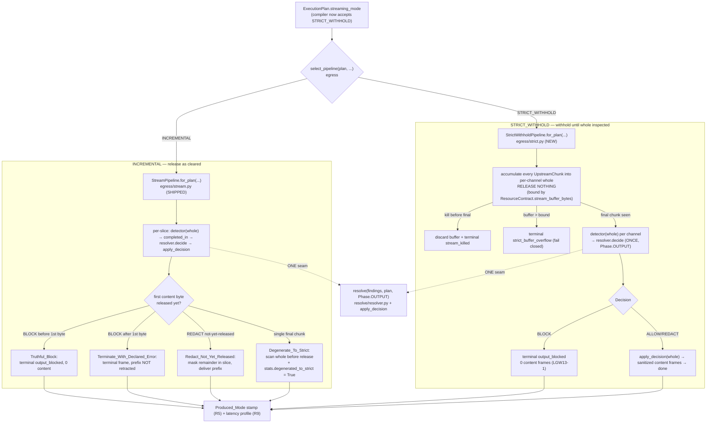

# Design Document

## Overview

GW13 (runbook §10.9, `## GW13 — Implement output enforcement and the two explicit streaming modes`, with its **v2.1 CORRECTION C4/C21/C25**) is **PARTIAL**: the output-enforcement glue and the INCREMENTAL release loop shipped under R2-06 / GW12b, but the second explicit streaming mode — **STRICT_WITHHOLD** — is an empty stub (`egress/strict.py`), and the compiler rejects STRICT_WITHHOLD at compile time (`plan/compiler.py` `SUPPORTED_STREAMING = frozenset({StreamingMode.INCREMENTAL})`).

The GW13 objective, verbatim: *"Make the output path use the same resolver as the input path, and make the two streaming modes honestly distinct at the wire and in the latency claim."*

This design builds the locally-buildable half of that objective **alongside** the shipped INCREMENTAL pipeline, never rewriting it:

1. A **distinct** `StrictWithholdPipeline` in `egress/strict.py` — a sibling of `StreamPipeline` that accumulates the whole response, inspects it once, resolves it through the **one** `OutputResolver` seam at `Phase.OUTPUT`, applies the `Decision` via the shipped `apply_decision`, and either emits the sanitized whole response or a single terminal `output_blocked` frame with zero content before it (LGW13-1).
2. A `select_pipeline(...)` factory in `egress` that reads `plan.streaming_mode` and constructs the right pipeline, keeping the one-resolver seam identical for both.
3. The one-line compiler change: STRICT_WITHHOLD joins `SUPPORTED_STREAMING` (the plan vocabulary, document round-trip, and `ExecutionPlan.streaming_mode` threading are already shipped).
4. A **Produced_Mode** stamp on the backend response plus a **Degenerate_To_Strict** flag on `StreamStats`, so the two modes are visibly distinct at the wire (R5) and a single-chunk provider response is not misreported as incremental delivery (R6).
5. A **distinct STRICT latency profile** (completion overhead) that never inherits the INCREMENTAL time-to-first-token claim (R9), with the STRICT buffer bound read from `ResourceContract` — no literal high-water mark.

### What is reused, not rebuilt (verified against source)

| Shipped seam | File | GW13 relationship |
|---|---|---|
| INCREMENTAL release loop (holdback scan, force-release, in-flight kill, boundary safety, C4 latency split) | `egress/stream.py::StreamPipeline` | Untouched; STRICT is added alongside. |
| The one resolver, phase-aware, total, pure | `resolve/resolver.py::resolve(findings, plan, phase)` | STRICT and INCREMENTAL both route through it; UNAVAILABLE/MONITOR semantics (R8) are **already correct** here. |
| The one-resolver seam | `egress/output_guard.py` — `OutputResolver`, `apply_decision`, `enforcing_output_rules`, `OutputBlocked` | STRICT reuses it verbatim; no second decision site. |
| Transport value types | `egress/stream.py` — `UpstreamChunk(text_deltas, final)`, `DownstreamFrame(text_deltas, error_code)` | STRICT reuses the same types. |
| Plan vocabulary + round-trip | `domain/plan.py` (`StreamingMode`, `Phase`, `ExecutionPlan.streaming_mode`), `plan/document.py`, `plan/delta.py` | STRICT_WITHHOLD already encodes/decodes via `StreamingMode.value`; only `SUPPORTED_STREAMING` gates it. |
| C21 output-field coverage | `domain/channels.py` (`unscanned_channels() == ()`) | Shipped; GW13 only routes both modes over the shipped channels (R10.4). |
| Capacity authority | `runtime/resources.py::ResourceContract.stream_buffer_bytes` | STRICT's buffer bound derives from here — no literal (R9.5). |
| Terminal code vocabulary | `domain/posture.py` (`STREAM_*`, reused `output_blocked`/`stream_killed`) | STRICT reuses `output_blocked`/`stream_killed`; adds one strict-buffer-overflow spelling. |

### Deferred (standing, per Requirement 10)

The operator has no cloud resources. The **measured** latency numbers and the two **signed** latency profiles (**LGW13-5**) move to **GW20**; GW13-local proves only that the modes are mechanically distinct and separately labelled. The console mode-visibility UI is deferred to a UI card (GW13 stamps the backend field only). The real provider socket and live wire captures are a deferred live gate. The bounded O(1) holdback engine (**C25**) is shipped and not rebuilt — STRICT is a **distinct** mode, not a holdback variant.

---

## Architecture

The chat surface selects the pipeline from `plan.streaming_mode`, then both pipelines fold through the **one** `OutputResolver` at `Phase.OUTPUT` and the **one** `apply_decision` byte-discipline. The two paths differ only in *when* they resolve: INCREMENTAL resolves per released slice as content clears; STRICT resolves once over the whole accumulated buffer with nothing released before the terminal result.



### Layering (import-linter contract, unchanged)

The order is `edge > admit > plan > detect > resolve > dispatch > egress > audit > runtime > contracts > domain`, with **`egress` forbidden from importing `detect`**. `StrictWithholdPipeline` lives in `egress` and obeys the same rule the shipped `StreamPipeline` obeys: the completed-match source is the **injected** `Detector = Callable[[str], Sequence[Finding]]` (described structurally, never imported from `detect`). `select_pipeline` lives in `egress`. The resolver seam is `egress/output_guard.OutputResolver` + `apply_decision` (imports only `domain`). The edge surfaces (`edge/routes.py`, `edge/openai_chat.py`, `edge/openai_nonstream.py`) are the only HTTP layer and the only injection site for the detector/resolver (above `detect`).

---

## Components and Interfaces

### C1 — `StrictWithholdPipeline` (NEW, `egress/strict.py`)

A sibling of `StreamPipeline` with the **same injection seam shape** and the **same transport types** (`UpstreamChunk` / `DownstreamFrame` imported from `egress.stream`). It does **not** use the holdback scanner, `TokenIndex`, or the hold cap (R3.6, C25): it accumulates, inspects once, resolves once.

```python
# egress/strict.py
class StrictWithholdPipeline:
    def __init__(
        self,
        *,
        resolver: OutputResolver,          # the ONE seam (egress/output_guard)
        enforcing_output: bool,            # resolved once, before the first chunk
        max_buffer_bytes: int,             # from ResourceContract (R9.5), NO literal
        metrics: StrictMetrics,            # completion-overhead profile (R9.4)
        clock: Callable[[], int] = time.perf_counter_ns,
        detector: Detector | None = None,  # injected completed-match source over whole text
    ) -> None: ...

    @classmethod
    def for_plan(
        cls,
        plan: UpstreamPlan,                # ExecutionPlan | PlanUnavailable | PlanUnknownTenant | Undetermined
        *,
        resolver: OutputResolver,
        max_buffer_bytes: int,
        metrics: StrictMetrics,
        clock: Callable[[], int] = time.perf_counter_ns,
        detector: Detector | None = None,
    ) -> "StrictWithholdPipeline":
        # Mirror StreamPipeline.for_plan: raise EnforcementUndetermined (reused from
        # egress.stream) on an unresolved plan BEFORE constructing — fail closed, release
        # nothing. enforcing_output = bool(enforcing_output_rules(plan)).
        ...

    async def run(self, chunks: ChunkSource, send: Send, killed: KillSignal) -> StrictStats:
        ...
```

**`run` loop (the heart of the mode):**

1. If `not enforcing_output` → pass-through: emit each chunk's `text_deltas` unheld (mirrors `StreamPipeline._run_passthrough`, R2.2 parity). *(Design note: STRICT with no enforcing output rule has nothing to withhold; it still reports `produced_mode = strict_withhold`.)*
2. Otherwise, for each `UpstreamChunk`:
   - Check `killed()` **at the chunk boundary** (same `InFlightKill.CUT_NEXT_CHUNK` contract as `StreamPipeline`). On a kill before `final`: discard every accumulated buffer, emit one terminal `stream_killed` frame, return `incomplete` (R7 parity; mirrors `_cut_on_kill`).
   - Append every `(channel, delta)` into per-channel `whole` buffers. **Release nothing** (R3.2).
   - If total accumulated bytes exceed `max_buffer_bytes` → emit terminal `strict_buffer_overflow`, fail closed (R9.5).
3. On the `final` chunk: for each channel, run `detector(whole)` to get completed findings over the **whole** accumulated text (boundary safety is trivial — the whole text is present, R7.2), resolve **once** through `resolver.decide(findings)` (the one seam, `Phase.OUTPUT`), and:
   - **BLOCK** → `apply_decision` raises `OutputBlocked`; emit a single terminal `output_blocked` frame with **zero** content frames before it (R3.4, LGW13-1).
   - **ALLOW/REDACT** → emit `apply_decision(whole, decision, base_offset=0)` as content frame(s), then clean completion.

> **Does STRICT reuse the holdback scanner?** No. STRICT does not hold-and-release incrementally; it inspects the whole buffer once (R3.6). It reuses only the resolver seam and `apply_decision`.
>
> **Does STRICT need in-flight kill?** Yes — a kill before `final` discards the buffer and emits a `stream_killed` terminal frame, mirroring `StreamPipeline._cut_on_kill` (R7). After the whole response is emitted, a kill is never observed (loop broke on `final`), identical to the shipped semantics.

### C2 — `select_pipeline(...)` factory (NEW, `egress`)

A thin, shared dispatch so both edge surfaces get the right mode without duplicating wiring. It keeps the one-resolver seam identical for both. Lives in `egress` (e.g. `egress/select.py` or appended to `egress/stream.py`) so `edge` reads one factory.

```python
# egress — a single dispatch keyed off plan.streaming_mode
def select_pipeline(
    plan: ExecutionPlan,
    *,
    # INCREMENTAL deps (shipped)
    scanner: ScanProtocol, token_index: TokenCounterProtocol,
    cfg: HoldbackConfig, metrics: HoldbackMetrics, window: int,
    # shared seam
    resolver: OutputResolver, detector: Detector | None,
    # STRICT deps
    max_buffer_bytes: int, strict_metrics: StrictMetrics,
    clock: Callable[[], int] = time.perf_counter_ns,
) -> StreamPipeline | StrictWithholdPipeline:
    if plan.streaming_mode is StreamingMode.STRICT_WITHHOLD:
        return StrictWithholdPipeline.for_plan(
            plan, resolver=resolver, max_buffer_bytes=max_buffer_bytes,
            metrics=strict_metrics, clock=clock, detector=detector,
        )
    return StreamPipeline.for_plan(
        plan, scanner=scanner, resolver=resolver, token_index=token_index,
        cfg=cfg, metrics=metrics, window=window, clock=clock, detector=detector,
    )
```

Both returned pipelines expose a `run(chunks, send, killed)` coroutine returning a stats value with a `produced_mode` field, so the edge driver treats them uniformly.

### C3 — Compiler change (`plan/compiler.py`, R4)

One line:

```python
SUPPORTED_STREAMING = frozenset({StreamingMode.INCREMENTAL, StreamingMode.STRICT_WITHHOLD})
```

The rest of `compile_plan` is unchanged: it already threads `streaming_mode=streaming_mode` onto the `ExecutionPlan`, and a mode **outside** the set still raises `CompileError` with the previous plan intact (R4.4). The plan document round-trip (`plan/document.py::encode_plan_body`/`decode_plan_body`, `plan/delta.py`) already encodes/decodes STRICT_WITHHOLD via `StreamingMode.value` — no change needed there.

### C4 — Mode selection / dispatch at the edge (R5, scoped)

The chat surface already reads the resolved `ExecutionPlan` on a proceed outcome (`edge/routes.py::ChatRoute._next_attempt` builds `StreamPipeline.for_plan(plan, ...)` today). GW13 replaces that single construction with `select_pipeline(plan, ...)`:

- **Streaming path** (`ChatRoute._build_pipeline` → `_next_attempt`): swap `StreamPipeline.for_plan` for `select_pipeline`, add the STRICT deps (`max_buffer_bytes = self.contract.stream_buffer_bytes(self.active_streams())`, `strict_metrics`). The existing SSE `_sink`, `FirstByteLatch`, `KillLatch`, and `StreamTimeouts` wiring is unchanged — `StrictWithholdPipeline.run` honours the same `send`/`killed` contract (it simply never sets the first-byte latch until the whole response clears).
- **Non-streaming path** (`edge/openai_nonstream.py::collect_and_enforce`): already drains the whole upstream and enforces per channel through `resolver.decide` + `apply_decision` — this is **already STRICT-shaped** (whole-response inspection before any emit). GW13 stamps its `produced_mode` from `plan.streaming_mode` and otherwise leaves it (a non-streaming request is strict-like by nature).

> **Honest scope statement (per the brief).** GW13-local wires the **streaming chat path** through `select_pipeline` as the working proof of the seam, stamps the Produced_Mode on both the streaming and non-streaming chat responses, lands the compiler change, and lands `StrictWithholdPipeline` + its tests. The other edge surfaces (`/v1/responses`, MCP, RAG/vector) remain the shipped `not_implemented` placeholders; when a later card wires them, they call the **same** `select_pipeline` factory. This is a thin, tested integration on one surface, not a multi-surface rollout.

### C5 — Produced_Mode stamp (R5)

`Produced_Mode` is a new backend field carrying the `StreamingMode` that actually produced the response.

- **Value type.** It is stamped as a field on the stats value every pipeline returns (`StreamStats.produced_mode` on the INCREMENTAL side, `StrictStats.produced_mode` on the STRICT side), so a caller of the backend response path reads it directly (R5.4). For the wire, the streaming chat path carries it as a response **meta/trace frame** (a non-content SSE frame emitted alongside the terminal marker) and the non-streaming path as a response **header** (`x-amf-produced-mode`) through the shipped `emit_response` header tuple.
- **INCREMENTAL (R5.2).** The *selected* mode is `INCREMENTAL`. The stamp reports `selected = incremental` plus the `degenerated_to_strict` flag (see C6). **Decision:** we report the **selected** mode as the Produced_Mode and expose the degenerate flag as a sibling field, rather than overwriting Produced_Mode with `strict`. Rationale: the plan *selected* INCREMENTAL and the pipeline *ran* the incremental loop; the fact that a given response had no streaming opportunity is a per-response trace fact (R6.2), not a mode change. Overwriting the mode would hide that the tenant is on INCREMENTAL. So: `produced_mode = incremental`, `degenerated_to_strict ∈ {true, false}`.
- **STRICT (R5.3).** `produced_mode = strict_withhold`, always.

### C6 — Degenerate_To_Strict flag (R6)

On the INCREMENTAL side only. The shipped `StreamPipeline._run_enforcing` already inspects the whole response before releasing when the provider sends everything in one chunk: a `final=True` first chunk flushes `hold_index = len(pending)` only after `_process_delta` scanned the whole buffer (R6.1 is already satisfied by construction). GW13 adds the **observable**: a boolean `StreamStats.degenerated_to_strict`.

**Where it is set.** In `_run_enforcing`'s loop: the flag is `True` iff **no content frame was emitted before the final chunk was processed** — equivalently, `stats.frames_out == 0` (ignoring the terminal frame) at the moment `chunk.final` is seen with content present. Concretely, record `released_before_final = (bytes released across all deltas before the final chunk)`; set `degenerated_to_strict = (released_before_final == 0 and content was present)`. A single `final=True` first chunk → `True`; a multi-chunk stream that released early → `False`. The flag flows into the trace via the stats value the edge driver already receives.

### C7 — STRICT latency profile (R9)

A new label-free producer `StrictMetrics` (in `runtime/`, following the `HoldbackMetrics` producer-vs-publisher split and the fixed `SERIES_COUNT` convention) records **completion overhead** only: `T_completion_overhead` (clock at `final` → clock when the whole sanitized response is emitted). It carries **no** `T_release_processing` / `T_holdback_wait` / time-to-first-token series (R9.2 — STRICT must not inherit the INCREMENTAL TTFT claim). INCREMENTAL continues to use the shipped `HoldbackMetrics` C4 split unchanged (R9.3). The two are thus two separate profiles (R9.1), labelled distinctly (R9.4). No tenant-derived label on either (the R2-10 lesson).

### C8 — STRICT buffer bound (R9.5)

`max_buffer_bytes` is read from `ResourceContract.stream_buffer_bytes(active_streams)` (already shipped, already derived from `memory_limit × utilization_cap / streams`, fails closed below one byte). GW13 introduces **no** literal high-water mark; the capacity-literal AST gate stays green. If the accumulated STRICT buffer would exceed the bound, the pipeline fails closed with a terminal `strict_buffer_overflow` frame (never raw bytes to the client).

### C9 — New terminal code (`domain/posture.py`)

One addition to the single shared vocabulary (codes only; `edge` owns the HTTP/SSE mapping):

```python
STREAM_STRICT_BUFFER_OVERFLOW = "strict_buffer_overflow"
"""R9.5: STRICT accumulation exceeded ResourceContract.stream_buffer_bytes. Fail closed, 0 content."""
```

STRICT reuses the shipped `output_blocked` (BLOCK) and `stream_killed` (`InFlightKill`) spellings unchanged (the C37 single-spelling discipline).

---

## Data Models

### `StrictStats` (NEW, `egress/strict.py`)

```python
@dataclass(slots=True)
class StrictStats:
    upstream_chunks: int = 0
    frames_out: int = 0                 # content frames emitted (0 on BLOCK)
    buffered_bytes: int = 0             # peak accumulated bytes (bounded by max_buffer_bytes)
    completion_overhead_ns: int = 0     # the STRICT latency profile (R9.4)
    produced_mode: StreamingMode = StreamingMode.STRICT_WITHHOLD  # R5.3
    done: bool = False
    incomplete: bool = False            # kill / overflow / block
    error: str | None = None            # output_blocked | stream_killed | strict_buffer_overflow
```

### `StreamStats` additions (`egress/stream.py`, INCREMENTAL)

Two new fields on the shipped dataclass (append-only, no behaviour change to the loop):

```python
    produced_mode: StreamingMode = StreamingMode.INCREMENTAL   # R5.2 — selected mode
    degenerated_to_strict: bool = False                        # R6.2 — set in _run_enforcing
```

### Produced_Mode on the wire

- Streaming: a non-content SSE meta frame `{"produced_mode": "...", "degenerated_to_strict": bool}` emitted alongside the terminal marker (does not violate the "no content after terminal" invariant — it is the trace, not content).
- Non-streaming: response header `x-amf-produced-mode` via the shipped `emit_response` header tuple.

### STRICT buffer-bound config read

No new config type. `max_buffer_bytes` is a plain `int` obtained at pipeline construction from `ResourceContract.stream_buffer_bytes(active_streams)` and passed into `StrictWithholdPipeline.for_plan`.

---

## Correctness Properties

*A property is a characteristic or behavior that should hold true across all valid executions of a system — essentially, a formal statement about what the system should do. Properties serve as the bridge between human-readable specifications and machine-verifiable correctness guarantees.*

The mode *mechanics* (one-resolver wiring, mode selection, metric labelling, the compiler-set change) are example/mechanism obligations and live in the Testing Strategy, not here. The properties below are the universal invariants that genuinely vary with input — the no-leak guarantees, the honesty invariants, the degenerate detection, and the plan round-trip — expressed over generated chunk sequences, split offsets, response texts, and resolver decisions.

### Property 1: STRICT releases nothing before the terminal result

*For any* sequence of `UpstreamChunk`s under STRICT_WITHHOLD with an enforcing output rule, no content `DownstreamFrame` is emitted before the `final` chunk has been processed and the resolver has decided; every content frame (if any) is strictly after whole-response inspection.

**Validates: Requirements 3.2, 3.4**

### Property 2: STRICT BLOCK yields zero prohibited bytes

*For any* whole response that resolves to a BLOCK disposition under STRICT_WITHHOLD, the pipeline emits zero content frames and exactly one terminal `output_blocked` frame before it.

**Validates: Requirements 3.4, 1.5 (LGW13-1)**

### Property 3: STRICT emitted bytes equal `apply_decision` of the whole buffer

*For any* whole response text and any non-BLOCK resolver `Decision`, the content bytes STRICT emits equal `apply_decision(whole, decision, base_offset=0)`, routed through the single `OutputResolver` seam at `Phase.OUTPUT`.

**Validates: Requirements 1.4, 1.5, 3.3, 3.5**

### Property 4: INCREMENTAL never presents truncation as block

*For any* chunk sequence where a BLOCK disposition arises **after** the first content byte was released, the already-delivered prefix frames are never retracted or altered, the stream ends with a terminal error frame, and no content frame follows the terminal frame.

**Validates: Requirements 2.3, 2.5, 2.6**

### Property 5: INCREMENTAL truthful block before the first byte

*For any* chunk sequence where a BLOCK disposition arises **before** any content byte is released, zero prohibited assistant bytes are emitted (only the terminal `output_blocked` frame).

**Validates: Requirements 2.2**

### Property 6: INCREMENTAL redacts only not-yet-released content

*For any* chunk sequence with a REDACT match straddling a chunk boundary after the first content byte, the delivered prefix bytes are byte-identical to what was sent and only the not-yet-released remainder within the release slice is masked.

**Validates: Requirements 2.4**

### Property 7: Boundary safety in both modes

*For any* sensitive match and *any* split offset that places the match across a `Chunk_Boundary`, neither mode emits any prohibited byte of the match: INCREMENTAL holds the minimal matchable suffix and re-scans the whole accumulated channel text (shipped, unmodified); STRICT inspects the whole buffer before any release.

**Validates: Requirements 7.1, 7.2, 7.3 (LGW13-6)**

### Property 8: Degenerate flag set exactly on single-chunk responses

*For any* INCREMENTAL chunk sequence, `StreamStats.degenerated_to_strict` is `True` if and only if no content frame was emitted before the `final` chunk was processed (a single final chunk, or an all-held stream flushed only at `final`); a multi-chunk stream that released content early sets it `False`.

**Validates: Requirements 6.1, 6.2**

### Property 9: Compiler round-trips both streaming modes

*For any* `StreamingMode` member `m`, encoding then decoding a `PlanDocument(streaming_mode=m)` and compiling it yields `plan.streaming_mode == m`; both `INCREMENTAL` and `STRICT_WITHHOLD` are accepted.

**Validates: Requirements 4.1, 4.2, 4.3**

### Property 10: Resolver-owned UNAVAILABLE posture on the output path

*For any* UNAVAILABLE output finding, the resolved disposition follows the selecting ENFORCE rule's `on_unavailable` posture — a BLOCK candidate iff some selecting ENFORCE rule is `FAIL_CLOSED`, and never a blanket redact — and holds identically when exercised through both STRICT and INCREMENTAL at `Phase.OUTPUT`.

**Validates: Requirements 8.1, 8.2, 8.4 (LGW13-3)**

### Property 11: MONITOR output rules never enforce

*For any* set of output findings whose only selecting rules are in MONITOR mode, the resolved disposition is ALLOW (the content is delivered and the finding recorded), holding identically through both modes.

**Validates: Requirements 8.3, 8.4 (LGW13-4)**

---

## Error Handling

| Condition | Mode | Handling | Terminal code |
|---|---|---|---|
| Resolved output `Decision` is BLOCK | both | Withhold all un-emitted content; emit one terminal frame; STRICT emits **zero** content frames (LGW13-1) | `output_blocked` (shipped) |
| REDACT span not fully covered by the released slice | both | `apply_decision` raises `ValueError`; fail closed, withhold | shipped `scan_failure` discipline (INCREMENTAL); STRICT withholds the whole buffer |
| In-flight kill before `final` (STRICT) | STRICT | Discard every accumulated buffer, emit terminal frame; no raw bytes released (R7 parity) | `stream_killed` (shipped) |
| STRICT accumulation exceeds `ResourceContract.stream_buffer_bytes` | STRICT | Fail closed, emit terminal frame, release zero content (R9.5) | `strict_buffer_overflow` (NEW) |
| Plan unresolved before first chunk | both | `for_plan` raises `EnforcementUndetermined` (reused from `egress.stream`) before construction; release nothing (R2.4 parity) | `plan_unavailable` at the edge (shipped `_next_attempt` path) |
| Enforcement state undetermined | both | Fail closed: withhold all (never default to pass-through) | — |
| INCREMENTAL post-first-byte BLOCK | INCREMENTAL | `Terminate_With_Declared_Error`: terminal frame, delivered prefix untouched, no claim the prefix was blocked (R2.3/R2.5/R2.6). This **is** the sanctioned truthful expression; the mode never fakes truncation, so BLOCK is "supported" in the honest sense (terminate + declare). Documented per R2.7. | `output_blocked` (shipped) |

Every terminal frame is the **last** frame for the stream — the "no content frame follows a terminal frame" invariant is structural in both pipelines (the `run` loop returns immediately after emitting it), identical to the shipped `StreamPipeline._terminate`.

---

## Testing Strategy

### Property-based tests (PBT applies to the no-leak and round-trip invariants)

PBT is appropriate here because the mode mechanics have clear input/output behavior over a large input space (chunk sequences, split offsets, response texts, resolver decisions, streaming-mode members). We **do not** rebuild the holdback engine or the resolver; we test the GW13 behaviour and re-exercise the shipped resolver on the output path.

- **Library & idiom.** Follow the shipped GW12b house idiom: seeded `random.Random`, **≥ 100 iterations** per property (the repo's own property suites run ≥ 10,000; GW13 uses the same `asyncio.run`-driven seeded generators), **no `hypothesis`**. Each test is tagged `# Feature: output-streaming-modes-gw13, Property N: <text>`.
- **Fakes (mirroring the GW12b test idiom).** Inject a **fake chunk source** (`UpstreamChunk` generator with a parametrised split offset), a **fake detector** (`Detector` returning completed `Finding`s with absolute spans over the whole text), and a **fake / recording `OutputResolver`** (returns a scripted `Decision` and records every `decide` call). `send` is a recording sink capturing the frame sequence.
- **Property coverage.** Properties 1–11 above, one property-based test each:
  - P1/P2/P3 — STRICT release-ordering, BLOCK-zero-content, and `apply_decision` equality over generated whole-response texts + injected decisions.
  - P4/P5/P6 — INCREMENTAL honesty (truncation-never-as-block, truthful-block-before-first-byte, redact-not-yet-released) over generated chunk sequences with a scripted post/pre-first-byte decision.
  - P7 — boundary safety: generate a secret and a split offset across the boundary; assert no prohibited byte in any content frame, for **both** pipelines (seeded over offsets).
  - P8 — degenerate flag: generate single-chunk vs multi-chunk-with-early-release sequences; assert the flag iff no pre-final release.
  - P9 — compiler round-trip across both `StreamingMode` members (`encode → decode → compile_plan`).
  - P10/P11 — re-exercise the shipped resolver's UNAVAILABLE posture and MONITOR non-enforcement **through both pipelines** at `Phase.OUTPUT` (generate findings/postures; assert disposition).

### Example / mechanism tests (the mode wiring and labelling)

Not input-varying — concrete scenarios and structural assertions:

- **One-resolver wiring (R1.1–R1.5, R3.3, R3.5, R3.6).** Inject a recording resolver; assert STRICT and INCREMENTAL both call it at `Phase.OUTPUT` and nothing else decides; assert STRICT never calls the injected holdback scanner / `TokenIndex` (distinct mode, C25).
- **No second decision site (R1.2).** Assert no `enforce_output` symbol exists and STRICT uses only `resolver.decide` + `apply_decision`.
- **Mode selection (R5, C2/C4).** `select_pipeline` returns `StrictWithholdPipeline` for a STRICT plan and `StreamPipeline` for an INCREMENTAL plan; the streaming chat path constructs the right one.
- **Produced_Mode stamp (R5.1–R5.4).** Strict run → `strict_withhold`; incremental multi-chunk → `incremental` + `degenerated_to_strict=false`; incremental single-chunk → `incremental` + `degenerated_to_strict=true`; the field is present on the returned stats and on the wire (header / meta frame).
- **Latency labelling (R9.1–R9.4).** Structural/mechanism: assert `StrictMetrics` publishes a completion-overhead series with **no** TTFT/release-lag/holdback-wait field, distinct from the shipped `HoldbackMetrics`; assert INCREMENTAL still records into `HoldbackMetrics` unchanged; assert fixed `SERIES_COUNT`.
- **Buffer bound (R9.5).** Assert `max_buffer_bytes` is read from `ResourceContract.stream_buffer_bytes` (no literal) and that exceeding it fails closed with `strict_buffer_overflow`; the capacity-literal AST gate passes.
- **Compiler guard (R4.4).** Assert the `SUPPORTED_STREAMING` guard still raises `CompileError` for an unsupported value and `compile_plan` does not mutate `previous`.
- **LGW13 mechanism tests.** `LGW13-1` (STRICT BLOCK → zero prohibited bytes), `LGW13-2` (INCREMENTAL mid-stream unsafe → declared termination, no truncation-as-block), `LGW13-3` (output BLOCK, detector UNAVAILABLE → `on_unavailable` posture through both modes), `LGW13-4` (output MONITOR → delivered, recorded, non-enforcing through both modes), `LGW13-6` (secret spanning a boundary in both modes → no leak). **`LGW13-5` (two signed/measured latency profiles) is DEFERRED to GW20** (R10.1) — GW13 proves only mechanical distinctness + separate labelling.

### Smoke / existence

- `StrictWithholdPipeline` imports from `egress/strict.py` (R3.1).
- **Repo gates (R10.6).** `mypy --strict`, `ruff`, `lint-imports` (the layer order with `egress` forbidden from importing `detect`), the 7 AST gates, and the full offline suite stay green against the baseline — including the new `egress → egress` factory edge and the unchanged `egress → domain` resolver seam.

### Why PBT is right here (not just example tests)

Each no-leak property is a genuine "for all inputs X, P(X) holds" statement over a large input space (every chunk split, every response text, every scripted decision), and 100+ seeded iterations find boundary bugs (split offsets, empty/single-chunk edge cases, multi-channel interleaving) that 2–3 hand-picked examples would miss. The wiring, labelling, and compiler-set assertions are deterministic and do not vary with input, so they are example/mechanism tests. The resolver's UNAVAILABLE/MONITOR semantics are already shipped and property-tested in the resolver suite; GW13 re-exercises them through both pipelines (P10/P11) to confirm the output-path routing preserves them.

---

## References

- **Runbook §10.9 — GW13** card and its **v2.1 CORRECTION (C4, C21, C25)** — sole source of truth.
- **C4** — the separated `T_release_processing` vs `T_holdback_wait` latency split (reused for INCREMENTAL, R9.3).
- **C21** — scan every text-bearing output field; shipped in `domain/channels.py` (`unscanned_channels() == ()`), R10.4.
- **C25** — the bounded O(1) holdback engine; shipped, not rebuilt; STRICT is a distinct mode (R3.6, R10.3).
- **LGW13-1..6** — the live acceptance tests, mapped to Properties 1–11 and the LGW13 mechanism tests above; **LGW13-5 deferred to GW20** (R10.1).
