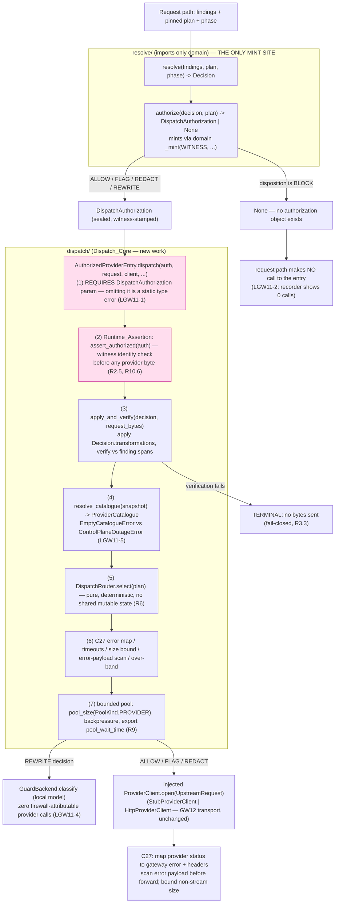

# Design Document

## Overview

GW11 (runbook §10.9, "Build provider dispatch with verified transformation and no firewall-initiated generation") is the one place a provider is called, reachable only with authorization, sending only verified bytes. This design builds the **Dispatch_Core** — the authorization + verification + error-mapping + pool-bound layer that wraps the already-shipped GW12 egress transport (`dispatch/provider.py`, `http_provider.py`, `routing.py`, `transform.py`, `guard_routing.py`), none of which are rewritten.

The design implements exactly the GW11 card plus its two v2.1 corrections, and nothing outside them:

- **C11 (enforcement mechanism).** "BLOCK cannot reach a provider, by type" is **not** enforceable in Python by a sealed constructor alone: `object.__new__`+`setattr`, `dataclasses.replace`, and relabel-then-mint all still reach a recording provider, and an HTTP-style gate is evaded by import aliases. The runbook-honest remedy is a **layered** stack: a sealed value type (`DispatchAuthorization`), a **provenance AST gate** (the primary static guarantee, mirroring `lint/check_http_outside_edge_resolve.py`, targeting the 17-forgery-form coverage the prototype gate reached), a **runtime assertion** at the single provider entry point, a **recorder zero-call proof**, and a **fourth import-linter forbidden contract** (`starlette`/`fastapi` not importable outside `edge/`). This design states precisely which hole each layer closes and which residual it does not.
- **C27 (error mapping + timeouts + size).** Plan-declared timeouts per provider/model; exact provider-error-class mapping with headers (never a blanket `502`); non-stream response-size bound; provider-error-payload scanning before forward; incremental history scanning with an SDK-compatible `context_length_exceeded` over-band error; audit every started request (including cancelled).

The six live acceptance tests this design must satisfy:

| Test | What it proves | Primary requirement |
|------|----------------|---------------------|
| **LGW11-1** | A dispatch omitting the authorization is a static type error; no runtime path reaches a provider without one | R1, R2, R10 |
| **LGW11-2** | A BLOCK decision reaches zero providers, recorder-proven | R4 |
| **LGW11-3** | A REDACT decision sends only sanitized bytes, verified against finding spans, with a verification log | R3 |
| **LGW11-4** | REWRITE runs on the local `GuardBackend`, zero firewall-attributable provider calls | R5 |
| **LGW11-5** | Empty catalogue and control-plane outage are distinct errors; an outage never says "connect your provider" | R7 |
| **LGW11-6** | 500 concurrent requests across 20 orgs: no spurious provisioning errors, no shared-state corruption | R11 |

### Confirmed facts from the codebase (designed against reality)

- `resolve/resolver.py` holds the single pure `resolve(findings, plan, phase) -> Decision`, importing only `gateway_v2.domain` + resolve-package helpers. It is the only legal minting site (R1.5).
- The "Resolve imports only domain" import-linter `forbidden` contract (in `pyproject.toml`) blocks `resolve → dispatch`. Therefore `DispatchAuthorization` **must** live in `gateway_v2.domain` so both `resolve/` (to mint) and `dispatch/` (to require) can import it from the same lowest layer (R1.4). Confirmed: `domain/__init__.py` is the lowest-layer export surface.
- `runtime/resources.py` `ResourceContract.pool_size(PoolKind.PROVIDER)` already exists and returns `workers()`. The provider pool bound derives from it; `dispatch` holds no capacity literal (R9.1). Confirmed exact names.
- `dispatch/routing.py` `DispatchRouter.select(plan) -> str` is pure, deterministic, slotted, stateless — reused unchanged for routing (R6).
- `dispatch/provider.py` owns `ProviderClient` (`@runtime_checkable`), `UpstreamRequest`, `UpstreamEvent`, `StubProviderClient`. `http_provider.py` is the real streaming client, injected via a `build_app(provider=...)` seam. These are fronted, not rewritten (R2.4, R12.2).
- `detect/guard/backend.py` `GuardBackend` (`@runtime_checkable`, `classify`/`readiness`/`capacity_hint`) is the §10.5.4 local-model path REWRITE routes through (R5.2).
- `egress/output_guard.py` `apply_decision(released, decision, base_offset)` is prior art: it applies a Decision's redaction `Transformation`s with fail-closed-on-uncovered-span and raises `OutputBlocked` on BLOCK. GW11's request-side `apply_and_verify` mirrors its byte-boundary discipline.
- `domain/posture.py` is the single codes-only vocabulary; `edge` owns HTTP mapping (`HTTPException`/`JSONResponse` forbidden outside `edge`/`resolve`). New dispatch error codes live here, not as HTTP objects in `dispatch`.
- `lint/check_http_outside_edge_resolve.py` is the AST-gate idiom to mirror; the structural-gates job in `.github/workflows/gateway-v2.yml` runs each `python -m lint.<gate>` over `gateway_v2` and `state_control`.

### Scope boundaries (R12, non-goals)

- **No real redactor.** The real redactor is GW15. GW11 implements only verification-against-spans and sanitized dispatch using the shipped `Transformation` values (R12.1 / R3.5).
- **No real provider socket rebuild.** `http_provider.py` already exists; GW11 adds only the authorization/verification/error-map/pool layer around the entry. Live-socket conformance is a deferred live gate (R12.2 / R8.6).
- **REWRITE is local only**, through `GuardBackend` — never a provider generation call (R12.3 / R5).
- House conventions preserved: `from __future__ import annotations`; frozen `@dataclass(frozen=True, slots=True)`; tuple `__all__`; no module-level mutable; no capacity literal outside `runtime/resources.py`; the layer order; `mypy --strict`, `ruff`, `lint-imports`, AST gates green (R12.4).

## Architecture

The Dispatch_Core sits on the request path between the resolver and the shipped provider transport. The resolver is the only place an authorization is minted; `dispatch` is the only place one is consumed; a BLOCK yields no authorization so the entry is never reached.



Three C11 defenses are annotated on the diagram and in Components:

1. **Sealed value type + domain mint seam** — a naive `DispatchAuthorization(...)` from outside raises; minting requires a module-private witness only `resolve/` reaches through the mint seam.
2. **Provenance AST gate (`lint/check_dispatch_provenance.py`)** — the primary static guarantee; flags every forgery form outside `resolve/`.
3. **Runtime assertion** at `AuthorizedProviderEntry` — re-validates witness identity before any byte, backing the recorder zero-call proof even if a forged object reaches the entry.

### Layer placement

Every new element respects the import-linter layer order `edge > admit > plan > detect > resolve > dispatch > egress > audit > runtime > contracts > domain`:

- `DispatchAuthorization` + its mint seam → `gateway_v2.domain` (lowest layer; importable by both `resolve/` and `dispatch/`).
- The authorize **call** → `gateway_v2.resolve` (the only mint site; imports only domain — contract-legal).
- `AuthorizedProviderEntry`, `apply_and_verify`, `ProviderCatalogue` + catalogue resolution, the C27 error map, the bounded pool → `gateway_v2.dispatch` (may import `domain`, `egress`, `runtime`, and — for the error-payload scan seam — a `detect/guard` scan surface, since `dispatch` sits **above** `detect`).
- The provenance gate → `gateway_v2.lint` (a standalone AST script, like the existing gates).
- The fourth import-linter contract → `gateway_v2/pyproject.toml`.

### REWRITE branch (no firewall-initiated generation)

A `Decision` whose winning action was `REWRITE` maps to `Disposition.REDACT` in the resolver (confirmed in `resolve/decision.py::_action_to_disposition`), carrying redaction transformations. GW11 routes the **rewrite execution** — when REWRITE is supported — through the local `GuardBackend` path (`detect/guard/backend.py`), never a provider generation call. `dispatch` sits above `detect` in the layer order, so `dispatch` may call a `detect/guard` scan/classify seam; the seam is injected (not imported upward past the contract) exactly as `http_provider.py` injects its SSE decoder. The recorder proves zero firewall-attributable provider calls for a REWRITE (LGW11-4).

## Components and Interfaces

Each component names its layer, its signature, and which existing symbol it wraps or reuses.

### C1 — `DispatchAuthorization` + mint seam — `gateway_v2/domain/dispatch_authorization.py` (NEW, domain layer)

The sealed value type and its module-private mint. Exported from `domain/__init__.py` (R1.4).

```python
# gateway_v2/domain/dispatch_authorization.py
from __future__ import annotations
from dataclasses import dataclass

class _Witness:
    """Module-private provenance token. The ONLY instance is _WITNESS below.
    It is not exported and cannot be named from outside this module without
    reaching into module internals (which the provenance gate flags)."""
    __slots__ = ()

_WITNESS = _Witness()

@dataclass(frozen=True, slots=True)
class DispatchAuthorization:
    """Proof a request is authorized to reach a provider (R1.1).

    Frozen + slotted. Carries the decision identity it authorizes (plan_version,
    disposition) and a private witness reference. __post_init__ validates the
    witness by IDENTITY (is), so a naive DispatchAuthorization(...) from outside
    — which cannot name _WITNESS — raises at construction (R1.2, the sealed
    constructor). This closes the naive-construction hole; it does NOT by itself
    close object.__new__/setattr forgery (that is the gate + runtime assertion)."""
    plan_version: str
    disposition: str          # Disposition value the auth was minted for
    _witness: _Witness

    def __post_init__(self) -> None:
        if self._witness is not _WITNESS:
            raise ValueError("DispatchAuthorization is not constructible outside resolve/ mint")

def _mint(plan_version: str, disposition: str) -> DispatchAuthorization:
    """Module-private mint. Stamps the one _WITNESS so __post_init__ passes.
    resolve/ reaches this through authorize(); the provenance gate flags any
    call to _mint (or direct construction / replace / __new__) outside resolve/."""
    return DispatchAuthorization(plan_version=plan_version, disposition=disposition, _witness=_WITNESS)
```

**Honest residual (C11).** This closes naive `DispatchAuthorization(...)` (raises — the witness cannot be named). It does **not** close `object.__new__(DispatchAuthorization)` + `object.__setattr__`, nor `dataclasses.replace` on a valid auth, by the type alone — Python allows both. Those are closed statically by the provenance gate (C4) and dynamically by the runtime assertion (C3). This matches C11's own position: "not enforceable by a sealed constructor alone."

### C2 — `authorize()` — `gateway_v2/resolve/authorize.py` (NEW, resolve layer; the ONLY mint call)

```python
# gateway_v2/resolve/authorize.py — imports ONLY gateway_v2.domain
from gateway_v2.domain import Decision, Disposition
from gateway_v2.domain.dispatch_authorization import DispatchAuthorization, _mint

def authorize(decision: Decision) -> DispatchAuthorization | None:
    """Mint an authorization for a non-terminal Decision; None for BLOCK (R1.5, R4.2).

    A BLOCK Decision is terminal: no authorization is minted, so no object exists
    for any caller to pass to the entry (LGW11-2). ALLOW/FLAG/REDACT (incl.
    REWRITE->REDACT) mint one stamped with the decision identity."""
    if decision.disposition is Disposition.BLOCK:
        return None
    return _mint(plan_version=decision.plan_version, disposition=str(decision.disposition))
```

Re-exported from `resolve/__init__.py`. This is the single mint site; the provenance gate's allow-set top package is `resolve`.

### C3 — `AuthorizedProviderEntry` + `assert_authorized` — `gateway_v2/dispatch/authorized.py` (NEW, dispatch layer)

The single entry (R2.1). Requires a `DispatchAuthorization` parameter so omission is a static type error (R2.2, LGW11-1). Fronts the shipped `ProviderClient` without rewriting it (R2.4).

```python
# gateway_v2/dispatch/authorized.py
from gateway_v2.domain.dispatch_authorization import DispatchAuthorization, _WITNESS
from gateway_v2.dispatch.provider import ProviderClient, UpstreamRequest, UpstreamEvent

def assert_authorized(auth: DispatchAuthorization) -> None:
    """Runtime_Assertion (R2.5, R10.6): re-verify provenance by witness identity
    before any provider byte. A forged object (object.__new__ bypassing
    __post_init__) carries a _witness that is not _WITNESS by identity, so this
    raises — backing the recorder zero-call proof (R4.3) at run time."""
    if getattr(auth, "_witness", None) is not _WITNESS:
        raise ValueError("unauthorized dispatch: authorization provenance check failed")

class AuthorizedProviderEntry:
    """The ONE provider entry (R2.1). Holds injected collaborators (ProviderClient,
    Transform, DispatchRouter, catalogue resolver, error mapper, bounded pool);
    none are shared mutable request-path state."""
    __slots__ = ("_client", "_router", "_transform", "_pool", "_error_map", "_scan", ...)

    async def dispatch(
        self,
        auth: DispatchAuthorization,          # REQUIRED — omission is a build-time type error
        *,
        decision: Decision,
        request: GatewayRequest,
        catalogue: ProviderCatalogue,
    ) -> AsyncIterator[UpstreamEvent]:
        assert_authorized(auth)                # (R2.5) before any byte
        verified = apply_and_verify(decision, request)   # (R3) terminal on failure
        destination = self._router.select(... plan ...)  # (R6) pure
        upstream = self._transform.to_provider(verified.request)
        async with self._pool.lease() as _slot:          # (R9) bounded, pool_wait_time exported
            async for event in self._client.open(upstream):
                yield self._error_map.scan_and_map(event) # (C27) scan payload, map errors
```

`dispatch` is `async` (the shipped transport is async-streaming). Omitting `auth` fails `mypy --strict` (a required positional-or-keyword parameter), which is LGW11-1's static half; `assert_authorized` is its runtime half.

### C4 — `apply_and_verify()` — `gateway_v2/dispatch/verify.py` (NEW, dispatch layer)

Applies `Decision.transformations` to the request bytes, then verifies the result against the finding spans. Mirrors `egress/output_guard.py::apply_decision`'s byte-boundary discipline on the request side; reuses the shipped `Transformation`/`Span` types; introduces no new redactor (R3.5, R12.1).

```python
@dataclass(frozen=True, slots=True)
class VerifiedBytes:
    """The only bytes the entry may send: Decision.transformations applied AND
    verified against the finding spans (R3.1, R3.2)."""
    request: GatewayRequest
    log: str   # the LGW11-3 verification log entry

class VerificationFailure(Exception):
    """Terminal (R3.3): no bytes are sent to the provider."""

def apply_and_verify(decision: Decision, request: GatewayRequest) -> VerifiedBytes:
    """Apply decision.transformations to request bytes; verify every finding span
    that must be redacted is in fact replaced and no raw span survives, byte-level
    (R3.2). Fail-closed: any uncovered/partial span or surviving raw span raises
    VerificationFailure (R3.3). For a REDACT decision, send only sanitized bytes
    and emit the verification log (R3.4). Reuses Transformation/Span (R3.5)."""
```

A BLOCK never reaches here (no authorization). A REDACT decision's transformations are applied, then every `finding.spans` entry under a redacting disposition is checked to be covered by a transformation and absent from the output bytes.

### C5 — `ProviderCatalogue` + `resolve_catalogue()` — `gateway_v2/dispatch/catalogue.py` (NEW, dispatch layer)

A snapshot resolved like the plan (R7.1), with two **distinct** errors (R7.4, LGW11-5).

```python
@dataclass(frozen=True, slots=True)
class ProviderCatalogue:
    """Snapshot of the providers/models available to a tenant (R7.1).
    Resolved as a snapshot, in the same manner as the pinned plan."""
    org_id: str
    entries: tuple[CatalogueEntry, ...]

class EmptyCatalogueError(Exception):
    """Genuine provisioning absence: the tenant has no provider configured (R7.2).
    This is the only error that may surface as 'connect your provider'."""

class ControlPlaneOutageError(Exception):
    """The catalogue could not be resolved due to a store/control-plane blip (R7.3).
    DISTINCT from EmptyCatalogueError; MUST NOT surface 'connect your provider' (R7.5)."""

def resolve_catalogue(source: CatalogueSource, org_id: str) -> ProviderCatalogue:
    """Resolve the catalogue snapshot. source is INJECTABLE (the real control-plane
    fetch is a seam like the plan snapshot — a store blip raises
    ControlPlaneOutageError; a resolved-but-empty catalogue raises
    EmptyCatalogueError). Keeps the request path pure/testable."""
```

`CatalogueSource` is a `Protocol` injected at the `edge` wiring site, exactly like the plan snapshot — a store outage is signalled as `ControlPlaneOutageError`, genuine absence as `EmptyCatalogueError`. Neither error object carries a tenant-facing "connect your provider" message; `edge` renders codes to responses.

### C6 — C27 error mapping / timeouts / size / scan / over-band — `gateway_v2/dispatch/provider_errors.py` (NEW, dispatch layer)

```python
#: Frozen provider-status -> gateway error-class mapping (R8.1, R8.2, R8.3).
#: NOT a blanket 502. 400 -> 400 (provider code preserved); 429 -> 429 (+Retry-After
#: + rate-limit headers). MappingProxyType, like egress error envelopes.
PROVIDER_STATUS_MAP: Mapping[int, GatewayErrorClass] = MappingProxyType({...})

OVER_BAND_CODE = "context_length_exceeded"   # SDK-compatible, NOT 413 (R8.7)

def map_provider_error(status: int, headers, body) -> GatewayError: ...     # R8.1-8.3
def provider_timeout_s(plan, provider, model) -> float: ...                 # R8.4 — from pinned plan, no fixed 120s
def bound_nonstream_body(reader, max_bytes: int) -> bytes: ...              # R8.5 — fail-closed over bound
def scan_error_payload(payload, scan_seam) -> ScannedPayload: ...          # R8.6 — scan before forward
def over_band_error(history, model_band) -> GatewayError: ...              # R8.7 — incremental history scan
```

- **Error class, not blanket 502 (R8.3).** The frozen map preserves class + headers.
- **Timeouts from the plan (R8.4).** Per provider/model; a legitimately slow first token (e.g. 125 s) is not cut at a fixed 120 s.
- **Non-stream size bound (R8.5).** `max_bytes` derives from `ResourceContract`/plan (no capacity literal in `dispatch`); fail-closed over it so one BYOK tenant cannot OOM a shared worker.
- **Error-payload scan (R8.6).** The scan seam is a `detect/guard` surface injected into the entry (dispatch sits above detect — layer-legal). A provider error frame echoing a secret is scanned before forward.
- **Over-band (R8.7).** Incremental history scanning yields the SDK-compatible `context_length_exceeded`, not a `413`.
- **Malformed body (R9.4).** A provider body that does not decode is a protocol error (`stream_malformed_upstream` reused from `domain.posture`), never reported as success.
- **Audit every started request (R8.8).** Including cancelled ones — the entry records a start on lease, independent of completion.

### C7 — `ProviderPool` — `gateway_v2/dispatch/pool.py` (NEW, dispatch layer)

```python
class ProviderPool:
    """Bounded, instrumented provider connection pool (R9).
    Bound = ResourceContract.pool_size(PoolKind.PROVIDER) — PASSED IN at construction
    from the edge wiring site; this module holds NO capacity literal (R9.1).
    Exhaustion -> bounded queueing with backpressure, never an exception storm (R9.2).
    Exports pool_wait_time (R9.3)."""
    __slots__ = ("_bound", "_sem", "_wait_metric")
    def __init__(self, *, bound: int, wait_metric: WaitMetric) -> None: ...
    async def lease(self) -> AsyncContextManager[None]: ...   # measures + exports wait time
```

The bound arrives as an `int` from `pool_size(PoolKind.PROVIDER)` resolved in `edge`/`runtime`, so no `maxsize=`/`Semaphore(N)` capacity literal lives in `dispatch` (the capacity-literal AST gate stays green).

### C8 — Provenance gate — `gateway_v2/lint/check_dispatch_provenance.py` (NEW, lint)

Mirrors `check_http_outside_edge_resolve.py` (R10.1). Allowed top package: `resolve` (plus the gate's own test fixtures, excluded like the secret gate's allowlist). Runnable `python -m lint.check_dispatch_provenance gateway_v2`; added to the structural-gates job (R10.3). Flags every forgery form outside `resolve/` (R10.2), tracking import aliases:

| # | Forgery form | AST detection |
|---|--------------|---------------|
| 1 | `DispatchAuthorization(...)` direct construction | `Call` whose func resolves to the tracked name |
| 2 | `_mint(...)` call | `Call` to the mint name (and `from ... import _mint as X`) |
| 3 | `dataclasses.replace(auth, ...)` | `Call` to `replace`/`dataclasses.replace` with an auth-typed first arg name |
| 4 | `object.__new__(DispatchAuthorization)` | `Call` to `__new__` with the tracked name as arg |
| 5 | `object.__setattr__(x, "_witness", ...)` / `x._witness = ...` | `Call` to `__setattr__` / `Attribute` assign of `_witness`/`_field` |
| 6 | `copy.copy`/`copy.deepcopy` of an auth | `Call` to `copy`/`deepcopy` on a tracked name |
| 7 | `type(auth)(...)` reconstruction | `Call` whose func is `type(<tracked>)` |
| 8 | import-alias evasion | track `from gateway_v2.domain... import DispatchAuthorization as X` / `import ... as Y` and treat `X`/`Y` as the tracked name |
| ... | (the forgery-form class the prototype gate caught — 17 forms) | enumerated in the gate; each form has a dedicated matrix test |

The design states honestly: **the AST gate is the enforceable static guarantee**; the runtime witness assertion is defense-in-depth for the dynamic holes a static gate cannot see (eval/alias at run time); the residual is a determined `object.__new__` + `object.__setattr__` forgery **inside** a module the gate does not scan — closed in the common case by the witness-identity runtime check (the witness is a module-private object the forger cannot name), and by the gate for every static case.

### C9 — Fourth import-linter contract — `gateway_v2/pyproject.toml` (edit)

A fourth `forbidden` contract (R10.4): `starlette` and `fastapi` are not importable outside `gateway_v2.edge`.

```toml
[[tool.importlinter.contracts]]
name = "No HTTP framework outside edge"
type = "forbidden"
source_modules = [
    "gateway_v2.admit", "gateway_v2.plan", "gateway_v2.detect", "gateway_v2.resolve",
    "gateway_v2.dispatch", "gateway_v2.egress", "gateway_v2.audit",
    "gateway_v2.runtime", "gateway_v2.contracts", "gateway_v2.domain",
]
forbidden_modules = ["starlette", "fastapi"]
```

Since `starlette`/`fastapi` are not runtime dependencies (the raw-ASGI `edge` imports neither — confirmed in `pyproject.toml` `[project.dependencies]` = `psycopg` + `redis` only), the contract asserts the "no HTTP framework outside `edge`" intent grounded in the actual dependencies, naming `starlette`/`fastapi` per C11 (R10.5). import-linter treats an **absent** forbidden module as trivially kept, so the contract is well-formed and green even with the modules absent — this design states that explicitly.

## Data Models

| Type | Layer / module | Fields | Role / requirement |
|------|----------------|--------|---------------------|
| `DispatchAuthorization` | `domain/dispatch_authorization.py` | `plan_version: str`, `disposition: str`, `_witness: _Witness` | Sealed proof of authorization; frozen+slots; `__post_init__` identity-checks the witness (R1.1–1.4) |
| `_Witness` / `_WITNESS` | `domain/dispatch_authorization.py` | `__slots__ = ()` singleton | Module-private provenance token; only `_mint` stamps it (R1.6) |
| `VerifiedBytes` | `dispatch/verify.py` | `request: GatewayRequest`, `log: str` | The only bytes the entry may send; carries the LGW11-3 verification log (R3.1, R3.4) |
| `VerificationFailure` | `dispatch/verify.py` | exception | Terminal verification failure — no bytes sent (R3.3) |
| `ProviderCatalogue` | `dispatch/catalogue.py` | `org_id: str`, `entries: tuple[CatalogueEntry, ...]` | Snapshot catalogue (R7.1) |
| `CatalogueEntry` | `dispatch/catalogue.py` | `provider: str`, `model: str`, `timeout_s: float`, `context_band: int` | One available provider/model; carries the plan-declared timeout + band (R8.4, R8.7) |
| `EmptyCatalogueError` | `dispatch/catalogue.py` | exception | Genuine provisioning absence (R7.2) — the only one that may say "connect your provider" |
| `ControlPlaneOutageError` | `dispatch/catalogue.py` | exception | Store/control-plane blip (R7.3); distinct (R7.4); never "connect your provider" (R7.5) |
| `GatewayErrorClass` / `GatewayError` | `dispatch/provider_errors.py` | `status: int`, `code: str`, `headers: Mapping[str, str]` | Mapped provider error, class + headers preserved (R8.1–8.3) |
| `PROVIDER_STATUS_MAP` | `dispatch/provider_errors.py` | `MappingProxyType[int, GatewayErrorClass]` | Frozen status map; never blanket 502 (R8.3) |
| `ProviderPool` | `dispatch/pool.py` | `_bound: int`, `_sem`, `_wait_metric` | Bounded pool, no capacity literal, exports `pool_wait_time` (R9.1–9.3) |
| `AuthorizedProviderEntry` | `dispatch/authorized.py` | injected collaborators | The one entry requiring the authorization (R2) |

Reused unchanged: `Decision`, `Disposition`, `Transformation`, `Finding`, `Span` (`domain`); `ProviderClient`, `UpstreamRequest`, `UpstreamEvent`, `StubProviderClient`, `HttpProviderClient` (`dispatch`); `DispatchRouter` (`dispatch/routing.py`); `Transform`, `GatewayRequest` (`dispatch/transform.py`); `GuardBackend` (`detect/guard/backend.py`); `ResourceContract`, `PoolKind.PROVIDER` (`runtime/resources.py`); the `domain.posture` codes; `egress/output_guard.apply_decision` as byte-discipline prior art.

## Correctness Properties

*A property is a characteristic or behavior that should hold true across all valid executions of a system — essentially, a formal statement about what the system should do. Properties serve as the bridge between human-readable specifications and machine-verifiable correctness guarantees.*

The prework classified each acceptance criterion as PROPERTY / EXAMPLE / EDGE_CASE / INTEGRATION / SMOKE and consolidated redundant criteria. The properties below are the consolidated, non-redundant universal statements. Architectural/static criteria (the AST gate's own exit behavior, the import-linter contract, mypy negative fixtures, "no new redactor") are verified by gate/type/structural tests described in the Testing Strategy rather than as property-based tests.

### Property 1: Sealed constructor — no authorization is constructible outside the mint

*For any* field tuple, constructing a `DispatchAuthorization` directly (without the module-private witness, as any caller outside the domain mint must) raises, so no forged authorization is obtainable by ordinary construction.

**Validates: Requirements 1.1, 1.2**

### Property 2: `dataclasses.replace` on an authorization fails

*For any* minted `DispatchAuthorization` and any field override, `dataclasses.replace` raises, because the reconstructed object re-runs the witness-identity check without the private witness.

**Validates: Requirements 1.3**

### Property 3: Authorization is minted iff the decision is non-terminal

*For any* `Decision`, `authorize(decision)` returns `None` if and only if the disposition is `BLOCK`, and a valid authorization for every ALLOW / FLAG / REDACT (including REWRITE→REDACT) decision.

**Validates: Requirements 1.5, 4.2**

### Property 4: A forged authorization is rejected at the runtime assertion

*For any* authorization-shaped object whose witness is not the module-private singleton (e.g. built via `object.__new__` so `__post_init__` never ran), the runtime assertion at the provider entry raises before any provider byte is sent, and the recorder shows zero provider calls.

**Validates: Requirements 1.6, 2.3, 2.5, 10.6**

### Property 5: BLOCK reaches no provider (recorder-proven)

*For any* `BLOCK` decision, the resolver mints no authorization, so the request path never invokes the entry, and a recording `ProviderClient` shows zero provider calls.

**Validates: Requirements 4.1, 4.2, 4.3**

### Property 6: Transformed bytes verify against finding spans, or nothing is sent

*For any* `(decision, request)` where the decision carries redaction transformations, `apply_and_verify` applies every transformation and the resulting bytes contain no raw bytes at any finding span a redacting disposition covers; if any covered span still carries raw bytes (uncovered or partial transformation), verification fails terminally and the recorder shows zero provider calls.

**Validates: Requirements 3.1, 3.2, 3.3, 3.4**

### Property 7: REWRITE runs on the local Guard_Backend with zero firewall-attributable provider calls

*For any* REWRITE decision, the rewrite executes through the injected `GuardBackend` local path and never the `ProviderClient`, so a recording provider shows zero firewall-attributable calls.

**Validates: Requirements 5.1, 5.2, 5.3, 12.3**

### Property 8: Routing is deterministic from plan identity

*For any* `ExecutionPlan`, repeated `DispatchRouter.select(plan)` returns the identical destination string, with no shared mutable router state read or mutated on the request path.

**Validates: Requirements 6.1, 6.4**

### Property 9: Empty catalogue and control-plane outage are distinct and never confused

*For any* catalogue source: a source resolving to a genuinely empty catalogue raises `EmptyCatalogueError`; a source signalling a store/control-plane outage raises `ControlPlaneOutageError`; the two are distinct classes and an outage never carries the "connect your provider" provisioning message.

**Validates: Requirements 7.2, 7.3, 7.4, 7.5**

### Property 10: Provider errors map to the exact class with headers, never a blanket 502

*For any* provider `4xx` response, the mapped gateway status equals the provider status (400→400 preserving the provider error code; 429→429 preserving `Retry-After` and the rate-limit headers) and is never `502`.

**Validates: Requirements 8.1, 8.2, 8.3**

### Property 11: The request timeout is the plan-declared per-provider/model value

*For any* plan with a declared per-provider/model timeout, `provider_timeout_s` returns that declared value (so a legitimately slow first token, e.g. 125 s, is not cut at a fixed 120 s), and the slow-provider path applies that same bound.

**Validates: Requirements 8.4, 9.5**

### Property 12: Non-streaming responses are size-bounded, fail-closed over the bound

*For any* non-streaming response body: a body at or under the bound is returned intact; a body exceeding the bound fails closed rather than growing worker memory unbounded.

**Validates: Requirements 8.5**

### Property 13: Provider error payloads are scanned before forwarding

*For any* provider error payload, the scan seam is invoked and the payload is sanitized or withheld before any byte is forwarded, so an error frame echoing a secret is never forwarded unscanned.

**Validates: Requirements 8.6**

### Property 14: Over-band conversations return an SDK-compatible context error, not a 413

*For any* multi-turn conversation exceeding the model's context band, the dispatch returns the SDK-compatible `context_length_exceeded` code (never `413`), using incremental history scanning.

**Validates: Requirements 8.7**

### Property 15: Every started request is audited, including cancelled ones

*For any* request that starts — whether it later completes or is cancelled — exactly one audit-start record is produced.

**Validates: Requirements 8.8**

### Property 16: A malformed provider body is reported as a protocol error, never success

*For any* undecodable provider body, the dispatch reports a protocol error (`stream_malformed_upstream`) rather than reporting success.

**Validates: Requirements 9.4**

### Property 17: The pool is bounded and exports its wait time

*For any* burst of requests exceeding the pool bound, the number of concurrent in-flight leases never exceeds `pool_size(PoolKind.PROVIDER)`, excess requests queue with backpressure rather than raising an exception storm, and every lease acquisition records a non-negative `pool_wait_time` sample.

**Validates: Requirements 9.2, 9.3**

### Property 18: The provenance gate flags every forgery form outside resolve/ and passes a clean tree

*For any* tree containing any `DispatchAuthorization` minting or forgery form outside `resolve/`, the provenance gate returns at least one hit (exit non-zero); for any tree with no such forgery, it returns none (exit zero).

**Validates: Requirements 10.1, 10.2**

### Property 19: Concurrency produces no spurious provisioning errors and no shared-state corruption

*For any* interleaving of 500 concurrent requests across 20 orgs with providers present, zero spurious provisioning errors occur, each org's destination stays plan-deterministic, no shared mutable state is corrupted, and any provisioning error that does occur implies a genuinely absent provider for that tenant.

**Validates: Requirements 11.1, 11.2, 11.3**

## Error Handling

The Dispatch_Core is fail-closed throughout. Errors are **codes** (`domain.posture` spellings) that `edge` renders to HTTP/SSE — `dispatch` never constructs an `HTTPException`/`JSONResponse` (forbidden outside `edge`/`resolve`, enforced by the existing HTTP AST gate).

| Condition | Handling | Fail direction | Requirement |
|-----------|----------|----------------|-------------|
| BLOCK decision | `authorize` returns `None`; the entry is never invoked | closed (no call) | R4 |
| Forged / invalid authorization | `assert_authorized` raises before any byte; recorder shows zero calls | closed | R1.6, R2.5, R10.6 |
| Verification failure (uncovered/partial span, surviving raw span) | `apply_and_verify` raises `VerificationFailure`; no bytes sent | closed (terminal) | R3.3 |
| Genuinely empty catalogue | `EmptyCatalogueError` (the only "connect your provider" path) | closed (provisioning) | R7.2 |
| Control-plane / store outage resolving the catalogue | `ControlPlaneOutageError` — distinct; never "connect your provider" | closed (outage, retryable) | R7.3, R7.5 |
| Provider `4xx` | exact-class map (400/429 + headers); never blanket 502 | mapped | R8.1–8.3 |
| Provider slow | plan-declared timeout bound (no fixed 120 s) | bounded | R8.4, R9.5 |
| Non-stream body over size bound | fail-closed; never OOM a worker | closed | R8.5 |
| Provider error payload | scanned before forward (sanitize/withhold) | scanned | R8.6 |
| Over-band conversation | SDK-compatible `context_length_exceeded`, not 413 | mapped | R8.7 |
| Pool exhausted | bounded queueing + backpressure; no exception storm | backpressure | R9.2 |
| Malformed provider body | `stream_malformed_upstream` protocol error, never success | closed | R9.4 |
| Request cancelled | still audited (audit-on-start) | audited | R8.8 |

The witness-identity residual (C11): a determined `object.__new__` + `object.__setattr__("_witness", _WITNESS)` forgery is only possible if the forger can **name** the module-private `_WITNESS`; the provenance gate flags any attribute-set on `_witness` and any import of the domain internals outside `resolve/`, and the runtime assertion rejects any object whose witness is not `_WITNESS` by identity. The honest residual is a forgery written inside a module the gate does not scan that also manages to obtain the private witness object — closed in the common case, not provably closed against arbitrary in-process reflection; this matches C11's stated position.

## Testing Strategy

**Dual approach.** Property-based tests verify the universal properties above across generated inputs; example/edge/integration/smoke tests cover concrete scenarios, the enumerated forgery matrix, structural guarantees, and static-typing checks. PBT is appropriate here because the core is pure/near-pure logic over large input spaces (decisions, spans/transformations, plans, provider statuses, forged objects), with clear universal invariants — not IaC, UI, or simple CRUD.

**Property-based testing.** The repository's house idiom is seeded `random.Random` generators with ≥10,000 iterations and **no** `hypothesis` dependency (confirmed across the AGENTS.md changelog: "house idiom, no hypothesis"). GW11 follows that idiom: each property is one seeded test, minimum 100 iterations (the house default is far higher at ≥10,000; GW11 adopts the house ≥10,000 for the pure properties), tagged:

`# Feature: provider-dispatch-authorization-gw11, Property {n}: {property text}`

Each of Properties 1–19 is implemented by a single property-based test. Concurrency (Property 19, LGW11-6) uses an **injected-clock, in-process** concurrency harness (deterministic, not wall-clock) driving 500 requests across 20 orgs against recording fakes — mirroring the admission/budget concurrency harnesses already in the tree.

**Recorder.** A recording `ProviderClient` (satisfying the `@runtime_checkable` protocol like `StubProviderClient`) counts every provider call; Properties 4, 5, 7 assert zero recorded calls (LGW11-2, LGW11-4) and the runtime-assertion short-circuit (LGW11-1 runtime half).

**Example / edge / integration / smoke tests:**

- **LGW11-1 static half (R2.2):** a `mypy --strict` negative fixture — calling `dispatch()` without the `auth` argument must fail type-checking. Example-based; the static guarantee cannot be a runtime property.
- **Forgery matrix (R10.2, EDGE_CASE):** one fixture per enumerated forgery form (direct construction, `_mint` call, `dataclasses.replace`, `object.__new__`, `object.__setattr__`/attribute assign of `_witness`, `copy`/`deepcopy`, `type(auth)(...)`, import-alias `as X`/`as Y`, …) in a module outside `resolve/`; assert the provenance gate flags each — the 17/17 coverage. The gate's own `scan_tree` is unit-tested on a clean tree (zero hits) and each dirty fixture (≥1 hit).
- **Catalogue distinctness (R7.4, SMOKE):** assert `EmptyCatalogueError` and `ControlPlaneOutageError` are distinct classes, neither in the other's MRO.
- **Transport fronting (R2.4, INTEGRATION):** inject `StubProviderClient`; assert `isinstance(client, ProviderClient)` and the entry drives the shipped transport unchanged.
- **No-adjudicator / no-shared-state (R6.2, R6.3, SMOKE):** wire a fake adjudicator that fails if called; assert `DispatchRouter` carries no instance/module mutable state.
- **No-new-redactor / no-socket-rebuild (R12.1, R12.2, SMOKE):** assert `apply_and_verify` imports `Transformation`/`Span` from `domain` and introduces no redaction algorithm; assert the entry wraps the shipped transport.
- **Import-linter fourth contract (R10.4, R10.5, SMOKE):** assert the contract exists in `pyproject.toml` and `lint-imports` passes (trivially kept with `starlette`/`fastapi` absent).
- **Gate wiring (R10.3, SMOKE):** assert `check_dispatch_provenance` exposes `main()`/`SystemExit` and is added to the structural-gates job in `.github/workflows/gateway-v2.yml`.

**CI gates (R12.4).** Every new module keeps `mypy --strict`, `ruff`, `lint-imports` (now 4 contracts), and all AST gates (`check_sizes`, `check_http_outside_edge_resolve`, `check_no_module_mutable`, `check_capacity_literals`, `check_frozen_dataclasses`, and the new `check_dispatch_provenance`) green against the existing full-suite baseline. The new gate is added to the `structural-gates` job loop over `gateway_v2` (and `state_control`, trivially clean).

## Requirement coverage map

| Requirement | Design element |
|-------------|----------------|
| R1 (sealed authorization, domain, mint-only-resolve) | C1 `DispatchAuthorization`/`_mint`/`_WITNESS`; C2 `authorize`; C8 gate; Properties 1–3 |
| R2 (single authorized entry, requires auth) | C3 `AuthorizedProviderEntry`/`assert_authorized`; Properties 4; LGW11-1 static fixture |
| R3 (apply + verify vs spans) | C4 `apply_and_verify`/`VerifiedBytes`; Property 6 |
| R4 (BLOCK reaches no provider, recorder) | C2 (None on BLOCK); C3; recorder; Property 5 |
| R5 (no firewall generation; REWRITE via GuardBackend) | C3 REWRITE branch → `GuardBackend`; Property 7 |
| R6 (deterministic plan routing, no shared mutable state) | reuse `DispatchRouter`; Property 8; SMOKE no-adjudicator |
| R7 (snapshot catalogue, distinct errors) | C5 `ProviderCatalogue`/`resolve_catalogue`/two errors; Property 9 |
| R8 (C27 error map/timeouts/size/scan/over-band/audit) | C6 `provider_errors`; Properties 10–15 |
| R9 (bounded instrumented pool) | C7 `ProviderPool`; Properties 16, 17 |
| R10 (C11 stack: gate, forbidden contract, runtime assertion) | C8 gate; C9 contract; C3 `assert_authorized`; Properties 4, 18 |
| R11 (concurrency LGW11-6) | injected-clock concurrency harness; Property 19 |
| R12 (non-goals, house conventions) | scope statements; SMOKE/structural tests; CI gates |

## Reference index

- **GW11** — runbook §10.9 dispatch-phase card (objective and exit criteria quoted in Overview).
- **C11** — enforcement mechanism correction: sealed constructor + provenance AST gate (17/17) + runtime assertion + recorder zero-call proof + import-linter forbidden contract. Implemented by C1/C2/C3/C8/C9 and the honest-residual statement in Error Handling.
- **C27** — error mapping + timeouts + size + error-payload scan + over-band + audit. Implemented by C6.
- **LGW11-1 … LGW11-6** — the six live acceptance tests, mapped in the Overview table and the Testing Strategy.
