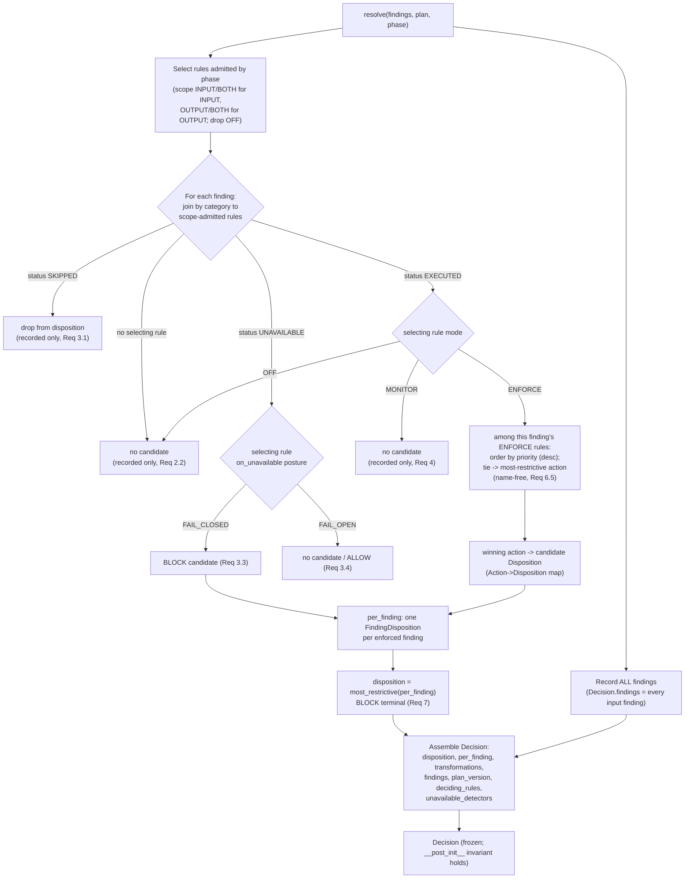
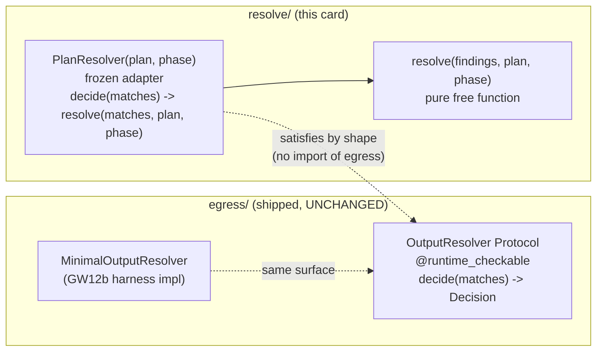

# Design Document

## Overview

GW07 (local half) implements **one pure function** —
`resolve(findings, plan, phase) -> Decision` — in the `gateway_v2.resolve`
layer, built on the already-shipped frozen domain vocabulary. It is the single
security-decision authority of the AI Mesh Firewall: it concentrates every
disposition outcome in one place so that any second decision site becomes a
build failure (runbook §10.9, "Build the single pure resolver and prove nothing
else can decide").

The design is deliberately tight. There is no new type to invent: `Finding`,
`FindingStatus`, `Span`, `Disposition`, `FindingDisposition`, `Transformation`,
`Decision`, `most_restrictive`, `Rule`, `Mode`, `Action`, `FailurePosture`,
`RuleScope`, `Phase`, and `ExecutionPlan` are all shipped and frozen in
`gateway_v2.domain` (verified by reading `domain/finding.py`,
`domain/decision.py`, `domain/plan.py`, `domain/category.py`, and
`domain/__init__.py`). This card fills in the three-line resolve-layer stubs
(`resolve/resolver.py`, `resolve/decision.py`, `resolve/conflict.py`) with the
pure function plus the small helpers it needs, and adds one resolve-layer
adapter that drops into the already-shipped `OutputResolver` protocol seam
**by shape, without importing it** (the layering reason is in
[Design decision 5](#decision-5-the-outputresolver-protocol-seam-structural-compatibility)).

The function removes the §10.1.1 defect class of v1: 283 terminal-decision
sites across 25 modules; organisation intent applied as a *severity maximum*
instead of a *precedence* (P1/P2); a degraded output scan computing an action
independent of the verdict (P3/P6); MONITOR mode enforcing on output (P7); and
adapters erasing a finding before the resolver saw it. The v2.1 CORRECTION C22
(CRITICAL) is the heart of the fix: **per-finding resolution** with the request
disposition taken as the most-restrictive per-finding disposition, so an
organisation's ALLOW for category X can never cancel a BLOCK for category Y, and
**tie-breaks never depend on names**.

### Scope at a glance

GW07 owns ONLY: the pure `resolve()` function, the resolve-layer helper modules
(`decision.py` / `conflict.py`) where logic is factored, the resolve-layer
`PlanResolver` adapter, and the property + example test file. Everything else is
deferred — see [Deferred and out of scope](#deferred-and-out-of-scope).

## Architecture

The resolver is the lowest-but-one layer in the gateway: it imports **only**
`gateway_v2.domain` and is imported by `dispatch`, `egress`, `admit`, and `edge`
above it. The import-linter `layers` list in `gateway_v2/pyproject.toml` orders
`edge` (highest) … `resolve` … `dispatch` … `egress` … `domain` (lowest), and a
second **forbidden** contract, "Resolve imports only domain", pins
`gateway_v2.resolve` to importing nothing but `gateway_v2.domain`. The resolver
is a pure, total function over frozen inputs: no I/O, no clock, no globals, no
logging, no HTTP, and it raises nothing.

### Resolution flow



### The adapter seam



`PlanResolver` structurally satisfies the shipped `@runtime_checkable`
`OutputResolver` protocol (it has `decide(matches) -> Decision`), so it drops
into the seam that `edge/openai_chat.py` already injects — but it **imports only
`gateway_v2.domain`**, never `egress`. The wiring that injects it is GW08/GW15.

## Components and Interfaces

### `gateway_v2/resolve/resolver.py` — the pure function (new content)

```python
def resolve(
    findings: Sequence[Finding],
    plan: ExecutionPlan,
    phase: Phase,
) -> Decision: ...
```

- Pure, total. Same inputs → same `Decision`, always. Raises nothing.
- Imports only from `gateway_v2.domain`.
- Steps 1–6 of §10.5.3 in strict order (see [Design decision 3](#decision-3-per-finding-resolution-c22)).

### `gateway_v2/resolve/conflict.py` — per-finding priority + tie-break (new content)

Helper(s), pure, importing only `gateway_v2.domain`:

- `_select_rules(plan, phase) -> tuple[Rule, ...]` — the phase-admitted,
  non-OFF rules.
- `_rules_for(finding, selected) -> tuple[Rule, ...]` — the category join.
- `_winning_action(finding, rules) -> Action | None` — priority ordering +
  name-free tie-break among the ENFORCE rules selecting one finding; returns
  `None` when no ENFORCE rule selects the finding.

### `gateway_v2/resolve/decision.py` — Action→Disposition + Decision assembly (new content)

Helpers, pure, importing only `gateway_v2.domain`:

- `_action_to_disposition(action: Action) -> Disposition` — the 5→4 mapping
  ([decision 2](#decision-2-the-actiondisposition-mapping)).
- `_transformations_for(finding, disposition) -> tuple[Transformation, ...]` —
  mirrors `MinimalOutputResolver.decide`: a `Transformation(kind="redact",
  span, replacement)` per span when the finding's disposition is REDACT.
- `PlanResolver` — the frozen, slotted adapter
  ([decision 5](#decision-5-the-outputresolver-protocol-seam-structural-compatibility)).

> These modules re-use the domain `Decision`/`Disposition`/`Transformation`
> types (Req 1.3, 8.5); they do NOT redefine them. The resolve-layer
> `decision.py`/`conflict.py` names are kept (per Req 12.6) but hold only
> helpers, never a second vocabulary.

### `PlanResolver` — the adapter

```python
@dataclass(frozen=True, slots=True)
class PlanResolver:
    plan: ExecutionPlan
    phase: Phase

    def decide(self, matches: Sequence[Finding]) -> Decision:
        return resolve(matches, self.plan, self.phase)
```

Structurally compatible with the shipped `OutputResolver` protocol. The
`plan`/`phase` the free function needs are bound at construction, which is why
`decide(matches)` can keep the plan-agnostic protocol signature — the signature
gap is closed by construction, not by widening the protocol.

## Data Models

All data models are **shipped and frozen** — this card adds none. The verified
shapes (read from source) that the resolver consumes and produces:

| Type | Shape (verified) | Role in the resolver |
|---|---|---|
| `Finding` | `detector, detector_version, category, status, confidence, spans, evidence` | input; join key is `category`; `detector` names the unavailable detector; `spans` feed transformations |
| `FindingStatus` | `EXECUTED \| SKIPPED \| UNAVAILABLE` | step 2/3 routing |
| `Span` | `start, end` | transformation coordinates |
| `Disposition` | `ALLOW \| FLAG \| REDACT \| BLOCK` (ranked BLOCK>REDACT>FLAG>ALLOW) | candidate + request disposition |
| `most_restrictive` | `tuple[Disposition, ...] -> Disposition`; **empty tuple → ALLOW** | request disposition from per-finding dispositions |
| `FindingDisposition` | `detector, disposition` | one per enforced finding → `Decision.per_finding` |
| `Transformation` | `kind, span, replacement` | REDACT output edits |
| `Decision` | `disposition, per_finding, transformations, findings, plan_version, deciding_rules, unavailable_detectors`; `__post_init__` requires `disposition == most_restrictive(per_finding dispositions)` **when per_finding is non-empty** | the single return type |
| `Rule` | `rule_id, category, mode, action, threshold, priority, scope, on_unavailable, surfaces` | the governing rule |
| `Mode` | `OFF \| MONITOR \| ENFORCE` | OFF→no select, MONITOR→non-enforcing, ENFORCE→candidate |
| `Action` | `ALLOW \| FLAG \| REDACT \| BLOCK \| REWRITE` | the configured candidate action |
| `FailurePosture` | `FAIL_OPEN \| FAIL_CLOSED` (**no `DEGRADE_TO`**) | UNAVAILABLE routing |
| `RuleScope` | `INPUT \| OUTPUT \| BOTH` | phase admission |
| `Phase` | `INPUT \| OUTPUT` | the third argument |
| `ExecutionPlan` | `… rules, required_detectors …` + `.version` property `f"{epoch}.{sequence}.{content_hash[:16]}"` | the rule set + `plan_version` source |

Verified subtlety carried into the design: `Decision.__post_init__` only raises
when `per_finding` is non-empty. So a request with no enforced finding has an
empty `per_finding`, and the resolver sets `disposition = Disposition.ALLOW`
(matching `most_restrictive(()) == ALLOW`) — consistent by construction.

## Design decisions

Each decision below is grounded in a shipped fact (file + symbol) or in the
runbook (§10.5.3, §10.9, C22).

### Decision 1: Finding → selecting-rule mapping (the join)

**Decision.** A rule *selects* a finding when **both**:
1. the rule's `category` equals the finding's `category` (same `Category`
   enum — verified `Rule.category: Category` in `plan.py` and
   `Finding.category: Category` in `finding.py`), AND
2. the rule's `scope` admits the current `phase`: `phase is Phase.INPUT`
   admits `RuleScope.INPUT` or `RuleScope.BOTH`; `phase is Phase.OUTPUT`
   admits `RuleScope.OUTPUT` or `RuleScope.BOTH`.

`Mode.OFF` rules never select (OFF means no work).

**Grounding.** The runbook §10.5.3 step 222 says "Partition findings by the
rule that selected the detector." The only shared, type-identical field between
`Finding` and `Rule` is `category`, so it is the join key; `scope`/`phase`
constrain which rules apply at the current call. The shipped
`enforcing_output_rules(plan)` in `egress/output_guard.py` already filters by
`scope in {OUTPUT, BOTH}` and `mode is ENFORCE` for the OUTPUT phase — this
design generalises exactly that filter to both phases.

**Consequences.** A finding may be selected by **multiple** rules of the same
category — that is precisely where per-finding priority ordering applies
(decision 3). A finding whose category matches no scope-admitted rule has **no
selecting rule**: it is recorded in `Decision.findings` and contributes no
candidate (Req 2.2).

### Decision 2: The Action→Disposition mapping

`Action` has 5 members; `Disposition` has 4. The mapping:

| `Action` | `Disposition` |
|---|---|
| `ALLOW` | `ALLOW` |
| `FLAG` | `FLAG` |
| `REDACT` | `REDACT` |
| `BLOCK` | `BLOCK` |
| **`REWRITE`** | **`REDACT`** |

**Decision.** `REWRITE` maps to `REDACT`.

**Grounding.** `REWRITE` is a payload-mutating action (it produces
`Transformation`s), and the shipped `Decision.disposition` vocabulary has no
`REWRITE` member — the runbook's `Decision` struct (§10.5.3) lists disposition
as `ALLOW | FLAG | REDACT | BLOCK` only. The shipped egress glue already treats
REWRITE as redaction-family: `_ENFORCING_ACTIONS` in `egress/output_guard.py` is
`{REDACT, BLOCK, REWRITE}`, i.e. REWRITE is grouped with the transformation
actions, and the harness emits `Transformation(kind="redact", …)` for the
redact-family. Mapping `REWRITE → REDACT` is the conservative,
transformation-producing choice: it mutates the payload (never silently allows)
and never downgrades a BLOCK. A dedicated rewrite-replacement vocabulary (a
distinct `Transformation.kind="rewrite"` with a per-rule replacement string) is
**not** representable from the shipped `Rule` fields alone and is left to the
GW05 plan-compiler / a follow-up ticket; GW07 records the conservative mapping
and does not invent a replacement source.

### Decision 3: Per-finding resolution + request disposition (C22)

For **each** finding, in strict step order (§10.5.3 steps 222–227):

1. Gather the finding's scope-admitted selecting rules (decision 1).
2. `SKIPPED` → no candidate (recorded only). `UNAVAILABLE` → routed through the
   selecting rule's `on_unavailable` posture: `FAIL_CLOSED` → **BLOCK**
   candidate; `FAIL_OPEN` → **no candidate** (ALLOW). No generic degraded
   branch exists.
3. Among the finding's `EXECUTE`ING selecting rules, order by `priority`
   **descending — highest priority wins**, and the winning rule's `action` maps
   (decision 2) to that finding's candidate `Disposition`. `MONITOR` rules
   contribute nothing. `OFF` rules do not select.
4. The finding yields **at most one** `FindingDisposition(detector,
   disposition)` (the candidate from its winning ENFORCE rule, or a FAIL_CLOSED
   UNAVAILABLE BLOCK). Findings with no candidate produce no `FindingDisposition`.

**Priority direction.** Highest `priority` wins. Grounding: §10.5.3 and C22 say
priority is "where organisation intent overrides a recommendation" — the signed
organisation rule is given the higher priority by the GW05 compiler, so "highest
wins" lets organisation intent override a detector recommendation. This is a
per-finding ordering only (step 226 / C22): priority **never** crosses findings.

**Name-independent tie-break (the critical C22 fix).** When two ENFORCE rules
selecting the **same finding** have equal `priority`, the tie-break is **the
most-restrictive mapped action among the tied rules** (rank BLOCK>REDACT>FLAG>
ALLOW via the shipped `most_restrictive`). This is **name-free**: it depends only
on the actions, never on `rule_id` ordering. Grounding: C22 states plainly
"tie-breaks never depend on names" and gives the exact defect being removed —
"at equal priority renaming a rule flipped the outcome." Ordering tied rules by
`rule_id` would re-introduce that defect, so it is explicitly rejected.
Property P6 ([Correctness Properties](#correctness-properties)) proves the
name-independence.

**Request disposition.** `disposition = most_restrictive(tuple of per-finding
dispositions)` using the shipped function. There is **no severity maximum
across different findings**: ALLOW for category X and BLOCK for category Y both
produce their own `FindingDisposition`, and `most_restrictive` keeps the BLOCK —
it does not let the ALLOW cancel it (Req 6.4, C22). An empty `per_finding` →
`most_restrictive(()) == ALLOW`.

**Deciding rules.** `Decision.deciding_rules` records, in priority order, the
`rule_id`s that produced the per-finding candidates. These identifiers are an
*output record* (audit), not an *input* to the tie-break — recording a name is
not the same as deciding by a name, so Req 6.5 and the name-independence
property are both satisfied.

### Decision 4: Decision assembly

- `findings` = **all** input findings, order-preserving (EXECUTED, SKIPPED,
  UNAVAILABLE, and no-rule findings alike) — Req 2.3, and the runbook struct
  comment "ALL of them, including SKIPPED".
- `per_finding` = the `FindingDisposition`s from enforced findings (decision 3).
- `disposition` = `most_restrictive(per_finding dispositions)` — so the shipped
  `Decision.__post_init__` invariant holds by construction, and **BLOCK is
  terminal** (Req 7) because `most_restrictive` ranks BLOCK highest: once any
  per-finding disposition is BLOCK the request disposition is BLOCK and no
  later REDACT/FLAG contribution can lower it.
- `transformations` = for each finding whose candidate disposition is REDACT
  (including REWRITE→REDACT), one `Transformation(kind="redact", span,
  replacement)` per span — mirroring `MinimalOutputResolver.decide` and using
  the shipped `REDACTION_PLACEHOLDER` sentinel value `"[REDACTED]"` (the
  resolver re-declares the sentinel locally so it imports only domain; the two
  must agree, pinned by a test).
- `plan_version` = `plan.version` (Req 1.5).
- `unavailable_detectors` = the `detector` of every UNAVAILABLE finding
  (Req 3.5), order-preserving and de-duplicated.

### Decision 5: The `OutputResolver` protocol seam (structural compatibility)

**The constraint.** The shipped `egress/output_guard.py` defines a
`@runtime_checkable OutputResolver` `Protocol` with `decide(matches:
Sequence[Finding]) -> Decision`, implemented by `MinimalOutputResolver`;
`edge/openai_chat.py` injects a resolver and calls `deps.resolver.decide(...)`.
The docstrings say "GW08's real resolver implements this same surface" /
"GW08's resolver drops in behind the same protocol." GW07 is that real resolver.

**But the protocol lives in `egress`, which the resolve layer may NOT import.**
Verified in `pyproject.toml`: the `layers` list puts `resolve` *above* `egress`
(a layer may import only lower layers, so `resolve → egress` is forbidden), and
the explicit "Resolve imports only domain" **forbidden** contract bans
`gateway_v2.resolve` from importing `egress` (and everything else except
`domain`). So the resolver **cannot import `OutputResolver`**.

**The reconciliation.** GW07 ships two things in `resolve/`:
1. the free function `resolve(findings, plan, phase) -> Decision` (plan+phase
   aware), and
2. a frozen, slotted `PlanResolver(plan, phase)` adapter whose
   `decide(matches) -> Decision` calls `resolve(matches, self.plan,
   self.phase)`.

Because `OutputResolver` is `@runtime_checkable` and defines its shape purely by
the `decide(matches) -> Decision` method, `PlanResolver` **satisfies it
structurally** — duck-typed, no import of `egress` needed. The adapter drops
into the shipped seam while the whole `resolve` package still imports only
`domain`. The signature gap (the protocol's `decide` takes no plan/phase) is
closed by binding `plan`/`phase` at construction. The wiring that constructs a
`PlanResolver` per request and injects it where `edge`/`egress` expect an
`OutputResolver` is **GW08/GW15**, not this card. GW07 does **not** move the
protocol or change `egress`.

### Decision 6: Purity and layer enforcement

`resolve()` and all resolve-layer helpers import **only** `gateway_v2.domain`:
no I/O, no clock, no globals, no logging, no HTTP, and the function raises
nothing (totality — every input of the declared types maps to a `Decision`).
Any value helper is a frozen, slotted dataclass; `PlanResolver` is frozen +
slotted. No capacity literal and no module-level mutable (so
`check_capacity_literals` / `check_no_module_mutable` stay green). The
`check_http_outside_edge_resolve` gate lists `resolve` in `ALLOWED_TOP`
(verified), so HTTP in `resolve/` is permitted by the gate — but the resolver
contains none anyway, satisfying Req 8.4.

## Correctness Properties

*A property is a characteristic or behavior that should hold true across all
valid executions of a system — essentially, a formal statement about what the
system should do. Properties serve as the bridge between human-readable
specifications and machine-verifiable correctness guarantees.*

The resolver is a pure, total function over frozen inputs, so it is an ideal
property-based-testing target. The six properties below map one-to-one onto
Requirement 9.1–9.6 (the LGW07-8 suite). The prework consolidated the
construction/structural invariants (disposition = most_restrictive(per_finding);
`findings` completeness; `unavailable_detectors` completeness; one
`FindingDisposition` per enforced finding; BLOCK dominance) into a single
**structural-invariants assertion bundle** asserted inside every property
iteration rather than as separate properties, leaving exactly six distinct
universal properties.

### Property 1: No disposition arises that is not derivable from an ENFORCE rule

*For all* generated `(findings, plan, phase)` inputs, every `FindingDisposition`
in `Decision.per_finding` is either the Action→Disposition mapping of a
scope-admitted ENFORCE rule that selects that finding, or a BLOCK produced by a
FAIL_CLOSED posture on an UNAVAILABLE finding; and the request `disposition` is
`most_restrictive` of exactly those derivable dispositions.

**Validates: Requirements 3.3, 5.1, 5.2, 9.1**

### Property 2: Adding a MONITOR rule never changes the request disposition

*For all* generated `(findings, plan, phase)` inputs, `resolve(findings,
plan', phase).disposition == resolve(findings, plan, phase).disposition`, where
`plan'` is `plan` with one additional `Mode.MONITOR` rule of any category,
action, priority, scope, and posture.

**Validates: Requirements 4.1, 4.2, 9.2**

### Property 3: Adding a SKIPPED finding never changes the request disposition

*For all* generated `(findings, plan, phase)` inputs, adding a finding with
`status is FindingStatus.SKIPPED` (any category/detector) leaves
`Decision.disposition` unchanged, and the added finding still appears in
`Decision.findings`.

**Validates: Requirements 3.1, 9.3**

### Property 4: The resolver is deterministic

*For all* generated `(findings, plan, phase)` inputs, two independent
evaluations return equal `Decision` values (equal in every field).

**Validates: Requirements 1.6, 8.2, 9.4**

### Property 5: Adding a REDACT, FLAG, or ALLOW rule never removes a BLOCK

*For all* generated `(findings, plan, phase)` inputs whose request disposition
is already `BLOCK`, adding any ENFORCE rule whose action maps to REDACT, FLAG,
or ALLOW — at any priority, any category, any scope — leaves the request
disposition `BLOCK`.

**Validates: Requirements 6.4, 7.1, 7.2, 9.5**

### Property 6: Renaming rules never changes the request disposition

*For all* generated `(findings, plan, phase)` inputs, consistently renaming
every `rule_id` in the plan (an injective renaming) leaves `Decision.disposition`
unchanged.

**Validates: Requirements 6.5, 9.6**

### Generator strategy

A seeded `random.Random` builds adversarial inputs that exercise the join and
per-finding resolution:

- **Findings:** random `Category` member; random `FindingStatus`
  (EXECUTED/SKIPPED/UNAVAILABLE in roughly equal measure); for EXECUTED a random
  `confidence` in `[0, 1]` (the domain `__post_init__` requires it) and `None`
  otherwise; a random `detector` string drawn from a small pool so collisions
  and category-sharing occur; 0–3 non-overlapping `Span`s with ascending
  coordinates; occasional `evidence` under the 256-char cap.
- **Rules:** random `Category`, `Mode` (OFF/MONITOR/ENFORCE), `Action` (all five
  including REWRITE), `priority` from a small integer range so ties are frequent,
  `RuleScope` (INPUT/OUTPUT/BOTH), `FailurePosture` (FAIL_OPEN/FAIL_CLOSED),
  threshold `None` or a random float, and a random `surfaces` subset. Multiple
  rules per category are generated deliberately so the per-finding priority
  ordering and the equal-priority tie-break are both hit.
- **Plan:** a valid `ExecutionPlan` wrapping the generated rules with a random
  but well-formed `version` source (epoch/sequence/content_hash).
- **Phase:** randomly INPUT or OUTPUT.

Each property runs **≥ 10,000 iterations** per Req 9.7, in the gateway_v2 house
idiom (seeded `random.Random`, **no Hypothesis dependency**), matching every
shipped B1–B9 card and the existing egress property suites.

## Error Handling

The resolver is **total**: it raises nothing (Req 1.6, 8.4). Error-shaped
conditions are modelled as data, never as exceptions:

- **Unavailable detector** → not an error; it is `FindingStatus.UNAVAILABLE`
  routed through the selecting rule's `on_unavailable` posture (FAIL_CLOSED →
  BLOCK candidate; FAIL_OPEN → no candidate). There is no generic degraded
  branch (Req 3.2, §10.9 "direct removal of P3 and P6").
- **No selecting rule for a finding** → recorded in `Decision.findings`, no
  candidate (Req 2.2).
- **Empty `per_finding`** → `most_restrictive(()) == ALLOW`; the resolver sets
  `disposition = ALLOW`, consistent with the shipped `__post_init__` (which only
  checks the invariant when `per_finding` is non-empty).
- **A transformation that cannot be applied** is a *dispatch-layer* concern
  (the request takes the rule's unmaskable path and is never dispatched
  unverified — §10.9 "Failure scenarios"). GW07 only emits the
  `Transformation`s; applying them and the fail-closed coverage check live in the
  shipped `egress.apply_decision` and in dispatch — out of this card.
- **`DEGRADE_TO(action)` posture** cannot occur: the shipped `FailurePosture`
  enum has only `FAIL_OPEN`/`FAIL_CLOSED` (verified in `plan.py`), so the
  resolver honours only those two and `DEGRADE_TO` is a GW05 concern (Req 3.6,
  12.4).
- **An unmapped `Category`** cannot reach the resolver: `Finding.__post_init__`
  runs `parse_category`, which rejects non-member strings at construction
  (GW04), so the join never sees an unknown category (§10.9 "Failure
  scenarios").

## Testing Strategy

### Dual approach

- **Property tests** verify the six universal properties across ≥ 10,000
  generated inputs each (the LGW07-8 suite).
- **Example (unit) tests** pin the concrete LGW07 action-matrix cases and the
  edge cases property generators are unlikely to name directly (empty findings,
  REWRITE→REDACT mapping, the sentinel-value agreement with
  `REDACTION_PLACEHOLDER`).

Property-based testing **is appropriate** here: `resolve()` is a pure function
with clear input/output behaviour and a large structured input space, with
genuine universal invariants (derivability, monotonic BLOCK, metamorphic
MONITOR/SKIPPED no-ops, determinism, name-independence). We do **not** implement
PBT from scratch — we use the shipped gateway_v2 house idiom (seeded
`random.Random`, no Hypothesis), as every B-card and the egress suites do.

### Single test file

All GW07 tests live in **one** new file,
`gateway_v2/tests/resolve/test_resolver_gw07.py` (the gateway_v2
single-coherent-file convention; a new `tests/resolve/` package with an
`__init__.py` is created). It contains:

| Test | Kind | Covers |
|---|---|---|
| LGW07-2 | example | ENFORCE FLAG → disposition FLAG (not BLOCK), finding retained (Req 10.1) |
| LGW07-3 | example | ENFORCE ALLOW over a detector that recommends BLOCK → signed semantics, no severity max (Req 10.2) |
| LGW07-5 | example | MONITOR high-confidence finding → disposition unchanged, finding recorded (Req 10.3) |
| LGW07-6 | example | PII REDACT + Credential BLOCK on one request → BLOCK, both findings retained (Req 10.4) |
| LGW07-7 (reframed) | integration | the AST + import gates stay green; `gateway_v2.resolve` imports only `gateway_v2.domain`; note that `resolve/` is HTTP-permitted by `check_http_outside_edge_resolve` and that dispatch status-code gating is a dispatch concern (Req 10.5) |
| LGW07-8 | property × 6 | Properties P1–P6, ≥ 10,000 iterations each (Req 9, 10.6) |

Each property test carries the tag comment:
**`# Feature: pure-resolver-gw07, Property {n}: {property text}`**.

Additional example assertions fold in the construction/structural invariants
(`disposition == most_restrictive(per_finding)`; `findings` completeness;
`unavailable_detectors` completeness; `plan_version == plan.version`; one
`FindingDisposition` per enforced finding), and an identity check that the
resolve-exported `Decision`/`Disposition` *are* the `domain` types (Req 8.5).

### The verification gate

Run from the `gateway_v2` working directory under the `.venv` virtual
environment (Req 11):

1. **Full pytest green** — baseline `1713 passed / 95 skipped / 1 xfailed` plus
   the new resolver tests.
2. **`mypy --strict`** clean.
3. **`ruff check gateway_v2 state_control audit_control load_harness lint tests`**
   clean.
4. **`lint-imports`** — all contracts kept, **especially** "Resolve imports
   only domain" and "Gateway v2 layers".
5. **The 6 AST gates** each exit 0 (`check_capacity_literals`,
   `check_no_module_mutable`, `check_frozen_dataclasses`,
   `check_http_outside_edge_resolve`, `check_sizes`,
   `check_tenant_scale`).
6. **`unscanned_channels() == ()`** — unchanged by this card (no channel edits).

## Deferred and out of scope

Grounded in Requirement 12 and the GW07 card:

- **LGW07-1 and LGW07-4 → GW15.** They need a served request or a live semantic
  detector (Req 12.1, §10.9 "LGW07-1 and LGW07-4 move to GW15"). The *local*
  resolution logic they exercise (ENFORCE BLOCK; FAIL_CLOSED/FAIL_OPEN
  UNAVAILABLE routing) is still covered here by examples + Property 1.
- **`DispatchAuthorization` provider-gate → GW11/dispatch.** The type does not
  exist in the tree today; "BLOCK unreachable by a provider, by type" is not
  owned by this card (Req 12.2).
- **GW05 plan-compiler rejection** of plans whose semantics the resolver cannot
  represent → GW05 (Req 12.3, C22 "GW05's compiler rejects plans whose semantics
  the resolver cannot represent").
- **`DEGRADE_TO(action)` posture → GW05.** Absent from the shipped
  `FailurePosture` enum (Req 12.4, 3.6).
- **Detector implementations → GW08/GW09/GW10** (Req 12.5).
- **The `OutputResolver` injection wiring → GW08/GW15.** This card ships the
  structurally-compatible `PlanResolver`; it does not move the protocol or edit
  `egress`/`edge` (decision 5).

GW07 owns only the pure `resolve()` function, its resolve-layer helpers
(`decision.py`/`conflict.py`), the `PlanResolver` adapter, and the property +
example test file (Req 12.6).

## Requirements traceability

| Requirement | Design element |
|---|---|
| 1 — single pure resolver on shipped types | `resolve()` in `resolve/resolver.py`; [Data Models](#data-models) re-use shipped types; `plan_version = plan.version`; totality (Error Handling) |
| 2 — partition by selecting rule | [Decision 1](#decision-1-finding--selecting-rule-mapping-the-join); no-rule finding recorded only; `findings` = all inputs |
| 3 — drop SKIPPED, route UNAVAILABLE by posture | [Decision 3](#decision-3-per-finding-resolution-c22) step 2; Error Handling (no generic branch); FAIL_CLOSED→BLOCK / FAIL_OPEN→ALLOW; `unavailable_detectors` |
| 4 — MONITOR structurally non-enforcing | [Decision 3](#decision-3-per-finding-resolution-c22) step 3 (MONITOR contributes nothing); Property 2 |
| 5 — ENFORCE uses configured action | [Decision 2](#decision-2-the-actiondisposition-mapping) + [Decision 3](#decision-3-per-finding-resolution-c22); Property 1 |
| 6 — per-finding resolution + most-restrictive (C22) | [Decision 3](#decision-3-per-finding-resolution-c22): priority within a finding, name-free tie-break, no severity max; `deciding_rules`; Properties 5, 6 |
| 7 — BLOCK terminal | [Decision 4](#decision-4-decision-assembly) (`most_restrictive` ranks BLOCK highest); Property 5 |
| 8 — purity + layer contract | [Decision 6](#decision-6-purity-and-layer-enforcement); [Decision 5](#decision-5-the-outputresolver-protocol-seam-structural-compatibility); Property 4; the gate |
| 9 — correctness properties (house idiom, ≥10k) | [Correctness Properties](#correctness-properties) P1–P6 + generator strategy |
| 10 — local LGW07 acceptance tests | [Single test file](#single-test-file) table |
| 11 — verification gate green | [The verification gate](#the-verification-gate) |
| 12 — out of scope / deferred | [Deferred and out of scope](#deferred-and-out-of-scope) |
