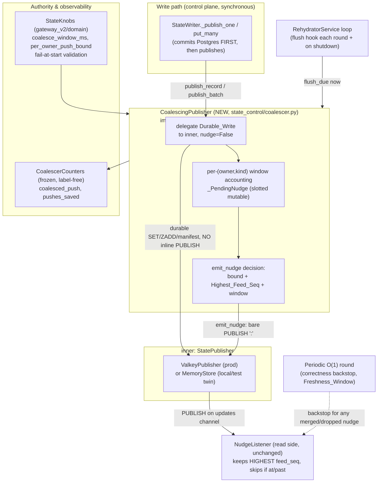

# Design Document

## Overview

This feature implements correction-register item **R2-23** (**C43 push cost**): a **per-owner,
publish-side nudge coalescer** for the control-plane package `gateway_v2/state_control/`. It sits
between the writer's committed, durable write and the transport's `PUBLISH`, so a burst of writes
to a single owner collapses to a **bounded number of nudges per owner per window** instead of one
`PUBLISH` per write.

The design is grounded in the verified current source, not a greenfield sketch. Three facts from
that source shape everything below:

1. **Durability already precedes the push.** `StateWriter` (`state_control/writer.py`) commits to
   Postgres first (`_commit*`), then calls `publish_record` / `publish_batch` on the publisher.
   Requirement 6.5 ("commit the Durable_Write and determine its outcome before any coalesced push
   is attempted") is therefore already the structure of the write path — the coalescer only has to
   preserve it.
2. **The push is a lossy latency hint, never load-bearing.** `NudgeListener`
   (`gateway_v2/runtime/state_nudge.py`) already coalesces on the read side: it keeps the HIGHEST
   `feed_seq` per kind, and a worker whose cursor is at or past the announced position skips the
   round. The periodic O(1) round is the correctness backstop. So merging or dropping a nudge is
   safe by construction — it can only cost latency, bounded by the Freshness_Window.
3. **The per-request / per-worker push defect is already closed by GW05c.** In `gateway_v2/` there
   is no serving-path publish at all. The write path emits exactly one `PUBLISH` per record write
   and one manifest-last `PUBLISH` per batch, never per worker, never per request. This feature
   records that honestly (Requirement 1 is a *verification obligation*, not a re-fix) and only
   closes the genuinely-remaining gap: a single owner's write *burst* still emits one `PUBLISH`
   per write.

The coalescer is a thin **decorator around the `StatePublisher` protocol** — a
`CoalescingPublisher(inner, knobs, clock, metrics)` that itself implements `StatePublisher`. The
writer is unchanged; it is simply handed a coalescing publisher instead of the bare one. The
decorator always delegates the Durable_Write to `inner` and only coalesces the `PUBLISH` nudge.

### Honest framing of what is closed vs. remaining (Requirements 1, 9)

| Concern | Status | Where |
| --- | --- | --- |
| 72 pushes **per request** at 36 workers (the original R2-23 defect) | **Already closed by GW05c** — no serving-path publish exists in `gateway_v2` | Standing verification obligation (Req 1), encoded as a test |
| One `PUBLISH` per **write** in a single owner's burst | **Remaining — this feature's real scope** | `CoalescingPublisher` (Req 2–8, 10) |
| Fleet-scale knee re-measure (36 workers / real Valkey / real load) | **OPEN — deferred cloud gate** | Represented locally by the Microbenchmark (Req 8, 9) |

## Architecture

### Layer placement

The coalescer lives in `gateway_v2/state_control/`, which is **outside** the import-linter
`root_packages = ["gateway_v2"]` — the same position as the `StatePublisher` protocol it wraps and
`audit_control`. The layers contract therefore does not govern it. It is allowed to import
`gateway_v2.domain.state_knobs` (its authority) exactly as the existing `state_control` modules
already import `gateway_v2.domain.*` and `gateway_v2.runtime.*`.



### The core design problem and its resolution

Today the inner publisher does the Durable_Write **and** the `PUBLISH` together inside one
`_guarded` MULTI (`ValkeyPublisher._guarded`: `stage(pipe)` → `pipe.set(manifest)` →
`pipe.publish(...)` → `pipe.execute()`). To coalesce **only** the nudge we must separate "durable
write + manifest" from "emit nudge".

Two options were considered:

- **(a) Extend the protocol.** Add an `emit_nudge(kind, feed_seq)` method and let the durable
  write skip its inline `PUBLISH` (`publish_record(..., *, nudge: bool = True)`). The wrapper tells
  `inner` to do the durable write WITHOUT the push, then emits the coalesced nudge itself via
  `inner.emit_nudge(...)`.
- **(b) The wrapper owns nudge emission entirely** and `inner` never publishes.

**Chosen: (a).** It keeps nudge emission on the same transport/connection as the durable write
(the wrapper does not need its own client), it leaves `publish_kind` (re-hydrator) and every other
call path untouched, and the separation is a one-line move inside `_guarded`: the `PUBLISH` becomes
conditional on `nudge`, and `emit_nudge` is a bare `PUBLISH` of `"<kind>:<feed_seq>"` on the same
`updates` channel. The durable `WATCH`/`MULTI` — `SET`/`HSET` + `ZADD` + `SADD`/`SREM` + manifest
`SET` — stays **byte-identical**; only the `pipe.publish(...)` line moves out. This is why
Requirement 3 (durability untouched) holds mechanically, and why Requirement 1 (one logical nudge
per write when coalescing is disabled / window = immediate) holds: with the bound = 1 and the
window = 0, the wrapper emits exactly one nudge per write, reproducing today's behaviour exactly.

### Durability-first ordering (Requirements 6.5, 3)

Within `CoalescingPublisher.publish_record` / `publish_batch`:

1. Call `inner.publish_record(record, manifest, engaged=flag, nudge=False)` — the full Durable_Write
   and manifest, with the inline push suppressed. Capture the bool result.
2. Return-value mapping to the writer is the inner's bool, **unchanged** — the writer still maps it
   to `OK` / `OK_PUBLISH_PENDING` exactly as before.
3. Only after step 1 returns, inside a `try/except` that swallows everything, record the pending
   nudge and decide whether to emit now via `inner.emit_nudge(...)`.

If step 1 raises, the exception propagates to the writer exactly as today (the writer's own
`except Exception` turns it into `OK_PUBLISH_PENDING`). If step 3 raises, it is swallowed and the
write outcome is already fixed — fail-safe (Req 6).

## Components and Interfaces

### 1. `StatePublisher` protocol extension (MODIFIED: `state_control/publisher.py`)

Add one method and one keyword, applied to all three implementations (`MemoryStore`,
`ValkeyPublisher`, `BrokenPublisher`) and `CoalescingPublisher`:

```python
class StatePublisher(Protocol):
    def publish_record(
        self, record: SignedRecord, manifest: Manifest,
        *, engaged: bool | None = None, nudge: bool = True,
    ) -> bool: ...

    def publish_batch(
        self, records: Sequence[SignedRecord], manifest: Manifest,
        *, engaged: Mapping[str, bool] | None = None, chunk: int = 500, nudge: bool = True,
    ) -> bool: ...

    def emit_nudge(self, kind: StateKind, feed_seq: int) -> None:
        """Emit exactly one PUBLISH of '<kind>:<feed_seq>' on the updates channel.

        A latency hint only; never load-bearing. Separated from the Durable_Write so a
        coalescer can bound the push rate without touching durability.
        """
        ...
```

`nudge` defaults to `True`, so every existing caller (the writer when handed a bare publisher, the
re-hydrator, every test) is unchanged. Only `CoalescingPublisher` passes `nudge=False`.

### 2. `CoalescingPublisher` (NEW: `state_control/coalescer.py`)

```python
@dataclass(frozen=True, slots=True)
class CoalesceConfig:
    """Resolved from the single declared authority (StateKnobs). Validated at construction."""
    per_owner_push_bound: int        # Per_Owner_Push_Bound (Req 7)
    coalesce_window_s: float         # Coalesce_Window, seconds, on the injected clock
    freshness_window_s: float        # StateKnobs.enforcement_bound_s, for the <= check

    def __post_init__(self) -> None:
        if self.per_owner_push_bound < 1:
            raise ValueError("per_owner_push_bound must be >= 1")
        if self.coalesce_window_s < 0:
            raise ValueError("coalesce_window_s must not be negative")
        if self.coalesce_window_s > self.freshness_window_s:   # Req 7.5
            raise ValueError(
                f"coalesce_window_s={self.coalesce_window_s} exceeds the Freshness_Window "
                f"{self.freshness_window_s}: a merged nudge would outlive the backstop",
            )

    @classmethod
    def from_knobs(cls, knobs: StateKnobs) -> CoalesceConfig: ...
        # reads knobs.coalesce_window_ms / knobs.per_owner_push_bound / knobs.enforcement_bound_s


class CoalescingPublisher:  # implements StatePublisher
    def __init__(
        self,
        inner: StatePublisher,
        config: CoalesceConfig,
        clock: Callable[[], float],
        metrics: CoalescerCounters = CoalescerCounters(),
    ) -> None: ...
```

- Implements the whole `StatePublisher` protocol. Reads (`stored_feed_seq`, `stored_head`,
  `stored_index`, `read_stamp`, `put_stamp`) and `publish_kind` (re-hydrator) are **pass-through**
  to `inner` with no coalescing — `publish_kind` is a wholesale restore and emits its own one
  nudge directly.
- `publish_record` / `publish_batch`: durability-first (above), then coalesce.
- `flush_due(now: float) -> None`: emits any held nudge whose window has elapsed. Called by the
  service loop each round and once on shutdown.
- `flush_all() -> None`: emits every held nudge regardless of window. Called on shutdown (Req 6.3).

### 3. Per-(owner, kind) window accounting (NEW, inside `coalescer.py`)

The owner is the write's per-tenant identity (`record.key` for `PLAN`/`KEY`/`KS` is the
`org_id` / key owner / scope — Req 2.6). The accounting map is keyed by `(owner, kind)`:

```python
@dataclass(slots=True)                 # mutable accumulator, NOT frozen (per-key state)
class _PendingNudge:
    window_start: float                # on the injected clock
    pushes_this_window: int            # <= per_owner_push_bound
    highest_pending: int               # highest feed_seq seen but not yet on the wire
    highest_announced: int             # highest feed_seq already PUBLISHed (monotonic, Req 4)
```

The map is `dict[tuple[str, StateKind], _PendingNudge]`. **Memory bound:** it holds one entry per
*owner that has written within a window*, not one per tenant. Writes are a **control-plane**
operation (plan edits, key rotations, kill-switch toggles), never a serving request, so this map
is never a tenant-count-proportional structure on any serving path. Stale entries are pruned on
window roll. This is called out explicitly because the project forbids per-tenant unbounded
structures on serving paths; this map is neither on a serving path nor tenant-proportional.

### 4. The coalesce algorithm

On each `publish_record` / `publish_batch` (after the Durable_Write committed), for the write's
`(owner, kind)` with the manifest's `feed_seq`:

```
now = clock()
e = map.get((owner, kind)) or new _PendingNudge(window_start=now, pushes=0, pending=0, announced=0)
if now - e.window_start >= window_s:            # window rolled
    # flush the previous window's residue first (if any pending > announced), then reset
    if e.highest_pending > e.highest_announced:
        _emit(owner, kind, e.highest_pending)   # carries Highest_Feed_Seq of the old window
    e.window_start = now; e.pushes_this_window = 0
e.highest_pending = max(e.highest_pending, feed_seq)
if e.pushes_this_window < bound:
    _emit(owner, kind, e.highest_pending)       # emit now; usually the first write in a window
# else: hold — flushed on window roll, on flush_due, or on shutdown
map[(owner, kind)] = e
```

`_emit(owner, kind, pos)`:

```
if pos <= e.highest_announced:        # Req 4.5: never announce a lower position
    metrics += pushes_saved           # suppressed as redundant
    return
inner.emit_nudge(kind, pos)
e.highest_announced = pos
e.pushes_this_window += 1
metrics += coalesced_push
```

Pushes genuinely merged away (a write whose nudge was folded into a later/earlier push) increment
`pushes_saved`. This yields: at most `bound` pushes per owner per window (Property 1); the last
push for an (owner, kind) carries the max `feed_seq` of the coalesced set (Req 4.1, Property 1);
announced positions are monotonic non-decreasing (Req 4.5, Property 4); per-owner isolation because
each `(owner, kind)` entry has its own budget and clock (Req 2.2, Property 5).

### 5. The flush / timer model (Requirements 5, 6.3)

The control-plane writer is synchronous and the service loop (`RehydratorService.run` in
`state_control/service.py`) runs periodic rounds. Flush is **three-layered**:

1. **Lazy flush on next write** to the same owner (window roll inside the algorithm above) — the
   common case for an active owner.
2. **A `flush_due(now)` hook the service loop calls each round.** A quiesced owner's final held
   nudge goes out within one re-hydrator period — well inside the Freshness_Window. This is a
   latency optimisation, not a correctness requirement.
3. **`flush_all()` on shutdown** (Req 6.3) — pending Highest_Feed_Seq positions are flushed rather
   than discarded.

**Correctness-by-backstop:** even if a held nudge is *never* flushed (worst case), the periodic
O(1) round delivers the committed write within the Freshness_Window (`enforcement_bound_s` =
rehydrate period + refresh period). The flush layers only *shorten* that latency; they are never
load-bearing. This is why coalescing a lossy hint is always safe (Req 5.1–5.6, Property 3).

### 6. `CoalescerCounters` (NEW, inside `coalescer.py`) — label-free metric (Requirement 10)

Mirrors `ListenerCounters` exactly: a frozen slotted dataclass of int counters, seeded 0, with a
`.plus(**fields)` monotonic accumulator and a `.snapshot()` a GW14d publisher reads. Exactly **two**
series, no per-owner label:

```python
@dataclass(frozen=True, slots=True)
class CoalescerCounters:
    coalesced_push: int = 0     # pushes actually emitted
    pushes_saved: int = 0       # nudges merged/suppressed (never put on the wire)

    def plus(self, **fields: int) -> CoalescerCounters: ...   # same shape as ListenerCounters.plus
    def snapshot(self) -> Mapping[str, int]: ...              # {"coalesced_push": .., "pushes_saved": ..}
```

Both start present-and-zero (Req 10.4), are monotonic non-decreasing (Req 10.5), the series count is
two regardless of owner/tenant count (Req 10.2–10.3), it imports no registry and self-registers
nothing (Req 10.1), and `.snapshot()` neither raises nor mutates (Req 10.6). Because the type is
frozen, the coalescer holds the current value and replaces it via `.plus(...)` just as
`NudgeListener` does with `self.counters`.

### 7. Authority wiring (MODIFIED: `gateway_v2/domain/state_knobs.py`) — Requirement 7

**Choice of authority (justified).** The two candidates are `ResourceContract`
(`runtime/resources.py`) and `StateKnobs` (`domain/state_knobs.py`). `ResourceContract` is a
*serving-capacity* authority keyed off `target_p99_ms` and worker counts; the push bound is a
*control-plane* protocol property, not a serving-capacity derivation. `StateKnobs` already owns the
control-plane periods and the `enforcement_bound_s` that *is* the Freshness_Window, is validated
fail-at-start, and lives in `gateway_v2/domain/` (inside `root_packages`, the bottom layer) so
`state_control` (outside `root_packages`) may import it. **Chosen: `StateKnobs`.**

Add two fields and a named-constant default each (no bare capacity literal — mirrors how
`resources.py` names its `_MULT` literals and how `state_knobs.py` already names
`DEFAULT_REHYDRATE_PERIOD_MS`):

```python
DEFAULT_COALESCE_WINDOW_MS = 250
"""Window within which one owner's nudges collapse. A quarter of the default rehydrate period:
long enough to fold a human-driven edit burst, short enough to stay well under the Freshness_Window
(1500 ms at defaults). A latency knob on a lossy hint, never a capacity position."""

DEFAULT_PER_OWNER_PUSH_BOUND = 1
"""Pushes per owner per window. One is the natural coalesced target (a single nudge carrying the
Highest_Feed_Seq); it is the push-count analogue of the read side's 'keep the highest position'.
A protocol constant, not a capacity position; named here so it has ONE declared home."""
```

New `StateKnobs` fields with `__post_init__` validation (Req 7.3, 7.4, 7.5):

```python
coalesce_window_ms: int = DEFAULT_COALESCE_WINDOW_MS
per_owner_push_bound: int = DEFAULT_PER_OWNER_PUSH_BOUND

# in __post_init__:
if self.coalesce_window_ms < 0:
    raise ValueError("coalesce_window_ms must not be negative")
if self.per_owner_push_bound < 1:
    raise ValueError("per_owner_push_bound must be >= 1")
# Freshness_Window check (Req 7.5): a window longer than the backstop is refused.
if self.coalesce_window_ms > self.enforcement_bound_s * 1000:
    raise ValueError(
        f"coalesce_window_ms={self.coalesce_window_ms} must be <= the Freshness_Window "
        f"({self.enforcement_bound_s * 1000:.0f} ms = rehydrate + refresh period): a merged "
        "nudge would otherwise outlive the periodic-round backstop",
    )
```

`CoalesceConfig.from_knobs` reads these; if a knob is absent/invalid, `StateKnobs.__post_init__`
already refuses to start (Req 7.4). `window = 0` + `bound = 1` reproduces the un-coalesced path
exactly (one nudge per write), which is how the Microbenchmark drives the "un-coalesced" arm.

### 8. Injection point (MODIFIED: `state_control/service.py`)

`RehydratorService.build` constructs `ValkeyPublisher` then `StateWriter`. Wrap the publisher:

```python
publisher = ValkeyPublisher(client, config.secret, StoreKeys(config.namespace))
coalescing = CoalescingPublisher(
    publisher, CoalesceConfig.from_knobs(config.knobs), clock=time.monotonic,
)
writer = StateWriter(db, coalescing, config.secret)
# the service loop calls coalescing.flush_due(time.monotonic()) each round, flush_all() on stop
```

The re-hydrator's `Rehydrator` continues to receive the bare `publisher` (its `publish_kind`
restore must not be coalesced). Only the *writer's* publisher is wrapped.

## Data Models

| Type | Shape | Mutability | Home |
| --- | --- | --- | --- |
| `CoalesceConfig` | `per_owner_push_bound: int`, `coalesce_window_s: float`, `freshness_window_s: float` | frozen slotted | `coalescer.py` (NEW) |
| `_PendingNudge` | `window_start: float`, `pushes_this_window: int`, `highest_pending: int`, `highest_announced: int` | slotted **mutable** (per-key accumulator) | `coalescer.py` (NEW) |
| `CoalescerCounters` | `coalesced_push: int = 0`, `pushes_saved: int = 0` | frozen slotted, `.plus()` returns a new value | `coalescer.py` (NEW) |
| `StateKnobs` (extended) | `+ coalesce_window_ms: int`, `+ per_owner_push_bound: int` | frozen slotted, validated | `domain/state_knobs.py` (MODIFIED) |

Wire contract (unchanged, preserved exactly): the nudge payload is the single string
`"<kind>:<feed_seq>"` (`kind.value` contains no colon; `feed_seq` base-10), parsed by `parse_nudge`
into the identical `(kind, feed_seq)` pair (Req 4.3). `emit_nudge` publishes on the same
`StoreKeys.updates` channel (`"<namespace>:updates"`) the inline `PUBLISH` used.

## Correctness Properties

*A property is a characteristic or behavior that should hold true across all valid executions of a
system — essentially, a formal statement about what the system should do. Properties serve as the
bridge between human-readable specifications and machine-verifiable correctness guarantees.*

The coalescer is pure logic over an injected clock and an in-memory `MemoryStore` twin — a textbook
PBT target. Each property below is asserted by a single seeded property-based test running
**>= 10,000 iterations** in the house idiom (`random.Random`, no `hypothesis`), tagged
**Feature: push-coalescing, Property N: ...**. The ten requirements-document properties map
one-to-one onto ten tests; the invariant and the test strategy for each follow.

### Property 1: Per-owner push bound (invariant)

For any burst of N writes to one Owner within one Coalesce_Window, the number of pushes emitted is
at most the Per_Owner_Push_Bound, and the last push for that Owner and kind carries the maximum
`feed_seq` among the coalesced writes. *Test:* generate a random burst (N, feed_seq sequence) inside
one window on a frozen clock; assert `MemoryStore.nudges` count for that owner/kind ≤ bound and the
last announced position == max feed_seq.
**Validates: Requirements 2.1, 4.1**

### Property 2: Durable writes equal N (invariant)

For any workload of N writes to any mix of Owners, the count of Durable_Writes equals N regardless
of coalescing, and each write's record, index entry, and manifest are byte-identical to the
un-coalesced path. *Test:* run the same workload through the bare `MemoryStore` and through the
`CoalescingPublisher`-over-`MemoryStore`; assert `record_writes` equal, and the two stores'
`_records` / `_index` / `_manifests` byte-identical.
**Validates: Requirements 3.1, 3.2, 3.5**

### Property 3: Reader never ends below the latest committed feed_seq (invariant / round-trip)

For any sequence of writes to one Owner, a reader applying only the coalesced nudges plus the
periodic round ends at or above the latest committed `feed_seq` — never below it. *Test:* drive the
`CoalescingPublisher`, feed only the emitted nudges plus one simulated backstop round into a
read-side model of `_collect`/skip-if-at-or-past; assert the reader's final applied position == the
max committed feed_seq.
**Validates: Requirements 4.6, 5.1, 5.3, 5.4**

### Property 4: Monotonic announced position (invariant)

The sequence of `feed_seq` values the coalescer announces for one Owner and kind is non-decreasing;
a coalesced push never announces a position lower than one already announced. *Test:* generate
writes with deliberately out-of-order feed_seq (including regressive ones) and assert the sequence
of `emit_nudge` positions is monotonic non-decreasing and no regressive push reaches the wire.
**Validates: Requirements 4.5**

### Property 5: Per-owner isolation (invariant)

For any interleaving of writes across multiple Owners, each Owner's pushes are bounded
independently; one Owner's burst never reduces another Owner's push budget and never reorders
another Owner's announced positions. *Test:* generate interleaved multi-owner workloads; assert each
owner independently satisfies Property 1, and a per-owner replay in isolation produces identical
announced positions.
**Validates: Requirements 2.2, 2.3**

### Property 6: Coalescing is idempotent on a quiesced owner (idempotence)

Once an Owner's latest write has been announced and no further writes arrive, re-running the
coalescer flush emits no additional push for that Owner. *Test:* drive writes, call `flush_due` /
`flush_all`, record the nudge count, call them again with no intervening write, assert the count is
unchanged.
**Validates: Requirements 2.4**

### Property 7: Fail-safe never costs durability or freshness (error condition)

For any injected push failure or shutdown with pending nudges, every Durable_Write still completes,
the write outcome is unchanged, and no reader is left below the latest committed `feed_seq` beyond
the Freshness_Window. *Test:* wrap a `MemoryStore` whose `emit_nudge` raises (and a variant that
drops) under the coalescer driven by a real `StateWriter`; assert every `WriteOutcome` matches the
un-coalesced run's outcome and the backstop-round model still converges within the window.
**Validates: Requirements 3.6, 6.1, 6.2, 6.3, 6.4**

### Property 8: Window bound derives from the authority (invariant)

For any `StateKnobs` configuration, the Per_Owner_Push_Bound and Coalesce_Window are functions of
the declared authority only; no capacity literal appears in the coalescer, and a Coalesce_Window
longer than the Freshness_Window is refused at start. *Test:* generate random valid and invalid
`StateKnobs` configs; assert `CoalesceConfig.from_knobs` reflects the knob values and that
`coalesce_window_ms > enforcement_bound_s * 1000` raises at construction.
**Validates: Requirements 7.1, 7.2, 7.5**

### Property 9: Confluence of write ordering (confluence)

For any two orderings of the same set of per-Owner writes within a window, the set of Durable_Writes
is identical and the final announced `feed_seq` per Owner and kind is identical, independent of the
order the coalescer observed them. *Test:* generate a write set, shuffle into two orderings on the
same seed, run both; assert equal durable state and equal final announced positions per (owner,
kind).
**Validates: Requirements 4.1, 4.2**

### Property 10: Push count is independent of worker and request count (metamorphic)

For a fixed set of writes and Owners, the total push count is unchanged when the simulated worker
count or request count varies, confirming the per-request / per-worker push defect stays closed.
*Test:* run a fixed write workload under varying simulated `workers`/`requests` parameters (which the
write path does not consume); assert the total `nudges` count is identical and that the serving-path
publish count is 0.
**Validates: Requirements 1.3, 1.4, 1.5**

## Error Handling

- **Durability-first, fail-safe (Req 6).** `CoalescingPublisher.publish_record` /
  `publish_batch` call `inner.publish_*(..., nudge=False)` first and capture the bool. The entire
  coalescing/emit path is inside a `try/except Exception` that is **swallowed** (logged at WARNING,
  like the writer's own publish-failure path). Because the Durable_Write already returned its bool
  before the `try`, no coalescer error can change a `WriteOutcome`. On a swallowed emit failure the
  owner is simply left to the next `flush_due` or the periodic round — refreshed within the
  Freshness_Window (Req 6.2).
- **Shutdown (Req 6.3).** `flush_all()` emits pending Highest_Feed_Seq positions; any that fail are
  swallowed and left to the backstop round. No pending position is discarded without the owner being
  refreshed within the Freshness_Window.
- **Manifest-last ordering (Req 3.3)** is entirely inside `inner` and byte-identical to today — the
  coalescer never touches the durable MULTI, only moves the trailing `PUBLISH` out of it.
- **Start-up refusal (Req 7.3–7.5).** `StateKnobs.__post_init__` and `CoalesceConfig.__post_init__`
  raise on an absent/invalid knob or a window exceeding the Freshness_Window, so the process refuses
  to start rather than coalescing with a bad bound.
- **Reads and `publish_kind` pass through** unchanged; `BrokenPublisher` continues to raise on every
  push, which the fail-safe tests use.

## Testing Strategy

**Dual approach.** Property-based tests cover the universal invariants (the ten properties above);
example / integration tests cover concrete wiring, the verification obligation, and the
microbenchmark.

**Property-based testing applies here** — the coalescer is pure logic over an injected clock and an
in-memory twin, with large input spaces (write bursts, interleavings, orderings) and clear
"for all" invariants. Library/idiom: the house seeded `random.Random` driver, **no `hypothesis`**,
**>= 10,000 iterations** per property, each test tagged
**Feature: push-coalescing, Property N: {property text}**. One property ⇒ one property test.

### Offline pytest files

- **NEW `tests/state_control/test_coalescer_properties.py`** — the ten seeded property tests
  (Properties 1–10), driving `CoalescingPublisher` over `MemoryStore` with an injected clock.
- **NEW `tests/state_control/test_coalescer_unit.py`** — example/edge tests: `nudge=False`
  suppresses the inline push; `emit_nudge` payload round-trips through `parse_nudge`; `window=0,
  bound=1` reproduces the bare path exactly; `flush_due` / `flush_all` / shutdown behaviour;
  `CoalescerCounters` present-and-zero, monotonic, snapshot-no-raise/no-mutate (Req 10).
- **NEW `tests/state_control/test_push_verification.py`** — the standing verification obligation
  (Req 1): one `PUBLISH` per record write; exactly one per batch independent of record count; zero
  on any serving/request path (encoded as a standing guard — `gateway_v2` serving code emits no
  publish); push count a function of W and O only, invariant to simulated N and R (Property 10).
- **NEW `tests/state_control/test_lgw23_microbench.py`** — the Microbenchmark (Req 8), below.
- **MODIFIED existing publisher/writer tests** — updated for the `nudge=` keyword and `emit_nudge`
  on `MemoryStore` / `ValkeyPublisher` / `BrokenPublisher`; assert the durable MULTI staging is
  byte-identical with the `PUBLISH` moved out.

### Microbenchmark (Requirement 8)

A local, deterministic, in-process harness (`tests/state_control/test_lgw23_microbench.py`, also
runnable standalone) that:

- runs entirely in one process on an injected clock and a `MemoryStore` twin, zero network (Req 8.1);
- is byte-reproducible across runs on the same workload + clock seed (Req 8.2);
- drives the identical write workload through the **un-coalesced** arm (`window=0, bound=1`) and the
  **coalesced** arm, counting `MemoryStore.nudges` on each (Req 8.5);
- asserts each per-owner-per-window push count ≤ Per_Owner_Push_Bound, failing with the offending
  owner/window/observed/configured on violation (Req 8.3, 8.4);
- reports the push-count delta (un-coalesced total − coalesced total) and a CPU-ms-shape proxy in
  the R2-23 baseline units ("+2.3 CPU-ms / 72 pushes") (Req 8.6);
- asserts Durable_Write parity (`record_writes` equal on both arms), failing with both counts and the
  workload id on mismatch (Req 8.7, 8.8).

### Deferred cloud gate (Requirement 9)

The **Knee_Re_Measure** (36 workers / real Valkey / real request load) is declared **OPEN** and
out-of-local-scope in the design, the plan, and the changelog — the Microbenchmark is its local
representative and does not substitute for it. No local test marks it satisfied/passed/closed.

### Static gates (all must stay green)

- **`mypy --strict`** over the new/modified modules.
- **`ruff`** clean.
- **import-linter — both contracts kept.** The coalescer is in `state_control`, **outside**
  `root_packages = ["gateway_v2"]`, so the layers contract does not govern it (same as the existing
  publisher); its one cross-package import, `gateway_v2.domain.state_knobs`, is the allowed
  `state_control → gateway_v2.domain` direction already used across `state_control`.
- **capacity-literals AST gate (`lint/check_capacity_literals.py`).** The gate scopes the
  `gateway_v2` tree and flags int-constant assignments to capacity-named identifiers and
  `Semaphore/Queue(int)` calls. The `StateKnobs` default lives in `gateway_v2/domain`, so its
  default **must be a named module constant** (`DEFAULT_COALESCE_WINDOW_MS`,
  `DEFAULT_PER_OWNER_PUSH_BOUND`) with a documented rationale — never a bare literal at the field —
  mirroring `resources.py`'s `_MULT` constants and the existing `DEFAULT_*` period constants. The
  coalescer module itself holds no capacity-position literal (Req 7.2).

### Files touched

**NEW**
- `gateway_v2/state_control/coalescer.py` — `CoalescingPublisher`, `CoalesceConfig`,
  `_PendingNudge`, `CoalescerCounters`.
- `tests/state_control/test_coalescer_properties.py`, `test_coalescer_unit.py`,
  `test_push_verification.py`, `test_lgw23_microbench.py`.

**MODIFIED**
- `gateway_v2/state_control/publisher.py` — `StatePublisher` protocol `nudge=` keyword +
  `emit_nudge`; `MemoryStore` (`emit_nudge` records a nudge; `publish_*` honour `nudge=`);
  `BrokenPublisher` (`emit_nudge` raises).
- `gateway_v2/state_control/valkey.py` — `ValkeyPublisher._guarded` makes the inline `PUBLISH`
  conditional on `nudge`; `publish_record` / `publish_batch` take `nudge=`; new `emit_nudge` is a
  bare `PUBLISH` of `"<kind>:<feed_seq>"` on `StoreKeys.updates`.
- `gateway_v2/domain/state_knobs.py` — new `coalesce_window_ms` / `per_owner_push_bound` fields,
  named-constant defaults, and `__post_init__` validation (including the ≤ Freshness_Window check).
- `gateway_v2/state_control/service.py` — wrap the writer's publisher in `CoalescingPublisher`;
  call `flush_due` each round and `flush_all` on shutdown. (`StateWriter` itself is **unchanged** —
  it depends only on the `StatePublisher` protocol, so no edit to `writer.py` is required.)
