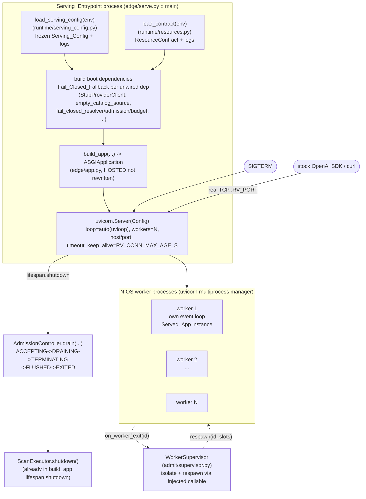

# Design Document

## Overview

Card B3 (`docs/LOCAL_WORKLIST_v3.md` §B3; runbook `AI_MESH_MASTER_RUNBOOK_v3_BACKEND_REWRITE.md`)
stands up the **Serving_Entrypoint** — the runnable process that constructs the injected
production dependencies, calls `gateway_v2.edge.app.build_app(...)`, and hosts the returned ASGI
3.0 application under **uvicorn**. Today `build_app` returns a complete raw-ASGI callable (router,
`lifespan`, `/readyz`, `/metrics`, chat + misc surfaces) but the module ends with
`app: ASGIApplication | None = None` — a stub nothing hosts. B3 **hosts** `build_app`; it does not
rewrite it.

This is a **category-2** local-half card: OS-level worker supervision, graceful-drain wiring, the
config surface, and real-socket conformance are built and verified locally; fleet-scale behaviour,
the real provider socket, and TLS/NLB/host-IPC stay explicit named seams (Requirement 7). Every
design decision below is grounded in the runbook and the actual code; where the runbook is silent
on a purely-local detail (the listen port) the design uses the already-approved requirements'
in-spec decision and says so.

### Runbook grounding (cited, not invented)

- **§0.4 / §10.9 card format.** Every new/changed card follows the §10.9 format
  (**why → implementation → live acceptance tests → exit → evidence → rollback**; the GW00 card at
  §10.9 is the worked template). This design is shaped so a `tasks.md` can produce that evidence:
  the Testing Strategy section maps each component onto *live acceptance tests / exit / evidence*.
  No alternative structure is introduced.
- **§0.2 "NLB balancing" row** (`r2-mig/notes`): on MIG scale-in the NLB drains **300 s before** VM
  deletion + SIGTERM, then `RV_DRAIN_ACCEPT_S` **15 s** + `RV_DRAIN_S` **60 s** ⇒ streams up to
  ≈ 375 s survive. The 300 s NLB drain is a cloud/load-balancer behaviour (deferred, Requirement 7);
  B3 owns the two in-process bounds the entrypoint applies after SIGTERM.
- **§0.2 R2-12 row** (`RV_CONN_MAX_AGE_S` 30 s in the MIG S3 runs): connection recycling bound,
  applied as the uvicorn connection max-age.
- **§3 / R2-20** (`v3 AMENDMENT`): gateways run **as a system user or in containers**; the local
  verification is therefore a real localhost socket in the dev/Docker container. The `/dev/shm`
  `RemoveIPC=yes` host configuration is the host half — deferred (Requirement 7.4).
- **"Proof" rule (top matter).** No task exits on unit tests alone — exit evidence is live
  Docker/staging, real wire bytes, real SDK/browser behaviour, controlled load. B3's **local half**
  = real localhost socket + the stock OpenAI SDK + `curl`; the fleet/Docker-staging capacity run
  stays the deferred gate.
- **§10.5.4 / R2-07** (runbook line 164): GW19 owner-level CoDel admission (target 5 ms, interval
  100 ms, hard cap 60 ms, guard wait budget `max(100, cap+40)` ms) is **already shipped**. The
  entrypoint **drives** it; it does not re-specify it. The gateway runs multi-worker, per-worker
  event loop ("1 gateway × 12 workers"; C38 per-worker isolation — runbook line 132/234).
- **G-02 drain gate** (runbook line 361): "0 dropped streams, **or** a declared maximum stream
  duration covered by the drain window." B3 takes the second clause locally: a declared max stream
  duration ≤ `RV_DRAIN_S`, so no stream is silently truncated.

### Where the entrypoint sits in the layer stack

`edge` is the **top** layer of the import-linter `layers` contract
(`edge > admit > plan > detect > resolve > dispatch > egress > audit > runtime > contracts >
domain`). A serving host is an `edge`-level concern, so it may import every layer below — exactly
what `build_app` already does (it imports `admit`, `runtime`, `dispatch`, `egress`, …). Placing the
new serving module under `gateway_v2/gateway_v2/edge/` therefore introduces **no new import edge**:
it imports `build_app` (same package), `AdmissionController`/`WorkerSupervisor` from `admit`, and
the new `Serving_Config` from `runtime` — all downward edges that already exist. No `egress → detect`
edge is created (the entrypoint never touches `detect`; the scanner/detector are injected into
`build_app` as today). `lint-imports` stays **2 contracts kept**.

Decision — module placement (resolves requirements §"New ambiguities" item 2): the serving
subcommand is a **new `edge`-layer module `gateway_v2/edge/serve.py`** exposing a `main(argv)`
entrypoint, *not* an extension of `runtime/lifecycle.py::run_cli`. Rationale:

- `run_cli`/`serve_forever` is a **thread** loop in `runtime` (SIGTERM/SIGINT→stop event, SIGHUP
  reload, snapshot emit). `runtime` is a *low* layer and may not import `edge` (`build_app`) or
  `admit` (`AdmissionController`) — hosting uvicorn there would **break the layer contract**. So
  the host cannot live in `runtime`.
- `edge/app.py` is already at 794 lines (gate ≤ 800). Adding the host there would blow the module
  size gate. A sibling `edge/serve.py` keeps both modules well under 800 lines and separates "how
  ASGI events flow" (`app.py`) from "how the process is hosted and supervised" (`serve.py`).
- The shipped `runtime/lifecycle.py` SIGHUP-reload contract is **left intact and untouched**;
  `serve.py` reuses `install_sighup(runtime, …)` so a running server still reloads its
  `ResourceContract` on SIGHUP without a restart.

## Architecture



### Boot sequence (per Requirement 1)

1. `main(argv)` loads `Serving_Config` from the environment **once** via the `runtime`
   env→dataclass+logs idiom (`load_serving_config(env=...) -> (Serving_Config, logs)`), and loads
   the `ResourceContract` via the shipped `load_contract(env=...)`. Both log tuples are written to
   the boot log.
2. The boot dependencies are constructed. Each `build_app` parameter that has no real
   implementation wired is set to its **shipped Fail_Closed_Fallback**, and a boot log line names
   the dependency and the fallback (R1.4, R1.7).
3. `build_app(**deps)` is called to obtain the `Served_App`. If it **raises**, `main` writes a
   JSON error line to stderr and returns a **non-zero** exit code *without* starting uvicorn
   (R1.8) — mirroring the shipped `run_cli` refuse-to-start pattern
   (`{"error": ..., "refuse_start": True}`, exit 2).
4. A `uvicorn.Config` + `uvicorn.Server` is built from `Serving_Config` and the `Served_App`
   factory, and the server is run. uvicorn drives the ASGI `lifespan.startup`/`lifespan.shutdown`
   handlers the skin already implements.

## Components and Interfaces

### 1. `gateway_v2/runtime/serving_config.py` — `Serving_Config` + `load_serving_config` (R6)

A new `runtime`-layer module following the **exact** `load_holdback_config` / `load_contract`
idiom: parse env, validate, return a frozen value plus a tuple of warning log lines.

```python
@dataclass(frozen=True, slots=True)
class ServingConfig:
    host: str                 # RV_HOST, default loopback-safe "127.0.0.1"
    port: int                 # RV_PORT, default 8300
    drain_accept_s: float     # RV_DRAIN_ACCEPT_S, default 15.0
    drain_s: float            # RV_DRAIN_S, default 60.0
    conn_max_age_s: float     # RV_CONN_MAX_AGE_S, default 30.0
    # NB: worker count is NOT stored here — it comes from ResourceContract.workers()
    #     (R6.4), so there is one worker-count authority and no second source of truth.

def load_serving_config(
    env: Mapping[str, str] | None = None,
) -> tuple[ServingConfig, tuple[str, ...]]: ...
```

- **Keys + defaults** (R6.2, R6.3, R3.6, R3.7, R3.10): `RV_PORT`=8300, `RV_HOST`="127.0.0.1"
  (loopback-safe), `RV_DRAIN_ACCEPT_S`=15.0, `RV_DRAIN_S`=60.0, `RV_CONN_MAX_AGE_S`=30.0.
- **Invalid value → warn + default** (R6.5): a present-but-unparseable or out-of-range value falls
  back to the documented default and appends one warning line naming the rejected key and value —
  byte-for-byte the `_parse_hold_cap` behaviour in `holdback_config.py`.
- **No capacity literal outside `resources.py`** (R6.6): the default port/host/drain seconds are
  **operational configuration literals**, not capacity-position literals (they are not derived from
  CPU/RAM/FD and the AST capacity gate concerns capacity-position bounds). The **worker count is a
  capacity-derived number**, so it is *not* read here — it comes from `ResourceContract.workers()`
  (which already lives in `resources.py`). The declared max stream duration (R3.8) is also
  capacity-derived and comes from `ResourceContract.max_stream_duration_s()` — see §5.
- **Frozen, no module-level mutable** (R6.7): `@dataclass(frozen=True, slots=True)`, module holds
  only the `_ENV_KEY` string constants and numeric defaults, matching `holdback_config.py`.

Worker count (R6.4): `serve.py` calls `contract.workers()` — `WEB_CONCURRENCY`/`AMF_WEB_CONCURRENCY`
override else the cpu/ram-detected count — exactly the shipped resolution. The entrypoint never
introduces a worker-count literal.

### 2. `gateway_v2/edge/serve.py` — the host (R1, R2, R3)

The new `edge`-layer serving module. Keeps functions ≤ 120 lines and the module ≤ 800 lines by
splitting boot-deps construction, uvicorn-config assembly, and the drain hook into small helpers.

```python
def build_boot_dependencies(
    *, contract: ResourceContract, admission: AdmissionController,
) -> tuple[dict[str, object], tuple[str, ...]]: ...   # deps kwargs + fallback log lines (R1.4/1.7)

def build_uvicorn_config(
    app_factory: Callable[[], ASGIApplication],
    *, cfg: ServingConfig, workers: int,
) -> "uvicorn.Config": ...                            # R2.1/2.2/2.3, R3.10

def install_drain_hook(
    server: "uvicorn.Server", *, controller: AdmissionController, cfg: ServingConfig,
) -> None: ...                                        # R3.1 (SIGTERM -> drain)

def main(argv: list[str] | None = None) -> int: ...   # orchestrates; non-zero on build_app raise
```

### 2a. uvicorn host wiring (R1.2, R2.1–2.3, R3.10)

- **App passed as a factory.** uvicorn is given a zero-arg **factory** that returns the
  `build_app(...)` callable (`uvicorn.Config(app=app_factory, factory=True, ...)`). A factory is
  required for the multi-worker model: each OS worker process calls the factory to build its own
  `Served_App` instance (its own `ScanExecutor`, its own frozen routes), giving true per-worker
  isolation (C38). The injected deps the factory closes over are the fail-closed boot deps built in
  the parent; the real-dependency wiring (provider socket, catalog backend) is swapped in per
  deferred card without changing this seam.
- **Modern loop + worker config** (R2.2): `uvicorn.Config(loop="auto", http="auto", workers=N)`.
  `loop="auto"` selects **uvloop** when installed, else asyncio — the recommended modern config.
  The design **does not** use `--worker-class uvicorn.workers.UvicornWorker` (the deprecated
  Gunicorn worker class) and **does not** pass `--worker-connections` (R2.3) — uvicorn's own
  multiprocess manager runs `N` workers, each a per-worker event loop, with no inert option.
- **host/port/workers from config** (R1.3, R6): `host=cfg.host`, `port=cfg.port`,
  `workers=contract.workers()`.
- **Connection recycling** (R3.10): `timeout_keep_alive=int(cfg.conn_max_age_s)` applies
  `RV_CONN_MAX_AGE_S` as the connection max-age bound, so idle keep-alive connections are recycled
  at the runbook's 30 s — the R2-12 behaviour that let a scaled-out gateway actually receive its
  share of NLB connections.
- **Lifespan driven by uvicorn** (R1.2): uvicorn speaks the ASGI `lifespan` protocol, so the skin's
  `_lifespan` handler receives `lifespan.startup`/`lifespan.shutdown` and releases the
  `ScanExecutor` on shutdown — already wired in `build_app`, nothing to rebuild (R3.9).

**New dependency.** `uvicorn` is added to `pyproject.toml`. Today `[project].dependencies` is
`psycopg[binary]` + `redis` only. The design adds `uvicorn>=0.30` (the version line that ships the
modern loop/factory config and has removed the inert options) to a **new optional-dependency group
`serve`** (`uvicorn[standard]>=0.30` to pull uvloop + httptools), so the base package stays
framework-free and a tree that only runs the pure suite is unaffected — mirroring how `openai`/
`httpx` sit in the `conformance` extra. `serve.py` imports uvicorn lazily inside `main` (an
`ImportError` with an install hint rather than a hard import at module load) so `edge` import and
the AST/mypy gates do not require uvicorn present.

### 2b. Boot dependency construction + Fail_Closed_Fallback (R1.4–R1.8)

`build_boot_dependencies` returns the `build_app` kwargs with every unwired dependency set to its
shipped fail-closed default, and a tuple of boot log lines (one per fallback, R1.7). The full
injected-dependency signature of `build_app` and the fallback chosen for each:

| `build_app` parameter | B3 wiring | Fallback / source |
|---|---|---|
| `contract` | real | `load_contract(env)` (shipped) |
| `provider` | **StubProviderClient** (R1.5) | real socket is **B4 / GW17-18**, deferred — not constructed |
| `scanner` | fail-closed default | the shipped `ScanProtocol` default (no-op scan until GW07/08) |
| `resolver` | shipped `OutputResolver` default | egress resolver |
| `metrics_registry` | GW14d `Publisher` if wired, else a plain exposition registry | `/metrics` + `/readyz` directory gate |
| `clock` | `time.monotonic` | real monotonic clock |
| `readiness` | `None` → composed from `state_view` | shipped `_resolve_readiness` composition |
| `state_view` | shipped GW05 seam | fail-closed when unverified |
| `active_streams` | GW19 live counter if wired, else `None` → `_one_stream` | shipped default |
| `control` | `None` → `_NoControlSource` | shipped all-clear default (max-duration deadline still active) |
| `error_scanner` | `None` → `_no_error_findings` | shipped default (forward unchanged; withhold only on BLOCK/scan-error) |
| `input_detector` | `None` → `no_findings_detector` | fail-closed (identity/admission refuse earlier) |
| `identity` | `None` → `fail_closed_resolver` | every request refuses with the declared auth code |
| `snapshot_source` | `None` → `unresolved_snapshot_source` | unresolved plan refuses |
| `admission` | GW19 decider | `None` → `fail_closed_admission` (sheds first) |
| `quota` | GW06 decider | `None` → `fail_closed_budget` |
| `exports` | GW14d `PerRequestExports` | `None` → fresh producer |
| `catalog` | **empty_catalog_source** (R1.6) | real org/plan backend deferred — every retrieve `model_not_found` |

Each fallback is **the shipped default already defined in `edge/app.py` / `edge/chat_deps.py`** —
B3 does not invent new fail-closed types; it names them explicitly and logs them. The honest-boot
rule holds: B3 fakes neither a real upstream nor a real catalog backend (R1.5, R1.6, R7.1, R7.5).

Non-zero exit (R1.8): `main` wraps the `build_app(**deps)` call in a try/except; on any exception it
writes `{"error": str(exc), "refuse_start": true}` to stderr and returns exit code 2 **before**
constructing or running the uvicorn server, so no traffic is ever served from a half-built app.

### 3. Worker model + real OS supervision (R2) — `WorkerSupervisor`

**Division of labour (explicit, R2).**

- **uvicorn's multiprocess manager** owns the OS mechanics: it `fork`/spawns `N` worker processes,
  each running its own event loop and its own `Served_App` (built via the factory), and it already
  restarts a worker that exits. This is what gives the "1 gateway × N workers, per-worker loop"
  model (C38) and satisfies R2.1 directly.
- **`WorkerSupervisor` (shipped, `admit/supervisor.py`)** owns the **shared-concurrency accounting**
  that uvicorn knows nothing about: when a worker exits abnormally, its **slots** must leave the
  shared accounting (R2.4) so peers do not over-admit against capacity a dead worker can't serve,
  and the replacement must re-enter with the **same slot contribution** (R2.7). `on_worker_exit`
  isolates (drops only the dead worker's slots — peers untouched, R2.6) then calls the injected
  `respawn: Callable[[str, int], Worker]` and bumps the generation.

**The real respawn callable (this card, R2.5).** The shipped default `respawn` only records intent.
B3 provides the OS-level respawn by registering a uvicorn **subprocess-lifecycle callback** that
fires when a worker process exits: the callback (a) calls `supervisor.on_worker_exit(worker_id)` to
reconcile the shared accounting, and (b) returns/triggers a replacement `Worker` whose `slots`
equal the crashed worker's slots (so `active_slots` is restored). The injected `respawn` passed to
`WorkerSupervisor` is a small adapter closing over the serving unit's per-worker slot count
(`contract`-derived, no literal in `serve.py`); it mints the `Worker` value the supervisor records.
Peers keep admitting throughout because only the dead worker's slots were ever removed (R2.6) and
the surviving uvicorn workers keep their own loops running.

**Local-verifiable half.** The locally verifiable assertions are: a worker that raises/exits is
isolated (its slots leave `active_slots`), `respawn` is invoked with the crashed worker's id +
slots, the replacement re-enters with the same slots and an incremented generation, and
`live_worker_ids` for peers is unchanged across the event. These are driven with a **fake respawn**
and a fake "crash" (a worker whose target raises) — no real multi-process crash is required for the
unit/property layer. The *real* multi-process crash-and-respawn over OS processes is exercised in
the real-socket integration test (§Testing Strategy); the full fleet behaviour under load stays the
deferred GW20 gate (R7.2).

### 4. SIGTERM → GW19 drain via lifespan.shutdown (R3)

**Trigger (R3.1).** uvicorn installs its own SIGTERM handler that begins graceful shutdown and
drives ASGI `lifespan.shutdown`. `install_drain_hook` registers the drain as part of that shutdown:
on SIGTERM, `serve.py` invokes `await controller.drain(...)` and only then lets uvicorn complete
`lifespan.shutdown` (which releases the `ScanExecutor`, R3.9).

**The shipped `drain()` and its honest gaps.** `AdmissionController.drain()` (shipped) runs
`ACCEPTING → DRAINING → TERMINATING → FLUSHED → EXITED`, emits one `DeclaredTermination` per
unfinished in-flight stream (never truncated), flushes the audit queue, and publishes `duration_s`
— all off the injected clock. **But** the shipped `drain()`:

1. takes a single `drain_window_s` (set at construction) and models **no separate stop-accepting
   (`RV_DRAIN_ACCEPT_S`) phase**; and
2. transitions `DRAINING → TERMINATING` **immediately** — it does **not actually wait** for the
   drain window to let in-flight streams finish (there is no `await`/sleep between the two
   transitions), and it has **no `max_stream_duration` parameter**.

So the two-phase `RV_DRAIN_ACCEPT_S` + `RV_DRAIN_S` mapping cannot be achieved by construction
alone, and faithfully honouring R3.4/R3.5/R3.8 requires a **minimal, behaviour-preserving extension
of `drain()`** rather than silently redefining the shipped machine.

**Minimal controller change (stated precisely).** Extend `AdmissionController.drain` with two
**optional, keyword-only** parameters that default to the current behaviour:

```python
async def drain(
    self,
    *,
    accept_grace_s: float = 0.0,         # RV_DRAIN_ACCEPT_S stop-accepting hold
    drain_window_s: float | None = None, # overrides the constructor window; the RV_DRAIN_S budget
    sleep: Callable[[float], Awaitable[None]] = asyncio.sleep,  # injected for deterministic tests
) -> DrainReport: ...
```

The extended state flow (every added step is a no-op at the defaults, so **all shipped tests keep
passing** — the smallest possible change):

- `ACCEPTING → DRAINING`: set state (stop accepting new requests, as today, R3.3).
- **New, inside `DRAINING`:** `await sleep(accept_grace_s)` then wait up to `drain_window_s` for
  in-flight streams to finish — poll `_in_flight` for `all(finished)` with an `await sleep(...)`
  bounded by the remaining window (R3.4). At `accept_grace_s=0.0` and `drain_window_s=None` the
  wait collapses to the current immediate transition.
- `DRAINING → TERMINATING`: `_declare_terminations()` exactly as shipped — one
  `DeclaredTermination(truncated=False)` per **still-unfinished** stream (R3.5). Because the
  entrypoint sets the declared **max stream duration ≤ `RV_DRAIN_S`** (next paragraph), a conformant
  stream has either finished within the window or is terminated by its own deadline before the
  window elapses, so the TERMINATING set is empty in the happy path (G-02 "0 dropped streams, or a
  declared max duration covered by the drain window" — the second clause).
- `TERMINATING → FLUSHED → EXITED`: `_flush_audit()` + publish `duration_s`, unchanged (R3.9 audit
  side; `ScanExecutor` released by the skin's `lifespan.shutdown`).

This extension adds ≤ ~15 lines to one method, keeps it under the 120-line gate, holds the
injected-clock discipline (the new wait uses an injected `sleep`), and does not touch the frozen
`DrainReport`/`DeclaredTermination` values or the `DrainState` enum.

**Two-phase mapping from the entrypoint (R3.6, R3.7).** `serve.py` reads `RV_DRAIN_ACCEPT_S`
(default 15 s) and `RV_DRAIN_S` (default 60 s) from `Serving_Config` and calls
`drain(accept_grace_s=cfg.drain_accept_s, drain_window_s=cfg.drain_s)`. This maps the runbook's
"`RV_DRAIN_ACCEPT_S` 15 s then `RV_DRAIN_S` 60 s" (§0.2) onto the shipped machine without
redefining it.

**Declared max stream duration covered by the window (R3.8, G-02).** The declared maximum stream
duration is **not** a new literal: it is `ResourceContract.max_stream_duration_s()` (already in
`resources.py`), which the serving unit must bound by `RV_DRAIN_S`. `serve.py` asserts/clamps
`declared_max_stream_duration_s = min(contract.max_stream_duration_s(), cfg.drain_s)` and threads it
into the serving unit so every in-flight stream has a deadline **covered by** the drain window. The
clamp lives in `serve.py` but holds no capacity literal — both operands come from existing authority
(`resources.py` and the env-loaded `Serving_Config`).

### 5. `/readyz` + `/metrics` over the real socket (R4)

Nothing to rebuild. The hosted `Served_App` already serves both:

- `/readyz` → `200 ok` when ready, `503` with the unavailable-dependency reason as the body
  (R4.1, R4.2), gating the **state dependency first then the metrics directory** via
  `_resolve_readiness` (R4.3). B3 wires `state_view` (and, when the GW14d `Publisher` is injected,
  its directory) so the composition the shipped `build_app` already implements runs over the socket.
- `/metrics` → `200` with the Prometheus text exposition computed **off** the serving loop via
  `asyncio.to_thread(metrics_registry.exposition)` (R4.4, R4.5) — the C38 R13.2 discipline already
  in the skin.

The design's only obligation is to confirm these are reachable over the real TCP socket, which the
real-socket integration tests assert (§Testing Strategy).

### 6. Real-socket OpenAI conformance (R5)

The entrypoint runs on `RV_PORT` (default 8300). The `gateway_v2` conformance harness
(`gateway_v2.contracts.openai_conformance.harness`) already selects TCP mode via
`AMF_CONFORMANCE_BASE_URL` / `tcp_base_url()` and app via `AMF_CONFORMANCE_APP` (`v2`). The
real-socket conformance:

- Boots the Serving_Entrypoint on `127.0.0.1:RV_PORT` as a child process in the test fixture, waits
  for `/readyz`, points the stock **OpenAI Python SDK** at `http://127.0.0.1:RV_PORT/v1` with only a
  base_url + API-key swap, and exercises `/v1/chat/completions` (R5.1) and the misc surfaces
  `/v1/embeddings`, `/v1/models`, `/v1/models/{id}`, `/v1/moderations` (R5.2).
- Issues **`curl`** against a served surface and asserts a response over the socket with a
  **non-HTML** content type (R5.3).
- Runs the existing `gateway_v2` conformance subset with `AMF_CONFORMANCE_BASE_URL` set to the
  running server (R5.4) using the harness.
- **Turns on `tests/openai_conformance/test_live_tcp_8300.py`** (currently in the pytest
  `--ignore` list and skipped unless `AMF_CONFORMANCE_BASE_URL` is set) against the running
  `gateway_v2` server on the configured port: it asserts SDK-visible **authentication errors** and
  **JSON (not HTML) error envelopes** over the real socket (R5.5). B3's task will un-ignore it and
  point `AMF_CONFORMANCE_BASE_URL`/`AMF_CONFORMANCE_APP=v2` at the running entrypoint.
- **Honest-stub boundary (R5.6).** While the real backends are unwired, the conformance asserts
  **SDK-visible protocol behaviour only** — auth errors, JSON error envelopes, content-type,
  surface routing — and **does not** assert stubbed-upstream response bytes. With
  `fail_closed_resolver`/`fail_closed_admission` as defaults, an unauthenticated/undecidable request
  refuses with the declared code, which is exactly the SDK-visible behaviour the live-TCP test
  checks.

**Correction carried from requirements (ambiguity 1).**
`tests/openai_conformance/test_openai_sdk_compat_live_uvicorn.py` targets the **old v1 gateway**
(`ai_mesh_gateway.main`), not `gateway_v2`. It is therefore **not** the `gateway_v2` live-uvicorn
test B3 turns on. B3's real-socket conformance is written against the `gateway_v2` `build_app`
application and the `gateway_v2` harness (`test_live_tcp_8300.py` + the in-process conformance
subset re-pointed at the live socket).

### 7. Deferred seams (R7)

Each is named with its owning card and leaves the shipped Fail_Closed_Fallback/stub in place
(R7.5); none is scaffolded:

- **Real provider socket** → `provider=StubProviderClient`; real HTTP/SSE upstream is **B4 / GW17-18**
  (R7.1).
- **Fleet-scale overload / autoscaling / Poisson knee** → **GW20 / GW20b**, gates **G-01 / G-02 at
  fleet scale** (R7.2). B3 verifies the *local* drain (G-02 second clause) only.
- **Real TLS termination at the edge + NLB bake-off / internet-vantage** → **B5 / GW16b, R2-12**,
  gates **G-10 / G-11 / G-13** (R7.3). The 300 s NLB pre-drain (§0.2) is part of this seam.
- **`/dev/shm` RemoveIPC host configuration** → **R2-20 host half** (R7.4) — the system-user/
  container run model is noted; the host IPC config is not scaffolded.

Each reference in `serve.py` is a comment naming the owning card next to the fallback it leaves in
place.

## Data Models

- **`ServingConfig`** (frozen, slots): `host: str`, `port: int`, `drain_accept_s: float`,
  `drain_s: float`, `conn_max_age_s: float`. An immutable value loaded once at boot; worker count
  and max-stream-duration are *not* fields (they come from `ResourceContract`).
- **`DrainReport`** (shipped, frozen, slots): `duration_s: float`,
  `declared_terminations: tuple[DeclaredTermination, ...]`, `audit_flushed: bool`. Unchanged by B3.
- **`DeclaredTermination`** (shipped, frozen, slots): `stream_id: str`, `truncated: bool = False`.
  Unchanged.
- **`Worker` / `ExitOutcome`** (shipped): `Worker(worker_id, slots, alive, generation)`;
  `ExitOutcome(isolated, respawned, replacement_generation)`. Unchanged; B3 provides the real
  `respawn` adapter that mints `Worker` values.
- **Boot-log lines**: `tuple[str, ...]` from `load_serving_config`, `load_contract`, and
  `build_boot_dependencies` (one per fallback). Diagnostic strings, not a stored model.

## Correctness Properties

*A property is a characteristic or behavior that should hold true across all valid executions of a
system — essentially, a formal statement about what the system should do. Properties serve as the
bridge between human-readable specifications and machine-verifiable correctness guarantees.*

PBT applicability assessment is recorded in the prework below. B3 is predominantly a **hosting /
wiring / configuration** card (uvicorn config assembly, dependency injection, real-socket I/O) —
most criteria are EXAMPLE / INTEGRATION / SMOKE. Two genuinely universal properties remain, both on
pure logic (the config parser and the extended drain's termination/clamp invariants); they are
expressed below. Everything else is covered by the unit/integration tests in the Testing Strategy.

### Property 1: Serving_Config parse is total and never un-defaults a bad value

*For any* mapping of environment values (including missing keys, blank strings, non-numeric
strings, and out-of-range numbers), `load_serving_config` returns a fully-populated frozen
`ServingConfig` in which every field equals either the validly-parsed value **or** its documented
default, and emits a warning line naming the key exactly when a present value was rejected; it never
raises and never leaves a field unset.

**Validates: Requirements 6.1, 6.2, 6.3, 6.5, 6.7**

### Property 2: Drain declares a terminal frame for exactly the unfinished streams, never truncates, and the declared max duration is covered by the window

*For any* set of in-flight streams (each independently finished or unfinished) and any
`accept_grace_s ≥ 0` / `drain_window_s > 0`, `drain(...)` produces exactly one
`DeclaredTermination` (with `truncated=False`) per **unfinished** stream and none for a finished
stream, and the entrypoint's declared max stream duration
`min(contract.max_stream_duration_s(), drain_s) ≤ drain_s` holds (the declared maximum stream
duration is covered by the Drain_Window).

**Validates: Requirements 3.4, 3.5, 3.8**

## Error Handling

- **`build_app` raises at boot (R1.8).** Catch, write `{"error", "refuse_start": true}` to stderr,
  return exit 2, do not start uvicorn — mirrors `run_cli`'s refuse-to-start.
- **`load_contract` / `load_serving_config` reject (refuse-to-start).** `load_contract` already
  raises `CapacityUnavailable`/`CapacityUnset` and `run_cli` exits 2; `serve.py` applies the same
  pattern. `load_serving_config` never raises (Property 1); it degrades to defaults + a warning
  line, so a bad `RV_*` value cannot crash boot.
- **Unwired dependency.** Never fails open: each falls back to a shipped **fail-closed** default and
  is logged. An unauthenticated/undecidable request refuses with the declared code (identity →
  `fail_closed_resolver`, admission → `fail_closed_admission`), so the honest-stub posture is itself
  the error-handling contract for the local half (R5.6).
- **Worker crash.** Isolated (slots removed, peers untouched) then respawned; a respawn that itself
  fails leaves the dead worker isolated (its slots stay out of `active_slots`) rather than
  double-counting — the fail-closed accounting stance.
- **Drain overrun.** A stream still unfinished past the window gets an explicit
  `DeclaredTermination`, never a silent truncation (R3.5); the declared max duration ≤ `RV_DRAIN_S`
  bounds this by construction (R3.8).
- **uvicorn missing.** Lazy import in `main` raises a clear `ImportError` with the
  `pip install 'gateway-v2[serve]'` hint rather than failing at module import (keeps `edge` import
  and the gates uvicorn-free).

## Testing Strategy

### PBT applicability

Property-based testing applies to the two pure-logic pieces (the `Serving_Config` parser and the
extended `drain` termination/clamp invariants — Properties 1 and 2). It does **not** apply to the
uvicorn host wiring, the OS worker supervision, the real-socket I/O, or the config *values*
themselves — those are INTEGRATION / EXAMPLE / SMOKE and are covered by example-based unit tests and
real-socket integration tests. This matches the house PBT guidance (host/IO/config → example and
integration tests, not PBT).

### Acceptance Criteria Testing Prework

(Produced via the prework tool before the properties above.)

```
B3 Acceptance Criteria Testing Prework

1.1 construct deps + call build_app        INTEGRATION — real boot path; verify build_app invoked with the deps dict (1-2 examples)
1.2 host under uvicorn                      INTEGRATION — assert server serves over a real socket
1.3 serve over real TCP host/port          INTEGRATION — connect to 127.0.0.1:RV_PORT, get a response
1.4 unwired dep -> Fail_Closed_Fallback     EXAMPLE — assert each unwired kwarg equals its shipped default
1.5 provider = StubProviderClient           EXAMPLE — assert provider is StubProviderClient, no real client built
1.6 catalog = empty_catalog_source          EXAMPLE — assert catalog is empty_catalog_source; models.retrieve -> model_not_found
1.7 boot log names dep + fallback           EXAMPLE/PROPERTY-lite — one log line per fallback; covered by Property 1-style check on the log tuple
1.8 build_app raises -> non-zero, no serve  EXAMPLE — inject a raising build_app, assert exit 2 and server never started
2.1 N workers, each own loop                INTEGRATION/SMOKE — uvicorn.Config(workers=N); boot N and observe N processes
2.2 modern worker+loop, not deprecated class SMOKE — assert config uses loop="auto"/workers, not UvicornWorker
2.3 no --worker-connections                  SMOKE — assert the option is absent from the config
2.4 crash -> isolate only its slots         PROPERTY-candidate (shipped WorkerSupervisor already property-tested) — EXAMPLE here: active_slots drops by exactly the dead worker's slots
2.5 crash -> respawn via injected callable  EXAMPLE — respawn invoked with (id, slots)
2.6 peers keep admitting                     EXAMPLE — live_worker_ids for peers unchanged across the event
2.7 replacement re-enters with same slots    EXAMPLE — replacement.slots == crashed.slots, generation+1
3.1 SIGTERM -> lifespan.shutdown             INTEGRATION — send SIGTERM to the running server, observe graceful shutdown
3.2 drain drives the state machine           EXAMPLE — drain() walks ACCEPTING->...->EXITED (shipped behaviour)
3.3 DRAINING stops accepting                 EXAMPLE — state is DRAINING; shipped
3.4 within window, in-flight finish          PROPERTY (part of Property 2) — finished streams get no termination
3.5 past window -> DeclaredTermination        PROPERTY (Property 2) — exactly the unfinished streams, truncated=False
3.6 RV_DRAIN_ACCEPT_S default 15             EXAMPLE/Property 1 — default when unset
3.7 RV_DRAIN_S default 60                     EXAMPLE/Property 1 — default when unset
3.8 declared max duration covered by window  PROPERTY (Property 2) — min(contract.max_stream_duration_s(), drain_s) <= drain_s
3.9 shutdown releases ScanExecutor           EXAMPLE — shipped lifespan.shutdown; assert executor.shutdown called
3.10 RV_CONN_MAX_AGE_S default 30 applied     EXAMPLE/Property 1 — default + wired as timeout_keep_alive
4.1 /readyz 200 when ready                    INTEGRATION — over the socket
4.2 /readyz 503 names dep when not            INTEGRATION — over the socket, body names the dep
4.3 state gated before metrics directory      EXAMPLE — shipped composition
4.4 /metrics 200 + Prometheus text            INTEGRATION — over the socket
4.5 /metrics computed off the loop            EXAMPLE — shipped to_thread offload
5.1 chat over real socket (SDK)               INTEGRATION — stock SDK, base_url+key swap
5.2 embeddings/models/moderations over socket INTEGRATION — stock SDK
5.3 curl -> non-HTML content type             INTEGRATION — curl assertion
5.4 harness subset over live socket           INTEGRATION — AMF_CONFORMANCE_BASE_URL set
5.5 test_live_tcp_8300 asserts auth + JSON    INTEGRATION — turn the test on against gateway_v2
5.6 assert SDK-visible only, not stub bytes   INTEGRATION — constraint on the above
6.1 load once via runtime idiom               PROPERTY (Property 1) + EXAMPLE
6.2 RV_PORT default 8300                       Property 1 — default when unset
6.3 RV_HOST default loopback-safe             Property 1 — default when unset
6.4 worker count from resources.py            EXAMPLE — serve uses contract.workers()
6.5 invalid value -> warn + default           PROPERTY (Property 1)
6.6 no capacity literal outside resources.py   SMOKE — AST capacity gate
6.7 Serving_Config frozen, no module mutable   SMOKE — AST frozen + no-mutable gates
7.1-7.5 deferred seams named, not scaffolded   SMOKE — grep for owning-card comments; assert stub/fallback in place
```

### Dual testing approach

- **Property tests (house idiom — seeded `random.Random`, no `hypothesis`, ≥ 100 iterations each,
  under `asyncio.run` where async).** One test per property, tagged
  `# Feature: serving-entrypoint-gw-b3, Property N: <text>`:
  - Property 1 — generate random env mappings (missing / blank / non-numeric / out-of-range) and
    assert totality + correct defaulting + exact warning lines.
  - Property 2 — generate random finished/unfinished in-flight sets and random
    `accept_grace_s`/`drain_window_s`, drive the extended `drain` with an injected `sleep`/clock,
    and assert the termination set + the duration-clamp invariant.
- **Unit / EXAMPLE tests** — the boot-dependency fallback table (R1.4–R1.7), the `build_app`-raises
  non-zero exit (R1.8), the uvicorn `Config` assembly (R2.2/2.3, R3.10 — assert loop/workers set,
  `UvicornWorker` and `--worker-connections` absent), the `WorkerSupervisor` isolate/respawn via a
  fake respawn (R2.4–R2.7), and the shipped drain-state walk (R3.2/3.3/3.9).
- **Real-socket integration tests (the live acceptance half — the "Proof" rule).** Boot the
  entrypoint on `127.0.0.1:RV_PORT` as a child process; assert `/readyz` 200/503 (R4), `/metrics`
  200 Prometheus text (R4), stock-SDK chat + misc surfaces (R5.1/5.2), `curl` non-HTML (R5.3), the
  harness subset with `AMF_CONFORMANCE_BASE_URL` set (R5.4), and `test_live_tcp_8300.py` on against
  `gateway_v2` (R5.5), asserting SDK-visible behaviour only (R5.6). A SIGTERM to the running server
  verifies graceful `lifespan.shutdown` + `ScanExecutor` release (R3.1/3.9), and a worker-process
  crash-and-respawn exercises the real OS supervision end-to-end (R2).
- **Gate (every task must pass before exit).** `pytest` (full offline suite + the B3 subset),
  `mypy --strict`, `ruff`, `lint-imports` (**2 contracts kept**, no new edge), and the **6 AST
  gates** — `check_sizes` (≤ 800 lines/module, ≤ 120 lines/function; `edge/app.py` stays untouched
  at 794 and `edge/serve.py` + `runtime/serving_config.py` are new small modules),
  `check_capacity_literals` (no capacity literal outside `resources.py`),
  `check_no_module_mutable`, `check_frozen_dataclasses` (`ServingConfig` frozen),
  `check_http_outside_edge_resolve`, `check_tenant_scale`.

### Mapping to §10.9 (why / implementation / live acceptance tests / exit / evidence / rollback)

So a `tasks.md` can produce the §10.9 evidence package:

- **Live acceptance tests** = the real-socket integration tests above (SDK + curl + `/readyz` +
  `/metrics` + live-TCP conformance + SIGTERM drain + worker respawn) run against the running
  entrypoint — real wire bytes, real SDK/curl behaviour, local Docker/localhost socket.
- **Exit** = the full gate green (pytest, mypy --strict, ruff, lint-imports 2 kept, 6 AST gates) +
  every live acceptance test passing against the real socket + the two property tests at ≥ 100
  iterations.
- **Evidence** = captured transcripts of the SDK/curl/live-TCP runs, the `/readyz`+`/metrics`
  responses over the socket, the boot-log tuple showing each named Fail_Closed_Fallback, a SIGTERM
  drain report (`DrainReport` with the declared terminations + duration within the window), and a
  worker crash-and-respawn log. The fleet capacity run (G-01/G-02 at scale), real provider bytes
  (B4), and TLS/NLB internet-vantage (B5) are the **deferred** gates, recorded as such.
- **Rollback** = the entrypoint is additive (`edge/serve.py`, `runtime/serving_config.py`, the
  minimal `drain` extension defaulting to current behaviour, the `uvicorn` optional extra); reverting
  the two new modules + the extra restores the stub `app = None` with no behavioural change to any
  shipped module, since every added parameter defaults to the shipped behaviour.
