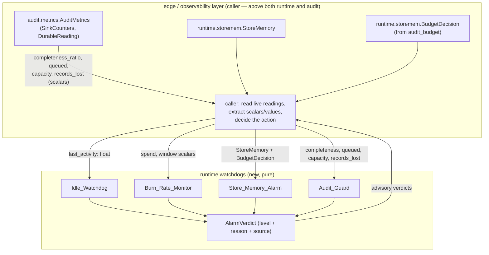

# Design Document

## Overview

This is the **local half of B9 / R2-24**: four pure, unit-tested validation-environment
watchdog/alarm **evaluator utilities** in the `gateway_v2` tree. Round 2 measured
test-environment waste — ≈ $120 of idle burn after agents stopped, idle reserved GPU slots
still billing, and an audit backlog that nearly took down the shared stores. The runbook
correction (R2-24 register row + the §3 v3 AMENDMENT) requires every validation environment to
run an idle watchdog, a burn-rate monitor, a store-memory alarm and an audit guard, plus an
owner-visible teardown rule that survives agent or session loss.

R2-24 is **LOW / PARTIAL**. This spec ships ONLY the four pure evaluators and their tests. Each
evaluator:

- is a `@dataclass(frozen=True, slots=True)` holding its thresholds (passed in at construction)
  plus an injected `clock: Callable[[], float]`;
- takes its readings as **plain values** (scalars, or the two shipped `runtime` reading types);
- returns a single frozen `AlarmVerdict` (an alarm level + a reason + a source tag);
- performs no I/O, does not sleep, does not reach the network, and does not import a higher
  architectural layer.

The evaluators are **advisory**. The caller — the edge/observability layer, which already sits
above both `runtime` and `audit` — reads the live readings, calls the evaluators, and decides
what to do with each verdict. Wiring the evaluators to live readings and a real teardown action
is **deferred** (see Deferred and Out of Scope).

### Scope anchored to shipped facts

The design names and builds on types that already exist in the tree (verified by reading the
source), and **re-implements none of them**:

| Shipped type | File | Used by |
|---|---|---|
| `StoreMemory(used, maxmemory, policy, evicted_keys)` with `.used_ratio`, `.policy_unsafe` | `gateway_v2/runtime/storemem.py` | Store_Memory_Alarm |
| `BudgetDecision(budget_bytes, source, warnings)` with `.known` | `gateway_v2/runtime/storemem.py` | Store_Memory_Alarm |
| `audit_budget(knobs, mem) -> BudgetDecision` | `gateway_v2/runtime/storemem.py` | caller (produces the `BudgetDecision`) |
| `AuditMetrics` / nested `SinkCounters` (`.queued`, `.capacity`), `DurableReading` (`.completeness_ratio`, `.records_lost`) | `gateway_v2/audit/metrics.py` | caller (reads it, passes scalars down) |

## Architecture

### The central constraint: layer safety

The import-linter contract orders the layers low→high:

```
domain, contracts, runtime, audit, egress, dispatch, resolve, detect, plan, admit, edge
```

(confirmed in `gateway_v2/pyproject.toml`, `[[tool.importlinter.contracts]]` "Gateway v2 layers",
and the glossary in requirements.md). A module in a **lower** layer must never import a **higher**
one.

Two of the four evaluators consume shipped readings, and those readings live in **different
layers**:

- `StoreMemory` and `BudgetDecision` live in `runtime` (`runtime/storemem.py`).
- `AuditMetrics` lives in `audit` (`audit/metrics.py`), which sits **above** `runtime`.

So a single module cannot both live in `runtime` and import `gateway_v2.audit` — that is exactly
the edge `lint-imports` forbids.

**Resolution (Decision 1):** place all four evaluators in **one new `runtime` module**,
`gateway_v2/gateway_v2/runtime/watchdogs.py`, and have every evaluator take its readings as
plain values:

- `Store_Memory_Alarm` takes a `StoreMemory` and a `BudgetDecision` — both `runtime` types, so
  importing them from `runtime/storemem.py` is a same-layer import and is legal.
- `Audit_Guard` takes the audit **scalars** it needs — `completeness_ratio: float`,
  `queued: int`, `capacity: int`, `records_lost: int` — as plain `float`/`int` arguments to its
  `evaluate(...)` method. It does **not** import `gateway_v2.audit` and never names
  `AuditMetrics`.
- `Idle_Watchdog` and `Burn_Rate_Monitor` take plain floats only.

The **caller** (edge/observability, above both layers) is the only place that reads
`audit.metrics.AuditMetrics` and `runtime.storemem`. It extracts the scalars/values and passes
them down into the `runtime` evaluators. This keeps the dependency arrow pointing the legal way
(higher layer imports lower layer, never the reverse) and keeps `lint-imports` at **2/2 kept**.

Why not place the evaluators in `domain` instead? `domain` is legal (it is the lowest layer, so
it may be imported by everyone and imports no one). But `Store_Memory_Alarm` wants the real
`StoreMemory`/`BudgetDecision` **types** for a precise, non-stringly signature, and those types
live in `runtime`; a `domain` evaluator could not name them without `domain` importing `runtime`
(illegal, since `runtime` is higher than `domain`). Keeping all four together in `runtime` lets
the store-memory alarm use the real shipped types while the audit guard still takes bare scalars
— the smallest, most cohesive placement that satisfies the Layer_Contract. `AlarmVerdict` and
`AlarmLevel` live in the same `runtime/watchdogs.py` module (both are plain value types the
evaluators own; nothing lower needs them).

### Data flow



The arrows into `runtime.watchdogs` all originate in the caller (a higher layer), so no `runtime`
module ever imports `audit`.

## Components and Interfaces

All four evaluators follow the shipped house idiom (verified against
`gateway_v2/plan/snapshot.py::ReplicaSnapshot` and
`gateway_v2/state_control/rehydrate.py::Rehydrator`): a frozen slotted dataclass holding config +
an injected `clock: Callable[[], float]` (inline-lambda / default-callable idiom, **not**
`runtime/clock.py`, which is an empty stub). Each exposes a pure `evaluate(...)` method returning
an `AlarmVerdict`.

### `AlarmLevel` (Enum)

Minimal, two members only — the runbook asks for an alarm, not a severity ladder:

```python
class AlarmLevel(Enum):
    OK = "ok"
    ALARM = "alarm"
```

### `AlarmSource` (Enum)

Which watchdog raised the verdict (a tag, not behaviour):

```python
class AlarmSource(Enum):
    IDLE = "idle"
    BURN_RATE = "burn_rate"
    STORE_MEMORY = "store_memory"
    AUDIT_GUARD = "audit_guard"
```

### `AlarmVerdict` (shared frozen value) — Decision 3

```python
@dataclass(frozen=True, slots=True)
class AlarmVerdict:
    level: AlarmLevel
    source: AlarmSource
    reason: str
```

- A **no-alarm** verdict is `level == AlarmLevel.OK` with a neutral/empty `reason` (e.g. `""`).
- A **firing** verdict is `level == AlarmLevel.ALARM` with a distinct `reason` string per firing
  path.
- The verdict is advisory only; the caller decides the action. There is no action field.

### `Idle_Watchdog` (Requirement 1)

```python
@dataclass(frozen=True, slots=True)
class IdleWatchdog:
    idle_bound_s: float                 # threshold, passed in by caller
    clock: Callable[[], float] = time.monotonic
    def evaluate(self, last_activity_at: float) -> AlarmVerdict: ...
```

- **Input:** `last_activity_at` (a monotonic timestamp), plus the injected clock.
- **Fires** (`ALARM`, source `IDLE`) iff `self.clock() - last_activity_at > self.idle_bound_s`.
- Otherwise returns `OK`.
- Pure: reads the clock once, does arithmetic, returns. No I/O, no sleep, no network.

### `Burn_Rate_Monitor` (Requirement 2)

```python
@dataclass(frozen=True, slots=True)
class BurnRateMonitor:
    budget_per_window: float            # threshold, passed in by caller
    clock: Callable[[], float] = time.monotonic
    def evaluate(self, observed_spend: float, elapsed_window_s: float) -> AlarmVerdict: ...
```

- **Input:** `observed_spend` and `elapsed_window_s` (or a window derived via the clock); plus
  `budget_per_window` config.
- **Burn rate** is `observed_spend / elapsed_window_s` for `elapsed_window_s > 0` (a projected
  per-window rate). A non-positive window is treated as "no measurable rate yet" → `OK` (an
  explicit edge case, so a zero elapsed window cannot divide by zero or fire spuriously).
- **Fires** (`ALARM`, source `BURN_RATE`) iff the projected burn rate `> self.budget_per_window`.
- Otherwise `OK`. Pure.

### `Store_Memory_Alarm` (Requirement 3)

```python
@dataclass(frozen=True, slots=True)
class StoreMemoryAlarm:
    used_ratio_threshold: float         # threshold, passed in by caller
    clock: Callable[[], float] = time.monotonic
    def evaluate(self, memory: StoreMemory, budget: BudgetDecision) -> AlarmVerdict: ...
```

- **Input:** a shipped `StoreMemory` and a shipped `BudgetDecision` (both `runtime` types,
  imported from `runtime/storemem.py` — a same-layer import).
- **Consumes the shipped readings and re-implements nothing** (Req 3.2): it reads
  `memory.used_ratio`, `memory.policy_unsafe`, `memory.used`, and `budget.budget_bytes` /
  `budget.known`. It does not recompute the ratio or the budget.
- **Fires** (`ALARM`, source `STORE_MEMORY`) on **any** of three conditions, each with a
  **distinct reason**:
  1. `memory.used_ratio >= self.used_ratio_threshold` — "used ratio over threshold".
  2. `budget.known and memory.used > budget.budget_bytes` — "audit budget exceeded by used
     bytes" (only when the budget is known; an unknown budget cannot be exceeded).
  3. `memory.policy_unsafe` — "unsafe/evicting maxmemory policy".
- When more than one condition holds, the reason names the first matched condition in the order
  above (deterministic); the level is still `ALARM`.
- Returns `OK` only when none of the three hold. Pure (clock available for a timestamped reason
  if desired, never for a decision).

### `Audit_Guard` (Requirement 4)

```python
@dataclass(frozen=True, slots=True)
class AuditGuard:
    completeness_bound: float           # threshold, passed in by caller
    backlog_bound: float                # threshold ratio, passed in by caller
    clock: Callable[[], float] = time.monotonic
    def evaluate(
        self, completeness_ratio: float, queued: int, capacity: int, records_lost: int,
    ) -> AlarmVerdict: ...
```

- **Input:** the audit **scalars** only (`completeness_ratio`, `queued`, `capacity`,
  `records_lost`), passed in by the caller — the guard never imports or names `AuditMetrics`.
- **Completeness is read, not re-derived** (Req 4.2): the guard uses the shipped
  `DurableReading.completeness_ratio` value verbatim. `completeness_ratio` is already
  `durable / acknowledged_high_water` — the ONLY place in the codebase allowed to say
  "completeness" — and the guard must not recompute it from the acknowledged high-water mark.
- **Backlog ratio** is `queued / capacity` for `capacity > 0` (a zero capacity is treated as "no
  measurable backlog" → not a backlog alarm by itself, an explicit edge case).
- **Fires** (`ALARM`, source `AUDIT_GUARD`) iff `completeness_ratio < self.completeness_bound`
  OR the backlog ratio `> self.backlog_bound`, with a distinct reason per path (completeness vs
  backlog). `records_lost` is carried into the reason string for operator context; it does not
  change the firing decision beyond the completeness/backlog conditions.
- Returns `OK` when completeness is at/above bound and backlog is within bound. Pure.

## Data Models

The only new value types are those defined above, all in `runtime/watchdogs.py`:

- `AlarmLevel` — Enum (`OK`, `ALARM`).
- `AlarmSource` — Enum (`IDLE`, `BURN_RATE`, `STORE_MEMORY`, `AUDIT_GUARD`).
- `AlarmVerdict` — frozen slotted dataclass (`level`, `source`, `reason`).
- `IdleWatchdog`, `BurnRateMonitor`, `StoreMemoryAlarm`, `AuditGuard` — frozen slotted dataclass
  evaluators.

Consumed (not redefined) shipped types:

- `gateway_v2.runtime.storemem.StoreMemory` — fields `used: int`, `maxmemory: int`,
  `policy: str`, `evicted_keys: int`; properties `used_ratio: float`, `policy_unsafe: bool`.
- `gateway_v2.runtime.storemem.BudgetDecision` — fields `budget_bytes: int | None`,
  `source: str`, `warnings: tuple[str, ...]`; property `known: bool`.
- Audit scalars extracted by the caller from `gateway_v2.audit.metrics.AuditMetrics`:
  `durable.completeness_ratio: float`, `sink.queued: int`, `sink.capacity: int`,
  `durable.records_lost: int`.

### House-idiom constraints (Decision 4 — explicit design rules)

These are binding design rules, each tied to a gate:

1. **Frozen slotted dataclasses.** Every new type uses `@dataclass(frozen=True, slots=True)` —
   passes `check_frozen_dataclasses`.
2. **Injected clock, not the stub.** Time enters through `clock: Callable[[], float]` defaulting
   to `time.monotonic` (the shipped `ReplicaSnapshot`/`Rehydrator` idiom), **never**
   `runtime/clock.py` (an empty stub).
3. **No capacity/SLO literal as a dataclass field default.** The AST gate
   `check_capacity_literals` forbids integer capacity literals assigned to the keyword names
   `queue_depth`, `backlog`, `capacity`, `high_water`, `pool_size`, `workers`, etc. (verified in
   `lint/check_capacity_literals.py`) outside `runtime/resources.py`. Thresholds are therefore
   **passed in by the caller at construction** (`idle_bound_s`, `budget_per_window`,
   `used_ratio_threshold`, `completeness_bound`, `backlog_bound`) with **no numeric defaults** on
   the dataclass fields. The gate matches exact target identifier names, so field names like
   `backlog_bound` (not the bare keyword `backlog`) and `used_ratio_threshold` are additionally
   safe by name — but the binding rule is: no capacity integer literal anywhere in this module.
4. **No module-level mutable; no new HTTP type.** The module defines only frozen dataclasses,
   Enums, and the evaluator classes — passes `check_no_module_mutable` and
   `check_http_outside_edge_resolve`.
5. **AlarmVerdict is a frozen value** carrying at least a level and a reason; the caller decides
   the action (Req 6.5).
6. **Property tests use a seeded `random.Random` with ≥ 10,000 iterations, no hypothesis**
   (Req 6.6).

## Correctness Properties

*A property is a characteristic or behavior that should hold true across all valid executions of a
system — essentially, a formal statement about what the system should do. Properties serve as the
bridge between human-readable specifications and machine-verifiable correctness guarantees.*

The four evaluators are pure functions over their inputs, which is exactly where property-based
testing is strongest. Each firing condition is a monotone boundary: the WHEN (fires) and the WHILE
(does not fire) halves of each requirement fold into **one** "fires iff condition" property, so the
"clean reading ⇒ OK" boundary is the negative side of each property rather than a separate one.
That leaves one property per evaluator — four in total.

### Property 1: Idle fires iff elapsed exceeds the bound

*For all* idle bounds, clock readings, and last-activity timestamps, the Idle_Watchdog returns an
`AlarmLevel.ALARM` verdict (source `IDLE`) **iff** `clock() - last_activity_at > idle_bound_s`, and
returns `AlarmLevel.OK` otherwise.

**Validates: Requirements 1.2, 1.3, 1.4**

### Property 2: Burn-rate fires iff the projected rate exceeds the budget

*For all* observed-spend values, positive elapsed windows, and budgets-per-window, the
Burn_Rate_Monitor returns an `AlarmLevel.ALARM` verdict (source `BURN_RATE`) **iff**
`observed_spend / elapsed_window_s > budget_per_window`, and returns `AlarmLevel.OK` otherwise
(a non-positive window yields `OK`).

**Validates: Requirements 2.2, 2.3, 2.4**

### Property 3: Store-memory fires iff any of the three conditions holds

*For all* `StoreMemory` readings, `BudgetDecision` values, and used-ratio thresholds, the
Store_Memory_Alarm returns an `AlarmLevel.ALARM` verdict (source `STORE_MEMORY`) **iff**
`used_ratio >= used_ratio_threshold` OR (`budget.known` AND `used > budget.budget_bytes`) OR
`policy_unsafe`, and returns `AlarmLevel.OK` iff none of the three holds; the alarm `reason`
identifies the first matched condition in that fixed order.

**Validates: Requirements 3.3, 3.4, 3.5, 3.6**

### Property 4: Audit-guard fires iff completeness is below bound or backlog is above bound

*For all* completeness ratios, queued/capacity pairs, records-lost counts, completeness bounds, and
backlog bounds, the Audit_Guard returns an `AlarmLevel.ALARM` verdict (source `AUDIT_GUARD`) **iff**
`completeness_ratio < completeness_bound` OR (`capacity > 0` AND `queued / capacity > backlog_bound`),
and returns `AlarmLevel.OK` otherwise; completeness is read from the shipped `completeness_ratio`
and never re-derived.

**Validates: Requirements 4.3, 4.4, 4.5, 4.6**

## Error Handling

The evaluators are pure and total — they do not raise for ordinary readings; they classify. The
error-handling design is therefore about **well-defined edge inputs**, not exceptions:

- **Zero / non-positive elapsed window (Burn_Rate_Monitor):** a window of `0` (or negative) has no
  measurable rate; the monitor returns `OK` rather than dividing by zero. Covered by an explicit
  boundary test.
- **Unknown budget (Store_Memory_Alarm):** when `budget.known` is `False` (`budget_bytes is None`),
  the "budget exceeded" condition cannot be evaluated and is treated as not-fired; the other two
  conditions still apply. An unknown budget never fires on its own.
- **Zero capacity (Audit_Guard):** a `capacity` of `0` (or negative) has no measurable backlog
  ratio; the backlog condition is treated as not-fired, while the completeness condition still
  applies.
- **Thresholds are the caller's contract:** thresholds are supplied at construction. The evaluators
  do not validate them (a non-sensical threshold is the caller's error); keeping them total avoids
  turning an advisory alarm into a construction-time failure. This matches the "advisory only"
  framing — the caller owns the policy.
- **No fail-open path:** because the evaluators perform no I/O, there is no degraded/exception mode
  that could silently return `OK`. Every input maps deterministically to a verdict.

## Testing Strategy

### Dual approach

- **Property tests** verify the four universal firing properties above across a wide input space.
- **Example / boundary tests** verify construction shape, the shipped-reading consumption (Req 3.2,
  4.2), and the explicit edge inputs (zero window, unknown budget, zero capacity).

All tests live in **one new file**, `gateway_v2/tests/runtime/test_watchdogs_r2_24.py`, written as
one coherent file per the single-test-file convention.

### Property-based testing applicability

PBT **is** appropriate here: the four evaluators are pure functions with clear input/output
behavior and universal "for all inputs" firing conditions over large numeric/value input spaces.
PBT is **not** used for the structural/architectural criteria (frozen-dataclass shape, layer
placement, no-recomputation, purity) — those are covered by the AST gates, `mypy --strict`,
`lint-imports`, and a few example tests.

### Property test configuration

- Use a **seeded `random.Random`** with **≥ 10,000 iterations** per property; **no hypothesis**
  (house idiom, Req 6.6).
- Each property test is tagged with a comment referencing its design property, format:
  **Feature: validation-watchdogs-r2-24, Property N: {property text}**.
- Each of the four correctness properties is implemented by a **single** property-based test:
  - Property 1 — generate `(idle_bound_s, now, last_activity_at)` across firing and non-firing
    regions; assert `ALARM` iff `now - last_activity_at > idle_bound_s`.
  - Property 2 — generate `(observed_spend, elapsed_window_s > 0, budget_per_window)`; assert
    `ALARM` iff `observed_spend / elapsed_window_s > budget_per_window`.
  - Property 3 — generate random `StoreMemory` (`used`, `maxmemory`, `policy` drawn from safe and
    evicting families, `evicted_keys`), a `BudgetDecision` (known and unknown), and a threshold;
    assert `ALARM` iff the three-way OR holds and the reason names the first matched condition.
  - Property 4 — generate `(completeness_ratio, queued, capacity, records_lost, completeness_bound,
    backlog_bound)`; assert `ALARM` iff `completeness_ratio < completeness_bound` or
    (`capacity > 0` and `queued / capacity > backlog_bound`).

### Example / boundary tests

- Construction examples for each evaluator (frozen, accepts injected clock) — Req 1.1, 2.1, 3.1,
  4.1.
- Store_Memory_Alarm tracks the shipped `StoreMemory.used_ratio` / `.policy_unsafe` and the
  `BudgetDecision` rather than recomputing — Req 3.2.
- Audit_Guard decision is a function of the passed-in `completeness_ratio` only (no acknowledged
  high-water recomputation) — Req 4.2.
- Boundary cases: elapsed exactly equal to bound (does not fire, strict `>`), rate exactly equal
  to budget (does not fire, strict `>`), used-ratio exactly at threshold (fires, `>=`), zero
  window, unknown budget, zero capacity.

### The gate (Requirement 7)

Run from cwd `gateway_v2` with the `gateway_v2/.venv` venv:

1. Full `pytest` green: baseline **1697 passed / 95 skipped / 1 xfailed** plus the new watchdog
   tests.
2. `mypy --strict` over the `gateway_v2` tree passes.
3. `ruff check gateway_v2 state_control audit_control load_harness lint tests` passes.
4. `lint-imports` reports **2/2 kept**.
5. Each of the 6 AST gates exits 0: `check_capacity_literals`, `check_no_module_mutable`,
   `check_frozen_dataclasses`, `check_http_outside_edge_resolve`, `check_sizes`,
   `check_tenant_scale`.
6. `unscanned_channels() == ()`.

## Requirements Traceability

| Requirement | Design element that satisfies it |
|---|---|
| 1.1 Idle_Watchdog frozen dataclass + injected clock + timestamp | `IdleWatchdog` dataclass (Components); construction example |
| 1.2 / 1.3 fires when elapsed > bound, OK otherwise | `IdleWatchdog.evaluate`; **Property 1** |
| 1.4 deterministic, no I/O/sleep/network | Pure method, injected clock; **Property 1** + structural purity |
| 2.1 Burn_Rate_Monitor frozen dataclass + clock + spend + budget | `BurnRateMonitor` dataclass; construction example |
| 2.2 / 2.3 fires when rate > budget, OK otherwise | `BurnRateMonitor.evaluate`; **Property 2** |
| 2.4 deterministic, no I/O/sleep/network | Pure method; **Property 2** + structural purity |
| 3.1 reads StoreMemory + BudgetDecision as plain values | `StoreMemoryAlarm.evaluate(memory, budget)` (same-layer `runtime` types) |
| 3.2 consumes shipped storemem readings, no re-implementation | Uses `used_ratio`, `policy_unsafe`, `budget.known`; example test |
| 3.3 used ratio over threshold ⇒ ALARM | Condition 1; **Property 3** |
| 3.4 budget exceeded by used bytes ⇒ ALARM | Condition 2 (`budget.known and used > budget_bytes`); **Property 3** |
| 3.5 unsafe/evicting policy ⇒ ALARM | Condition 3 (`policy_unsafe`); **Property 3** |
| 3.6 none hold ⇒ OK | Negative side of **Property 3** |
| 4.1 Audit_Guard frozen dataclass reads Audit_Reading scalars | `AuditGuard.evaluate(completeness_ratio, queued, capacity, records_lost)` |
| 4.2 completeness from DURABLE high-water, not re-derived | Reads shipped `completeness_ratio` verbatim; example test |
| 4.3 completeness below bound ⇒ ALARM | Completeness condition; **Property 4** |
| 4.4 queue depth over backlog bound ⇒ ALARM | Backlog-ratio condition; **Property 4** |
| 4.5 completeness ok and queue within bound ⇒ OK | Negative side of **Property 4** |
| 4.6 deterministic, no I/O/sleep/network | Pure method; **Property 4** + structural purity |
| 5.1 placement complies with Layer_Contract | All four in `runtime/watchdogs.py` (Architecture) |
| 5.2 runtime utility does not import `gateway_v2.audit` | Audit_Guard takes scalars, never names `AuditMetrics` (Decision 1) |
| 5.3 readings passed as plain values / small protocol | Scalars + `runtime` reading types only (Decision 1) |
| 5.4 lint-imports 2/2 kept | Gate step 4 |
| 6.1 frozen slotted dataclasses | House-idiom rule 1; `check_frozen_dataclasses` |
| 6.2 injected clock, not `runtime/clock.py` | House-idiom rule 2 (`time.monotonic` default) |
| 6.3 no capacity/SLO literal as a field | House-idiom rule 3; `check_capacity_literals`; thresholds passed in |
| 6.4 no module-level mutable, no new HTTP type | House-idiom rule 4; `check_no_module_mutable`, `check_http_outside_edge_resolve` |
| 6.5 AlarmVerdict frozen value; caller decides action | `AlarmVerdict` (Decision 3); advisory framing |
| 6.6 seeded `random.Random` ≥ 10,000 iters, no hypothesis | Testing Strategy, property test configuration |
| 7.1–7.5 local acceptance gate | Testing Strategy "The gate" |
| 8.1–8.4 deferred / out of scope | Deferred and Out of Scope |

## Deferred and Out of Scope

Named here, not built — consistent with R2-24 being LOW / PARTIAL (the watchdog/alarm **utilities**
are buildable locally; everything that requires live cloud, store, metrics, or billing wiring is
operations/deployer policy):

- **Owner-visible teardown rule** that survives agent or session loss — operations/deployer policy
  owned by **T20**. This local half ships evaluators that *detect*; it does not perform or schedule
  teardown (Req 8.1).
- **Idle reserved GPU slot billing** — a cloud/GPU-capacity concern owned by **GW25** (Req 8.2).
- **Real wiring:** no real cloud environment wiring, no real store or metrics I/O, no real GCP
  billing API access. The evaluators are pure; a real caller that reads live `AuditMetrics` /
  `StoreMemory`, computes spend/idle from real signals, and takes a real action is deferred
  (Req 8.3).
- The caller that extracts the audit scalars from `AuditMetrics` and the store values from
  `runtime.storemem`, calls the four evaluators, and acts on their verdicts lives in the
  edge/observability layer and is **not** part of this card (Req 8.4 — this spec ships only the four
  pure evaluators and their tests).
