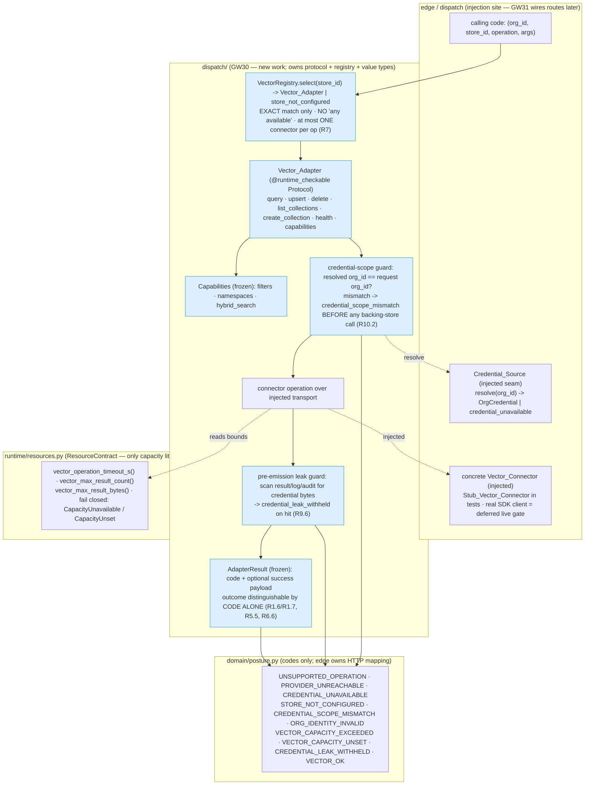

# Design Document

## Overview

GW30 (runbook v3.1 §00.6, "One adapter interface for every vector store") builds **one** `@runtime_checkable` adapter protocol that every vector-store connector implements, a registry that routes a request to **exactly** the requested store with **no silent fallback**, a per-org credential seam that resolves from the control plane and never leaks, and a uniform result value whose success-vs-failure outcome is distinguishable **by a declared posture code alone**. It is the v1-parity, pre-cutover card that GW31 (RAG parity), GW21 (shadow) and GW23 (cutover) consume; it depends on GW11 (dispatch authorization, complete) and follows its injected-`ProviderClient`, fail-closed, byte-honest idiom.

GW30 exists to kill a specific v1 defect: `_resolve_vector_client` silently falls back to "any available" provider when the requested store is unreachable, so one tenant's query reaches a store the tenant never configured, and an unreachable store surfaces an **empty result set as if it were a clean, complete search**. GW30 replaces that with a connector that answers a declared `unsupported_operation` for anything it cannot do, a declared `provider_unreachable` (never an empty result) for a transport failure, and a registry that selects a connector by **exact store identifier match only**.

This design implements exactly the GW30 card and nothing outside it:

- **Objective (verbatim, §00.6).** One adapter interface with connectors for Pinecone, Chroma, Milvus/Zilliz, Qdrant, Weaviate, pgvector, Elasticsearch/OpenSearch, Redis, MongoDB Atlas, AWS (OpenSearch Serverless, Bedrock Knowledge Bases), GCP (Vertex AI Vector Search) and Azure (AI Search) — **13 named connectors**.
- **Interface.** `query`, `upsert`, `delete`, `list_collections`, `create_collection`, `health`, plus capability flags (`filters`, `namespaces`, `hybrid_search`).
- **Credentials** come per org from control and never appear in responses or logs.
- **A connector that cannot do an operation answers a declared `unsupported_operation`, never an empty result.**
- **No silent fallback** to another provider.

The three live acceptance tests this design must satisfy (no exit on unit tests alone, per the runbook):

| Test | What it proves | Primary requirement |
|------|----------------|---------------------|
| **L30-1** | The same `query`/`upsert`/`delete` suite against every connector yields the same results and the same declared-error categories on byte-identical equivalent input | R12 |
| **L30-2** | A provider made unreachable in live staging returns `provider_unreachable` within 30 s — never an empty result labelled as a clean search | R13 |
| **L30-3** | Org A's credential presented for Org B's request is refused **before** any backing-store connection | R14 |

### Scope boundaries (what GW30 is NOT)

- **No RAG routes, no RAG pipeline.** `/v1/rag/*` and `/v1/vector/*` (today `edge/rag.py` is the empty placeholder "empty until GW18") and the four-stage RAG pipeline are **GW31** scope. GW30 ships the adapter layer that GW31 will wire into routes. This document introduces no route and no pipeline behaviour.
- **No real per-store SDK/HTTP clients.** Exactly as `dispatch/provider.py::StubProviderClient` defers the real socket, the 13 named connectors are thin classes over an **injected transport**; the real network clients are a **deferred live gate** exercised only by L30-1/L30-2/L30-3. Unit and property tests inject the socket-free `Stub_Vector_Connector`.
- **House conventions preserved:** `from __future__ import annotations`; frozen `@dataclass(frozen=True, slots=True)` value types; tuple `__all__`; **no module-level mutable table** (gated by `lint/check_no_module_mutable.py`); **no capacity literal outside `runtime/resources.py`** (gated by `lint/check_capacity_literals.py`); the import-linter layer order; codes-only posture vocabulary with `edge` owning any HTTP mapping; `mypy --strict`, `ruff`, `lint-imports`, AST gates green.

### Confirmed facts from the codebase (designed against reality)

- `dispatch/provider.py` owns the mirror idiom: `ProviderClient` (`@runtime_checkable` Protocol with `open`/`abort`), the frozen slotted value types `UpstreamRequest`/`UpstreamEvent`, and `StubProviderClient` (injected seeded `random.Random` + scripted sequence, one-way abort latch, **no socket**; real socket a deferred live gate). GW30's `Vector_Adapter` + `Stub_Vector_Connector` are the direct analogues.
- `dispatch/routing.py` `DispatchRouter.select(plan) -> str` is pure, deterministic, slotted (`__slots__ = ()`), stateless. GW30's `VectorRegistry.select(store_id)` mirrors its purity and exact-match discipline — but selects by an explicitly requested identifier, never derives "any available".
- `dispatch/transform.py` shows the frozen-slotted value + stateless codec idiom and the `MappingProxyType` immutable-body pattern reused by the adapter request bodies.
- `domain/posture.py` is the single codes-only vocabulary (`KILL_SWITCH_UNAVAILABLE`, `STREAM_*`, `OVERLOAD_SHED`, …), each a plain string constant with a docstring; `HTTPException`/`JSONResponse` are forbidden outside `edge`/`resolve`. GW30's new codes live here, codes only.
- `runtime/resources.py` `ResourceContract` is the only module `lint/check_capacity_literals.py` exempts. It derives bounds via `_MULT`/`_FRACTION` constants off `target_p99_ms`/`workers()`/`connection_budget()` and fails closed with `CapacityUnavailable` below a serviceable minimum (and `CapacityUnset` for an unsupplied bound, as `_guard_pool` shows). GW30's per-operation timeout and result-size bounds are added here as accessors in that idiom, never as connector literals.
- The control-plane per-org plan-key idiom is `{rv2}:plan:{org}` (AGENTS.md R2-09/budget-lease, GW11). The `Credential_Source` resolves under that key.

## Architecture

The adapter layer sits in `dispatch` (it already owns `ProviderClient` and sits above `egress`/`runtime`/`contracts`/`domain` and below `plan`/`resolve`). `edge`/`dispatch` **inject** the concrete connector and the `Credential_Source`; neither is imported downward. `domain` owns the posture codes; `runtime` owns the `ResourceContract` bounds.



Flow of one operation (the invariant the card signs for):

1. Caller hands `VectorRegistry` an **explicit** `store_id` plus the operation and args. The registry does an **exact-match** lookup; an unregistered id returns `store_not_configured` and routes to **no** connector (R7.2).
2. Before any backing-store byte, the connector resolves the `OrgCredential` for the request's `org_id` through the injected `Credential_Source` and verifies the resolved credential's `org_id` **equals** the request's `org_id`. A mismatch returns `credential_scope_mismatch`; a missing/empty `org_id` returns `org_identity_invalid`; an unresolvable/unverified credential returns `credential_unavailable` — **all before any store call** (R8, R10).
3. The connector performs the operation over its **injected transport**, bounded by the `ResourceContract` timeout and result-size accessors. Unreachable → `provider_unreachable`; an operation/capability it cannot do → `unsupported_operation`; a bound exceeded → `vector_capacity_exceeded`.
4. The pre-emission **leak guard** scans the result (and any log/audit field) for credential bytes before it leaves the connector; a hit withholds the whole value and emits `credential_leak_withheld`.
5. A connector-returned `provider_unreachable`/`unsupported_operation` is returned to the caller **as-is** — never retried or forwarded to another connector (R7.3).

## Data Models

Every GW30 value is a frozen, slotted dataclass in the house idiom (`from __future__ import annotations`; `@dataclass(frozen=True, slots=True)`; immutable tuples, never lists, for any collection field), so each value is hashable, immutable, and allocation-bounded by its slots. Nothing here carries a clock, randomness, or module-level mutable state. These models are the complete GW30 data vocabulary; the "Components and Interfaces" section below describes how each is produced and consumed.

### `AdapterResult` — the uniform operation result

The single value returned by **every** `Vector_Adapter` operation. Its success-vs-failure outcome is distinguishable **by `code` alone** (R1.6, R1.7, R5.4, R5.5, R6.6), so a legitimate zero-record success is never confusable with any failure.

```python
from __future__ import annotations

from dataclasses import dataclass

from gateway_v2 import domain  # posture codes


@dataclass(frozen=True, slots=True)
class AdapterResult:
    code: str                                        # a domain.posture Vector_Posture_Code
    records: tuple[VectorRecord, ...] | None = None  # ABSENT (None) on any non-OK outcome
    count: int | None = None                         # applied/removed count for upsert/delete success
    collections: tuple[str, ...] | None = None       # list_collections success
    status: str | None = None                        # health: "reachable" | "degraded"
    detail_ref: str | None = None                    # credential REFERENCE id only, never the value

    @property
    def ok(self) -> bool:
        return self.code == domain.posture.VECTOR_OK
```

**Absent-vs-empty invariant (the heart of R5.5 / R6.6).** On any non-OK `code`, `records is None` (**absent**). A successful `query` that genuinely matched nothing returns `code == VECTOR_OK` with `records == ()` (**present but empty**). `None` and `()` are therefore never interchangeable: `None` means "no search happened / the operation failed", `()` means "the search ran and matched zero records". `count`/`collections`/`status` follow the same rule — present only on the relevant success, `None` otherwise. `detail_ref` is only ever a credential **reference id**, never secret material.

### `VectorRecord` — the id + vector + metadata record

The record shape returned inside a successful `query` (`AdapterResult.records`) and supplied inside an `UpsertRequest`. The embedding is a tuple of floats (immutable); metadata is an immutable mapping of string keys to scalar values.

```python
from __future__ import annotations

from dataclasses import dataclass
from types import MappingProxyType
from typing import Mapping


@dataclass(frozen=True, slots=True)
class VectorRecord:
    id: str
    vector: tuple[float, ...]
    metadata: Mapping[str, str | int | float | bool]  # built from MappingProxyType — immutable
```

### Request value types — one per operation

Six frozen, slotted request values, one per protocol operation. Each carries the request `org_id`, the target `store_id`, the `collection` identifier where the operation applies to a collection, and that operation's payload as **immutable tuples** (matching the `MappingProxyType`-built `UpstreamRequest.body` idiom). None of them carries credential material — the credential is resolved by the connector from the injected `Credential_Source`, never passed in by the caller.

```python
from __future__ import annotations

from dataclasses import dataclass
from typing import Mapping


@dataclass(frozen=True, slots=True)
class QueryRequest:
    org_id: str
    store_id: str
    collection: str
    vector: tuple[float, ...]                 # the query embedding
    top_k: int
    filter: Mapping[str, str | int | float | bool] | None = None  # applied only if capabilities().filters
    namespace: str | None = None              # honoured only if capabilities().namespaces


@dataclass(frozen=True, slots=True)
class UpsertRequest:
    org_id: str
    store_id: str
    collection: str
    records: tuple[VectorRecord, ...]         # the record set to write (immutable)
    namespace: str | None = None


@dataclass(frozen=True, slots=True)
class DeleteRequest:
    org_id: str
    store_id: str
    collection: str
    ids: tuple[str, ...]                      # the record ids to remove (immutable)
    namespace: str | None = None


@dataclass(frozen=True, slots=True)
class ListRequest:
    org_id: str
    store_id: str                             # list_collections — no single collection target


@dataclass(frozen=True, slots=True)
class CreateRequest:
    org_id: str
    store_id: str
    collection: str                           # the collection to create
    dimension: int                            # the embedding dimensionality
    metric: str                               # the distance metric (e.g. "cosine")


@dataclass(frozen=True, slots=True)
class HealthRequest:
    org_id: str
    store_id: str                             # probe reachability of this store
```

### `Capabilities` — the per-connector capability flags (R3)

Exactly three booleans, each **defined** (no flag left undefined). A call exercising a capability a connector declares `False` returns `unsupported_operation` (never a silently-ignored option, never an empty result).

```python
from __future__ import annotations

from dataclasses import dataclass


@dataclass(frozen=True, slots=True)
class Capabilities:
    filters: bool
    namespaces: bool
    hybrid_search: bool
```

### `OrgCredential` — redacted, never-at-rest secret material (R9)

The per-org credential resolved from the control plane. It carries the owning `org_id`, a `verified` flag, and the secret material — but its `__repr__`/`__str__` are overridden to **redact** the secret, and it deliberately carries **no serialization method**: an audit stream is append-only and exported, so a serialized credential would put the secret at rest (mirrors the GW14c `Finding.evidence`-is-never-serialized lesson in AGENTS.md). Diagnostics reference a credential by a **reference id only**.

```python
from __future__ import annotations

from dataclasses import dataclass


@dataclass(frozen=True, slots=True)
class OrgCredential:
    org_id: str
    verified: bool
    _secret: str                 # secret material — never emitted, never serialized
    ref_id: str                  # opaque diagnostic reference id (safe to log)

    def __repr__(self) -> str:   # redacted — the secret never reaches a repr
        return f"OrgCredential(org_id={self.org_id!r}, verified={self.verified!r}, ref_id={self.ref_id!r}, secret=<redacted>)"

    __str__ = __repr__

    # NO to_dict / to_json / __getstate__ — a credential is NEVER put at rest (R9.4, R9.5)
```

### `CredentialResolution` — the `resolve()` outcome

The value returned by `Credential_Source.resolve(org_id)`: either a **success** carrying exactly one `OrgCredential` scoped to the requested `org_id`, or a **failure** carrying a posture code (`credential_unavailable`, `credential_scope_mismatch`, or `org_identity_invalid`) and never a credential. The success-vs-failure split is, like `AdapterResult`, decidable by the code alone; `credential` is present only on success and `None` on every failure.

```python
from __future__ import annotations

from dataclasses import dataclass


@dataclass(frozen=True, slots=True)
class CredentialResolution:
    code: str                              # VECTOR_OK on success, else a failure Vector_Posture_Code
    credential: OrgCredential | None = None  # present ONLY on success; None on every failure

    @property
    def ok(self) -> bool:
        return self.credential is not None
```

## Components and Interfaces

### `dispatch/vector_adapter.py` — the protocol, value types, and registry (R1, R2, R3, R5, R6, R7)

**`Vector_Adapter` protocol** (`@runtime_checkable`, mirroring `ProviderClient`). It declares exactly the six operations plus the `capabilities` accessor. A connector missing any one of the six is a non-conforming connector: an `isinstance` check against the protocol returns false, and the registry refuses to expose it, returning a declared code (R1.1, R1.2).

```python
@runtime_checkable
class Vector_Adapter(Protocol):
    async def query(self, req: QueryRequest) -> AdapterResult: ...
    async def upsert(self, req: UpsertRequest) -> AdapterResult: ...
    async def delete(self, req: DeleteRequest) -> AdapterResult: ...
    async def list_collections(self, req: ListRequest) -> AdapterResult: ...
    async def create_collection(self, req: CreateRequest) -> AdapterResult: ...
    async def health(self, req: HealthRequest) -> AdapterResult: ...
    def capabilities(self) -> Capabilities: ...
```

**Frozen request value types.** One per operation (`QueryRequest`, `UpsertRequest`, `DeleteRequest`, `ListRequest`, `CreateRequest`, `HealthRequest`), each a `@dataclass(frozen=True, slots=True)` carrying `org_id`, the `store_id`, the collection identifier where applicable, and the operation payload (query vector + optional filter; record set for upsert; id set for delete; collection spec for create). Record sets are carried as tuples so the value is immutable, matching `UpstreamRequest.body` built from a `MappingProxyType`.

**`AdapterResult` — the uniform result (R1.6, R1.7, R5.4, R5.5, R6.6).** The single value every operation returns. It carries a `Vector_Posture_Code` and an **optional** success payload. The success-vs-failure outcome is determined **by the code alone**, so a legitimate zero-record success is never confusable with a failure:

```python
@dataclass(frozen=True, slots=True)
class AdapterResult:
    code: str                               # a domain.posture Vector_Posture_Code
    records: tuple[VectorRecord, ...] | None = None   # ABSENT (None) on any non-OK outcome
    count: int | None = None                # applied/removed count for upsert/delete success
    collections: tuple[str, ...] | None = None        # list_collections success
    status: str | None = None               # health: "reachable" | "degraded"
    detail_ref: str | None = None           # credential REFERENCE id only, never the value

    @property
    def ok(self) -> bool:
        return self.code == posture.VECTOR_OK
```

The **absent-vs-empty distinction is explicit**: on any non-OK code `records is None` (absent), while a successful `query` that genuinely matched nothing returns `code == VECTOR_OK` with `records == ()` (present, empty). A caller distinguishes `unsupported_operation`/`provider_unreachable` from a clean zero-record search **without inspecting the record count** — it inspects `code` (R5.5, R6.6). An operation never raises its failure to the caller as an unhandled exception; every failure is a code on an `AdapterResult` (R1.7, R6.2).

**`Capabilities` — the capability flags (R3).** A frozen value with exactly three booleans, each defined (no flag left undefined):

```python
@dataclass(frozen=True, slots=True)
class Capabilities:
    filters: bool
    namespaces: bool
    hybrid_search: bool
```

A `query` carrying a filter against a connector whose `capabilities().filters` is false returns `unsupported_operation` — it does **not** silently ignore the filter and returns **no** results (R3.5). Where `filters` is true, the filter is applied and only matching results return (R3.6). The same unsupported-capability path covers `namespaces` and `hybrid_search`.

**`VectorRegistry` — exact-match selector, no silent fallback (R7).** Mirrors `DispatchRouter`'s purity (`__slots__`, stateless, no clock/no randomness) but maps a requested `store_id` to the one registered connector. It is constructed with an **injected** mapping of `store_id -> Vector_Adapter` (built in `edge`/`dispatch`; the registry holds no module-level mutable table). `select(store_id)`:

- returns the connector registered for that **exact** id, or
- returns `store_not_configured` when no connector matches — routing to **no** connector and leaving tenant data/query state untouched (R7.2),
- never selects by "any available", load, round-robin, or any criterion other than the exact id (R7.4) — the v1 `_resolve_vector_client` anti-pattern is explicitly barred.

The registry returns a connector-produced `provider_unreachable`/`unsupported_operation` **as-is** and invokes no other connector; for any single operation the count of distinct connectors invoked is **at most one** (R7.3, R7.5).

### `dispatch/vector_connectors.py` — the 13 named connectors over an injected transport (R4)

A connector is a thin `Vector_Adapter` implementation over an **injected `VectorTransport`** (the analogue of the injected `ProviderClient`): it shapes the adapter request into a per-store wire call, bounds it by the `ResourceContract`, maps the transport outcome to an `AdapterResult`, and declares its `Capabilities`. The real per-store SDK/HTTP transport is a **deferred live gate** — not built here — exercised only by L30-1/L30-2/L30-3.

The connector **table** is a factory function (not a module-level mutable dict; built and returned per call) naming exactly the 13 stores and each one's declared capability flags:

| `store_id` | filters | namespaces | hybrid_search |
|------------|:-------:|:----------:|:-------------:|
| `pinecone` | ✓ | ✓ | ✓ |
| `chroma` | ✓ | ✗ | ✗ |
| `milvus` | ✓ | ✓ | ✓ |
| `qdrant` | ✓ | ✗ | ✓ |
| `weaviate` | ✓ | ✗ | ✓ |
| `pgvector` | ✓ | ✗ | ✗ |
| `elasticsearch` | ✓ | ✗ | ✓ |
| `redis` | ✓ | ✗ | ✓ |
| `mongodb_atlas` | ✓ | ✗ | ✓ |
| `aws_opensearch_serverless` | ✓ | ✗ | ✓ |
| `aws_bedrock_kb` | ✓ | ✗ | ✗ |
| `gcp_vertex_vector` | ✓ | ✗ | ✗ |
| `azure_ai_search` | ✓ | ✗ | ✓ |

The capability-flag column is the **mechanism by which heterogeneous stores present a uniform adapter**: a store that lacks namespaces declares `namespaces=False` and returns `unsupported_operation` for a namespaced call, rather than each caller special-casing the store (see the L30-1 interpretation note below). Each of the 13 satisfies the protocol such that `isinstance(conn, Vector_Adapter)` is true (R4.3). Requesting a store id outside the 13 is rejected as unsupported and returns no connector instance (R4.7).

**`Stub_Vector_Connector` (R4.4–R4.6).** The injectable, in-process, **socket-free** connector that unit + property tests use, mirroring `StubProviderClient`:

- Driven by a seeded `random.Random` **injected** at construction (never created internally) and a scripted sequence of results/errors; two instances with the same seed + same script produce **byte-identical** outputs across all calls (R4.5).
- Returns results and raises/returns errors strictly in script order; opens **no** network socket, file handle, or other external I/O (R4.6).
- Satisfies the `Vector_Adapter` protocol (`isinstance` true) and declares a `Capabilities` value from its script, so the capability paths are testable offline.

### `dispatch/vector_credentials.py` — the injected `Credential_Source` seam (R8, R9, R10)

**`OrgCredential` value type.** A frozen slotted value carrying `org_id`, a `verified: bool` flag, and the secret material. Its `__repr__`/`__str__` are overridden to redact the secret, and it carries **no** serialization method — an audit stream is append-only and exported, so a serialized credential would put the secret at rest (mirrors the GW14c `Finding.evidence`-is-never-serialized lesson in AGENTS.md). Diagnostic detail references a credential by a **reference id only**, never its value (R9.4).

**`Credential_Source` protocol (injected from `edge`/`dispatch`, never downward, R8.6).**

```python
@runtime_checkable
class Credential_Source(Protocol):
    async def resolve(self, org_id: str) -> CredentialResolution: ...
```

`resolve(org_id)` reads the per-org plan key `{rv2}:plan:{org}` from the control plane within the 5000 ms resolution bound and returns exactly one `OrgCredential` scoped to that `org_id`, or a failure. It **fails closed**:

- missing/empty `org_id` → `credential_unavailable`, no store call, state unchanged (R8.3);
- control plane unreachable within 5000 ms → `credential_unavailable` (R8.4);
- resolved credential **not verified** → `credential_unavailable` (R8.5);
- resolved credential's `org_id` ≠ the request's `org_id` → `credential_scope_mismatch`, refused **before** any store call (R10.2, R10.4).

The source resolves a credential scoped to exactly one `org_id` and never returns another org's credential (R10.4). A connector carries **no** static credential, no process-wide default, and no credential state shared/observable across requests bearing different `org_id` values (R8.7, R10.6).

**Pre-emission leak guard (R9.6).** Immediately before a connector emits a result, writes a log line, or contributes an audit field, a guard scans the outgoing bytes for any **consecutive run of characters** of the active `OrgCredential` value (plaintext or encoded/partially-masked). On a hit it **withholds the entire value** and emits `credential_leak_withheld`. This sits at the connector's single emission boundary so every result/log/audit path passes through it (R9.1–R9.3, R9.5).

### `runtime/resources.py` — GW30 capacity accessors (R6, R11)

Three new accessors in the established `_MULT`/`_FRACTION` idiom, fail-closed exactly like `stream_buffer_bytes`/`_guard_pool`:

```python
_VECTOR_OP_TIMEOUT_MULT = 250.0   # vector op budget = p99_s x mult (~5 s at the 20 ms default)
_VECTOR_MAX_RESULT_COUNT = ...     # derived from connection_budget(), clamped to [1, 10_000]
_VECTOR_MAX_RESULT_BYTES_SHARE = ... # share of per_worker_rss, clamped to [1, 10_485_760]
```

- `vector_operation_timeout_s()` — per-operation timeout, `p99_s x _VECTOR_OP_TIMEOUT_MULT`; raises `CapacityUnavailable` on a non-positive result. A connector that finds **no** timeout supplied raises `CapacityUnset` and refuses to start the operation, returning `provider_unreachable` rather than an unbounded wait (R6.4, R6.5).
- `vector_max_result_count()` — max result count in `[1, 10_000]` derived from `connection_budget()`; `CapacityUnavailable` below one.
- `vector_max_result_bytes()` — max result payload bytes in `[1, 10_485_760]` derived from `per_worker_rss`; `CapacityUnavailable` below one.

A connector derives every bound from these accessors and holds **no** capacity literal (R11.1, R11.2, R11.4). An operation that would exceed a bound aborts before returning any partial result, discards accumulated data, and returns `vector_capacity_exceeded` (R11.3). An operation that does not complete within the derived timeout is cancelled, releases its resources, and returns a timeout code mapped to `provider_unreachable` (R6.4, R11.5). A required bound unset at init → `vector_capacity_unset`, refuse to start (R11.6).

### `domain/posture.py` — new Vector_Posture_Codes (R5.1, R6.1, R8, R9.6, R10, R11)

Plain string constants with a docstring each, codes-only, consistent with the existing `STREAM_*`/`*_UNAVAILABLE` naming; `edge` owns any HTTP mapping:

```python
VECTOR_OK = "vector_ok"                              # the single success code
UNSUPPORTED_OPERATION = "unsupported_operation"      # R5.1 — distinct from VECTOR_OK and every error
PROVIDER_UNREACHABLE = "provider_unreachable"        # R6.1 — transport failure, never empty success
CREDENTIAL_UNAVAILABLE = "credential_unavailable"    # R8 — unresolvable/unverified/CP-unreachable
STORE_NOT_CONFIGURED = "store_not_configured"        # R7.2 — no connector for the requested id
CREDENTIAL_SCOPE_MISMATCH = "credential_scope_mismatch"  # R10.2 — resolved org != request org
ORG_IDENTITY_INVALID = "org_identity_invalid"        # R10.3 — missing/empty/unresolvable org_id
VECTOR_CAPACITY_EXCEEDED = "vector_capacity_exceeded" # R11.3 — a Resource_Contract bound exceeded
VECTOR_CAPACITY_UNSET = "vector_capacity_unset"      # R11.6 — a required bound unset at init
CREDENTIAL_LEAK_WITHHELD = "credential_leak_withheld" # R9.6 — leak guard withheld the emission
```

`UNSUPPORTED_OPERATION` is a distinct code not equal to `VECTOR_OK` or any other error code, so the vocabulary alone distinguishes it from a zero-record success (R5.1, R5.5).

## Correctness Properties

*A property is a characteristic or behavior that should hold true across all valid executions of a system — a formal statement about what the system should do, bridging the human-readable specification and machine-verifiable correctness guarantees.*

The GW30 property tests use a seeded `random.Random` source, do **not** use the `hypothesis` library, and execute a **minimum of 10,000 generated iterations** per property (the house idiom, matching every shipped card in AGENTS.md). A failure reports the seed and the failing generated input, and preserves the seed so the case is reproducible (R15.1, R15.7). Each is implemented as a **single** property-based test tagged `Feature: vector-store-adapter-gw30, Property N: <text>`.

### Property 1: No silent fallback

*For all* generated requests against a specific `store_id` and any registry population, the call reaches only the connector registered for that exact `store_id` and reaches **zero** other connectors; an unregistered `store_id` reaches zero connectors and returns `store_not_configured`.

**Validates: Requirements 7.1, 7.2, 7.3, 7.4, 7.5, 15.2**

### Property 2: No credential leak

*For all* generated Adapter_Operations and declared errors, **zero** Org_Credential values (plaintext or any encoding/partial-mask reproducing one or more consecutive characters) appear in any returned result value, log line, or audit field; when an operation terminates with a declared error, zero credential characters appear in the error value or its diagnostic detail (which carries only a reference id).

**Validates: Requirements 9.1, 9.2, 9.3, 9.4, 9.6, 15.3, 15.4**

### Property 3: Unsupported operation is not an empty success

*For all* generated unsupported operations (and unsupported capability calls such as a filter against a `filters=False` connector), the result's `code` equals `unsupported_operation`, `records is None` (absent, not an empty tuple), and the result is **not equal** to a successful result whose record collection contains exactly zero records.

**Validates: Requirements 3.5, 5.2, 5.3, 5.4, 5.5, 15.5**

### Property 4: Org-credential isolation

*For all* generated `org_id` pairs whose two values are distinct, an operation for one `org_id` uses only that `org_id`'s Org_Credential and uses **zero** credentials belonging to any other `org_id`; a resolved-vs-request `org_id` mismatch is refused with `credential_scope_mismatch` before any backing-store call.

**Validates: Requirements 8.2, 10.1, 10.2, 10.4, 10.6, 15.6**

### Property 5: Provider-unreachable is not an empty success

*For all* generated transport failures (connection refusal, timeout, transport error, 5xx) and timeouts past the derived bound, the result's `code` equals `provider_unreachable`, `records is None`, and the result is distinguishable by `code` alone from a successful zero-record query — no unhandled exception reaches the caller.

**Validates: Requirements 6.2, 6.3, 6.4, 6.6**

### Property 6: Stub determinism

*For all* seeds and scripted result/error sequences, two `Stub_Vector_Connector` instances constructed with the same seed and the same script produce **byte-identical** outputs across all calls, in script order, opening zero sockets or file handles.

**Validates: Requirements 4.5, 4.6**

## Error Handling

Every failure mode maps to exactly one declared `Vector_Posture_Code`; no failure raises an unhandled exception to calling code (R1.7). `edge` owns any HTTP mapping (GW31).

| Failure condition | Declared code | Notes / requirement |
|-------------------|---------------|---------------------|
| Operation/capability the connector cannot perform | `unsupported_operation` | `records=None`, never empty success (R5.2–R5.5) |
| Filter on a `filters=False` connector | `unsupported_operation` | no results, filter not ignored (R3.5) |
| Store unreachable (refused/timeout/transport/5xx) | `provider_unreachable` | never empty success (R6.2, R6.3) |
| Operation exceeds derived per-op timeout | `provider_unreachable` | cancel + release (R6.4, R11.5) |
| No timeout supplied by Resource_Contract | `provider_unreachable` | refuse to start, no unbounded wait (R6.5) |
| Requested `store_id` not registered | `store_not_configured` | no connector invoked, state unchanged (R7.2) |
| Missing/empty/unresolvable request `org_id` | `org_identity_invalid` | refuse before any store call (R10.3) |
| Credential unresolvable / unverified / CP unreachable | `credential_unavailable` | no store contact, state unchanged (R8.3–R8.5) |
| Resolved credential `org_id` ≠ request `org_id` | `credential_scope_mismatch` | refuse **before** any store call (R10.2, R10.5) |
| Result/log/audit about to emit credential bytes | `credential_leak_withheld` | withhold whole emission (R9.6) |
| Resource_Contract bound exceeded mid-op | `vector_capacity_exceeded` | abort, discard partial, no unbounded result (R11.3) |
| Required bound unset at connector init | `vector_capacity_unset` | refuse to start, no default literal (R11.6) |
| Successful op (query may match zero records) | `vector_ok` | `records=()` is a present, empty success (R5.6, R6.6) |

## Testing Strategy

**The card does NOT exit on unit tests alone.** Per the runbook, exit evidence is live Docker/staging behaviour, real wire bytes, and controlled-load measurement, captured by L30-1/L30-2/L30-3. The offline suite proves the adapter's logic; the live gates prove the real connectors.

**Offline — unit + property tests (stub-backed).** All offline tests inject the socket-free `Stub_Vector_Connector` and a stub `Credential_Source`; none opens a socket.

- **Property tests** (seeded `random.Random`, ≥10,000 iterations, no `hypothesis`): the six properties above, one property-based test each, tagged to the design.
- **Unit tests** for the concrete examples and edge cases property generators coordinate with: the 13-connector table is complete and de-duplicated (R4.1, R4.2); each connector `isinstance`-satisfies the protocol (R4.3); a connector missing one of the six operations is non-conforming (R1.1, R1.2); the `absent (None)` vs `empty ()` record distinction (R5.4, R6.6); `ResourceContract` fail-closed on unset/exceeded (R11.6, R11.3); the `OrgCredential` value carries no serialization method and its `repr` redacts (R9.5).
- **Gates:** `mypy --strict`, `ruff`, `lint-imports` (no `edge`/`dispatch`→downward connector/credential import edge; adapter stays in `dispatch`), and the AST gates `lint/check_no_module_mutable.py` (connector table is a factory, no module-level dict) and `lint/check_capacity_literals.py` (bounds only in `runtime/resources.py`).

**Live acceptance gates (real Docker/staging, real wire bytes).**

- **L30-1** — run the same `query`/`upsert`/`delete` suite against every named connector with byte-identical equivalent inputs; confirm identical result sets (matching record ids, field values, counts) and identical **declared-error categories**; record the real wire bytes and per-operation outcome per connector as persisted exit evidence; do not substitute unit results (R12).
- **L30-2** — make a connector's backing store unreachable; observe `provider_unreachable` within 30 s, never an empty result labelled a clean search; persist the code, request id, timestamp (R13).
- **L30-3** — present Org A's credential for Org B's request; observe refusal **before** any backing-store connection, zero backing-store operations for that request, a refusal identifying a credential-to-org mismatch, and no Org B payload; persist each refusal outcome for the cutover review (R14).

## Open Questions and Deferred Work (runbook-sourced)

- **Deferred live gates — the real per-store clients.** The 13 real SDK/HTTP transports are **not** built in GW30; they are a deferred live gate exercised only by L30-1/L30-2/L30-3, exactly as `StubProviderClient` defers the real socket in GW12/GW11. This is a scope decision from the card ("no exit on unit tests alone"), not a new decision.
- **L30-1 "same results and declared errors across every connector" vs heterogeneous stores.** The apparent tension — real stores differ in native capability (not every store has namespaces or hybrid search) — is resolved **by the card's own language**: the **capability flags + `unsupported_operation`** are how uniformity is preserved. L30-1 requires the **declared-error category** and the **adapter-level result shape** to be uniform across connectors, not that every store natively supports every feature. A store that cannot do an operation declares the relevant capability flag false and returns the *same* `unsupported_operation` code every other such store returns; a successful operation returns the *same* `AdapterResult` shape. This interpretation is sourced from the card's capability-flags + `unsupported_operation` text and introduces no new decision.
- **Not a GW30 item.** Runbook §00.7 decision 10 (surface scoping) belongs to GW26, and the `/v1/rag/*` and `/v1/vector/*` routes + the RAG pipeline are GW31; neither is designed here.
