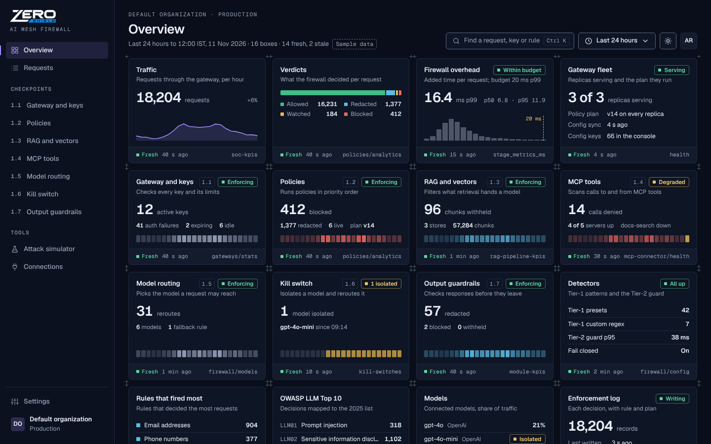
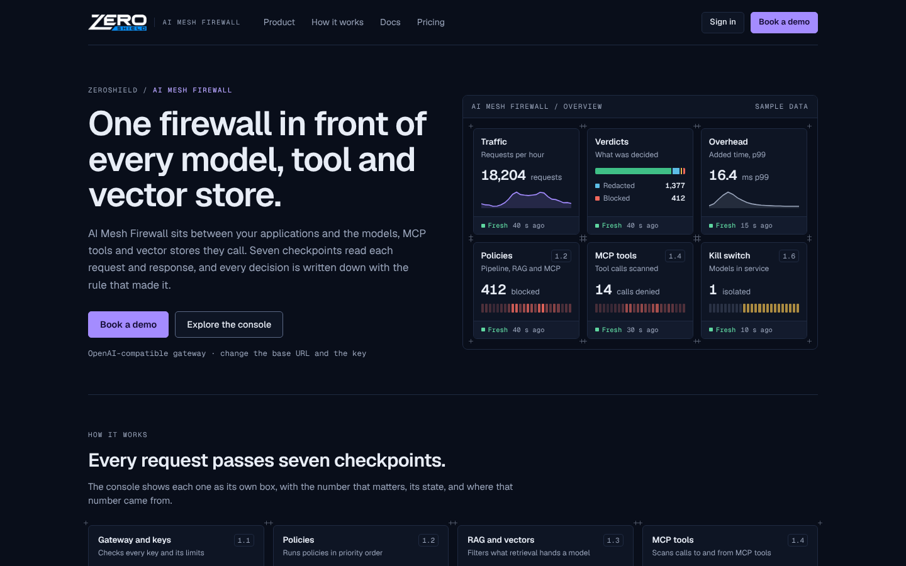
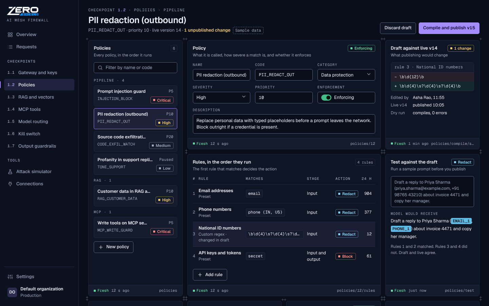
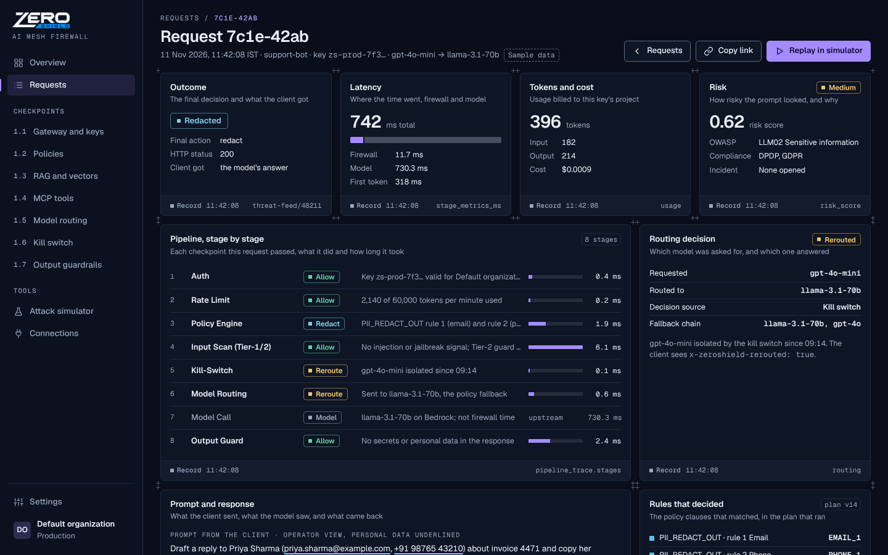
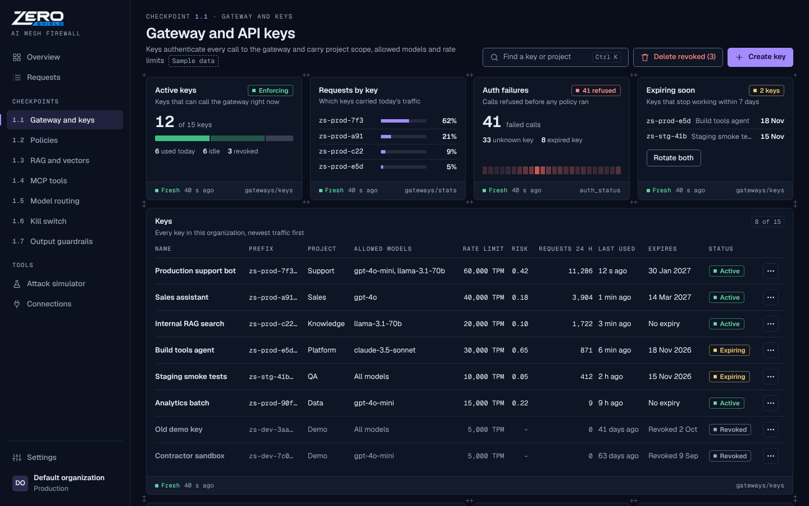
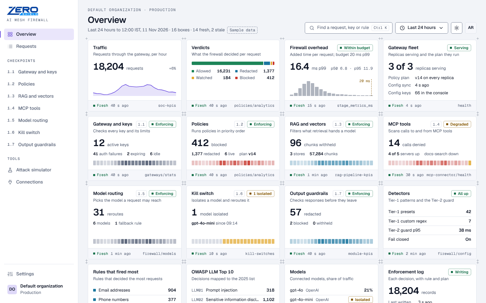

# F6: visual directions for the console and the public landing page

Status: **for the owner to pick. No redesign build starts until one is chosen** (owner decision, 11 Nov).
On 12 Nov the owner reviewed directions 1 to 3 and chose none of them. He pointed to the AI-DSPM
console as the style he wants, so **direction 4, Lattice, was added below and is the current
proposal**. Directions 1 to 3 stay in this file for the record.
Audit of the current UI: [AUDIT.md](AUDIT.md). Mockup source: [`directions/mockups/`](directions/mockups/).
Rendered screenshots: [`../2026-11-12-f6-directions/`](../2026-11-12-f6-directions/).

## Direction 4: Lattice (12 Nov, after the owner's feedback)

**The owner's brief, 12 Nov, in his words:** "check out this style https://aidspm.zeroshield.ai/app
… another project but I want similar designs. No notification or small tabs; by notification tab I
mean multiple small boxes on the same screen for different purposes." On clarification he chose:

- **Many small boxes.** The overview packs many small boxes side by side, each with its own purpose.
  There is no notification bell, no activity or notification feed, no "needs attention", "since you
  last looked" or "for review" lists, and no tab strips of small views.
- **Inspired, own identity.** Use the same calm, precise structure as AI-DSPM, but give AI Mesh
  Firewall its own accent colour and details. Do not clone AI-DSPM's blue or copy its components
  verbatim.

**Pitch: every checkpoint gets a box, every box says where its number came from.**

Why it fits: the overview is a strict lattice of 16 equal boxes on a 12-column grid: traffic,
verdicts, firewall overhead, gateway fleet, the seven checkpoints 1.1 to 1.7, detectors, top rules,
OWASP LLM Top 10, models and the enforcement log. Each box has three parts in a fixed order: a title,
a one-line purpose, and a source line naming the endpoint the number came from, how old it is, and
whether it is Fresh or Stale. An operator can scan the whole firewall at once. A reviewer can see
which numbers to trust.

- **Type:** Geist 400 to 700 for the interface and Geist Mono for IDs, eyebrows, endpoints and
  patterns. Scale 11 / 12 / 13.5 / 14 / 26 / 28 / 54, with mono labels at 10.5 to 11.5.
- **Palette (dark, primary):** page `#090E1A`, surfaces `#0E1524` / `#131B2D`, ink `#E8EDF6`.
  The single accent is **Lattice violet `#A48CFF`** (text `#B7A4FF`), used for brand, focus and the
  primary action. Verdicts are allow `#3FBF86`, redact `#5CBDE6`, monitor `#E9B949` and block
  `#F2685C`, each shown as a word with a square glyph. A light theme is included, with violet
  `#6B4FE0` as the accent.
- **Density:** high, but calm. At 1440x900, 12 boxes are fully in view and the fourth row starts
  above the fold. The radius is 6 px, surfaces are flat, and there are no shadows.
- **Signature:** registration ticks at every box corner, which form a "+" wherever four boxes meet
  and make the grid visible. Each checkpoint box also ends with a 24-hour cell strip (one cell per
  hour, coloured by the verdict that box decides).
- **Optimises for:** the owner's stated preference (the AI-DSPM family look) and a single scan of
  the whole firewall. It adds the two screens no earlier direction drew: request detail and gateway
  keys.

**Borrowed from AI-DSPM** (read from the Lovable source `src/styles.css`, `primitives.tsx`,
`source-data.tsx`, `navigation.ts`, and from the live demo):

- dark navy base with thin-bordered panels and no decoration
- monospace uppercase eyebrows above page titles
- a title, a one-line subtitle and a source footer on every panel
- compact status chips that always carry a word
- a left sidebar with icons, sections and utilities at the foot
- the ZeroShield wordmark (the company mark, used as is)

**Deliberately different:**

| | AI-DSPM | Lattice |
|---|---|---|
| Accent | sky blue `#38A8FF` (dark) / `#1D56DF` (light) | violet `#A48CFF` (dark) / `#6B4FE0` (light) |
| Type | Work Sans + JetBrains Mono (console); Sora + Manrope + IBM Plex Mono (site) | Geist + Geist Mono everywhere |
| Panels | larger radius, one wide panel per topic | 6 px radius; many equal boxes on one 12-column grid, with corner ticks |
| Source footer | "Source data · N stages · M systems · freshness bar · Show rows" | freshness word and age, plus the endpoint it came from (for example `policies/analytics`) |
| Chips | soft filled, round glyph | outlined, square glyph |
| Navigation | sections with tab strips under each page title | no tab strips: checkpoints by module ID in the sidebar, and policy types as groups in a list |
| Overview | a few large charts | 16 small boxes, 7 of them one per checkpoint |

**Screens.** Lattice draws five screens: the landing page, the console overview, the policy editor,
the request detail (today's `LogDetailPage`, "Scan Detail Report") and gateway and API keys (module
1.1, today's `GatewayKeyPanel`). Field names follow today's frontend and the v2 console inventory
(`docs/plans/evidence/2026-10-26-gw14b/`): `pipeline_trace.stages`, `stage_metrics_ms`,
`matched_rules`, `routing`, `plan_version`, `key_prefix`, `rate_limit_status`, `auth_status`, the
stage labels from `frontend/src/utils/pipelineTrace.js`, and the endpoints from the audit's route
map. The request detail page has a "Copy link" action because the redesign gives every view a real
URL (audit A-02, A-03).

| Console overview (desktop) | Landing (desktop) |
|---|---|
|  |  |
| **Policy editor (desktop)** | **Request detail (desktop)** |
|  |  |
| **Gateway and API keys (desktop)** | **Console overview, light theme** |
|  |  |

Next to AI-DSPM:
[overview](../2026-11-12-f6-directions/f6-compare-lattice-console.png),
[landing](../2026-11-12-f6-directions/f6-compare-lattice-landing.png),
[policy](../2026-11-12-f6-directions/f6-compare-lattice-policy.png),
[request detail](../2026-11-12-f6-directions/f6-compare-lattice-request.png),
[keys](../2026-11-12-f6-directions/f6-compare-lattice-keys.png).
AI-DSPM has no API-key page, so the keys comparison uses its Integrations page, the closest
equivalent. Mobile: `f6-lattice-<screen>-mobile.png` in the same folder.

**Trade-offs:** this is the closest to a page the owner already approved, so it carries the lowest
taste risk. The ZeroShield products will look like one family. It is the densest of the four, so
every box has to earn its place. The 16 boxes on the overview are a proposal and the owner can cut
them. The violet accent and Geist are new to the brand and need the owner's yes.

**Accessibility, verified.** `check-contrast.mjs` covers Lattice's 23 token pairs in both themes:
**46 pairs, 0 failures**. The full report now covers 184 pairs across 4 directions, with 0 failures.
A further 24 Lattice-only pairs pass, run with
`../2026-11-12-f6-directions/contrast_extra.py`: footer labels on the inset band, the active nav
fill, selected rows and the placeholder chip. axe-core 4.10.3 (`wcag2a`, `wcag2aa`, `wcag21aa`,
`best-practice`) reports **0 violations on 20 of 20 Lattice page variants**: 5 pages, 2 themes,
desktop and mobile. There is no horizontal scroll at 390 px.

---

## Directions 1 to 3 (11 Nov, not chosen; kept for the record)

Directions 1 to 3 render the **same three screens with the same content**, so the choice is about the
visual system only:

1. Public landing page (hero and first sections)
2. Console overview (the dashboard an operator opens first)
3. Policy and rules editor

Every screen was captured at desktop 1440x900 and mobile 390x844 (deviceScaleFactor 2), in the
direction's primary theme. The console overview is also captured in the other theme, because both
themes are production (PRODUCT.md, principle 5).

## What is the same in all three

Lattice (direction 4) keeps the shared data file, the verdict vocabulary and the token contract below.
Its navigation replaces "Audit log" with "Requests", the request log with a page per request.

- **Content and data.** One shared file, [`shared/sample-data.js`](directions/mockups/shared/sample-data.js),
  whose fields mirror the real control API (`soc-kpis`, `module-kpis`, `policies`, `policies/{id}/rules`,
  `owasp-stats`). Every console screen carries a visible "Sample data" marker, and the landing
  vignettes say "Example". No customer names, logos, certifications or performance claims are shown.
- **Proposed navigation.** Overview, Audit log, then the seven checkpoints keeping their module IDs
  (1.1 Gateway and keys, 1.2 Policies, 1.3 RAG and vectors, 1.4 MCP tools, 1.5 Model routing,
  1.6 Kill switch, 1.7 Output guardrails), then Tools (Attack simulator, Connections). "Inputs" is
  renamed "Connections" because that page holds model and database connections (audit finding A-08).
  This is a proposal to confirm; see the questions at the end.
- **Verdict vocabulary.** Four verdicts, always shown as a word plus a colour (never colour alone):
  allow, redact, monitor (shown as Watched / Flagged), block.
- **Token contract.** Each direction defines the same token names in
  [`tokens.mjs`](directions/mockups/tokens.mjs), so the pick maps 1:1 onto the app's existing semantic
  Tailwind tokens and the `components/ui/*` primitives keep their API (DESIGN.md contract):

  | Direction token | App token (`frontend/src/index.css`) |
  |---|---|
  | `page` | `--background` |
  | `surface`, `surface2`, `raised` | `--card` / `--surface-1`, `--surface-2` / `--muted`, `--popover` |
  | `ink`, `ink2` | `--foreground`, `--muted-foreground` |
  | `accent`, `onAccent` | `--primary`, `--primary-foreground` |
  | `control`, `line` | `--input`, `--border` |
  | `focus` | `--ring` |
  | `allow`, `monitor`, `block` (+ `*Ink`, `*Text`) | `--success`, `--warning`, `--destructive` (+ foregrounds) |
  | `redact` (+ `redactInk`, `redactText`) | new: `--redact` (the product's most common verdict has no token today) |
  | `nav`, `navInk`, `navInk2` | new: `--sidebar`, `--sidebar-foreground`, `--sidebar-muted` |

- **Accessibility, verified rather than asserted.**
  - [`check-contrast.mjs`](directions/mockups/check-contrast.mjs) checks 23 text and UI pairs per theme:
    body and secondary text on every surface at 4.5:1 or better, control borders and focus rings at 3:1
    or better (WCAG 1.4.11), labels on every verdict fill, verdict colours used as text. That is
    **138 pairs across 3 directions x 2 themes, 0 failures** (184 pairs with Lattice, still 0 failures)
    ([contrast-report.md](directions/mockups/contrast-report.md)).
  - axe-core 4.10.3 (rules `wcag2a`, `wcag2aa`, `wcag21aa`, `best-practice`) on every mockup page, both
    themes, desktop and mobile: **36 of 36 page variants report no violations**.
  - Charts use the `*Text` verdict colours, which clear 3:1 against the surface; the lighter fills are
    kept for labels and plates.
  - Every page has a `prefers-reduced-motion` fallback and a visible `:focus-visible` ring.
  - No horizontal scroll at 390px on any page (checked by `shoot.mjs`).

## Direction 1: Checkpoint

**Pitch: AI traffic is traffic. A wayfinding system where every verdict is a road sign and nothing else is.**

Why it fits: buyers on the landing page grasp "every request stops at a checkpoint" in one look, and
operators get a route board that maps one-to-one onto the seven modules they already know by number.
Sign plates (with the inset keyline of a real road sign) are used only for verdicts and checkpoint IDs,
so colour always means a decision. It is the most distinctive and brandable of the three.

- **Type:** Overpass 400 to 900 (its design descends from US highway signage lettering) with Overpass Mono
  for IDs, keys and patterns. Scale 13 / 14 / 16 / 20 / 25 / 32 / 44 / 64 / 96.
- **Palette (light, primary):** asphalt ink `#1B2124`, page `#ECEEEA`, guide green `#0B6A4C` (brand and allow),
  info blue `#1A56A0` (redact), caution `#F2B01E` (monitor), stop `#BF2A1D` (block). Dark theme included.
- **Signature:** the road in the landing hero (three requests passing overhead gantries) and the route
  board on the overview.
- **Trade-offs:** the boldest identity, and the highest risk of feeling loud if overused. Rules for
  restraint are built in: plates only for verdicts and IDs, everything else flat.

| Landing (desktop) | Console overview (desktop) |
|---|---|
|  |  |
| **Policy editor (desktop)** | **Console overview, dark theme** |
|  |  |

Mobile: [landing](directions/shots/checkpoint--landing--mobile.webp),
[console](directions/shots/checkpoint--console--mobile.webp),
[policy](directions/shots/checkpoint--policy--mobile.webp).
Full-length pages: [landing](directions/shots/checkpoint--landing--desktop--full.webp),
[console](directions/shots/checkpoint--console--desktop--full.webp),
[policy](directions/shots/checkpoint--policy--desktop--full.webp).

## Direction 2: Night Shift

**Pitch: built for the person on call at 3 a.m. Dark by default, dense, legible first, every verdict traceable.**

Why it fits: PRODUCT.md describes operators deciding and acting on live data in a dim SOC, wanting dense
and trustworthy surfaces. Atkinson Hyperlegible (designed by the Braille Institute for low-vision readers)
keeps `I l 1` and `O 0` distinct, which matters for key prefixes, request IDs and regex patterns. The
overview leads with what changed since you last looked, the kill switch state and open incidents; the
policy editor reviews a draft as a diff against the live version and tests it before publishing.

- **Type:** Atkinson Hyperlegible Next with Atkinson Hyperlegible Mono. Scale 13 / 15 / 18 / 22 / 26 / 38 / 56.
- **Palette (dark, primary):** midnight page `#0E1A2B`, surfaces `#13233A` / `#192C47`, ink `#EAF0F8`,
  ion blue `#7CC4FF` (accent and focus), mint `#52D6A6` (allow), lavender `#BBA3FF` (redact),
  amber `#F6C85F` (monitor), coral `#FF8173` (block). Light theme included.
- **Signature:** the request trace (landing hero) and the 15-minute verdict heat strip (overview).
  Verdict pills carry an icon and a word.
- **Trade-offs:** the closest to today's console (dark slate, dense), so the cheapest migration and the
  least risk for operators; also the least "marketing" landing page of the three.

| Landing (desktop) | Console overview (desktop) |
|---|---|
|  |  |
| **Policy editor (desktop)** | **Console overview, light theme** |
|  |  |

Mobile: [landing](directions/shots/night-shift--landing--mobile.webp),
[console](directions/shots/night-shift--console--mobile.webp) (bottom tab bar, kill switch first),
[policy](directions/shots/night-shift--policy--mobile.webp).
Full-length pages: [landing](directions/shots/night-shift--landing--desktop--full.webp),
[console](directions/shots/night-shift--console--desktop--full.webp),
[policy](directions/shots/night-shift--policy--desktop--full.webp).

## Direction 3: Redline

**Pitch: securing language is editing language. Prompts are marked up like a reviewed document, and policies read as numbered clauses.**

Why it fits: the firewall's actions are edits (redact, strike, flag), and the people who sign off on
it (compliance reviewers, AI-governance owners, buyers) read evidence. Redaction bars, strike-outs
and highlighter marks are the verdicts; the reviewer's margin note carries the rule that fired. The
overview opens with a short written brief bound to real numbers; the policy editor renders each rule
as a clause in priority order (numbering is honest here, because order decides the outcome), with
tracked changes before publishing.

- **Type:** Spectral (a screen-first serif designed for document reading) for headings and prose,
  Public Sans for interface text, JetBrains Mono for code. Scale 13 / 14 / 16 / 18 / 22 / 28 / 40 / 64.
- **Palette (light, primary):** desk `#E8ECF1`, sheet `#FFFFFF`, ink `#161D2B`, blue pencil `#2443C4`
  (accent), redaction bar `#161D2B`, strike red `#B3261E` (block), highlighter `#FFE27A` (monitor),
  green `#16704F` (allow). Dark theme included.
- **Signature:** the marked-up prompt with margin notes (landing hero), the morning brief (overview), the
  clause editor with tracked changes.
- **Trade-offs:** the strongest story for compliance buyers and auditors, and the calmest to read; the
  least dense, so operators see fewer numbers per screen than in Night Shift.

| Landing (desktop) | Console overview (desktop) |
|---|---|
|  |  |
| **Policy editor (desktop)** | **Console overview, dark theme** |
|  |  |

Mobile: [landing](directions/shots/redline--landing--mobile.webp),
[console](directions/shots/redline--console--mobile.webp),
[policy](directions/shots/redline--policy--mobile.webp).
Full-length pages: [landing](directions/shots/redline--landing--desktop--full.webp),
[console](directions/shots/redline--console--desktop--full.webp),
[policy](directions/shots/redline--policy--desktop--full.webp).

## Side by side

| | Lattice (12 Nov) | Checkpoint | Night Shift | Redline |
|---|---|---|---|---|
| Default theme | Dark | Light | Dark | Light |
| Density | High, boxed | Medium | High | Low to medium |
| Landing personality | Calm, product-led (AI-DSPM family) | Bold, memorable | Technical, calm | Editorial, evidential |
| Strongest for | The owner's stated style; scanning every checkpoint at once | Buyers, brand recognition | On-call operators, SREs | Compliance reviewers, auditors |
| Distance from today's UI | Medium (dark, dense, new grid) | Far | Near | Far |
| Screens drawn | 5 (adds request detail and keys) | 3 | 3 | 3 |
| Main risk | Too many boxes if they are not curated | Loud if plates spread beyond verdicts | Reads as "another dark console" on the landing page | Serif-led console may feel slow to power users |

**Superseded on 12 Nov:** the owner chose none of directions 1 to 3 and asked for the AI-DSPM style, which became Lattice.
The 11 Nov recommendation is kept for the record.

**Design lead's recommendation, 11 Nov (the owner decides):** Night Shift for the console, because it matches the
users and principles in PRODUCT.md most directly and migrates with the least risk. If the landing page
needs a stronger identity than Night Shift gives it, choose Checkpoint for both surfaces rather than
mixing two systems; its route board also works for operators.

## What happens after the pick (not started)

1. Tokens and primitives: write the chosen tokens into `frontend/src/index.css`, restyle `components/ui/*`
   (styles only, API unchanged), add `--redact` and sidebar tokens.
2. Shell and navigation: new sidebar and top bar, real URLs for every view (fixes A-02, A-03), a working
   search (A-04).
3. Page-by-page migration from raw palette classes to tokens (audit A-05 counts 9,651 raw palette
   classes), with screenshots per page for the owner.
4. Landing page as a public route or separate build (question 3 below).

Each step is its own PR with before/after screenshots.

## How to reproduce

```bash
cd docs/plans/evidence/2026-11-11-f6-frontend/directions/mockups
node build-tokens.mjs        # tokens.mjs -> */tokens.css
node check-contrast.mjs      # WCAG pairs, writes contrast-report.md, exit 1 on any failure
node shoot.mjs /tmp/shots    # Playwright screenshots (needs `playwright` resolvable)
```

The PNG evidence of 12 Nov (all four directions, plus Lattice next to AI-DSPM) was made with the Python
harness in `../2026-11-12-f6-directions/`. It uses headless Chrome and Python Playwright:

```bash
cd docs/plans/evidence/2026-11-12-f6-directions
python3 -I shoot.py ../2026-11-11-f6-frontend/directions/mockups <out> lattice   # or no name: all four
python3 -I ref_shoot.py <ref> https://aidspm.zeroshield.ai/app app               # AI-DSPM reference pages
python3 -I compare_ref.py <out> <ref> 1200 256                                   # Lattice next to AI-DSPM
python3 -I contrast_extra.py ../2026-11-11-f6-frontend/directions/mockups/lattice/tokens.css
python3 -I axe_lattice.py ../2026-11-11-f6-frontend/directions/mockups/lattice <axe.min.js>
```

The pages are plain HTML and CSS with a little inline JavaScript to render the sample data; open any
`*/landing.html`, `*/console.html` or `*/policy.html` (Lattice adds `request.html` and `keys.html`) directly in a browser. Add `?theme=dark` or
`?theme=light` to switch theme. Fonts load from Google Fonts.

## Questions for the owner

1. **Is Lattice the direction?** (12 Nov; the owner chose none of 1 to 3.) If yes, which of the 16 overview
   boxes stay, and is anything missing?
2. **Product name on the landing page.** The repo uses "ZeroShield", "AI Mesh Firewall", "ZeroShield AI Mesh
   Firewall" and "AI Security Platform" (sidebar). The mockups use "ZeroShield" with "AI Mesh Firewall"
   as the product line. Is that right, or should the landing page use the AISecShield name?
3. **Where does the landing page live?** A public route in this app (today `/` is the protected
   console), a separate static site, or a page on zeroshield.ai?
4. **Brand assets.** Is there an existing logo, wordmark or brand colour that must be kept? Directions 1 to 3
   use placeholder marks. Lattice uses the ZeroShield wordmark that the AI-DSPM console serves, with
   "AI Mesh Firewall" as the product line.
5. **Calls to action and pricing.** Is the primary CTA "Book a demo"? Should there be a pricing page, and
   is pricing public?
6. **Claims we may make.** The landing copy avoids performance numbers, customer names and certifications.
   Which claims are approved (for example deployment model "runs as containers in your environment",
   supported providers, latency figures), and who signs off copy?
7. **Navigation.** Keep the 1.1 to 1.7 module numbering in the console (all three mockups keep it), or move
   to task names only?
8. **Default theme.** DESIGN.md says the console defaults to dark; the code defaults to light (audit A-09).
   Which should ship? (Lattice is dark first, like AI-DSPM.)
9. **Lattice's own identity.** Is violet `#A48CFF` the AI Mesh Firewall accent, and Geist its typeface? Both
   were chosen to sit beside AI-DSPM's blue and Work Sans without copying them.
